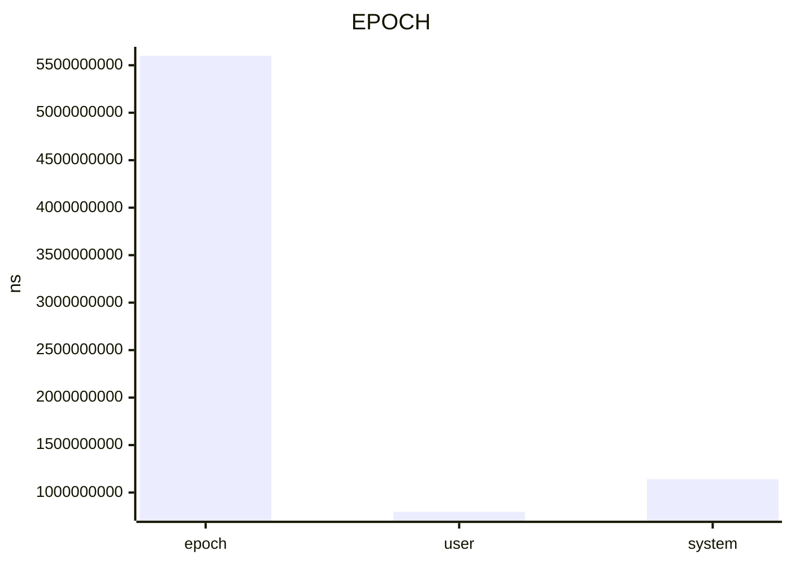

## epoch

+--------+-------+-------------+--------------------+-------------+-------------+-------+------+------------------------------------------+---------------+--------------------+-------------------+
| key    | type  | value       | errorPercent       | min         | max         | calls | unit | samples                                  | baseline      | change             | probability       |
+========+=======+=============+====================+=============+=============+=======+======+==========================================+===============+====================+===================+
| epoch  | float | 5.5999135e9 | 0.2178712224751329 | 5.5877129e9 | 5.6636309e9 | 1     | ns   | 5.6636309e9, 5.6132383e9, 5.5934257e9, 5 | 2.49415489e10 | -77.54785188982389 | 0.117185087198138 |
|        |       |             |                    |             |             |       |      | .5877129e9, 5.5999135e9                  |               |                    |                   |
+--------+-------+-------------+--------------------+-------------+-------------+-------+------+------------------------------------------+---------------+--------------------+-------------------+
| user   | float | 7.96875e8   | 7.84313725490196   | 7.03125e8   | 9.6875e8    | 1     | ns   | 7.03125e8, 9.6875e8, 7.65625e8, 7.96875e | 2.1453125e10  | -96.28550619082301 | 0.117185087198138 |
|        |       |             |                    |             |             |       |      | 8, 8.59375e8                             |               |                    |                   |
+--------+-------+-------------+--------------------+-------------+-------------+-------+------+------------------------------------------+---------------+--------------------+-------------------+
| system | float | 1.140625e9  | 16.43835616438356  | 9.375e8     | 1.34375e9   | 1     | ns   | 1.34375e9, 9.53125e8, 1.21875e9, 1.14062 | 1.78125e9     | -35.96491228070175 | 0.117185087198138 |
|        |       |             |                    |             |             |       |      | 5e9, 9.375e8                             |               |                    |                   |
+--------+-------+-------------+--------------------+-------------+-------------+-------+------+------------------------------------------+---------------+--------------------+-------------------+

