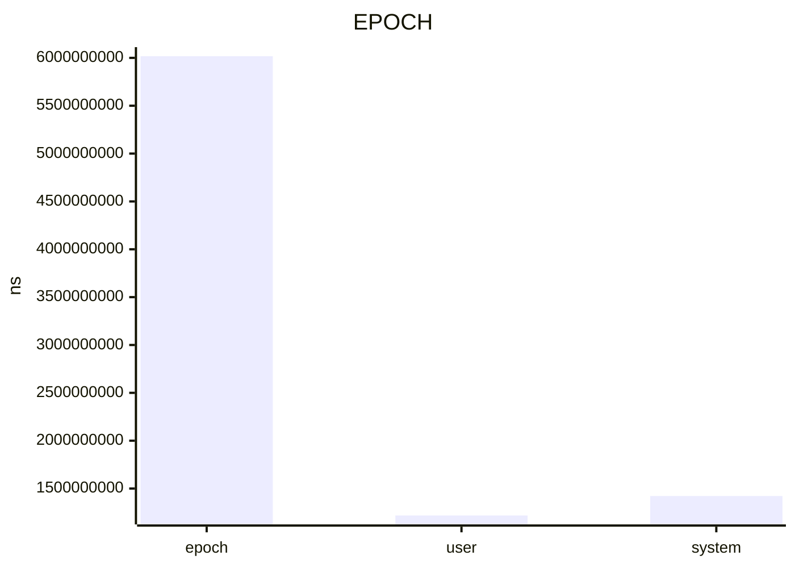

## epoch

+--------+-------+-------------+---------------------+------------+-------------+-------+------+------------------------------------------+---------------+--------------------+--------------------+
| key    | type  | value       | errorPercent        | min        | max         | calls | unit | samples                                  | baseline      | change             | probability        |
+========+=======+=============+=====================+============+=============+=======+======+==========================================+===============+====================+====================+
| epoch  | float | 6.0179845e9 | 0.07582438937820461 | 5.992334e9 | 6.0376079e9 | 1     | ns   | 6.0376079e9, 6.0225476e9, 5.992334e9, 6. | 2.49415489e10 | -75.87164885337174 | 0.117185087198138  |
|        |       |             |                     |            |             |       |      | 0142166e9, 6.0179845e9                   |               |                    |                    |
+--------+-------+-------------+---------------------+------------+-------------+-------+------+------------------------------------------+---------------+--------------------+--------------------+
| user   | float | 1.21875e9   | 6.41025641025641    | 1.03125e9  | 1.4375e9    | 1     | ns   | 1.03125e9, 1.4375e9, 1.28125e9, 1.21875e | 2.1453125e10  | -94.31900946831755 | 0.117185087198138  |
|        |       |             |                     |            |             |       |      | 9, 1.140625e9                            |               |                    |                    |
+--------+-------+-------------+---------------------+------------+-------------+-------+------+------------------------------------------+---------------+--------------------+--------------------+
| system | float | 1.421875e9  | 2.197802197802198   | 1.328125e9 | 1.515625e9  | 1     | ns   | 1.453125e9, 1.390625e9, 1.421875e9, 1.32 | 1.78125e9     | -20.17543859649123 | 0.1436720818069603 |
|        |       |             |                     |            |             |       |      | 8125e9, 1.515625e9                       |               |                    |                    |
+--------+-------+-------------+---------------------+------------+-------------+-------+------+------------------------------------------+---------------+--------------------+--------------------+

