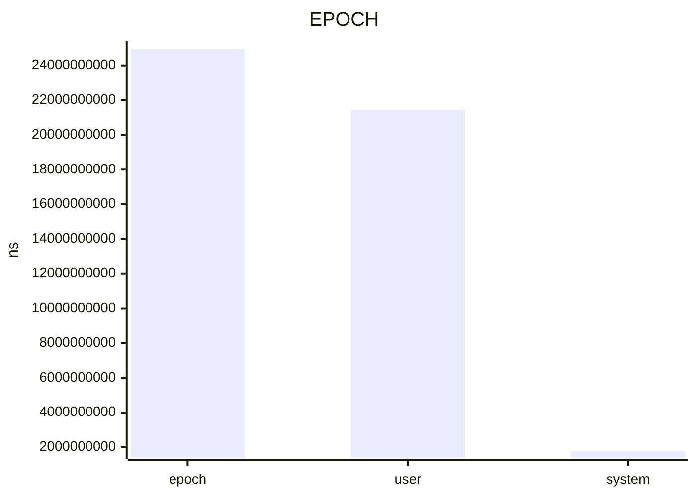

## epoch

+--------+-------+---------------+--------------------+---------------+---------------+-------+------+------------------------------------------+
| key    | type  | value         | errorPercent       | min           | max           | calls | unit | samples                                  |
+========+=======+===============+====================+===============+===============+=======+======+==========================================+
| epoch  | float | 2.49415489e10 | 0.1490649203426175 | 2.48307064e10 | 2.50086894e10 | 1     | ns   | 2.50086894e10, 2.49043698e10, 2.49511749 |
|        |       |               |                    |               |               |       |      | e10, 2.48307064e10, 2.49415489e10        |
+--------+-------+---------------+--------------------+---------------+---------------+-------+------+------------------------------------------+
| user   | float | 2.1453125e10  | 0.3641660597232338 | 2.1234375e10  | 2.1578125e10  | 1     | ns   | 2.1578125e10, 2.1375e10, 2.15e10, 2.1234 |
|        |       |               |                    |               |               |       |      | 375e10, 2.1453125e10                     |
+--------+-------+---------------+--------------------+---------------+---------------+-------+------+------------------------------------------+
| system | float | 1.78125e9     | 1.754385964912281  | 1.515625e9    | 1.953125e9    | 1     | ns   | 1.515625e9, 1.953125e9, 1.78125e9, 1.75e |
|        |       |               |                    |               |               |       |      | 9, 1.796875e9                            |
+--------+-------+---------------+--------------------+---------------+---------------+-------+------+------------------------------------------+

