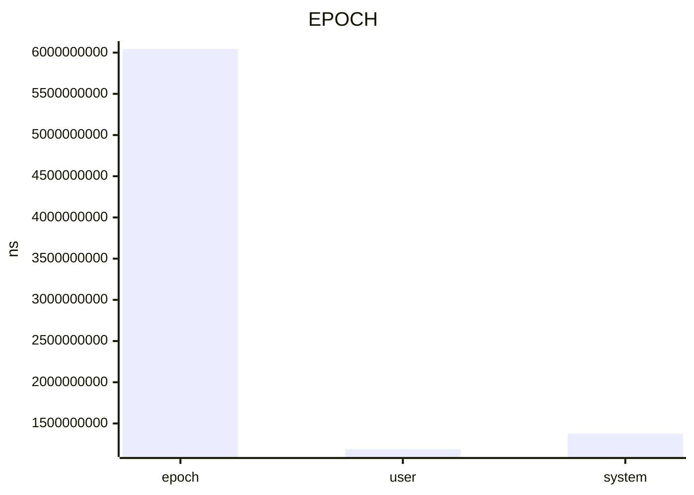

## epoch

+--------+-------+-------------+-------------------+-------------+-------------+-------+------+-----------------------------------------------------+---------------+--------------------+-------------------+
| key    | type  | value       | errorPercent      | min         | max         | calls | unit | samples                                             | baseline      | change             | probability       |
+========+=======+=============+===================+=============+=============+=======+======+=====================================================+===============+====================+===================+
| epoch  | float | 6.0450167e9 | 0.384685455045972 | 6.0104974e9 | 6.4131039e9 | 1     | ns   | 6.4131039e9, 6.0450167e9, 6.0104974e9, 6            | 2.49415489e10 | -75.76326665101381 | 0.117185087198138 |
|        |       |             |                   |             |             |       |      | .068271e9, 6.0370966e9                              |               |                    |                   |
+--------+-------+-------------+-------------------+-------------+-------------+-------+------+-----------------------------------------------------+---------------+--------------------+-------------------+
| user   | float | 1.1875e9    | 3.947368421052631 | 1.140625e9  | 1.265625e9  | 1     | ns   | 1.203125e9, 1.140625e9, 1.265625e9, 1.14            | 2.1453125e10  | -94.46467589220686 | 0.117185087198138 |
|        |       |             |                   |             |             |       |      | 0625e9, 1.1875e9                                    |               |                    |                   |
+--------+-------+-------------+-------------------+-------------+-------------+-------+------+-----------------------------------------------------+---------------+--------------------+-------------------+
| system | float | 1.375e9     | 3.409090909090909 | 1.28125e9   | 1.453125e9  | 1     | ns   | 1.328125e9, 1.28125e9, 1.375e9, 1.375e9, 1.453125e9 | 1.78125e9     | -22.80701754385965 | 0.117185087198138 |
+--------+-------+-------------+-------------------+-------------+-------------+-------+------+-----------------------------------------------------+---------------+--------------------+-------------------+

