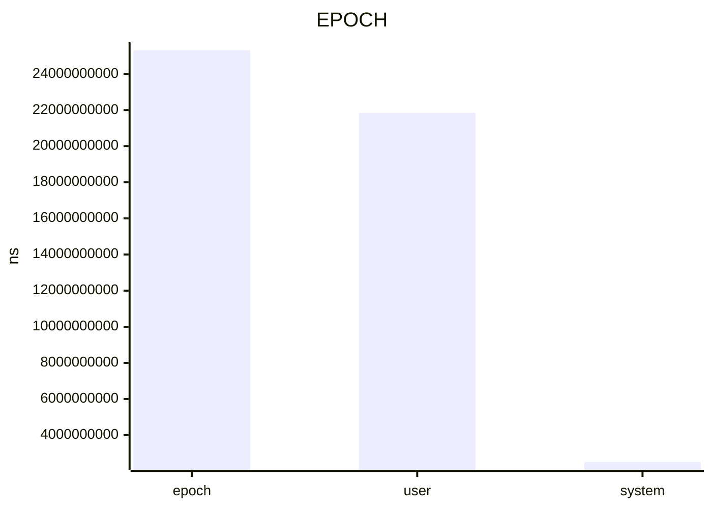

## epoch

+--------+-------+--------------+--------------+--------------+--------------+-------+------+--------------+
| key    | type  | value        | errorPercent | min          | max          | calls | unit | samples      |
+========+=======+==============+==============+==============+==============+=======+======+==============+
| epoch  | float | 2.5308192e10 | 0.0          | 2.5308192e10 | 2.5308192e10 | 1     | ns   | 2.5308192e10 |
+--------+-------+--------------+--------------+--------------+--------------+-------+------+--------------+
| user   | float | 2.184375e10  | 0.0          | 2.184375e10  | 2.184375e10  | 1     | ns   | 2.184375e10  |
+--------+-------+--------------+--------------+--------------+--------------+-------+------+--------------+
| system | float | 2.515625e9   | 0.0          | 2.515625e9   | 2.515625e9   | 1     | ns   | 2.515625e9   |
+--------+-------+--------------+--------------+--------------+--------------+-------+------+--------------+

## sample

+--------------------------------------------------------------------------------------------------------------------------------------------------------------------------------------------------------------------------------------------------------------------+-------+---------+--------------+---------+---------+-------+-------+---------+
| key                                                                                                                                                                                                                                                                | type  | value   | errorPercent | min     | max     | calls | unit  | samples |
+====================================================================================================================================================================================================================================================================+=======+=========+==============+=========+=========+=======+=======+=========+
| rtl get suite mask                                                                                                                                                                                                                                                 | float | 17572.0 | 0.0          | 17572.0 | 17572.0 | 1     | count | 17572   |
+--------------------------------------------------------------------------------------------------------------------------------------------------------------------------------------------------------------------------------------------------------------------+-------+---------+--------------+---------+---------+-------+-------+---------+
| rtl query wnf state data with explicit scope                                                                                                                                                                                                                       | float | 1833.0  | 0.0          | 1833.0  | 1833.0  | 1     | count | 1833    |
+--------------------------------------------------------------------------------------------------------------------------------------------------------------------------------------------------------------------------------------------------------------------+-------+---------+--------------+---------+---------+-------+-------+---------+
| rtl size heap                                                                                                                                                                                                                                                      | float | 21284.0 | 0.0          | 21284.0 | 21284.0 | 1     | count | 21284   |
+--------------------------------------------------------------------------------------------------------------------------------------------------------------------------------------------------------------------------------------------------------------------+-------+---------+--------------+---------+---------+-------+-------+---------+
| rtl allocate heap                                                                                                                                                                                                                                                  | float | 1849.0  | 0.0          | 1849.0  | 1849.0  | 1     | count | 1849    |
+--------------------------------------------------------------------------------------------------------------------------------------------------------------------------------------------------------------------------------------------------------------------+-------+---------+--------------+---------+---------+-------+-------+---------+
| tp alloc wait                                                                                                                                                                                                                                                      | float | 1.0     | 0.0          | 1.0     | 1.0     | 1     | count | 1       |
+--------------------------------------------------------------------------------------------------------------------------------------------------------------------------------------------------------------------------------------------------------------------+-------+---------+--------------+---------+---------+-------+-------+---------+
| rtl wow64 get shared info process                                                                                                                                                                                                                                  | float | 1.0     | 0.0          | 1.0     | 1.0     | 1     | count | 1       |
+--------------------------------------------------------------------------------------------------------------------------------------------------------------------------------------------------------------------------------------------------------------------+-------+---------+--------------+---------+---------+-------+-------+---------+
| rtl subscribe wnf state change notification                                                                                                                                                                                                                        | float | 8.0     | 0.0          | 8.0     | 8.0     | 1     | count | 8       |
+--------------------------------------------------------------------------------------------------------------------------------------------------------------------------------------------------------------------------------------------------------------------+-------+---------+--------------+---------+---------+-------+-------+---------+
| rtl query process lock information                                                                                                                                                                                                                                 | float | 8.0     | 0.0          | 8.0     | 8.0     | 1     | count | 8       |
+--------------------------------------------------------------------------------------------------------------------------------------------------------------------------------------------------------------------------------------------------------------------+-------+---------+--------------+---------+---------+-------+-------+---------+
| etw event write no registration                                                                                                                                                                                                                                    | float | 333.0   | 0.0          | 333.0   | 333.0   | 1     | count | 333     |
+--------------------------------------------------------------------------------------------------------------------------------------------------------------------------------------------------------------------------------------------------------------------+-------+---------+--------------+---------+---------+-------+-------+---------+
| ldr initialize thunk                                                                                                                                                                                                                                               | float | 339.0   | 0.0          | 339.0   | 339.0   | 1     | count | 339     |
+--------------------------------------------------------------------------------------------------------------------------------------------------------------------------------------------------------------------------------------------------------------------+-------+---------+--------------+---------+---------+-------+-------+---------+
| rtl release SRW lock exclusive                                                                                                                                                                                                                                     | float | 89.0    | 0.0          | 89.0    | 89.0    | 1     | count | 89      |
+--------------------------------------------------------------------------------------------------------------------------------------------------------------------------------------------------------------------------------------------------------------------+-------+---------+--------------+---------+---------+-------+-------+---------+
| rtl append unicode string to string                                                                                                                                                                                                                                | float | 158.0   | 0.0          | 158.0   | 158.0   | 1     | count | 158     |
+--------------------------------------------------------------------------------------------------------------------------------------------------------------------------------------------------------------------------------------------------------------------+-------+---------+--------------+---------+---------+-------+-------+---------+
| rtl deactivate activation context unsafe fast                                                                                                                                                                                                                      | float | 46.0    | 0.0          | 46.0    | 46.0    | 1     | count | 46      |
+--------------------------------------------------------------------------------------------------------------------------------------------------------------------------------------------------------------------------------------------------------------------+-------+---------+--------------+---------+---------+-------+-------+---------+
| ldr get dll handle ex                                                                                                                                                                                                                                              | float | 291.0   | 0.0          | 291.0   | 291.0   | 1     | count | 291     |
+--------------------------------------------------------------------------------------------------------------------------------------------------------------------------------------------------------------------------------------------------------------------+-------+---------+--------------+---------+---------+-------+-------+---------+
| ldr load dll                                                                                                                                                                                                                                                       | float | 197.0   | 0.0          | 197.0   | 197.0   | 1     | count | 197     |
+--------------------------------------------------------------------------------------------------------------------------------------------------------------------------------------------------------------------------------------------------------------------+-------+---------+--------------+---------+---------+-------+-------+---------+
| rtl dos search path U                                                                                                                                                                                                                                              | float | 49.0    | 0.0          | 49.0    | 49.0    | 1     | count | 49      |
+--------------------------------------------------------------------------------------------------------------------------------------------------------------------------------------------------------------------------------------------------------------------+-------+---------+--------------+---------+---------+-------+-------+---------+
| nt device io control file                                                                                                                                                                                                                                          | float | 21.0    | 0.0          | 21.0    | 21.0    | 1     | count | 21      |
+--------------------------------------------------------------------------------------------------------------------------------------------------------------------------------------------------------------------------------------------------------------------+-------+---------+--------------+---------+---------+-------+-------+---------+
| attach console                                                                                                                                                                                                                                                     | float | 2.0     | 0.0          | 2.0     | 2.0     | 1     | count | 2       |
+--------------------------------------------------------------------------------------------------------------------------------------------------------------------------------------------------------------------------------------------------------------------+-------+---------+--------------+---------+---------+-------+-------+---------+
| lstrcmp W                                                                                                                                                                                                                                                          | float | 11.0    | 0.0          | 11.0    | 11.0    | 1     | count | 11      |
+--------------------------------------------------------------------------------------------------------------------------------------------------------------------------------------------------------------------------------------------------------------------+-------+---------+--------------+---------+---------+-------+-------+---------+
| create process internal W                                                                                                                                                                                                                                          | float | 149.0   | 0.0          | 149.0   | 149.0   | 1     | count | 149     |
+--------------------------------------------------------------------------------------------------------------------------------------------------------------------------------------------------------------------------------------------------------------------+-------+---------+--------------+---------+---------+-------+-------+---------+
| rtl wow64 suspend thread                                                                                                                                                                                                                                           | float | 237.0   | 0.0          | 237.0   | 237.0   | 1     | count | 237     |
+--------------------------------------------------------------------------------------------------------------------------------------------------------------------------------------------------------------------------------------------------------------------+-------+---------+--------------+---------+---------+-------+-------+---------+
| rtl raise exception                                                                                                                                                                                                                                                | float | 319.0   | 0.0          | 319.0   | 319.0   | 1     | count | 319     |
+--------------------------------------------------------------------------------------------------------------------------------------------------------------------------------------------------------------------------------------------------------------------+-------+---------+--------------+---------+---------+-------+-------+---------+
| rtl delete element generic table avl ex                                                                                                                                                                                                                            | float | 181.0   | 0.0          | 181.0   | 181.0   | 1     | count | 181     |
+--------------------------------------------------------------------------------------------------------------------------------------------------------------------------------------------------------------------------------------------------------------------+-------+---------+--------------+---------+---------+-------+-------+---------+
| ldr get procedure address for caller                                                                                                                                                                                                                               | float | 299.0   | 0.0          | 299.0   | 299.0   | 1     | count | 299     |
+--------------------------------------------------------------------------------------------------------------------------------------------------------------------------------------------------------------------------------------------------------------------+-------+---------+--------------+---------+---------+-------+-------+---------+
| ldr unload dll                                                                                                                                                                                                                                                     | float | 173.0   | 0.0          | 173.0   | 173.0   | 1     | count | 173     |
+--------------------------------------------------------------------------------------------------------------------------------------------------------------------------------------------------------------------------------------------------------------------+-------+---------+--------------+---------+---------+-------+-------+---------+
| rtl init code page table                                                                                                                                                                                                                                           | float | 2.0     | 0.0          | 2.0     | 2.0     | 1     | count | 2       |
+--------------------------------------------------------------------------------------------------------------------------------------------------------------------------------------------------------------------------------------------------------------------+-------+---------+--------------+---------+---------+-------+-------+---------+
| rtl real predecessor                                                                                                                                                                                                                                               | float | 5.0     | 0.0          | 5.0     | 5.0     | 1     | count | 5       |
+--------------------------------------------------------------------------------------------------------------------------------------------------------------------------------------------------------------------------------------------------------------------+-------+---------+--------------+---------+---------+-------+-------+---------+
| rtl valid acl                                                                                                                                                                                                                                                      | float | 128.0   | 0.0          | 128.0   | 128.0   | 1     | count | 128     |
+--------------------------------------------------------------------------------------------------------------------------------------------------------------------------------------------------------------------------------------------------------------------+-------+---------+--------------+---------+---------+-------+-------+---------+
| nt create semaphore                                                                                                                                                                                                                                                | float | 4.0     | 0.0          | 4.0     | 4.0     | 1     | count | 4       |
+--------------------------------------------------------------------------------------------------------------------------------------------------------------------------------------------------------------------------------------------------------------------+-------+---------+--------------+---------+---------+-------+-------+---------+
| create semaphore ex W                                                                                                                                                                                                                                              | float | 7.0     | 0.0          | 7.0     | 7.0     | 1     | count | 7       |
+--------------------------------------------------------------------------------------------------------------------------------------------------------------------------------------------------------------------------------------------------------------------+-------+---------+--------------+---------+---------+-------+-------+---------+
| clear comm error                                                                                                                                                                                                                                                   | float | 4.0     | 0.0          | 4.0     | 4.0     | 1     | count | 4       |
+--------------------------------------------------------------------------------------------------------------------------------------------------------------------------------------------------------------------------------------------------------------------+-------+---------+--------------+---------+---------+-------+-------+---------+
| arm feature usage subscriber flush notification                                                                                                                                                                                                                    | float | 7.0     | 0.0          | 7.0     | 7.0     | 1     | count | 7       |
+--------------------------------------------------------------------------------------------------------------------------------------------------------------------------------------------------------------------------------------------------------------------+-------+---------+--------------+---------+---------+-------+-------+---------+
| get locale info helper                                                                                                                                                                                                                                             | float | 7.0     | 0.0          | 7.0     | 7.0     | 1     | count | 7       |
+--------------------------------------------------------------------------------------------------------------------------------------------------------------------------------------------------------------------------------------------------------------------+-------+---------+--------------+---------+---------+-------+-------+---------+
| get application restart settings                                                                                                                                                                                                                                   | float | 8.0     | 0.0          | 8.0     | 8.0     | 1     | count | 8       |
+--------------------------------------------------------------------------------------------------------------------------------------------------------------------------------------------------------------------------------------------------------------------+-------+---------+--------------+---------+---------+-------+-------+---------+
| nt protect virtual memory                                                                                                                                                                                                                                          | float | 16.0    | 0.0          | 16.0    | 16.0    | 1     | count | 16      |
+--------------------------------------------------------------------------------------------------------------------------------------------------------------------------------------------------------------------------------------------------------------------+-------+---------+--------------+---------+---------+-------+-------+---------+
| virtual protect                                                                                                                                                                                                                                                    | float | 2.0     | 0.0          | 2.0     | 2.0     | 1     | count | 2       |
+--------------------------------------------------------------------------------------------------------------------------------------------------------------------------------------------------------------------------------------------------------------------+-------+---------+--------------+---------+---------+-------+-------+---------+
| wcscat s                                                                                                                                                                                                                                                           | float | 4.0     | 0.0          | 4.0     | 4.0     | 1     | count | 4       |
+--------------------------------------------------------------------------------------------------------------------------------------------------------------------------------------------------------------------------------------------------------------------+-------+---------+--------------+---------+---------+-------+-------+---------+
| lock locales                                                                                                                                                                                                                                                       | float | 1.0     | 0.0          | 1.0     | 1.0     | 1     | count | 1       |
+--------------------------------------------------------------------------------------------------------------------------------------------------------------------------------------------------------------------------------------------------------------------+-------+---------+--------------+---------+---------+-------+-------+---------+
| std::locale:: init                                                                                                                                                                                                                                                 | float | 1.0     | 0.0          | 1.0     | 1.0     | 1     | count | 1       |
+--------------------------------------------------------------------------------------------------------------------------------------------------------------------------------------------------------------------------------------------------------------------+-------+---------+--------------+---------+---------+-------+-------+---------+
| std::basic streambuf unsigned short std::char traits unsigned short ::basic streambuf unsigned short std::char traits unsigned short                                                                                                                               | float | 1.0     | 0.0          | 1.0     | 1.0     | 1     | count | 1       |
+--------------------------------------------------------------------------------------------------------------------------------------------------------------------------------------------------------------------------------------------------------------------+-------+---------+--------------+---------+---------+-------+-------+---------+
| std::ios base::setf                                                                                                                                                                                                                                                | float | 1.0     | 0.0          | 1.0     | 1.0     | 1     | count | 1       |
+--------------------------------------------------------------------------------------------------------------------------------------------------------------------------------------------------------------------------------------------------------------------+-------+---------+--------------+---------+---------+-------+-------+---------+
| initterm                                                                                                                                                                                                                                                           | float | 15.0    | 0.0          | 15.0    | 15.0    | 1     | count | 15      |
+--------------------------------------------------------------------------------------------------------------------------------------------------------------------------------------------------------------------------------------------------------------------+-------+---------+--------------+---------+---------+-------+-------+---------+
| std:: locinfo:: getfalse                                                                                                                                                                                                                                           | float | 5.0     | 0.0          | 5.0     | 5.0     | 1     | count | 5       |
+--------------------------------------------------------------------------------------------------------------------------------------------------------------------------------------------------------------------------------------------------------------------+-------+---------+--------------+---------+---------+-------+-------+---------+
| strncpy                                                                                                                                                                                                                                                            | float | 6.0     | 0.0          | 6.0     | 6.0     | 1     | count | 6       |
+--------------------------------------------------------------------------------------------------------------------------------------------------------------------------------------------------------------------------------------------------------------------+-------+---------+--------------+---------+---------+-------+-------+---------+
| rtl image directory entry to data                                                                                                                                                                                                                                  | float | 83.0    | 0.0          | 83.0    | 83.0    | 1     | count | 83      |
+--------------------------------------------------------------------------------------------------------------------------------------------------------------------------------------------------------------------------------------------------------------------+-------+---------+--------------+---------+---------+-------+-------+---------+
| ldr resolve delay loaded API                                                                                                                                                                                                                                       | float | 97.0    | 0.0          | 97.0    | 97.0    | 1     | count | 97      |
+--------------------------------------------------------------------------------------------------------------------------------------------------------------------------------------------------------------------------------------------------------------------+-------+---------+--------------+---------+---------+-------+-------+---------+
| conhost exe                                                                                                                                                                                                                                                        | float | 38.0    | 0.0          | 38.0    | 38.0    | 1     | count | 38      |
+--------------------------------------------------------------------------------------------------------------------------------------------------------------------------------------------------------------------------------------------------------------------+-------+---------+--------------+---------+---------+-------+-------+---------+
| base thread init thunk                                                                                                                                                                                                                                             | float | 22282.0 | 0.0          | 22282.0 | 22282.0 | 1     | count | 22282   |
+--------------------------------------------------------------------------------------------------------------------------------------------------------------------------------------------------------------------------------------------------------------------+-------+---------+--------------+---------+---------+-------+-------+---------+
| rtl user thread start                                                                                                                                                                                                                                              | float | 22282.0 | 0.0          | 22282.0 | 22282.0 | 1     | count | 22282   |
+--------------------------------------------------------------------------------------------------------------------------------------------------------------------------------------------------------------------------------------------------------------------+-------+---------+--------------+---------+---------+-------+-------+---------+
| zw trace control                                                                                                                                                                                                                                                   | float | 19.0    | 0.0          | 19.0    | 19.0    | 1     | count | 19      |
+--------------------------------------------------------------------------------------------------------------------------------------------------------------------------------------------------------------------------------------------------------------------+-------+---------+--------------+---------+---------+-------+-------+---------+
| rtl nt status to dos error                                                                                                                                                                                                                                         | float | 21.0    | 0.0          | 21.0    | 21.0    | 1     | count | 21      |
+--------------------------------------------------------------------------------------------------------------------------------------------------------------------------------------------------------------------------------------------------------------------+-------+---------+--------------+---------+---------+-------+-------+---------+
| etw notification register                                                                                                                                                                                                                                          | float | 22.0    | 0.0          | 22.0    | 22.0    | 1     | count | 22      |
+--------------------------------------------------------------------------------------------------------------------------------------------------------------------------------------------------------------------------------------------------------------------+-------+---------+--------------+---------+---------+-------+-------+---------+
| etw event register                                                                                                                                                                                                                                                 | float | 20.0    | 0.0          | 20.0    | 20.0    | 1     | count | 20      |
+--------------------------------------------------------------------------------------------------------------------------------------------------------------------------------------------------------------------------------------------------------------------+-------+---------+--------------+---------+---------+-------+-------+---------+
| query service config2 W                                                                                                                                                                                                                                            | float | 2.0     | 0.0          | 2.0     | 2.0     | 1     | count | 2       |
+--------------------------------------------------------------------------------------------------------------------------------------------------------------------------------------------------------------------------------------------------------------------+-------+---------+--------------+---------+---------+-------+-------+---------+
| local get string for condition                                                                                                                                                                                                                                     | float | 3.0     | 0.0          | 3.0     | 3.0     | 1     | count | 3       |
+--------------------------------------------------------------------------------------------------------------------------------------------------------------------------------------------------------------------------------------------------------------------+-------+---------+--------------+---------+---------+-------+-------+---------+
| rtl leave critical section                                                                                                                                                                                                                                         | float | 70.0    | 0.0          | 70.0    | 70.0    | 1     | count | 70      |
+--------------------------------------------------------------------------------------------------------------------------------------------------------------------------------------------------------------------------------------------------------------------+-------+---------+--------------+---------+---------+-------+-------+---------+
| rtl add growable function table                                                                                                                                                                                                                                    | float | 5.0     | 0.0          | 5.0     | 5.0     | 1     | count | 5       |
+--------------------------------------------------------------------------------------------------------------------------------------------------------------------------------------------------------------------------------------------------------------------+-------+---------+--------------+---------+---------+-------+-------+---------+
| rtl avl insert node ex                                                                                                                                                                                                                                             | float | 12.0    | 0.0          | 12.0    | 12.0    | 1     | count | 12      |
+--------------------------------------------------------------------------------------------------------------------------------------------------------------------------------------------------------------------------------------------------------------------+-------+---------+--------------+---------+---------+-------+-------+---------+
| load library ex W                                                                                                                                                                                                                                                  | float | 163.0   | 0.0          | 163.0   | 163.0   | 1     | count | 163     |
+--------------------------------------------------------------------------------------------------------------------------------------------------------------------------------------------------------------------------------------------------------------------+-------+---------+--------------+---------+---------+-------+-------+---------+
| rtl locate extended feature2                                                                                                                                                                                                                                       | float | 175.0   | 0.0          | 175.0   | 175.0   | 1     | count | 175     |
+--------------------------------------------------------------------------------------------------------------------------------------------------------------------------------------------------------------------------------------------------------------------+-------+---------+--------------+---------+---------+-------+-------+---------+
| tp callback may run long                                                                                                                                                                                                                                           | float | 419.0   | 0.0          | 419.0   | 419.0   | 1     | count | 419     |
+--------------------------------------------------------------------------------------------------------------------------------------------------------------------------------------------------------------------------------------------------------------------+-------+---------+--------------+---------+---------+-------+-------+---------+
| alpc get message from completion list                                                                                                                                                                                                                              | float | 30.0    | 0.0          | 30.0    | 30.0    | 1     | count | 30      |
+--------------------------------------------------------------------------------------------------------------------------------------------------------------------------------------------------------------------------------------------------------------------+-------+---------+--------------+---------+---------+-------+-------+---------+
| user32 initialize imm entry table                                                                                                                                                                                                                                  | float | 14.0    | 0.0          | 14.0    | 14.0    | 1     | count | 14      |
+--------------------------------------------------------------------------------------------------------------------------------------------------------------------------------------------------------------------------------------------------------------------+-------+---------+--------------+---------+---------+-------+-------+---------+
| exit windows ex                                                                                                                                                                                                                                                    | float | 25.0    | 0.0          | 25.0    | 25.0    | 1     | count | 25      |
+--------------------------------------------------------------------------------------------------------------------------------------------------------------------------------------------------------------------------------------------------------------------+-------+---------+--------------+---------+---------+-------+-------+---------+
| rect visible                                                                                                                                                                                                                                                       | float | 4.0     | 0.0          | 4.0     | 4.0     | 1     | count | 4       |
+--------------------------------------------------------------------------------------------------------------------------------------------------------------------------------------------------------------------------------------------------------------------+-------+---------+--------------+---------+---------+-------+-------+---------+
| get DC org ex                                                                                                                                                                                                                                                      | float | 1.0     | 0.0          | 1.0     | 1.0     | 1     | count | 1       |
+--------------------------------------------------------------------------------------------------------------------------------------------------------------------------------------------------------------------------------------------------------------------+-------+---------+--------------+---------+---------+-------+-------+---------+
| get stock object                                                                                                                                                                                                                                                   | float | 1.0     | 0.0          | 1.0     | 1.0     | 1     | count | 1       |
+--------------------------------------------------------------------------------------------------------------------------------------------------------------------------------------------------------------------------------------------------------------------+-------+---------+--------------+---------+---------+-------+-------+---------+
| ctx init user32                                                                                                                                                                                                                                                    | float | 1.0     | 0.0          | 1.0     | 1.0     | 1     | count | 1       |
+--------------------------------------------------------------------------------------------------------------------------------------------------------------------------------------------------------------------------------------------------------------------+-------+---------+--------------+---------+---------+-------+-------+---------+
| client thread setup                                                                                                                                                                                                                                                | float | 2.0     | 0.0          | 2.0     | 2.0     | 1     | count | 2       |
+--------------------------------------------------------------------------------------------------------------------------------------------------------------------------------------------------------------------------------------------------------------------+-------+---------+--------------+---------+---------+-------+-------+---------+
| update layered window                                                                                                                                                                                                                                              | float | 2.0     | 0.0          | 2.0     | 2.0     | 1     | count | 2       |
+--------------------------------------------------------------------------------------------------------------------------------------------------------------------------------------------------------------------------------------------------------------------+-------+---------+--------------+---------+---------+-------+-------+---------+
| ki user callback dispatcher                                                                                                                                                                                                                                        | float | 81.0    | 0.0          | 81.0    | 81.0    | 1     | count | 81      |
+--------------------------------------------------------------------------------------------------------------------------------------------------------------------------------------------------------------------------------------------------------------------+-------+---------+--------------+---------+---------+-------+-------+---------+
| nt gdi init2                                                                                                                                                                                                                                                       | float | 7.0     | 0.0          | 7.0     | 7.0     | 1     | count | 7       |
+--------------------------------------------------------------------------------------------------------------------------------------------------------------------------------------------------------------------------------------------------------------------+-------+---------+--------------+---------+---------+-------+-------+---------+
| set brush attributes                                                                                                                                                                                                                                               | float | 7.0     | 0.0          | 7.0     | 7.0     | 1     | count | 7       |
+--------------------------------------------------------------------------------------------------------------------------------------------------------------------------------------------------------------------------------------------------------------------+-------+---------+--------------+---------+---------+-------+-------+---------+
| create color space W                                                                                                                                                                                                                                               | float | 7.0     | 0.0          | 7.0     | 7.0     | 1     | count | 7       |
+--------------------------------------------------------------------------------------------------------------------------------------------------------------------------------------------------------------------------------------------------------------------+-------+---------+--------------+---------+---------+-------+-------+---------+
| gdi dll initialize                                                                                                                                                                                                                                                 | float | 9.0     | 0.0          | 9.0     | 9.0     | 1     | count | 9       |
+--------------------------------------------------------------------------------------------------------------------------------------------------------------------------------------------------------------------------------------------------------------------+-------+---------+--------------+---------+---------+-------+-------+---------+
| nt map view of section                                                                                                                                                                                                                                             | float | 39.0    | 0.0          | 39.0    | 39.0    | 1     | count | 39      |
+--------------------------------------------------------------------------------------------------------------------------------------------------------------------------------------------------------------------------------------------------------------------+-------+---------+--------------+---------+---------+-------+-------+---------+
| rtl insert element generic table full avl                                                                                                                                                                                                                          | float | 94.0    | 0.0          | 94.0    | 94.0    | 1     | count | 94      |
+--------------------------------------------------------------------------------------------------------------------------------------------------------------------------------------------------------------------------------------------------------------------+-------+---------+--------------+---------+---------+-------+-------+---------+
| nt user load user api hook                                                                                                                                                                                                                                         | float | 4.0     | 0.0          | 4.0     | 4.0     | 1     | count | 4       |
+--------------------------------------------------------------------------------------------------------------------------------------------------------------------------------------------------------------------------------------------------------------------+-------+---------+--------------+---------+---------+-------+-------+---------+
| get system metrics                                                                                                                                                                                                                                                 | float | 4.0     | 0.0          | 4.0     | 4.0     | 1     | count | 4       |
+--------------------------------------------------------------------------------------------------------------------------------------------------------------------------------------------------------------------------------------------------------------------+-------+---------+--------------+---------+---------+-------+-------+---------+
| nt close                                                                                                                                                                                                                                                           | float | 90.0    | 0.0          | 90.0    | 90.0    | 1     | count | 90      |
+--------------------------------------------------------------------------------------------------------------------------------------------------------------------------------------------------------------------------------------------------------------------+-------+---------+--------------+---------+---------+-------+-------+---------+
| get final path name by handle W                                                                                                                                                                                                                                    | float | 39.0    | 0.0          | 39.0    | 39.0    | 1     | count | 39      |
+--------------------------------------------------------------------------------------------------------------------------------------------------------------------------------------------------------------------------------------------------------------------+-------+---------+--------------+---------+---------+-------+-------+---------+
| private extract icons W                                                                                                                                                                                                                                            | float | 5.0     | 0.0          | 5.0     | 5.0     | 1     | count | 5       |
+--------------------------------------------------------------------------------------------------------------------------------------------------------------------------------------------------------------------------------------------------------------------+-------+---------+--------------+---------+---------+-------+-------+---------+
| nt gdi set DI bits to device internal                                                                                                                                                                                                                              | float | 1.0     | 0.0          | 1.0     | 1.0     | 1     | count | 1       |
+--------------------------------------------------------------------------------------------------------------------------------------------------------------------------------------------------------------------------------------------------------------------+-------+---------+--------------+---------+---------+-------+-------+---------+
| set DI bits to device                                                                                                                                                                                                                                              | float | 1.0     | 0.0          | 1.0     | 1.0     | 1     | count | 1       |
+--------------------------------------------------------------------------------------------------------------------------------------------------------------------------------------------------------------------------------------------------------------------+-------+---------+--------------+---------+---------+-------+-------+---------+
| set DI bits                                                                                                                                                                                                                                                        | float | 1.0     | 0.0          | 1.0     | 1.0     | 1     | count | 1       |
+--------------------------------------------------------------------------------------------------------------------------------------------------------------------------------------------------------------------------------------------------------------------+-------+---------+--------------+---------+---------+-------+-------+---------+
| create icon indirect                                                                                                                                                                                                                                               | float | 3.0     | 0.0          | 3.0     | 3.0     | 1     | count | 3       |
+--------------------------------------------------------------------------------------------------------------------------------------------------------------------------------------------------------------------------------------------------------------------+-------+---------+--------------+---------+---------+-------+-------+---------+
| copy icon                                                                                                                                                                                                                                                          | float | 1.0     | 0.0          | 1.0     | 1.0     | 1     | count | 1       |
+--------------------------------------------------------------------------------------------------------------------------------------------------------------------------------------------------------------------------------------------------------------------+-------+---------+--------------+---------+---------+-------+-------+---------+
| create icon from resource ex                                                                                                                                                                                                                                       | float | 1.0     | 0.0          | 1.0     | 1.0     | 1     | count | 1       |
+--------------------------------------------------------------------------------------------------------------------------------------------------------------------------------------------------------------------------------------------------------------------+-------+---------+--------------+---------+---------+-------+-------+---------+
| scroll window ex                                                                                                                                                                                                                                                   | float | 1.0     | 0.0          | 1.0     | 1.0     | 1     | count | 1       |
+--------------------------------------------------------------------------------------------------------------------------------------------------------------------------------------------------------------------------------------------------------------------+-------+---------+--------------+---------+---------+-------+-------+---------+
| get string table entry                                                                                                                                                                                                                                             | float | 2.0     | 0.0          | 2.0     | 2.0     | 1     | count | 2       |
+--------------------------------------------------------------------------------------------------------------------------------------------------------------------------------------------------------------------------------------------------------------------+-------+---------+--------------+---------+---------+-------+-------+---------+
| enum resource names ex W                                                                                                                                                                                                                                           | float | 2.0     | 0.0          | 2.0     | 2.0     | 1     | count | 2       |
+--------------------------------------------------------------------------------------------------------------------------------------------------------------------------------------------------------------------------------------------------------------------+-------+---------+--------------+---------+---------+-------+-------+---------+
| rtl UTF8 to unicode N                                                                                                                                                                                                                                              | float | 50.0    | 0.0          | 50.0    | 50.0    | 1     | count | 50      |
+--------------------------------------------------------------------------------------------------------------------------------------------------------------------------------------------------------------------------------------------------------------------+-------+---------+--------------+---------+---------+-------+-------+---------+
| nt user release DC                                                                                                                                                                                                                                                 | float | 1.0     | 0.0          | 1.0     | 1.0     | 1     | count | 1       |
+--------------------------------------------------------------------------------------------------------------------------------------------------------------------------------------------------------------------------------------------------------------------+-------+---------+--------------+---------+---------+-------+-------+---------+
| translate accelerator A                                                                                                                                                                                                                                            | float | 2.0     | 0.0          | 2.0     | 2.0     | 1     | count | 2       |
+--------------------------------------------------------------------------------------------------------------------------------------------------------------------------------------------------------------------------------------------------------------------+-------+---------+--------------+---------+---------+-------+-------+---------+
| nt user set process dpi awareness context                                                                                                                                                                                                                          | float | 3.0     | 0.0          | 3.0     | 3.0     | 1     | count | 3       |
+--------------------------------------------------------------------------------------------------------------------------------------------------------------------------------------------------------------------------------------------------------------------+-------+---------+--------------+---------+---------+-------+-------+---------+
| set process dpi awareness context                                                                                                                                                                                                                                  | float | 3.0     | 0.0          | 3.0     | 3.0     | 1     | count | 3       |
+--------------------------------------------------------------------------------------------------------------------------------------------------------------------------------------------------------------------------------------------------------------------+-------+---------+--------------+---------+---------+-------+-------+---------+
| sdb close database                                                                                                                                                                                                                                                 | float | 14.0    | 0.0          | 14.0    | 14.0    | 1     | count | 14      |
+--------------------------------------------------------------------------------------------------------------------------------------------------------------------------------------------------------------------------------------------------------------------+-------+---------+--------------+---------+---------+-------+-------+---------+
| SE COM lookup                                                                                                                                                                                                                                                      | float | 10.0    | 0.0          | 10.0    | 10.0    | 1     | count | 10      |
+--------------------------------------------------------------------------------------------------------------------------------------------------------------------------------------------------------------------------------------------------------------------+-------+---------+--------------+---------+---------+-------+-------+---------+
| ldr unlock loader lock                                                                                                                                                                                                                                             | float | 78.0    | 0.0          | 78.0    | 78.0    | 1     | count | 78      |
+--------------------------------------------------------------------------------------------------------------------------------------------------------------------------------------------------------------------------------------------------------------------+-------+---------+--------------+---------+---------+-------+-------+---------+
| nt query information by name                                                                                                                                                                                                                                       | float | 22.0    | 0.0          | 22.0    | 22.0    | 1     | count | 22      |
+--------------------------------------------------------------------------------------------------------------------------------------------------------------------------------------------------------------------------------------------------------------------+-------+---------+--------------+---------+---------+-------+-------+---------+
| sdb is tagref from local DB                                                                                                                                                                                                                                        | float | 8.0     | 0.0          | 8.0     | 8.0     | 1     | count | 8       |
+--------------------------------------------------------------------------------------------------------------------------------------------------------------------------------------------------------------------------------------------------------------------+-------+---------+--------------+---------+---------+-------+-------+---------+
| ordinal28                                                                                                                                                                                                                                                          | float | 13.0    | 0.0          | 13.0    | 13.0    | 1     | count | 13      |
+--------------------------------------------------------------------------------------------------------------------------------------------------------------------------------------------------------------------------------------------------------------------+-------+---------+--------------+---------+---------+-------+-------+---------+
| SE COM hook object                                                                                                                                                                                                                                                 | float | 19.0    | 0.0          | 19.0    | 19.0    | 1     | count | 19      |
+--------------------------------------------------------------------------------------------------------------------------------------------------------------------------------------------------------------------------------------------------------------------+-------+---------+--------------+---------+---------+-------+-------+---------+
| sdb init database ex                                                                                                                                                                                                                                               | float | 22.0    | 0.0          | 22.0    | 22.0    | 1     | count | 22      |
+--------------------------------------------------------------------------------------------------------------------------------------------------------------------------------------------------------------------------------------------------------------------+-------+---------+--------------+---------+---------+-------+-------+---------+
| SE initialize engine                                                                                                                                                                                                                                               | float | 49.0    | 0.0          | 49.0    | 49.0    | 1     | count | 49      |
+--------------------------------------------------------------------------------------------------------------------------------------------------------------------------------------------------------------------------------------------------------------------+-------+---------+--------------+---------+---------+-------+-------+---------+
| sdb find next string indexed tag                                                                                                                                                                                                                                   | float | 5.0     | 0.0          | 5.0     | 5.0     | 1     | count | 5       |
+--------------------------------------------------------------------------------------------------------------------------------------------------------------------------------------------------------------------------------------------------------------------+-------+---------+--------------+---------+---------+-------+-------+---------+
| sdb get next child                                                                                                                                                                                                                                                 | float | 7.0     | 0.0          | 7.0     | 7.0     | 1     | count | 7       |
+--------------------------------------------------------------------------------------------------------------------------------------------------------------------------------------------------------------------------------------------------------------------+-------+---------+--------------+---------+---------+-------+-------+---------+
| sdb find next tag                                                                                                                                                                                                                                                  | float | 8.0     | 0.0          | 8.0     | 8.0     | 1     | count | 8       |
+--------------------------------------------------------------------------------------------------------------------------------------------------------------------------------------------------------------------------------------------------------------------+-------+---------+--------------+---------+---------+-------+-------+---------+
| sdb tag ID to tag ref                                                                                                                                                                                                                                              | float | 9.0     | 0.0          | 9.0     | 9.0     | 1     | count | 9       |
+--------------------------------------------------------------------------------------------------------------------------------------------------------------------------------------------------------------------------------------------------------------------+-------+---------+--------------+---------+---------+-------+-------+---------+
| sdb find next tag ref                                                                                                                                                                                                                                              | float | 16.0    | 0.0          | 16.0    | 16.0    | 1     | count | 16      |
+--------------------------------------------------------------------------------------------------------------------------------------------------------------------------------------------------------------------------------------------------------------------+-------+---------+--------------+---------+---------+-------+-------+---------+
| SE dynamic shim                                                                                                                                                                                                                                                    | float | 69.0    | 0.0          | 69.0    | 69.0    | 1     | count | 69      |
+--------------------------------------------------------------------------------------------------------------------------------------------------------------------------------------------------------------------------------------------------------------------+-------+---------+--------------+---------+---------+-------+-------+---------+
| rtl release SRW lock shared                                                                                                                                                                                                                                        | float | 7.0     | 0.0          | 7.0     | 7.0     | 1     | count | 7       |
+--------------------------------------------------------------------------------------------------------------------------------------------------------------------------------------------------------------------------------------------------------------------+-------+---------+--------------+---------+---------+-------+-------+---------+
| ldr find entry for address                                                                                                                                                                                                                                         | float | 1.0     | 0.0          | 1.0     | 1.0     | 1     | count | 1       |
+--------------------------------------------------------------------------------------------------------------------------------------------------------------------------------------------------------------------------------------------------------------------+-------+---------+--------------+---------+---------+-------+-------+---------+
| SE dll loaded                                                                                                                                                                                                                                                      | float | 47.0    | 0.0          | 47.0    | 47.0    | 1     | count | 47      |
+--------------------------------------------------------------------------------------------------------------------------------------------------------------------------------------------------------------------------------------------------------------------+-------+---------+--------------+---------+---------+-------+-------+---------+
| cmd exe                                                                                                                                                                                                                                                            | float | 17.0    | 0.0          | 17.0    | 17.0    | 1     | count | 17      |
+--------------------------------------------------------------------------------------------------------------------------------------------------------------------------------------------------------------------------------------------------------------------+-------+---------+--------------+---------+---------+-------+-------+---------+
| rtl protect heap                                                                                                                                                                                                                                                   | float | 1.0     | 0.0          | 1.0     | 1.0     | 1     | count | 1       |
+--------------------------------------------------------------------------------------------------------------------------------------------------------------------------------------------------------------------------------------------------------------------+-------+---------+--------------+---------+---------+-------+-------+---------+
| rtl get full path name ustr ex                                                                                                                                                                                                                                     | float | 70.0    | 0.0          | 70.0    | 70.0    | 1     | count | 70      |
+--------------------------------------------------------------------------------------------------------------------------------------------------------------------------------------------------------------------------------------------------------------------+-------+---------+--------------+---------+---------+-------+-------+---------+
| zw open event                                                                                                                                                                                                                                                      | float | 1.0     | 0.0          | 1.0     | 1.0     | 1     | count | 1       |
+--------------------------------------------------------------------------------------------------------------------------------------------------------------------------------------------------------------------------------------------------------------------+-------+---------+--------------+---------+---------+-------+-------+---------+
| open event W                                                                                                                                                                                                                                                       | float | 1.0     | 0.0          | 1.0     | 1.0     | 1     | count | 1       |
+--------------------------------------------------------------------------------------------------------------------------------------------------------------------------------------------------------------------------------------------------------------------+-------+---------+--------------+---------+---------+-------+-------+---------+
| open event A                                                                                                                                                                                                                                                       | float | 1.0     | 0.0          | 1.0     | 1.0     | 1     | count | 1       |
+--------------------------------------------------------------------------------------------------------------------------------------------------------------------------------------------------------------------------------------------------------------------+-------+---------+--------------+---------+---------+-------+-------+---------+
| ordinal101                                                                                                                                                                                                                                                         | float | 5.0     | 0.0          | 5.0     | 5.0     | 1     | count | 5       |
+--------------------------------------------------------------------------------------------------------------------------------------------------------------------------------------------------------------------------------------------------------------------+-------+---------+--------------+---------+---------+-------+-------+---------+
| HRGN user free                                                                                                                                                                                                                                                     | float | 13.0    | 0.0          | 13.0    | 13.0    | 1     | count | 13      |
+--------------------------------------------------------------------------------------------------------------------------------------------------------------------------------------------------------------------------------------------------------------------+-------+---------+--------------+---------+---------+-------+-------+---------+
| experimental wldp query baseline security mode                                                                                                                                                                                                                     | float | 2.0     | 0.0          | 2.0     | 2.0     | 1     | count | 2       |
+--------------------------------------------------------------------------------------------------------------------------------------------------------------------------------------------------------------------------------------------------------------------+-------+---------+--------------+---------+---------+-------+-------+---------+
| wldp can execute file                                                                                                                                                                                                                                              | float | 2.0     | 0.0          | 2.0     | 2.0     | 1     | count | 2       |
+--------------------------------------------------------------------------------------------------------------------------------------------------------------------------------------------------------------------------------------------------------------------+-------+---------+--------------+---------+---------+-------+-------+---------+
| wldp is production configuration                                                                                                                                                                                                                                   | float | 2.0     | 0.0          | 2.0     | 2.0     | 1     | count | 2       |
+--------------------------------------------------------------------------------------------------------------------------------------------------------------------------------------------------------------------------------------------------------------------+-------+---------+--------------+---------+---------+-------+-------+---------+
| wldp get application setting boolean                                                                                                                                                                                                                               | float | 2.0     | 0.0          | 2.0     | 2.0     | 1     | count | 2       |
+--------------------------------------------------------------------------------------------------------------------------------------------------------------------------------------------------------------------------------------------------------------------+-------+---------+--------------+---------+---------+-------+-------+---------+
| wldp is allowed entry point                                                                                                                                                                                                                                        | float | 1.0     | 0.0          | 1.0     | 1.0     | 1     | count | 1       |
+--------------------------------------------------------------------------------------------------------------------------------------------------------------------------------------------------------------------------------------------------------------------+-------+---------+--------------+---------+---------+-------+-------+---------+
| rtl char to integer                                                                                                                                                                                                                                                | float | 60.0    | 0.0          | 60.0    | 60.0    | 1     | count | 60      |
+--------------------------------------------------------------------------------------------------------------------------------------------------------------------------------------------------------------------------------------------------------------------+-------+---------+--------------+---------+---------+-------+-------+---------+
| rtl create heap                                                                                                                                                                                                                                                    | float | 4.0     | 0.0          | 4.0     | 4.0     | 1     | count | 4       |
+--------------------------------------------------------------------------------------------------------------------------------------------------------------------------------------------------------------------------------------------------------------------+-------+---------+--------------+---------+---------+-------+-------+---------+
| heap create                                                                                                                                                                                                                                                        | float | 2.0     | 0.0          | 2.0     | 2.0     | 1     | count | 2       |
+--------------------------------------------------------------------------------------------------------------------------------------------------------------------------------------------------------------------------------------------------------------------+-------+---------+--------------+---------+---------+-------+-------+---------+
| get heap handle                                                                                                                                                                                                                                                    | float | 1.0     | 0.0          | 1.0     | 1.0     | 1     | count | 1       |
+--------------------------------------------------------------------------------------------------------------------------------------------------------------------------------------------------------------------------------------------------------------------+-------+---------+--------------+---------+---------+-------+-------+---------+
| wgetmainargs                                                                                                                                                                                                                                                       | float | 1.0     | 0.0          | 1.0     | 1.0     | 1     | count | 1       |
+--------------------------------------------------------------------------------------------------------------------------------------------------------------------------------------------------------------------------------------------------------------------+-------+---------+--------------+---------+---------+-------+-------+---------+
| wfindnexti64                                                                                                                                                                                                                                                       | float | 6.0     | 0.0          | 6.0     | 6.0     | 1     | count | 6       |
+--------------------------------------------------------------------------------------------------------------------------------------------------------------------------------------------------------------------------------------------------------------------+-------+---------+--------------+---------+---------+-------+-------+---------+
| zw open key                                                                                                                                                                                                                                                        | float | 35.0    | 0.0          | 35.0    | 35.0    | 1     | count | 35      |
+--------------------------------------------------------------------------------------------------------------------------------------------------------------------------------------------------------------------------------------------------------------------+-------+---------+--------------+---------+---------+-------+-------+---------+
| safer identify level                                                                                                                                                                                                                                               | float | 1.0     | 0.0          | 1.0     | 1.0     | 1     | count | 1       |
+--------------------------------------------------------------------------------------------------------------------------------------------------------------------------------------------------------------------------------------------------------------------+-------+---------+--------------+---------+---------+-------+-------+---------+
| safer worker                                                                                                                                                                                                                                                       | float | 1.0     | 0.0          | 1.0     | 1.0     | 1     | count | 1       |
+--------------------------------------------------------------------------------------------------------------------------------------------------------------------------------------------------------------------------------------------------------------------+-------+---------+--------------+---------+---------+-------+-------+---------+
| find first file ex W                                                                                                                                                                                                                                               | float | 4.0     | 0.0          | 4.0     | 4.0     | 1     | count | 4       |
+--------------------------------------------------------------------------------------------------------------------------------------------------------------------------------------------------------------------------------------------------------------------+-------+---------+--------------+---------+---------+-------+-------+---------+
| nt query directory file ex                                                                                                                                                                                                                                         | float | 2.0     | 0.0          | 2.0     | 2.0     | 1     | count | 2       |
+--------------------------------------------------------------------------------------------------------------------------------------------------------------------------------------------------------------------------------------------------------------------+-------+---------+--------------+---------+---------+-------+-------+---------+
| nt create file                                                                                                                                                                                                                                                     | float | 136.0   | 0.0          | 136.0   | 136.0   | 1     | count | 136     |
+--------------------------------------------------------------------------------------------------------------------------------------------------------------------------------------------------------------------------------------------------------------------+-------+---------+--------------+---------+---------+-------+-------+---------+
| get drive type W                                                                                                                                                                                                                                                   | float | 32.0    | 0.0          | 32.0    | 32.0    | 1     | count | 32      |
+--------------------------------------------------------------------------------------------------------------------------------------------------------------------------------------------------------------------------------------------------------------------+-------+---------+--------------+---------+---------+-------+-------+---------+
| create file W                                                                                                                                                                                                                                                      | float | 28.0    | 0.0          | 28.0    | 28.0    | 1     | count | 28      |
+--------------------------------------------------------------------------------------------------------------------------------------------------------------------------------------------------------------------------------------------------------------------+-------+---------+--------------+---------+---------+-------+-------+---------+
| sort get handle                                                                                                                                                                                                                                                    | float | 2.0     | 0.0          | 2.0     | 2.0     | 1     | count | 2       |
+--------------------------------------------------------------------------------------------------------------------------------------------------------------------------------------------------------------------------------------------------------------------+-------+---------+--------------+---------+---------+-------+-------+---------+
| compare string ex                                                                                                                                                                                                                                                  | float | 3.0     | 0.0          | 3.0     | 3.0     | 1     | count | 3       |
+--------------------------------------------------------------------------------------------------------------------------------------------------------------------------------------------------------------------------------------------------------------------+-------+---------+--------------+---------+---------+-------+-------+---------+
| zw create user process                                                                                                                                                                                                                                             | float | 26.0    | 0.0          | 26.0    | 26.0    | 1     | count | 26      |
+--------------------------------------------------------------------------------------------------------------------------------------------------------------------------------------------------------------------------------------------------------------------+-------+---------+--------------+---------+---------+-------+-------+---------+
| create process W                                                                                                                                                                                                                                                   | float | 120.0   | 0.0          | 120.0   | 120.0   | 1     | count | 120     |
+--------------------------------------------------------------------------------------------------------------------------------------------------------------------------------------------------------------------------------------------------------------------+-------+---------+--------------+---------+---------+-------+-------+---------+
| nt apphelp cache control                                                                                                                                                                                                                                           | float | 37.0    | 0.0          | 37.0    | 37.0    | 1     | count | 37      |
+--------------------------------------------------------------------------------------------------------------------------------------------------------------------------------------------------------------------------------------------------------------------+-------+---------+--------------+---------+---------+-------+-------+---------+
| basep query app compat                                                                                                                                                                                                                                             | float | 26.0    | 0.0          | 26.0    | 26.0    | 1     | count | 26      |
+--------------------------------------------------------------------------------------------------------------------------------------------------------------------------------------------------------------------------------------------------------------------+-------+---------+--------------+---------+---------+-------+-------+---------+
| rtl virtual unwind2                                                                                                                                                                                                                                                | float | 70.0    | 0.0          | 70.0    | 70.0    | 1     | count | 70      |
+--------------------------------------------------------------------------------------------------------------------------------------------------------------------------------------------------------------------------------------------------------------------+-------+---------+--------------+---------+---------+-------+-------+---------+
| rtl walk frame chain                                                                                                                                                                                                                                               | float | 62.0    | 0.0          | 62.0    | 62.0    | 1     | count | 62      |
+--------------------------------------------------------------------------------------------------------------------------------------------------------------------------------------------------------------------------------------------------------------------+-------+---------+--------------+---------+---------+-------+-------+---------+
| rtl capture stack back trace                                                                                                                                                                                                                                       | float | 62.0    | 0.0          | 62.0    | 62.0    | 1     | count | 62      |
+--------------------------------------------------------------------------------------------------------------------------------------------------------------------------------------------------------------------------------------------------------------------+-------+---------+--------------+---------+---------+-------+-------+---------+
| SE get proc address for caller                                                                                                                                                                                                                                     | float | 79.0    | 0.0          | 79.0    | 79.0    | 1     | count | 79      |
+--------------------------------------------------------------------------------------------------------------------------------------------------------------------------------------------------------------------------------------------------------------------+-------+---------+--------------+---------+---------+-------+-------+---------+
| ldr get procedure address                                                                                                                                                                                                                                          | float | 2.0     | 0.0          | 2.0     | 2.0     | 1     | count | 2       |
+--------------------------------------------------------------------------------------------------------------------------------------------------------------------------------------------------------------------------------------------------------------------+-------+---------+--------------+---------+---------+-------+-------+---------+
| base generate app compat data                                                                                                                                                                                                                                      | float | 2.0     | 0.0          | 2.0     | 2.0     | 1     | count | 2       |
+--------------------------------------------------------------------------------------------------------------------------------------------------------------------------------------------------------------------------------------------------------------------+-------+---------+--------------+---------+---------+-------+-------+---------+
| basep get app compat data                                                                                                                                                                                                                                          | float | 12.0    | 0.0          | 12.0    | 12.0    | 1     | count | 12      |
+--------------------------------------------------------------------------------------------------------------------------------------------------------------------------------------------------------------------------------------------------------------------+-------+---------+--------------+---------+---------+-------+-------+---------+
| rtl unsubscribe wnf state change notification                                                                                                                                                                                                                      | float | 6.0     | 0.0          | 6.0     | 6.0     | 1     | count | 6       |
+--------------------------------------------------------------------------------------------------------------------------------------------------------------------------------------------------------------------------------------------------------------------+-------+---------+--------------+---------+---------+-------+-------+---------+
| rtl create process parameters with template                                                                                                                                                                                                                        | float | 2.0     | 0.0          | 2.0     | 2.0     | 1     | count | 2       |
+--------------------------------------------------------------------------------------------------------------------------------------------------------------------------------------------------------------------------------------------------------------------+-------+---------+--------------+---------+---------+-------+-------+---------+
| rtl get callers address                                                                                                                                                                                                                                            | float | 3.0     | 0.0          | 3.0     | 3.0     | 1     | count | 3       |
+--------------------------------------------------------------------------------------------------------------------------------------------------------------------------------------------------------------------------------------------------------------------+-------+---------+--------------+---------+---------+-------+-------+---------+
| strlen                                                                                                                                                                                                                                                             | float | 9.0     | 0.0          | 9.0     | 9.0     | 1     | count | 9       |
+--------------------------------------------------------------------------------------------------------------------------------------------------------------------------------------------------------------------------------------------------------------------+-------+---------+--------------+---------+---------+-------+-------+---------+
| rtl upper char                                                                                                                                                                                                                                                     | float | 5.0     | 0.0          | 5.0     | 5.0     | 1     | count | 5       |
+--------------------------------------------------------------------------------------------------------------------------------------------------------------------------------------------------------------------------------------------------------------------+-------+---------+--------------+---------+---------+-------+-------+---------+
| SE COM hook interface                                                                                                                                                                                                                                              | float | 6.0     | 0.0          | 6.0     | 6.0     | 1     | count | 6       |
+--------------------------------------------------------------------------------------------------------------------------------------------------------------------------------------------------------------------------------------------------------------------+-------+---------+--------------+---------+---------+-------+-------+---------+
| ldr enumerate loaded modules                                                                                                                                                                                                                                       | float | 6.0     | 0.0          | 6.0     | 6.0     | 1     | count | 6       |
+--------------------------------------------------------------------------------------------------------------------------------------------------------------------------------------------------------------------------------------------------------------------+-------+---------+--------------+---------+---------+-------+-------+---------+
| sdb get binary tag data                                                                                                                                                                                                                                            | float | 18.0    | 0.0          | 18.0    | 18.0    | 1     | count | 18      |
+--------------------------------------------------------------------------------------------------------------------------------------------------------------------------------------------------------------------------------------------------------------------+-------+---------+--------------+---------+---------+-------+-------+---------+
| ordinal20                                                                                                                                                                                                                                                          | float | 13.0    | 0.0          | 13.0    | 13.0    | 1     | count | 13      |
+--------------------------------------------------------------------------------------------------------------------------------------------------------------------------------------------------------------------------------------------------------------------+-------+---------+--------------+---------+---------+-------+-------+---------+
| SE ldr entry removed                                                                                                                                                                                                                                               | float | 6.0     | 0.0          | 6.0     | 6.0     | 1     | count | 6       |
+--------------------------------------------------------------------------------------------------------------------------------------------------------------------------------------------------------------------------------------------------------------------+-------+---------+--------------+---------+---------+-------+-------+---------+
| SE process dying                                                                                                                                                                                                                                                   | float | 7.0     | 0.0          | 7.0     | 7.0     | 1     | count | 7       |
+--------------------------------------------------------------------------------------------------------------------------------------------------------------------------------------------------------------------------------------------------------------------+-------+---------+--------------+---------+---------+-------+-------+---------+
| SE WINRT hook object                                                                                                                                                                                                                                               | float | 8.0     | 0.0          | 8.0     | 8.0     | 1     | count | 8       |
+--------------------------------------------------------------------------------------------------------------------------------------------------------------------------------------------------------------------------------------------------------------------+-------+---------+--------------+---------+---------+-------+-------+---------+
| sdb init database                                                                                                                                                                                                                                                  | float | 8.0     | 0.0          | 8.0     | 8.0     | 1     | count | 8       |
+--------------------------------------------------------------------------------------------------------------------------------------------------------------------------------------------------------------------------------------------------------------------+-------+---------+--------------+---------+---------+-------+-------+---------+
| SE install before init                                                                                                                                                                                                                                             | float | 8.0     | 0.0          | 8.0     | 8.0     | 1     | count | 8       |
+--------------------------------------------------------------------------------------------------------------------------------------------------------------------------------------------------------------------------------------------------------------------+-------+---------+--------------+---------+---------+-------+-------+---------+
| rtl compute import table hash                                                                                                                                                                                                                                      | float | 5.0     | 0.0          | 5.0     | 5.0     | 1     | count | 5       |
+--------------------------------------------------------------------------------------------------------------------------------------------------------------------------------------------------------------------------------------------------------------------+-------+---------+--------------+---------+---------+-------+-------+---------+
| rtl get return address hijack target                                                                                                                                                                                                                               | float | 11.0    | 0.0          | 11.0    | 11.0    | 1     | count | 11      |
+--------------------------------------------------------------------------------------------------------------------------------------------------------------------------------------------------------------------------------------------------------------------+-------+---------+--------------+---------+---------+-------+-------+---------+
| ldr get dll handle by name                                                                                                                                                                                                                                         | float | 41.0    | 0.0          | 41.0    | 41.0    | 1     | count | 41      |
+--------------------------------------------------------------------------------------------------------------------------------------------------------------------------------------------------------------------------------------------------------------------+-------+---------+--------------+---------+---------+-------+-------+---------+
| free locale                                                                                                                                                                                                                                                        | float | 18.0    | 0.0          | 18.0    | 18.0    | 1     | count | 18      |
+--------------------------------------------------------------------------------------------------------------------------------------------------------------------------------------------------------------------------------------------------------------------+-------+---------+--------------+---------+---------+-------+-------+---------+
| towlower l                                                                                                                                                                                                                                                         | float | 10.0    | 0.0          | 10.0    | 10.0    | 1     | count | 10      |
+--------------------------------------------------------------------------------------------------------------------------------------------------------------------------------------------------------------------------------------------------------------------+-------+---------+--------------+---------+---------+-------+-------+---------+
| set errno                                                                                                                                                                                                                                                          | float | 6.0     | 0.0          | 6.0     | 6.0     | 1     | count | 6       |
+--------------------------------------------------------------------------------------------------------------------------------------------------------------------------------------------------------------------------------------------------------------------+-------+---------+--------------+---------+---------+-------+-------+---------+
| wctype                                                                                                                                                                                                                                                             | float | 2.0     | 0.0          | 2.0     | 2.0     | 1     | count | 2       |
+--------------------------------------------------------------------------------------------------------------------------------------------------------------------------------------------------------------------------------------------------------------------+-------+---------+--------------+---------+---------+-------+-------+---------+
| ftime64                                                                                                                                                                                                                                                            | float | 5.0     | 0.0          | 5.0     | 5.0     | 1     | count | 5       |
+--------------------------------------------------------------------------------------------------------------------------------------------------------------------------------------------------------------------------------------------------------------------+-------+---------+--------------+---------+---------+-------+-------+---------+
| sb select procedure                                                                                                                                                                                                                                                | float | 1.0     | 0.0          | 1.0     | 1.0     | 1     | count | 1       |
+--------------------------------------------------------------------------------------------------------------------------------------------------------------------------------------------------------------------------------------------------------------------+-------+---------+--------------+---------+---------+-------+-------+---------+
| reg close key                                                                                                                                                                                                                                                      | float | 7.0     | 0.0          | 7.0     | 7.0     | 1     | count | 7       |
+--------------------------------------------------------------------------------------------------------------------------------------------------------------------------------------------------------------------------------------------------------------------+-------+---------+--------------+---------+---------+-------+-------+---------+
| co disable call cancellation                                                                                                                                                                                                                                       | float | 1.0     | 0.0          | 1.0     | 1.0     | 1     | count | 1       |
+--------------------------------------------------------------------------------------------------------------------------------------------------------------------------------------------------------------------------------------------------------------------+-------+---------+--------------+---------+---------+-------+-------+---------+
| zw unmap view of section                                                                                                                                                                                                                                           | float | 6.0     | 0.0          | 6.0     | 6.0     | 1     | count | 6       |
+--------------------------------------------------------------------------------------------------------------------------------------------------------------------------------------------------------------------------------------------------------------------+-------+---------+--------------+---------+---------+-------+-------+---------+
| rtl get search path                                                                                                                                                                                                                                                | float | 2.0     | 0.0          | 2.0     | 2.0     | 1     | count | 2       |
+--------------------------------------------------------------------------------------------------------------------------------------------------------------------------------------------------------------------------------------------------------------------+-------+---------+--------------+---------+---------+-------+-------+---------+
| ldr get dll handle                                                                                                                                                                                                                                                 | float | 93.0    | 0.0          | 93.0    | 93.0    | 1     | count | 93      |
+--------------------------------------------------------------------------------------------------------------------------------------------------------------------------------------------------------------------------------------------------------------------+-------+---------+--------------+---------+---------+-------+-------+---------+
| get module handle W                                                                                                                                                                                                                                                | float | 88.0    | 0.0          | 88.0    | 88.0    | 1     | count | 88      |
+--------------------------------------------------------------------------------------------------------------------------------------------------------------------------------------------------------------------------------------------------------------------+-------+---------+--------------+---------+---------+-------+-------+---------+
| safe array alloc descriptor                                                                                                                                                                                                                                        | float | 2.0     | 0.0          | 2.0     | 2.0     | 1     | count | 2       |
+--------------------------------------------------------------------------------------------------------------------------------------------------------------------------------------------------------------------------------------------------------------------+-------+---------+--------------+---------+---------+-------+-------+---------+
| set error info                                                                                                                                                                                                                                                     | float | 3.0     | 0.0          | 3.0     | 3.0     | 1     | count | 3       |
+--------------------------------------------------------------------------------------------------------------------------------------------------------------------------------------------------------------------------------------------------------------------+-------+---------+--------------+---------+---------+-------+-------+---------+
| var weekday name                                                                                                                                                                                                                                                   | float | 2.0     | 0.0          | 2.0     | 2.0     | 1     | count | 2       |
+--------------------------------------------------------------------------------------------------------------------------------------------------------------------------------------------------------------------------------------------------------------------+-------+---------+--------------+---------+---------+-------+-------+---------+
| var UI8 from cy                                                                                                                                                                                                                                                    | float | 2.0     | 0.0          | 2.0     | 2.0     | 1     | count | 2       |
+--------------------------------------------------------------------------------------------------------------------------------------------------------------------------------------------------------------------------------------------------------------------+-------+---------+--------------+---------+---------+-------+-------+---------+
| nt query virtual memory                                                                                                                                                                                                                                            | float | 4.0     | 0.0          | 4.0     | 4.0     | 1     | count | 4       |
+--------------------------------------------------------------------------------------------------------------------------------------------------------------------------------------------------------------------------------------------------------------------+-------+---------+--------------+---------+---------+-------+-------+---------+
| get proc address                                                                                                                                                                                                                                                   | float | 87.0    | 0.0          | 87.0    | 87.0    | 1     | count | 87      |
+--------------------------------------------------------------------------------------------------------------------------------------------------------------------------------------------------------------------------------------------------------------------+-------+---------+--------------+---------+---------+-------+-------+---------+
| range map write                                                                                                                                                                                                                                                    | float | 1.0     | 0.0          | 1.0     | 1.0     | 1     | count | 1       |
+--------------------------------------------------------------------------------------------------------------------------------------------------------------------------------------------------------------------------------------------------------------------+-------+---------+--------------+---------+---------+-------+-------+---------+
| image rva to va                                                                                                                                                                                                                                                    | float | 1.0     | 0.0          | 1.0     | 1.0     | 1     | count | 1       |
+--------------------------------------------------------------------------------------------------------------------------------------------------------------------------------------------------------------------------------------------------------------------+-------+---------+--------------+---------+---------+-------+-------+---------+
| dbg help dll                                                                                                                                                                                                                                                       | float | 1.0     | 0.0          | 1.0     | 1.0     | 1     | count | 1       |
+--------------------------------------------------------------------------------------------------------------------------------------------------------------------------------------------------------------------------------------------------------------------+-------+---------+--------------+---------+---------+-------+-------+---------+
| zw query attributes file                                                                                                                                                                                                                                           | float | 59.0    | 0.0          | 59.0    | 59.0    | 1     | count | 59      |
+--------------------------------------------------------------------------------------------------------------------------------------------------------------------------------------------------------------------------------------------------------------------+-------+---------+--------------+---------+---------+-------+-------+---------+
| ordinal8                                                                                                                                                                                                                                                           | float | 41.0    | 0.0          | 41.0    | 41.0    | 1     | count | 41      |
+--------------------------------------------------------------------------------------------------------------------------------------------------------------------------------------------------------------------------------------------------------------------+-------+---------+--------------+---------+---------+-------+-------+---------+
| load library ex A                                                                                                                                                                                                                                                  | float | 10.0    | 0.0          | 10.0    | 10.0    | 1     | count | 10      |
+--------------------------------------------------------------------------------------------------------------------------------------------------------------------------------------------------------------------------------------------------------------------+-------+---------+--------------+---------+---------+-------+-------+---------+
| luv state                                                                                                                                                                                                                                                          | float | 94.0    | 0.0          | 94.0    | 94.0    | 1     | count | 94      |
+--------------------------------------------------------------------------------------------------------------------------------------------------------------------------------------------------------------------------------------------------------------------+-------+---------+--------------+---------+---------+-------+-------+---------+
| rtl run once execute once                                                                                                                                                                                                                                          | float | 14.0    | 0.0          | 14.0    | 14.0    | 1     | count | 14      |
+--------------------------------------------------------------------------------------------------------------------------------------------------------------------------------------------------------------------------------------------------------------------+-------+---------+--------------+---------+---------+-------+-------+---------+
| init once execute once                                                                                                                                                                                                                                             | float | 13.0    | 0.0          | 13.0    | 13.0    | 1     | count | 13      |
+--------------------------------------------------------------------------------------------------------------------------------------------------------------------------------------------------------------------------------------------------------------------+-------+---------+--------------+---------+---------+-------+-------+---------+
| loop init                                                                                                                                                                                                                                                          | float | 6.0     | 0.0          | 6.0     | 6.0     | 1     | count | 6       |
+--------------------------------------------------------------------------------------------------------------------------------------------------------------------------------------------------------------------------------------------------------------------+-------+---------+--------------+---------+---------+-------+-------+---------+
| event init                                                                                                                                                                                                                                                         | float | 7.0     | 0.0          | 7.0     | 7.0     | 1     | count | 7       |
+--------------------------------------------------------------------------------------------------------------------------------------------------------------------------------------------------------------------------------------------------------------------+-------+---------+--------------+---------+---------+-------+-------+---------+
| main                                                                                                                                                                                                                                                               | float | 94.0    | 0.0          | 94.0    | 94.0    | 1     | count | 94      |
+--------------------------------------------------------------------------------------------------------------------------------------------------------------------------------------------------------------------------------------------------------------------+-------+---------+--------------+---------+---------+-------+-------+---------+
| wcstombs                                                                                                                                                                                                                                                           | float | 64.0    | 0.0          | 64.0    | 64.0    | 1     | count | 64      |
+--------------------------------------------------------------------------------------------------------------------------------------------------------------------------------------------------------------------------------------------------------------------+-------+---------+--------------+---------+---------+-------+-------+---------+
| vsnprintf                                                                                                                                                                                                                                                          | float | 9.0     | 0.0          | 9.0     | 9.0     | 1     | count | 9       |
+--------------------------------------------------------------------------------------------------------------------------------------------------------------------------------------------------------------------------------------------------------------------+-------+---------+--------------+---------+---------+-------+-------+---------+
| rtl sleep condition variable CS                                                                                                                                                                                                                                    | float | 109.0   | 0.0          | 109.0   | 109.0   | 1     | count | 109     |
+--------------------------------------------------------------------------------------------------------------------------------------------------------------------------------------------------------------------------------------------------------------------+-------+---------+--------------+---------+---------+-------+-------+---------+
| power determine platform role                                                                                                                                                                                                                                      | float | 5.0     | 0.0          | 5.0     | 5.0     | 1     | count | 5       |
+--------------------------------------------------------------------------------------------------------------------------------------------------------------------------------------------------------------------------------------------------------------------+-------+---------+--------------+---------+---------+-------+-------+---------+
| power unregister from effective power mode notifications                                                                                                                                                                                                           | float | 5.0     | 0.0          | 5.0     | 5.0     | 1     | count | 5       |
+--------------------------------------------------------------------------------------------------------------------------------------------------------------------------------------------------------------------------------------------------------------------+-------+---------+--------------+---------+---------+-------+-------+---------+
| zw notify change key                                                                                                                                                                                                                                               | float | 4.0     | 0.0          | 4.0     | 4.0     | 1     | count | 4       |
+--------------------------------------------------------------------------------------------------------------------------------------------------------------------------------------------------------------------------------------------------------------------+-------+---------+--------------+---------+---------+-------+-------+---------+
| reg notify change key value                                                                                                                                                                                                                                        | float | 4.0     | 0.0          | 4.0     | 4.0     | 1     | count | 4       |
+--------------------------------------------------------------------------------------------------------------------------------------------------------------------------------------------------------------------------------------------------------------------+-------+---------+--------------+---------+---------+-------+-------+---------+
| get name info W                                                                                                                                                                                                                                                    | float | 1.0     | 0.0          | 1.0     | 1.0     | 1     | count | 1       |
+--------------------------------------------------------------------------------------------------------------------------------------------------------------------------------------------------------------------------------------------------------------------+-------+---------+--------------+---------+---------+-------+-------+---------+
| WSA socket W                                                                                                                                                                                                                                                       | float | 2.0     | 0.0          | 2.0     | 2.0     | 1     | count | 2       |
+--------------------------------------------------------------------------------------------------------------------------------------------------------------------------------------------------------------------------------------------------------------------+-------+---------+--------------+---------+---------+-------+-------+---------+
| getnameinfo                                                                                                                                                                                                                                                        | float | 7.0     | 0.0          | 7.0     | 7.0     | 1     | count | 7       |
+--------------------------------------------------------------------------------------------------------------------------------------------------------------------------------------------------------------------------------------------------------------------+-------+---------+--------------+---------+---------+-------+-------+---------+
| WSA startup                                                                                                                                                                                                                                                        | float | 5.0     | 0.0          | 5.0     | 5.0     | 1     | count | 5       |
+--------------------------------------------------------------------------------------------------------------------------------------------------------------------------------------------------------------------------------------------------------------------+-------+---------+--------------+---------+---------+-------+-------+---------+
| rtl get current directory U                                                                                                                                                                                                                                        | float | 16.0    | 0.0          | 16.0    | 16.0    | 1     | count | 16      |
+--------------------------------------------------------------------------------------------------------------------------------------------------------------------------------------------------------------------------------------------------------------------+-------+---------+--------------+---------+---------+-------+-------+---------+
| rtl dos search path ustr                                                                                                                                                                                                                                           | float | 10.0    | 0.0          | 10.0    | 10.0    | 1     | count | 10      |
+--------------------------------------------------------------------------------------------------------------------------------------------------------------------------------------------------------------------------------------------------------------------+-------+---------+--------------+---------+---------+-------+-------+---------+
| WSA close event                                                                                                                                                                                                                                                    | float | 4.0     | 0.0          | 4.0     | 4.0     | 1     | count | 4       |
+--------------------------------------------------------------------------------------------------------------------------------------------------------------------------------------------------------------------------------------------------------------------+-------+---------+--------------+---------+---------+-------+-------+---------+
| WSC enum protocols ex                                                                                                                                                                                                                                              | float | 2.0     | 0.0          | 2.0     | 2.0     | 1     | count | 2       |
+--------------------------------------------------------------------------------------------------------------------------------------------------------------------------------------------------------------------------------------------------------------------+-------+---------+--------------+---------+---------+-------+-------+---------+
| WSC enum protocols                                                                                                                                                                                                                                                 | float | 2.0     | 0.0          | 2.0     | 2.0     | 1     | count | 2       |
+--------------------------------------------------------------------------------------------------------------------------------------------------------------------------------------------------------------------------------------------------------------------+-------+---------+--------------+---------+---------+-------+-------+---------+
| NSP startup                                                                                                                                                                                                                                                        | float | 2.0     | 0.0          | 2.0     | 2.0     | 1     | count | 2       |
+--------------------------------------------------------------------------------------------------------------------------------------------------------------------------------------------------------------------------------------------------------------------+-------+---------+--------------+---------+---------+-------+-------+---------+
| mswsock dll                                                                                                                                                                                                                                                        | float | 2.0     | 0.0          | 2.0     | 2.0     | 1     | count | 2       |
+--------------------------------------------------------------------------------------------------------------------------------------------------------------------------------------------------------------------------------------------------------------------+-------+---------+--------------+---------+---------+-------+-------+---------+
| getsockopt                                                                                                                                                                                                                                                         | float | 2.0     | 0.0          | 2.0     | 2.0     | 1     | count | 2       |
+--------------------------------------------------------------------------------------------------------------------------------------------------------------------------------------------------------------------------------------------------------------------+-------+---------+--------------+---------+---------+-------+-------+---------+
| rtl find message                                                                                                                                                                                                                                                   | float | 11.0    | 0.0          | 11.0    | 11.0    | 1     | count | 11      |
+--------------------------------------------------------------------------------------------------------------------------------------------------------------------------------------------------------------------------------------------------------------------+-------+---------+--------------+---------+---------+-------+-------+---------+
| rtl load string                                                                                                                                                                                                                                                    | float | 4.0     | 0.0          | 4.0     | 4.0     | 1     | count | 4       |
+--------------------------------------------------------------------------------------------------------------------------------------------------------------------------------------------------------------------------------------------------------------------+-------+---------+--------------+---------+---------+-------+-------+---------+
| load string W                                                                                                                                                                                                                                                      | float | 2.0     | 0.0          | 2.0     | 2.0     | 1     | count | 2       |
+--------------------------------------------------------------------------------------------------------------------------------------------------------------------------------------------------------------------------------------------------------------------+-------+---------+--------------+---------+---------+-------+-------+---------+
| nt set information worker factory                                                                                                                                                                                                                                  | float | 1.0     | 0.0          | 1.0     | 1.0     | 1     | count | 1       |
+--------------------------------------------------------------------------------------------------------------------------------------------------------------------------------------------------------------------------------------------------------------------+-------+---------+--------------+---------+---------+-------+-------+---------+
| ldr add ref dll                                                                                                                                                                                                                                                    | float | 1.0     | 0.0          | 1.0     | 1.0     | 1     | count | 1       |
+--------------------------------------------------------------------------------------------------------------------------------------------------------------------------------------------------------------------------------------------------------------------+-------+---------+--------------+---------+---------+-------+-------+---------+
| unpack keydict                                                                                                                                                                                                                                                     | float | 1.0     | 0.0          | 1.0     | 1.0     | 1     | count | 1       |
+--------------------------------------------------------------------------------------------------------------------------------------------------------------------------------------------------------------------------------------------------------------------+-------+---------+--------------+---------+---------+-------+-------+---------+
| qsort                                                                                                                                                                                                                                                              | float | 3.0     | 0.0          | 3.0     | 3.0     | 1     | count | 3       |
+--------------------------------------------------------------------------------------------------------------------------------------------------------------------------------------------------------------------------------------------------------------------+-------+---------+--------------+---------+---------+-------+-------+---------+
| init normal cmds                                                                                                                                                                                                                                                   | float | 1.0     | 0.0          | 1.0     | 1.0     | 1     | count | 1       |
+--------------------------------------------------------------------------------------------------------------------------------------------------------------------------------------------------------------------------------------------------------------------+-------+---------+--------------+---------+---------+-------+-------+---------+
| early init                                                                                                                                                                                                                                                         | float | 17.0    | 0.0          | 17.0    | 17.0    | 1     | count | 17      |
+--------------------------------------------------------------------------------------------------------------------------------------------------------------------------------------------------------------------------------------------------------------------+-------+---------+--------------+---------+---------+-------+-------+---------+
| internal lcid to name                                                                                                                                                                                                                                              | float | 20.0    | 0.0          | 20.0    | 20.0    | 1     | count | 20      |
+--------------------------------------------------------------------------------------------------------------------------------------------------------------------------------------------------------------------------------------------------------------------+-------+---------+--------------+---------+---------+-------+-------+---------+
| get named locale hash node                                                                                                                                                                                                                                         | float | 19.0    | 0.0          | 19.0    | 19.0    | 1     | count | 19      |
+--------------------------------------------------------------------------------------------------------------------------------------------------------------------------------------------------------------------------------------------------------------------+-------+---------+--------------+---------+---------+-------+-------+---------+
| get locale info ex                                                                                                                                                                                                                                                 | float | 15.0    | 0.0          | 15.0    | 15.0    | 1     | count | 15      |
+--------------------------------------------------------------------------------------------------------------------------------------------------------------------------------------------------------------------------------------------------------------------+-------+---------+--------------+---------+---------+-------+-------+---------+
| getdrive                                                                                                                                                                                                                                                           | float | 16.0    | 0.0          | 16.0    | 16.0    | 1     | count | 16      |
+--------------------------------------------------------------------------------------------------------------------------------------------------------------------------------------------------------------------------------------------------------------------+-------+---------+--------------+---------+---------+-------+-------+---------+
| internal enum system locales                                                                                                                                                                                                                                       | float | 21.0    | 0.0          | 21.0    | 21.0    | 1     | count | 21      |
+--------------------------------------------------------------------------------------------------------------------------------------------------------------------------------------------------------------------------------------------------------------------+-------+---------+--------------+---------+---------+-------+-------+---------+
| enum system locales ex                                                                                                                                                                                                                                             | float | 20.0    | 0.0          | 20.0    | 20.0    | 1     | count | 20      |
+--------------------------------------------------------------------------------------------------------------------------------------------------------------------------------------------------------------------------------------------------------------------+-------+---------+--------------+---------+---------+-------+-------+---------+
| strncpy s                                                                                                                                                                                                                                                          | float | 16.0    | 0.0          | 16.0    | 16.0    | 1     | count | 16      |
+--------------------------------------------------------------------------------------------------------------------------------------------------------------------------------------------------------------------------------------------------------------------+-------+---------+--------------+---------+---------+-------+-------+---------+
| memcpy                                                                                                                                                                                                                                                             | float | 24.0    | 0.0          | 24.0    | 24.0    | 1     | count | 24      |
+--------------------------------------------------------------------------------------------------------------------------------------------------------------------------------------------------------------------------------------------------------------------+-------+---------+--------------+---------+---------+-------+-------+---------+
| setlocale                                                                                                                                                                                                                                                          | float | 17.0    | 0.0          | 17.0    | 17.0    | 1     | count | 17      |
+--------------------------------------------------------------------------------------------------------------------------------------------------------------------------------------------------------------------------------------------------------------------+-------+---------+--------------+---------+---------+-------+-------+---------+
| init locale                                                                                                                                                                                                                                                        | float | 16.0    | 0.0          | 16.0    | 16.0    | 1     | count | 16      |
+--------------------------------------------------------------------------------------------------------------------------------------------------------------------------------------------------------------------------------------------------------------------+-------+---------+--------------+---------+---------+-------+-------+---------+
| zw query value key                                                                                                                                                                                                                                                 | float | 10.0    | 0.0          | 10.0    | 10.0    | 1     | count | 10      |
+--------------------------------------------------------------------------------------------------------------------------------------------------------------------------------------------------------------------------------------------------------------------+-------+---------+--------------+---------+---------+-------+-------+---------+
| NLG return2                                                                                                                                                                                                                                                        | float | 2.0     | 0.0          | 2.0     | 2.0     | 1     | count | 2       |
+--------------------------------------------------------------------------------------------------------------------------------------------------------------------------------------------------------------------------------------------------------------------+-------+---------+--------------+---------+---------+-------+-------+---------+
| lua newstate                                                                                                                                                                                                                                                       | float | 4.0     | 0.0          | 4.0     | 4.0     | 1     | count | 4       |
+--------------------------------------------------------------------------------------------------------------------------------------------------------------------------------------------------------------------------------------------------------------------+-------+---------+--------------+---------+---------+-------+-------+---------+
| lua pushstring                                                                                                                                                                                                                                                     | float | 1.0     | 0.0          | 1.0     | 1.0     | 1     | count | 1       |
+--------------------------------------------------------------------------------------------------------------------------------------------------------------------------------------------------------------------------------------------------------------------+-------+---------+--------------+---------+---------+-------+-------+---------+
| luaopen luv                                                                                                                                                                                                                                                        | float | 1.0     | 0.0          | 1.0     | 1.0     | 1     | count | 1       |
+--------------------------------------------------------------------------------------------------------------------------------------------------------------------------------------------------------------------------------------------------------------------+-------+---------+--------------+---------+---------+-------+-------+---------+
| nlua get global ref count                                                                                                                                                                                                                                          | float | 9.0     | 0.0          | 9.0     | 9.0     | 1     | count | 9       |
+--------------------------------------------------------------------------------------------------------------------------------------------------------------------------------------------------------------------------------------------------------------------+-------+---------+--------------+---------+---------+-------+-------+---------+
| nlua init                                                                                                                                                                                                                                                          | float | 3.0     | 0.0          | 3.0     | 3.0     | 1     | count | 3       |
+--------------------------------------------------------------------------------------------------------------------------------------------------------------------------------------------------------------------------------------------------------------------+-------+---------+--------------+---------+---------+-------+-------+---------+
| wscanf s                                                                                                                                                                                                                                                           | float | 13.0    | 0.0          | 13.0    | 13.0    | 1     | count | 13      |
+--------------------------------------------------------------------------------------------------------------------------------------------------------------------------------------------------------------------------------------------------------------------+-------+---------+--------------+---------+---------+-------+-------+---------+
| lua loadx                                                                                                                                                                                                                                                          | float | 13.0    | 0.0          | 13.0    | 13.0    | 1     | count | 13      |
+--------------------------------------------------------------------------------------------------------------------------------------------------------------------------------------------------------------------------------------------------------------------+-------+---------+--------------+---------+---------+-------+-------+---------+
| lua51 dll                                                                                                                                                                                                                                                          | float | 70.0    | 0.0          | 70.0    | 70.0    | 1     | count | 70      |
+--------------------------------------------------------------------------------------------------------------------------------------------------------------------------------------------------------------------------------------------------------------------+-------+---------+--------------+---------+---------+-------+-------+---------+
| lua L loadbuffer                                                                                                                                                                                                                                                   | float | 6.0     | 0.0          | 6.0     | 6.0     | 1     | count | 6       |
+--------------------------------------------------------------------------------------------------------------------------------------------------------------------------------------------------------------------------------------------------------------------+-------+---------+--------------+---------+---------+-------+-------+---------+
| luaopen os                                                                                                                                                                                                                                                         | float | 20.0    | 0.0          | 20.0    | 20.0    | 1     | count | 20      |
+--------------------------------------------------------------------------------------------------------------------------------------------------------------------------------------------------------------------------------------------------------------------+-------+---------+--------------+---------+---------+-------+-------+---------+
| lua pcall                                                                                                                                                                                                                                                          | float | 70.0    | 0.0          | 70.0    | 70.0    | 1     | count | 70      |
+--------------------------------------------------------------------------------------------------------------------------------------------------------------------------------------------------------------------------------------------------------------------+-------+---------+--------------+---------+---------+-------+-------+---------+
| nlua pcall                                                                                                                                                                                                                                                         | float | 68.0    | 0.0          | 68.0    | 68.0    | 1     | count | 68      |
+--------------------------------------------------------------------------------------------------------------------------------------------------------------------------------------------------------------------------------------------------------------------+-------+---------+--------------+---------+---------+-------+-------+---------+
| nlua init defaults                                                                                                                                                                                                                                                 | float | 2.0     | 0.0          | 2.0     | 2.0     | 1     | count | 2       |
+--------------------------------------------------------------------------------------------------------------------------------------------------------------------------------------------------------------------------------------------------------------------+-------+---------+--------------+---------+---------+-------+-------+---------+
| errno                                                                                                                                                                                                                                                              | float | 2.0     | 0.0          | 2.0     | 2.0     | 1     | count | 2       |
+--------------------------------------------------------------------------------------------------------------------------------------------------------------------------------------------------------------------------------------------------------------------+-------+---------+--------------+---------+---------+-------+-------+---------+
| lua setlocal                                                                                                                                                                                                                                                       | float | 1.0     | 0.0          | 1.0     | 1.0     | 1     | count | 1       |
+--------------------------------------------------------------------------------------------------------------------------------------------------------------------------------------------------------------------------------------------------------------------+-------+---------+--------------+---------+---------+-------+-------+---------+
| device io control                                                                                                                                                                                                                                                  | float | 18.0    | 0.0          | 18.0    | 18.0    | 1     | count | 18      |
+--------------------------------------------------------------------------------------------------------------------------------------------------------------------------------------------------------------------------------------------------------------------+-------+---------+--------------+---------+---------+-------+-------+---------+
| get file information by name                                                                                                                                                                                                                                       | float | 16.0    | 0.0          | 16.0    | 16.0    | 1     | count | 16      |
+--------------------------------------------------------------------------------------------------------------------------------------------------------------------------------------------------------------------------------------------------------------------+-------+---------+--------------+---------+---------+-------+-------+---------+
| os fsync                                                                                                                                                                                                                                                           | float | 13.0    | 0.0          | 13.0    | 13.0    | 1     | count | 13      |
+--------------------------------------------------------------------------------------------------------------------------------------------------------------------------------------------------------------------------------------------------------------------+-------+---------+--------------+---------+---------+-------+-------+---------+
| addfile                                                                                                                                                                                                                                                            | float | 1.0     | 0.0          | 1.0     | 1.0     | 1     | count | 1       |
+--------------------------------------------------------------------------------------------------------------------------------------------------------------------------------------------------------------------------------------------------------------------+-------+---------+--------------+---------+---------+-------+-------+---------+
| gen expand wildcards                                                                                                                                                                                                                                               | float | 1.0     | 0.0          | 1.0     | 1.0     | 1     | count | 1       |
+--------------------------------------------------------------------------------------------------------------------------------------------------------------------------------------------------------------------------------------------------------------------+-------+---------+--------------+---------+---------+-------+-------+---------+
| do in path and pp                                                                                                                                                                                                                                                  | float | 1.0     | 0.0          | 1.0     | 1.0     | 1     | count | 1       |
+--------------------------------------------------------------------------------------------------------------------------------------------------------------------------------------------------------------------------------------------------------------------+-------+---------+--------------+---------+---------+-------+-------+---------+
| runtime search path validate                                                                                                                                                                                                                                       | float | 1.0     | 0.0          | 1.0     | 1.0     | 1     | count | 1       |
+--------------------------------------------------------------------------------------------------------------------------------------------------------------------------------------------------------------------------------------------------------------------+-------+---------+--------------+---------+---------+-------+-------+---------+
| runtime get named                                                                                                                                                                                                                                                  | float | 2.0     | 0.0          | 2.0     | 2.0     | 1     | count | 2       |
+--------------------------------------------------------------------------------------------------------------------------------------------------------------------------------------------------------------------------------------------------------------------+-------+---------+--------------+---------+---------+-------+-------+---------+
| open log file                                                                                                                                                                                                                                                      | float | 18.0    | 0.0          | 18.0    | 18.0    | 1     | count | 18      |
+--------------------------------------------------------------------------------------------------------------------------------------------------------------------------------------------------------------------------------------------------------------------+-------+---------+--------------+---------+---------+-------+-------+---------+
| nlua exec file                                                                                                                                                                                                                                                     | float | 66.0    | 0.0          | 66.0    | 66.0    | 1     | count | 66      |
+--------------------------------------------------------------------------------------------------------------------------------------------------------------------------------------------------------------------------------------------------------------------+-------+---------+--------------+---------+---------+-------+-------+---------+
| lua L loadfilex                                                                                                                                                                                                                                                    | float | 8.0     | 0.0          | 8.0     | 8.0     | 1     | count | 8       |
+--------------------------------------------------------------------------------------------------------------------------------------------------------------------------------------------------------------------------------------------------------------------+-------+---------+--------------+---------+---------+-------+-------+---------+
| lua L unref                                                                                                                                                                                                                                                        | float | 8.0     | 0.0          | 8.0     | 8.0     | 1     | count | 8       |
+--------------------------------------------------------------------------------------------------------------------------------------------------------------------------------------------------------------------------------------------------------------------+-------+---------+--------------+---------+---------+-------+-------+---------+
| os can exe                                                                                                                                                                                                                                                         | float | 12.0    | 0.0          | 12.0    | 12.0    | 1     | count | 12      |
+--------------------------------------------------------------------------------------------------------------------------------------------------------------------------------------------------------------------------------------------------------------------+-------+---------+--------------+---------+---------+-------+-------+---------+
| f exepath                                                                                                                                                                                                                                                          | float | 12.0    | 0.0          | 12.0    | 12.0    | 1     | count | 12      |
+--------------------------------------------------------------------------------------------------------------------------------------------------------------------------------------------------------------------------------------------------------------------+-------+---------+--------------+---------+---------+-------+-------+---------+
| call internal func                                                                                                                                                                                                                                                 | float | 22.0    | 0.0          | 22.0    | 22.0    | 1     | count | 22      |
+--------------------------------------------------------------------------------------------------------------------------------------------------------------------------------------------------------------------------------------------------------------------+-------+---------+--------------+---------+---------+-------+-------+---------+
| call func                                                                                                                                                                                                                                                          | float | 22.0    | 0.0          | 22.0    | 22.0    | 1     | count | 22      |
+--------------------------------------------------------------------------------------------------------------------------------------------------------------------------------------------------------------------------------------------------------------------+-------+---------+--------------+---------+---------+-------+-------+---------+
| nlua call                                                                                                                                                                                                                                                          | float | 23.0    | 0.0          | 23.0    | 23.0    | 1     | count | 23      |
+--------------------------------------------------------------------------------------------------------------------------------------------------------------------------------------------------------------------------------------------------------------------+-------+---------+--------------+---------+---------+-------+-------+---------+
| ftell                                                                                                                                                                                                                                                              | float | 3.0     | 0.0          | 3.0     | 3.0     | 1     | count | 3       |
+--------------------------------------------------------------------------------------------------------------------------------------------------------------------------------------------------------------------------------------------------------------------+-------+---------+--------------+---------+---------+-------+-------+---------+
| wsopen s                                                                                                                                                                                                                                                           | float | 3.0     | 0.0          | 3.0     | 3.0     | 1     | count | 3       |
+--------------------------------------------------------------------------------------------------------------------------------------------------------------------------------------------------------------------------------------------------------------------+-------+---------+--------------+---------+---------+-------+-------+---------+
| sopen s                                                                                                                                                                                                                                                            | float | 3.0     | 0.0          | 3.0     | 3.0     | 1     | count | 3       |
+--------------------------------------------------------------------------------------------------------------------------------------------------------------------------------------------------------------------------------------------------------------------+-------+---------+--------------+---------+---------+-------+-------+---------+
| wfopen s                                                                                                                                                                                                                                                           | float | 3.0     | 0.0          | 3.0     | 3.0     | 1     | count | 3       |
+--------------------------------------------------------------------------------------------------------------------------------------------------------------------------------------------------------------------------------------------------------------------+-------+---------+--------------+---------+---------+-------+-------+---------+
| wcstok s                                                                                                                                                                                                                                                           | float | 2.0     | 0.0          | 2.0     | 2.0     | 1     | count | 2       |
+--------------------------------------------------------------------------------------------------------------------------------------------------------------------------------------------------------------------------------------------------------------------+-------+---------+--------------+---------+---------+-------+-------+---------+
| get proc address for caller                                                                                                                                                                                                                                        | float | 16.0    | 0.0          | 16.0    | 16.0    | 1     | count | 16      |
+--------------------------------------------------------------------------------------------------------------------------------------------------------------------------------------------------------------------------------------------------------------------+-------+---------+--------------+---------+---------+-------+-------+---------+
| lua L openlibs                                                                                                                                                                                                                                                     | float | 2.0     | 0.0          | 2.0     | 2.0     | 1     | count | 2       |
+--------------------------------------------------------------------------------------------------------------------------------------------------------------------------------------------------------------------------------------------------------------------+-------+---------+--------------+---------+---------+-------+-------+---------+
| lua error                                                                                                                                                                                                                                                          | float | 2.0     | 0.0          | 2.0     | 2.0     | 1     | count | 2       |
+--------------------------------------------------------------------------------------------------------------------------------------------------------------------------------------------------------------------------------------------------------------------+-------+---------+--------------+---------+---------+-------+-------+---------+
| win float create preview                                                                                                                                                                                                                                           | float | 7.0     | 0.0          | 7.0     | 7.0     | 1     | count | 7       |
+--------------------------------------------------------------------------------------------------------------------------------------------------------------------------------------------------------------------------------------------------------------------+-------+---------+--------------+---------+---------+-------+-------+---------+
| wcslen                                                                                                                                                                                                                                                             | float | 4.0     | 0.0          | 4.0     | 4.0     | 1     | count | 4       |
+--------------------------------------------------------------------------------------------------------------------------------------------------------------------------------------------------------------------------------------------------------------------+-------+---------+--------------+---------+---------+-------+-------+---------+
| get environment variable W                                                                                                                                                                                                                                         | float | 1.0     | 0.0          | 1.0     | 1.0     | 1     | count | 1       |
+--------------------------------------------------------------------------------------------------------------------------------------------------------------------------------------------------------------------------------------------------------------------+-------+---------+--------------+---------+---------+-------+-------+---------+
| os getenv buf                                                                                                                                                                                                                                                      | float | 1.0     | 0.0          | 1.0     | 1.0     | 1     | count | 1       |
+--------------------------------------------------------------------------------------------------------------------------------------------------------------------------------------------------------------------------------------------------------------------+-------+---------+--------------+---------+---------+-------+-------+---------+
| rtl run once begin initialize                                                                                                                                                                                                                                      | float | 1.0     | 0.0          | 1.0     | 1.0     | 1     | count | 1       |
+--------------------------------------------------------------------------------------------------------------------------------------------------------------------------------------------------------------------------------------------------------------------+-------+---------+--------------+---------+---------+-------+-------+---------+
| rtl get persisted state location                                                                                                                                                                                                                                   | float | 2.0     | 0.0          | 2.0     | 2.0     | 1     | count | 2       |
+--------------------------------------------------------------------------------------------------------------------------------------------------------------------------------------------------------------------------------------------------------------------+-------+---------+--------------+---------+---------+-------+-------+---------+
| get temp path2 W                                                                                                                                                                                                                                                   | float | 5.0     | 0.0          | 5.0     | 5.0     | 1     | count | 5       |
+--------------------------------------------------------------------------------------------------------------------------------------------------------------------------------------------------------------------------------------------------------------------+-------+---------+--------------+---------+---------+-------+-------+---------+
| remove package dependency                                                                                                                                                                                                                                          | float | 3.0     | 0.0          | 3.0     | 3.0     | 1     | count | 3       |
+--------------------------------------------------------------------------------------------------------------------------------------------------------------------------------------------------------------------------------------------------------------------+-------+---------+--------------+---------+---------+-------+-------+---------+
| apphelp dll                                                                                                                                                                                                                                                        | float | 10.0    | 0.0          | 10.0    | 10.0    | 1     | count | 10      |
+--------------------------------------------------------------------------------------------------------------------------------------------------------------------------------------------------------------------------------------------------------------------+-------+---------+--------------+---------+---------+-------+-------+---------+
| sdb get tag data size                                                                                                                                                                                                                                              | float | 4.0     | 0.0          | 4.0     | 4.0     | 1     | count | 4       |
+--------------------------------------------------------------------------------------------------------------------------------------------------------------------------------------------------------------------------------------------------------------------+-------+---------+--------------+---------+---------+-------+-------+---------+
| nt create section                                                                                                                                                                                                                                                  | float | 16.0    | 0.0          | 16.0    | 16.0    | 1     | count | 16      |
+--------------------------------------------------------------------------------------------------------------------------------------------------------------------------------------------------------------------------------------------------------------------+-------+---------+--------------+---------+---------+-------+-------+---------+
| rtl free activation context stack                                                                                                                                                                                                                                  | float | 19.0    | 0.0          | 19.0    | 19.0    | 1     | count | 19      |
+--------------------------------------------------------------------------------------------------------------------------------------------------------------------------------------------------------------------------------------------------------------------+-------+---------+--------------+---------+---------+-------+-------+---------+
| mbstowcs s                                                                                                                                                                                                                                                         | float | 1.0     | 0.0          | 1.0     | 1.0     | 1     | count | 1       |
+--------------------------------------------------------------------------------------------------------------------------------------------------------------------------------------------------------------------------------------------------------------------+-------+---------+--------------+---------+---------+-------+-------+---------+
| std:: locinfo:: locinfo                                                                                                                                                                                                                                            | float | 1.0     | 0.0          | 1.0     | 1.0     | 1     | count | 1       |
+--------------------------------------------------------------------------------------------------------------------------------------------------------------------------------------------------------------------------------------------------------------------+-------+---------+--------------+---------+---------+-------+-------+---------+
| std::basic streambuf unsigned short std::char traits unsigned short ::xsputn                                                                                                                                                                                       | float | 2.0     | 0.0          | 2.0     | 2.0     | 1     | count | 2       |
+--------------------------------------------------------------------------------------------------------------------------------------------------------------------------------------------------------------------------------------------------------------------+-------+---------+--------------+---------+---------+-------+-------+---------+
| std::basic ios unsigned short std::char traits unsigned short ::init                                                                                                                                                                                               | float | 2.0     | 0.0          | 2.0     | 2.0     | 1     | count | 2       |
+--------------------------------------------------------------------------------------------------------------------------------------------------------------------------------------------------------------------------------------------------------------------+-------+---------+--------------+---------+---------+-------+-------+---------+
| std::num put wchar t std::ostreambuf iterator wchar t std::char traits wchar t ::num put wchar t std::ostreambuf iterator wchar t std::char traits wchar t                                                                                                         | float | 2.0     | 0.0          | 2.0     | 2.0     | 1     | count | 2       |
+--------------------------------------------------------------------------------------------------------------------------------------------------------------------------------------------------------------------------------------------------------------------+-------+---------+--------------+---------+---------+-------+-------+---------+
| get dpi for monitor internal                                                                                                                                                                                                                                       | float | 3.0     | 0.0          | 3.0     | 3.0     | 1     | count | 3       |
+--------------------------------------------------------------------------------------------------------------------------------------------------------------------------------------------------------------------------------------------------------------------+-------+---------+--------------+---------+---------+-------+-------+---------+
| ordinal87                                                                                                                                                                                                                                                          | float | 25.0    | 0.0          | 25.0    | 25.0    | 1     | count | 25      |
+--------------------------------------------------------------------------------------------------------------------------------------------------------------------------------------------------------------------------------------------------------------------+-------+---------+--------------+---------+---------+-------+-------+---------+
| ro get activation factory                                                                                                                                                                                                                                          | float | 17.0    | 0.0          | 17.0    | 17.0    | 1     | count | 17      |
+--------------------------------------------------------------------------------------------------------------------------------------------------------------------------------------------------------------------------------------------------------------------+-------+---------+--------------+---------+---------+-------+-------+---------+
| rtl dos apply file isolation redirection ustr                                                                                                                                                                                                                      | float | 16.0    | 0.0          | 16.0    | 16.0    | 1     | count | 16      |
+--------------------------------------------------------------------------------------------------------------------------------------------------------------------------------------------------------------------------------------------------------------------+-------+---------+--------------+---------+---------+-------+-------+---------+
| rtl delete boundary descriptor                                                                                                                                                                                                                                     | float | 18.0    | 0.0          | 18.0    | 18.0    | 1     | count | 18      |
+--------------------------------------------------------------------------------------------------------------------------------------------------------------------------------------------------------------------------------------------------------------------+-------+---------+--------------+---------+---------+-------+-------+---------+
| get module handle ex W                                                                                                                                                                                                                                             | float | 3.0     | 0.0          | 3.0     | 3.0     | 1     | count | 3       |
+--------------------------------------------------------------------------------------------------------------------------------------------------------------------------------------------------------------------------------------------------------------------+-------+---------+--------------+---------+---------+-------+-------+---------+
| ordinal903                                                                                                                                                                                                                                                         | float | 1.0     | 0.0          | 1.0     | 1.0     | 1     | count | 1       |
+--------------------------------------------------------------------------------------------------------------------------------------------------------------------------------------------------------------------------------------------------------------------+-------+---------+--------------+---------+---------+-------+-------+---------+
| ordinal615                                                                                                                                                                                                                                                         | float | 1.0     | 0.0          | 1.0     | 1.0     | 1     | count | 1       |
+--------------------------------------------------------------------------------------------------------------------------------------------------------------------------------------------------------------------------------------------------------------------+-------+---------+--------------+---------+---------+-------+-------+---------+
| SH get folder path and sub dir W                                                                                                                                                                                                                                   | float | 6.0     | 0.0          | 6.0     | 6.0     | 1     | count | 6       |
+--------------------------------------------------------------------------------------------------------------------------------------------------------------------------------------------------------------------------------------------------------------------+-------+---------+--------------+---------+---------+-------+-------+---------+
| nt set information process                                                                                                                                                                                                                                         | float | 1.0     | 0.0          | 1.0     | 1.0     | 1     | count | 1       |
+--------------------------------------------------------------------------------------------------------------------------------------------------------------------------------------------------------------------------------------------------------------------+-------+---------+--------------+---------+---------+-------+-------+---------+
| fls alloc                                                                                                                                                                                                                                                          | float | 1.0     | 0.0          | 1.0     | 1.0     | 1     | count | 1       |
+--------------------------------------------------------------------------------------------------------------------------------------------------------------------------------------------------------------------------------------------------------------------+-------+---------+--------------+---------+---------+-------+-------+---------+
| whatdbg exe                                                                                                                                                                                                                                                        | float | 328.0   | 0.0          | 328.0   | 328.0   | 1     | count | 328     |
+--------------------------------------------------------------------------------------------------------------------------------------------------------------------------------------------------------------------------------------------------------------------+-------+---------+--------------+---------+---------+-------+-------+---------+
| rtl sub authority sid                                                                                                                                                                                                                                              | float | 1.0     | 0.0          | 1.0     | 1.0     | 1     | count | 1       |
+--------------------------------------------------------------------------------------------------------------------------------------------------------------------------------------------------------------------------------------------------------------------+-------+---------+--------------+---------+---------+-------+-------+---------+
| CFS folder is common item                                                                                                                                                                                                                                          | float | 1.0     | 0.0          | 1.0     | 1.0     | 1     | count | 1       |
+--------------------------------------------------------------------------------------------------------------------------------------------------------------------------------------------------------------------------------------------------------------------+-------+---------+--------------+---------+---------+-------+-------+---------+
| dll can unload now                                                                                                                                                                                                                                                 | float | 6.0     | 0.0          | 6.0     | 6.0     | 1     | count | 6       |
+--------------------------------------------------------------------------------------------------------------------------------------------------------------------------------------------------------------------------------------------------------------------+-------+---------+--------------+---------+---------+-------+-------+---------+
| path resolve                                                                                                                                                                                                                                                       | float | 2.0     | 0.0          | 2.0     | 2.0     | 1     | count | 2       |
+--------------------------------------------------------------------------------------------------------------------------------------------------------------------------------------------------------------------------------------------------------------------+-------+---------+--------------+---------+---------+-------+-------+---------+
| SH get folder path ex                                                                                                                                                                                                                                              | float | 2.0     | 0.0          | 2.0     | 2.0     | 1     | count | 2       |
+--------------------------------------------------------------------------------------------------------------------------------------------------------------------------------------------------------------------------------------------------------------------+-------+---------+--------------+---------+---------+-------+-------+---------+
| SH get special folder path W                                                                                                                                                                                                                                       | float | 2.0     | 0.0          | 2.0     | 2.0     | 1     | count | 2       |
+--------------------------------------------------------------------------------------------------------------------------------------------------------------------------------------------------------------------------------------------------------------------+-------+---------+--------------+---------+---------+-------+-------+---------+
| get file attributes W                                                                                                                                                                                                                                              | float | 8.0     | 0.0          | 8.0     | 8.0     | 1     | count | 8       |
+--------------------------------------------------------------------------------------------------------------------------------------------------------------------------------------------------------------------------------------------------------------------+-------+---------+--------------+---------+---------+-------+-------+---------+
| nt user create window ex                                                                                                                                                                                                                                           | float | 10.0    | 0.0          | 10.0    | 10.0    | 1     | count | 10      |
+--------------------------------------------------------------------------------------------------------------------------------------------------------------------------------------------------------------------------------------------------------------------+-------+---------+--------------+---------+---------+-------+-------+---------+
| create window ex W                                                                                                                                                                                                                                                 | float | 10.0    | 0.0          | 10.0    | 10.0    | 1     | count | 10      |
+--------------------------------------------------------------------------------------------------------------------------------------------------------------------------------------------------------------------------------------------------------------------+-------+---------+--------------+---------+---------+-------+-------+---------+
| ordinal93                                                                                                                                                                                                                                                          | float | 2.0     | 0.0          | 2.0     | 2.0     | 1     | count | 2       |
+--------------------------------------------------------------------------------------------------------------------------------------------------------------------------------------------------------------------------------------------------------------------+-------+---------+--------------+---------+---------+-------+-------+---------+
| co initialize ex                                                                                                                                                                                                                                                   | float | 6.0     | 0.0          | 6.0     | 6.0     | 1     | count | 6       |
+--------------------------------------------------------------------------------------------------------------------------------------------------------------------------------------------------------------------------------------------------------------------+-------+---------+--------------+---------+---------+-------+-------+---------+
| create bind ctx                                                                                                                                                                                                                                                    | float | 1.0     | 0.0          | 1.0     | 1.0     | 1     | count | 1       |
+--------------------------------------------------------------------------------------------------------------------------------------------------------------------------------------------------------------------------------------------------------------------+-------+---------+--------------+---------+---------+-------+-------+---------+
| nt user build hwnd list                                                                                                                                                                                                                                            | float | 2.0     | 0.0          | 2.0     | 2.0     | 1     | count | 2       |
+--------------------------------------------------------------------------------------------------------------------------------------------------------------------------------------------------------------------------------------------------------------------+-------+---------+--------------+---------+---------+-------+-------+---------+
| enum windows                                                                                                                                                                                                                                                       | float | 2.0     | 0.0          | 2.0     | 2.0     | 1     | count | 2       |
+--------------------------------------------------------------------------------------------------------------------------------------------------------------------------------------------------------------------------------------------------------------------+-------+---------+--------------+---------+---------+-------+-------+---------+
| nt open file                                                                                                                                                                                                                                                       | float | 92.0    | 0.0          | 92.0    | 92.0    | 1     | count | 92      |
+--------------------------------------------------------------------------------------------------------------------------------------------------------------------------------------------------------------------------------------------------------------------+-------+---------+--------------+---------+---------+-------+-------+---------+
| ctf imm notify                                                                                                                                                                                                                                                     | float | 3.0     | 0.0          | 3.0     | 3.0     | 1     | count | 3       |
+--------------------------------------------------------------------------------------------------------------------------------------------------------------------------------------------------------------------------------------------------------------------+-------+---------+--------------+---------+---------+-------+-------+---------+
| ctf imm is text frame service disabled                                                                                                                                                                                                                             | float | 3.0     | 0.0          | 3.0     | 3.0     | 1     | count | 3       |
+--------------------------------------------------------------------------------------------------------------------------------------------------------------------------------------------------------------------------------------------------------------------+-------+---------+--------------+---------+---------+-------+-------+---------+
| ctf imm dispatch def ime message                                                                                                                                                                                                                                   | float | 3.0     | 0.0          | 3.0     | 3.0     | 1     | count | 3       |
+--------------------------------------------------------------------------------------------------------------------------------------------------------------------------------------------------------------------------------------------------------------------+-------+---------+--------------+---------+---------+-------+-------+---------+
| get capture                                                                                                                                                                                                                                                        | float | 6.0     | 0.0          | 6.0     | 6.0     | 1     | count | 6       |
+--------------------------------------------------------------------------------------------------------------------------------------------------------------------------------------------------------------------------------------------------------------------+-------+---------+--------------+---------+---------+-------+-------+---------+
| call window proc W                                                                                                                                                                                                                                                 | float | 71.0    | 0.0          | 71.0    | 71.0    | 1     | count | 71      |
+--------------------------------------------------------------------------------------------------------------------------------------------------------------------------------------------------------------------------------------------------------------------+-------+---------+--------------+---------+---------+-------+-------+---------+
| get focus                                                                                                                                                                                                                                                          | float | 70.0    | 0.0          | 70.0    | 70.0    | 1     | count | 70      |
+--------------------------------------------------------------------------------------------------------------------------------------------------------------------------------------------------------------------------------------------------------------------+-------+---------+--------------+---------+---------+-------+-------+---------+
| ordinal49                                                                                                                                                                                                                                                          | float | 2.0     | 0.0          | 2.0     | 2.0     | 1     | count | 2       |
+--------------------------------------------------------------------------------------------------------------------------------------------------------------------------------------------------------------------------------------------------------------------+-------+---------+--------------+---------+---------+-------+-------+---------+
| ordinal75                                                                                                                                                                                                                                                          | float | 2.0     | 0.0          | 2.0     | 2.0     | 1     | count | 2       |
+--------------------------------------------------------------------------------------------------------------------------------------------------------------------------------------------------------------------------------------------------------------------+-------+---------+--------------+---------+---------+-------+-------+---------+
| send message W                                                                                                                                                                                                                                                     | float | 4.0     | 0.0          | 4.0     | 4.0     | 1     | count | 4       |
+--------------------------------------------------------------------------------------------------------------------------------------------------------------------------------------------------------------------------------------------------------------------+-------+---------+--------------+---------+---------+-------+-------+---------+
| find window W                                                                                                                                                                                                                                                      | float | 2.0     | 0.0          | 2.0     | 2.0     | 1     | count | 2       |
+--------------------------------------------------------------------------------------------------------------------------------------------------------------------------------------------------------------------------------------------------------------------+-------+---------+--------------+---------+---------+-------+-------+---------+
| o stdio common vswprintf                                                                                                                                                                                                                                           | float | 10.0    | 0.0          | 10.0    | 10.0    | 1     | count | 10      |
+--------------------------------------------------------------------------------------------------------------------------------------------------------------------------------------------------------------------------------------------------------------------+-------+---------+--------------+---------+---------+-------+-------+---------+
| get sym load error                                                                                                                                                                                                                                                 | float | 1.0     | 0.0          | 1.0     | 1.0     | 1     | count | 1       |
+--------------------------------------------------------------------------------------------------------------------------------------------------------------------------------------------------------------------------------------------------------------------+-------+---------+--------------+---------+---------+-------+-------+---------+
| dbghelp dll                                                                                                                                                                                                                                                        | float | 1.0     | 0.0          | 1.0     | 1.0     | 1     | count | 1       |
+--------------------------------------------------------------------------------------------------------------------------------------------------------------------------------------------------------------------------------------------------------------------+-------+---------+--------------+---------+---------+-------+-------+---------+
| ordinal489                                                                                                                                                                                                                                                         | float | 303.0   | 0.0          | 303.0   | 303.0   | 1     | count | 303     |
+--------------------------------------------------------------------------------------------------------------------------------------------------------------------------------------------------------------------------------------------------------------------+-------+---------+--------------+---------+---------+-------+-------+---------+
| ordinal332                                                                                                                                                                                                                                                         | float | 8.0     | 0.0          | 8.0     | 8.0     | 1     | count | 8       |
+--------------------------------------------------------------------------------------------------------------------------------------------------------------------------------------------------------------------------------------------------------------------+-------+---------+--------------+---------+---------+-------+-------+---------+
| debug create ex                                                                                                                                                                                                                                                    | float | 3.0     | 0.0          | 3.0     | 3.0     | 1     | count | 3       |
+--------------------------------------------------------------------------------------------------------------------------------------------------------------------------------------------------------------------------------------------------------------------+-------+---------+--------------+---------+---------+-------+-------+---------+
| create data model manager                                                                                                                                                                                                                                          | float | 1.0     | 0.0          | 1.0     | 1.0     | 1     | count | 1       |
+--------------------------------------------------------------------------------------------------------------------------------------------------------------------------------------------------------------------------------------------------------------------+-------+---------+--------------+---------+---------+-------+-------+---------+
| dbg model dll                                                                                                                                                                                                                                                      | float | 1.0     | 0.0          | 1.0     | 1.0     | 1     | count | 1       |
+--------------------------------------------------------------------------------------------------------------------------------------------------------------------------------------------------------------------------------------------------------------------+-------+---------+--------------+---------+---------+-------+-------+---------+
| ordinal367                                                                                                                                                                                                                                                         | float | 303.0   | 0.0          | 303.0   | 303.0   | 1     | count | 303     |
+--------------------------------------------------------------------------------------------------------------------------------------------------------------------------------------------------------------------------------------------------------------------+-------+---------+--------------+---------+---------+-------+-------+---------+
| ordinal386                                                                                                                                                                                                                                                         | float | 246.0   | 0.0          | 246.0   | 246.0   | 1     | count | 246     |
+--------------------------------------------------------------------------------------------------------------------------------------------------------------------------------------------------------------------------------------------------------------------+-------+---------+--------------+---------+---------+-------+-------+---------+
| isctype l                                                                                                                                                                                                                                                          | float | 1.0     | 0.0          | 1.0     | 1.0     | 1     | count | 1       |
+--------------------------------------------------------------------------------------------------------------------------------------------------------------------------------------------------------------------------------------------------------------------+-------+---------+--------------+---------+---------+-------+-------+---------+
| stdio common vswprintf s                                                                                                                                                                                                                                           | float | 2.0     | 0.0          | 2.0     | 2.0     | 1     | count | 2       |
+--------------------------------------------------------------------------------------------------------------------------------------------------------------------------------------------------------------------------------------------------------------------+-------+---------+--------------+---------+---------+-------+-------+---------+
| stdio common vsnwprintf s                                                                                                                                                                                                                                          | float | 2.0     | 0.0          | 2.0     | 2.0     | 1     | count | 2       |
+--------------------------------------------------------------------------------------------------------------------------------------------------------------------------------------------------------------------------------------------------------------------+-------+---------+--------------+---------+---------+-------+-------+---------+
| multiqueue process events                                                                                                                                                                                                                                          | float | 20.0    | 0.0          | 20.0    | 20.0    | 1     | count | 20      |
+--------------------------------------------------------------------------------------------------------------------------------------------------------------------------------------------------------------------------------------------------------------------+-------+---------+--------------+---------+---------+-------+-------+---------+
| luaopen string                                                                                                                                                                                                                                                     | float | 1.0     | 0.0          | 1.0     | 1.0     | 1     | count | 1       |
+--------------------------------------------------------------------------------------------------------------------------------------------------------------------------------------------------------------------------------------------------------------------+-------+---------+--------------+---------+---------+-------+-------+---------+
| is thread A fiber                                                                                                                                                                                                                                                  | float | 1.0     | 0.0          | 1.0     | 1.0     | 1     | count | 1       |
+--------------------------------------------------------------------------------------------------------------------------------------------------------------------------------------------------------------------------------------------------------------------+-------+---------+--------------+---------+---------+-------+-------+---------+
| runtime get named thread                                                                                                                                                                                                                                           | float | 1.0     | 0.0          | 1.0     | 1.0     | 1     | count | 1       |
+--------------------------------------------------------------------------------------------------------------------------------------------------------------------------------------------------------------------------------------------------------------------+-------+---------+--------------+---------+---------+-------+-------+---------+
| os fileinfo link                                                                                                                                                                                                                                                   | float | 3.0     | 0.0          | 3.0     | 3.0     | 1     | count | 3       |
+--------------------------------------------------------------------------------------------------------------------------------------------------------------------------------------------------------------------------------------------------------------------+-------+---------+--------------+---------+---------+-------+-------+---------+
| path fix case                                                                                                                                                                                                                                                      | float | 7.0     | 0.0          | 7.0     | 7.0     | 1     | count | 7       |
+--------------------------------------------------------------------------------------------------------------------------------------------------------------------------------------------------------------------------------------------------------------------+-------+---------+--------------+---------+---------+-------+-------+---------+
| fix fname                                                                                                                                                                                                                                                          | float | 7.0     | 0.0          | 7.0     | 7.0     | 1     | count | 7       |
+--------------------------------------------------------------------------------------------------------------------------------------------------------------------------------------------------------------------------------------------------------------------+-------+---------+--------------+---------+---------+-------+-------+---------+
| nlua set sctx                                                                                                                                                                                                                                                      | float | 7.0     | 0.0          | 7.0     | 7.0     | 1     | count | 7       |
+--------------------------------------------------------------------------------------------------------------------------------------------------------------------------------------------------------------------------------------------------------------------+-------+---------+--------------+---------+---------+-------+-------+---------+
| set option sctx                                                                                                                                                                                                                                                    | float | 4.0     | 0.0          | 4.0     | 4.0     | 1     | count | 4       |
+--------------------------------------------------------------------------------------------------------------------------------------------------------------------------------------------------------------------------------------------------------------------+-------+---------+--------------+---------+---------+-------+-------+---------+
| get option                                                                                                                                                                                                                                                         | float | 4.0     | 0.0          | 4.0     | 4.0     | 1     | count | 4       |
+--------------------------------------------------------------------------------------------------------------------------------------------------------------------------------------------------------------------------------------------------------------------+-------+---------+--------------+---------+---------+-------+-------+---------+
| set option value                                                                                                                                                                                                                                                   | float | 4.0     | 0.0          | 4.0     | 4.0     | 1     | count | 4       |
+--------------------------------------------------------------------------------------------------------------------------------------------------------------------------------------------------------------------------------------------------------------------+-------+---------+--------------+---------+---------+-------+-------+---------+
| nvim set option value                                                                                                                                                                                                                                              | float | 4.0     | 0.0          | 4.0     | 4.0     | 1     | count | 4       |
+--------------------------------------------------------------------------------------------------------------------------------------------------------------------------------------------------------------------------------------------------------------------+-------+---------+--------------+---------+---------+-------+-------+---------+
| get locale info A                                                                                                                                                                                                                                                  | float | 1.0     | 0.0          | 1.0     | 1.0     | 1     | count | 1       |
+--------------------------------------------------------------------------------------------------------------------------------------------------------------------------------------------------------------------------------------------------------------------+-------+---------+--------------+---------+---------+-------+-------+---------+
| enum system locales A                                                                                                                                                                                                                                              | float | 1.0     | 0.0          | 1.0     | 1.0     | 1     | count | 1       |
+--------------------------------------------------------------------------------------------------------------------------------------------------------------------------------------------------------------------------------------------------------------------+-------+---------+--------------+---------+---------+-------+-------+---------+
| tv dict extend                                                                                                                                                                                                                                                     | float | 1.0     | 0.0          | 1.0     | 1.0     | 1     | count | 1       |
+--------------------------------------------------------------------------------------------------------------------------------------------------------------------------------------------------------------------------------------------------------------------+-------+---------+--------------+---------+---------+-------+-------+---------+
| create environment                                                                                                                                                                                                                                                 | float | 1.0     | 0.0          | 1.0     | 1.0     | 1     | count | 1       |
+--------------------------------------------------------------------------------------------------------------------------------------------------------------------------------------------------------------------------------------------------------------------+-------+---------+--------------+---------+---------+-------+-------+---------+
| f jobstart                                                                                                                                                                                                                                                         | float | 9.0     | 0.0          | 9.0     | 9.0     | 1     | count | 9       |
+--------------------------------------------------------------------------------------------------------------------------------------------------------------------------------------------------------------------------------------------------------------------+-------+---------+--------------+---------+---------+-------+-------+---------+
| nvim buf call                                                                                                                                                                                                                                                      | float | 9.0     | 0.0          | 9.0     | 9.0     | 1     | count | 9       |
+--------------------------------------------------------------------------------------------------------------------------------------------------------------------------------------------------------------------------------------------------------------------+-------+---------+--------------+---------+---------+-------+-------+---------+
| escape comm function                                                                                                                                                                                                                                               | float | 3.0     | 0.0          | 3.0     | 3.0     | 1     | count | 3       |
+--------------------------------------------------------------------------------------------------------------------------------------------------------------------------------------------------------------------------------------------------------------------+-------+---------+--------------+---------+---------+-------+-------+---------+
| create pseudo console as user                                                                                                                                                                                                                                      | float | 3.0     | 0.0          | 3.0     | 3.0     | 1     | count | 3       |
+--------------------------------------------------------------------------------------------------------------------------------------------------------------------------------------------------------------------------------------------------------------------+-------+---------+--------------+---------+---------+-------+-------+---------+
| create pseudo console                                                                                                                                                                                                                                              | float | 3.0     | 0.0          | 3.0     | 3.0     | 1     | count | 3       |
+--------------------------------------------------------------------------------------------------------------------------------------------------------------------------------------------------------------------------------------------------------------------+-------+---------+--------------+---------+---------+-------+-------+---------+
| os conpty init                                                                                                                                                                                                                                                     | float | 3.0     | 0.0          | 3.0     | 3.0     | 1     | count | 3       |
+--------------------------------------------------------------------------------------------------------------------------------------------------------------------------------------------------------------------------------------------------------------------+-------+---------+--------------+---------+---------+-------+-------+---------+
| pty proc spawn                                                                                                                                                                                                                                                     | float | 5.0     | 0.0          | 5.0     | 5.0     | 1     | count | 5       |
+--------------------------------------------------------------------------------------------------------------------------------------------------------------------------------------------------------------------------------------------------------------------+-------+---------+--------------+---------+---------+-------+-------+---------+
| proc spawn                                                                                                                                                                                                                                                         | float | 5.0     | 0.0          | 5.0     | 5.0     | 1     | count | 5       |
+--------------------------------------------------------------------------------------------------------------------------------------------------------------------------------------------------------------------------------------------------------------------+-------+---------+--------------+---------+---------+-------+-------+---------+
| channel job start                                                                                                                                                                                                                                                  | float | 5.0     | 0.0          | 5.0     | 5.0     | 1     | count | 5       |
+--------------------------------------------------------------------------------------------------------------------------------------------------------------------------------------------------------------------------------------------------------------------+-------+---------+--------------+---------+---------+-------+-------+---------+
| search path W                                                                                                                                                                                                                                                      | float | 6.0     | 0.0          | 6.0     | 6.0     | 1     | count | 6       |
+--------------------------------------------------------------------------------------------------------------------------------------------------------------------------------------------------------------------------------------------------------------------+-------+---------+--------------+---------+---------+-------+-------+---------+
| rtl compare unicode strings                                                                                                                                                                                                                                        | float | 1.0     | 0.0          | 1.0     | 1.0     | 1     | count | 1       |
+--------------------------------------------------------------------------------------------------------------------------------------------------------------------------------------------------------------------------------------------------------------------+-------+---------+--------------+---------+---------+-------+-------+---------+
| rtl query time zone information                                                                                                                                                                                                                                    | float | 1.0     | 0.0          | 1.0     | 1.0     | 1     | count | 1       |
+--------------------------------------------------------------------------------------------------------------------------------------------------------------------------------------------------------------------------------------------------------------------+-------+---------+--------------+---------+---------+-------+-------+---------+
| zw release worker factory worker                                                                                                                                                                                                                                   | float | 7.0     | 0.0          | 7.0     | 7.0     | 1     | count | 7       |
+--------------------------------------------------------------------------------------------------------------------------------------------------------------------------------------------------------------------------------------------------------------------+-------+---------+--------------+---------+---------+-------+-------+---------+
| rtl query information activation context                                                                                                                                                                                                                           | float | 10.0    | 0.0          | 10.0    | 10.0    | 1     | count | 10      |
+--------------------------------------------------------------------------------------------------------------------------------------------------------------------------------------------------------------------------------------------------------------------+-------+---------+--------------+---------+---------+-------+-------+---------+
| getc nolock                                                                                                                                                                                                                                                        | float | 1.0     | 0.0          | 1.0     | 1.0     | 1     | count | 1       |
+--------------------------------------------------------------------------------------------------------------------------------------------------------------------------------------------------------------------------------------------------------------------+-------+---------+--------------+---------+---------+-------+-------+---------+
| strnicoll                                                                                                                                                                                                                                                          | float | 1.0     | 0.0          | 1.0     | 1.0     | 1     | count | 1       |
+--------------------------------------------------------------------------------------------------------------------------------------------------------------------------------------------------------------------------------------------------------------------+-------+---------+--------------+---------+---------+-------+-------+---------+
| register onexit function                                                                                                                                                                                                                                           | float | 2.0     | 0.0          | 2.0     | 2.0     | 1     | count | 2       |
+--------------------------------------------------------------------------------------------------------------------------------------------------------------------------------------------------------------------------------------------------------------------+-------+---------+--------------+---------+---------+-------+-------+---------+
| is autocmd blocked                                                                                                                                                                                                                                                 | float | 3.0     | 0.0          | 3.0     | 3.0     | 1     | count | 3       |
+--------------------------------------------------------------------------------------------------------------------------------------------------------------------------------------------------------------------------------------------------------------------+-------+---------+--------------+---------+---------+-------+-------+---------+
| getnextac                                                                                                                                                                                                                                                          | float | 3.0     | 0.0          | 3.0     | 3.0     | 1     | count | 3       |
+--------------------------------------------------------------------------------------------------------------------------------------------------------------------------------------------------------------------------------------------------------------------+-------+---------+--------------+---------+---------+-------+-------+---------+
| do cmdline                                                                                                                                                                                                                                                         | float | 5.0     | 0.0          | 5.0     | 5.0     | 1     | count | 5       |
+--------------------------------------------------------------------------------------------------------------------------------------------------------------------------------------------------------------------------------------------------------------------+-------+---------+--------------+---------+---------+-------+-------+---------+
| apply autocmds group                                                                                                                                                                                                                                               | float | 3.0     | 0.0          | 3.0     | 3.0     | 1     | count | 3       |
+--------------------------------------------------------------------------------------------------------------------------------------------------------------------------------------------------------------------------------------------------------------------+-------+---------+--------------+---------+---------+-------+-------+---------+
| terminal open                                                                                                                                                                                                                                                      | float | 3.0     | 0.0          | 3.0     | 3.0     | 1     | count | 3       |
+--------------------------------------------------------------------------------------------------------------------------------------------------------------------------------------------------------------------------------------------------------------------+-------+---------+--------------+---------+---------+-------+-------+---------+
| map mode to chars                                                                                                                                                                                                                                                  | float | 2.0     | 0.0          | 2.0     | 2.0     | 1     | count | 2       |
+--------------------------------------------------------------------------------------------------------------------------------------------------------------------------------------------------------------------------------------------------------------------+-------+---------+--------------+---------+---------+-------+-------+---------+
| modify keymap                                                                                                                                                                                                                                                      | float | 2.0     | 0.0          | 2.0     | 2.0     | 1     | count | 2       |
+--------------------------------------------------------------------------------------------------------------------------------------------------------------------------------------------------------------------------------------------------------------------+-------+---------+--------------+---------+---------+-------+-------+---------+
| initialize lpk hooks                                                                                                                                                                                                                                               | float | 1.0     | 0.0          | 1.0     | 1.0     | 1     | count | 1       |
+--------------------------------------------------------------------------------------------------------------------------------------------------------------------------------------------------------------------------------------------------------------------+-------+---------+--------------+---------+---------+-------+-------+---------+
| ldr load alternate resource module ex                                                                                                                                                                                                                              | float | 5.0     | 0.0          | 5.0     | 5.0     | 1     | count | 5       |
+--------------------------------------------------------------------------------------------------------------------------------------------------------------------------------------------------------------------------------------------------------------------+-------+---------+--------------+---------+---------+-------+-------+---------+
| ldr load alternate resource module                                                                                                                                                                                                                                 | float | 1.0     | 0.0          | 1.0     | 1.0     | 1     | count | 1       |
+--------------------------------------------------------------------------------------------------------------------------------------------------------------------------------------------------------------------------------------------------------------------+-------+---------+--------------+---------+---------+-------+-------+---------+
| ctf ime to ascii ex                                                                                                                                                                                                                                                | float | 4.0     | 0.0          | 4.0     | 4.0     | 1     | count | 4       |
+--------------------------------------------------------------------------------------------------------------------------------------------------------------------------------------------------------------------------------------------------------------------+-------+---------+--------------+---------+---------+-------+-------+---------+
| rtl free heap                                                                                                                                                                                                                                                      | float | 19434.0 | 0.0          | 19434.0 | 19434.0 | 1     | count | 19434   |
+--------------------------------------------------------------------------------------------------------------------------------------------------------------------------------------------------------------------------------------------------------------------+-------+---------+--------------+---------+---------+-------+-------+---------+
| nt open section                                                                                                                                                                                                                                                    | float | 5.0     | 0.0          | 5.0     | 5.0     | 1     | count | 5       |
+--------------------------------------------------------------------------------------------------------------------------------------------------------------------------------------------------------------------------------------------------------------------+-------+---------+--------------+---------+---------+-------+-------+---------+
| rtl initialize critical section                                                                                                                                                                                                                                    | float | 1.0     | 0.0          | 1.0     | 1.0     | 1     | count | 1       |
+--------------------------------------------------------------------------------------------------------------------------------------------------------------------------------------------------------------------------------------------------------------------+-------+---------+--------------+---------+---------+-------+-------+---------+
| nt open key ex                                                                                                                                                                                                                                                     | float | 19.0    | 0.0          | 19.0    | 19.0    | 1     | count | 19      |
+--------------------------------------------------------------------------------------------------------------------------------------------------------------------------------------------------------------------------------------------------------------------+-------+---------+--------------+---------+---------+-------+-------+---------+
| map predefined handle internal                                                                                                                                                                                                                                     | float | 23.0    | 0.0          | 23.0    | 23.0    | 1     | count | 23      |
+--------------------------------------------------------------------------------------------------------------------------------------------------------------------------------------------------------------------------------------------------------------------+-------+---------+--------------+---------+---------+-------+-------+---------+
| reg open key ex internal W                                                                                                                                                                                                                                         | float | 20.0    | 0.0          | 20.0    | 20.0    | 1     | count | 20      |
+--------------------------------------------------------------------------------------------------------------------------------------------------------------------------------------------------------------------------------------------------------------------+-------+---------+--------------+---------+---------+-------+-------+---------+
| reg open key ex W                                                                                                                                                                                                                                                  | float | 18.0    | 0.0          | 18.0    | 18.0    | 1     | count | 18      |
+--------------------------------------------------------------------------------------------------------------------------------------------------------------------------------------------------------------------------------------------------------------------+-------+---------+--------------+---------+---------+-------+-------+---------+
| get running object table                                                                                                                                                                                                                                           | float | 1.0     | 0.0          | 1.0     | 1.0     | 1     | count | 1       |
+--------------------------------------------------------------------------------------------------------------------------------------------------------------------------------------------------------------------------------------------------------------------+-------+---------+--------------+---------+---------+-------+-------+---------+
| ole load from stream                                                                                                                                                                                                                                               | float | 2.0     | 0.0          | 2.0     | 2.0     | 1     | count | 2       |
+--------------------------------------------------------------------------------------------------------------------------------------------------------------------------------------------------------------------------------------------------------------------+-------+---------+--------------+---------+---------+-------+-------+---------+
| co set state                                                                                                                                                                                                                                                       | float | 2.0     | 0.0          | 2.0     | 2.0     | 1     | count | 2       |
+--------------------------------------------------------------------------------------------------------------------------------------------------------------------------------------------------------------------------------------------------------------------+-------+---------+--------------+---------+---------+-------+-------+---------+
| ndr map comm and fault status                                                                                                                                                                                                                                      | float | 5.0     | 0.0          | 5.0     | 5.0     | 1     | count | 5       |
+--------------------------------------------------------------------------------------------------------------------------------------------------------------------------------------------------------------------------------------------------------------------+-------+---------+--------------+---------+---------+-------+-------+---------+
| rpc error reset enumeration                                                                                                                                                                                                                                        | float | 3.0     | 0.0          | 3.0     | 3.0     | 1     | count | 3       |
+--------------------------------------------------------------------------------------------------------------------------------------------------------------------------------------------------------------------------------------------------------------------+-------+---------+--------------+---------+---------+-------+-------+---------+
| uuid create                                                                                                                                                                                                                                                        | float | 4.0     | 0.0          | 4.0     | 4.0     | 1     | count | 4       |
+--------------------------------------------------------------------------------------------------------------------------------------------------------------------------------------------------------------------------------------------------------------------+-------+---------+--------------+---------+---------+-------+-------+---------+
| D write dll                                                                                                                                                                                                                                                        | float | 9.0     | 0.0          | 9.0     | 9.0     | 1     | count | 9       |
+--------------------------------------------------------------------------------------------------------------------------------------------------------------------------------------------------------------------------------------------------------------------+-------+---------+--------------+---------+---------+-------+-------+---------+
| D write create factory                                                                                                                                                                                                                                             | float | 6.0     | 0.0          | 6.0     | 6.0     | 1     | count | 6       |
+--------------------------------------------------------------------------------------------------------------------------------------------------------------------------------------------------------------------------------------------------------------------+-------+---------+--------------+---------+---------+-------+-------+---------+
| get security descriptor length                                                                                                                                                                                                                                     | float | 15.0    | 0.0          | 15.0    | 15.0    | 1     | count | 15      |
+--------------------------------------------------------------------------------------------------------------------------------------------------------------------------------------------------------------------------------------------------------------------+-------+---------+--------------+---------+---------+-------+-------+---------+
| time                                                                                                                                                                                                                                                               | float | 16.0    | 0.0          | 16.0    | 16.0    | 1     | count | 16      |
+--------------------------------------------------------------------------------------------------------------------------------------------------------------------------------------------------------------------------------------------------------------------+-------+---------+--------------+---------+---------+-------+-------+---------+
| malloc base                                                                                                                                                                                                                                                        | float | 12.0    | 0.0          | 12.0    | 12.0    | 1     | count | 12      |
+--------------------------------------------------------------------------------------------------------------------------------------------------------------------------------------------------------------------------------------------------------------------+-------+---------+--------------+---------+---------+-------+-------+---------+
| ordinal453                                                                                                                                                                                                                                                         | float | 226.0   | 0.0          | 226.0   | 226.0   | 1     | count | 226     |
+--------------------------------------------------------------------------------------------------------------------------------------------------------------------------------------------------------------------------------------------------------------------+-------+---------+--------------+---------+---------+-------+-------+---------+
| init once begin initialize                                                                                                                                                                                                                                         | float | 2.0     | 0.0          | 2.0     | 2.0     | 1     | count | 2       |
+--------------------------------------------------------------------------------------------------------------------------------------------------------------------------------------------------------------------------------------------------------------------+-------+---------+--------------+---------+---------+-------+-------+---------+
| WT helper get file handle                                                                                                                                                                                                                                          | float | 2.0     | 0.0          | 2.0     | 2.0     | 1     | count | 2       |
+--------------------------------------------------------------------------------------------------------------------------------------------------------------------------------------------------------------------------------------------------------------------+-------+---------+--------------+---------+---------+-------+-------+---------+
| crypt SIP get reg working flags                                                                                                                                                                                                                                    | float | 4.0     | 0.0          | 4.0     | 4.0     | 1     | count | 4       |
+--------------------------------------------------------------------------------------------------------------------------------------------------------------------------------------------------------------------------------------------------------------------+-------+---------+--------------+---------+---------+-------+-------+---------+
| trust open stores                                                                                                                                                                                                                                                  | float | 6.0     | 0.0          | 6.0     | 6.0     | 1     | count | 6       |
+--------------------------------------------------------------------------------------------------------------------------------------------------------------------------------------------------------------------------------------------------------------------+-------+---------+--------------+---------+---------+-------+-------+---------+
| WT helper cert find issuer certificate                                                                                                                                                                                                                             | float | 4.0     | 0.0          | 4.0     | 4.0     | 1     | count | 4       |
+--------------------------------------------------------------------------------------------------------------------------------------------------------------------------------------------------------------------------------------------------------------------+-------+---------+--------------+---------+---------+-------+-------+---------+
| softpub initialize                                                                                                                                                                                                                                                 | float | 1.0     | 0.0          | 1.0     | 1.0     | 1     | count | 1       |
+--------------------------------------------------------------------------------------------------------------------------------------------------------------------------------------------------------------------------------------------------------------------+-------+---------+--------------+---------+---------+-------+-------+---------+
| win verify trust                                                                                                                                                                                                                                                   | float | 28.0    | 0.0          | 28.0    | 28.0    | 1     | count | 28      |
+--------------------------------------------------------------------------------------------------------------------------------------------------------------------------------------------------------------------------------------------------------------------+-------+---------+--------------+---------+---------+-------+-------+---------+
| reg open key ex internal A                                                                                                                                                                                                                                         | float | 5.0     | 0.0          | 5.0     | 5.0     | 1     | count | 5       |
+--------------------------------------------------------------------------------------------------------------------------------------------------------------------------------------------------------------------------------------------------------------------+-------+---------+--------------+---------+---------+-------+-------+---------+
| reg open key ex A                                                                                                                                                                                                                                                  | float | 5.0     | 0.0          | 5.0     | 5.0     | 1     | count | 5       |
+--------------------------------------------------------------------------------------------------------------------------------------------------------------------------------------------------------------------------------------------------------------------+-------+---------+--------------+---------+---------+-------+-------+---------+
| crypt enum OID function                                                                                                                                                                                                                                            | float | 3.0     | 0.0          | 3.0     | 3.0     | 1     | count | 3       |
+--------------------------------------------------------------------------------------------------------------------------------------------------------------------------------------------------------------------------------------------------------------------+-------+---------+--------------+---------+---------+-------+-------+---------+
| cert open store                                                                                                                                                                                                                                                    | float | 8.0     | 0.0          | 8.0     | 8.0     | 1     | count | 8       |
+--------------------------------------------------------------------------------------------------------------------------------------------------------------------------------------------------------------------------------------------------------------------+-------+---------+--------------+---------+---------+-------+-------+---------+
| crypt get OID function address                                                                                                                                                                                                                                     | float | 1.0     | 0.0          | 1.0     | 1.0     | 1     | count | 1       |
+--------------------------------------------------------------------------------------------------------------------------------------------------------------------------------------------------------------------------------------------------------------------+-------+---------+--------------+---------+---------+-------+-------+---------+
| crypt SIP get signed data msg                                                                                                                                                                                                                                      | float | 1.0     | 0.0          | 1.0     | 1.0     | 1     | count | 1       |
+--------------------------------------------------------------------------------------------------------------------------------------------------------------------------------------------------------------------------------------------------------------------+-------+---------+--------------+---------+---------+-------+-------+---------+
| softpub load message                                                                                                                                                                                                                                               | float | 8.0     | 0.0          | 8.0     | 8.0     | 1     | count | 8       |
+--------------------------------------------------------------------------------------------------------------------------------------------------------------------------------------------------------------------------------------------------------------------+-------+---------+--------------+---------+---------+-------+-------+---------+
| ASN1 BER dec object identifier2                                                                                                                                                                                                                                    | float | 1.0     | 0.0          | 1.0     | 1.0     | 1     | count | 1       |
+--------------------------------------------------------------------------------------------------------------------------------------------------------------------------------------------------------------------------------------------------------------------+-------+---------+--------------+---------+---------+-------+-------+---------+
| cert compare public key info                                                                                                                                                                                                                                       | float | 2.0     | 0.0          | 2.0     | 2.0     | 1     | count | 2       |
+--------------------------------------------------------------------------------------------------------------------------------------------------------------------------------------------------------------------------------------------------------------------+-------+---------+--------------+---------+---------+-------+-------+---------+
| ASN1 decode                                                                                                                                                                                                                                                        | float | 2.0     | 0.0          | 2.0     | 2.0     | 1     | count | 2       |
+--------------------------------------------------------------------------------------------------------------------------------------------------------------------------------------------------------------------------------------------------------------------+-------+---------+--------------+---------+---------+-------+-------+---------+
| I cert sync store                                                                                                                                                                                                                                                  | float | 2.0     | 0.0          | 2.0     | 2.0     | 1     | count | 2       |
+--------------------------------------------------------------------------------------------------------------------------------------------------------------------------------------------------------------------------------------------------------------------+-------+---------+--------------+---------+---------+-------+-------+---------+
| crypt msg update                                                                                                                                                                                                                                                   | float | 4.0     | 0.0          | 4.0     | 4.0     | 1     | count | 4       |
+--------------------------------------------------------------------------------------------------------------------------------------------------------------------------------------------------------------------------------------------------------------------+-------+---------+--------------+---------+---------+-------+-------+---------+
| load string by reference                                                                                                                                                                                                                                           | float | 1.0     | 0.0          | 1.0     | 1.0     | 1     | count | 1       |
+--------------------------------------------------------------------------------------------------------------------------------------------------------------------------------------------------------------------------------------------------------------------+-------+---------+--------------+---------+---------+-------+-------+---------+
| reg load MUI string W                                                                                                                                                                                                                                              | float | 1.0     | 0.0          | 1.0     | 1.0     | 1     | count | 1       |
+--------------------------------------------------------------------------------------------------------------------------------------------------------------------------------------------------------------------------------------------------------------------+-------+---------+--------------+---------+---------+-------+-------+---------+
| crypt binary to string A                                                                                                                                                                                                                                           | float | 2.0     | 0.0          | 2.0     | 2.0     | 1     | count | 2       |
+--------------------------------------------------------------------------------------------------------------------------------------------------------------------------------------------------------------------------------------------------------------------+-------+---------+--------------+---------+---------+-------+-------+---------+
| crypt find OID info                                                                                                                                                                                                                                                | float | 2.0     | 0.0          | 2.0     | 2.0     | 1     | count | 2       |
+--------------------------------------------------------------------------------------------------------------------------------------------------------------------------------------------------------------------------------------------------------------------+-------+---------+--------------+---------+---------+-------+-------+---------+
| I crypt release lru entry                                                                                                                                                                                                                                          | float | 3.0     | 0.0          | 3.0     | 3.0     | 1     | count | 3       |
+--------------------------------------------------------------------------------------------------------------------------------------------------------------------------------------------------------------------------------------------------------------------+-------+---------+--------------+---------+---------+-------+-------+---------+
| ordinal1821                                                                                                                                                                                                                                                        | float | 4.0     | 0.0          | 4.0     | 4.0     | 1     | count | 4       |
+--------------------------------------------------------------------------------------------------------------------------------------------------------------------------------------------------------------------------------------------------------------------+-------+---------+--------------+---------+---------+-------+-------+---------+
| ldrp res get mapping size                                                                                                                                                                                                                                          | float | 1.0     | 0.0          | 1.0     | 1.0     | 1     | count | 1       |
+--------------------------------------------------------------------------------------------------------------------------------------------------------------------------------------------------------------------------------------------------------------------+-------+---------+--------------+---------+---------+-------+-------+---------+
| ldr rsc is type exist                                                                                                                                                                                                                                              | float | 5.0     | 0.0          | 5.0     | 5.0     | 1     | count | 5       |
+--------------------------------------------------------------------------------------------------------------------------------------------------------------------------------------------------------------------------------------------------------------------+-------+---------+--------------+---------+---------+-------+-------+---------+
| zw enumerate key                                                                                                                                                                                                                                                   | float | 2.0     | 0.0          | 2.0     | 2.0     | 1     | count | 2       |
+--------------------------------------------------------------------------------------------------------------------------------------------------------------------------------------------------------------------------------------------------------------------+-------+---------+--------------+---------+---------+-------+-------+---------+
| reg enum key ex A                                                                                                                                                                                                                                                  | float | 2.0     | 0.0          | 2.0     | 2.0     | 1     | count | 2       |
+--------------------------------------------------------------------------------------------------------------------------------------------------------------------------------------------------------------------------------------------------------------------+-------+---------+--------------+---------+---------+-------+-------+---------+
| crypt decode object ex                                                                                                                                                                                                                                             | float | 1.0     | 0.0          | 1.0     | 1.0     | 1     | count | 1       |
+--------------------------------------------------------------------------------------------------------------------------------------------------------------------------------------------------------------------------------------------------------------------+-------+---------+--------------+---------+---------+-------+-------+---------+
| crypt decode object                                                                                                                                                                                                                                                | float | 1.0     | 0.0          | 1.0     | 1.0     | 1     | count | 1       |
+--------------------------------------------------------------------------------------------------------------------------------------------------------------------------------------------------------------------------------------------------------------------+-------+---------+--------------+---------+---------+-------+-------+---------+
| trust decode                                                                                                                                                                                                                                                       | float | 5.0     | 0.0          | 5.0     | 5.0     | 1     | count | 5       |
+--------------------------------------------------------------------------------------------------------------------------------------------------------------------------------------------------------------------------------------------------------------------+-------+---------+--------------+---------+---------+-------+-------+---------+
| process prng                                                                                                                                                                                                                                                       | float | 11.0    | 0.0          | 11.0    | 11.0    | 1     | count | 11      |
+--------------------------------------------------------------------------------------------------------------------------------------------------------------------------------------------------------------------------------------------------------------------+-------+---------+--------------+---------+---------+-------+-------+---------+
| bcryptprimitives dll                                                                                                                                                                                                                                               | float | 3.0     | 0.0          | 3.0     | 3.0     | 1     | count | 3       |
+--------------------------------------------------------------------------------------------------------------------------------------------------------------------------------------------------------------------------------------------------------------------+-------+---------+--------------+---------+---------+-------+-------+---------+
| B crypt hash data                                                                                                                                                                                                                                                  | float | 3.0     | 0.0          | 3.0     | 3.0     | 1     | count | 3       |
+--------------------------------------------------------------------------------------------------------------------------------------------------------------------------------------------------------------------------------------------------------------------+-------+---------+--------------+---------+---------+-------+-------+---------+
| crypt SIP verify indirect data                                                                                                                                                                                                                                     | float | 3.0     | 0.0          | 3.0     | 3.0     | 1     | count | 3       |
+--------------------------------------------------------------------------------------------------------------------------------------------------------------------------------------------------------------------------------------------------------------------+-------+---------+--------------+---------+---------+-------+-------+---------+
| get signature interface                                                                                                                                                                                                                                            | float | 2.0     | 0.0          | 2.0     | 2.0     | 1     | count | 2       |
+--------------------------------------------------------------------------------------------------------------------------------------------------------------------------------------------------------------------------------------------------------------------+-------+---------+--------------+---------+---------+-------+-------+---------+
| get cipher interface                                                                                                                                                                                                                                               | float | 2.0     | 0.0          | 2.0     | 2.0     | 1     | count | 2       |
+--------------------------------------------------------------------------------------------------------------------------------------------------------------------------------------------------------------------------------------------------------------------+-------+---------+--------------+---------+---------+-------+-------+---------+
| get key encapsulation interface                                                                                                                                                                                                                                    | float | 2.0     | 0.0          | 2.0     | 2.0     | 1     | count | 2       |
+--------------------------------------------------------------------------------------------------------------------------------------------------------------------------------------------------------------------------------------------------------------------+-------+---------+--------------+---------+---------+-------+-------+---------+
| MS crypt convert rsa private blob to full rsa blob                                                                                                                                                                                                                 | float | 2.0     | 0.0          | 2.0     | 2.0     | 1     | count | 2       |
+--------------------------------------------------------------------------------------------------------------------------------------------------------------------------------------------------------------------------------------------------------------------+-------+---------+--------------+---------+---------+-------+-------+---------+
| B crypt import key pair                                                                                                                                                                                                                                            | float | 2.0     | 0.0          | 2.0     | 2.0     | 1     | count | 2       |
+--------------------------------------------------------------------------------------------------------------------------------------------------------------------------------------------------------------------------------------------------------------------+-------+---------+--------------+---------+---------+-------+-------+---------+
| crypt import public key info ex2                                                                                                                                                                                                                                   | float | 2.0     | 0.0          | 2.0     | 2.0     | 1     | count | 2       |
+--------------------------------------------------------------------------------------------------------------------------------------------------------------------------------------------------------------------------------------------------------------------+-------+---------+--------------+---------+---------+-------+-------+---------+
| crypt enum OID info                                                                                                                                                                                                                                                | float | 4.0     | 0.0          | 4.0     | 4.0     | 1     | count | 4       |
+--------------------------------------------------------------------------------------------------------------------------------------------------------------------------------------------------------------------------------------------------------------------+-------+---------+--------------+---------+---------+-------+-------+---------+
| crypt msg control                                                                                                                                                                                                                                                  | float | 2.0     | 0.0          | 2.0     | 2.0     | 1     | count | 2       |
+--------------------------------------------------------------------------------------------------------------------------------------------------------------------------------------------------------------------------------------------------------------------+-------+---------+--------------+---------+---------+-------+-------+---------+
| crypt verify time stamp signature                                                                                                                                                                                                                                  | float | 2.0     | 0.0          | 2.0     | 2.0     | 1     | count | 2       |
+--------------------------------------------------------------------------------------------------------------------------------------------------------------------------------------------------------------------------------------------------------------------+-------+---------+--------------+---------+---------+-------+-------+---------+
| WVT asn1 spc sig info encode                                                                                                                                                                                                                                       | float | 12.0    | 0.0          | 12.0    | 12.0    | 1     | count | 12      |
+--------------------------------------------------------------------------------------------------------------------------------------------------------------------------------------------------------------------------------------------------------------------+-------+---------+--------------+---------+---------+-------+-------+---------+
| softpub load signature                                                                                                                                                                                                                                             | float | 12.0    | 0.0          | 12.0    | 12.0    | 1     | count | 12      |
+--------------------------------------------------------------------------------------------------------------------------------------------------------------------------------------------------------------------------------------------------------------------+-------+---------+--------------+---------+---------+-------+-------+---------+
| I crypt read trusted publisher DWORD value from registry                                                                                                                                                                                                           | float | 1.0     | 0.0          | 1.0     | 1.0     | 1     | count | 1       |
+--------------------------------------------------------------------------------------------------------------------------------------------------------------------------------------------------------------------------------------------------------------------+-------+---------+--------------+---------+---------+-------+-------+---------+
| cert delete CTL from store                                                                                                                                                                                                                                         | float | 7.0     | 0.0          | 7.0     | 7.0     | 1     | count | 7       |
+--------------------------------------------------------------------------------------------------------------------------------------------------------------------------------------------------------------------------------------------------------------------+-------+---------+--------------+---------+---------+-------+-------+---------+
| cert enum certificates in store                                                                                                                                                                                                                                    | float | 4.0     | 0.0          | 4.0     | 4.0     | 1     | count | 4       |
+--------------------------------------------------------------------------------------------------------------------------------------------------------------------------------------------------------------------------------------------------------------------+-------+---------+--------------+---------+---------+-------+-------+---------+
| crypt free OID function address                                                                                                                                                                                                                                    | float | 5.0     | 0.0          | 5.0     | 5.0     | 1     | count | 5       |
+--------------------------------------------------------------------------------------------------------------------------------------------------------------------------------------------------------------------------------------------------------------------+-------+---------+--------------+---------+---------+-------+-------+---------+
| cert get certificate chain                                                                                                                                                                                                                                         | float | 11.0    | 0.0          | 11.0    | 11.0    | 1     | count | 11      |
+--------------------------------------------------------------------------------------------------------------------------------------------------------------------------------------------------------------------------------------------------------------------+-------+---------+--------------+---------+---------+-------+-------+---------+
| cert is weak hash                                                                                                                                                                                                                                                  | float | 9.0     | 0.0          | 9.0     | 9.0     | 1     | count | 9       |
+--------------------------------------------------------------------------------------------------------------------------------------------------------------------------------------------------------------------------------------------------------------------+-------+---------+--------------+---------+---------+-------+-------+---------+
| softpub cleanup                                                                                                                                                                                                                                                    | float | 9.0     | 0.0          | 9.0     | 9.0     | 1     | count | 9       |
+--------------------------------------------------------------------------------------------------------------------------------------------------------------------------------------------------------------------------------------------------------------------+-------+---------+--------------+---------+---------+-------+-------+---------+
| nt query key                                                                                                                                                                                                                                                       | float | 4.0     | 0.0          | 4.0     | 4.0     | 1     | count | 4       |
+--------------------------------------------------------------------------------------------------------------------------------------------------------------------------------------------------------------------------------------------------------------------+-------+---------+--------------+---------+---------+-------+-------+---------+
| cert add serialized element to store                                                                                                                                                                                                                               | float | 4.0     | 0.0          | 4.0     | 4.0     | 1     | count | 4       |
+--------------------------------------------------------------------------------------------------------------------------------------------------------------------------------------------------------------------------------------------------------------------+-------+---------+--------------+---------+---------+-------+-------+---------+
| local alloc                                                                                                                                                                                                                                                        | float | 6.0     | 0.0          | 6.0     | 6.0     | 1     | count | 6       |
+--------------------------------------------------------------------------------------------------------------------------------------------------------------------------------------------------------------------------------------------------------------------+-------+---------+--------------+---------+---------+-------+-------+---------+
| zw create key                                                                                                                                                                                                                                                      | float | 1.0     | 0.0          | 1.0     | 1.0     | 1     | count | 1       |
+--------------------------------------------------------------------------------------------------------------------------------------------------------------------------------------------------------------------------------------------------------------------+-------+---------+--------------+---------+---------+-------+-------+---------+
| reg set key value W                                                                                                                                                                                                                                                | float | 2.0     | 0.0          | 2.0     | 2.0     | 1     | count | 2       |
+--------------------------------------------------------------------------------------------------------------------------------------------------------------------------------------------------------------------------------------------------------------------+-------+---------+--------------+---------+---------+-------+-------+---------+
| reg create key ex internal W                                                                                                                                                                                                                                       | float | 2.0     | 0.0          | 2.0     | 2.0     | 1     | count | 2       |
+--------------------------------------------------------------------------------------------------------------------------------------------------------------------------------------------------------------------------------------------------------------------+-------+---------+--------------+---------+---------+-------+-------+---------+
| reg create key ex W                                                                                                                                                                                                                                                | float | 2.0     | 0.0          | 2.0     | 2.0     | 1     | count | 2       |
+--------------------------------------------------------------------------------------------------------------------------------------------------------------------------------------------------------------------------------------------------------------------+-------+---------+--------------+---------+---------+-------+-------+---------+
| reg query value ex W                                                                                                                                                                                                                                               | float | 3.0     | 0.0          | 3.0     | 3.0     | 1     | count | 3       |
+--------------------------------------------------------------------------------------------------------------------------------------------------------------------------------------------------------------------------------------------------------------------+-------+---------+--------------+---------+---------+-------+-------+---------+
| crypt import public key info                                                                                                                                                                                                                                       | float | 4.0     | 0.0          | 4.0     | 4.0     | 1     | count | 4       |
+--------------------------------------------------------------------------------------------------------------------------------------------------------------------------------------------------------------------------------------------------------------------+-------+---------+--------------+---------+---------+-------+-------+---------+
| cert get enhanced key usage                                                                                                                                                                                                                                        | float | 4.0     | 0.0          | 4.0     | 4.0     | 1     | count | 4       |
+--------------------------------------------------------------------------------------------------------------------------------------------------------------------------------------------------------------------------------------------------------------------+-------+---------+--------------+---------+---------+-------+-------+---------+
| cert control store                                                                                                                                                                                                                                                 | float | 4.0     | 0.0          | 4.0     | 4.0     | 1     | count | 4       |
+--------------------------------------------------------------------------------------------------------------------------------------------------------------------------------------------------------------------------------------------------------------------+-------+---------+--------------+---------+---------+-------+-------+---------+
| I crypt enum matching lru entries                                                                                                                                                                                                                                  | float | 3.0     | 0.0          | 3.0     | 3.0     | 1     | count | 3       |
+--------------------------------------------------------------------------------------------------------------------------------------------------------------------------------------------------------------------------------------------------------------------+-------+---------+--------------+---------+---------+-------+-------+---------+
| register GP notification internal                                                                                                                                                                                                                                  | float | 1.0     | 0.0          | 1.0     | 1.0     | 1     | count | 1       |
+--------------------------------------------------------------------------------------------------------------------------------------------------------------------------------------------------------------------------------------------------------------------+-------+---------+--------------+---------+---------+-------+-------+---------+
| crypt protect data                                                                                                                                                                                                                                                 | float | 1.0     | 0.0          | 1.0     | 1.0     | 1     | count | 1       |
+--------------------------------------------------------------------------------------------------------------------------------------------------------------------------------------------------------------------------------------------------------------------+-------+---------+--------------+---------+---------+-------+-------+---------+
| cert get certificate context property                                                                                                                                                                                                                              | float | 1.0     | 0.0          | 1.0     | 1.0     | 1     | count | 1       |
+--------------------------------------------------------------------------------------------------------------------------------------------------------------------------------------------------------------------------------------------------------------------+-------+---------+--------------+---------+---------+-------+-------+---------+
| cert close store                                                                                                                                                                                                                                                   | float | 1.0     | 0.0          | 1.0     | 1.0     | 1     | count | 1       |
+--------------------------------------------------------------------------------------------------------------------------------------------------------------------------------------------------------------------------------------------------------------------+-------+---------+--------------+---------+---------+-------+-------+---------+
| ASN1 BER dec explicit tag                                                                                                                                                                                                                                          | float | 1.0     | 0.0          | 1.0     | 1.0     | 1     | count | 1       |
+--------------------------------------------------------------------------------------------------------------------------------------------------------------------------------------------------------------------------------------------------------------------+-------+---------+--------------+---------+---------+-------+-------+---------+
| crypt get object url                                                                                                                                                                                                                                               | float | 1.0     | 0.0          | 1.0     | 1.0     | 1     | count | 1       |
+--------------------------------------------------------------------------------------------------------------------------------------------------------------------------------------------------------------------------------------------------------------------+-------+---------+--------------+---------+---------+-------+-------+---------+
| I crypt net auto flush                                                                                                                                                                                                                                             | float | 1.0     | 0.0          | 1.0     | 1.0     | 1     | count | 1       |
+--------------------------------------------------------------------------------------------------------------------------------------------------------------------------------------------------------------------------------------------------------------------+-------+---------+--------------+---------+---------+-------+-------+---------+
| I crypt net get connectivity                                                                                                                                                                                                                                       | float | 2.0     | 0.0          | 2.0     | 2.0     | 1     | count | 2       |
+--------------------------------------------------------------------------------------------------------------------------------------------------------------------------------------------------------------------------------------------------------------------+-------+---------+--------------+---------+---------+-------+-------+---------+
| cert create context                                                                                                                                                                                                                                                | float | 2.0     | 0.0          | 2.0     | 2.0     | 1     | count | 2       |
+--------------------------------------------------------------------------------------------------------------------------------------------------------------------------------------------------------------------------------------------------------------------+-------+---------+--------------+---------+---------+-------+-------+---------+
| cert duplicate CRL context                                                                                                                                                                                                                                         | float | 2.0     | 0.0          | 2.0     | 2.0     | 1     | count | 2       |
+--------------------------------------------------------------------------------------------------------------------------------------------------------------------------------------------------------------------------------------------------------------------+-------+---------+--------------+---------+---------+-------+-------+---------+
| HTTPS certificate trust                                                                                                                                                                                                                                            | float | 4.0     | 0.0          | 4.0     | 4.0     | 1     | count | 4       |
+--------------------------------------------------------------------------------------------------------------------------------------------------------------------------------------------------------------------------------------------------------------------+-------+---------+--------------+---------+---------+-------+-------+---------+
| wintrust certificate trust                                                                                                                                                                                                                                         | float | 2.0     | 0.0          | 2.0     | 2.0     | 1     | count | 2       |
+--------------------------------------------------------------------------------------------------------------------------------------------------------------------------------------------------------------------------------------------------------------------+-------+---------+--------------+---------+---------+-------+-------+---------+
| zw alpc connect port ex                                                                                                                                                                                                                                            | float | 2.0     | 0.0          | 2.0     | 2.0     | 1     | count | 2       |
+--------------------------------------------------------------------------------------------------------------------------------------------------------------------------------------------------------------------------------------------------------------------+-------+---------+--------------+---------+---------+-------+-------+---------+
| rpc server register if3                                                                                                                                                                                                                                            | float | 4.0     | 0.0          | 4.0     | 4.0     | 1     | count | 4       |
+--------------------------------------------------------------------------------------------------------------------------------------------------------------------------------------------------------------------------------------------------------------------+-------+---------+--------------+---------+---------+-------+-------+---------+
| rpc exception filter                                                                                                                                                                                                                                               | float | 9.0     | 0.0          | 9.0     | 9.0     | 1     | count | 9       |
+--------------------------------------------------------------------------------------------------------------------------------------------------------------------------------------------------------------------------------------------------------------------+-------+---------+--------------+---------+---------+-------+-------+---------+
| ndr byte count pointer free                                                                                                                                                                                                                                        | float | 1.0     | 0.0          | 1.0     | 1.0     | 1     | count | 1       |
+--------------------------------------------------------------------------------------------------------------------------------------------------------------------------------------------------------------------------------------------------------------------+-------+---------+--------------+---------+---------+-------+-------+---------+
| rtl is normalized string                                                                                                                                                                                                                                           | float | 1.0     | 0.0          | 1.0     | 1.0     | 1     | count | 1       |
+--------------------------------------------------------------------------------------------------------------------------------------------------------------------------------------------------------------------------------------------------------------------+-------+---------+--------------+---------+---------+-------+-------+---------+
| nsi allocate and get table                                                                                                                                                                                                                                         | float | 1.0     | 0.0          | 1.0     | 1.0     | 1     | count | 1       |
+--------------------------------------------------------------------------------------------------------------------------------------------------------------------------------------------------------------------------------------------------------------------+-------+---------+--------------+---------+---------+-------+-------+---------+
| get current thread compartment id                                                                                                                                                                                                                                  | float | 1.0     | 0.0          | 1.0     | 1.0     | 1     | count | 1       |
+--------------------------------------------------------------------------------------------------------------------------------------------------------------------------------------------------------------------------------------------------------------------+-------+---------+--------------+---------+---------+-------+-------+---------+
| I rpc negotiate transfer syntax                                                                                                                                                                                                                                    | float | 3.0     | 0.0          | 3.0     | 3.0     | 1     | count | 3       |
+--------------------------------------------------------------------------------------------------------------------------------------------------------------------------------------------------------------------------------------------------------------------+-------+---------+--------------+---------+---------+-------+-------+---------+
| ndr client call3                                                                                                                                                                                                                                                   | float | 11.0    | 0.0          | 11.0    | 11.0    | 1     | count | 11      |
+--------------------------------------------------------------------------------------------------------------------------------------------------------------------------------------------------------------------------------------------------------------------+-------+---------+--------------+---------+---------+-------+-------+---------+
| lsa lookup open local policy                                                                                                                                                                                                                                       | float | 3.0     | 0.0          | 3.0     | 3.0     | 1     | count | 3       |
+--------------------------------------------------------------------------------------------------------------------------------------------------------------------------------------------------------------------------------------------------------------------+-------+---------+--------------+---------+---------+-------+-------+---------+
| lookup account sid local W                                                                                                                                                                                                                                         | float | 3.0     | 0.0          | 3.0     | 3.0     | 1     | count | 3       |
+--------------------------------------------------------------------------------------------------------------------------------------------------------------------------------------------------------------------------------------------------------------------+-------+---------+--------------+---------+---------+-------+-------+---------+
| lookup account sid W                                                                                                                                                                                                                                               | float | 4.0     | 0.0          | 4.0     | 4.0     | 1     | count | 4       |
+--------------------------------------------------------------------------------------------------------------------------------------------------------------------------------------------------------------------------------------------------------------------+-------+---------+--------------+---------+---------+-------+-------+---------+
| crypt CAT admin enum catalog from hash                                                                                                                                                                                                                             | float | 2.0     | 0.0          | 2.0     | 2.0     | 1     | count | 2       |
+--------------------------------------------------------------------------------------------------------------------------------------------------------------------------------------------------------------------------------------------------------------------+-------+---------+--------------+---------+---------+-------+-------+---------+
| srp check smartlocker E aand process token                                                                                                                                                                                                                         | float | 2.0     | 0.0          | 2.0     | 2.0     | 1     | count | 2       |
+--------------------------------------------------------------------------------------------------------------------------------------------------------------------------------------------------------------------------------------------------------------------+-------+---------+--------------+---------+---------+-------+-------+---------+
| wintrust get default for usage                                                                                                                                                                                                                                     | float | 3.0     | 0.0          | 3.0     | 3.0     | 1     | count | 3       |
+--------------------------------------------------------------------------------------------------------------------------------------------------------------------------------------------------------------------------------------------------------------------+-------+---------+--------------+---------+---------+-------+-------+---------+
| zw alpc send wait receive port                                                                                                                                                                                                                                     | float | 6.0     | 0.0          | 6.0     | 6.0     | 1     | count | 6       |
+--------------------------------------------------------------------------------------------------------------------------------------------------------------------------------------------------------------------------------------------------------------------+-------+---------+--------------+---------+---------+-------+-------+---------+
| rpc binding from string binding W                                                                                                                                                                                                                                  | float | 5.0     | 0.0          | 5.0     | 5.0     | 1     | count | 5       |
+--------------------------------------------------------------------------------------------------------------------------------------------------------------------------------------------------------------------------------------------------------------------+-------+---------+--------------+---------+---------+-------+-------+---------+
| nt query information process                                                                                                                                                                                                                                       | float | 2.0     | 0.0          | 2.0     | 2.0     | 1     | count | 2       |
+--------------------------------------------------------------------------------------------------------------------------------------------------------------------------------------------------------------------------------------------------------------------+-------+---------+--------------+---------+---------+-------+-------+---------+
| set error mode                                                                                                                                                                                                                                                     | float | 1.0     | 0.0          | 1.0     | 1.0     | 1     | count | 1       |
+--------------------------------------------------------------------------------------------------------------------------------------------------------------------------------------------------------------------------------------------------------------------+-------+---------+--------------+---------+---------+-------+-------+---------+
| make sure directory path exists                                                                                                                                                                                                                                    | float | 3.0     | 0.0          | 3.0     | 3.0     | 1     | count | 3       |
+--------------------------------------------------------------------------------------------------------------------------------------------------------------------------------------------------------------------------------------------------------------------+-------+---------+--------------+---------+---------+-------+-------+---------+
| sym set options                                                                                                                                                                                                                                                    | float | 3.0     | 0.0          | 3.0     | 3.0     | 1     | count | 3       |
+--------------------------------------------------------------------------------------------------------------------------------------------------------------------------------------------------------------------------------------------------------------------+-------+---------+--------------+---------+---------+-------+-------+---------+
| sym unload module                                                                                                                                                                                                                                                  | float | 2.0     | 0.0          | 2.0     | 2.0     | 1     | count | 2       |
+--------------------------------------------------------------------------------------------------------------------------------------------------------------------------------------------------------------------------------------------------------------------+-------+---------+--------------+---------+---------+-------+-------+---------+
| sym load module ex W                                                                                                                                                                                                                                               | float | 3.0     | 0.0          | 3.0     | 3.0     | 1     | count | 3       |
+--------------------------------------------------------------------------------------------------------------------------------------------------------------------------------------------------------------------------------------------------------------------+-------+---------+--------------+---------+---------+-------+-------+---------+
| ordinal1116                                                                                                                                                                                                                                                        | float | 3.0     | 0.0          | 3.0     | 3.0     | 1     | count | 3       |
+--------------------------------------------------------------------------------------------------------------------------------------------------------------------------------------------------------------------------------------------------------------------+-------+---------+--------------+---------+---------+-------+-------+---------+
| stack walk2                                                                                                                                                                                                                                                        | float | 3.0     | 0.0          | 3.0     | 3.0     | 1     | count | 3       |
+--------------------------------------------------------------------------------------------------------------------------------------------------------------------------------------------------------------------------------------------------------------------+-------+---------+--------------+---------+---------+-------+-------+---------+
| un decorate symbol name                                                                                                                                                                                                                                            | float | 1.0     | 0.0          | 1.0     | 1.0     | 1     | count | 1       |
+--------------------------------------------------------------------------------------------------------------------------------------------------------------------------------------------------------------------------------------------------------------------+-------+---------+--------------+---------+---------+-------+-------+---------+
| rtl free memory block lookaside                                                                                                                                                                                                                                    | float | 8.0     | 0.0          | 8.0     | 8.0     | 1     | count | 8       |
+--------------------------------------------------------------------------------------------------------------------------------------------------------------------------------------------------------------------------------------------------------------------+-------+---------+--------------+---------+---------+-------+-------+---------+
| rtl compare memory                                                                                                                                                                                                                                                 | float | 12.0    | 0.0          | 12.0    | 12.0    | 1     | count | 12      |
+--------------------------------------------------------------------------------------------------------------------------------------------------------------------------------------------------------------------------------------------------------------------+-------+---------+--------------+---------+---------+-------+-------+---------+
| rtl validate heap                                                                                                                                                                                                                                                  | float | 133.0   | 0.0          | 133.0   | 133.0   | 1     | count | 133     |
+--------------------------------------------------------------------------------------------------------------------------------------------------------------------------------------------------------------------------------------------------------------------+-------+---------+--------------+---------+---------+-------+-------+---------+
| rtl get user info heap                                                                                                                                                                                                                                             | float | 21221.0 | 0.0          | 21221.0 | 21221.0 | 1     | count | 21221   |
+--------------------------------------------------------------------------------------------------------------------------------------------------------------------------------------------------------------------------------------------------------------------+-------+---------+--------------+---------+---------+-------+-------+---------+
| sdb find first tag ref                                                                                                                                                                                                                                             | float | 1.0     | 0.0          | 1.0     | 1.0     | 1     | count | 1       |
+--------------------------------------------------------------------------------------------------------------------------------------------------------------------------------------------------------------------------------------------------------------------+-------+---------+--------------+---------+---------+-------+-------+---------+
| rtl get UI language info                                                                                                                                                                                                                                           | float | 4.0     | 0.0          | 4.0     | 4.0     | 1     | count | 4       |
+--------------------------------------------------------------------------------------------------------------------------------------------------------------------------------------------------------------------------------------------------------------------+-------+---------+--------------+---------+---------+-------+-------+---------+
| ldr res search resource                                                                                                                                                                                                                                            | float | 4.0     | 0.0          | 4.0     | 4.0     | 1     | count | 4       |
+--------------------------------------------------------------------------------------------------------------------------------------------------------------------------------------------------------------------------------------------------------------------+-------+---------+--------------+---------+---------+-------+-------+---------+
| ldr res find resource directory                                                                                                                                                                                                                                    | float | 4.0     | 0.0          | 4.0     | 4.0     | 1     | count | 4       |
+--------------------------------------------------------------------------------------------------------------------------------------------------------------------------------------------------------------------------------------------------------------------+-------+---------+--------------+---------+---------+-------+-------+---------+
| create act ctx W worker                                                                                                                                                                                                                                            | float | 5.0     | 0.0          | 5.0     | 5.0     | 1     | count | 5       |
+--------------------------------------------------------------------------------------------------------------------------------------------------------------------------------------------------------------------------------------------------------------------+-------+---------+--------------+---------+---------+-------+-------+---------+
| zw resume thread                                                                                                                                                                                                                                                   | float | 3.0     | 0.0          | 3.0     | 3.0     | 1     | count | 3       |
+--------------------------------------------------------------------------------------------------------------------------------------------------------------------------------------------------------------------------------------------------------------------+-------+---------+--------------+---------+---------+-------+-------+---------+
| resume thread                                                                                                                                                                                                                                                      | float | 3.0     | 0.0          | 3.0     | 3.0     | 1     | count | 3       |
+--------------------------------------------------------------------------------------------------------------------------------------------------------------------------------------------------------------------------------------------------------------------+-------+---------+--------------+---------+---------+-------+-------+---------+
| rtl move memory                                                                                                                                                                                                                                                    | float | 7.0     | 0.0          | 7.0     | 7.0     | 1     | count | 7       |
+--------------------------------------------------------------------------------------------------------------------------------------------------------------------------------------------------------------------------------------------------------------------+-------+---------+--------------+---------+---------+-------+-------+---------+
| strrchr                                                                                                                                                                                                                                                            | float | 2.0     | 0.0          | 2.0     | 2.0     | 1     | count | 2       |
+--------------------------------------------------------------------------------------------------------------------------------------------------------------------------------------------------------------------------------------------------------------------+-------+---------+--------------+---------+---------+-------+-------+---------+
| lua pushlstring                                                                                                                                                                                                                                                    | float | 1.0     | 0.0          | 1.0     | 1.0     | 1     | count | 1       |
+--------------------------------------------------------------------------------------------------------------------------------------------------------------------------------------------------------------------------------------------------------------------+-------+---------+--------------+---------+---------+-------+-------+---------+
| luv loop                                                                                                                                                                                                                                                           | float | 1.0     | 0.0          | 1.0     | 1.0     | 1     | count | 1       |
+--------------------------------------------------------------------------------------------------------------------------------------------------------------------------------------------------------------------------------------------------------------------+-------+---------+--------------+---------+---------+-------+-------+---------+
| rtl compare memory ulong                                                                                                                                                                                                                                           | float | 18132.0 | 0.0          | 18132.0 | 18132.0 | 1     | count | 18132   |
+--------------------------------------------------------------------------------------------------------------------------------------------------------------------------------------------------------------------------------------------------------------------+-------+---------+--------------+---------+---------+-------+-------+---------+
| etw register trace guids W                                                                                                                                                                                                                                         | float | 2.0     | 0.0          | 2.0     | 2.0     | 1     | count | 2       |
+--------------------------------------------------------------------------------------------------------------------------------------------------------------------------------------------------------------------------------------------------------------------+-------+---------+--------------+---------+---------+-------+-------+---------+
| get pointer frame info history                                                                                                                                                                                                                                     | float | 1.0     | 0.0          | 1.0     | 1.0     | 1     | count | 1       |
+--------------------------------------------------------------------------------------------------------------------------------------------------------------------------------------------------------------------------------------------------------------------+-------+---------+--------------+---------+---------+-------+-------+---------+
| create DXGI factory2                                                                                                                                                                                                                                               | float | 2.0     | 0.0          | 2.0     | 2.0     | 1     | count | 2       |
+--------------------------------------------------------------------------------------------------------------------------------------------------------------------------------------------------------------------------------------------------------------------+-------+---------+--------------+---------+---------+-------+-------+---------+
| set app compat string pointer                                                                                                                                                                                                                                      | float | 1.0     | 0.0          | 1.0     | 1.0     | 1     | count | 1       |
+--------------------------------------------------------------------------------------------------------------------------------------------------------------------------------------------------------------------------------------------------------------------+-------+---------+--------------+---------+---------+-------+-------+---------+
| ordinal882                                                                                                                                                                                                                                                         | float | 1.0     | 0.0          | 1.0     | 1.0     | 1     | count | 1       |
+--------------------------------------------------------------------------------------------------------------------------------------------------------------------------------------------------------------------------------------------------------------------+-------+---------+--------------+---------+---------+-------+-------+---------+
| memcmp                                                                                                                                                                                                                                                             | float | 1.0     | 0.0          | 1.0     | 1.0     | 1     | count | 1       |
+--------------------------------------------------------------------------------------------------------------------------------------------------------------------------------------------------------------------------------------------------------------------+-------+---------+--------------+---------+---------+-------+-------+---------+
| ordinal2000                                                                                                                                                                                                                                                        | float | 2.0     | 0.0          | 2.0     | 2.0     | 1     | count | 2       |
+--------------------------------------------------------------------------------------------------------------------------------------------------------------------------------------------------------------------------------------------------------------------+-------+---------+--------------+---------+---------+-------+-------+---------+
| D composition create device                                                                                                                                                                                                                                        | float | 1.0     | 0.0          | 1.0     | 1.0     | 1     | count | 1       |
+--------------------------------------------------------------------------------------------------------------------------------------------------------------------------------------------------------------------------------------------------------------------+-------+---------+--------------+---------+---------+-------+-------+---------+
| ordinal2001                                                                                                                                                                                                                                                        | float | 1.0     | 0.0          | 1.0     | 1.0     | 1     | count | 1       |
+--------------------------------------------------------------------------------------------------------------------------------------------------------------------------------------------------------------------------------------------------------------------+-------+---------+--------------+---------+---------+-------+-------+---------+
| EVE exe                                                                                                                                                                                                                                                            | float | 21688.0 | 0.0          | 21688.0 | 21688.0 | 1     | count | 21688   |
+--------------------------------------------------------------------------------------------------------------------------------------------------------------------------------------------------------------------------------------------------------------------+-------+---------+--------------+---------+---------+-------+-------+---------+
| rtl set process preferred UI languages                                                                                                                                                                                                                             | float | 2143.0  | 0.0          | 2143.0  | 2143.0  | 1     | count | 2143    |
+--------------------------------------------------------------------------------------------------------------------------------------------------------------------------------------------------------------------------------------------------------------------+-------+---------+--------------+---------+---------+-------+-------+---------+
| nt create mutant                                                                                                                                                                                                                                                   | float | 4.0     | 0.0          | 4.0     | 4.0     | 1     | count | 4       |
+--------------------------------------------------------------------------------------------------------------------------------------------------------------------------------------------------------------------------------------------------------------------+-------+---------+--------------+---------+---------+-------+-------+---------+
| create mutex ex W                                                                                                                                                                                                                                                  | float | 2.0     | 0.0          | 2.0     | 2.0     | 1     | count | 2       |
+--------------------------------------------------------------------------------------------------------------------------------------------------------------------------------------------------------------------------------------------------------------------+-------+---------+--------------+---------+---------+-------+-------+---------+
| get theme background region                                                                                                                                                                                                                                        | float | 1.0     | 0.0          | 1.0     | 1.0     | 1     | count | 1       |
+--------------------------------------------------------------------------------------------------------------------------------------------------------------------------------------------------------------------------------------------------------------------+-------+---------+--------------+---------+---------+-------+-------+---------+
| ordinal137                                                                                                                                                                                                                                                         | float | 1.0     | 0.0          | 1.0     | 1.0     | 1     | count | 1       |
+--------------------------------------------------------------------------------------------------------------------------------------------------------------------------------------------------------------------------------------------------------------------+-------+---------+--------------+---------+---------+-------+-------+---------+
| ordinal128                                                                                                                                                                                                                                                         | float | 1.0     | 0.0          | 1.0     | 1.0     | 1     | count | 1       |
+--------------------------------------------------------------------------------------------------------------------------------------------------------------------------------------------------------------------------------------------------------------------+-------+---------+--------------+---------+---------+-------+-------+---------+
| get immersive color from color set ex                                                                                                                                                                                                                              | float | 1.0     | 0.0          | 1.0     | 1.0     | 1     | count | 1       |
+--------------------------------------------------------------------------------------------------------------------------------------------------------------------------------------------------------------------------------------------------------------------+-------+---------+--------------+---------+---------+-------+-------+---------+
| ordinal138                                                                                                                                                                                                                                                         | float | 1.0     | 0.0          | 1.0     | 1.0     | 1     | count | 1       |
+--------------------------------------------------------------------------------------------------------------------------------------------------------------------------------------------------------------------------------------------------------------------+-------+---------+--------------+---------+---------+-------+-------+---------+
| ordinal139                                                                                                                                                                                                                                                         | float | 1.0     | 0.0          | 1.0     | 1.0     | 1     | count | 1       |
+--------------------------------------------------------------------------------------------------------------------------------------------------------------------------------------------------------------------------------------------------------------------+-------+---------+--------------+---------+---------+-------+-------+---------+
| zw read virtual memory                                                                                                                                                                                                                                             | float | 11.0    | 0.0          | 11.0    | 11.0    | 1     | count | 11      |
+--------------------------------------------------------------------------------------------------------------------------------------------------------------------------------------------------------------------------------------------------------------------+-------+---------+--------------+---------+---------+-------+-------+---------+
| read process memory                                                                                                                                                                                                                                                | float | 12.0    | 0.0          | 12.0    | 12.0    | 1     | count | 12      |
+--------------------------------------------------------------------------------------------------------------------------------------------------------------------------------------------------------------------------------------------------------------------+-------+---------+--------------+---------+---------+-------+-------+---------+
| wcsrchr                                                                                                                                                                                                                                                            | float | 2.0     | 0.0          | 2.0     | 2.0     | 1     | count | 2       |
+--------------------------------------------------------------------------------------------------------------------------------------------------------------------------------------------------------------------------------------------------------------------+-------+---------+--------------+---------+---------+-------+-------+---------+
| SHELL32 lookup back icon index                                                                                                                                                                                                                                     | float | 2.0     | 0.0          | 2.0     | 2.0     | 1     | count | 2       |
+--------------------------------------------------------------------------------------------------------------------------------------------------------------------------------------------------------------------------------------------------------------------+-------+---------+--------------+---------+---------+-------+-------+---------+
| path cleanup spec                                                                                                                                                                                                                                                  | float | 1.0     | 0.0          | 1.0     | 1.0     | 1     | count | 1       |
+--------------------------------------------------------------------------------------------------------------------------------------------------------------------------------------------------------------------------------------------------------------------+-------+---------+--------------+---------+---------+-------+-------+---------+
| vsnwprintf                                                                                                                                                                                                                                                         | float | 56.0    | 0.0          | 56.0    | 56.0    | 1     | count | 56      |
+--------------------------------------------------------------------------------------------------------------------------------------------------------------------------------------------------------------------------------------------------------------------+-------+---------+--------------+---------+---------+-------+-------+---------+
| C item store create instance                                                                                                                                                                                                                                       | float | 1.0     | 0.0          | 1.0     | 1.0     | 1     | count | 1       |
+--------------------------------------------------------------------------------------------------------------------------------------------------------------------------------------------------------------------------------------------------------------------+-------+---------+--------------+---------+---------+-------+-------+---------+
| SH create directory ex A                                                                                                                                                                                                                                           | float | 2.0     | 0.0          | 2.0     | 2.0     | 1     | count | 2       |
+--------------------------------------------------------------------------------------------------------------------------------------------------------------------------------------------------------------------------------------------------------------------+-------+---------+--------------+---------+---------+-------+-------+---------+
| SH create shell item array from data object                                                                                                                                                                                                                        | float | 1.0     | 0.0          | 1.0     | 1.0     | 1     | count | 1       |
+--------------------------------------------------------------------------------------------------------------------------------------------------------------------------------------------------------------------------------------------------------------------+-------+---------+--------------+---------+---------+-------+-------+---------+
| create volatile property store                                                                                                                                                                                                                                     | float | 1.0     | 0.0          | 1.0     | 1.0     | 1     | count | 1       |
+--------------------------------------------------------------------------------------------------------------------------------------------------------------------------------------------------------------------------------------------------------------------+-------+---------+--------------+---------+---------+-------+-------+---------+
| get device caps                                                                                                                                                                                                                                                    | float | 1.0     | 0.0          | 1.0     | 1.0     | 1     | count | 1       |
+--------------------------------------------------------------------------------------------------------------------------------------------------------------------------------------------------------------------------------------------------------------------+-------+---------+--------------+---------+---------+-------+-------+---------+
| zw set context thread                                                                                                                                                                                                                                              | float | 28.0    | 0.0          | 28.0    | 28.0    | 1     | count | 28      |
+--------------------------------------------------------------------------------------------------------------------------------------------------------------------------------------------------------------------------------------------------------------------+-------+---------+--------------+---------+---------+-------+-------+---------+
| set thread context                                                                                                                                                                                                                                                 | float | 28.0    | 0.0          | 28.0    | 28.0    | 1     | count | 28      |
+--------------------------------------------------------------------------------------------------------------------------------------------------------------------------------------------------------------------------------------------------------------------+-------+---------+--------------+---------+---------+-------+-------+---------+
| rtl ansi char to unicode char                                                                                                                                                                                                                                      | float | 50.0    | 0.0          | 50.0    | 50.0    | 1     | count | 50      |
+--------------------------------------------------------------------------------------------------------------------------------------------------------------------------------------------------------------------------------------------------------------------+-------+---------+--------------+---------+---------+-------+-------+---------+
| get window thread process id                                                                                                                                                                                                                                       | float | 3.0     | 0.0          | 3.0     | 3.0     | 1     | count | 3       |
+--------------------------------------------------------------------------------------------------------------------------------------------------------------------------------------------------------------------------------------------------------------------+-------+---------+--------------+---------+---------+-------+-------+---------+
| nt get context thread                                                                                                                                                                                                                                              | float | 16.0    | 0.0          | 16.0    | 16.0    | 1     | count | 16      |
+--------------------------------------------------------------------------------------------------------------------------------------------------------------------------------------------------------------------------------------------------------------------+-------+---------+--------------+---------+---------+-------+-------+---------+
| get thread context                                                                                                                                                                                                                                                 | float | 16.0    | 0.0          | 16.0    | 16.0    | 1     | count | 16      |
+--------------------------------------------------------------------------------------------------------------------------------------------------------------------------------------------------------------------------------------------------------------------+-------+---------+--------------+---------+---------+-------+-------+---------+
| rtl try enter critical section                                                                                                                                                                                                                                     | float | 2.0     | 0.0          | 2.0     | 2.0     | 1     | count | 2       |
+--------------------------------------------------------------------------------------------------------------------------------------------------------------------------------------------------------------------------------------------------------------------+-------+---------+--------------+---------+---------+-------+-------+---------+
| free base                                                                                                                                                                                                                                                          | float | 6.0     | 0.0          | 6.0     | 6.0     | 1     | count | 6       |
+--------------------------------------------------------------------------------------------------------------------------------------------------------------------------------------------------------------------------------------------------------------------+-------+---------+--------------+---------+---------+-------+-------+---------+
| rtl release activation context                                                                                                                                                                                                                                     | float | 6.0     | 0.0          | 6.0     | 6.0     | 1     | count | 6       |
+--------------------------------------------------------------------------------------------------------------------------------------------------------------------------------------------------------------------------------------------------------------------+-------+---------+--------------+---------+---------+-------+-------+---------+
| rtl find activation context section string                                                                                                                                                                                                                         | float | 10.0    | 0.0          | 10.0    | 10.0    | 1     | count | 10      |
+--------------------------------------------------------------------------------------------------------------------------------------------------------------------------------------------------------------------------------------------------------------------+-------+---------+--------------+---------+---------+-------+-------+---------+
| zw set event                                                                                                                                                                                                                                                       | float | 5.0     | 0.0          | 5.0     | 5.0     | 1     | count | 5       |
+--------------------------------------------------------------------------------------------------------------------------------------------------------------------------------------------------------------------------------------------------------------------+-------+---------+--------------+---------+---------+-------+-------+---------+
| rtl enter critical section                                                                                                                                                                                                                                         | float | 63.0    | 0.0          | 63.0    | 63.0    | 1     | count | 63      |
+--------------------------------------------------------------------------------------------------------------------------------------------------------------------------------------------------------------------------------------------------------------------+-------+---------+--------------+---------+---------+-------+-------+---------+
| nt user attach thread input                                                                                                                                                                                                                                        | float | 6.0     | 0.0          | 6.0     | 6.0     | 1     | count | 6       |
+--------------------------------------------------------------------------------------------------------------------------------------------------------------------------------------------------------------------------------------------------------------------+-------+---------+--------------+---------+---------+-------+-------+---------+
| find packages by package family                                                                                                                                                                                                                                    | float | 7.0     | 0.0          | 7.0     | 7.0     | 1     | count | 7       |
+--------------------------------------------------------------------------------------------------------------------------------------------------------------------------------------------------------------------------------------------------------------------+-------+---------+--------------+---------+---------+-------+-------+---------+
| get packages by package family                                                                                                                                                                                                                                     | float | 2.0     | 0.0          | 2.0     | 2.0     | 1     | count | 2       |
+--------------------------------------------------------------------------------------------------------------------------------------------------------------------------------------------------------------------------------------------------------------------+-------+---------+--------------+---------+---------+-------+-------+---------+
| vk reset event                                                                                                                                                                                                                                                     | float | 176.0   | 0.0          | 176.0   | 176.0   | 1     | count | 176     |
+--------------------------------------------------------------------------------------------------------------------------------------------------------------------------------------------------------------------------------------------------------------------+-------+---------+--------------+---------+---------+-------+-------+---------+
| nt read file                                                                                                                                                                                                                                                       | float | 20.0    | 0.0          | 20.0    | 20.0    | 1     | count | 20      |
+--------------------------------------------------------------------------------------------------------------------------------------------------------------------------------------------------------------------------------------------------------------------+-------+---------+--------------+---------+---------+-------+-------+---------+
| read file                                                                                                                                                                                                                                                          | float | 4.0     | 0.0          | 4.0     | 4.0     | 1     | count | 4       |
+--------------------------------------------------------------------------------------------------------------------------------------------------------------------------------------------------------------------------------------------------------------------+-------+---------+--------------+---------+---------+-------+-------+---------+
| PIX end capture                                                                                                                                                                                                                                                    | float | 2.0     | 0.0          | 2.0     | 2.0     | 1     | count | 2       |
+--------------------------------------------------------------------------------------------------------------------------------------------------------------------------------------------------------------------------------------------------------------------+-------+---------+--------------+---------+---------+-------+-------+---------+
| compat string                                                                                                                                                                                                                                                      | float | 2.0     | 0.0          | 2.0     | 2.0     | 1     | count | 2       |
+--------------------------------------------------------------------------------------------------------------------------------------------------------------------------------------------------------------------------------------------------------------------+-------+---------+--------------+---------+---------+-------+-------+---------+
| dxgi dll                                                                                                                                                                                                                                                           | float | 36.0    | 0.0          | 36.0    | 36.0    | 1     | count | 36      |
+--------------------------------------------------------------------------------------------------------------------------------------------------------------------------------------------------------------------------------------------------------------------+-------+---------+--------------+---------+---------+-------+-------+---------+
| create DXGI factory1                                                                                                                                                                                                                                               | float | 33.0    | 0.0          | 33.0    | 33.0    | 1     | count | 33      |
+--------------------------------------------------------------------------------------------------------------------------------------------------------------------------------------------------------------------------------------------------------------------+-------+---------+--------------+---------+---------+-------+-------+---------+
| process trace                                                                                                                                                                                                                                                      | float | 1.0     | 0.0          | 1.0     | 1.0     | 1     | count | 1       |
+--------------------------------------------------------------------------------------------------------------------------------------------------------------------------------------------------------------------------------------------------------------------+-------+---------+--------------+---------+---------+-------+-------+---------+
| query transient object security descriptor                                                                                                                                                                                                                         | float | 1.0     | 0.0          | 1.0     | 1.0     | 1     | count | 1       |
+--------------------------------------------------------------------------------------------------------------------------------------------------------------------------------------------------------------------------------------------------------------------+-------+---------+--------------+---------+---------+-------+-------+---------+
| free game config store client                                                                                                                                                                                                                                      | float | 3.0     | 0.0          | 3.0     | 3.0     | 1     | count | 3       |
+--------------------------------------------------------------------------------------------------------------------------------------------------------------------------------------------------------------------------------------------------------------------+-------+---------+--------------+---------+---------+-------+-------+---------+
| create game config store client                                                                                                                                                                                                                                    | float | 3.0     | 0.0          | 3.0     | 3.0     | 1     | count | 3       |
+--------------------------------------------------------------------------------------------------------------------------------------------------------------------------------------------------------------------------------------------------------------------+-------+---------+--------------+---------+---------+-------+-------+---------+
| DXGI report adapter configuration                                                                                                                                                                                                                                  | float | 32.0    | 0.0          | 32.0    | 32.0    | 1     | count | 32      |
+--------------------------------------------------------------------------------------------------------------------------------------------------------------------------------------------------------------------------------------------------------------------+-------+---------+--------------+---------+---------+-------+-------+---------+
| DXGI dump journal                                                                                                                                                                                                                                                  | float | 20.0    | 0.0          | 20.0    | 20.0    | 1     | count | 20      |
+--------------------------------------------------------------------------------------------------------------------------------------------------------------------------------------------------------------------------------------------------------------------+-------+---------+--------------+---------+---------+-------+-------+---------+
| add access allowed ace                                                                                                                                                                                                                                             | float | 1.0     | 0.0          | 1.0     | 1.0     | 1     | count | 1       |
+--------------------------------------------------------------------------------------------------------------------------------------------------------------------------------------------------------------------------------------------------------------------+-------+---------+--------------+---------+---------+-------+-------+---------+
| mes buffer handle reset                                                                                                                                                                                                                                            | float | 4.0     | 0.0          | 4.0     | 4.0     | 1     | count | 4       |
+--------------------------------------------------------------------------------------------------------------------------------------------------------------------------------------------------------------------------------------------------------------------+-------+---------+--------------+---------+---------+-------+-------+---------+
| rpc binding create W                                                                                                                                                                                                                                               | float | 2.0     | 0.0          | 2.0     | 2.0     | 1     | count | 2       |
+--------------------------------------------------------------------------------------------------------------------------------------------------------------------------------------------------------------------------------------------------------------------+-------+---------+--------------+---------+---------+-------+-------+---------+
| ndr varying array free                                                                                                                                                                                                                                             | float | 2.0     | 0.0          | 2.0     | 2.0     | 1     | count | 2       |
+--------------------------------------------------------------------------------------------------------------------------------------------------------------------------------------------------------------------------------------------------------------------+-------+---------+--------------+---------+---------+-------+-------+---------+
| nt gdi dd DDI query adapter info                                                                                                                                                                                                                                   | float | 13.0    | 0.0          | 13.0    | 13.0    | 1     | count | 13      |
+--------------------------------------------------------------------------------------------------------------------------------------------------------------------------------------------------------------------------------------------------------------------+-------+---------+--------------+---------+---------+-------+-------+---------+
| ordinal218                                                                                                                                                                                                                                                         | float | 9.0     | 0.0          | 9.0     | 9.0     | 1     | count | 9       |
+--------------------------------------------------------------------------------------------------------------------------------------------------------------------------------------------------------------------------------------------------------------------+-------+---------+--------------+---------+---------+-------+-------+---------+
| ordinal241                                                                                                                                                                                                                                                         | float | 10.0    | 0.0          | 10.0    | 10.0    | 1     | count | 10      |
+--------------------------------------------------------------------------------------------------------------------------------------------------------------------------------------------------------------------------------------------------------------------+-------+---------+--------------+---------+---------+-------+-------+---------+
| DX core create adapter factory                                                                                                                                                                                                                                     | float | 6.0     | 0.0          | 6.0     | 6.0     | 1     | count | 6       |
+--------------------------------------------------------------------------------------------------------------------------------------------------------------------------------------------------------------------------------------------------------------------+-------+---------+--------------+---------+---------+-------+-------+---------+
| directxdatabasehelper dll                                                                                                                                                                                                                                          | float | 30.0    | 0.0          | 30.0    | 30.0    | 1     | count | 30      |
+--------------------------------------------------------------------------------------------------------------------------------------------------------------------------------------------------------------------------------------------------------------------+-------+---------+--------------+---------+---------+-------+-------+---------+
| rtl get last win32 error                                                                                                                                                                                                                                           | float | 1.0     | 0.0          | 1.0     | 1.0     | 1     | count | 1       |
+--------------------------------------------------------------------------------------------------------------------------------------------------------------------------------------------------------------------------------------------------------------------+-------+---------+--------------+---------+---------+-------+-------+---------+
| nt alert thread by thread id ex                                                                                                                                                                                                                                    | float | 21.0    | 0.0          | 21.0    | 21.0    | 1     | count | 21      |
+--------------------------------------------------------------------------------------------------------------------------------------------------------------------------------------------------------------------------------------------------------------------+-------+---------+--------------+---------+---------+-------+-------+---------+
| rtl raise status                                                                                                                                                                                                                                                   | float | 24.0    | 0.0          | 24.0    | 24.0    | 1     | count | 24      |
+--------------------------------------------------------------------------------------------------------------------------------------------------------------------------------------------------------------------------------------------------------------------+-------+---------+--------------+---------+---------+-------+-------+---------+
| zw wait for alert by thread id                                                                                                                                                                                                                                     | float | 14.0    | 0.0          | 14.0    | 14.0    | 1     | count | 14      |
+--------------------------------------------------------------------------------------------------------------------------------------------------------------------------------------------------------------------------------------------------------------------+-------+---------+--------------+---------+---------+-------+-------+---------+
| std::locale:: locimp:: makeushloc                                                                                                                                                                                                                                  | float | 2.0     | 0.0          | 2.0     | 2.0     | 1     | count | 2       |
+--------------------------------------------------------------------------------------------------------------------------------------------------------------------------------------------------------------------------------------------------------------------+-------+---------+--------------+---------+---------+-------+-------+---------+
| std::locale:: locimp:: makeloc                                                                                                                                                                                                                                     | float | 3.0     | 0.0          | 3.0     | 3.0     | 1     | count | 3       |
+--------------------------------------------------------------------------------------------------------------------------------------------------------------------------------------------------------------------------------------------------------------------+-------+---------+--------------+---------+---------+-------+-------+---------+
| std::locale:: locimp:: locimp ctor                                                                                                                                                                                                                                 | float | 3.0     | 0.0          | 3.0     | 3.0     | 1     | count | 3       |
+--------------------------------------------------------------------------------------------------------------------------------------------------------------------------------------------------------------------------------------------------------------------+-------+---------+--------------+---------+---------+-------+-------+---------+
| std::locale:: locimp:: locimp                                                                                                                                                                                                                                      | float | 3.0     | 0.0          | 3.0     | 3.0     | 1     | count | 3       |
+--------------------------------------------------------------------------------------------------------------------------------------------------------------------------------------------------------------------------------------------------------------------+-------+---------+--------------+---------+---------+-------+-------+---------+
| std::locale:: locimp:: new locimp                                                                                                                                                                                                                                  | float | 3.0     | 0.0          | 3.0     | 3.0     | 1     | count | 3       |
+--------------------------------------------------------------------------------------------------------------------------------------------------------------------------------------------------------------------------------------------------------------------+-------+---------+--------------+---------+---------+-------+-------+---------+
| W gettnames                                                                                                                                                                                                                                                        | float | 1.0     | 0.0          | 1.0     | 1.0     | 1     | count | 1       |
+--------------------------------------------------------------------------------------------------------------------------------------------------------------------------------------------------------------------------------------------------------------------+-------+---------+--------------+---------+---------+-------+-------+---------+
| o isdigit                                                                                                                                                                                                                                                          | float | 1.0     | 0.0          | 1.0     | 1.0     | 1     | count | 1       |
+--------------------------------------------------------------------------------------------------------------------------------------------------------------------------------------------------------------------------------------------------------------------+-------+---------+--------------+---------+---------+-------+-------+---------+
| std::locale:: locimp:: makewloc                                                                                                                                                                                                                                    | float | 1.0     | 0.0          | 1.0     | 1.0     | 1     | count | 1       |
+--------------------------------------------------------------------------------------------------------------------------------------------------------------------------------------------------------------------------------------------------------------------+-------+---------+--------------+---------+---------+-------+-------+---------+
| calloc base                                                                                                                                                                                                                                                        | float | 2.0     | 0.0          | 2.0     | 2.0     | 1     | count | 2       |
+--------------------------------------------------------------------------------------------------------------------------------------------------------------------------------------------------------------------------------------------------------------------+-------+---------+--------------+---------+---------+-------+-------+---------+
| getctype                                                                                                                                                                                                                                                           | float | 2.0     | 0.0          | 2.0     | 2.0     | 1     | count | 2       |
+--------------------------------------------------------------------------------------------------------------------------------------------------------------------------------------------------------------------------------------------------------------------+-------+---------+--------------+---------+---------+-------+-------+---------+
| quirk is enabled worker                                                                                                                                                                                                                                            | float | 2.0     | 0.0          | 2.0     | 2.0     | 1     | count | 2       |
+--------------------------------------------------------------------------------------------------------------------------------------------------------------------------------------------------------------------------------------------------------------------+-------+---------+--------------+---------+---------+-------+-------+---------+
| apply compat resolution quirking                                                                                                                                                                                                                                   | float | 13.0    | 0.0          | 13.0    | 13.0    | 1     | count | 13      |
+--------------------------------------------------------------------------------------------------------------------------------------------------------------------------------------------------------------------------------------------------------------------+-------+---------+--------------+---------+---------+-------+-------+---------+
| reg get value W                                                                                                                                                                                                                                                    | float | 3.0     | 0.0          | 3.0     | 3.0     | 1     | count | 3       |
+--------------------------------------------------------------------------------------------------------------------------------------------------------------------------------------------------------------------------------------------------------------------+-------+---------+--------------+---------+---------+-------+-------+---------+
| zw query system information                                                                                                                                                                                                                                        | float | 2.0     | 0.0          | 2.0     | 2.0     | 1     | count | 2       |
+--------------------------------------------------------------------------------------------------------------------------------------------------------------------------------------------------------------------------------------------------------------------+-------+---------+--------------+---------+---------+-------+-------+---------+
| get system firmware table                                                                                                                                                                                                                                          | float | 1.0     | 0.0          | 1.0     | 1.0     | 1     | count | 1       |
+--------------------------------------------------------------------------------------------------------------------------------------------------------------------------------------------------------------------------------------------------------------------+-------+---------+--------------+---------+---------+-------+-------+---------+
| get physically installed system memory                                                                                                                                                                                                                             | float | 1.0     | 0.0          | 1.0     | 1.0     | 1     | count | 1       |
+--------------------------------------------------------------------------------------------------------------------------------------------------------------------------------------------------------------------------------------------------------------------+-------+---------+--------------+---------+---------+-------+-------+---------+
| boost::serialization::singleton boost::archive::detail::iserializer sc xml iarchive SC SI PS ATTR CH ENTRY ::get const instance                                                                                                                                    | float | 51.0    | 0.0          | 51.0    | 51.0    | 1     | count | 51      |
+--------------------------------------------------------------------------------------------------------------------------------------------------------------------------------------------------------------------------------------------------------------------+-------+---------+--------------+---------+---------+-------+-------+---------+
| rtl time to seconds since1970                                                                                                                                                                                                                                      | float | 2.0     | 0.0          | 2.0     | 2.0     | 1     | count | 2       |
+--------------------------------------------------------------------------------------------------------------------------------------------------------------------------------------------------------------------------------------------------------------------+-------+---------+--------------+---------+---------+-------+-------+---------+
| rtl copy unicode string                                                                                                                                                                                                                                            | float | 1.0     | 0.0          | 1.0     | 1.0     | 1     | count | 1       |
+--------------------------------------------------------------------------------------------------------------------------------------------------------------------------------------------------------------------------------------------------------------------+-------+---------+--------------+---------+---------+-------+-------+---------+
| bsearch                                                                                                                                                                                                                                                            | float | 2.0     | 0.0          | 2.0     | 2.0     | 1     | count | 2       |
+--------------------------------------------------------------------------------------------------------------------------------------------------------------------------------------------------------------------------------------------------------------------+-------+---------+--------------+---------+---------+-------+-------+---------+
| boost::serialization::singleton std::set boost::serialization::void cast detail::void caster const ptr64 boost::serialization::void cast detail::void caster compare std::allocator boost::serialization::void cast detail::void caster const ptr64 ::is destroyed | float | 121.0   | 0.0          | 121.0   | 121.0   | 1     | count | 121     |
+--------------------------------------------------------------------------------------------------------------------------------------------------------------------------------------------------------------------------------------------------------------------+-------+---------+--------------+---------+---------+-------+-------+---------+
| amdvlk64 dll                                                                                                                                                                                                                                                       | float | 24.0    | 0.0          | 24.0    | 24.0    | 1     | count | 24      |
+--------------------------------------------------------------------------------------------------------------------------------------------------------------------------------------------------------------------------------------------------------------------+-------+---------+--------------+---------+---------+-------+-------+---------+
| reg enum value W                                                                                                                                                                                                                                                   | float | 1.0     | 0.0          | 1.0     | 1.0     | 1     | count | 1       |
+--------------------------------------------------------------------------------------------------------------------------------------------------------------------------------------------------------------------------------------------------------------------+-------+---------+--------------+---------+---------+-------+-------+---------+
| reg enum value A                                                                                                                                                                                                                                                   | float | 1.0     | 0.0          | 1.0     | 1.0     | 1     | count | 1       |
+--------------------------------------------------------------------------------------------------------------------------------------------------------------------------------------------------------------------------------------------------------------------+-------+---------+--------------+---------+---------+-------+-------+---------+
| nt allocate virtual memory                                                                                                                                                                                                                                         | float | 108.0   | 0.0          | 108.0   | 108.0   | 1     | count | 108     |
+--------------------------------------------------------------------------------------------------------------------------------------------------------------------------------------------------------------------------------------------------------------------+-------+---------+--------------+---------+---------+-------+-------+---------+
| mtx init in situ                                                                                                                                                                                                                                                   | float | 1.0     | 0.0          | 1.0     | 1.0     | 1     | count | 1       |
+--------------------------------------------------------------------------------------------------------------------------------------------------------------------------------------------------------------------------------------------------------------------+-------+---------+--------------+---------+---------+-------+-------+---------+
| close handle                                                                                                                                                                                                                                                       | float | 26.0    | 0.0          | 26.0    | 26.0    | 1     | count | 26      |
+--------------------------------------------------------------------------------------------------------------------------------------------------------------------------------------------------------------------------------------------------------------------+-------+---------+--------------+---------+---------+-------+-------+---------+
| rtl re allocate heap                                                                                                                                                                                                                                               | float | 65.0    | 0.0          | 65.0    | 65.0    | 1     | count | 65      |
+--------------------------------------------------------------------------------------------------------------------------------------------------------------------------------------------------------------------------------------------------------------------+-------+---------+--------------+---------+---------+-------+-------+---------+
| SR cache expand macros                                                                                                                                                                                                                                             | float | 3.0     | 0.0          | 3.0     | 3.0     | 1     | count | 3       |
+--------------------------------------------------------------------------------------------------------------------------------------------------------------------------------------------------------------------------------------------------------------------+-------+---------+--------------+---------+---------+-------+-------+---------+
| windows state repository core dll                                                                                                                                                                                                                                  | float | 2.0     | 0.0          | 2.0     | 2.0     | 1     | count | 2       |
+--------------------------------------------------------------------------------------------------------------------------------------------------------------------------------------------------------------------------------------------------------------------+-------+---------+--------------+---------+---------+-------+-------+---------+
| SR cache context open                                                                                                                                                                                                                                              | float | 1.0     | 0.0          | 1.0     | 1.0     | 1     | count | 1       |
+--------------------------------------------------------------------------------------------------------------------------------------------------------------------------------------------------------------------------------------------------------------------+-------+---------+--------------+---------+---------+-------+-------+---------+
| open package info by full name for user                                                                                                                                                                                                                            | float | 2.0     | 0.0          | 2.0     | 2.0     | 1     | count | 2       |
+--------------------------------------------------------------------------------------------------------------------------------------------------------------------------------------------------------------------------------------------------------------------+-------+---------+--------------+---------+---------+-------+-------+---------+
| vk icd get instance proc addr SG                                                                                                                                                                                                                                   | float | 52.0    | 0.0          | 52.0    | 52.0    | 1     | count | 52      |
+--------------------------------------------------------------------------------------------------------------------------------------------------------------------------------------------------------------------------------------------------------------------+-------+---------+--------------+---------+---------+-------+-------+---------+
| vk icd negotiate loader ICD interface version                                                                                                                                                                                                                      | float | 60.0    | 0.0          | 60.0    | 60.0    | 1     | count | 60      |
+--------------------------------------------------------------------------------------------------------------------------------------------------------------------------------------------------------------------------------------------------------------------+-------+---------+--------------+---------+---------+-------+-------+---------+
| get settings blobs all                                                                                                                                                                                                                                             | float | 56.0    | 0.0          | 56.0    | 56.0    | 1     | count | 56      |
+--------------------------------------------------------------------------------------------------------------------------------------------------------------------------------------------------------------------------------------------------------------------+-------+---------+--------------+---------+---------+-------+-------+---------+
| virtual query                                                                                                                                                                                                                                                      | float | 1.0     | 0.0          | 1.0     | 1.0     | 1     | count | 1       |
+--------------------------------------------------------------------------------------------------------------------------------------------------------------------------------------------------------------------------------------------------------------------+-------+---------+--------------+---------+---------+-------+-------+---------+
| p setup concatenate paths                                                                                                                                                                                                                                          | float | 4.0     | 0.0          | 4.0     | 4.0     | 1     | count | 4       |
+--------------------------------------------------------------------------------------------------------------------------------------------------------------------------------------------------------------------------------------------------------------------+-------+---------+--------------+---------+---------+-------+-------+---------+
| setup di open class reg key ex W                                                                                                                                                                                                                                   | float | 5.0     | 0.0          | 5.0     | 5.0     | 1     | count | 5       |
+--------------------------------------------------------------------------------------------------------------------------------------------------------------------------------------------------------------------------------------------------------------------+-------+---------+--------------+---------+---------+-------+-------+---------+
| p setup get global flags                                                                                                                                                                                                                                           | float | 1.0     | 0.0          | 1.0     | 1.0     | 1     | count | 1       |
+--------------------------------------------------------------------------------------------------------------------------------------------------------------------------------------------------------------------------------------------------------------------+-------+---------+--------------+---------+---------+-------+-------+---------+
| setup di create device info list ex W                                                                                                                                                                                                                              | float | 1.0     | 0.0          | 1.0     | 1.0     | 1     | count | 1       |
+--------------------------------------------------------------------------------------------------------------------------------------------------------------------------------------------------------------------------------------------------------------------+-------+---------+--------------+---------+---------+-------+-------+---------+
| setup di get class devs ex W                                                                                                                                                                                                                                       | float | 3.0     | 0.0          | 3.0     | 3.0     | 1     | count | 3       |
+--------------------------------------------------------------------------------------------------------------------------------------------------------------------------------------------------------------------------------------------------------------------+-------+---------+--------------+---------+---------+-------+-------+---------+
| setup di get class devs A                                                                                                                                                                                                                                          | float | 2.0     | 0.0          | 2.0     | 2.0     | 1     | count | 2       |
+--------------------------------------------------------------------------------------------------------------------------------------------------------------------------------------------------------------------------------------------------------------------+-------+---------+--------------+---------+---------+-------+-------+---------+
| CM get device interface list W                                                                                                                                                                                                                                     | float | 1.0     | 0.0          | 1.0     | 1.0     | 1     | count | 1       |
+--------------------------------------------------------------------------------------------------------------------------------------------------------------------------------------------------------------------------------------------------------------------+-------+---------+--------------+---------+---------+-------+-------+---------+
| CM get device interface list ex W                                                                                                                                                                                                                                  | float | 1.0     | 0.0          | 1.0     | 1.0     | 1     | count | 1       |
+--------------------------------------------------------------------------------------------------------------------------------------------------------------------------------------------------------------------------------------------------------------------+-------+---------+--------------+---------+---------+-------+-------+---------+
| dev obj get class devs                                                                                                                                                                                                                                             | float | 2.0     | 0.0          | 2.0     | 2.0     | 1     | count | 2       |
+--------------------------------------------------------------------------------------------------------------------------------------------------------------------------------------------------------------------------------------------------------------------+-------+---------+--------------+---------+---------+-------+-------+---------+
| p setup di invalidate helper modules                                                                                                                                                                                                                               | float | 5.0     | 0.0          | 5.0     | 5.0     | 1     | count | 5       |
+--------------------------------------------------------------------------------------------------------------------------------------------------------------------------------------------------------------------------------------------------------------------+-------+---------+--------------+---------+---------+-------+-------+---------+
| setup di destroy device info list                                                                                                                                                                                                                                  | float | 5.0     | 0.0          | 5.0     | 5.0     | 1     | count | 5       |
+--------------------------------------------------------------------------------------------------------------------------------------------------------------------------------------------------------------------------------------------------------------------+-------+---------+--------------+---------+---------+-------+-------+---------+
| I crypt create lru cache                                                                                                                                                                                                                                           | float | 1.0     | 0.0          | 1.0     | 1.0     | 1     | count | 1       |
+--------------------------------------------------------------------------------------------------------------------------------------------------------------------------------------------------------------------------------------------------------------------+-------+---------+--------------+---------+---------+-------+-------+---------+
| nt suspend thread                                                                                                                                                                                                                                                  | float | 8.0     | 0.0          | 8.0     | 8.0     | 1     | count | 8       |
+--------------------------------------------------------------------------------------------------------------------------------------------------------------------------------------------------------------------------------------------------------------------+-------+---------+--------------+---------+---------+-------+-------+---------+
| suspend thread                                                                                                                                                                                                                                                     | float | 8.0     | 0.0          | 8.0     | 8.0     | 1     | count | 8       |
+--------------------------------------------------------------------------------------------------------------------------------------------------------------------------------------------------------------------------------------------------------------------+-------+---------+--------------+---------+---------+-------+-------+---------+
| crypt CAT handle from store                                                                                                                                                                                                                                        | float | 1.0     | 0.0          | 1.0     | 1.0     | 1     | count | 1       |
+--------------------------------------------------------------------------------------------------------------------------------------------------------------------------------------------------------------------------------------------------------------------+-------+---------+--------------+---------+---------+-------+-------+---------+
| crypt CAT admin calc hash from file handle3                                                                                                                                                                                                                        | float | 1.0     | 0.0          | 1.0     | 1.0     | 1     | count | 1       |
+--------------------------------------------------------------------------------------------------------------------------------------------------------------------------------------------------------------------------------------------------------------------+-------+---------+--------------+---------+---------+-------+-------+---------+
| dev obj destroy device info list                                                                                                                                                                                                                                   | float | 1.0     | 0.0          | 1.0     | 1.0     | 1     | count | 1       |
+--------------------------------------------------------------------------------------------------------------------------------------------------------------------------------------------------------------------------------------------------------------------+-------+---------+--------------+---------+---------+-------+-------+---------+
| get module file name A                                                                                                                                                                                                                                             | float | 2.0     | 0.0          | 2.0     | 2.0     | 1     | count | 2       |
+--------------------------------------------------------------------------------------------------------------------------------------------------------------------------------------------------------------------------------------------------------------------+-------+---------+--------------+---------+---------+-------+-------+---------+
| nt gdi dd DDI create allocation                                                                                                                                                                                                                                    | float | 10.0    | 0.0          | 10.0    | 10.0    | 1     | count | 10      |
+--------------------------------------------------------------------------------------------------------------------------------------------------------------------------------------------------------------------------------------------------------------------+-------+---------+--------------+---------+---------+-------+-------+---------+
| ordinal1                                                                                                                                                                                                                                                           | float | 10.0    | 0.0          | 10.0    | 10.0    | 1     | count | 10      |
+--------------------------------------------------------------------------------------------------------------------------------------------------------------------------------------------------------------------------------------------------------------------+-------+---------+--------------+---------+---------+-------+-------+---------+
| load library A                                                                                                                                                                                                                                                     | float | 5.0     | 0.0          | 5.0     | 5.0     | 1     | count | 5       |
+--------------------------------------------------------------------------------------------------------------------------------------------------------------------------------------------------------------------------------------------------------------------+-------+---------+--------------+---------+---------+-------+-------+---------+
| B crypt free buffer                                                                                                                                                                                                                                                | float | 1.0     | 0.0          | 1.0     | 1.0     | 1     | count | 1       |
+--------------------------------------------------------------------------------------------------------------------------------------------------------------------------------------------------------------------------------------------------------------------+-------+---------+--------------+---------+---------+-------+-------+---------+
| B crypt open algorithm provider                                                                                                                                                                                                                                    | float | 1.0     | 0.0          | 1.0     | 1.0     | 1     | count | 1       |
+--------------------------------------------------------------------------------------------------------------------------------------------------------------------------------------------------------------------------------------------------------------------+-------+---------+--------------+---------+---------+-------+-------+---------+
| boost::serialization::singleton boost::serialization::extended type info typeid SC CONSTANTUSAGE ::singleton boost::serialization::extended type info typeid SC CONSTANTUSAGE                                                                                      | float | 42.0    | 0.0          | 42.0    | 42.0    | 1     | count | 42      |
+--------------------------------------------------------------------------------------------------------------------------------------------------------------------------------------------------------------------------------------------------------------------+-------+---------+--------------+---------+---------+-------+-------+---------+
| rtl acquire resource exclusive                                                                                                                                                                                                                                     | float | 162.0   | 0.0          | 162.0   | 162.0   | 1     | count | 162     |
+--------------------------------------------------------------------------------------------------------------------------------------------------------------------------------------------------------------------------------------------------------------------+-------+---------+--------------+---------+---------+-------+-------+---------+
| get drive type A                                                                                                                                                                                                                                                   | float | 3.0     | 0.0          | 3.0     | 3.0     | 1     | count | 3       |
+--------------------------------------------------------------------------------------------------------------------------------------------------------------------------------------------------------------------------------------------------------------------+-------+---------+--------------+---------+---------+-------+-------+---------+
| create directory W                                                                                                                                                                                                                                                 | float | 3.0     | 0.0          | 3.0     | 3.0     | 1     | count | 3       |
+--------------------------------------------------------------------------------------------------------------------------------------------------------------------------------------------------------------------------------------------------------------------+-------+---------+--------------+---------+---------+-------+-------+---------+
| get module handle ex A                                                                                                                                                                                                                                             | float | 1.0     | 0.0          | 1.0     | 1.0     | 1     | count | 1       |
+--------------------------------------------------------------------------------------------------------------------------------------------------------------------------------------------------------------------------------------------------------------------+-------+---------+--------------+---------+---------+-------+-------+---------+
| VC absolute to normalized                                                                                                                                                                                                                                          | float | 4.0     | 0.0          | 4.0     | 4.0     | 1     | count | 4       |
+--------------------------------------------------------------------------------------------------------------------------------------------------------------------------------------------------------------------------------------------------------------------+-------+---------+--------------+---------+---------+-------+-------+---------+
| ldrp res get resource directory                                                                                                                                                                                                                                    | float | 3.0     | 0.0          | 3.0     | 3.0     | 1     | count | 3       |
+--------------------------------------------------------------------------------------------------------------------------------------------------------------------------------------------------------------------------------------------------------------------+-------+---------+--------------+---------+---------+-------+-------+---------+
| terminate                                                                                                                                                                                                                                                          | float | 6.0     | 0.0          | 6.0     | 6.0     | 1     | count | 6       |
+--------------------------------------------------------------------------------------------------------------------------------------------------------------------------------------------------------------------------------------------------------------------+-------+---------+--------------+---------+---------+-------+-------+---------+
| nt set value key                                                                                                                                                                                                                                                   | float | 1.0     | 0.0          | 1.0     | 1.0     | 1     | count | 1       |
+--------------------------------------------------------------------------------------------------------------------------------------------------------------------------------------------------------------------------------------------------------------------+-------+---------+--------------+---------+---------+-------+-------+---------+
| reg set value ex W                                                                                                                                                                                                                                                 | float | 1.0     | 0.0          | 1.0     | 1.0     | 1     | count | 1       |
+--------------------------------------------------------------------------------------------------------------------------------------------------------------------------------------------------------------------------------------------------------------------+-------+---------+--------------+---------+---------+-------+-------+---------+
| amdihk64 dll                                                                                                                                                                                                                                                       | float | 2.0     | 0.0          | 2.0     | 2.0     | 1     | count | 2       |
+--------------------------------------------------------------------------------------------------------------------------------------------------------------------------------------------------------------------------------------------------------------------+-------+---------+--------------+---------+---------+-------+-------+---------+
| init                                                                                                                                                                                                                                                               | float | 1.0     | 0.0          | 1.0     | 1.0     | 1     | count | 1       |
+--------------------------------------------------------------------------------------------------------------------------------------------------------------------------------------------------------------------------------------------------------------------+-------+---------+--------------+---------+---------+-------+-------+---------+
| nt gdi dd DDI escape                                                                                                                                                                                                                                               | float | 5.0     | 0.0          | 5.0     | 5.0     | 1     | count | 5       |
+--------------------------------------------------------------------------------------------------------------------------------------------------------------------------------------------------------------------------------------------------------------------+-------+---------+--------------+---------+---------+-------+-------+---------+
| icd present buffers                                                                                                                                                                                                                                                | float | 19.0    | 0.0          | 19.0    | 19.0    | 1     | count | 19      |
+--------------------------------------------------------------------------------------------------------------------------------------------------------------------------------------------------------------------------------------------------------------------+-------+---------+--------------+---------+---------+-------+-------+---------+
| rtl set last win32 error                                                                                                                                                                                                                                           | float | 1.0     | 0.0          | 1.0     | 1.0     | 1     | count | 1       |
+--------------------------------------------------------------------------------------------------------------------------------------------------------------------------------------------------------------------------------------------------------------------+-------+---------+--------------+---------+---------+-------+-------+---------+
| sleep condition variable SRW                                                                                                                                                                                                                                       | float | 4.0     | 0.0          | 4.0     | 4.0     | 1     | count | 4       |
+--------------------------------------------------------------------------------------------------------------------------------------------------------------------------------------------------------------------------------------------------------------------+-------+---------+--------------+---------+---------+-------+-------+---------+
| delete file W                                                                                                                                                                                                                                                      | float | 3.0     | 0.0          | 3.0     | 3.0     | 1     | count | 3       |
+--------------------------------------------------------------------------------------------------------------------------------------------------------------------------------------------------------------------------------------------------------------------+-------+---------+--------------+---------+---------+-------+-------+---------+
| get length sid                                                                                                                                                                                                                                                     | float | 2.0     | 0.0          | 2.0     | 2.0     | 1     | count | 2       |
+--------------------------------------------------------------------------------------------------------------------------------------------------------------------------------------------------------------------------------------------------------------------+-------+---------+--------------+---------+---------+-------+-------+---------+
| query user service name for context                                                                                                                                                                                                                                | float | 2.0     | 0.0          | 2.0     | 2.0     | 1     | count | 2       |
+--------------------------------------------------------------------------------------------------------------------------------------------------------------------------------------------------------------------------------------------------------------------+-------+---------+--------------+---------+---------+-------+-------+---------+
| get security info                                                                                                                                                                                                                                                  | float | 4.0     | 0.0          | 4.0     | 4.0     | 1     | count | 4       |
+--------------------------------------------------------------------------------------------------------------------------------------------------------------------------------------------------------------------------------------------------------------------+-------+---------+--------------+---------+---------+-------+-------+---------+
| replace file ex internal                                                                                                                                                                                                                                           | float | 22.0    | 0.0          | 22.0    | 22.0    | 1     | count | 22      |
+--------------------------------------------------------------------------------------------------------------------------------------------------------------------------------------------------------------------------------------------------------------------+-------+---------+--------------+---------+---------+-------+-------+---------+
| replace file W                                                                                                                                                                                                                                                     | float | 22.0    | 0.0          | 22.0    | 22.0    | 1     | count | 22      |
+--------------------------------------------------------------------------------------------------------------------------------------------------------------------------------------------------------------------------------------------------------------------+-------+---------+--------------+---------+---------+-------+-------+---------+
| zw set security object                                                                                                                                                                                                                                             | float | 1.0     | 0.0          | 1.0     | 1.0     | 1     | count | 1       |
+--------------------------------------------------------------------------------------------------------------------------------------------------------------------------------------------------------------------------------------------------------------------+-------+---------+--------------+---------+---------+-------+-------+---------+
| set kernel object security                                                                                                                                                                                                                                         | float | 1.0     | 0.0          | 1.0     | 1.0     | 1     | count | 1       |
+--------------------------------------------------------------------------------------------------------------------------------------------------------------------------------------------------------------------------------------------------------------------+-------+---------+--------------+---------+---------+-------+-------+---------+
| acc rewrite set named rights                                                                                                                                                                                                                                       | float | 2.0     | 0.0          | 2.0     | 2.0     | 1     | count | 2       |
+--------------------------------------------------------------------------------------------------------------------------------------------------------------------------------------------------------------------------------------------------------------------+-------+---------+--------------+---------+---------+-------+-------+---------+
| acc get inheritance source                                                                                                                                                                                                                                         | float | 3.0     | 0.0          | 3.0     | 3.0     | 1     | count | 3       |
+--------------------------------------------------------------------------------------------------------------------------------------------------------------------------------------------------------------------------------------------------------------------+-------+---------+--------------+---------+---------+-------+-------+---------+
| acc rewrite set handle rights                                                                                                                                                                                                                                      | float | 3.0     | 0.0          | 3.0     | 3.0     | 1     | count | 3       |
+--------------------------------------------------------------------------------------------------------------------------------------------------------------------------------------------------------------------------------------------------------------------+-------+---------+--------------+---------+---------+-------+-------+---------+
| set security info                                                                                                                                                                                                                                                  | float | 3.0     | 0.0          | 3.0     | 3.0     | 1     | count | 3       |
+--------------------------------------------------------------------------------------------------------------------------------------------------------------------------------------------------------------------------------------------------------------------+-------+---------+--------------+---------+---------+-------+-------+---------+
| nt set information file                                                                                                                                                                                                                                            | float | 4.0     | 0.0          | 4.0     | 4.0     | 1     | count | 4       |
+--------------------------------------------------------------------------------------------------------------------------------------------------------------------------------------------------------------------------------------------------------------------+-------+---------+--------------+---------+---------+-------+-------+---------+
| acc rewrite set entries in acl                                                                                                                                                                                                                                     | float | 6.0     | 0.0          | 6.0     | 6.0     | 1     | count | 6       |
+--------------------------------------------------------------------------------------------------------------------------------------------------------------------------------------------------------------------------------------------------------------------+-------+---------+--------------+---------+---------+-------+-------+---------+
| acc rewrite get named rights                                                                                                                                                                                                                                       | float | 3.0     | 0.0          | 3.0     | 3.0     | 1     | count | 3       |
+--------------------------------------------------------------------------------------------------------------------------------------------------------------------------------------------------------------------------------------------------------------------+-------+---------+--------------+---------+---------+-------+-------+---------+
| local free                                                                                                                                                                                                                                                         | float | 3.0     | 0.0          | 3.0     | 3.0     | 1     | count | 3       |
+--------------------------------------------------------------------------------------------------------------------------------------------------------------------------------------------------------------------------------------------------------------------+-------+---------+--------------+---------+---------+-------+-------+---------+
| apphelp create appcompat data                                                                                                                                                                                                                                      | float | 10.0    | 0.0          | 10.0    | 10.0    | 1     | count | 10      |
+--------------------------------------------------------------------------------------------------------------------------------------------------------------------------------------------------------------------------------------------------------------------+-------+---------+--------------+---------+---------+-------+-------+---------+
| rtl query environment variable                                                                                                                                                                                                                                     | float | 2.0     | 0.0          | 2.0     | 2.0     | 1     | count | 2       |
+--------------------------------------------------------------------------------------------------------------------------------------------------------------------------------------------------------------------------------------------------------------------+-------+---------+--------------+---------+---------+-------+-------+---------+
| rtl set environment var                                                                                                                                                                                                                                            | float | 2.0     | 0.0          | 2.0     | 2.0     | 1     | count | 2       |
+--------------------------------------------------------------------------------------------------------------------------------------------------------------------------------------------------------------------------------------------------------------------+-------+---------+--------------+---------+---------+-------+-------+---------+
| csr client connect to server                                                                                                                                                                                                                                       | float | 2.0     | 0.0          | 2.0     | 2.0     | 1     | count | 2       |
+--------------------------------------------------------------------------------------------------------------------------------------------------------------------------------------------------------------------------------------------------------------------+-------+---------+--------------+---------+---------+-------+-------+---------+
| ordinal33                                                                                                                                                                                                                                                          | float | 4.0     | 0.0          | 4.0     | 4.0     | 1     | count | 4       |
+--------------------------------------------------------------------------------------------------------------------------------------------------------------------------------------------------------------------------------------------------------------------+-------+---------+--------------+---------+---------+-------+-------+---------+
| rtl culture name to LCID                                                                                                                                                                                                                                           | float | 2.0     | 0.0          | 2.0     | 2.0     | 1     | count | 2       |
+--------------------------------------------------------------------------------------------------------------------------------------------------------------------------------------------------------------------------------------------------------------------+-------+---------+--------------+---------+---------+-------+-------+---------+
| rtl get parent locale name                                                                                                                                                                                                                                         | float | 2.0     | 0.0          | 2.0     | 2.0     | 1     | count | 2       |
+--------------------------------------------------------------------------------------------------------------------------------------------------------------------------------------------------------------------------------------------------------------------+-------+---------+--------------+---------+---------+-------+-------+---------+
| rtlp create process registry info                                                                                                                                                                                                                                  | float | 5.0     | 0.0          | 5.0     | 5.0     | 1     | count | 5       |
+--------------------------------------------------------------------------------------------------------------------------------------------------------------------------------------------------------------------------------------------------------------------+-------+---------+--------------+---------+---------+-------+-------+---------+
| rtl get thread preferred UI languages                                                                                                                                                                                                                              | float | 5.0     | 0.0          | 5.0     | 5.0     | 1     | count | 5       |
+--------------------------------------------------------------------------------------------------------------------------------------------------------------------------------------------------------------------------------------------------------------------+-------+---------+--------------+---------+---------+-------+-------+---------+
| ldr find resource U                                                                                                                                                                                                                                                | float | 5.0     | 0.0          | 5.0     | 5.0     | 1     | count | 5       |
+--------------------------------------------------------------------------------------------------------------------------------------------------------------------------------------------------------------------------------------------------------------------+-------+---------+--------------+---------+---------+-------+-------+---------+
| find resource ex W                                                                                                                                                                                                                                                 | float | 5.0     | 0.0          | 5.0     | 5.0     | 1     | count | 5       |
+--------------------------------------------------------------------------------------------------------------------------------------------------------------------------------------------------------------------------------------------------------------------+-------+---------+--------------+---------+---------+-------+-------+---------+
| nt query security object                                                                                                                                                                                                                                           | float | 2.0     | 0.0          | 2.0     | 2.0     | 1     | count | 2       |
+--------------------------------------------------------------------------------------------------------------------------------------------------------------------------------------------------------------------------------------------------------------------+-------+---------+--------------+---------+---------+-------+-------+---------+
| assert                                                                                                                                                                                                                                                             | float | 89.0    | 0.0          | 89.0    | 89.0    | 1     | count | 89      |
+--------------------------------------------------------------------------------------------------------------------------------------------------------------------------------------------------------------------------------------------------------------------+-------+---------+--------------+---------+---------+-------+-------+---------+
| abort                                                                                                                                                                                                                                                              | float | 39.0    | 0.0          | 39.0    | 39.0    | 1     | count | 39      |
+--------------------------------------------------------------------------------------------------------------------------------------------------------------------------------------------------------------------------------------------------------------------+-------+---------+--------------+---------+---------+-------+-------+---------+
| secure getenv                                                                                                                                                                                                                                                      | float | 49.0    | 0.0          | 49.0    | 49.0    | 1     | count | 49      |
+--------------------------------------------------------------------------------------------------------------------------------------------------------------------------------------------------------------------------------------------------------------------+-------+---------+--------------+---------+---------+-------+-------+---------+
| dirname                                                                                                                                                                                                                                                            | float | 8.0     | 0.0          | 8.0     | 8.0     | 1     | count | 8       |
+--------------------------------------------------------------------------------------------------------------------------------------------------------------------------------------------------------------------------------------------------------------------+-------+---------+--------------+---------+---------+-------+-------+---------+
| msys dll init                                                                                                                                                                                                                                                      | float | 148.0   | 0.0          | 148.0   | 148.0   | 1     | count | 148     |
+--------------------------------------------------------------------------------------------------------------------------------------------------------------------------------------------------------------------------------------------------------------------+-------+---------+--------------+---------+---------+-------+-------+---------+
| zw query full attributes file                                                                                                                                                                                                                                      | float | 15.0    | 0.0          | 15.0    | 15.0    | 1     | count | 15      |
+--------------------------------------------------------------------------------------------------------------------------------------------------------------------------------------------------------------------------------------------------------------------+-------+---------+--------------+---------+---------+-------+-------+---------+
| get file attributes ex W                                                                                                                                                                                                                                           | float | 16.0    | 0.0          | 16.0    | 16.0    | 1     | count | 16      |
+--------------------------------------------------------------------------------------------------------------------------------------------------------------------------------------------------------------------------------------------------------------------+-------+---------+--------------+---------+---------+-------+-------+---------+
| sam perform generic operation                                                                                                                                                                                                                                      | float | 1.0     | 0.0          | 1.0     | 1.0     | 1     | count | 1       |
+--------------------------------------------------------------------------------------------------------------------------------------------------------------------------------------------------------------------------------------------------------------------+-------+---------+--------------+---------+---------+-------+-------+---------+
| sam query information domain                                                                                                                                                                                                                                       | float | 1.0     | 0.0          | 1.0     | 1.0     | 1     | count | 1       |
+--------------------------------------------------------------------------------------------------------------------------------------------------------------------------------------------------------------------------------------------------------------------+-------+---------+--------------+---------+---------+-------+-------+---------+
| sam free memory                                                                                                                                                                                                                                                    | float | 2.0     | 0.0          | 2.0     | 2.0     | 1     | count | 2       |
+--------------------------------------------------------------------------------------------------------------------------------------------------------------------------------------------------------------------------------------------------------------------+-------+---------+--------------+---------+---------+-------+-------+---------+
| sam connect                                                                                                                                                                                                                                                        | float | 2.0     | 0.0          | 2.0     | 2.0     | 1     | count | 2       |
+--------------------------------------------------------------------------------------------------------------------------------------------------------------------------------------------------------------------------------------------------------------------+-------+---------+--------------+---------+---------+-------+-------+---------+
| net user get info                                                                                                                                                                                                                                                  | float | 2.0     | 0.0          | 2.0     | 2.0     | 1     | count | 2       |
+--------------------------------------------------------------------------------------------------------------------------------------------------------------------------------------------------------------------------------------------------------------------+-------+---------+--------------+---------+---------+-------+-------+---------+
| cuserid                                                                                                                                                                                                                                                            | float | 134.0   | 0.0          | 134.0   | 134.0   | 1     | count | 134     |
+--------------------------------------------------------------------------------------------------------------------------------------------------------------------------------------------------------------------------------------------------------------------+-------+---------+--------------+---------+---------+-------+-------+---------+
| rpc ss destroy client context                                                                                                                                                                                                                                      | float | 3.0     | 0.0          | 3.0     | 3.0     | 1     | count | 3       |
+--------------------------------------------------------------------------------------------------------------------------------------------------------------------------------------------------------------------------------------------------------------------+-------+---------+--------------+---------+---------+-------+-------+---------+
| net local group get info                                                                                                                                                                                                                                           | float | 2.0     | 0.0          | 2.0     | 2.0     | 1     | count | 2       |
+--------------------------------------------------------------------------------------------------------------------------------------------------------------------------------------------------------------------------------------------------------------------+-------+---------+--------------+---------+---------+-------+-------+---------+
| endgrent                                                                                                                                                                                                                                                           | float | 2.0     | 0.0          | 2.0     | 2.0     | 1     | count | 2       |
+--------------------------------------------------------------------------------------------------------------------------------------------------------------------------------------------------------------------------------------------------------------------+-------+---------+--------------+---------+---------+-------+-------+---------+
| rtl sleep condition variable SRW                                                                                                                                                                                                                                   | float | 3.0     | 0.0          | 3.0     | 3.0     | 1     | count | 3       |
+--------------------------------------------------------------------------------------------------------------------------------------------------------------------------------------------------------------------------------------------------------------------+-------+---------+--------------+---------+---------+-------+-------+---------+
| zw manage hot patch                                                                                                                                                                                                                                                | float | 3.0     | 0.0          | 3.0     | 3.0     | 1     | count | 3       |
+--------------------------------------------------------------------------------------------------------------------------------------------------------------------------------------------------------------------------------------------------------------------+-------+---------+--------------+---------+---------+-------+-------+---------+
| nt user map desktop object                                                                                                                                                                                                                                         | float | 2.0     | 0.0          | 2.0     | 2.0     | 1     | count | 2       |
+--------------------------------------------------------------------------------------------------------------------------------------------------------------------------------------------------------------------------------------------------------------------+-------+---------+--------------+---------+---------+-------+-------+---------+
| rtl init unicode string                                                                                                                                                                                                                                            | float | 3.0     | 0.0          | 3.0     | 3.0     | 1     | count | 3       |
+--------------------------------------------------------------------------------------------------------------------------------------------------------------------------------------------------------------------------------------------------------------------+-------+---------+--------------+---------+---------+-------+-------+---------+
| load bitmap A                                                                                                                                                                                                                                                      | float | 1.0     | 0.0          | 1.0     | 1.0     | 1     | count | 1       |
+--------------------------------------------------------------------------------------------------------------------------------------------------------------------------------------------------------------------------------------------------------------------+-------+---------+--------------+---------+---------+-------+-------+---------+
| enum props A                                                                                                                                                                                                                                                       | float | 1.0     | 0.0          | 1.0     | 1.0     | 1     | count | 1       |
+--------------------------------------------------------------------------------------------------------------------------------------------------------------------------------------------------------------------------------------------------------------------+-------+---------+--------------+---------+---------+-------+-------+---------+
| get message time                                                                                                                                                                                                                                                   | float | 1.0     | 0.0          | 1.0     | 1.0     | 1     | count | 1       |
+--------------------------------------------------------------------------------------------------------------------------------------------------------------------------------------------------------------------------------------------------------------------+-------+---------+--------------+---------+---------+-------+-------+---------+
| cli imm set hot key                                                                                                                                                                                                                                                | float | 1.0     | 0.0          | 1.0     | 1.0     | 1     | count | 1       |
+--------------------------------------------------------------------------------------------------------------------------------------------------------------------------------------------------------------------------------------------------------------------+-------+---------+--------------+---------+---------+-------+-------+---------+
| abort path                                                                                                                                                                                                                                                         | float | 1.0     | 0.0          | 1.0     | 1.0     | 1     | count | 1       |
+--------------------------------------------------------------------------------------------------------------------------------------------------------------------------------------------------------------------------------------------------------------------+-------+---------+--------------+---------+---------+-------+-------+---------+
| acquire pgrp                                                                                                                                                                                                                                                       | float | 1.0     | 0.0          | 1.0     | 1.0     | 1     | count | 1       |
+--------------------------------------------------------------------------------------------------------------------------------------------------------------------------------------------------------------------------------------------------------------------+-------+---------+--------------+---------+---------+-------+-------+---------+
| zsh main                                                                                                                                                                                                                                                           | float | 27.0    | 0.0          | 27.0    | 27.0    | 1     | count | 27      |
+--------------------------------------------------------------------------------------------------------------------------------------------------------------------------------------------------------------------------------------------------------------------+-------+---------+--------------+---------+---------+-------+-------+---------+
| load string base ex W                                                                                                                                                                                                                                              | float | 2.0     | 0.0          | 2.0     | 2.0     | 1     | count | 2       |
+--------------------------------------------------------------------------------------------------------------------------------------------------------------------------------------------------------------------------------------------------------------------+-------+---------+--------------+---------+---------+-------+-------+---------+
| get CP hash node                                                                                                                                                                                                                                                   | float | 4.0     | 0.0          | 4.0     | 4.0     | 1     | count | 4       |
+--------------------------------------------------------------------------------------------------------------------------------------------------------------------------------------------------------------------------------------------------------------------+-------+---------+--------------+---------+---------+-------+-------+---------+
| get time zone information                                                                                                                                                                                                                                          | float | 3.0     | 0.0          | 3.0     | 3.0     | 1     | count | 3       |
+--------------------------------------------------------------------------------------------------------------------------------------------------------------------------------------------------------------------------------------------------------------------+-------+---------+--------------+---------+---------+-------+-------+---------+
| acl get perm                                                                                                                                                                                                                                                       | float | 1.0     | 0.0          | 1.0     | 1.0     | 1     | count | 1       |
+--------------------------------------------------------------------------------------------------------------------------------------------------------------------------------------------------------------------------------------------------------------------+-------+---------+--------------+---------+---------+-------+-------+---------+
| cfmakeraw                                                                                                                                                                                                                                                          | float | 2.0     | 0.0          | 2.0     | 2.0     | 1     | count | 2       |
+--------------------------------------------------------------------------------------------------------------------------------------------------------------------------------------------------------------------------------------------------------------------+-------+---------+--------------+---------+---------+-------+-------+---------+
| timegm                                                                                                                                                                                                                                                             | float | 474.0   | 0.0          | 474.0   | 474.0   | 1     | count | 474     |
+--------------------------------------------------------------------------------------------------------------------------------------------------------------------------------------------------------------------------------------------------------------------+-------+---------+--------------+---------+---------+-------+-------+---------+
| rtl query internal feature configuration                                                                                                                                                                                                                           | float | 7.0     | 0.0          | 7.0     | 7.0     | 1     | count | 7       |
+--------------------------------------------------------------------------------------------------------------------------------------------------------------------------------------------------------------------------------------------------------------------+-------+---------+--------------+---------+---------+-------+-------+---------+
| rtl query feature configuration                                                                                                                                                                                                                                    | float | 10.0    | 0.0          | 10.0    | 10.0    | 1     | count | 10      |
+--------------------------------------------------------------------------------------------------------------------------------------------------------------------------------------------------------------------------------------------------------------------+-------+---------+--------------+---------+---------+-------+-------+---------+
| dns update machine presence                                                                                                                                                                                                                                        | float | 1.0     | 0.0          | 1.0     | 1.0     | 1     | count | 1       |
+--------------------------------------------------------------------------------------------------------------------------------------------------------------------------------------------------------------------------------------------------------------------+-------+---------+--------------+---------+---------+-------+-------+---------+
| dns get ddr info internal                                                                                                                                                                                                                                          | float | 2.0     | 0.0          | 2.0     | 2.0     | 1     | count | 2       |
+--------------------------------------------------------------------------------------------------------------------------------------------------------------------------------------------------------------------------------------------------------------------+-------+---------+--------------+---------+---------+-------+-------+---------+
| dns query config alloc ex                                                                                                                                                                                                                                          | float | 2.0     | 0.0          | 2.0     | 2.0     | 1     | count | 2       |
+--------------------------------------------------------------------------------------------------------------------------------------------------------------------------------------------------------------------------------------------------------------------+-------+---------+--------------+---------+---------+-------+-------+---------+
| dns free proxy name                                                                                                                                                                                                                                                | float | 2.0     | 0.0          | 2.0     | 2.0     | 1     | count | 2       |
+--------------------------------------------------------------------------------------------------------------------------------------------------------------------------------------------------------------------------------------------------------------------+-------+---------+--------------+---------+---------+-------+-------+---------+
| get ip interface entry                                                                                                                                                                                                                                             | float | 2.0     | 0.0          | 2.0     | 2.0     | 1     | count | 2       |
+--------------------------------------------------------------------------------------------------------------------------------------------------------------------------------------------------------------------------------------------------------------------+-------+---------+--------------+---------+---------+-------+-------+---------+
| create ip net entry2                                                                                                                                                                                                                                               | float | 2.0     | 0.0          | 2.0     | 2.0     | 1     | count | 2       |
+--------------------------------------------------------------------------------------------------------------------------------------------------------------------------------------------------------------------------------------------------------------------+-------+---------+--------------+---------+---------+-------+-------+---------+
| get network params                                                                                                                                                                                                                                                 | float | 5.0     | 0.0          | 5.0     | 5.0     | 1     | count | 5       |
+--------------------------------------------------------------------------------------------------------------------------------------------------------------------------------------------------------------------------------------------------------------------+-------+---------+--------------+---------+---------+-------+-------+---------+
| inet makeaddr                                                                                                                                                                                                                                                      | float | 5.0     | 0.0          | 5.0     | 5.0     | 1     | count | 5       |
+--------------------------------------------------------------------------------------------------------------------------------------------------------------------------------------------------------------------------------------------------------------------+-------+---------+--------------+---------+---------+-------+-------+---------+
| nulstring                                                                                                                                                                                                                                                          | float | 2.0     | 0.0          | 2.0     | 2.0     | 1     | count | 2       |
+--------------------------------------------------------------------------------------------------------------------------------------------------------------------------------------------------------------------------------------------------------------------+-------+---------+--------------+---------+---------+-------+-------+---------+
| dns get cache records                                                                                                                                                                                                                                              | float | 1.0     | 0.0          | 1.0     | 1.0     | 1     | count | 1       |
+--------------------------------------------------------------------------------------------------------------------------------------------------------------------------------------------------------------------------------------------------------------------+-------+---------+--------------+---------+---------+-------+-------+---------+
| net info is addr config                                                                                                                                                                                                                                            | float | 1.0     | 0.0          | 1.0     | 1.0     | 1     | count | 1       |
+--------------------------------------------------------------------------------------------------------------------------------------------------------------------------------------------------------------------------------------------------------------------+-------+---------+--------------+---------+---------+-------+-------+---------+
| dns query config                                                                                                                                                                                                                                                   | float | 2.0     | 0.0          | 2.0     | 2.0     | 1     | count | 2       |
+--------------------------------------------------------------------------------------------------------------------------------------------------------------------------------------------------------------------------------------------------------------------+-------+---------+--------------+---------+---------+-------+-------+---------+
| umask                                                                                                                                                                                                                                                              | float | 172.0   | 0.0          | 172.0   | 172.0   | 1     | count | 172     |
+--------------------------------------------------------------------------------------------------------------------------------------------------------------------------------------------------------------------------------------------------------------------+-------+---------+--------------+---------+---------+-------+-------+---------+
| nsi get all parameters                                                                                                                                                                                                                                             | float | 1.0     | 0.0          | 1.0     | 1.0     | 1     | count | 1       |
+--------------------------------------------------------------------------------------------------------------------------------------------------------------------------------------------------------------------------------------------------------------------+-------+---------+--------------+---------+---------+-------+-------+---------+
| get ip statistics ex                                                                                                                                                                                                                                               | float | 1.0     | 0.0          | 1.0     | 1.0     | 1     | count | 1       |
+--------------------------------------------------------------------------------------------------------------------------------------------------------------------------------------------------------------------------------------------------------------------+-------+---------+--------------+---------+---------+-------+-------+---------+
| modify                                                                                                                                                                                                                                                             | float | 7.0     | 0.0          | 7.0     | 7.0     | 1     | count | 7       |
+--------------------------------------------------------------------------------------------------------------------------------------------------------------------------------------------------------------------------------------------------------------------+-------+---------+--------------+---------+---------+-------+-------+---------+
| prefork                                                                                                                                                                                                                                                            | float | 7.0     | 0.0          | 7.0     | 7.0     | 1     | count | 7       |
+--------------------------------------------------------------------------------------------------------------------------------------------------------------------------------------------------------------------------------------------------------------------+-------+---------+--------------+---------+---------+-------+-------+---------+
| zcontext restore                                                                                                                                                                                                                                                   | float | 9.0     | 0.0          | 9.0     | 9.0     | 1     | count | 9       |
+--------------------------------------------------------------------------------------------------------------------------------------------------------------------------------------------------------------------------------------------------------------------+-------+---------+--------------+---------+---------+-------+-------+---------+
| doshfunc                                                                                                                                                                                                                                                           | float | 19.0    | 0.0          | 19.0    | 19.0    | 1     | count | 19      |
+--------------------------------------------------------------------------------------------------------------------------------------------------------------------------------------------------------------------------------------------------------------------+-------+---------+--------------+---------+---------+-------+-------+---------+
| execlist                                                                                                                                                                                                                                                           | float | 31.0    | 0.0          | 31.0    | 31.0    | 1     | count | 31      |
+--------------------------------------------------------------------------------------------------------------------------------------------------------------------------------------------------------------------------------------------------------------------+-------+---------+--------------+---------+---------+-------+-------+---------+
| execode                                                                                                                                                                                                                                                            | float | 30.0    | 0.0          | 30.0    | 30.0    | 1     | count | 30      |
+--------------------------------------------------------------------------------------------------------------------------------------------------------------------------------------------------------------------------------------------------------------------+-------+---------+--------------+---------+---------+-------+-------+---------+
| loop                                                                                                                                                                                                                                                               | float | 26.0    | 0.0          | 26.0    | 26.0    | 1     | count | 26      |
+--------------------------------------------------------------------------------------------------------------------------------------------------------------------------------------------------------------------------------------------------------------------+-------+---------+--------------+---------+---------+-------+-------+---------+
| source                                                                                                                                                                                                                                                             | float | 22.0    | 0.0          | 22.0    | 22.0    | 1     | count | 22      |
+--------------------------------------------------------------------------------------------------------------------------------------------------------------------------------------------------------------------------------------------------------------------+-------+---------+--------------+---------+---------+-------+-------+---------+
| run init scripts                                                                                                                                                                                                                                                   | float | 22.0    | 0.0          | 22.0    | 22.0    | 1     | count | 22      |
+--------------------------------------------------------------------------------------------------------------------------------------------------------------------------------------------------------------------------------------------------------------------+-------+---------+--------------+---------+---------+-------+-------+---------+
| setpassent                                                                                                                                                                                                                                                         | float | 187.0   | 0.0          | 187.0   | 187.0   | 1     | count | 187     |
+--------------------------------------------------------------------------------------------------------------------------------------------------------------------------------------------------------------------------------------------------------------------+-------+---------+--------------+---------+---------+-------+-------+---------+
| cygwin split path                                                                                                                                                                                                                                                  | float | 186.0   | 0.0          | 186.0   | 186.0   | 1     | count | 186     |
+--------------------------------------------------------------------------------------------------------------------------------------------------------------------------------------------------------------------------------------------------------------------+-------+---------+--------------+---------+---------+-------+-------+---------+
| nt query volume information file                                                                                                                                                                                                                                   | float | 13.0    | 0.0          | 13.0    | 13.0    | 1     | count | 13      |
+--------------------------------------------------------------------------------------------------------------------------------------------------------------------------------------------------------------------------------------------------------------------+-------+---------+--------------+---------+---------+-------+-------+---------+
| lfind                                                                                                                                                                                                                                                              | float | 18.0    | 0.0          | 18.0    | 18.0    | 1     | count | 18      |
+--------------------------------------------------------------------------------------------------------------------------------------------------------------------------------------------------------------------------------------------------------------------+-------+---------+--------------+---------+---------+-------+-------+---------+
| dlfork                                                                                                                                                                                                                                                             | float | 106.0   | 0.0          | 106.0   | 106.0   | 1     | count | 106     |
+--------------------------------------------------------------------------------------------------------------------------------------------------------------------------------------------------------------------------------------------------------------------+-------+---------+--------------+---------+---------+-------+-------+---------+
| rtl fls set value                                                                                                                                                                                                                                                  | float | 4.0     | 0.0          | 4.0     | 4.0     | 1     | count | 4       |
+--------------------------------------------------------------------------------------------------------------------------------------------------------------------------------------------------------------------------------------------------------------------+-------+---------+--------------+---------+---------+-------+-------+---------+
| fls set value                                                                                                                                                                                                                                                      | float | 4.0     | 0.0          | 4.0     | 4.0     | 1     | count | 4       |
+--------------------------------------------------------------------------------------------------------------------------------------------------------------------------------------------------------------------------------------------------------------------+-------+---------+--------------+---------+---------+-------+-------+---------+
| zw create thread ex                                                                                                                                                                                                                                                | float | 5.0     | 0.0          | 5.0     | 5.0     | 1     | count | 5       |
+--------------------------------------------------------------------------------------------------------------------------------------------------------------------------------------------------------------------------------------------------------------------+-------+---------+--------------+---------+---------+-------+-------+---------+
| create remote thread ex                                                                                                                                                                                                                                            | float | 5.0     | 0.0          | 5.0     | 5.0     | 1     | count | 5       |
+--------------------------------------------------------------------------------------------------------------------------------------------------------------------------------------------------------------------------------------------------------------------+-------+---------+--------------+---------+---------+-------+-------+---------+
| create thread                                                                                                                                                                                                                                                      | float | 5.0     | 0.0          | 5.0     | 5.0     | 1     | count | 5       |
+--------------------------------------------------------------------------------------------------------------------------------------------------------------------------------------------------------------------------------------------------------------------+-------+---------+--------------+---------+---------+-------+-------+---------+
| nt query directory file                                                                                                                                                                                                                                            | float | 29.0    | 0.0          | 29.0    | 29.0    | 1     | count | 29      |
+--------------------------------------------------------------------------------------------------------------------------------------------------------------------------------------------------------------------------------------------------------------------+-------+---------+--------------+---------+---------+-------+-------+---------+
| exectry                                                                                                                                                                                                                                                            | float | 1.0     | 0.0          | 1.0     | 1.0     | 1     | count | 1       |
+--------------------------------------------------------------------------------------------------------------------------------------------------------------------------------------------------------------------------------------------------------------------+-------+---------+--------------+---------+---------+-------+-------+---------+
| mathevalarg                                                                                                                                                                                                                                                        | float | 1.0     | 0.0          | 1.0     | 1.0     | 1     | count | 1       |
+--------------------------------------------------------------------------------------------------------------------------------------------------------------------------------------------------------------------------------------------------------------------+-------+---------+--------------+---------+---------+-------+-------+---------+
| getstrvalue                                                                                                                                                                                                                                                        | float | 2.0     | 0.0          | 2.0     | 2.0     | 1     | count | 2       |
+--------------------------------------------------------------------------------------------------------------------------------------------------------------------------------------------------------------------------------------------------------------------+-------+---------+--------------+---------+---------+-------+-------+---------+
| getindex                                                                                                                                                                                                                                                           | float | 2.0     | 0.0          | 2.0     | 2.0     | 1     | count | 2       |
+--------------------------------------------------------------------------------------------------------------------------------------------------------------------------------------------------------------------------------------------------------------------+-------+---------+--------------+---------+---------+-------+-------+---------+
| singsub                                                                                                                                                                                                                                                            | float | 2.0     | 0.0          | 2.0     | 2.0     | 1     | count | 2       |
+--------------------------------------------------------------------------------------------------------------------------------------------------------------------------------------------------------------------------------------------------------------------+-------+---------+--------------+---------+---------+-------+-------+---------+
| evalcond                                                                                                                                                                                                                                                           | float | 2.0     | 0.0          | 2.0     | 2.0     | 1     | count | 2       |
+--------------------------------------------------------------------------------------------------------------------------------------------------------------------------------------------------------------------------------------------------------------------+-------+---------+--------------+---------+---------+-------+-------+---------+
| execif                                                                                                                                                                                                                                                             | float | 18.0    | 0.0          | 18.0    | 18.0    | 1     | count | 18      |
+--------------------------------------------------------------------------------------------------------------------------------------------------------------------------------------------------------------------------------------------------------------------+-------+---------+--------------+---------+---------+-------+-------+---------+
| loadautofn                                                                                                                                                                                                                                                         | float | 29.0    | 0.0          | 29.0    | 29.0    | 1     | count | 29      |
+--------------------------------------------------------------------------------------------------------------------------------------------------------------------------------------------------------------------------------------------------------------------+-------+---------+--------------+---------+---------+-------+-------+---------+
| bin dot                                                                                                                                                                                                                                                            | float | 17.0    | 0.0          | 17.0    | 17.0    | 1     | count | 17      |
+--------------------------------------------------------------------------------------------------------------------------------------------------------------------------------------------------------------------------------------------------------------------+-------+---------+--------------+---------+---------+-------+-------+---------+
| execbuiltin                                                                                                                                                                                                                                                        | float | 24.0    | 0.0          | 24.0    | 24.0    | 1     | count | 24      |
+--------------------------------------------------------------------------------------------------------------------------------------------------------------------------------------------------------------------------------------------------------------------+-------+---------+--------------+---------+---------+-------+-------+---------+
| create file2                                                                                                                                                                                                                                                       | float | 16.0    | 0.0          | 16.0    | 16.0    | 1     | count | 16      |
+--------------------------------------------------------------------------------------------------------------------------------------------------------------------------------------------------------------------------------------------------------------------+-------+---------+--------------+---------+---------+-------+-------+---------+
| nt query information file                                                                                                                                                                                                                                          | float | 20.0    | 0.0          | 20.0    | 20.0    | 1     | count | 20      |
+--------------------------------------------------------------------------------------------------------------------------------------------------------------------------------------------------------------------------------------------------------------------+-------+---------+--------------+---------+---------+-------+-------+---------+
| getppid                                                                                                                                                                                                                                                            | float | 16.0    | 0.0          | 16.0    | 16.0    | 1     | count | 16      |
+--------------------------------------------------------------------------------------------------------------------------------------------------------------------------------------------------------------------------------------------------------------------+-------+---------+--------------+---------+---------+-------+-------+---------+
| truncl                                                                                                                                                                                                                                                             | float | 15.0    | 0.0          | 15.0    | 15.0    | 1     | count | 15      |
+--------------------------------------------------------------------------------------------------------------------------------------------------------------------------------------------------------------------------------------------------------------------+-------+---------+--------------+---------+---------+-------+-------+---------+
| find act ctx section guid                                                                                                                                                                                                                                          | float | 1.0     | 0.0          | 1.0     | 1.0     | 1     | count | 1       |
+--------------------------------------------------------------------------------------------------------------------------------------------------------------------------------------------------------------------------------------------------------------------+-------+---------+--------------+---------+---------+-------+-------+---------+
| locale name to LCID                                                                                                                                                                                                                                                | float | 3.0     | 0.0          | 3.0     | 3.0     | 1     | count | 3       |
+--------------------------------------------------------------------------------------------------------------------------------------------------------------------------------------------------------------------------------------------------------------------+-------+---------+--------------+---------+---------+-------+-------+---------+
| feinitialise                                                                                                                                                                                                                                                       | float | 78.0    | 0.0          | 78.0    | 78.0    | 1     | count | 78      |
+--------------------------------------------------------------------------------------------------------------------------------------------------------------------------------------------------------------------------------------------------------------------+-------+---------+--------------+---------+---------+-------+-------+---------+
| nt get nls section ptr                                                                                                                                                                                                                                             | float | 1.0     | 0.0          | 1.0     | 1.0     | 1     | count | 1       |
+--------------------------------------------------------------------------------------------------------------------------------------------------------------------------------------------------------------------------------------------------------------------+-------+---------+--------------+---------+---------+-------+-------+---------+
| dll entry                                                                                                                                                                                                                                                          | float | 34.0    | 0.0          | 34.0    | 34.0    | 1     | count | 34      |
+--------------------------------------------------------------------------------------------------------------------------------------------------------------------------------------------------------------------------------------------------------------------+-------+---------+--------------+---------+---------+-------+-------+---------+
| nt create event                                                                                                                                                                                                                                                    | float | 4.0     | 0.0          | 4.0     | 4.0     | 1     | count | 4       |
+--------------------------------------------------------------------------------------------------------------------------------------------------------------------------------------------------------------------------------------------------------------------+-------+---------+--------------+---------+---------+-------+-------+---------+
| getreent                                                                                                                                                                                                                                                           | float | 2.0     | 0.0          | 2.0     | 2.0     | 1     | count | 2       |
+--------------------------------------------------------------------------------------------------------------------------------------------------------------------------------------------------------------------------------------------------------------------+-------+---------+--------------+---------+---------+-------+-------+---------+
| rtl find char in unicode string                                                                                                                                                                                                                                    | float | 1.0     | 0.0          | 1.0     | 1.0     | 1     | count | 1       |
+--------------------------------------------------------------------------------------------------------------------------------------------------------------------------------------------------------------------------------------------------------------------+-------+---------+--------------+---------+---------+-------+-------+---------+
| rtl query activation context application settings                                                                                                                                                                                                                  | float | 3.0     | 0.0          | 3.0     | 3.0     | 1     | count | 3       |
+--------------------------------------------------------------------------------------------------------------------------------------------------------------------------------------------------------------------------------------------------------------------+-------+---------+--------------+---------+---------+-------+-------+---------+
| is debugger present                                                                                                                                                                                                                                                | float | 2.0     | 0.0          | 2.0     | 2.0     | 1     | count | 2       |
+--------------------------------------------------------------------------------------------------------------------------------------------------------------------------------------------------------------------------------------------------------------------+-------+---------+--------------+---------+---------+-------+-------+---------+
| rtl address in section table                                                                                                                                                                                                                                       | float | 1.0     | 0.0          | 1.0     | 1.0     | 1     | count | 1       |
+--------------------------------------------------------------------------------------------------------------------------------------------------------------------------------------------------------------------------------------------------------------------+-------+---------+--------------+---------+---------+-------+-------+---------+
| sigfillset                                                                                                                                                                                                                                                         | float | 81.0    | 0.0          | 81.0    | 81.0    | 1     | count | 81      |
+--------------------------------------------------------------------------------------------------------------------------------------------------------------------------------------------------------------------------------------------------------------------+-------+---------+--------------+---------+---------+-------+-------+---------+
| wcpncpy                                                                                                                                                                                                                                                            | float | 4.0     | 0.0          | 4.0     | 4.0     | 1     | count | 4       |
+--------------------------------------------------------------------------------------------------------------------------------------------------------------------------------------------------------------------------------------------------------------------+-------+---------+--------------+---------+---------+-------+-------+---------+
| alloca                                                                                                                                                                                                                                                             | float | 6.0     | 0.0          | 6.0     | 6.0     | 1     | count | 6       |
+--------------------------------------------------------------------------------------------------------------------------------------------------------------------------------------------------------------------------------------------------------------------+-------+---------+--------------+---------+---------+-------+-------+---------+
| get file version info size ex W                                                                                                                                                                                                                                    | float | 3.0     | 0.0          | 3.0     | 3.0     | 1     | count | 3       |
+--------------------------------------------------------------------------------------------------------------------------------------------------------------------------------------------------------------------------------------------------------------------+-------+---------+--------------+---------+---------+-------+-------+---------+
| ntohs                                                                                                                                                                                                                                                              | float | 6.0     | 0.0          | 6.0     | 6.0     | 1     | count | 6       |
+--------------------------------------------------------------------------------------------------------------------------------------------------------------------------------------------------------------------------------------------------------------------+-------+---------+--------------+---------+---------+-------+-------+---------+
| localeconv                                                                                                                                                                                                                                                         | float | 5.0     | 0.0          | 5.0     | 5.0     | 1     | count | 5       |
+--------------------------------------------------------------------------------------------------------------------------------------------------------------------------------------------------------------------------------------------------------------------+-------+---------+--------------+---------+---------+-------+-------+---------+
| difftime                                                                                                                                                                                                                                                           | float | 4.0     | 0.0          | 4.0     | 4.0     | 1     | count | 4       |
+--------------------------------------------------------------------------------------------------------------------------------------------------------------------------------------------------------------------------------------------------------------------+-------+---------+--------------+---------+---------+-------+-------+---------+
| strxfrm                                                                                                                                                                                                                                                            | float | 4.0     | 0.0          | 4.0     | 4.0     | 1     | count | 4       |
+--------------------------------------------------------------------------------------------------------------------------------------------------------------------------------------------------------------------------------------------------------------------+-------+---------+--------------+---------+---------+-------+-------+---------+
| dns query config dword                                                                                                                                                                                                                                             | float | 1.0     | 0.0          | 1.0     | 1.0     | 1     | count | 1       |
+--------------------------------------------------------------------------------------------------------------------------------------------------------------------------------------------------------------------------------------------------------------------+-------+---------+--------------+---------+---------+-------+-------+---------+
| dns service construct instance                                                                                                                                                                                                                                     | float | 1.0     | 0.0          | 1.0     | 1.0     | 1     | count | 1       |
+--------------------------------------------------------------------------------------------------------------------------------------------------------------------------------------------------------------------------------------------------------------------+-------+---------+--------------+---------+---------+-------+-------+---------+
| reg read globals ex                                                                                                                                                                                                                                                | float | 1.0     | 0.0          | 1.0     | 1.0     | 1     | count | 1       |
+--------------------------------------------------------------------------------------------------------------------------------------------------------------------------------------------------------------------------------------------------------------------+-------+---------+--------------+---------+---------+-------+-------+---------+
| net info clean                                                                                                                                                                                                                                                     | float | 1.0     | 0.0          | 1.0     | 1.0     | 1     | count | 1       |
+--------------------------------------------------------------------------------------------------------------------------------------------------------------------------------------------------------------------------------------------------------------------+-------+---------+--------------+---------+---------+-------+-------+---------+
| ordinal164                                                                                                                                                                                                                                                         | float | 5.0     | 0.0          | 5.0     | 5.0     | 1     | count | 5       |
+--------------------------------------------------------------------------------------------------------------------------------------------------------------------------------------------------------------------------------------------------------------------+-------+---------+--------------+---------+---------+-------+-------+---------+
| co query client blanket                                                                                                                                                                                                                                            | float | 5.0     | 0.0          | 5.0     | 5.0     | 1     | count | 5       |
+--------------------------------------------------------------------------------------------------------------------------------------------------------------------------------------------------------------------------------------------------------------------+-------+---------+--------------+---------+---------+-------+-------+---------+
| C std async stub buffer query interface                                                                                                                                                                                                                            | float | 20.0    | 0.0          | 20.0    | 20.0    | 1     | count | 20      |
+--------------------------------------------------------------------------------------------------------------------------------------------------------------------------------------------------------------------------------------------------------------------+-------+---------+--------------+---------+---------+-------+-------+---------+
| CLSID from prog ID                                                                                                                                                                                                                                                 | float | 4.0     | 0.0          | 4.0     | 4.0     | 1     | count | 4       |
+--------------------------------------------------------------------------------------------------------------------------------------------------------------------------------------------------------------------------------------------------------------------+-------+---------+--------------+---------+---------+-------+-------+---------+
| nt query object                                                                                                                                                                                                                                                    | float | 6.0     | 0.0          | 6.0     | 6.0     | 1     | count | 6       |
+--------------------------------------------------------------------------------------------------------------------------------------------------------------------------------------------------------------------------------------------------------------------+-------+---------+--------------+---------+---------+-------+-------+---------+
| lineno                                                                                                                                                                                                                                                             | float | 1.0     | 0.0          | 1.0     | 1.0     | 1     | count | 1       |
+--------------------------------------------------------------------------------------------------------------------------------------------------------------------------------------------------------------------------------------------------------------------+-------+---------+--------------+---------+---------+-------+-------+---------+
| co release server process                                                                                                                                                                                                                                          | float | 6.0     | 0.0          | 6.0     | 6.0     | 1     | count | 6       |
+--------------------------------------------------------------------------------------------------------------------------------------------------------------------------------------------------------------------------------------------------------------------+-------+---------+--------------+---------+---------+-------+-------+---------+
| nt user set windows hook ex                                                                                                                                                                                                                                        | float | 1.0     | 0.0          | 1.0     | 1.0     | 1     | count | 1       |
+--------------------------------------------------------------------------------------------------------------------------------------------------------------------------------------------------------------------------------------------------------------------+-------+---------+--------------+---------+---------+-------+-------+---------+
| set windows hook ex AW                                                                                                                                                                                                                                             | float | 1.0     | 0.0          | 1.0     | 1.0     | 1     | count | 1       |
+--------------------------------------------------------------------------------------------------------------------------------------------------------------------------------------------------------------------------------------------------------------------+-------+---------+--------------+---------+---------+-------+-------+---------+
| set windows hook ex W                                                                                                                                                                                                                                              | float | 1.0     | 0.0          | 1.0     | 1.0     | 1     | count | 1       |
+--------------------------------------------------------------------------------------------------------------------------------------------------------------------------------------------------------------------------------------------------------------------+-------+---------+--------------+---------+---------+-------+-------+---------+
| nt subscribe wnf state change                                                                                                                                                                                                                                      | float | 5.0     | 0.0          | 5.0     | 5.0     | 1     | count | 5       |
+--------------------------------------------------------------------------------------------------------------------------------------------------------------------------------------------------------------------------------------------------------------------+-------+---------+--------------+---------+---------+-------+-------+---------+
| ordinal77                                                                                                                                                                                                                                                          | float | 1.0     | 0.0          | 1.0     | 1.0     | 1     | count | 1       |
+--------------------------------------------------------------------------------------------------------------------------------------------------------------------------------------------------------------------------------------------------------------------+-------+---------+--------------+---------+---------+-------+-------+---------+
| query new max icons                                                                                                                                                                                                                                                | float | 1.0     | 0.0          | 1.0     | 1.0     | 1     | count | 1       |
+--------------------------------------------------------------------------------------------------------------------------------------------------------------------------------------------------------------------------------------------------------------------+-------+---------+--------------+---------+---------+-------+-------+---------+
| is SHIL inited                                                                                                                                                                                                                                                     | float | 1.0     | 0.0          | 1.0     | 1.0     | 1     | count | 1       |
+--------------------------------------------------------------------------------------------------------------------------------------------------------------------------------------------------------------------------------------------------------------------+-------+---------+--------------+---------+---------+-------+-------+---------+
| SH def extract icon W                                                                                                                                                                                                                                              | float | 4.0     | 0.0          | 4.0     | 4.0     | 1     | count | 4       |
+--------------------------------------------------------------------------------------------------------------------------------------------------------------------------------------------------------------------------------------------------------------------+-------+---------+--------------+---------+---------+-------+-------+---------+
| extract icon W                                                                                                                                                                                                                                                     | float | 4.0     | 0.0          | 4.0     | 4.0     | 1     | count | 4       |
+--------------------------------------------------------------------------------------------------------------------------------------------------------------------------------------------------------------------------------------------------------------------+-------+---------+--------------+---------+---------+-------+-------+---------+
| extract associated icon W                                                                                                                                                                                                                                          | float | 4.0     | 0.0          | 4.0     | 4.0     | 1     | count | 4       |
+--------------------------------------------------------------------------------------------------------------------------------------------------------------------------------------------------------------------------------------------------------------------+-------+---------+--------------+---------+---------+-------+-------+---------+
| rtl delete hash table                                                                                                                                                                                                                                              | float | 1.0     | 0.0          | 1.0     | 1.0     | 1     | count | 1       |
+--------------------------------------------------------------------------------------------------------------------------------------------------------------------------------------------------------------------------------------------------------------------+-------+---------+--------------+---------+---------+-------+-------+---------+
| ordinal414                                                                                                                                                                                                                                                         | float | 1.0     | 0.0          | 1.0     | 1.0     | 1     | count | 1       |
+--------------------------------------------------------------------------------------------------------------------------------------------------------------------------------------------------------------------------------------------------------------------+-------+---------+--------------+---------+---------+-------+-------+---------+
| flat SB set scroll info                                                                                                                                                                                                                                            | float | 1.0     | 0.0          | 1.0     | 1.0     | 1     | count | 1       |
+--------------------------------------------------------------------------------------------------------------------------------------------------------------------------------------------------------------------------------------------------------------------+-------+---------+--------------+---------+---------+-------+-------+---------+
| DSA destroy                                                                                                                                                                                                                                                        | float | 1.0     | 0.0          | 1.0     | 1.0     | 1     | count | 1       |
+--------------------------------------------------------------------------------------------------------------------------------------------------------------------------------------------------------------------------------------------------------------------+-------+---------+--------------+---------+---------+-------+-------+---------+
| def subclass proc                                                                                                                                                                                                                                                  | float | 2.0     | 0.0          | 2.0     | 2.0     | 1     | count | 2       |
+--------------------------------------------------------------------------------------------------------------------------------------------------------------------------------------------------------------------------------------------------------------------+-------+---------+--------------+---------+---------+-------+-------+---------+
| ordinal393                                                                                                                                                                                                                                                         | float | 3.0     | 0.0          | 3.0     | 3.0     | 1     | count | 3       |
+--------------------------------------------------------------------------------------------------------------------------------------------------------------------------------------------------------------------------------------------------------------------+-------+---------+--------------+---------+---------+-------+-------+---------+
| shim dump cache                                                                                                                                                                                                                                                    | float | 4.0     | 0.0          | 4.0     | 4.0     | 1     | count | 4       |
+--------------------------------------------------------------------------------------------------------------------------------------------------------------------------------------------------------------------------------------------------------------------+-------+---------+--------------+---------+---------+-------+-------+---------+
| rtl append unicode to string                                                                                                                                                                                                                                       | float | 1.0     | 0.0          | 1.0     | 1.0     | 1     | count | 1       |
+--------------------------------------------------------------------------------------------------------------------------------------------------------------------------------------------------------------------------------------------------------------------+-------+---------+--------------+---------+---------+-------+-------+---------+
| ordinal23                                                                                                                                                                                                                                                          | float | 1.0     | 0.0          | 1.0     | 1.0     | 1     | count | 1       |
+--------------------------------------------------------------------------------------------------------------------------------------------------------------------------------------------------------------------------------------------------------------------+-------+---------+--------------+---------+---------+-------+-------+---------+
| image list co create instance                                                                                                                                                                                                                                      | float | 2.0     | 0.0          | 2.0     | 2.0     | 1     | count | 2       |
+--------------------------------------------------------------------------------------------------------------------------------------------------------------------------------------------------------------------------------------------------------------------+-------+---------+--------------+---------+---------+-------+-------+---------+
| nt gdi create DIB section                                                                                                                                                                                                                                          | float | 1.0     | 0.0          | 1.0     | 1.0     | 1     | count | 1       |
+--------------------------------------------------------------------------------------------------------------------------------------------------------------------------------------------------------------------------------------------------------------------+-------+---------+--------------+---------+---------+-------+-------+---------+
| create DIB section                                                                                                                                                                                                                                                 | float | 1.0     | 0.0          | 1.0     | 1.0     | 1     | count | 1       |
+--------------------------------------------------------------------------------------------------------------------------------------------------------------------------------------------------------------------------------------------------------------------+-------+---------+--------------+---------+---------+-------+-------+---------+
| nt wait for work via worker factory                                                                                                                                                                                                                                | float | 2.0     | 0.0          | 2.0     | 2.0     | 1     | count | 2       |
+--------------------------------------------------------------------------------------------------------------------------------------------------------------------------------------------------------------------------------------------------------------------+-------+---------+--------------+---------+---------+-------+-------+---------+
| internal reg open class key                                                                                                                                                                                                                                        | float | 3.0     | 0.0          | 3.0     | 3.0     | 1     | count | 3       |
+--------------------------------------------------------------------------------------------------------------------------------------------------------------------------------------------------------------------------------------------------------------------+-------+---------+--------------+---------+---------+-------+-------+---------+
| release func descs                                                                                                                                                                                                                                                 | float | 1.0     | 0.0          | 1.0     | 1.0     | 1     | count | 1       |
+--------------------------------------------------------------------------------------------------------------------------------------------------------------------------------------------------------------------------------------------------------------------+-------+---------+--------------+---------+---------+-------+-------+---------+
| co initialize security                                                                                                                                                                                                                                             | float | 7.0     | 0.0          | 7.0     | 7.0     | 1     | count | 7       |
+--------------------------------------------------------------------------------------------------------------------------------------------------------------------------------------------------------------------------------------------------------------------+-------+---------+--------------+---------+---------+-------+-------+---------+
| C std stub buffer query interface                                                                                                                                                                                                                                  | float | 12.0    | 0.0          | 12.0    | 12.0    | 1     | count | 12      |
+--------------------------------------------------------------------------------------------------------------------------------------------------------------------------------------------------------------------------------------------------------------------+-------+---------+--------------+---------+---------+-------+-------+---------+
| windows delete string                                                                                                                                                                                                                                              | float | 13.0    | 0.0          | 13.0    | 13.0    | 1     | count | 13      |
+--------------------------------------------------------------------------------------------------------------------------------------------------------------------------------------------------------------------------------------------------------------------+-------+---------+--------------+---------+---------+-------+-------+---------+
| internal register window prop interface2                                                                                                                                                                                                                           | float | 2.0     | 0.0          | 2.0     | 2.0     | 1     | count | 2       |
+--------------------------------------------------------------------------------------------------------------------------------------------------------------------------------------------------------------------------------------------------------------------+-------+---------+--------------+---------+---------+-------+-------+---------+
| revoke drag drop                                                                                                                                                                                                                                                   | float | 2.0     | 0.0          | 2.0     | 2.0     | 1     | count | 2       |
+--------------------------------------------------------------------------------------------------------------------------------------------------------------------------------------------------------------------------------------------------------------------+-------+---------+--------------+---------+---------+-------+-------+---------+
| register drag drop                                                                                                                                                                                                                                                 | float | 5.0     | 0.0          | 5.0     | 5.0     | 1     | count | 5       |
+--------------------------------------------------------------------------------------------------------------------------------------------------------------------------------------------------------------------------------------------------------------------+-------+---------+--------------+---------+---------+-------+-------+---------+
| windows replace string                                                                                                                                                                                                                                             | float | 2.0     | 0.0          | 2.0     | 2.0     | 1     | count | 2       |
+--------------------------------------------------------------------------------------------------------------------------------------------------------------------------------------------------------------------------------------------------------------------+-------+---------+--------------+---------+---------+-------+-------+---------+
| internal irot get object3                                                                                                                                                                                                                                          | float | 19.0    | 0.0          | 19.0    | 19.0    | 1     | count | 19      |
+--------------------------------------------------------------------------------------------------------------------------------------------------------------------------------------------------------------------------------------------------------------------+-------+---------+--------------+---------+---------+-------+-------+---------+
| rtl capture context2                                                                                                                                                                                                                                               | float | 1.0     | 0.0          | 1.0     | 1.0     | 1     | count | 1       |
+--------------------------------------------------------------------------------------------------------------------------------------------------------------------------------------------------------------------------------------------------------------------+-------+---------+--------------+---------+---------+-------+-------+---------+
| open file mapping W                                                                                                                                                                                                                                                | float | 2.0     | 0.0          | 2.0     | 2.0     | 1     | count | 2       |
+--------------------------------------------------------------------------------------------------------------------------------------------------------------------------------------------------------------------------------------------------------------------+-------+---------+--------------+---------+---------+-------+-------+---------+
| clbcatq dll                                                                                                                                                                                                                                                        | float | 2.0     | 0.0          | 2.0     | 2.0     | 1     | count | 2       |
+--------------------------------------------------------------------------------------------------------------------------------------------------------------------------------------------------------------------------------------------------------------------+-------+---------+--------------+---------+---------+-------+-------+---------+
| co get module type                                                                                                                                                                                                                                                 | float | 4.0     | 0.0          | 4.0     | 4.0     | 1     | count | 4       |
+--------------------------------------------------------------------------------------------------------------------------------------------------------------------------------------------------------------------------------------------------------------------+-------+---------+--------------+---------+---------+-------+-------+---------+
| ordinal68                                                                                                                                                                                                                                                          | float | 16.0    | 0.0          | 16.0    | 16.0    | 1     | count | 16      |
+--------------------------------------------------------------------------------------------------------------------------------------------------------------------------------------------------------------------------------------------------------------------+-------+---------+--------------+---------+---------+-------+-------+---------+
| co create instance                                                                                                                                                                                                                                                 | float | 6.0     | 0.0          | 6.0     | 6.0     | 1     | count | 6       |
+--------------------------------------------------------------------------------------------------------------------------------------------------------------------------------------------------------------------------------------------------------------------+-------+---------+--------------+---------+---------+-------+-------+---------+
| ole get clipboard                                                                                                                                                                                                                                                  | float | 1.0     | 0.0          | 1.0     | 1.0     | 1     | count | 1       |
+--------------------------------------------------------------------------------------------------------------------------------------------------------------------------------------------------------------------------------------------------------------------+-------+---------+--------------+---------+---------+-------+-------+---------+
| sym function table access64 access routines                                                                                                                                                                                                                        | float | 1.0     | 0.0          | 1.0     | 1.0     | 1     | count | 1       |
+--------------------------------------------------------------------------------------------------------------------------------------------------------------------------------------------------------------------------------------------------------------------+-------+---------+--------------+---------+---------+-------+-------+---------+
| sym get extended option                                                                                                                                                                                                                                            | float | 1.0     | 0.0          | 1.0     | 1.0     | 1     | count | 1       |
+--------------------------------------------------------------------------------------------------------------------------------------------------------------------------------------------------------------------------------------------------------------------+-------+---------+--------------+---------+---------+-------+-------+---------+
| ordinal7                                                                                                                                                                                                                                                           | float | 1.0     | 0.0          | 1.0     | 1.0     | 1     | count | 1       |
+--------------------------------------------------------------------------------------------------------------------------------------------------------------------------------------------------------------------------------------------------------------------+-------+---------+--------------+---------+---------+-------+-------+---------+
| ordinal6                                                                                                                                                                                                                                                           | float | 2.0     | 0.0          | 2.0     | 2.0     | 1     | count | 2       |
+--------------------------------------------------------------------------------------------------------------------------------------------------------------------------------------------------------------------------------------------------------------------+-------+---------+--------------+---------+---------+-------+-------+---------+
| dll get class object                                                                                                                                                                                                                                               | float | 35.0    | 0.0          | 35.0    | 35.0    | 1     | count | 35      |
+--------------------------------------------------------------------------------------------------------------------------------------------------------------------------------------------------------------------------------------------------------------------+-------+---------+--------------+---------+---------+-------+-------+---------+
| get secret agreement interface                                                                                                                                                                                                                                     | float | 5.0     | 0.0          | 5.0     | 5.0     | 1     | count | 5       |
+--------------------------------------------------------------------------------------------------------------------------------------------------------------------------------------------------------------------------------------------------------------------+-------+---------+--------------+---------+---------+-------+-------+---------+
| system function040                                                                                                                                                                                                                                                 | float | 7.0     | 0.0          | 7.0     | 7.0     | 1     | count | 7       |
+--------------------------------------------------------------------------------------------------------------------------------------------------------------------------------------------------------------------------------------------------------------------+-------+---------+--------------+---------+---------+-------+-------+---------+
| system function028                                                                                                                                                                                                                                                 | float | 6.0     | 0.0          | 6.0     | 6.0     | 1     | count | 6       |
+--------------------------------------------------------------------------------------------------------------------------------------------------------------------------------------------------------------------------------------------------------------------+-------+---------+--------------+---------+---------+-------+-------+---------+
| system function036                                                                                                                                                                                                                                                 | float | 6.0     | 0.0          | 6.0     | 6.0     | 1     | count | 6       |
+--------------------------------------------------------------------------------------------------------------------------------------------------------------------------------------------------------------------------------------------------------------------+-------+---------+--------------+---------+---------+-------+-------+---------+
| fts set clientptr                                                                                                                                                                                                                                                  | float | 6.0     | 0.0          | 6.0     | 6.0     | 1     | count | 6       |
+--------------------------------------------------------------------------------------------------------------------------------------------------------------------------------------------------------------------------------------------------------------------+-------+---------+--------------+---------+---------+-------+-------+---------+
| wcstold                                                                                                                                                                                                                                                            | float | 6.0     | 0.0          | 6.0     | 6.0     | 1     | count | 6       |
+--------------------------------------------------------------------------------------------------------------------------------------------------------------------------------------------------------------------------------------------------------------------+-------+---------+--------------+---------+---------+-------+-------+---------+
| arc4random buf                                                                                                                                                                                                                                                     | float | 6.0     | 0.0          | 6.0     | 6.0     | 1     | count | 6       |
+--------------------------------------------------------------------------------------------------------------------------------------------------------------------------------------------------------------------------------------------------------------------+-------+---------+--------------+---------+---------+-------+-------+---------+
| create file mapping W                                                                                                                                                                                                                                              | float | 3.0     | 0.0          | 3.0     | 3.0     | 1     | count | 3       |
+--------------------------------------------------------------------------------------------------------------------------------------------------------------------------------------------------------------------------------------------------------------------+-------+---------+--------------+---------+---------+-------+-------+---------+
| ordinal4                                                                                                                                                                                                                                                           | float | 1.0     | 0.0          | 1.0     | 1.0     | 1     | count | 1       |
+--------------------------------------------------------------------------------------------------------------------------------------------------------------------------------------------------------------------------------------------------------------------+-------+---------+--------------+---------+---------+-------+-------+---------+
| ordinal14                                                                                                                                                                                                                                                          | float | 1.0     | 0.0          | 1.0     | 1.0     | 1     | count | 1       |
+--------------------------------------------------------------------------------------------------------------------------------------------------------------------------------------------------------------------------------------------------------------------+-------+---------+--------------+---------+---------+-------+-------+---------+
| ordinal5                                                                                                                                                                                                                                                           | float | 1.0     | 0.0          | 1.0     | 1.0     | 1     | count | 1       |
+--------------------------------------------------------------------------------------------------------------------------------------------------------------------------------------------------------------------------------------------------------------------+-------+---------+--------------+---------+---------+-------+-------+---------+
| D3 D performance set marker                                                                                                                                                                                                                                        | float | 39.0    | 0.0          | 39.0    | 39.0    | 1     | count | 39      |
+--------------------------------------------------------------------------------------------------------------------------------------------------------------------------------------------------------------------------------------------------------------------+-------+---------+--------------+---------+---------+-------+-------+---------+
| D3 D performance get status                                                                                                                                                                                                                                        | float | 113.0   | 0.0          | 113.0   | 113.0   | 1     | count | 113     |
+--------------------------------------------------------------------------------------------------------------------------------------------------------------------------------------------------------------------------------------------------------------------+-------+---------+--------------+---------+---------+-------+-------+---------+
| D3 D11 create device and swap chain                                                                                                                                                                                                                                | float | 61.0    | 0.0          | 61.0    | 61.0    | 1     | count | 61      |
+--------------------------------------------------------------------------------------------------------------------------------------------------------------------------------------------------------------------------------------------------------------------+-------+---------+--------------+---------+---------+-------+-------+---------+
| D3 D performance end event                                                                                                                                                                                                                                         | float | 61.0    | 0.0          | 61.0    | 61.0    | 1     | count | 61      |
+--------------------------------------------------------------------------------------------------------------------------------------------------------------------------------------------------------------------------------------------------------------------+-------+---------+--------------+---------+---------+-------+-------+---------+
| D3 D11 create device                                                                                                                                                                                                                                               | float | 123.0   | 0.0          | 123.0   | 123.0   | 1     | count | 123     |
+--------------------------------------------------------------------------------------------------------------------------------------------------------------------------------------------------------------------------------------------------------------------+-------+---------+--------------+---------+---------+-------+-------+---------+
| get dynamic time zone information                                                                                                                                                                                                                                  | float | 1.0     | 0.0          | 1.0     | 1.0     | 1     | count | 1       |
+--------------------------------------------------------------------------------------------------------------------------------------------------------------------------------------------------------------------------------------------------------------------+-------+---------+--------------+---------+---------+-------+-------+---------+
| tzset exe                                                                                                                                                                                                                                                          | float | 1.0     | 0.0          | 1.0     | 1.0     | 1     | count | 1       |
+--------------------------------------------------------------------------------------------------------------------------------------------------------------------------------------------------------------------------------------------------------------------+-------+---------+--------------+---------+---------+-------+-------+---------+
| d3d11 dll                                                                                                                                                                                                                                                          | float | 13.0    | 0.0          | 13.0    | 13.0    | 1     | count | 13      |
+--------------------------------------------------------------------------------------------------------------------------------------------------------------------------------------------------------------------------------------------------------------------+-------+---------+--------------+---------+---------+-------+-------+---------+
| D3 D11 core create layered device                                                                                                                                                                                                                                  | float | 127.0   | 0.0          | 127.0   | 127.0   | 1     | count | 127     |
+--------------------------------------------------------------------------------------------------------------------------------------------------------------------------------------------------------------------------------------------------------------------+-------+---------+--------------+---------+---------+-------+-------+---------+
| D3 D11 core create device                                                                                                                                                                                                                                          | float | 56.0    | 0.0          | 56.0    | 56.0    | 1     | count | 56      |
+--------------------------------------------------------------------------------------------------------------------------------------------------------------------------------------------------------------------------------------------------------------------+-------+---------+--------------+---------+---------+-------+-------+---------+
| scriptname                                                                                                                                                                                                                                                         | float | 1.0     | 0.0          | 1.0     | 1.0     | 1     | count | 1       |
+--------------------------------------------------------------------------------------------------------------------------------------------------------------------------------------------------------------------------------------------------------------------+-------+---------+--------------+---------+---------+-------+-------+---------+
| towctrans                                                                                                                                                                                                                                                          | float | 1.0     | 0.0          | 1.0     | 1.0     | 1     | count | 1       |
+--------------------------------------------------------------------------------------------------------------------------------------------------------------------------------------------------------------------------------------------------------------------+-------+---------+--------------+---------+---------+-------+-------+---------+
| towctrans l                                                                                                                                                                                                                                                        | float | 1.0     | 0.0          | 1.0     | 1.0     | 1     | count | 1       |
+--------------------------------------------------------------------------------------------------------------------------------------------------------------------------------------------------------------------------------------------------------------------+-------+---------+--------------+---------+---------+-------+-------+---------+
| boost::serialization::singleton boost::serialization::extended type info typeid SC CBRCONSTVALUES ::singleton boost::serialization::extended type info typeid SC CBRCONSTVALUES                                                                                    | float | 96.0    | 0.0          | 96.0    | 96.0    | 1     | count | 96      |
+--------------------------------------------------------------------------------------------------------------------------------------------------------------------------------------------------------------------------------------------------------------------+-------+---------+--------------+---------+---------+-------+-------+---------+
| create direct3 D11 device from DXGI device                                                                                                                                                                                                                         | float | 97.0    | 0.0          | 97.0    | 97.0    | 1     | count | 97      |
+--------------------------------------------------------------------------------------------------------------------------------------------------------------------------------------------------------------------------------------------------------------------+-------+---------+--------------+---------+---------+-------+-------+---------+
| amd D3 D11 create device and swap chain ext                                                                                                                                                                                                                        | float | 49.0    | 0.0          | 49.0    | 49.0    | 1     | count | 49      |
+--------------------------------------------------------------------------------------------------------------------------------------------------------------------------------------------------------------------------------------------------------------------+-------+---------+--------------+---------+---------+-------+-------+---------+
| histstrcmp                                                                                                                                                                                                                                                         | float | 1.0     | 0.0          | 1.0     | 1.0     | 1     | count | 1       |
+--------------------------------------------------------------------------------------------------------------------------------------------------------------------------------------------------------------------------------------------------------------------+-------+---------+--------------+---------+---------+-------+-------+---------+
| arrfixenv                                                                                                                                                                                                                                                          | float | 1.0     | 0.0          | 1.0     | 1.0     | 1     | count | 1       |
+--------------------------------------------------------------------------------------------------------------------------------------------------------------------------------------------------------------------------------------------------------------------+-------+---------+--------------+---------+---------+-------+-------+---------+
| colonarrsetfn                                                                                                                                                                                                                                                      | float | 2.0     | 0.0          | 2.0     | 2.0     | 1     | count | 2       |
+--------------------------------------------------------------------------------------------------------------------------------------------------------------------------------------------------------------------------------------------------------------------+-------+---------+--------------+---------+---------+-------+-------+---------+
| export param                                                                                                                                                                                                                                                       | float | 3.0     | 0.0          | 3.0     | 3.0     | 1     | count | 3       |
+--------------------------------------------------------------------------------------------------------------------------------------------------------------------------------------------------------------------------------------------------------------------+-------+---------+--------------+---------+---------+-------+-------+---------+
| assignsparam                                                                                                                                                                                                                                                       | float | 2.0     | 0.0          | 2.0     | 2.0     | 1     | count | 2       |
+--------------------------------------------------------------------------------------------------------------------------------------------------------------------------------------------------------------------------------------------------------------------+-------+---------+--------------+---------+---------+-------+-------+---------+
| bin unhash                                                                                                                                                                                                                                                         | float | 2.0     | 0.0          | 2.0     | 2.0     | 1     | count | 2       |
+--------------------------------------------------------------------------------------------------------------------------------------------------------------------------------------------------------------------------------------------------------------------+-------+---------+--------------+---------+---------+-------+-------+---------+
| bin typeset                                                                                                                                                                                                                                                        | float | 2.0     | 0.0          | 2.0     | 2.0     | 1     | count | 2       |
+--------------------------------------------------------------------------------------------------------------------------------------------------------------------------------------------------------------------------------------------------------------------+-------+---------+--------------+---------+---------+-------+-------+---------+
| mbtowc                                                                                                                                                                                                                                                             | float | 6.0     | 0.0          | 6.0     | 6.0     | 1     | count | 6       |
+--------------------------------------------------------------------------------------------------------------------------------------------------------------------------------------------------------------------------------------------------------------------+-------+---------+--------------+---------+---------+-------+-------+---------+
| mbrtoc16                                                                                                                                                                                                                                                           | float | 12.0    | 0.0          | 12.0    | 12.0    | 1     | count | 12      |
+--------------------------------------------------------------------------------------------------------------------------------------------------------------------------------------------------------------------------------------------------------------------+-------+---------+--------------+---------+---------+-------+-------+---------+
| apphelp check module                                                                                                                                                                                                                                               | float | 1.0     | 0.0          | 1.0     | 1.0     | 1     | count | 1       |
+--------------------------------------------------------------------------------------------------------------------------------------------------------------------------------------------------------------------------------------------------------------------+-------+---------+--------------+---------+---------+-------+-------+---------+
| strcpy                                                                                                                                                                                                                                                             | float | 3.0     | 0.0          | 3.0     | 3.0     | 1     | count | 3       |
+--------------------------------------------------------------------------------------------------------------------------------------------------------------------------------------------------------------------------------------------------------------------+-------+---------+--------------+---------+---------+-------+-------+---------+
| setunderscore                                                                                                                                                                                                                                                      | float | 1.0     | 0.0          | 1.0     | 1.0     | 1     | count | 1       |
+--------------------------------------------------------------------------------------------------------------------------------------------------------------------------------------------------------------------------------------------------------------------+-------+---------+--------------+---------+---------+-------+-------+---------+
| runshfunc                                                                                                                                                                                                                                                          | float | 17.0    | 0.0          | 17.0    | 17.0    | 1     | count | 17      |
+--------------------------------------------------------------------------------------------------------------------------------------------------------------------------------------------------------------------------------------------------------------------+-------+---------+--------------+---------+---------+-------+-------+---------+
| rtl acquire SRW lock shared                                                                                                                                                                                                                                        | float | 1.0     | 0.0          | 1.0     | 1.0     | 1     | count | 1       |
+--------------------------------------------------------------------------------------------------------------------------------------------------------------------------------------------------------------------------------------------------------------------+-------+---------+--------------+---------+---------+-------+-------+---------+
| gethashnode2                                                                                                                                                                                                                                                       | float | 3.0     | 0.0          | 3.0     | 3.0     | 1     | count | 3       |
+--------------------------------------------------------------------------------------------------------------------------------------------------------------------------------------------------------------------------------------------------------------------+-------+---------+--------------+---------+---------+-------+-------+---------+
| emptyhisttable                                                                                                                                                                                                                                                     | float | 5.0     | 0.0          | 5.0     | 5.0     | 1     | count | 5       |
+--------------------------------------------------------------------------------------------------------------------------------------------------------------------------------------------------------------------------------------------------------------------+-------+---------+--------------+---------+---------+-------+-------+---------+
| gcc deregister frame                                                                                                                                                                                                                                               | float | 1.0     | 0.0          | 1.0     | 1.0     | 1     | count | 1       |
+--------------------------------------------------------------------------------------------------------------------------------------------------------------------------------------------------------------------------------------------------------------------+-------+---------+--------------+---------+---------+-------+-------+---------+
| fetchvalue                                                                                                                                                                                                                                                         | float | 1.0     | 0.0          | 1.0     | 1.0     | 1     | count | 1       |
+--------------------------------------------------------------------------------------------------------------------------------------------------------------------------------------------------------------------------------------------------------------------+-------+---------+--------------+---------+---------+-------+-------+---------+
| rtl unicode to multi byte N                                                                                                                                                                                                                                        | float | 6.0     | 0.0          | 6.0     | 6.0     | 1     | count | 6       |
+--------------------------------------------------------------------------------------------------------------------------------------------------------------------------------------------------------------------------------------------------------------------+-------+---------+--------------+---------+---------+-------+-------+---------+
| zw fs control file                                                                                                                                                                                                                                                 | float | 2.0     | 0.0          | 2.0     | 2.0     | 1     | count | 2       |
+--------------------------------------------------------------------------------------------------------------------------------------------------------------------------------------------------------------------------------------------------------------------+-------+---------+--------------+---------+---------+-------+-------+---------+
| strcoll l                                                                                                                                                                                                                                                          | float | 2.0     | 0.0          | 2.0     | 2.0     | 1     | count | 2       |
+--------------------------------------------------------------------------------------------------------------------------------------------------------------------------------------------------------------------------------------------------------------------+-------+---------+--------------+---------+---------+-------+-------+---------+
| rtsigname                                                                                                                                                                                                                                                          | float | 2.0     | 0.0          | 2.0     | 2.0     | 1     | count | 2       |
+--------------------------------------------------------------------------------------------------------------------------------------------------------------------------------------------------------------------------------------------------------------------+-------+---------+--------------+---------+---------+-------+-------+---------+
| zstrcmp                                                                                                                                                                                                                                                            | float | 2.0     | 0.0          | 2.0     | 2.0     | 1     | count | 2       |
+--------------------------------------------------------------------------------------------------------------------------------------------------------------------------------------------------------------------------------------------------------------------+-------+---------+--------------+---------+---------+-------+-------+---------+
| execrestore                                                                                                                                                                                                                                                        | float | 2.0     | 0.0          | 2.0     | 2.0     | 1     | count | 2       |
+--------------------------------------------------------------------------------------------------------------------------------------------------------------------------------------------------------------------------------------------------------------------+-------+---------+--------------+---------+---------+-------+-------+---------+
| zglob                                                                                                                                                                                                                                                              | float | 4.0     | 0.0          | 4.0     | 4.0     | 1     | count | 4       |
+--------------------------------------------------------------------------------------------------------------------------------------------------------------------------------------------------------------------------------------------------------------------+-------+---------+--------------+---------+---------+-------+-------+---------+
| globlist                                                                                                                                                                                                                                                           | float | 4.0     | 0.0          | 4.0     | 4.0     | 1     | count | 4       |
+--------------------------------------------------------------------------------------------------------------------------------------------------------------------------------------------------------------------------------------------------------------------+-------+---------+--------------+---------+---------+-------+-------+---------+
| msys zsh 5 9 2 dll                                                                                                                                                                                                                                                 | float | 1.0     | 0.0          | 1.0     | 1.0     | 1     | count | 1       |
+--------------------------------------------------------------------------------------------------------------------------------------------------------------------------------------------------------------------------------------------------------------------+-------+---------+--------------+---------+---------+-------+-------+---------+
| amdxx64 dll                                                                                                                                                                                                                                                        | float | 63.0    | 0.0          | 63.0    | 63.0    | 1     | count | 63      |
+--------------------------------------------------------------------------------------------------------------------------------------------------------------------------------------------------------------------------------------------------------------------+-------+---------+--------------+---------+---------+-------+-------+---------+
| rtl capture context                                                                                                                                                                                                                                                | float | 1.0     | 0.0          | 1.0     | 1.0     | 1     | count | 1       |
+--------------------------------------------------------------------------------------------------------------------------------------------------------------------------------------------------------------------------------------------------------------------+-------+---------+--------------+---------+---------+-------+-------+---------+
| wcsicmp                                                                                                                                                                                                                                                            | float | 1.0     | 0.0          | 1.0     | 1.0     | 1     | count | 1       |
+--------------------------------------------------------------------------------------------------------------------------------------------------------------------------------------------------------------------------------------------------------------------+-------+---------+--------------+---------+---------+-------+-------+---------+
| initialize context2                                                                                                                                                                                                                                                | float | 1.0     | 0.0          | 1.0     | 1.0     | 1     | count | 1       |
+--------------------------------------------------------------------------------------------------------------------------------------------------------------------------------------------------------------------------------------------------------------------+-------+---------+--------------+---------+---------+-------+-------+---------+
| initialize context                                                                                                                                                                                                                                                 | float | 1.0     | 0.0          | 1.0     | 1.0     | 1     | count | 1       |
+--------------------------------------------------------------------------------------------------------------------------------------------------------------------------------------------------------------------------------------------------------------------+-------+---------+--------------+---------+---------+-------+-------+---------+
| amd dx gsa free compiled shader                                                                                                                                                                                                                                    | float | 5.0     | 0.0          | 5.0     | 5.0     | 1     | count | 5       |
+--------------------------------------------------------------------------------------------------------------------------------------------------------------------------------------------------------------------------------------------------------------------+-------+---------+--------------+---------+---------+-------+-------+---------+
| nt gdi dd DDI reserve gpu virtual address                                                                                                                                                                                                                          | float | 1.0     | 0.0          | 1.0     | 1.0     | 1     | count | 1       |
+--------------------------------------------------------------------------------------------------------------------------------------------------------------------------------------------------------------------------------------------------------------------+-------+---------+--------------+---------+---------+-------+-------+---------+
| mm telemetry parser                                                                                                                                                                                                                                                | float | 4.0     | 0.0          | 4.0     | 4.0     | 1     | count | 4       |
+--------------------------------------------------------------------------------------------------------------------------------------------------------------------------------------------------------------------------------------------------------------------+-------+---------+--------------+---------+---------+-------+-------+---------+
| rtl acquire SRW lock exclusive                                                                                                                                                                                                                                     | float | 7.0     | 0.0          | 7.0     | 7.0     | 1     | count | 7       |
+--------------------------------------------------------------------------------------------------------------------------------------------------------------------------------------------------------------------------------------------------------------------+-------+---------+--------------+---------+---------+-------+-------+---------+
| nt gdi dd DDI lock2                                                                                                                                                                                                                                                | float | 2.0     | 0.0          | 2.0     | 2.0     | 1     | count | 2       |
+--------------------------------------------------------------------------------------------------------------------------------------------------------------------------------------------------------------------------------------------------------------------+-------+---------+--------------+---------+---------+-------+-------+---------+
| patallocstr                                                                                                                                                                                                                                                        | float | 1.0     | 0.0          | 1.0     | 1.0     | 1     | count | 1       |
+--------------------------------------------------------------------------------------------------------------------------------------------------------------------------------------------------------------------------------------------------------------------+-------+---------+--------------+---------+---------+-------+-------+---------+
| pattryrefs                                                                                                                                                                                                                                                         | float | 1.0     | 0.0          | 1.0     | 1.0     | 1     | count | 1       |
+--------------------------------------------------------------------------------------------------------------------------------------------------------------------------------------------------------------------------------------------------------------------+-------+---------+--------------+---------+---------+-------+-------+---------+
| pattry                                                                                                                                                                                                                                                             | float | 1.0     | 0.0          | 1.0     | 1.0     | 1     | count | 1       |
+--------------------------------------------------------------------------------------------------------------------------------------------------------------------------------------------------------------------------------------------------------------------+-------+---------+--------------+---------+---------+-------+-------+---------+
| file type                                                                                                                                                                                                                                                          | float | 1.0     | 0.0          | 1.0     | 1.0     | 1     | count | 1       |
+--------------------------------------------------------------------------------------------------------------------------------------------------------------------------------------------------------------------------------------------------------------------+-------+---------+--------------+---------+---------+-------+-------+---------+
| zw duplicate object                                                                                                                                                                                                                                                | float | 1.0     | 0.0          | 1.0     | 1.0     | 1     | count | 1       |
+--------------------------------------------------------------------------------------------------------------------------------------------------------------------------------------------------------------------------------------------------------------------+-------+---------+--------------+---------+---------+-------+-------+---------+
| duplicate handle                                                                                                                                                                                                                                                   | float | 1.0     | 0.0          | 1.0     | 1.0     | 1     | count | 1       |
+--------------------------------------------------------------------------------------------------------------------------------------------------------------------------------------------------------------------------------------------------------------------+-------+---------+--------------+---------+---------+-------+-------+---------+
| create event W                                                                                                                                                                                                                                                     | float | 1.0     | 0.0          | 1.0     | 1.0     | 1     | count | 1       |
+--------------------------------------------------------------------------------------------------------------------------------------------------------------------------------------------------------------------------------------------------------------------+-------+---------+--------------+---------+---------+-------+-------+---------+
| strchr                                                                                                                                                                                                                                                             | float | 1.0     | 0.0          | 1.0     | 1.0     | 1     | count | 1       |
+--------------------------------------------------------------------------------------------------------------------------------------------------------------------------------------------------------------------------------------------------------------------+-------+---------+--------------+---------+---------+-------+-------+---------+
| release pgrp                                                                                                                                                                                                                                                       | float | 2.0     | 0.0          | 2.0     | 2.0     | 1     | count | 2       |
+--------------------------------------------------------------------------------------------------------------------------------------------------------------------------------------------------------------------------------------------------------------------+-------+---------+--------------+---------+---------+-------+-------+---------+
| exalias                                                                                                                                                                                                                                                            | float | 6.0     | 0.0          | 6.0     | 6.0     | 1     | count | 6       |
+--------------------------------------------------------------------------------------------------------------------------------------------------------------------------------------------------------------------------------------------------------------------+-------+---------+--------------+---------+---------+-------+-------+---------+
| endparamscope                                                                                                                                                                                                                                                      | float | 9.0     | 0.0          | 9.0     | 9.0     | 1     | count | 9       |
+--------------------------------------------------------------------------------------------------------------------------------------------------------------------------------------------------------------------------------------------------------------------+-------+---------+--------------+---------+---------+-------+-------+---------+
| par event                                                                                                                                                                                                                                                          | float | 6.0     | 0.0          | 6.0     | 6.0     | 1     | count | 6       |
+--------------------------------------------------------------------------------------------------------------------------------------------------------------------------------------------------------------------------------------------------------------------+-------+---------+--------------+---------+---------+-------+-------+---------+
| parse event                                                                                                                                                                                                                                                        | float | 7.0     | 0.0          | 7.0     | 7.0     | 1     | count | 7       |
+--------------------------------------------------------------------------------------------------------------------------------------------------------------------------------------------------------------------------------------------------------------------+-------+---------+--------------+---------+---------+-------+-------+---------+
| dupstring                                                                                                                                                                                                                                                          | float | 1.0     | 0.0          | 1.0     | 1.0     | 1     | count | 1       |
+--------------------------------------------------------------------------------------------------------------------------------------------------------------------------------------------------------------------------------------------------------------------+-------+---------+--------------+---------+---------+-------+-------+---------+
| ecgetlist                                                                                                                                                                                                                                                          | float | 1.0     | 0.0          | 1.0     | 1.0     | 1     | count | 1       |
+--------------------------------------------------------------------------------------------------------------------------------------------------------------------------------------------------------------------------------------------------------------------+-------+---------+--------------+---------+---------+-------+-------+---------+
| ztrdup                                                                                                                                                                                                                                                             | float | 3.0     | 0.0          | 3.0     | 3.0     | 1     | count | 3       |
+--------------------------------------------------------------------------------------------------------------------------------------------------------------------------------------------------------------------------------------------------------------------+-------+---------+--------------+---------+---------+-------+-------+---------+
| createparam                                                                                                                                                                                                                                                        | float | 1.0     | 0.0          | 1.0     | 1.0     | 1     | count | 1       |
+--------------------------------------------------------------------------------------------------------------------------------------------------------------------------------------------------------------------------------------------------------------------+-------+---------+--------------+---------+---------+-------+-------+---------+
| assignaparam                                                                                                                                                                                                                                                       | float | 1.0     | 0.0          | 1.0     | 1.0     | 1     | count | 1       |
+--------------------------------------------------------------------------------------------------------------------------------------------------------------------------------------------------------------------------------------------------------------------+-------+---------+--------------+---------+---------+-------+-------+---------+
| shingetline                                                                                                                                                                                                                                                        | float | 3.0     | 0.0          | 3.0     | 3.0     | 1     | count | 3       |
+--------------------------------------------------------------------------------------------------------------------------------------------------------------------------------------------------------------------------------------------------------------------+-------+---------+--------------+---------+---------+-------+-------+---------+
| add                                                                                                                                                                                                                                                                | float | 2.0     | 0.0          | 2.0     | 2.0     | 1     | count | 2       |
+--------------------------------------------------------------------------------------------------------------------------------------------------------------------------------------------------------------------------------------------------------------------+-------+---------+--------------+---------+---------+-------+-------+---------+
| ugetnode                                                                                                                                                                                                                                                           | float | 1.0     | 0.0          | 1.0     | 1.0     | 1     | count | 1       |
+--------------------------------------------------------------------------------------------------------------------------------------------------------------------------------------------------------------------------------------------------------------------+-------+---------+--------------+---------+---------+-------+-------+---------+
| execfor                                                                                                                                                                                                                                                            | float | 2.0     | 0.0          | 2.0     | 2.0     | 1     | count | 2       |
+--------------------------------------------------------------------------------------------------------------------------------------------------------------------------------------------------------------------------------------------------------------------+-------+---------+--------------+---------+---------+-------+-------+---------+
| D2 D1 make rotate matrix                                                                                                                                                                                                                                           | float | 4.0     | 0.0          | 4.0     | 4.0     | 1     | count | 4       |
+--------------------------------------------------------------------------------------------------------------------------------------------------------------------------------------------------------------------------------------------------------------------+-------+---------+--------------+---------+---------+-------+-------+---------+
| D2 D1 vec3 length                                                                                                                                                                                                                                                  | float | 2.0     | 0.0          | 2.0     | 2.0     | 1     | count | 2       |
+--------------------------------------------------------------------------------------------------------------------------------------------------------------------------------------------------------------------------------------------------------------------+-------+---------+--------------+---------+---------+-------+-------+---------+
| get monitor info W                                                                                                                                                                                                                                                 | float | 1.0     | 0.0          | 1.0     | 1.0     | 1     | count | 1       |
+--------------------------------------------------------------------------------------------------------------------------------------------------------------------------------------------------------------------------------------------------------------------+-------+---------+--------------+---------+---------+-------+-------+---------+
| ordinal2560                                                                                                                                                                                                                                                        | float | 1.0     | 0.0          | 1.0     | 1.0     | 1     | count | 1       |
+--------------------------------------------------------------------------------------------------------------------------------------------------------------------------------------------------------------------------------------------------------------------+-------+---------+--------------+---------+---------+-------+-------+---------+
| nt user enum display monitors                                                                                                                                                                                                                                      | float | 1.0     | 0.0          | 1.0     | 1.0     | 1     | count | 1       |
+--------------------------------------------------------------------------------------------------------------------------------------------------------------------------------------------------------------------------------------------------------------------+-------+---------+--------------+---------+---------+-------+-------+---------+
| dlerror                                                                                                                                                                                                                                                            | float | 29.0    | 0.0          | 29.0    | 29.0    | 1     | count | 29      |
+--------------------------------------------------------------------------------------------------------------------------------------------------------------------------------------------------------------------------------------------------------------------+-------+---------+--------------+---------+---------+-------+-------+---------+
| nt query directory object                                                                                                                                                                                                                                          | float | 1.0     | 0.0          | 1.0     | 1.0     | 1     | count | 1       |
+--------------------------------------------------------------------------------------------------------------------------------------------------------------------------------------------------------------------------------------------------------------------+-------+---------+--------------+---------+---------+-------+-------+---------+
| setlogmask                                                                                                                                                                                                                                                         | float | 2.0     | 0.0          | 2.0     | 2.0     | 1     | count | 2       |
+--------------------------------------------------------------------------------------------------------------------------------------------------------------------------------------------------------------------------------------------------------------------+-------+---------+--------------+---------+---------+-------+-------+---------+
| zw set information object                                                                                                                                                                                                                                          | float | 1.0     | 0.0          | 1.0     | 1.0     | 1     | count | 1       |
+--------------------------------------------------------------------------------------------------------------------------------------------------------------------------------------------------------------------------------------------------------------------+-------+---------+--------------+---------+---------+-------+-------+---------+
| set handle information                                                                                                                                                                                                                                             | float | 1.0     | 0.0          | 1.0     | 1.0     | 1     | count | 1       |
+--------------------------------------------------------------------------------------------------------------------------------------------------------------------------------------------------------------------------------------------------------------------+-------+---------+--------------+---------+---------+-------+-------+---------+
| strtosigno                                                                                                                                                                                                                                                         | float | 7.0     | 0.0          | 7.0     | 7.0     | 1     | count | 7       |
+--------------------------------------------------------------------------------------------------------------------------------------------------------------------------------------------------------------------------------------------------------------------+-------+---------+--------------+---------+---------+-------+-------+---------+
| uname                                                                                                                                                                                                                                                              | float | 2.0     | 0.0          | 2.0     | 2.0     | 1     | count | 2       |
+--------------------------------------------------------------------------------------------------------------------------------------------------------------------------------------------------------------------------------------------------------------------+-------+---------+--------------+---------+---------+-------+-------+---------+
| movefd                                                                                                                                                                                                                                                             | float | 1.0     | 0.0          | 1.0     | 1.0     | 1     | count | 1       |
+--------------------------------------------------------------------------------------------------------------------------------------------------------------------------------------------------------------------------------------------------------------------+-------+---------+--------------+---------+---------+-------+-------+---------+
| zw alpc connect port                                                                                                                                                                                                                                               | float | 2.0     | 0.0          | 2.0     | 2.0     | 1     | count | 2       |
+--------------------------------------------------------------------------------------------------------------------------------------------------------------------------------------------------------------------------------------------------------------------+-------+---------+--------------+---------+---------+-------+-------+---------+
| ordinal169                                                                                                                                                                                                                                                         | float | 1.0     | 0.0          | 1.0     | 1.0     | 1     | count | 1       |
+--------------------------------------------------------------------------------------------------------------------------------------------------------------------------------------------------------------------------------------------------------------------+-------+---------+--------------+---------+---------+-------+-------+---------+
| dwm flush                                                                                                                                                                                                                                                          | float | 1.0     | 0.0          | 1.0     | 1.0     | 1     | count | 1       |
+--------------------------------------------------------------------------------------------------------------------------------------------------------------------------------------------------------------------------------------------------------------------+-------+---------+--------------+---------+---------+-------+-------+---------+
| ordinal168                                                                                                                                                                                                                                                         | float | 1.0     | 0.0          | 1.0     | 1.0     | 1     | count | 1       |
+--------------------------------------------------------------------------------------------------------------------------------------------------------------------------------------------------------------------------------------------------------------------+-------+---------+--------------+---------+---------+-------+-------+---------+
| dwm extend frame into client area                                                                                                                                                                                                                                  | float | 1.0     | 0.0          | 1.0     | 1.0     | 1     | count | 1       |
+--------------------------------------------------------------------------------------------------------------------------------------------------------------------------------------------------------------------------------------------------------------------+-------+---------+--------------+---------+---------+-------+-------+---------+
| msys 2 0 dll                                                                                                                                                                                                                                                       | float | 1.0     | 0.0          | 1.0     | 1.0     | 1     | count | 1       |
+--------------------------------------------------------------------------------------------------------------------------------------------------------------------------------------------------------------------------------------------------------------------+-------+---------+--------------+---------+---------+-------+-------+---------+
| qsort r                                                                                                                                                                                                                                                            | float | 3.0     | 0.0          | 3.0     | 3.0     | 1     | count | 3       |
+--------------------------------------------------------------------------------------------------------------------------------------------------------------------------------------------------------------------------------------------------------------------+-------+---------+--------------+---------+---------+-------+-------+---------+
| zshlex raw add                                                                                                                                                                                                                                                     | float | 1.0     | 0.0          | 1.0     | 1.0     | 1     | count | 1       |
+--------------------------------------------------------------------------------------------------------------------------------------------------------------------------------------------------------------------------------------------------------------------+-------+---------+--------------+---------+---------+-------+-------+---------+
| zw query information thread                                                                                                                                                                                                                                        | float | 4.0     | 0.0          | 4.0     | 4.0     | 1     | count | 4       |
+--------------------------------------------------------------------------------------------------------------------------------------------------------------------------------------------------------------------------------------------------------------------+-------+---------+--------------+---------+---------+-------+-------+---------+
| rtl unregister feature configuration change notification                                                                                                                                                                                                           | float | 2.0     | 0.0          | 2.0     | 2.0     | 1     | count | 2       |
+--------------------------------------------------------------------------------------------------------------------------------------------------------------------------------------------------------------------------------------------------------------------+-------+---------+--------------+---------+---------+-------+-------+---------+
| rtl create service sid                                                                                                                                                                                                                                             | float | 1.0     | 0.0          | 1.0     | 1.0     | 1     | count | 1       |
+--------------------------------------------------------------------------------------------------------------------------------------------------------------------------------------------------------------------------------------------------------------------+-------+---------+--------------+---------+---------+-------+-------+---------+
| rtl get current service session id                                                                                                                                                                                                                                 | float | 1.0     | 0.0          | 1.0     | 1.0     | 1     | count | 1       |
+--------------------------------------------------------------------------------------------------------------------------------------------------------------------------------------------------------------------------------------------------------------------+-------+---------+--------------+---------+---------+-------+-------+---------+
| malloc                                                                                                                                                                                                                                                             | float | 1.0     | 0.0          | 1.0     | 1.0     | 1     | count | 1       |
+--------------------------------------------------------------------------------------------------------------------------------------------------------------------------------------------------------------------------------------------------------------------+-------+---------+--------------+---------+---------+-------+-------+---------+
| realloc                                                                                                                                                                                                                                                            | float | 2.0     | 0.0          | 2.0     | 2.0     | 1     | count | 2       |
+--------------------------------------------------------------------------------------------------------------------------------------------------------------------------------------------------------------------------------------------------------------------+-------+---------+--------------+---------+---------+-------+-------+---------+
| exception ptr copy exception                                                                                                                                                                                                                                       | float | 1.0     | 0.0          | 1.0     | 1.0     | 1     | count | 1       |
+--------------------------------------------------------------------------------------------------------------------------------------------------------------------------------------------------------------------------------------------------------------------+-------+---------+--------------+---------+---------+-------+-------+---------+
| crt do for all client objects                                                                                                                                                                                                                                      | float | 1.0     | 0.0          | 1.0     | 1.0     | 1     | count | 1       |
+--------------------------------------------------------------------------------------------------------------------------------------------------------------------------------------------------------------------------------------------------------------------+-------+---------+--------------+---------+---------+-------+-------+---------+
| msvcrt dll                                                                                                                                                                                                                                                         | float | 1.0     | 0.0          | 1.0     | 1.0     | 1     | count | 1       |
+--------------------------------------------------------------------------------------------------------------------------------------------------------------------------------------------------------------------------------------------------------------------+-------+---------+--------------+---------+---------+-------+-------+---------+
| cexit                                                                                                                                                                                                                                                              | float | 2.0     | 0.0          | 2.0     | 2.0     | 1     | count | 2       |
+--------------------------------------------------------------------------------------------------------------------------------------------------------------------------------------------------------------------------------------------------------------------+-------+---------+--------------+---------+---------+-------+-------+---------+
| nt write virtual memory                                                                                                                                                                                                                                            | float | 2.0     | 0.0          | 2.0     | 2.0     | 1     | count | 2       |
+--------------------------------------------------------------------------------------------------------------------------------------------------------------------------------------------------------------------------------------------------------------------+-------+---------+--------------+---------+---------+-------+-------+---------+
| write process memory                                                                                                                                                                                                                                               | float | 2.0     | 0.0          | 2.0     | 2.0     | 1     | count | 2       |
+--------------------------------------------------------------------------------------------------------------------------------------------------------------------------------------------------------------------------------------------------------------------+-------+---------+--------------+---------+---------+-------+-------+---------+
| assertfail                                                                                                                                                                                                                                                         | float | 4.0     | 0.0          | 4.0     | 4.0     | 1     | count | 4       |
+--------------------------------------------------------------------------------------------------------------------------------------------------------------------------------------------------------------------------------------------------------------------+-------+---------+--------------+---------+---------+-------+-------+---------+
| set input scopes2                                                                                                                                                                                                                                                  | float | 2.0     | 0.0          | 2.0     | 2.0     | 1     | count | 2       |
+--------------------------------------------------------------------------------------------------------------------------------------------------------------------------------------------------------------------------------------------------------------------+-------+---------+--------------+---------+---------+-------+-------+---------+
| has deferred input for core dispatcher                                                                                                                                                                                                                             | float | 1.0     | 0.0          | 1.0     | 1.0     | 1     | count | 1       |
+--------------------------------------------------------------------------------------------------------------------------------------------------------------------------------------------------------------------------------------------------------------------+-------+---------+--------------+---------+---------+-------+-------+---------+
| TF can uninitialize                                                                                                                                                                                                                                                | float | 4.0     | 0.0          | 4.0     | 4.0     | 1     | count | 4       |
+--------------------------------------------------------------------------------------------------------------------------------------------------------------------------------------------------------------------------------------------------------------------+-------+---------+--------------+---------+---------+-------+-------+---------+
| TF create thread mgr                                                                                                                                                                                                                                               | float | 1.0     | 0.0          | 1.0     | 1.0     | 1     | count | 1       |
+--------------------------------------------------------------------------------------------------------------------------------------------------------------------------------------------------------------------------------------------------------------------+-------+---------+--------------+---------+---------+-------+-------+---------+
| ctf ime create thread mgr                                                                                                                                                                                                                                          | float | 1.0     | 0.0          | 1.0     | 1.0     | 1     | count | 1       |
+--------------------------------------------------------------------------------------------------------------------------------------------------------------------------------------------------------------------------------------------------------------------+-------+---------+--------------+---------+---------+-------+-------+---------+
| ctf imm TIM activate                                                                                                                                                                                                                                               | float | 1.0     | 0.0          | 1.0     | 1.0     | 1     | count | 1       |
+--------------------------------------------------------------------------------------------------------------------------------------------------------------------------------------------------------------------------------------------------------------------+-------+---------+--------------+---------+---------+-------+-------+---------+
| imm get composition font W                                                                                                                                                                                                                                         | float | 2.0     | 0.0          | 2.0     | 2.0     | 1     | count | 2       |
+--------------------------------------------------------------------------------------------------------------------------------------------------------------------------------------------------------------------------------------------------------------------+-------+---------+--------------+---------+---------+-------+-------+---------+
| imm set active context                                                                                                                                                                                                                                             | float | 3.0     | 0.0          | 3.0     | 3.0     | 1     | count | 3       |
+--------------------------------------------------------------------------------------------------------------------------------------------------------------------------------------------------------------------------------------------------------------------+-------+---------+--------------+---------+---------+-------+-------+---------+
| get app compat flags                                                                                                                                                                                                                                               | float | 3.0     | 0.0          | 3.0     | 3.0     | 1     | count | 3       |
+--------------------------------------------------------------------------------------------------------------------------------------------------------------------------------------------------------------------------------------------------------------------+-------+---------+--------------+---------+---------+-------+-------+---------+
| get window dpi awareness context                                                                                                                                                                                                                                   | float | 65.0    | 0.0          | 65.0    | 65.0    | 1     | count | 65      |
+--------------------------------------------------------------------------------------------------------------------------------------------------------------------------------------------------------------------------------------------------------------------+-------+---------+--------------+---------+---------+-------+-------+---------+
| nt user set window pos                                                                                                                                                                                                                                             | float | 4.0     | 0.0          | 4.0     | 4.0     | 1     | count | 4       |
+--------------------------------------------------------------------------------------------------------------------------------------------------------------------------------------------------------------------------------------------------------------------+-------+---------+--------------+---------+---------+-------+-------+---------+
| bring window to top                                                                                                                                                                                                                                                | float | 4.0     | 0.0          | 4.0     | 4.0     | 1     | count | 4       |
+--------------------------------------------------------------------------------------------------------------------------------------------------------------------------------------------------------------------------------------------------------------------+-------+---------+--------------+---------+---------+-------+-------+---------+
| TF get thread flags                                                                                                                                                                                                                                                | float | 3.0     | 0.0          | 3.0     | 3.0     | 1     | count | 3       |
+--------------------------------------------------------------------------------------------------------------------------------------------------------------------------------------------------------------------------------------------------------------------+-------+---------+--------------+---------+---------+-------+-------+---------+
| ctf ime process key                                                                                                                                                                                                                                                | float | 1.0     | 0.0          | 1.0     | 1.0     | 1     | count | 1       |
+--------------------------------------------------------------------------------------------------------------------------------------------------------------------------------------------------------------------------------------------------------------------+-------+---------+--------------+---------+---------+-------+-------+---------+
| imm lock IMC                                                                                                                                                                                                                                                       | float | 1.0     | 0.0          | 1.0     | 1.0     | 1     | count | 1       |
+--------------------------------------------------------------------------------------------------------------------------------------------------------------------------------------------------------------------------------------------------------------------+-------+---------+--------------+---------+---------+-------+-------+---------+
| imm enum input context                                                                                                                                                                                                                                             | float | 1.0     | 0.0          | 1.0     | 1.0     | 1     | count | 1       |
+--------------------------------------------------------------------------------------------------------------------------------------------------------------------------------------------------------------------------------------------------------------------+-------+---------+--------------+---------+---------+-------+-------+---------+
| nt gdi stretch DI bits internal                                                                                                                                                                                                                                    | float | 1.0     | 0.0          | 1.0     | 1.0     | 1     | count | 1       |
+--------------------------------------------------------------------------------------------------------------------------------------------------------------------------------------------------------------------------------------------------------------------+-------+---------+--------------+---------+---------+-------+-------+---------+
| stretch DI bits impl                                                                                                                                                                                                                                               | float | 1.0     | 0.0          | 1.0     | 1.0     | 1     | count | 1       |
+--------------------------------------------------------------------------------------------------------------------------------------------------------------------------------------------------------------------------------------------------------------------+-------+---------+--------------+---------+---------+-------+-------+---------+
| stretch DI bits                                                                                                                                                                                                                                                    | float | 1.0     | 0.0          | 1.0     | 1.0     | 1     | count | 1       |
+--------------------------------------------------------------------------------------------------------------------------------------------------------------------------------------------------------------------------------------------------------------------+-------+---------+--------------+---------+---------+-------+-------+---------+
| get system metrics for dpi                                                                                                                                                                                                                                         | float | 1.0     | 0.0          | 1.0     | 1.0     | 1     | count | 1       |
+--------------------------------------------------------------------------------------------------------------------------------------------------------------------------------------------------------------------------------------------------------------------+-------+---------+--------------+---------+---------+-------+-------+---------+
| set window long ptr W                                                                                                                                                                                                                                              | float | 3.0     | 0.0          | 3.0     | 3.0     | 1     | count | 3       |
+--------------------------------------------------------------------------------------------------------------------------------------------------------------------------------------------------------------------------------------------------------------------+-------+---------+--------------+---------+---------+-------+-------+---------+
| ordinal2536                                                                                                                                                                                                                                                        | float | 1.0     | 0.0          | 1.0     | 1.0     | 1     | count | 1       |
+--------------------------------------------------------------------------------------------------------------------------------------------------------------------------------------------------------------------------------------------------------------------+-------+---------+--------------+---------+---------+-------+-------+---------+
| nt user message call                                                                                                                                                                                                                                               | float | 1.0     | 0.0          | 1.0     | 1.0     | 1     | count | 1       |
+--------------------------------------------------------------------------------------------------------------------------------------------------------------------------------------------------------------------------------------------------------------------+-------+---------+--------------+---------+---------+-------+-------+---------+
| is window enabled                                                                                                                                                                                                                                                  | float | 2.0     | 0.0          | 2.0     | 2.0     | 1     | count | 2       |
+--------------------------------------------------------------------------------------------------------------------------------------------------------------------------------------------------------------------------------------------------------------------+-------+---------+--------------+---------+---------+-------+-------+---------+
| cmdpush                                                                                                                                                                                                                                                            | float | 1.0     | 0.0          | 1.0     | 1.0     | 1     | count | 1       |
+--------------------------------------------------------------------------------------------------------------------------------------------------------------------------------------------------------------------------------------------------------------------+-------+---------+--------------+---------+---------+-------+-------+---------+
| getoutput                                                                                                                                                                                                                                                          | float | 4.0     | 0.0          | 4.0     | 4.0     | 1     | count | 4       |
+--------------------------------------------------------------------------------------------------------------------------------------------------------------------------------------------------------------------------------------------------------------------+-------+---------+--------------+---------+---------+-------+-------+---------+
| window from accessible object                                                                                                                                                                                                                                      | float | 1.0     | 0.0          | 1.0     | 1.0     | 1     | count | 1       |
+--------------------------------------------------------------------------------------------------------------------------------------------------------------------------------------------------------------------------------------------------------------------+-------+---------+--------------+---------+---------+-------+-------+---------+
| dll register server                                                                                                                                                                                                                                                | float | 1.0     | 0.0          | 1.0     | 1.0     | 1     | count | 1       |
+--------------------------------------------------------------------------------------------------------------------------------------------------------------------------------------------------------------------------------------------------------------------+-------+---------+--------------+---------+---------+-------+-------+---------+
| accessible object from event                                                                                                                                                                                                                                       | float | 1.0     | 0.0          | 1.0     | 1.0     | 1     | count | 1       |
+--------------------------------------------------------------------------------------------------------------------------------------------------------------------------------------------------------------------------------------------------------------------+-------+---------+--------------+---------+---------+-------+-------+---------+
| set input scope                                                                                                                                                                                                                                                    | float | 1.0     | 0.0          | 1.0     | 1.0     | 1     | count | 1       |
+--------------------------------------------------------------------------------------------------------------------------------------------------------------------------------------------------------------------------------------------------------------------+-------+---------+--------------+---------+---------+-------+-------+---------+
| register window message A                                                                                                                                                                                                                                          | float | 1.0     | 0.0          | 1.0     | 1.0     | 1     | count | 1       |
+--------------------------------------------------------------------------------------------------------------------------------------------------------------------------------------------------------------------------------------------------------------------+-------+---------+--------------+---------+---------+-------+-------+---------+
| nt user show window                                                                                                                                                                                                                                                | float | 62.0    | 0.0          | 62.0    | 62.0    | 1     | count | 62      |
+--------------------------------------------------------------------------------------------------------------------------------------------------------------------------------------------------------------------------------------------------------------------+-------+---------+--------------+---------+---------+-------+-------+---------+
| rtl free ansi string                                                                                                                                                                                                                                               | float | 2.0     | 0.0          | 2.0     | 2.0     | 1     | count | 2       |
+--------------------------------------------------------------------------------------------------------------------------------------------------------------------------------------------------------------------------------------------------------------------+-------+---------+--------------+---------+---------+-------+-------+---------+
| sdb get file attributes                                                                                                                                                                                                                                            | float | 2.0     | 0.0          | 2.0     | 2.0     | 1     | count | 2       |
+--------------------------------------------------------------------------------------------------------------------------------------------------------------------------------------------------------------------------------------------------------------------+-------+---------+--------------+---------+---------+-------+-------+---------+
| convert string security descriptor to security descriptor A                                                                                                                                                                                                        | float | 3.0     | 0.0          | 3.0     | 3.0     | 1     | count | 3       |
+--------------------------------------------------------------------------------------------------------------------------------------------------------------------------------------------------------------------------------------------------------------------+-------+---------+--------------+---------+---------+-------+-------+---------+
| find first file A                                                                                                                                                                                                                                                  | float | 1.0     | 0.0          | 1.0     | 1.0     | 1     | count | 1       |
+--------------------------------------------------------------------------------------------------------------------------------------------------------------------------------------------------------------------------------------------------------------------+-------+---------+--------------+---------+---------+-------+-------+---------+
| rtl create query debug buffer                                                                                                                                                                                                                                      | float | 1.0     | 0.0          | 1.0     | 1.0     | 1     | count | 1       |
+--------------------------------------------------------------------------------------------------------------------------------------------------------------------------------------------------------------------------------------------------------------------+-------+---------+--------------+---------+---------+-------+-------+---------+
| zw open symbolic link object                                                                                                                                                                                                                                       | float | 2.0     | 0.0          | 2.0     | 2.0     | 1     | count | 2       |
+--------------------------------------------------------------------------------------------------------------------------------------------------------------------------------------------------------------------------------------------------------------------+-------+---------+--------------+---------+---------+-------+-------+---------+
| rtl init string                                                                                                                                                                                                                                                    | float | 2.0     | 0.0          | 2.0     | 2.0     | 1     | count | 2       |
+--------------------------------------------------------------------------------------------------------------------------------------------------------------------------------------------------------------------------------------------------------------------+-------+---------+--------------+---------+---------+-------+-------+---------+
| getfpfunc                                                                                                                                                                                                                                                          | float | 1.0     | 0.0          | 1.0     | 1.0     | 1     | count | 1       |
+--------------------------------------------------------------------------------------------------------------------------------------------------------------------------------------------------------------------------------------------------------------------+-------+---------+--------------+---------+---------+-------+-------+---------+
| mkautofn                                                                                                                                                                                                                                                           | float | 1.0     | 0.0          | 1.0     | 1.0     | 1     | count | 1       |
+--------------------------------------------------------------------------------------------------------------------------------------------------------------------------------------------------------------------------------------------------------------------+-------+---------+--------------+---------+---------+-------+-------+---------+
| bin functions                                                                                                                                                                                                                                                      | float | 1.0     | 0.0          | 1.0     | 1.0     | 1     | count | 1       |
+--------------------------------------------------------------------------------------------------------------------------------------------------------------------------------------------------------------------------------------------------------------------+-------+---------+--------------+---------+---------+-------+-------+---------+
| hasher                                                                                                                                                                                                                                                             | float | 2.0     | 0.0          | 2.0     | 2.0     | 1     | count | 2       |
+--------------------------------------------------------------------------------------------------------------------------------------------------------------------------------------------------------------------------------------------------------------------+-------+---------+--------------+---------+---------+-------+-------+---------+
| gethashnode                                                                                                                                                                                                                                                        | float | 1.0     | 0.0          | 1.0     | 1.0     | 1     | count | 1       |
+--------------------------------------------------------------------------------------------------------------------------------------------------------------------------------------------------------------------------------------------------------------------+-------+---------+--------------+---------+---------+-------+-------+---------+
| zw debug continue                                                                                                                                                                                                                                                  | float | 2.0     | 0.0          | 2.0     | 2.0     | 1     | count | 2       |
+--------------------------------------------------------------------------------------------------------------------------------------------------------------------------------------------------------------------------------------------------------------------+-------+---------+--------------+---------+---------+-------+-------+---------+
| hashcmd                                                                                                                                                                                                                                                            | float | 4.0     | 0.0          | 4.0     | 4.0     | 1     | count | 4       |
+--------------------------------------------------------------------------------------------------------------------------------------------------------------------------------------------------------------------------------------------------------------------+-------+---------+--------------+---------+---------+-------+-------+---------+
| findcmd                                                                                                                                                                                                                                                            | float | 3.0     | 0.0          | 3.0     | 3.0     | 1     | count | 3       |
+--------------------------------------------------------------------------------------------------------------------------------------------------------------------------------------------------------------------------------------------------------------------+-------+---------+--------------+---------+---------+-------+-------+---------+
| bin whence                                                                                                                                                                                                                                                         | float | 3.0     | 0.0          | 3.0     | 3.0     | 1     | count | 3       |
+--------------------------------------------------------------------------------------------------------------------------------------------------------------------------------------------------------------------------------------------------------------------+-------+---------+--------------+---------+---------+-------+-------+---------+
| pathchecked                                                                                                                                                                                                                                                        | float | 2.0     | 0.0          | 2.0     | 2.0     | 1     | count | 2       |
+--------------------------------------------------------------------------------------------------------------------------------------------------------------------------------------------------------------------------------------------------------------------+-------+---------+--------------+---------+---------+-------+-------+---------+
| addhashnode2                                                                                                                                                                                                                                                       | float | 2.0     | 0.0          | 2.0     | 2.0     | 1     | count | 2       |
+--------------------------------------------------------------------------------------------------------------------------------------------------------------------------------------------------------------------------------------------------------------------+-------+---------+--------------+---------+---------+-------+-------+---------+
| create file A                                                                                                                                                                                                                                                      | float | 3.0     | 0.0          | 3.0     | 3.0     | 1     | count | 3       |
+--------------------------------------------------------------------------------------------------------------------------------------------------------------------------------------------------------------------------------------------------------------------+-------+---------+--------------+---------+---------+-------+-------+---------+
| rtl notify feature usage                                                                                                                                                                                                                                           | float | 3.0     | 0.0          | 3.0     | 3.0     | 1     | count | 3       |
+--------------------------------------------------------------------------------------------------------------------------------------------------------------------------------------------------------------------------------------------------------------------+-------+---------+--------------+---------+---------+-------+-------+---------+
| rtl query all internal feature configurations                                                                                                                                                                                                                      | float | 3.0     | 0.0          | 3.0     | 3.0     | 1     | count | 3       |
+--------------------------------------------------------------------------------------------------------------------------------------------------------------------------------------------------------------------------------------------------------------------+-------+---------+--------------+---------+---------+-------+-------+---------+
| zw query license value                                                                                                                                                                                                                                             | float | 1.0     | 0.0          | 1.0     | 1.0     | 1     | count | 1       |
+--------------------------------------------------------------------------------------------------------------------------------------------------------------------------------------------------------------------------------------------------------------------+-------+---------+--------------+---------+---------+-------+-------+---------+
| rtl get version                                                                                                                                                                                                                                                    | float | 1.0     | 0.0          | 1.0     | 1.0     | 1     | count | 1       |
+--------------------------------------------------------------------------------------------------------------------------------------------------------------------------------------------------------------------------------------------------------------------+-------+---------+--------------+---------+---------+-------+-------+---------+
| sdb show apphelp from query                                                                                                                                                                                                                                        | float | 1.0     | 0.0          | 1.0     | 1.0     | 1     | count | 1       |
+--------------------------------------------------------------------------------------------------------------------------------------------------------------------------------------------------------------------------------------------------------------------+-------+---------+--------------+---------+---------+-------+-------+---------+
| check allow decrypted remote destination policy                                                                                                                                                                                                                    | float | 1.0     | 0.0          | 1.0     | 1.0     | 1     | count | 1       |
+--------------------------------------------------------------------------------------------------------------------------------------------------------------------------------------------------------------------------------------------------------------------+-------+---------+--------------+---------+---------+-------+-------+---------+
| set last error                                                                                                                                                                                                                                                     | float | 1.0     | 0.0          | 1.0     | 1.0     | 1     | count | 1       |
+--------------------------------------------------------------------------------------------------------------------------------------------------------------------------------------------------------------------------------------------------------------------+-------+---------+--------------+---------+---------+-------+-------+---------+
| create app container token                                                                                                                                                                                                                                         | float | 1.0     | 0.0          | 1.0     | 1.0     | 1     | count | 1       |
+--------------------------------------------------------------------------------------------------------------------------------------------------------------------------------------------------------------------------------------------------------------------+-------+---------+--------------+---------+---------+-------+-------+---------+
| rtl clear thread work on behalf ticket                                                                                                                                                                                                                             | float | 2.0     | 0.0          | 2.0     | 2.0     | 1     | count | 2       |
+--------------------------------------------------------------------------------------------------------------------------------------------------------------------------------------------------------------------------------------------------------------------+-------+---------+--------------+---------+---------+-------+-------+---------+
| longjmp                                                                                                                                                                                                                                                            | float | 1.0     | 0.0          | 1.0     | 1.0     | 1     | count | 1       |
+--------------------------------------------------------------------------------------------------------------------------------------------------------------------------------------------------------------------------------------------------------------------+-------+---------+--------------+---------+---------+-------+-------+---------+
| initterm e                                                                                                                                                                                                                                                         | float | 2.0     | 0.0          | 2.0     | 2.0     | 1     | count | 2       |
+--------------------------------------------------------------------------------------------------------------------------------------------------------------------------------------------------------------------------------------------------------------------+-------+---------+--------------+---------+---------+-------+-------+---------+
| profapi dll                                                                                                                                                                                                                                                        | float | 3.0     | 0.0          | 3.0     | 3.0     | 1     | count | 3       |
+--------------------------------------------------------------------------------------------------------------------------------------------------------------------------------------------------------------------------------------------------------------------+-------+---------+--------------+---------+---------+-------+-------+---------+
| get computer name ex W                                                                                                                                                                                                                                             | float | 1.0     | 0.0          | 1.0     | 1.0     | 1     | count | 1       |
+--------------------------------------------------------------------------------------------------------------------------------------------------------------------------------------------------------------------------------------------------------------------+-------+---------+--------------+---------+---------+-------+-------+---------+
| rpc string binding compose W                                                                                                                                                                                                                                       | float | 2.0     | 0.0          | 2.0     | 2.0     | 1     | count | 2       |
+--------------------------------------------------------------------------------------------------------------------------------------------------------------------------------------------------------------------------------------------------------------------+-------+---------+--------------+---------+---------+-------+-------+---------+
| persist app execution alias to file handle ex                                                                                                                                                                                                                      | float | 31.0    | 0.0          | 31.0    | 31.0    | 1     | count | 31      |
+--------------------------------------------------------------------------------------------------------------------------------------------------------------------------------------------------------------------------------------------------------------------+-------+---------+--------------+---------+---------+-------+-------+---------+
| load app execution alias info ex2                                                                                                                                                                                                                                  | float | 30.0    | 0.0          | 30.0    | 30.0    | 1     | count | 30      |
+--------------------------------------------------------------------------------------------------------------------------------------------------------------------------------------------------------------------------------------------------------------------+-------+---------+--------------+---------+---------+-------+-------+---------+
| format message W                                                                                                                                                                                                                                                   | float | 2.0     | 0.0          | 2.0     | 2.0     | 1     | count | 2       |
+--------------------------------------------------------------------------------------------------------------------------------------------------------------------------------------------------------------------------------------------------------------------+-------+---------+--------------+---------+---------+-------+-------+---------+
| microsoft internal warp pal dll                                                                                                                                                                                                                                    | float | 2.0     | 0.0          | 2.0     | 2.0     | 1     | count | 2       |
+--------------------------------------------------------------------------------------------------------------------------------------------------------------------------------------------------------------------------------------------------------------------+-------+---------+--------------+---------+---------+-------+-------+---------+
| warp pal create extension factory                                                                                                                                                                                                                                  | float | 1.0     | 0.0          | 1.0     | 1.0     | 1     | count | 1       |
+--------------------------------------------------------------------------------------------------------------------------------------------------------------------------------------------------------------------------------------------------------------------+-------+---------+--------------+---------+---------+-------+-------+---------+
| ordinal2002                                                                                                                                                                                                                                                        | float | 2.0     | 0.0          | 2.0     | 2.0     | 1     | count | 2       |
+--------------------------------------------------------------------------------------------------------------------------------------------------------------------------------------------------------------------------------------------------------------------+-------+---------+--------------+---------+---------+-------+-------+---------+
| D composition create device2                                                                                                                                                                                                                                       | float | 2.0     | 0.0          | 2.0     | 2.0     | 1     | count | 2       |
+--------------------------------------------------------------------------------------------------------------------------------------------------------------------------------------------------------------------------------------------------------------------+-------+---------+--------------+---------+---------+-------+-------+---------+
| query full process image name W                                                                                                                                                                                                                                    | float | 2.0     | 0.0          | 2.0     | 2.0     | 1     | count | 2       |
+--------------------------------------------------------------------------------------------------------------------------------------------------------------------------------------------------------------------------------------------------------------------+-------+---------+--------------+---------+---------+-------+-------+---------+
| ordinal2501                                                                                                                                                                                                                                                        | float | 1.0     | 0.0          | 1.0     | 1.0     | 1     | count | 1       |
+--------------------------------------------------------------------------------------------------------------------------------------------------------------------------------------------------------------------------------------------------------------------+-------+---------+--------------+---------+---------+-------+-------+---------+
| open app execution alias for user ex                                                                                                                                                                                                                               | float | 2.0     | 0.0          | 2.0     | 2.0     | 1     | count | 2       |
+--------------------------------------------------------------------------------------------------------------------------------------------------------------------------------------------------------------------------------------------------------------------+-------+---------+--------------+---------+---------+-------+-------+---------+
| autocmd register                                                                                                                                                                                                                                                   | float | 2.0     | 0.0          | 2.0     | 2.0     | 1     | count | 2       |
+--------------------------------------------------------------------------------------------------------------------------------------------------------------------------------------------------------------------------------------------------------------------+-------+---------+--------------+---------+---------+-------+-------+---------+
| nvim create autocmd                                                                                                                                                                                                                                                | float | 2.0     | 0.0          | 2.0     | 2.0     | 1     | count | 2       |
+--------------------------------------------------------------------------------------------------------------------------------------------------------------------------------------------------------------------------------------------------------------------+-------+---------+--------------+---------+---------+-------+-------+---------+
| api set host app execution alias dll                                                                                                                                                                                                                               | float | 8.0     | 0.0          | 8.0     | 8.0     | 1     | count | 8       |
+--------------------------------------------------------------------------------------------------------------------------------------------------------------------------------------------------------------------------------------------------------------------+-------+---------+--------------+---------+---------+-------+-------+---------+
| nt user enum display devices                                                                                                                                                                                                                                       | float | 1.0     | 0.0          | 1.0     | 1.0     | 1     | count | 1       |
+--------------------------------------------------------------------------------------------------------------------------------------------------------------------------------------------------------------------------------------------------------------------+-------+---------+--------------+---------+---------+-------+-------+---------+
| enum display devices W                                                                                                                                                                                                                                             | float | 1.0     | 0.0          | 1.0     | 1.0     | 1     | count | 1       |
+--------------------------------------------------------------------------------------------------------------------------------------------------------------------------------------------------------------------------------------------------------------------+-------+---------+--------------+---------+---------+-------+-------+---------+
| N crypt enum storage providers                                                                                                                                                                                                                                     | float | 2.0     | 0.0          | 2.0     | 2.0     | 1     | count | 2       |
+--------------------------------------------------------------------------------------------------------------------------------------------------------------------------------------------------------------------------------------------------------------------+-------+---------+--------------+---------+---------+-------+-------+---------+
| ssl enum cipher suites                                                                                                                                                                                                                                             | float | 2.0     | 0.0          | 2.0     | 2.0     | 1     | count | 2       |
+--------------------------------------------------------------------------------------------------------------------------------------------------------------------------------------------------------------------------------------------------------------------+-------+---------+--------------+---------+---------+-------+-------+---------+
| N crypt close key protector                                                                                                                                                                                                                                        | float | 2.0     | 0.0          | 2.0     | 2.0     | 1     | count | 2       |
+--------------------------------------------------------------------------------------------------------------------------------------------------------------------------------------------------------------------------------------------------------------------+-------+---------+--------------+---------+---------+-------+-------+---------+
| internal set ole thunk wow ptr                                                                                                                                                                                                                                     | float | 5.0     | 0.0          | 5.0     | 5.0     | 1     | count | 5       |
+--------------------------------------------------------------------------------------------------------------------------------------------------------------------------------------------------------------------------------------------------------------------+-------+---------+--------------+---------+---------+-------+-------+---------+
| co get module architecture                                                                                                                                                                                                                                         | float | 10.0    | 0.0          | 10.0    | 10.0    | 1     | count | 10      |
+--------------------------------------------------------------------------------------------------------------------------------------------------------------------------------------------------------------------------------------------------------------------+-------+---------+--------------+---------+---------+-------+-------+---------+
| co decrement MTA usage                                                                                                                                                                                                                                             | float | 1.0     | 0.0          | 1.0     | 1.0     | 1     | count | 1       |
+--------------------------------------------------------------------------------------------------------------------------------------------------------------------------------------------------------------------------------------------------------------------+-------+---------+--------------+---------+---------+-------+-------+---------+
| co increment MTA usage                                                                                                                                                                                                                                             | float | 2.0     | 0.0          | 2.0     | 2.0     | 1     | count | 2       |
+--------------------------------------------------------------------------------------------------------------------------------------------------------------------------------------------------------------------------------------------------------------------+-------+---------+--------------+---------+---------+-------+-------+---------+
| get registry path detokenizer                                                                                                                                                                                                                                      | float | 16.0    | 0.0          | 16.0    | 16.0    | 1     | count | 16      |
+--------------------------------------------------------------------------------------------------------------------------------------------------------------------------------------------------------------------------------------------------------------------+-------+---------+--------------+---------+---------+-------+-------+---------+
| create desktop app X activation info                                                                                                                                                                                                                               | float | 19.0    | 0.0          | 19.0    | 19.0    | 1     | count | 19      |
+--------------------------------------------------------------------------------------------------------------------------------------------------------------------------------------------------------------------------------------------------------------------+-------+---------+--------------+---------+---------+-------+-------+---------+
| open component library ex                                                                                                                                                                                                                                          | float | 1.0     | 0.0          | 1.0     | 1.0     | 1     | count | 1       |
+--------------------------------------------------------------------------------------------------------------------------------------------------------------------------------------------------------------------------------------------------------------------+-------+---------+--------------+---------+---------+-------+-------+---------+
| ndr conformant string unmarshall                                                                                                                                                                                                                                   | float | 1.0     | 0.0          | 1.0     | 1.0     | 1     | count | 1       |
+--------------------------------------------------------------------------------------------------------------------------------------------------------------------------------------------------------------------------------------------------------------------+-------+---------+--------------+---------+---------+-------+-------+---------+
| ndr complex struct unmarshall                                                                                                                                                                                                                                      | float | 1.0     | 0.0          | 1.0     | 1.0     | 1     | count | 1       |
+--------------------------------------------------------------------------------------------------------------------------------------------------------------------------------------------------------------------------------------------------------------------+-------+---------+--------------+---------+---------+-------+-------+---------+
| ndr complex array unmarshall                                                                                                                                                                                                                                       | float | 1.0     | 0.0          | 1.0     | 1.0     | 1     | count | 1       |
+--------------------------------------------------------------------------------------------------------------------------------------------------------------------------------------------------------------------------------------------------------------------+-------+---------+--------------+---------+---------+-------+-------+---------+
| ndr pointer unmarshall                                                                                                                                                                                                                                             | float | 14.0    | 0.0          | 14.0    | 14.0    | 1     | count | 14      |
+--------------------------------------------------------------------------------------------------------------------------------------------------------------------------------------------------------------------------------------------------------------------+-------+---------+--------------+---------+---------+-------+-------+---------+
| I rpc map win32 status                                                                                                                                                                                                                                             | float | 12.0    | 0.0          | 12.0    | 12.0    | 1     | count | 12      |
+--------------------------------------------------------------------------------------------------------------------------------------------------------------------------------------------------------------------------------------------------------------------+-------+---------+--------------+---------+---------+-------+-------+---------+
| ndrp client call2                                                                                                                                                                                                                                                  | float | 14.0    | 0.0          | 14.0    | 14.0    | 1     | count | 14      |
+--------------------------------------------------------------------------------------------------------------------------------------------------------------------------------------------------------------------------------------------------------------------+-------+---------+--------------+---------+---------+-------+-------+---------+
| ndr client call2                                                                                                                                                                                                                                                   | float | 1.0     | 0.0          | 1.0     | 1.0     | 1     | count | 1       |
+--------------------------------------------------------------------------------------------------------------------------------------------------------------------------------------------------------------------------------------------------------------------+-------+---------+--------------+---------+---------+-------+-------+---------+
| co treat as class                                                                                                                                                                                                                                                  | float | 4.0     | 0.0          | 4.0     | 4.0     | 1     | count | 4       |
+--------------------------------------------------------------------------------------------------------------------------------------------------------------------------------------------------------------------------------------------------------------------+-------+---------+--------------+---------+---------+-------+-------+---------+
| co get marshal size max                                                                                                                                                                                                                                            | float | 12.0    | 0.0          | 12.0    | 12.0    | 1     | count | 12      |
+--------------------------------------------------------------------------------------------------------------------------------------------------------------------------------------------------------------------------------------------------------------------+-------+---------+--------------+---------+---------+-------+-------+---------+
| co get standard marshal                                                                                                                                                                                                                                            | float | 14.0    | 0.0          | 14.0    | 14.0    | 1     | count | 14      |
+--------------------------------------------------------------------------------------------------------------------------------------------------------------------------------------------------------------------------------------------------------------------+-------+---------+--------------+---------+---------+-------+-------+---------+
| ndr ole dll get class object                                                                                                                                                                                                                                       | float | 1.0     | 0.0          | 1.0     | 1.0     | 1     | count | 1       |
+--------------------------------------------------------------------------------------------------------------------------------------------------------------------------------------------------------------------------------------------------------------------+-------+---------+--------------+---------+---------+-------+-------+---------+
| ndr dll get class object                                                                                                                                                                                                                                           | float | 1.0     | 0.0          | 1.0     | 1.0     | 1     | count | 1       |
+--------------------------------------------------------------------------------------------------------------------------------------------------------------------------------------------------------------------------------------------------------------------+-------+---------+--------------+---------+---------+-------+-------+---------+
| object stubless client32                                                                                                                                                                                                                                           | float | 16.0    | 0.0          | 16.0    | 16.0    | 1     | count | 16      |
+--------------------------------------------------------------------------------------------------------------------------------------------------------------------------------------------------------------------------------------------------------------------+-------+---------+--------------+---------+---------+-------+-------+---------+
| co task mem alloc                                                                                                                                                                                                                                                  | float | 18.0    | 0.0          | 18.0    | 18.0    | 1     | count | 18      |
+--------------------------------------------------------------------------------------------------------------------------------------------------------------------------------------------------------------------------------------------------------------------+-------+---------+--------------+---------+---------+-------+-------+---------+
| ro get agile reference                                                                                                                                                                                                                                             | float | 23.0    | 0.0          | 23.0    | 23.0    | 1     | count | 23      |
+--------------------------------------------------------------------------------------------------------------------------------------------------------------------------------------------------------------------------------------------------------------------+-------+---------+--------------+---------+---------+-------+-------+---------+
| virtual alloc                                                                                                                                                                                                                                                      | float | 2.0     | 0.0          | 2.0     | 2.0     | 1     | count | 2       |
+--------------------------------------------------------------------------------------------------------------------------------------------------------------------------------------------------------------------------------------------------------------------+-------+---------+--------------+---------+---------+-------+-------+---------+
| co copy proxy                                                                                                                                                                                                                                                      | float | 17.0    | 0.0          | 17.0    | 17.0    | 1     | count | 17      |
+--------------------------------------------------------------------------------------------------------------------------------------------------------------------------------------------------------------------------------------------------------------------+-------+---------+--------------+---------+---------+-------+-------+---------+
| co unmarshal interface                                                                                                                                                                                                                                             | float | 17.0    | 0.0          | 17.0    | 17.0    | 1     | count | 17      |
+--------------------------------------------------------------------------------------------------------------------------------------------------------------------------------------------------------------------------------------------------------------------+-------+---------+--------------+---------+---------+-------+-------+---------+
| app X pre creation extension                                                                                                                                                                                                                                       | float | 6.0     | 0.0          | 6.0     | 6.0     | 1     | count | 6       |
+--------------------------------------------------------------------------------------------------------------------------------------------------------------------------------------------------------------------------------------------------------------------+-------+---------+--------------+---------+---------+-------+-------+---------+
| basep app X extension                                                                                                                                                                                                                                              | float | 6.0     | 0.0          | 6.0     | 6.0     | 1     | count | 6       |
+--------------------------------------------------------------------------------------------------------------------------------------------------------------------------------------------------------------------------------------------------------------------+-------+---------+--------------+---------+---------+-------+-------+---------+
| SCCD validate catalog file                                                                                                                                                                                                                                         | float | 1.0     | 0.0          | 1.0     | 1.0     | 1     | count | 1       |
+--------------------------------------------------------------------------------------------------------------------------------------------------------------------------------------------------------------------------------------------------------------------+-------+---------+--------------+---------+---------+-------+-------+---------+
| capauthz dll                                                                                                                                                                                                                                                       | float | 1.0     | 0.0          | 1.0     | 1.0     | 1     | count | 1       |
+--------------------------------------------------------------------------------------------------------------------------------------------------------------------------------------------------------------------------------------------------------------------+-------+---------+--------------+---------+---------+-------+-------+---------+
| query application capabilities ex                                                                                                                                                                                                                                  | float | 2.0     | 0.0          | 2.0     | 2.0     | 1     | count | 2       |
+--------------------------------------------------------------------------------------------------------------------------------------------------------------------------------------------------------------------------------------------------------------------+-------+---------+--------------+---------+---------+-------+-------+---------+
| get package status                                                                                                                                                                                                                                                 | float | 1.0     | 0.0          | 1.0     | 1.0     | 1     | count | 1       |
+--------------------------------------------------------------------------------------------------------------------------------------------------------------------------------------------------------------------------------------------------------------------+-------+---------+--------------+---------+---------+-------+-------+---------+
| get volume information W                                                                                                                                                                                                                                           | float | 1.0     | 0.0          | 1.0     | 1.0     | 1     | count | 1       |
+--------------------------------------------------------------------------------------------------------------------------------------------------------------------------------------------------------------------------------------------------------------------+-------+---------+--------------+---------+---------+-------+-------+---------+
| get current package full name                                                                                                                                                                                                                                      | float | 1.0     | 0.0          | 1.0     | 1.0     | 1     | count | 1       |
+--------------------------------------------------------------------------------------------------------------------------------------------------------------------------------------------------------------------------------------------------------------------+-------+---------+--------------+---------+---------+-------+-------+---------+
| package name and publisher id from family name                                                                                                                                                                                                                     | float | 2.0     | 0.0          | 2.0     | 2.0     | 1     | count | 2       |
+--------------------------------------------------------------------------------------------------------------------------------------------------------------------------------------------------------------------------------------------------------------------+-------+---------+--------------+---------+---------+-------+-------+---------+
| SR cache context set field U int64                                                                                                                                                                                                                                 | float | 1.0     | 0.0          | 1.0     | 1.0     | 1     | count | 1       |
+--------------------------------------------------------------------------------------------------------------------------------------------------------------------------------------------------------------------------------------------------------------------+-------+---------+--------------+---------+---------+-------+-------+---------+
| SR cache manager open                                                                                                                                                                                                                                              | float | 1.0     | 0.0          | 1.0     | 1.0     | 1     | count | 1       |
+--------------------------------------------------------------------------------------------------------------------------------------------------------------------------------------------------------------------------------------------------------------------+-------+---------+--------------+---------+---------+-------+-------+---------+
| zw wait for multiple objects                                                                                                                                                                                                                                       | float | 2.0     | 0.0          | 2.0     | 2.0     | 1     | count | 2       |
+--------------------------------------------------------------------------------------------------------------------------------------------------------------------------------------------------------------------------------------------------------------------+-------+---------+--------------+---------+---------+-------+-------+---------+
| wait for multiple objects ex                                                                                                                                                                                                                                       | float | 2.0     | 0.0          | 2.0     | 2.0     | 1     | count | 2       |
+--------------------------------------------------------------------------------------------------------------------------------------------------------------------------------------------------------------------------------------------------------------------+-------+---------+--------------+---------+---------+-------+-------+---------+
| wait for multiple objects                                                                                                                                                                                                                                          | float | 2.0     | 0.0          | 2.0     | 2.0     | 1     | count | 2       |
+--------------------------------------------------------------------------------------------------------------------------------------------------------------------------------------------------------------------------------------------------------------------+-------+---------+--------------+---------+---------+-------+-------+---------+
| set event                                                                                                                                                                                                                                                          | float | 3.0     | 0.0          | 3.0     | 3.0     | 1     | count | 3       |
+--------------------------------------------------------------------------------------------------------------------------------------------------------------------------------------------------------------------------------------------------------------------+-------+---------+--------------+---------+---------+-------+-------+---------+
| oh my posh exe                                                                                                                                                                                                                                                     | float | 42.0    | 0.0          | 42.0    | 42.0    | 1     | count | 42      |
+--------------------------------------------------------------------------------------------------------------------------------------------------------------------------------------------------------------------------------------------------------------------+-------+---------+--------------+---------+---------+-------+-------+---------+
| multi byte to wide char                                                                                                                                                                                                                                            | float | 1.0     | 0.0          | 1.0     | 1.0     | 1     | count | 1       |
+--------------------------------------------------------------------------------------------------------------------------------------------------------------------------------------------------------------------------------------------------------------------+-------+---------+--------------+---------+---------+-------+-------+---------+
| mbrtowc                                                                                                                                                                                                                                                            | float | 3.0     | 0.0          | 3.0     | 3.0     | 1     | count | 3       |
+--------------------------------------------------------------------------------------------------------------------------------------------------------------------------------------------------------------------------------------------------------------------+-------+---------+--------------+---------+---------+-------+-------+---------+
| pdc port open                                                                                                                                                                                                                                                      | float | 1.0     | 0.0          | 1.0     | 1.0     | 1     | count | 1       |
+--------------------------------------------------------------------------------------------------------------------------------------------------------------------------------------------------------------------------------------------------------------------+-------+---------+--------------+---------+---------+-------+-------+---------+
| power register suspend resume notification                                                                                                                                                                                                                         | float | 1.0     | 0.0          | 1.0     | 1.0     | 1     | count | 1       |
+--------------------------------------------------------------------------------------------------------------------------------------------------------------------------------------------------------------------------------------------------------------------+-------+---------+--------------+---------+---------+-------+-------+---------+
| tp start async io operation                                                                                                                                                                                                                                        | float | 5.0     | 0.0          | 5.0     | 5.0     | 1     | count | 5       |
+--------------------------------------------------------------------------------------------------------------------------------------------------------------------------------------------------------------------------------------------------------------------+-------+---------+--------------+---------+---------+-------+-------+---------+
| ndr dll register proxy                                                                                                                                                                                                                                             | float | 4.0     | 0.0          | 4.0     | 4.0     | 1     | count | 4       |
+--------------------------------------------------------------------------------------------------------------------------------------------------------------------------------------------------------------------------------------------------------------------+-------+---------+--------------+---------+---------+-------+-------+---------+
| rpc binding bind                                                                                                                                                                                                                                                   | float | 3.0     | 0.0          | 3.0     | 3.0     | 1     | count | 3       |
+--------------------------------------------------------------------------------------------------------------------------------------------------------------------------------------------------------------------------------------------------------------------+-------+---------+--------------+---------+---------+-------+-------+---------+
| reg enum key W                                                                                                                                                                                                                                                     | float | 1.0     | 0.0          | 1.0     | 1.0     | 1     | count | 1       |
+--------------------------------------------------------------------------------------------------------------------------------------------------------------------------------------------------------------------------------------------------------------------+-------+---------+--------------+---------+---------+-------+-------+---------+
| is valid sid                                                                                                                                                                                                                                                       | float | 3.0     | 0.0          | 3.0     | 3.0     | 1     | count | 3       |
+--------------------------------------------------------------------------------------------------------------------------------------------------------------------------------------------------------------------------------------------------------------------+-------+---------+--------------+---------+---------+-------+-------+---------+
| lookup privilege value W                                                                                                                                                                                                                                           | float | 5.0     | 0.0          | 5.0     | 5.0     | 1     | count | 5       |
+--------------------------------------------------------------------------------------------------------------------------------------------------------------------------------------------------------------------------------------------------------------------+-------+---------+--------------+---------+---------+-------+-------+---------+
| ndr64 async server call all                                                                                                                                                                                                                                        | float | 1.0     | 0.0          | 1.0     | 1.0     | 1     | count | 1       |
+--------------------------------------------------------------------------------------------------------------------------------------------------------------------------------------------------------------------------------------------------------------------+-------+---------+--------------+---------+---------+-------+-------+---------+
| get marta extension interface                                                                                                                                                                                                                                      | float | 1.0     | 0.0          | 1.0     | 1.0     | 1     | count | 1       |
+--------------------------------------------------------------------------------------------------------------------------------------------------------------------------------------------------------------------------------------------------------------------+-------+---------+--------------+---------+---------+-------+-------+---------+
| enable desktop app X debugging for package                                                                                                                                                                                                                         | float | 1.0     | 0.0          | 1.0     | 1.0     | 1     | count | 1       |
+--------------------------------------------------------------------------------------------------------------------------------------------------------------------------------------------------------------------------------------------------------------------+-------+---------+--------------+---------+---------+-------+-------+---------+
| daxexec dll                                                                                                                                                                                                                                                        | float | 1.0     | 0.0          | 1.0     | 1.0     | 1     | count | 1       |
+--------------------------------------------------------------------------------------------------------------------------------------------------------------------------------------------------------------------------------------------------------------------+-------+---------+--------------+---------+---------+-------+-------+---------+
| remove lookaside package                                                                                                                                                                                                                                           | float | 1.0     | 0.0          | 1.0     | 1.0     | 1     | count | 1       |
+--------------------------------------------------------------------------------------------------------------------------------------------------------------------------------------------------------------------------------------------------------------------+-------+---------+--------------+---------+---------+-------+-------+---------+
| check app X package breakaway                                                                                                                                                                                                                                      | float | 1.0     | 0.0          | 1.0     | 1.0     | 1     | count | 1       |
+--------------------------------------------------------------------------------------------------------------------------------------------------------------------------------------------------------------------------------------------------------------------+-------+---------+--------------+---------+---------+-------+-------+---------+
| str R chr IW                                                                                                                                                                                                                                                       | float | 1.0     | 0.0          | 1.0     | 1.0     | 1     | count | 1       |
+--------------------------------------------------------------------------------------------------------------------------------------------------------------------------------------------------------------------------------------------------------------------+-------+---------+--------------+---------+---------+-------+-------+---------+
| nt set information token                                                                                                                                                                                                                                           | float | 1.0     | 0.0          | 1.0     | 1.0     | 1     | count | 1       |
+--------------------------------------------------------------------------------------------------------------------------------------------------------------------------------------------------------------------------------------------------------------------+-------+---------+--------------+---------+---------+-------+-------+---------+
| ttyslot                                                                                                                                                                                                                                                            | float | 1.0     | 0.0          | 1.0     | 1.0     | 1     | count | 1       |
+--------------------------------------------------------------------------------------------------------------------------------------------------------------------------------------------------------------------------------------------------------------------+-------+---------+--------------+---------+---------+-------+-------+---------+
| ldr query image file key option                                                                                                                                                                                                                                    | float | 1.0     | 0.0          | 1.0     | 1.0     | 1     | count | 1       |
+--------------------------------------------------------------------------------------------------------------------------------------------------------------------------------------------------------------------------------------------------------------------+-------+---------+--------------+---------+---------+-------+-------+---------+
| ldr query image file execution options ex                                                                                                                                                                                                                          | float | 1.0     | 0.0          | 1.0     | 1.0     | 1     | count | 1       |
+--------------------------------------------------------------------------------------------------------------------------------------------------------------------------------------------------------------------------------------------------------------------+-------+---------+--------------+---------+---------+-------+-------+---------+
| ldr query image file execution options                                                                                                                                                                                                                             | float | 1.0     | 0.0          | 1.0     | 1.0     | 1     | count | 1       |
+--------------------------------------------------------------------------------------------------------------------------------------------------------------------------------------------------------------------------------------------------------------------+-------+---------+--------------+---------+---------+-------+-------+---------+
| xdrstdio create                                                                                                                                                                                                                                                    | float | 1.0     | 0.0          | 1.0     | 1.0     | 1     | count | 1       |
+--------------------------------------------------------------------------------------------------------------------------------------------------------------------------------------------------------------------------------------------------------------------+-------+---------+--------------+---------+---------+-------+-------+---------+
| query service status ex                                                                                                                                                                                                                                            | float | 2.0     | 0.0          | 2.0     | 2.0     | 1     | count | 2       |
+--------------------------------------------------------------------------------------------------------------------------------------------------------------------------------------------------------------------------------------------------------------------+-------+---------+--------------+---------+---------+-------+-------+---------+
| net local group add members                                                                                                                                                                                                                                        | float | 1.0     | 0.0          | 1.0     | 1.0     | 1     | count | 1       |
+--------------------------------------------------------------------------------------------------------------------------------------------------------------------------------------------------------------------------------------------------------------------+-------+---------+--------------+---------+---------+-------+-------+---------+
| get std handle                                                                                                                                                                                                                                                     | float | 1.0     | 0.0          | 1.0     | 1.0     | 1     | count | 1       |
+--------------------------------------------------------------------------------------------------------------------------------------------------------------------------------------------------------------------------------------------------------------------+-------+---------+--------------+---------+---------+-------+-------+---------+
| zw terminate process                                                                                                                                                                                                                                               | float | 1.0     | 0.0          | 1.0     | 1.0     | 1     | count | 1       |
+--------------------------------------------------------------------------------------------------------------------------------------------------------------------------------------------------------------------------------------------------------------------+-------+---------+--------------+---------+---------+-------+-------+---------+
| rtl exit user process                                                                                                                                                                                                                                              | float | 19.0    | 0.0          | 19.0    | 19.0    | 1     | count | 19      |
+--------------------------------------------------------------------------------------------------------------------------------------------------------------------------------------------------------------------------------------------------------------------+-------+---------+--------------+---------+---------+-------+-------+---------+
| exit process                                                                                                                                                                                                                                                       | float | 19.0    | 0.0          | 19.0    | 19.0    | 1     | count | 19      |
+--------------------------------------------------------------------------------------------------------------------------------------------------------------------------------------------------------------------------------------------------------------------+-------+---------+--------------+---------+---------+-------+-------+---------+
| csr capture message buffer                                                                                                                                                                                                                                         | float | 1.0     | 0.0          | 1.0     | 1.0     | 1     | count | 1       |
+--------------------------------------------------------------------------------------------------------------------------------------------------------------------------------------------------------------------------------------------------------------------+-------+---------+--------------+---------+---------+-------+-------+---------+
| rtl open current user                                                                                                                                                                                                                                              | float | 1.0     | 0.0          | 1.0     | 1.0     | 1     | count | 1       |
+--------------------------------------------------------------------------------------------------------------------------------------------------------------------------------------------------------------------------------------------------------------------+-------+---------+--------------+---------+---------+-------+-------+---------+
| dll dllcrt0                                                                                                                                                                                                                                                        | float | 2.0     | 0.0          | 2.0     | 2.0     | 1     | count | 2       |
+--------------------------------------------------------------------------------------------------------------------------------------------------------------------------------------------------------------------------------------------------------------------+-------+---------+--------------+---------+---------+-------+-------+---------+
| curses version                                                                                                                                                                                                                                                     | float | 1.0     | 0.0          | 1.0     | 1.0     | 1     | count | 1       |
+--------------------------------------------------------------------------------------------------------------------------------------------------------------------------------------------------------------------------------------------------------------------+-------+---------+--------------+---------+---------+-------+-------+---------+
| zhalloc                                                                                                                                                                                                                                                            | float | 1.0     | 0.0          | 1.0     | 1.0     | 1     | count | 1       |
+--------------------------------------------------------------------------------------------------------------------------------------------------------------------------------------------------------------------------------------------------------------------+-------+---------+--------------+---------+---------+-------+-------+---------+
| newlinklist                                                                                                                                                                                                                                                        | float | 1.0     | 0.0          | 1.0     | 1.0     | 1     | count | 1       |
+--------------------------------------------------------------------------------------------------------------------------------------------------------------------------------------------------------------------------------------------------------------------+-------+---------+--------------+---------+---------+-------+-------+---------+
| readoutput                                                                                                                                                                                                                                                         | float | 1.0     | 0.0          | 1.0     | 1.0     | 1     | count | 1       |
+--------------------------------------------------------------------------------------------------------------------------------------------------------------------------------------------------------------------------------------------------------------------+-------+---------+--------------+---------+---------+-------+-------+---------+
| o stricmp                                                                                                                                                                                                                                                          | float | 1.0     | 0.0          | 1.0     | 1.0     | 1     | count | 1       |
+--------------------------------------------------------------------------------------------------------------------------------------------------------------------------------------------------------------------------------------------------------------------+-------+---------+--------------+---------+---------+-------+-------+---------+
| std::ctype unsigned short ::ctype unsigned short                                                                                                                                                                                                                   | float | 1.0     | 0.0          | 1.0     | 1.0     | 1     | count | 1       |
+--------------------------------------------------------------------------------------------------------------------------------------------------------------------------------------------------------------------------------------------------------------------+-------+---------+--------------+---------+---------+-------+-------+---------+
| B crypt enum algorithms                                                                                                                                                                                                                                            | float | 1.0     | 0.0          | 1.0     | 1.0     | 1     | count | 1       |
+--------------------------------------------------------------------------------------------------------------------------------------------------------------------------------------------------------------------------------------------------------------------+-------+---------+--------------+---------+---------+-------+-------+---------+
| B crypt get fips algorithm mode                                                                                                                                                                                                                                    | float | 1.0     | 0.0          | 1.0     | 1.0     | 1     | count | 1       |
+--------------------------------------------------------------------------------------------------------------------------------------------------------------------------------------------------------------------------------------------------------------------+-------+---------+--------------+---------+---------+-------+-------+---------+
| rtl initialize critical section ex                                                                                                                                                                                                                                 | float | 1.0     | 0.0          | 1.0     | 1.0     | 1     | count | 1       |
+--------------------------------------------------------------------------------------------------------------------------------------------------------------------------------------------------------------------------------------------------------------------+-------+---------+--------------+---------+---------+-------+-------+---------+
| initialize critical section ex                                                                                                                                                                                                                                     | float | 1.0     | 0.0          | 1.0     | 1.0     | 1     | count | 1       |
+--------------------------------------------------------------------------------------------------------------------------------------------------------------------------------------------------------------------------------------------------------------------+-------+---------+--------------+---------+---------+-------+-------+---------+
| get computer object                                                                                                                                                                                                                                                | float | 1.0     | 0.0          | 1.0     | 1.0     | 1     | count | 1       |
+--------------------------------------------------------------------------------------------------------------------------------------------------------------------------------------------------------------------------------------------------------------------+-------+---------+--------------+---------+---------+-------+-------+---------+
| ordinal178                                                                                                                                                                                                                                                         | float | 2.0     | 0.0          | 2.0     | 2.0     | 1     | count | 2       |
+--------------------------------------------------------------------------------------------------------------------------------------------------------------------------------------------------------------------------------------------------------------------+-------+---------+--------------+---------+---------+-------+-------+---------+
| co get class object                                                                                                                                                                                                                                                | float | 2.0     | 0.0          | 2.0     | 2.0     | 1     | count | 2       |
+--------------------------------------------------------------------------------------------------------------------------------------------------------------------------------------------------------------------------------------------------------------------+-------+---------+--------------+---------+---------+-------+-------+---------+
| ndr free buffer                                                                                                                                                                                                                                                    | float | 1.0     | 0.0          | 1.0     | 1.0     | 1     | count | 1       |
+--------------------------------------------------------------------------------------------------------------------------------------------------------------------------------------------------------------------------------------------------------------------+-------+---------+--------------+---------+---------+-------+-------+---------+
| ndr64 async client call                                                                                                                                                                                                                                            | float | 3.0     | 0.0          | 3.0     | 3.0     | 1     | count | 3       |
+--------------------------------------------------------------------------------------------------------------------------------------------------------------------------------------------------------------------------------------------------------------------+-------+---------+--------------+---------+---------+-------+-------+---------+
| windows compare string ordinal                                                                                                                                                                                                                                     | float | 15.0    | 0.0          | 15.0    | 15.0    | 1     | count | 15      |
+--------------------------------------------------------------------------------------------------------------------------------------------------------------------------------------------------------------------------------------------------------------------+-------+---------+--------------+---------+---------+-------+-------+---------+
| state repository do maintenance tasks                                                                                                                                                                                                                              | float | 2.0     | 0.0          | 2.0     | 2.0     | 1     | count | 2       |
+--------------------------------------------------------------------------------------------------------------------------------------------------------------------------------------------------------------------------------------------------------------------+-------+---------+--------------+---------+---------+-------+-------+---------+
| windows state repository client dll                                                                                                                                                                                                                                | float | 2.0     | 0.0          | 2.0     | 2.0     | 1     | count | 2       |
+--------------------------------------------------------------------------------------------------------------------------------------------------------------------------------------------------------------------------------------------------------------------+-------+---------+--------------+---------+---------+-------+-------+---------+
| SR get package status for user sid                                                                                                                                                                                                                                 | float | 2.0     | 0.0          | 2.0     | 2.0     | 1     | count | 2       |
+--------------------------------------------------------------------------------------------------------------------------------------------------------------------------------------------------------------------------------------------------------------------+-------+---------+--------------+---------+---------+-------+-------+---------+
| get package status for user                                                                                                                                                                                                                                        | float | 3.0     | 0.0          | 3.0     | 3.0     | 1     | count | 3       |
+--------------------------------------------------------------------------------------------------------------------------------------------------------------------------------------------------------------------------------------------------------------------+-------+---------+--------------+---------+---------+-------+-------+---------+
| get effective package status for user                                                                                                                                                                                                                              | float | 3.0     | 0.0          | 3.0     | 3.0     | 1     | count | 3       |
+--------------------------------------------------------------------------------------------------------------------------------------------------------------------------------------------------------------------------------------------------------------------+-------+---------+--------------+---------+---------+-------+-------+---------+
| detokenize desktop app X offline registry                                                                                                                                                                                                                          | float | 3.0     | 0.0          | 3.0     | 3.0     | 1     | count | 3       |
+--------------------------------------------------------------------------------------------------------------------------------------------------------------------------------------------------------------------------------------------------------------------+-------+---------+--------------+---------+---------+-------+-------+---------+
| verify file is trusted and in package                                                                                                                                                                                                                              | float | 3.0     | 0.0          | 3.0     | 3.0     | 1     | count | 3       |
+--------------------------------------------------------------------------------------------------------------------------------------------------------------------------------------------------------------------------------------------------------------------+-------+---------+--------------+---------+---------+-------+-------+---------+
| quirk is enabled3 worker                                                                                                                                                                                                                                           | float | 1.0     | 0.0          | 1.0     | 1.0     | 1     | count | 1       |
+--------------------------------------------------------------------------------------------------------------------------------------------------------------------------------------------------------------------------------------------------------------------+-------+---------+--------------+---------+---------+-------+-------+---------+
| I rpc free buffer                                                                                                                                                                                                                                                  | float | 1.0     | 0.0          | 1.0     | 1.0     | 1     | count | 1       |
+--------------------------------------------------------------------------------------------------------------------------------------------------------------------------------------------------------------------------------------------------------------------+-------+---------+--------------+---------+---------+-------+-------+---------+
| ndr64 async server call64                                                                                                                                                                                                                                          | float | 1.0     | 0.0          | 1.0     | 1.0     | 1     | count | 1       |
+--------------------------------------------------------------------------------------------------------------------------------------------------------------------------------------------------------------------------------------------------------------------+-------+---------+--------------+---------+---------+-------+-------+---------+
| I rpc B cache free                                                                                                                                                                                                                                                 | float | 1.0     | 0.0          | 1.0     | 1.0     | 1     | count | 1       |
+--------------------------------------------------------------------------------------------------------------------------------------------------------------------------------------------------------------------------------------------------------------------+-------+---------+--------------+---------+---------+-------+-------+---------+
| rpc binding set object                                                                                                                                                                                                                                             | float | 1.0     | 0.0          | 1.0     | 1.0     | 1     | count | 1       |
+--------------------------------------------------------------------------------------------------------------------------------------------------------------------------------------------------------------------------------------------------------------------+-------+---------+--------------+---------+---------+-------+-------+---------+
| I rpc trans get thread event thread optional                                                                                                                                                                                                                       | float | 1.0     | 0.0          | 1.0     | 1.0     | 1     | count | 1       |
+--------------------------------------------------------------------------------------------------------------------------------------------------------------------------------------------------------------------------------------------------------------------+-------+---------+--------------+---------+---------+-------+-------+---------+
| I rpc async set handle                                                                                                                                                                                                                                             | float | 2.0     | 0.0          | 2.0     | 2.0     | 1     | count | 2       |
+--------------------------------------------------------------------------------------------------------------------------------------------------------------------------------------------------------------------------------------------------------------------+-------+---------+--------------+---------+---------+-------+-------+---------+
| tower construct                                                                                                                                                                                                                                                    | float | 1.0     | 0.0          | 1.0     | 1.0     | 1     | count | 1       |
+--------------------------------------------------------------------------------------------------------------------------------------------------------------------------------------------------------------------------------------------------------------------+-------+---------+--------------+---------+---------+-------+-------+---------+
| complete app execution alias process creation ex                                                                                                                                                                                                                   | float | 1.0     | 0.0          | 1.0     | 1.0     | 1     | count | 1       |
+--------------------------------------------------------------------------------------------------------------------------------------------------------------------------------------------------------------------------------------------------------------------+-------+---------+--------------+---------+---------+-------+-------+---------+
| free app execution alias info ex                                                                                                                                                                                                                                   | float | 1.0     | 0.0          | 1.0     | 1.0     | 1     | count | 1       |
+--------------------------------------------------------------------------------------------------------------------------------------------------------------------------------------------------------------------------------------------------------------------+-------+---------+--------------+---------+---------+-------+-------+---------+
| get enabled X state features                                                                                                                                                                                                                                       | float | 1.0     | 0.0          | 1.0     | 1.0     | 1     | count | 1       |
+--------------------------------------------------------------------------------------------------------------------------------------------------------------------------------------------------------------------------------------------------------------------+-------+---------+--------------+---------+---------+-------+-------+---------+
| reg query value ex A                                                                                                                                                                                                                                               | float | 1.0     | 0.0          | 1.0     | 1.0     | 1     | count | 1       |
+--------------------------------------------------------------------------------------------------------------------------------------------------------------------------------------------------------------------------------------------------------------------+-------+---------+--------------+---------+---------+-------+-------+---------+
| strcpy s                                                                                                                                                                                                                                                           | float | 1.0     | 0.0          | 1.0     | 1.0     | 1     | count | 1       |
+--------------------------------------------------------------------------------------------------------------------------------------------------------------------------------------------------------------------------------------------------------------------+-------+---------+--------------+---------+---------+-------+-------+---------+
| unlock                                                                                                                                                                                                                                                             | float | 2.0     | 0.0          | 2.0     | 2.0     | 1     | count | 2       |
+--------------------------------------------------------------------------------------------------------------------------------------------------------------------------------------------------------------------------------------------------------------------+-------+---------+--------------+---------+---------+-------+-------+---------+
| nt open directory object                                                                                                                                                                                                                                           | float | 1.0     | 0.0          | 1.0     | 1.0     | 1     | count | 1       |
+--------------------------------------------------------------------------------------------------------------------------------------------------------------------------------------------------------------------------------------------------------------------+-------+---------+--------------+---------+---------+-------+-------+---------+
| base get named object directory                                                                                                                                                                                                                                    | float | 1.0     | 0.0          | 1.0     | 1.0     | 1     | count | 1       |
+--------------------------------------------------------------------------------------------------------------------------------------------------------------------------------------------------------------------------------------------------------------------+-------+---------+--------------+---------+---------+-------+-------+---------+
| base format object attributes                                                                                                                                                                                                                                      | float | 1.0     | 0.0          | 1.0     | 1.0     | 1     | count | 1       |
+--------------------------------------------------------------------------------------------------------------------------------------------------------------------------------------------------------------------------------------------------------------------+-------+---------+--------------+---------+---------+-------+-------+---------+
| getenv                                                                                                                                                                                                                                                             | float | 1.0     | 0.0          | 1.0     | 1.0     | 1     | count | 1       |
+--------------------------------------------------------------------------------------------------------------------------------------------------------------------------------------------------------------------------------------------------------------------+-------+---------+--------------+---------+---------+-------+-------+---------+
| perf set U long long counter value                                                                                                                                                                                                                                 | float | 1.0     | 0.0          | 1.0     | 1.0     | 1     | count | 1       |
+--------------------------------------------------------------------------------------------------------------------------------------------------------------------------------------------------------------------------------------------------------------------+-------+---------+--------------+---------+---------+-------+-------+---------+
| strncmp                                                                                                                                                                                                                                                            | float | 1.0     | 0.0          | 1.0     | 1.0     | 1     | count | 1       |
+--------------------------------------------------------------------------------------------------------------------------------------------------------------------------------------------------------------------------------------------------------------------+-------+---------+--------------+---------+---------+-------+-------+---------+
| LC map string ex                                                                                                                                                                                                                                                   | float | 1.0     | 0.0          | 1.0     | 1.0     | 1     | count | 1       |
+--------------------------------------------------------------------------------------------------------------------------------------------------------------------------------------------------------------------------------------------------------------------+-------+---------+--------------+---------+---------+-------+-------+---------+
| wcslwr s l                                                                                                                                                                                                                                                         | float | 2.0     | 0.0          | 2.0     | 2.0     | 1     | count | 2       |
+--------------------------------------------------------------------------------------------------------------------------------------------------------------------------------------------------------------------------------------------------------------------+-------+---------+--------------+---------+---------+-------+-------+---------+
| SH enable service object                                                                                                                                                                                                                                           | float | 1.0     | 0.0          | 1.0     | 1.0     | 1     | count | 1       |
+--------------------------------------------------------------------------------------------------------------------------------------------------------------------------------------------------------------------------------------------------------------------+-------+---------+--------------+---------+---------+-------+-------+---------+
| ole flush clipboard                                                                                                                                                                                                                                                | float | 1.0     | 0.0          | 1.0     | 1.0     | 1     | count | 1       |
+--------------------------------------------------------------------------------------------------------------------------------------------------------------------------------------------------------------------------------------------------------------------+-------+---------+--------------+---------+---------+-------+-------+---------+
| ole reg get user type                                                                                                                                                                                                                                              | float | 1.0     | 0.0          | 1.0     | 1.0     | 1     | count | 1       |
+--------------------------------------------------------------------------------------------------------------------------------------------------------------------------------------------------------------------------------------------------------------------+-------+---------+--------------+---------+---------+-------+-------+---------+
| zoxide exe                                                                                                                                                                                                                                                         | float | 1.0     | 0.0          | 1.0     | 1.0     | 1     | count | 1       |
+--------------------------------------------------------------------------------------------------------------------------------------------------------------------------------------------------------------------------------------------------------------------+-------+---------+--------------+---------+---------+-------+-------+---------+
| parse list                                                                                                                                                                                                                                                         | float | 1.0     | 0.0          | 1.0     | 1.0     | 1     | count | 1       |
+--------------------------------------------------------------------------------------------------------------------------------------------------------------------------------------------------------------------------------------------------------------------+-------+---------+--------------+---------+---------+-------+-------+---------+
| parse string                                                                                                                                                                                                                                                       | float | 1.0     | 0.0          | 1.0     | 1.0     | 1     | count | 1       |
+--------------------------------------------------------------------------------------------------------------------------------------------------------------------------------------------------------------------------------------------------------------------+-------+---------+--------------+---------+---------+-------+-------+---------+
| colonsplit                                                                                                                                                                                                                                                         | float | 1.0     | 0.0          | 1.0     | 1.0     | 1     | count | 1       |
+--------------------------------------------------------------------------------------------------------------------------------------------------------------------------------------------------------------------------------------------------------------------+-------+---------+--------------+---------+---------+-------+-------+---------+
| nt open semaphore                                                                                                                                                                                                                                                  | float | 1.0     | 0.0          | 1.0     | 1.0     | 1     | count | 1       |
+--------------------------------------------------------------------------------------------------------------------------------------------------------------------------------------------------------------------------------------------------------------------+-------+---------+--------------+---------+---------+-------+-------+---------+
| nt user post message                                                                                                                                                                                                                                               | float | 3.0     | 0.0          | 3.0     | 3.0     | 1     | count | 3       |
+--------------------------------------------------------------------------------------------------------------------------------------------------------------------------------------------------------------------------------------------------------------------+-------+---------+--------------+---------+---------+-------+-------+---------+
| post message W                                                                                                                                                                                                                                                     | float | 5.0     | 0.0          | 5.0     | 5.0     | 1     | count | 5       |
+--------------------------------------------------------------------------------------------------------------------------------------------------------------------------------------------------------------------------------------------------------------------+-------+---------+--------------+---------+---------+-------+-------+---------+
| sdb release database                                                                                                                                                                                                                                               | float | 2.0     | 0.0          | 2.0     | 2.0     | 1     | count | 2       |
+--------------------------------------------------------------------------------------------------------------------------------------------------------------------------------------------------------------------------------------------------------------------+-------+---------+--------------+---------+---------+-------+-------+---------+
| nt free virtual memory                                                                                                                                                                                                                                             | float | 60.0    | 0.0          | 60.0    | 60.0    | 1     | count | 60      |
+--------------------------------------------------------------------------------------------------------------------------------------------------------------------------------------------------------------------------------------------------------------------+-------+---------+--------------+---------+---------+-------+-------+---------+
| virtual free                                                                                                                                                                                                                                                       | float | 1.0     | 0.0          | 1.0     | 1.0     | 1     | count | 1       |
+--------------------------------------------------------------------------------------------------------------------------------------------------------------------------------------------------------------------------------------------------------------------+-------+---------+--------------+---------+---------+-------+-------+---------+
| rtl get system preferred UI languages                                                                                                                                                                                                                              | float | 1.0     | 0.0          | 1.0     | 1.0     | 1     | count | 1       |
+--------------------------------------------------------------------------------------------------------------------------------------------------------------------------------------------------------------------------------------------------------------------+-------+---------+--------------+---------+---------+-------+-------+---------+
| rtl query environment variable U                                                                                                                                                                                                                                   | float | 1.0     | 0.0          | 1.0     | 1.0     | 1     | count | 1       |
+--------------------------------------------------------------------------------------------------------------------------------------------------------------------------------------------------------------------------------------------------------------------+-------+---------+--------------+---------+---------+-------+-------+---------+
| get environment variable A                                                                                                                                                                                                                                         | float | 1.0     | 0.0          | 1.0     | 1.0     | 1     | count | 1       |
+--------------------------------------------------------------------------------------------------------------------------------------------------------------------------------------------------------------------------------------------------------------------+-------+---------+--------------+---------+---------+-------+-------+---------+
| write                                                                                                                                                                                                                                                              | float | 1.0     | 0.0          | 1.0     | 1.0     | 1     | count | 1       |
+--------------------------------------------------------------------------------------------------------------------------------------------------------------------------------------------------------------------------------------------------------------------+-------+---------+--------------+---------+---------+-------+-------+---------+
| setmbcp                                                                                                                                                                                                                                                            | float | 1.0     | 0.0          | 1.0     | 1.0     | 1     | count | 1       |
+--------------------------------------------------------------------------------------------------------------------------------------------------------------------------------------------------------------------------------------------------------------------+-------+---------+--------------+---------+---------+-------+-------+---------+
| nt create named pipe file                                                                                                                                                                                                                                          | float | 2.0     | 0.0          | 2.0     | 2.0     | 1     | count | 2       |
+--------------------------------------------------------------------------------------------------------------------------------------------------------------------------------------------------------------------------------------------------------------------+-------+---------+--------------+---------+---------+-------+-------+---------+
| memset                                                                                                                                                                                                                                                             | float | 1.0     | 0.0          | 1.0     | 1.0     | 1     | count | 1       |
+--------------------------------------------------------------------------------------------------------------------------------------------------------------------------------------------------------------------------------------------------------------------+-------+---------+--------------+---------+---------+-------+-------+---------+
| expunge console command history W                                                                                                                                                                                                                                  | float | 1.0     | 0.0          | 1.0     | 1.0     | 1     | count | 1       |
+--------------------------------------------------------------------------------------------------------------------------------------------------------------------------------------------------------------------------------------------------------------------+-------+---------+--------------+---------+---------+-------+-------+---------+
| zw test alert                                                                                                                                                                                                                                                      | float | 1.0     | 0.0          | 1.0     | 1.0     | 1     | count | 1       |
+--------------------------------------------------------------------------------------------------------------------------------------------------------------------------------------------------------------------------------------------------------------------+-------+---------+--------------+---------+---------+-------+-------+---------+
| create named pipe W                                                                                                                                                                                                                                                | float | 1.0     | 0.0          | 1.0     | 1.0     | 1     | count | 1       |
+--------------------------------------------------------------------------------------------------------------------------------------------------------------------------------------------------------------------------------------------------------------------+-------+---------+--------------+---------+---------+-------+-------+---------+
| create named pipe A                                                                                                                                                                                                                                                | float | 1.0     | 0.0          | 1.0     | 1.0     | 1     | count | 1       |
+--------------------------------------------------------------------------------------------------------------------------------------------------------------------------------------------------------------------------------------------------------------------+-------+---------+--------------+---------+---------+-------+-------+---------+
| SH query user notification state                                                                                                                                                                                                                                   | float | 1.0     | 0.0          | 1.0     | 1.0     | 1     | count | 1       |
+--------------------------------------------------------------------------------------------------------------------------------------------------------------------------------------------------------------------------------------------------------------------+-------+---------+--------------+---------+---------+-------+-------+---------+
| getsparam u                                                                                                                                                                                                                                                        | float | 1.0     | 0.0          | 1.0     | 1.0     | 1     | count | 1       |
+--------------------------------------------------------------------------------------------------------------------------------------------------------------------------------------------------------------------------------------------------------------------+-------+---------+--------------+---------+---------+-------+-------+---------+
| lc allsetfn                                                                                                                                                                                                                                                        | float | 1.0     | 0.0          | 1.0     | 1.0     | 1     | count | 1       |
+--------------------------------------------------------------------------------------------------------------------------------------------------------------------------------------------------------------------------------------------------------------------+-------+---------+--------------+---------+---------+-------+-------+---------+
| sethparam                                                                                                                                                                                                                                                          | float | 1.0     | 0.0          | 1.0     | 1.0     | 1     | count | 1       |
+--------------------------------------------------------------------------------------------------------------------------------------------------------------------------------------------------------------------------------------------------------------------+-------+---------+--------------+---------+---------+-------+-------+---------+
| scanmatchtable                                                                                                                                                                                                                                                     | float | 2.0     | 0.0          | 2.0     | 2.0     | 1     | count | 2       |
+--------------------------------------------------------------------------------------------------------------------------------------------------------------------------------------------------------------------------------------------------------------------+-------+---------+--------------+---------+---------+-------+-------+---------+
| scanhashtable                                                                                                                                                                                                                                                      | float | 2.0     | 0.0          | 2.0     | 2.0     | 1     | count | 2       |
+--------------------------------------------------------------------------------------------------------------------------------------------------------------------------------------------------------------------------------------------------------------------+-------+---------+--------------+---------+---------+-------+-------+---------+
| callhookfunc                                                                                                                                                                                                                                                       | float | 3.0     | 0.0          | 3.0     | 3.0     | 1     | count | 3       |
+--------------------------------------------------------------------------------------------------------------------------------------------------------------------------------------------------------------------------------------------------------------------+-------+---------+--------------+---------+---------+-------+-------+---------+
| preprompt                                                                                                                                                                                                                                                          | float | 3.0     | 0.0          | 3.0     | 3.0     | 1     | count | 3       |
+--------------------------------------------------------------------------------------------------------------------------------------------------------------------------------------------------------------------------------------------------------------------+-------+---------+--------------+---------+---------+-------+-------+---------+
| ndr server initialize marshall                                                                                                                                                                                                                                     | float | 1.0     | 0.0          | 1.0     | 1.0     | 1     | count | 1       |
+--------------------------------------------------------------------------------------------------------------------------------------------------------------------------------------------------------------------------------------------------------------------+-------+---------+--------------+---------+---------+-------+-------+---------+
| rpc server inq binding handle                                                                                                                                                                                                                                      | float | 1.0     | 0.0          | 1.0     | 1.0     | 1     | count | 1       |
+--------------------------------------------------------------------------------------------------------------------------------------------------------------------------------------------------------------------------------------------------------------------+-------+---------+--------------+---------+---------+-------+-------+---------+
| wide char to multi byte                                                                                                                                                                                                                                            | float | 1.0     | 0.0          | 1.0     | 1.0     | 1     | count | 1       |
+--------------------------------------------------------------------------------------------------------------------------------------------------------------------------------------------------------------------------------------------------------------------+-------+---------+--------------+---------+---------+-------+-------+---------+
| strerror s                                                                                                                                                                                                                                                         | float | 1.0     | 0.0          | 1.0     | 1.0     | 1     | count | 1       |
+--------------------------------------------------------------------------------------------------------------------------------------------------------------------------------------------------------------------------------------------------------------------+-------+---------+--------------+---------+---------+-------+-------+---------+
| std::basic ios char std::char traits char ::setstate                                                                                                                                                                                                               | float | 1.0     | 0.0          | 1.0     | 1.0     | 1     | count | 1       |
+--------------------------------------------------------------------------------------------------------------------------------------------------------------------------------------------------------------------------------------------------------------------+-------+---------+--------------+---------+---------+-------+-------+---------+
| internal create C agg id                                                                                                                                                                                                                                           | float | 1.0     | 0.0          | 1.0     | 1.0     | 1     | count | 1       |
+--------------------------------------------------------------------------------------------------------------------------------------------------------------------------------------------------------------------------------------------------------------------+-------+---------+--------------+---------+---------+-------+-------+---------+
| co lock object external                                                                                                                                                                                                                                            | float | 1.0     | 0.0          | 1.0     | 1.0     | 1     | count | 1       |
+--------------------------------------------------------------------------------------------------------------------------------------------------------------------------------------------------------------------------------------------------------------------+-------+---------+--------------+---------+---------+-------+-------+---------+
| SR app extension find by user and name                                                                                                                                                                                                                             | float | 1.0     | 0.0          | 1.0     | 1.0     | 1     | count | 1       |
+--------------------------------------------------------------------------------------------------------------------------------------------------------------------------------------------------------------------------------------------------------------------+-------+---------+--------------+---------+---------+-------+-------+---------+
| set named security info W                                                                                                                                                                                                                                          | float | 1.0     | 0.0          | 1.0     | 1.0     | 1     | count | 1       |
+--------------------------------------------------------------------------------------------------------------------------------------------------------------------------------------------------------------------------------------------------------------------+-------+---------+--------------+---------+---------+-------+-------+---------+
| reg enum key ex W                                                                                                                                                                                                                                                  | float | 1.0     | 0.0          | 1.0     | 1.0     | 1     | count | 1       |
+--------------------------------------------------------------------------------------------------------------------------------------------------------------------------------------------------------------------------------------------------------------------+-------+---------+--------------+---------+---------+-------+-------+---------+
| SR cache context enumerate data                                                                                                                                                                                                                                    | float | 1.0     | 0.0          | 1.0     | 1.0     | 1     | count | 1       |
+--------------------------------------------------------------------------------------------------------------------------------------------------------------------------------------------------------------------------------------------------------------------+-------+---------+--------------+---------+---------+-------+-------+---------+
| get staged package origin                                                                                                                                                                                                                                          | float | 1.0     | 0.0          | 1.0     | 1.0     | 1     | count | 1       |
+--------------------------------------------------------------------------------------------------------------------------------------------------------------------------------------------------------------------------------------------------------------------+-------+---------+--------------+---------+---------+-------+-------+---------+
| basep check win safer restrictions                                                                                                                                                                                                                                 | float | 1.0     | 0.0          | 1.0     | 1.0     | 1     | count | 1       |
+--------------------------------------------------------------------------------------------------------------------------------------------------------------------------------------------------------------------------------------------------------------------+-------+---------+--------------+---------+---------+-------+-------+---------+
| quirk is enabled for package3                                                                                                                                                                                                                                      | float | 1.0     | 0.0          | 1.0     | 1.0     | 1     | count | 1       |
+--------------------------------------------------------------------------------------------------------------------------------------------------------------------------------------------------------------------------------------------------------------------+-------+---------+--------------+---------+---------+-------+-------+---------+
| rtl lookup function entry                                                                                                                                                                                                                                          | float | 1.0     | 0.0          | 1.0     | 1.0     | 1     | count | 1       |
+--------------------------------------------------------------------------------------------------------------------------------------------------------------------------------------------------------------------------------------------------------------------+-------+---------+--------------+---------+---------+-------+-------+---------+
| get named security info W                                                                                                                                                                                                                                          | float | 1.0     | 0.0          | 1.0     | 1.0     | 1     | count | 1       |
+--------------------------------------------------------------------------------------------------------------------------------------------------------------------------------------------------------------------------------------------------------------------+-------+---------+--------------+---------+---------+-------+-------+---------+
| ldr shutdown process                                                                                                                                                                                                                                               | float | 18.0    | 0.0          | 18.0    | 18.0    | 1     | count | 18      |
+--------------------------------------------------------------------------------------------------------------------------------------------------------------------------------------------------------------------------------------------------------------------+-------+---------+--------------+---------+---------+-------+-------+---------+
| zlehooks                                                                                                                                                                                                                                                           | float | 2.0     | 0.0          | 2.0     | 2.0     | 1     | count | 2       |
+--------------------------------------------------------------------------------------------------------------------------------------------------------------------------------------------------------------------------------------------------------------------+-------+---------+--------------+---------+---------+-------+-------+---------+
| rpromptbuf                                                                                                                                                                                                                                                         | float | 1.0     | 0.0          | 1.0     | 1.0     | 1     | count | 1       |
+--------------------------------------------------------------------------------------------------------------------------------------------------------------------------------------------------------------------------------------------------------------------+-------+---------+--------------+---------+---------+-------+-------+---------+
| nt associate wait completion packet                                                                                                                                                                                                                                | float | 1.0     | 0.0          | 1.0     | 1.0     | 1     | count | 1       |
+--------------------------------------------------------------------------------------------------------------------------------------------------------------------------------------------------------------------------------------------------------------------+-------+---------+--------------+---------+---------+-------+-------+---------+
| tp set wait ex                                                                                                                                                                                                                                                     | float | 3.0     | 0.0          | 3.0     | 3.0     | 1     | count | 3       |
+--------------------------------------------------------------------------------------------------------------------------------------------------------------------------------------------------------------------------------------------------------------------+-------+---------+--------------+---------+---------+-------+-------+---------+
| write console output character A                                                                                                                                                                                                                                   | float | 1.0     | 0.0          | 1.0     | 1.0     | 1     | count | 1       |
+--------------------------------------------------------------------------------------------------------------------------------------------------------------------------------------------------------------------------------------------------------------------+-------+---------+--------------+---------+---------+-------+-------+---------+
| get console process list                                                                                                                                                                                                                                           | float | 1.0     | 0.0          | 1.0     | 1.0     | 1     | count | 1       |
+--------------------------------------------------------------------------------------------------------------------------------------------------------------------------------------------------------------------------------------------------------------------+-------+---------+--------------+---------+---------+-------+-------+---------+
| execzlefunc                                                                                                                                                                                                                                                        | float | 1.0     | 0.0          | 1.0     | 1.0     | 1     | count | 1       |
+--------------------------------------------------------------------------------------------------------------------------------------------------------------------------------------------------------------------------------------------------------------------+-------+---------+--------------+---------+---------+-------+-------+---------+
| redrawhook                                                                                                                                                                                                                                                         | float | 1.0     | 0.0          | 1.0     | 1.0     | 1     | count | 1       |
+--------------------------------------------------------------------------------------------------------------------------------------------------------------------------------------------------------------------------------------------------------------------+-------+---------+--------------+---------+---------+-------+-------+---------+
| recursiveedit                                                                                                                                                                                                                                                      | float | 1.0     | 0.0          | 1.0     | 1.0     | 1     | count | 1       |
+--------------------------------------------------------------------------------------------------------------------------------------------------------------------------------------------------------------------------------------------------------------------+-------+---------+--------------+---------+---------+-------+-------+---------+
| rthingy                                                                                                                                                                                                                                                            | float | 1.0     | 0.0          | 1.0     | 1.0     | 1     | count | 1       |
+--------------------------------------------------------------------------------------------------------------------------------------------------------------------------------------------------------------------------------------------------------------------+-------+---------+--------------+---------+---------+-------+-------+---------+
| zlecallhook                                                                                                                                                                                                                                                        | float | 1.0     | 0.0          | 1.0     | 1.0     | 1     | count | 1       |
+--------------------------------------------------------------------------------------------------------------------------------------------------------------------------------------------------------------------------------------------------------------------+-------+---------+--------------+---------+---------+-------+-------+---------+
| zleread                                                                                                                                                                                                                                                            | float | 1.0     | 0.0          | 1.0     | 1.0     | 1     | count | 1       |
+--------------------------------------------------------------------------------------------------------------------------------------------------------------------------------------------------------------------------------------------------------------------+-------+---------+--------------+---------+---------+-------+-------+---------+
| zleentry                                                                                                                                                                                                                                                           | float | 1.0     | 0.0          | 1.0     | 1.0     | 1     | count | 1       |
+--------------------------------------------------------------------------------------------------------------------------------------------------------------------------------------------------------------------------------------------------------------------+-------+---------+--------------+---------+---------+-------+-------+---------+
| subst                                                                                                                                                                                                                                                              | float | 1.0     | 0.0          | 1.0     | 1.0     | 1     | count | 1       |
+--------------------------------------------------------------------------------------------------------------------------------------------------------------------------------------------------------------------------------------------------------------------+-------+---------+--------------+---------+---------+-------+-------+---------+
| nt clear event                                                                                                                                                                                                                                                     | float | 1.0     | 0.0          | 1.0     | 1.0     | 1     | count | 1       |
+--------------------------------------------------------------------------------------------------------------------------------------------------------------------------------------------------------------------------------------------------------------------+-------+---------+--------------+---------+---------+-------+-------+---------+
| reset event                                                                                                                                                                                                                                                        | float | 1.0     | 0.0          | 1.0     | 1.0     | 1     | count | 1       |
+--------------------------------------------------------------------------------------------------------------------------------------------------------------------------------------------------------------------------------------------------------------------+-------+---------+--------------+---------+---------+-------+-------+---------+
| nt user get message                                                                                                                                                                                                                                                | float | 3.0     | 0.0          | 3.0     | 3.0     | 1     | count | 3       |
+--------------------------------------------------------------------------------------------------------------------------------------------------------------------------------------------------------------------------------------------------------------------+-------+---------+--------------+---------+---------+-------+-------+---------+
| get message W                                                                                                                                                                                                                                                      | float | 3.0     | 0.0          | 3.0     | 3.0     | 1     | count | 3       |
+--------------------------------------------------------------------------------------------------------------------------------------------------------------------------------------------------------------------------------------------------------------------+-------+---------+--------------+---------+---------+-------+-------+---------+
| rtl release relative name                                                                                                                                                                                                                                          | float | 1.0     | 0.0          | 1.0     | 1.0     | 1     | count | 1       |
+--------------------------------------------------------------------------------------------------------------------------------------------------------------------------------------------------------------------------------------------------------------------+-------+---------+--------------+---------+---------+-------+-------+---------+
| map view of file                                                                                                                                                                                                                                                   | float | 1.0     | 0.0          | 1.0     | 1.0     | 1     | count | 1       |
+--------------------------------------------------------------------------------------------------------------------------------------------------------------------------------------------------------------------------------------------------------------------+-------+---------+--------------+---------+---------+-------+-------+---------+
| try malloc                                                                                                                                                                                                                                                         | float | 1.0     | 0.0          | 1.0     | 1.0     | 1     | count | 1       |
+--------------------------------------------------------------------------------------------------------------------------------------------------------------------------------------------------------------------------------------------------------------------+-------+---------+--------------+---------+---------+-------+-------+---------+
| strcase save                                                                                                                                                                                                                                                       | float | 1.0     | 0.0          | 1.0     | 1.0     | 1     | count | 1       |
+--------------------------------------------------------------------------------------------------------------------------------------------------------------------------------------------------------------------------------------------------------------------+-------+---------+--------------+---------+---------+-------+-------+---------+
| get optional window                                                                                                                                                                                                                                                | float | 1.0     | 0.0          | 1.0     | 1.0     | 1     | count | 1       |
+--------------------------------------------------------------------------------------------------------------------------------------------------------------------------------------------------------------------------------------------------------------------+-------+---------+--------------+---------+---------+-------+-------+---------+
| nt initialize nls files                                                                                                                                                                                                                                            | float | 1.0     | 0.0          | 1.0     | 1.0     | 1     | count | 1       |
+--------------------------------------------------------------------------------------------------------------------------------------------------------------------------------------------------------------------------------------------------------------------+-------+---------+--------------+---------+---------+-------+-------+---------+
| rtl get locale file mapping address                                                                                                                                                                                                                                | float | 1.0     | 0.0          | 1.0     | 1.0     | 1     | count | 1       |
+--------------------------------------------------------------------------------------------------------------------------------------------------------------------------------------------------------------------------------------------------------------------+-------+---------+--------------+---------+---------+-------+-------+---------+
| path un expand env strings W                                                                                                                                                                                                                                       | float | 2.0     | 0.0          | 2.0     | 2.0     | 1     | count | 2       |
+--------------------------------------------------------------------------------------------------------------------------------------------------------------------------------------------------------------------------------------------------------------------+-------+---------+--------------+---------+---------+-------+-------+---------+
| zw connect port                                                                                                                                                                                                                                                    | float | 1.0     | 0.0          | 1.0     | 1.0     | 1     | count | 1       |
+--------------------------------------------------------------------------------------------------------------------------------------------------------------------------------------------------------------------------------------------------------------------+-------+---------+--------------+---------+---------+-------+-------+---------+
| ldr initialize enclave                                                                                                                                                                                                                                             | float | 1.0     | 0.0          | 1.0     | 1.0     | 1     | count | 1       |
+--------------------------------------------------------------------------------------------------------------------------------------------------------------------------------------------------------------------------------------------------------------------+-------+---------+--------------+---------+---------+-------+-------+---------+
| std::num put wchar t std::ostreambuf iterator wchar t std::char traits wchar t ::do put                                                                                                                                                                            | float | 1.0     | 0.0          | 1.0     | 1.0     | 1     | count | 1       |
+--------------------------------------------------------------------------------------------------------------------------------------------------------------------------------------------------------------------------------------------------------------------+-------+---------+--------------+---------+---------+-------+-------+---------+
| lstrcmpi W                                                                                                                                                                                                                                                         | float | 1.0     | 0.0          | 1.0     | 1.0     | 1     | count | 1       |
+--------------------------------------------------------------------------------------------------------------------------------------------------------------------------------------------------------------------------------------------------------------------+-------+---------+--------------+---------+---------+-------+-------+---------+
| WSA duplicate socket W                                                                                                                                                                                                                                             | float | 1.0     | 0.0          | 1.0     | 1.0     | 1     | count | 1       |
+--------------------------------------------------------------------------------------------------------------------------------------------------------------------------------------------------------------------------------------------------------------------+-------+---------+--------------+---------+---------+-------+-------+---------+
| WSANSP ioctl                                                                                                                                                                                                                                                       | float | 1.0     | 0.0          | 1.0     | 1.0     | 1     | count | 1       |
+--------------------------------------------------------------------------------------------------------------------------------------------------------------------------------------------------------------------------------------------------------------------+-------+---------+--------------+---------+---------+-------+-------+---------+
| WSA recv disconnect                                                                                                                                                                                                                                                | float | 1.0     | 0.0          | 1.0     | 1.0     | 1     | count | 1       |
+--------------------------------------------------------------------------------------------------------------------------------------------------------------------------------------------------------------------------------------------------------------------+-------+---------+--------------+---------+---------+-------+-------+---------+
| taskkill exe                                                                                                                                                                                                                                                       | float | 19.0    | 0.0          | 19.0    | 19.0    | 1     | count | 19      |
+--------------------------------------------------------------------------------------------------------------------------------------------------------------------------------------------------------------------------------------------------------------------+-------+---------+--------------+---------+---------+-------+-------+---------+
| co get current logical thread id                                                                                                                                                                                                                                   | float | 3.0     | 0.0          | 3.0     | 3.0     | 1     | count | 3       |
+--------------------------------------------------------------------------------------------------------------------------------------------------------------------------------------------------------------------------------------------------------------------+-------+---------+--------------+---------+---------+-------+-------+---------+
| co create instance ex                                                                                                                                                                                                                                              | float | 4.0     | 0.0          | 4.0     | 4.0     | 1     | count | 4       |
+--------------------------------------------------------------------------------------------------------------------------------------------------------------------------------------------------------------------------------------------------------------------+-------+---------+--------------+---------+---------+-------+-------+---------+
| wbemprox dll                                                                                                                                                                                                                                                       | float | 15.0    | 0.0          | 15.0    | 15.0    | 1     | count | 15      |
+--------------------------------------------------------------------------------------------------------------------------------------------------------------------------------------------------------------------------------------------------------------------+-------+---------+--------------+---------+---------+-------+-------+---------+
| C data table:: get min length                                                                                                                                                                                                                                      | float | 8.0     | 0.0          | 8.0     | 8.0     | 1     | count | 8       |
+--------------------------------------------------------------------------------------------------------------------------------------------------------------------------------------------------------------------------------------------------------------------+-------+---------+--------------+---------+---------+-------+-------+---------+
| C wbem object array packet:: calculate length                                                                                                                                                                                                                      | float | 8.0     | 0.0          | 8.0     | 8.0     | 1     | count | 8       |
+--------------------------------------------------------------------------------------------------------------------------------------------------------------------------------------------------------------------------------------------------------------------+-------+---------+--------------+---------+---------+-------+-------+---------+
| get app container folder path                                                                                                                                                                                                                                      | float | 1.0     | 0.0          | 1.0     | 1.0     | 1     | count | 1       |
+--------------------------------------------------------------------------------------------------------------------------------------------------------------------------------------------------------------------------------------------------------------------+-------+---------+--------------+---------+---------+-------+-------+---------+
| get profile type                                                                                                                                                                                                                                                   | float | 1.0     | 0.0          | 1.0     | 1.0     | 1     | count | 1       |
+--------------------------------------------------------------------------------------------------------------------------------------------------------------------------------------------------------------------------------------------------------------------+-------+---------+--------------+---------+---------+-------+-------+---------+
| expand environment strings for user W                                                                                                                                                                                                                              | float | 2.0     | 0.0          | 2.0     | 2.0     | 1     | count | 2       |
+--------------------------------------------------------------------------------------------------------------------------------------------------------------------------------------------------------------------------------------------------------------------+-------+---------+--------------+---------+---------+-------+-------+---------+
| amsi uac scan                                                                                                                                                                                                                                                      | float | 6.0     | 0.0          | 6.0     | 6.0     | 1     | count | 6       |
+--------------------------------------------------------------------------------------------------------------------------------------------------------------------------------------------------------------------------------------------------------------------+-------+---------+--------------+---------+---------+-------+-------+---------+
| amsi initialize                                                                                                                                                                                                                                                    | float | 6.0     | 0.0          | 6.0     | 6.0     | 1     | count | 6       |
+--------------------------------------------------------------------------------------------------------------------------------------------------------------------------------------------------------------------------------------------------------------------+-------+---------+--------------+---------+---------+-------+-------+---------+
| I rpc send receive                                                                                                                                                                                                                                                 | float | 2.0     | 0.0          | 2.0     | 2.0     | 1     | count | 2       |
+--------------------------------------------------------------------------------------------------------------------------------------------------------------------------------------------------------------------------------------------------------------------+-------+---------+--------------+---------+---------+-------+-------+---------+
| C std stub buffer invoke                                                                                                                                                                                                                                           | float | 3.0     | 0.0          | 3.0     | 3.0     | 1     | count | 3       |
+--------------------------------------------------------------------------------------------------------------------------------------------------------------------------------------------------------------------------------------------------------------------+-------+---------+--------------+---------+---------+-------+-------+---------+
| is window redirected for print                                                                                                                                                                                                                                     | float | 3.0     | 0.0          | 3.0     | 3.0     | 1     | count | 3       |
+--------------------------------------------------------------------------------------------------------------------------------------------------------------------------------------------------------------------------------------------------------------------+-------+---------+--------------+---------+---------+-------+-------+---------+
| nt user find window ex                                                                                                                                                                                                                                             | float | 2.0     | 0.0          | 2.0     | 2.0     | 1     | count | 2       |
+--------------------------------------------------------------------------------------------------------------------------------------------------------------------------------------------------------------------------------------------------------------------+-------+---------+--------------+---------+---------+-------+-------+---------+
| find window ex W                                                                                                                                                                                                                                                   | float | 2.0     | 0.0          | 2.0     | 2.0     | 1     | count | 2       |
+--------------------------------------------------------------------------------------------------------------------------------------------------------------------------------------------------------------------------------------------------------------------+-------+---------+--------------+---------+---------+-------+-------+---------+
| C internal string:: create LPWSTR copy                                                                                                                                                                                                                             | float | 2.0     | 0.0          | 2.0     | 2.0     | 1     | count | 2       |
+--------------------------------------------------------------------------------------------------------------------------------------------------------------------------------------------------------------------------------------------------------------------+-------+---------+--------------+---------+---------+-------+-------+---------+
| is window unicode                                                                                                                                                                                                                                                  | float | 1.0     | 0.0          | 1.0     | 1.0     | 1     | count | 1       |
+--------------------------------------------------------------------------------------------------------------------------------------------------------------------------------------------------------------------------------------------------------------------+-------+---------+--------------+---------+---------+-------+-------+---------+
| zw alpc delete security context                                                                                                                                                                                                                                    | float | 1.0     | 0.0          | 1.0     | 1.0     | 1     | count | 1       |
+--------------------------------------------------------------------------------------------------------------------------------------------------------------------------------------------------------------------------------------------------------------------+-------+---------+--------------+---------+---------+-------+-------+---------+
| ndr get buffer                                                                                                                                                                                                                                                     | float | 2.0     | 0.0          | 2.0     | 2.0     | 1     | count | 2       |
+--------------------------------------------------------------------------------------------------------------------------------------------------------------------------------------------------------------------------------------------------------------------+-------+---------+--------------+---------+---------+-------+-------+---------+
| ndr correlation pass                                                                                                                                                                                                                                               | float | 1.0     | 0.0          | 1.0     | 1.0     | 1     | count | 1       |
+--------------------------------------------------------------------------------------------------------------------------------------------------------------------------------------------------------------------------------------------------------------------+-------+---------+--------------+---------+---------+-------+-------+---------+
| rpc binding free                                                                                                                                                                                                                                                   | float | 1.0     | 0.0          | 1.0     | 1.0     | 1     | count | 1       |
+--------------------------------------------------------------------------------------------------------------------------------------------------------------------------------------------------------------------------------------------------------------------+-------+---------+--------------+---------+---------+-------+-------+---------+
| C std stub buffer2 connect                                                                                                                                                                                                                                         | float | 1.0     | 0.0          | 1.0     | 1.0     | 1     | count | 1       |
+--------------------------------------------------------------------------------------------------------------------------------------------------------------------------------------------------------------------------------------------------------------------+-------+---------+--------------+---------+---------+-------+-------+---------+
| rtl delete function table                                                                                                                                                                                                                                          | float | 1.0     | 0.0          | 1.0     | 1.0     | 1     | count | 1       |
+--------------------------------------------------------------------------------------------------------------------------------------------------------------------------------------------------------------------------------------------------------------------+-------+---------+--------------+---------+---------+-------+-------+---------+
| free library                                                                                                                                                                                                                                                       | float | 19.0    | 0.0          | 19.0    | 19.0    | 1     | count | 19      |
+--------------------------------------------------------------------------------------------------------------------------------------------------------------------------------------------------------------------------------------------------------------------+-------+---------+--------------+---------+---------+-------+-------+---------+
| prog ID from CLSID                                                                                                                                                                                                                                                 | float | 3.0     | 0.0          | 3.0     | 3.0     | 1     | count | 3       |
+--------------------------------------------------------------------------------------------------------------------------------------------------------------------------------------------------------------------------------------------------------------------+-------+---------+--------------+---------+---------+-------+-------+---------+
| co uninitialize                                                                                                                                                                                                                                                    | float | 3.0     | 0.0          | 3.0     | 3.0     | 1     | count | 3       |
+--------------------------------------------------------------------------------------------------------------------------------------------------------------------------------------------------------------------------------------------------------------------+-------+---------+--------------+---------+---------+-------+-------+---------+
| etw notification unregister                                                                                                                                                                                                                                        | float | 3.0     | 0.0          | 3.0     | 3.0     | 1     | count | 3       |
+--------------------------------------------------------------------------------------------------------------------------------------------------------------------------------------------------------------------------------------------------------------------+-------+---------+--------------+---------+---------+-------+-------+---------+
| exit                                                                                                                                                                                                                                                               | float | 1.0     | 0.0          | 1.0     | 1.0     | 1     | count | 1       |
+--------------------------------------------------------------------------------------------------------------------------------------------------------------------------------------------------------------------------------------------------------------------+-------+---------+--------------+---------+---------+-------+-------+---------+
| create threadpool timer                                                                                                                                                                                                                                            | float | 1.0     | 0.0          | 1.0     | 1.0     | 1     | count | 1       |
+--------------------------------------------------------------------------------------------------------------------------------------------------------------------------------------------------------------------------------------------------------------------+-------+---------+--------------+---------+---------+-------+-------+---------+
| test create                                                                                                                                                                                                                                                        | float | 1.0     | 0.0          | 1.0     | 1.0     | 1     | count | 1       |
+--------------------------------------------------------------------------------------------------------------------------------------------------------------------------------------------------------------------------------------------------------------------+-------+---------+--------------+---------+---------+-------+-------+---------+
| get numa node processor mask ex                                                                                                                                                                                                                                    | float | 1.0     | 0.0          | 1.0     | 1.0     | 1     | count | 1       |
+--------------------------------------------------------------------------------------------------------------------------------------------------------------------------------------------------------------------------------------------------------------------+-------+---------+--------------+---------+---------+-------+-------+---------+
| set file information by handle                                                                                                                                                                                                                                     | float | 3.0     | 0.0          | 3.0     | 3.0     | 1     | count | 3       |
+--------------------------------------------------------------------------------------------------------------------------------------------------------------------------------------------------------------------------------------------------------------------+-------+---------+--------------+---------+---------+-------+-------+---------+
| url is opaque W                                                                                                                                                                                                                                                    | float | 1.0     | 0.0          | 1.0     | 1.0     | 1     | count | 1       |
+--------------------------------------------------------------------------------------------------------------------------------------------------------------------------------------------------------------------------------------------------------------------+-------+---------+--------------+---------+---------+-------+-------+---------+
| nt user destroy window                                                                                                                                                                                                                                             | float | 5.0     | 0.0          | 5.0     | 5.0     | 1     | count | 5       |
+--------------------------------------------------------------------------------------------------------------------------------------------------------------------------------------------------------------------------------------------------------------------+-------+---------+--------------+---------+---------+-------+-------+---------+
| rtl lock heap                                                                                                                                                                                                                                                      | float | 1.0     | 0.0          | 1.0     | 1.0     | 1     | count | 1       |
+--------------------------------------------------------------------------------------------------------------------------------------------------------------------------------------------------------------------------------------------------------------------+-------+---------+--------------+---------+---------+-------+-------+---------+
| global free                                                                                                                                                                                                                                                        | float | 1.0     | 0.0          | 1.0     | 1.0     | 1     | count | 1       |
+--------------------------------------------------------------------------------------------------------------------------------------------------------------------------------------------------------------------------------------------------------------------+-------+---------+--------------+---------+---------+-------+-------+---------+
| create stream on H global                                                                                                                                                                                                                                          | float | 1.0     | 0.0          | 1.0     | 1.0     | 1     | count | 1       |
+--------------------------------------------------------------------------------------------------------------------------------------------------------------------------------------------------------------------------------------------------------------------+-------+---------+--------------+---------+---------+-------+-------+---------+
| ordinal9                                                                                                                                                                                                                                                           | float | 1.0     | 0.0          | 1.0     | 1.0     | 1     | count | 1       |
+--------------------------------------------------------------------------------------------------------------------------------------------------------------------------------------------------------------------------------------------------------------------+-------+---------+--------------+---------+---------+-------+-------+---------+
| get icon info ex W                                                                                                                                                                                                                                                 | float | 1.0     | 0.0          | 1.0     | 1.0     | 1     | count | 1       |
+--------------------------------------------------------------------------------------------------------------------------------------------------------------------------------------------------------------------------------------------------------------------+-------+---------+--------------+---------+---------+-------+-------+---------+
| remove directory W                                                                                                                                                                                                                                                 | float | 1.0     | 0.0          | 1.0     | 1.0     | 1     | count | 1       |
+--------------------------------------------------------------------------------------------------------------------------------------------------------------------------------------------------------------------------------------------------------------------+-------+---------+--------------+---------+---------+-------+-------+---------+
| tp release timer                                                                                                                                                                                                                                                   | float | 2.0     | 0.0          | 2.0     | 2.0     | 1     | count | 2       |
+--------------------------------------------------------------------------------------------------------------------------------------------------------------------------------------------------------------------------------------------------------------------+-------+---------+--------------+---------+---------+-------+-------+---------+
| tp release work                                                                                                                                                                                                                                                    | float | 2.0     | 0.0          | 2.0     | 2.0     | 1     | count | 2       |
+--------------------------------------------------------------------------------------------------------------------------------------------------------------------------------------------------------------------------------------------------------------------+-------+---------+--------------+---------+---------+-------+-------+---------+
| zw remove io completion ex                                                                                                                                                                                                                                         | float | 2.0     | 0.0          | 2.0     | 2.0     | 1     | count | 2       |
+--------------------------------------------------------------------------------------------------------------------------------------------------------------------------------------------------------------------------------------------------------------------+-------+---------+--------------+---------+---------+-------+-------+---------+
| get queued completion status ex                                                                                                                                                                                                                                    | float | 2.0     | 0.0          | 2.0     | 2.0     | 1     | count | 2       |
+--------------------------------------------------------------------------------------------------------------------------------------------------------------------------------------------------------------------------------------------------------------------+-------+---------+--------------+---------+---------+-------+-------+---------+
| lua getfield                                                                                                                                                                                                                                                       | float | 2.0     | 0.0          | 2.0     | 2.0     | 1     | count | 2       |
+--------------------------------------------------------------------------------------------------------------------------------------------------------------------------------------------------------------------------------------------------------------------+-------+---------+--------------+---------+---------+-------+-------+---------+
| rtl query performance counter                                                                                                                                                                                                                                      | float | 2.0     | 0.0          | 2.0     | 2.0     | 1     | count | 2       |
+--------------------------------------------------------------------------------------------------------------------------------------------------------------------------------------------------------------------------------------------------------------------+-------+---------+--------------+---------+---------+-------+-------+---------+
| lua gettop                                                                                                                                                                                                                                                         | float | 1.0     | 0.0          | 1.0     | 1.0     | 1     | count | 1       |
+--------------------------------------------------------------------------------------------------------------------------------------------------------------------------------------------------------------------------------------------------------------------+-------+---------+--------------+---------+---------+-------+-------+---------+
| D2 D1 invert matrix                                                                                                                                                                                                                                                | float | 4.0     | 0.0          | 4.0     | 4.0     | 1     | count | 4       |
+--------------------------------------------------------------------------------------------------------------------------------------------------------------------------------------------------------------------------------------------------------------------+-------+---------+--------------+---------+---------+-------+-------+---------+
| D2 D1 make skew matrix                                                                                                                                                                                                                                             | float | 3.0     | 0.0          | 3.0     | 3.0     | 1     | count | 3       |
+--------------------------------------------------------------------------------------------------------------------------------------------------------------------------------------------------------------------------------------------------------------------+-------+---------+--------------+---------+---------+-------+-------+---------+
| ordinal199                                                                                                                                                                                                                                                         | float | 1.0     | 0.0          | 1.0     | 1.0     | 1     | count | 1       |
+--------------------------------------------------------------------------------------------------------------------------------------------------------------------------------------------------------------------------------------------------------------------+-------+---------+--------------+---------+---------+-------+-------+---------+
| open adapter10 2                                                                                                                                                                                                                                                   | float | 1.0     | 0.0          | 1.0     | 1.0     | 1     | count | 1       |
+--------------------------------------------------------------------------------------------------------------------------------------------------------------------------------------------------------------------------------------------------------------------+-------+---------+--------------+---------+---------+-------+-------+---------+
| D3 DKMT set vid pn source owner                                                                                                                                                                                                                                    | float | 15.0    | 0.0          | 15.0    | 15.0    | 1     | count | 15      |
+--------------------------------------------------------------------------------------------------------------------------------------------------------------------------------------------------------------------------------------------------------------------+-------+---------+--------------+---------+---------+-------+-------+---------+
| get exit code thread                                                                                                                                                                                                                                               | float | 3.0     | 0.0          | 3.0     | 3.0     | 1     | count | 3       |
+--------------------------------------------------------------------------------------------------------------------------------------------------------------------------------------------------------------------------------------------------------------------+-------+---------+--------------+---------+---------+-------+-------+---------+
| nt alert thread by thread id                                                                                                                                                                                                                                       | float | 1.0     | 0.0          | 1.0     | 1.0     | 1     | count | 1       |
+--------------------------------------------------------------------------------------------------------------------------------------------------------------------------------------------------------------------------------------------------------------------+-------+---------+--------------+---------+---------+-------+-------+---------+
| rtl wake all condition variable                                                                                                                                                                                                                                    | float | 1.0     | 0.0          | 1.0     | 1.0     | 1     | count | 1       |
+--------------------------------------------------------------------------------------------------------------------------------------------------------------------------------------------------------------------------------------------------------------------+-------+---------+--------------+---------+---------+-------+-------+---------+
| rtl clear bits                                                                                                                                                                                                                                                     | float | 1.0     | 0.0          | 1.0     | 1.0     | 1     | count | 1       |
+--------------------------------------------------------------------------------------------------------------------------------------------------------------------------------------------------------------------------------------------------------------------+-------+---------+--------------+---------+---------+-------+-------+---------+
| fls free                                                                                                                                                                                                                                                           | float | 1.0     | 0.0          | 1.0     | 1.0     | 1     | count | 1       |
+--------------------------------------------------------------------------------------------------------------------------------------------------------------------------------------------------------------------------------------------------------------------+-------+---------+--------------+---------+---------+-------+-------+---------+
| create DXGI factory                                                                                                                                                                                                                                                | float | 1.0     | 0.0          | 1.0     | 1.0     | 1     | count | 1       |
+--------------------------------------------------------------------------------------------------------------------------------------------------------------------------------------------------------------------------------------------------------------------+-------+---------+--------------+---------+---------+-------+-------+---------+
| ldr shutdown thread                                                                                                                                                                                                                                                | float | 1.0     | 0.0          | 1.0     | 1.0     | 1     | count | 1       |
+--------------------------------------------------------------------------------------------------------------------------------------------------------------------------------------------------------------------------------------------------------------------+-------+---------+--------------+---------+---------+-------+-------+---------+
| rtl exit user thread                                                                                                                                                                                                                                               | float | 1.0     | 0.0          | 1.0     | 1.0     | 1     | count | 1       |
+--------------------------------------------------------------------------------------------------------------------------------------------------------------------------------------------------------------------------------------------------------------------+-------+---------+--------------+---------+---------+-------+-------+---------+
| zw delete value key                                                                                                                                                                                                                                                | float | 1.0     | 0.0          | 1.0     | 1.0     | 1     | count | 1       |
+--------------------------------------------------------------------------------------------------------------------------------------------------------------------------------------------------------------------------------------------------------------------+-------+---------+--------------+---------+---------+-------+-------+---------+
| reg delete value W                                                                                                                                                                                                                                                 | float | 1.0     | 0.0          | 1.0     | 1.0     | 1     | count | 1       |
+--------------------------------------------------------------------------------------------------------------------------------------------------------------------------------------------------------------------------------------------------------------------+-------+---------+--------------+---------+---------+-------+-------+---------+
| vk destroy instance                                                                                                                                                                                                                                                | float | 12.0    | 0.0          | 12.0    | 12.0    | 1     | count | 12      |
+--------------------------------------------------------------------------------------------------------------------------------------------------------------------------------------------------------------------------------------------------------------------+-------+---------+--------------+---------+---------+-------+-------+---------+
| nt gdi dd DDI destroy device                                                                                                                                                                                                                                       | float | 1.0     | 0.0          | 1.0     | 1.0     | 1     | count | 1       |
+--------------------------------------------------------------------------------------------------------------------------------------------------------------------------------------------------------------------------------------------------------------------+-------+---------+--------------+---------+---------+-------+-------+---------+
| rtl delete critical section                                                                                                                                                                                                                                        | float | 1.0     | 0.0          | 1.0     | 1.0     | 1     | count | 1       |
+--------------------------------------------------------------------------------------------------------------------------------------------------------------------------------------------------------------------------------------------------------------------+-------+---------+--------------+---------+---------+-------+-------+---------+
| dll main                                                                                                                                                                                                                                                           | float | 1.0     | 0.0          | 1.0     | 1.0     | 1     | count | 1       |
+--------------------------------------------------------------------------------------------------------------------------------------------------------------------------------------------------------------------------------------------------------------------+-------+---------+--------------+---------+---------+-------+-------+---------+
| p setup string table get extra data                                                                                                                                                                                                                                | float | 1.0     | 0.0          | 1.0     | 1.0     | 1     | count | 1       |
+--------------------------------------------------------------------------------------------------------------------------------------------------------------------------------------------------------------------------------------------------------------------+-------+---------+--------------+---------+---------+-------+-------+---------+
| setup di get class property W                                                                                                                                                                                                                                      | float | 1.0     | 0.0          | 1.0     | 1.0     | 1     | count | 1       |
+--------------------------------------------------------------------------------------------------------------------------------------------------------------------------------------------------------------------------------------------------------------------+-------+---------+--------------+---------+---------+-------+-------+---------+
| zw unmap view of section ex                                                                                                                                                                                                                                        | float | 1.0     | 0.0          | 1.0     | 1.0     | 1     | count | 1       |
+--------------------------------------------------------------------------------------------------------------------------------------------------------------------------------------------------------------------------------------------------------------------+-------+---------+--------------+---------+---------+-------+-------+---------+
| unmap view of file                                                                                                                                                                                                                                                 | float | 1.0     | 0.0          | 1.0     | 1.0     | 1     | count | 1       |
+--------------------------------------------------------------------------------------------------------------------------------------------------------------------------------------------------------------------------------------------------------------------+-------+---------+--------------+---------+---------+-------+-------+---------+
| TF create cic load mutex                                                                                                                                                                                                                                           | float | 1.0     | 0.0          | 1.0     | 1.0     | 1     | count | 1       |
+--------------------------------------------------------------------------------------------------------------------------------------------------------------------------------------------------------------------------------------------------------------------+-------+---------+--------------+---------+---------+-------+-------+---------+
| ctf ime destroy thread mgr                                                                                                                                                                                                                                         | float | 2.0     | 0.0          | 2.0     | 2.0     | 1     | count | 2       |
+--------------------------------------------------------------------------------------------------------------------------------------------------------------------------------------------------------------------------------------------------------------------+-------+---------+--------------+---------+---------+-------+-------+---------+
| ctf imm co uninitialize                                                                                                                                                                                                                                            | float | 2.0     | 0.0          | 2.0     | 2.0     | 1     | count | 2       |
+--------------------------------------------------------------------------------------------------------------------------------------------------------------------------------------------------------------------------------------------------------------------+-------+---------+--------------+---------+---------+-------+-------+---------+
| TF notify                                                                                                                                                                                                                                                          | float | 3.0     | 0.0          | 3.0     | 3.0     | 1     | count | 3       |
+--------------------------------------------------------------------------------------------------------------------------------------------------------------------------------------------------------------------------------------------------------------------+-------+---------+--------------+---------+---------+-------+-------+---------+
| get last active popup                                                                                                                                                                                                                                              | float | 2.0     | 0.0          | 2.0     | 2.0     | 1     | count | 2       |
+--------------------------------------------------------------------------------------------------------------------------------------------------------------------------------------------------------------------------------------------------------------------+-------+---------+--------------+---------+---------+-------+-------+---------+
| create dispatcher queue controller                                                                                                                                                                                                                                 | float | 1.0     | 0.0          | 1.0     | 1.0     | 1     | count | 1       |
+--------------------------------------------------------------------------------------------------------------------------------------------------------------------------------------------------------------------------------------------------------------------+-------+---------+--------------+---------+---------+-------+-------+---------+
| core UI call create endpoint host                                                                                                                                                                                                                                  | float | 1.0     | 0.0          | 1.0     | 1.0     | 1     | count | 1       |
+--------------------------------------------------------------------------------------------------------------------------------------------------------------------------------------------------------------------------------------------------------------------+-------+---------+--------------+---------+---------+-------+-------+---------+
| svchost push service globals                                                                                                                                                                                                                                       | float | 1.0     | 0.0          | 1.0     | 1.0     | 1     | count | 1       |
+--------------------------------------------------------------------------------------------------------------------------------------------------------------------------------------------------------------------------------------------------------------------+-------+---------+--------------+---------+---------+-------+-------+---------+
| ctf ime create input context                                                                                                                                                                                                                                       | float | 1.0     | 0.0          | 1.0     | 1.0     | 1     | count | 1       |
+--------------------------------------------------------------------------------------------------------------------------------------------------------------------------------------------------------------------------------------------------------------------+-------+---------+--------------+---------+---------+-------+-------+---------+
| ctf ime dispatch def ime message                                                                                                                                                                                                                                   | float | 1.0     | 0.0          | 1.0     | 1.0     | 1     | count | 1       |
+--------------------------------------------------------------------------------------------------------------------------------------------------------------------------------------------------------------------------------------------------------------------+-------+---------+--------------+---------+---------+-------+-------+---------+
| rpc impersonate client                                                                                                                                                                                                                                             | float | 1.0     | 0.0          | 1.0     | 1.0     | 1     | count | 1       |
+--------------------------------------------------------------------------------------------------------------------------------------------------------------------------------------------------------------------------------------------------------------------+-------+---------+--------------+---------+---------+-------+-------+---------+
| I rpc get buffer with object                                                                                                                                                                                                                                       | float | 1.0     | 0.0          | 1.0     | 1.0     | 1     | count | 1       |
+--------------------------------------------------------------------------------------------------------------------------------------------------------------------------------------------------------------------------------------------------------------------+-------+---------+--------------+---------+---------+-------+-------+---------+
| rpc binding unbind                                                                                                                                                                                                                                                 | float | 1.0     | 0.0          | 1.0     | 1.0     | 1     | count | 1       |
+--------------------------------------------------------------------------------------------------------------------------------------------------------------------------------------------------------------------------------------------------------------------+-------+---------+--------------+---------+---------+-------+-------+---------+
| free                                                                                                                                                                                                                                                               | float | 1.0     | 0.0          | 1.0     | 1.0     | 1     | count | 1       |
+--------------------------------------------------------------------------------------------------------------------------------------------------------------------------------------------------------------------------------------------------------------------+-------+---------+--------------+---------+---------+-------+-------+---------+
| text input server create                                                                                                                                                                                                                                           | float | 1.0     | 0.0          | 1.0     | 1.0     | 1     | count | 1       |
+--------------------------------------------------------------------------------------------------------------------------------------------------------------------------------------------------------------------------------------------------------------------+-------+---------+--------------+---------+---------+-------+-------+---------+
| ordinal22                                                                                                                                                                                                                                                          | float | 1.0     | 0.0          | 1.0     | 1.0     | 1     | count | 1       |
+--------------------------------------------------------------------------------------------------------------------------------------------------------------------------------------------------------------------------------------------------------------------+-------+---------+--------------+---------+---------+-------+-------+---------+
| bsearch s                                                                                                                                                                                                                                                          | float | 6.0     | 0.0          | 6.0     | 6.0     | 1     | count | 6       |
+--------------------------------------------------------------------------------------------------------------------------------------------------------------------------------------------------------------------------------------------------------------------+-------+---------+--------------+---------+---------+-------+-------+---------+
| execute onexit table                                                                                                                                                                                                                                               | float | 6.0     | 0.0          | 6.0     | 6.0     | 1     | count | 6       |
+--------------------------------------------------------------------------------------------------------------------------------------------------------------------------------------------------------------------------------------------------------------------+-------+---------+--------------+---------+---------+-------+-------+---------+
| stricmp l                                                                                                                                                                                                                                                          | float | 6.0     | 0.0          | 6.0     | 6.0     | 1     | count | 6       |
+--------------------------------------------------------------------------------------------------------------------------------------------------------------------------------------------------------------------------------------------------------------------+-------+---------+--------------+---------+---------+-------+-------+---------+
| warp pal get device caps                                                                                                                                                                                                                                           | float | 1.0     | 0.0          | 1.0     | 1.0     | 1     | count | 1       |
+--------------------------------------------------------------------------------------------------------------------------------------------------------------------------------------------------------------------------------------------------------------------+-------+---------+--------------+---------+---------+-------+-------+---------+
| etw unregister trace guids                                                                                                                                                                                                                                         | float | 1.0     | 0.0          | 1.0     | 1.0     | 1     | count | 1       |
+--------------------------------------------------------------------------------------------------------------------------------------------------------------------------------------------------------------------------------------------------------------------+-------+---------+--------------+---------+---------+-------+-------+---------+
| SH app bar message                                                                                                                                                                                                                                                 | float | 2.0     | 0.0          | 2.0     | 2.0     | 1     | count | 2       |
+--------------------------------------------------------------------------------------------------------------------------------------------------------------------------------------------------------------------------------------------------------------------+-------+---------+--------------+---------+---------+-------+-------+---------+
| fread nolock s                                                                                                                                                                                                                                                     | float | 1.0     | 0.0          | 1.0     | 1.0     | 1     | count | 1       |
+--------------------------------------------------------------------------------------------------------------------------------------------------------------------------------------------------------------------------------------------------------------------+-------+---------+--------------+---------+---------+-------+-------+---------+
| read                                                                                                                                                                                                                                                               | float | 1.0     | 0.0          | 1.0     | 1.0     | 1     | count | 1       |
+--------------------------------------------------------------------------------------------------------------------------------------------------------------------------------------------------------------------------------------------------------------------+-------+---------+--------------+---------+---------+-------+-------+---------+
| fgetc                                                                                                                                                                                                                                                              | float | 1.0     | 0.0          | 1.0     | 1.0     | 1     | count | 1       |
+--------------------------------------------------------------------------------------------------------------------------------------------------------------------------------------------------------------------------------------------------------------------+-------+---------+--------------+---------+---------+-------+-------+---------+
| fread s                                                                                                                                                                                                                                                            | float | 1.0     | 0.0          | 1.0     | 1.0     | 1     | count | 1       |
+--------------------------------------------------------------------------------------------------------------------------------------------------------------------------------------------------------------------------------------------------------------------+-------+---------+--------------+---------+---------+-------+-------+---------+
| fread                                                                                                                                                                                                                                                              | float | 1.0     | 0.0          | 1.0     | 1.0     | 1     | count | 1       |
+--------------------------------------------------------------------------------------------------------------------------------------------------------------------------------------------------------------------------------------------------------------------+-------+---------+--------------+---------+---------+-------+-------+---------+
| lsa unregister policy change notification                                                                                                                                                                                                                          | float | 1.0     | 0.0          | 1.0     | 1.0     | 1     | count | 1       |
+--------------------------------------------------------------------------------------------------------------------------------------------------------------------------------------------------------------------------------------------------------------------+-------+---------+--------------+---------+---------+-------+-------+---------+
| sspi unmarshal auth identity internal                                                                                                                                                                                                                              | float | 1.0     | 0.0          | 1.0     | 1.0     | 1     | count | 1       |
+--------------------------------------------------------------------------------------------------------------------------------------------------------------------------------------------------------------------------------------------------------------------+-------+---------+--------------+---------+---------+-------+-------+---------+
| lsa set machine certificate                                                                                                                                                                                                                                        | float | 1.0     | 0.0          | 1.0     | 1.0     | 1     | count | 1       |
+--------------------------------------------------------------------------------------------------------------------------------------------------------------------------------------------------------------------------------------------------------------------+-------+---------+--------------+---------+---------+-------+-------+---------+
| sspi local free                                                                                                                                                                                                                                                    | float | 1.0     | 0.0          | 1.0     | 1.0     | 1     | count | 1       |
+--------------------------------------------------------------------------------------------------------------------------------------------------------------------------------------------------------------------------------------------------------------------+-------+---------+--------------+---------+---------+-------+-------+---------+
| cred unmarshal target info                                                                                                                                                                                                                                         | float | 2.0     | 0.0          | 2.0     | 2.0     | 1     | count | 2       |
+--------------------------------------------------------------------------------------------------------------------------------------------------------------------------------------------------------------------------------------------------------------------+-------+---------+--------------+---------+---------+-------+-------+---------+
| ordinal825                                                                                                                                                                                                                                                         | float | 1.0     | 0.0          | 1.0     | 1.0     | 1     | count | 1       |
+--------------------------------------------------------------------------------------------------------------------------------------------------------------------------------------------------------------------------------------------------------------------+-------+---------+--------------+---------+---------+-------+-------+---------+
| SHELL32 is valid link info                                                                                                                                                                                                                                         | float | 1.0     | 0.0          | 1.0     | 1.0     | 1     | count | 1       |
+--------------------------------------------------------------------------------------------------------------------------------------------------------------------------------------------------------------------------------------------------------------------+-------+---------+--------------+---------+---------+-------+-------+---------+
| rtl impersonate self                                                                                                                                                                                                                                               | float | 1.0     | 0.0          | 1.0     | 1.0     | 1     | count | 1       |
+--------------------------------------------------------------------------------------------------------------------------------------------------------------------------------------------------------------------------------------------------------------------+-------+---------+--------------+---------+---------+-------+-------+---------+
| str cmp IW                                                                                                                                                                                                                                                         | float | 1.0     | 0.0          | 1.0     | 1.0     | 1     | count | 1       |
+--------------------------------------------------------------------------------------------------------------------------------------------------------------------------------------------------------------------------------------------------------------------+-------+---------+--------------+---------+---------+-------+-------+---------+
| nt user console control                                                                                                                                                                                                                                            | float | 1.0     | 0.0          | 1.0     | 1.0     | 1     | count | 1       |
+--------------------------------------------------------------------------------------------------------------------------------------------------------------------------------------------------------------------------------------------------------------------+-------+---------+--------------+---------+---------+-------+-------+---------+
| console control                                                                                                                                                                                                                                                    | float | 1.0     | 0.0          | 1.0     | 1.0     | 1     | count | 1       |
+--------------------------------------------------------------------------------------------------------------------------------------------------------------------------------------------------------------------------------------------------------------------+-------+---------+--------------+---------+---------+-------+-------+---------+
| zw enumerate value key                                                                                                                                                                                                                                             | float | 1.0     | 0.0          | 1.0     | 1.0     | 1     | count | 1       |
+--------------------------------------------------------------------------------------------------------------------------------------------------------------------------------------------------------------------------------------------------------------------+-------+---------+--------------+---------+---------+-------+-------+---------+
| tp wait for work                                                                                                                                                                                                                                                   | float | 1.0     | 0.0          | 1.0     | 1.0     | 1     | count | 1       |
+--------------------------------------------------------------------------------------------------------------------------------------------------------------------------------------------------------------------------------------------------------------------+-------+---------+--------------+---------+---------+-------+-------+---------+
| query act ctx settings W worker                                                                                                                                                                                                                                    | float | 1.0     | 0.0          | 1.0     | 1.0     | 1     | count | 1       |
+--------------------------------------------------------------------------------------------------------------------------------------------------------------------------------------------------------------------------------------------------------------------+-------+---------+--------------+---------+---------+-------+-------+---------+
| query act ctx settings W                                                                                                                                                                                                                                           | float | 1.0     | 0.0          | 1.0     | 1.0     | 1     | count | 1       |
+--------------------------------------------------------------------------------------------------------------------------------------------------------------------------------------------------------------------------------------------------------------------+-------+---------+--------------+---------+---------+-------+-------+---------+
| in send message                                                                                                                                                                                                                                                    | float | 1.0     | 0.0          | 1.0     | 1.0     | 1     | count | 1       |
+--------------------------------------------------------------------------------------------------------------------------------------------------------------------------------------------------------------------------------------------------------------------+-------+---------+--------------+---------+---------+-------+-------+---------+
| C registry::c registry                                                                                                                                                                                                                                             | float | 1.0     | 0.0          | 1.0     | 1.0     | 1     | count | 1       |
+--------------------------------------------------------------------------------------------------------------------------------------------------------------------------------------------------------------------------------------------------------------------+-------+---------+--------------+---------+---------+-------+-------+---------+
| provider log:: is logging on                                                                                                                                                                                                                                       | float | 1.0     | 0.0          | 1.0     | 1.0     | 1     | count | 1       |
+--------------------------------------------------------------------------------------------------------------------------------------------------------------------------------------------------------------------------------------------------------------------+-------+---------+--------------+---------+---------+-------+-------+---------+
| provider log:: provider log                                                                                                                                                                                                                                        | float | 1.0     | 0.0          | 1.0     | 1.0     | 1     | count | 1       |
+--------------------------------------------------------------------------------------------------------------------------------------------------------------------------------------------------------------------------------------------------------------------+-------+---------+--------------+---------+---------+-------+-------+---------+
| C win msg event:: msg wnd proc                                                                                                                                                                                                                                     | float | 1.0     | 0.0          | 1.0     | 1.0     | 1     | count | 1       |
+--------------------------------------------------------------------------------------------------------------------------------------------------------------------------------------------------------------------------------------------------------------------+-------+---------+--------------+---------+---------+-------+-------+---------+
| C auto event:: signal                                                                                                                                                                                                                                              | float | 1.0     | 0.0          | 1.0     | 1.0     | 1     | count | 1       |
+--------------------------------------------------------------------------------------------------------------------------------------------------------------------------------------------------------------------------------------------------------------------+-------+---------+--------------+---------+---------+-------+-------+---------+
| co cancel call                                                                                                                                                                                                                                                     | float | 1.0     | 0.0          | 1.0     | 1.0     | 1     | count | 1       |
+--------------------------------------------------------------------------------------------------------------------------------------------------------------------------------------------------------------------------------------------------------------------+-------+---------+--------------+---------+---------+-------+-------+---------+
| tasklist exe                                                                                                                                                                                                                                                       | float | 18.0    | 0.0          | 18.0    | 18.0    | 1     | count | 18      |
+--------------------------------------------------------------------------------------------------------------------------------------------------------------------------------------------------------------------------------------------------------------------+-------+---------+--------------+---------+---------+-------+-------+---------+
| rpc string binding parse W                                                                                                                                                                                                                                         | float | 1.0     | 0.0          | 1.0     | 1.0     | 1     | count | 1       |
+--------------------------------------------------------------------------------------------------------------------------------------------------------------------------------------------------------------------------------------------------------------------+-------+---------+--------------+---------+---------+-------+-------+---------+
| nt open thread token                                                                                                                                                                                                                                               | float | 1.0     | 0.0          | 1.0     | 1.0     | 1     | count | 1       |
+--------------------------------------------------------------------------------------------------------------------------------------------------------------------------------------------------------------------------------------------------------------------+-------+---------+--------------+---------+---------+-------+-------+---------+
| open thread token                                                                                                                                                                                                                                                  | float | 1.0     | 0.0          | 1.0     | 1.0     | 1     | count | 1       |
+--------------------------------------------------------------------------------------------------------------------------------------------------------------------------------------------------------------------------------------------------------------------+-------+---------+--------------+---------+---------+-------+-------+---------+
| IID from string                                                                                                                                                                                                                                                    | float | 1.0     | 0.0          | 1.0     | 1.0     | 1     | count | 1       |
+--------------------------------------------------------------------------------------------------------------------------------------------------------------------------------------------------------------------------------------------------------------------+-------+---------+--------------+---------+---------+-------+-------+---------+
| internal C agg id release                                                                                                                                                                                                                                          | float | 1.0     | 0.0          | 1.0     | 1.0     | 1     | count | 1       |
+--------------------------------------------------------------------------------------------------------------------------------------------------------------------------------------------------------------------------------------------------------------------+-------+---------+--------------+---------+---------+-------+-------+---------+
| ro capture error context                                                                                                                                                                                                                                           | float | 1.0     | 0.0          | 1.0     | 1.0     | 1     | count | 1       |
+--------------------------------------------------------------------------------------------------------------------------------------------------------------------------------------------------------------------------------------------------------------------+-------+---------+--------------+---------+---------+-------+-------+---------+
| get file version info ex W                                                                                                                                                                                                                                         | float | 1.0     | 0.0          | 1.0     | 1.0     | 1     | count | 1       |
+--------------------------------------------------------------------------------------------------------------------------------------------------------------------------------------------------------------------------------------------------------------------+-------+---------+--------------+---------+---------+-------+-------+---------+
| nt set information thread                                                                                                                                                                                                                                          | float | 1.0     | 0.0          | 1.0     | 1.0     | 1     | count | 1       |
+--------------------------------------------------------------------------------------------------------------------------------------------------------------------------------------------------------------------------------------------------------------------+-------+---------+--------------+---------+---------+-------+-------+---------+
| rtl ipv6 address to string A                                                                                                                                                                                                                                       | float | 1.0     | 0.0          | 1.0     | 1.0     | 1     | count | 1       |
+--------------------------------------------------------------------------------------------------------------------------------------------------------------------------------------------------------------------------------------------------------------------+-------+---------+--------------+---------+---------+-------+-------+---------+
| mp OAV dll                                                                                                                                                                                                                                                         | float | 1.0     | 0.0          | 1.0     | 1.0     | 1     | count | 1       |
+--------------------------------------------------------------------------------------------------------------------------------------------------------------------------------------------------------------------------------------------------------------------+-------+---------+--------------+---------+---------+-------+-------+---------+
| C class part:: get qualifier set start                                                                                                                                                                                                                             | float | 1.0     | 0.0          | 1.0     | 1.0     | 1     | count | 1       |
+--------------------------------------------------------------------------------------------------------------------------------------------------------------------------------------------------------------------------------------------------------------------+-------+---------+--------------+---------+---------+-------+-------+---------+
| C wbem instance:: create from blob2                                                                                                                                                                                                                                | float | 1.0     | 0.0          | 1.0     | 1.0     | 1     | count | 1       |
+--------------------------------------------------------------------------------------------------------------------------------------------------------------------------------------------------------------------------------------------------------------------+-------+---------+--------------+---------+---------+-------+-------+---------+
| C ql1 parse sink::c ql1 parse sink                                                                                                                                                                                                                                 | float | 1.0     | 0.0          | 1.0     | 1.0     | 1     | count | 1       |
+--------------------------------------------------------------------------------------------------------------------------------------------------------------------------------------------------------------------------------------------------------------------+-------+---------+--------------+---------+---------+-------+-------+---------+
| nt user get class info ex                                                                                                                                                                                                                                          | float | 1.0     | 0.0          | 1.0     | 1.0     | 1     | count | 1       |
+--------------------------------------------------------------------------------------------------------------------------------------------------------------------------------------------------------------------------------------------------------------------+-------+---------+--------------+---------+---------+-------+-------+---------+
| get class info ex W                                                                                                                                                                                                                                                | float | 1.0     | 0.0          | 1.0     | 1.0     | 1     | count | 1       |
+--------------------------------------------------------------------------------------------------------------------------------------------------------------------------------------------------------------------------------------------------------------------+-------+---------+--------------+---------+---------+-------+-------+---------+
| TF init system                                                                                                                                                                                                                                                     | float | 1.0     | 0.0          | 1.0     | 1.0     | 1     | count | 1       |
+--------------------------------------------------------------------------------------------------------------------------------------------------------------------------------------------------------------------------------------------------------------------+-------+---------+--------------+---------+---------+-------+-------+---------+
| fputws                                                                                                                                                                                                                                                             | float | 2.0     | 0.0          | 2.0     | 2.0     | 1     | count | 2       |
+--------------------------------------------------------------------------------------------------------------------------------------------------------------------------------------------------------------------------------------------------------------------+-------+---------+--------------+---------+---------+-------+-------+---------+
| server teardown                                                                                                                                                                                                                                                    | float | 1.0     | 0.0          | 1.0     | 1.0     | 1     | count | 1       |
+--------------------------------------------------------------------------------------------------------------------------------------------------------------------------------------------------------------------------------------------------------------------+-------+---------+--------------+---------+---------+-------+-------+---------+
| os exit                                                                                                                                                                                                                                                            | float | 2.0     | 0.0          | 2.0     | 2.0     | 1     | count | 2       |
+--------------------------------------------------------------------------------------------------------------------------------------------------------------------------------------------------------------------------------------------------------------------+-------+---------+--------------+---------+---------+-------+-------+---------+
| before quit all                                                                                                                                                                                                                                                    | float | 2.0     | 0.0          | 2.0     | 2.0     | 1     | count | 2       |
+--------------------------------------------------------------------------------------------------------------------------------------------------------------------------------------------------------------------------------------------------------------------+-------+---------+--------------+---------+---------+-------+-------+---------+
| execute cmd                                                                                                                                                                                                                                                        | float | 2.0     | 0.0          | 2.0     | 2.0     | 1     | count | 2       |
+--------------------------------------------------------------------------------------------------------------------------------------------------------------------------------------------------------------------------------------------------------------------+-------+---------+--------------+---------+---------+-------+-------+---------+
| do source str                                                                                                                                                                                                                                                      | float | 2.0     | 0.0          | 2.0     | 2.0     | 1     | count | 2       |
+--------------------------------------------------------------------------------------------------------------------------------------------------------------------------------------------------------------------------------------------------------------------+-------+---------+--------------+---------+---------+-------+-------+---------+
| exec impl                                                                                                                                                                                                                                                          | float | 2.0     | 0.0          | 2.0     | 2.0     | 1     | count | 2       |
+--------------------------------------------------------------------------------------------------------------------------------------------------------------------------------------------------------------------------------------------------------------------+-------+---------+--------------+---------+---------+-------+-------+---------+
| internal irot register                                                                                                                                                                                                                                             | float | 1.0     | 0.0          | 1.0     | 1.0     | 1     | count | 1       |
+--------------------------------------------------------------------------------------------------------------------------------------------------------------------------------------------------------------------------------------------------------------------+-------+---------+--------------+---------+---------+-------+-------+---------+
| logbf                                                                                                                                                                                                                                                              | float | 3.0     | 0.0          | 3.0     | 3.0     | 1     | count | 3       |
+--------------------------------------------------------------------------------------------------------------------------------------------------------------------------------------------------------------------------------------------------------------------+-------+---------+--------------+---------+---------+-------+-------+---------+
| set environment variable W                                                                                                                                                                                                                                         | float | 1.0     | 0.0          | 1.0     | 1.0     | 1     | count | 1       |
+--------------------------------------------------------------------------------------------------------------------------------------------------------------------------------------------------------------------------------------------------------------------+-------+---------+--------------+---------+---------+-------+-------+---------+
| find first file W                                                                                                                                                                                                                                                  | float | 1.0     | 0.0          | 1.0     | 1.0     | 1     | count | 1       |
+--------------------------------------------------------------------------------------------------------------------------------------------------------------------------------------------------------------------------------------------------------------------+-------+---------+--------------+---------+---------+-------+-------+---------+
| o W getmonths                                                                                                                                                                                                                                                      | float | 1.0     | 0.0          | 1.0     | 1.0     | 1     | count | 1       |
+--------------------------------------------------------------------------------------------------------------------------------------------------------------------------------------------------------------------------------------------------------------------+-------+---------+--------------+---------+---------+-------+-------+---------+
| getenv s                                                                                                                                                                                                                                                           | float | 2.0     | 0.0          | 2.0     | 2.0     | 1     | count | 2       |
+--------------------------------------------------------------------------------------------------------------------------------------------------------------------------------------------------------------------------------------------------------------------+-------+---------+--------------+---------+---------+-------+-------+---------+

## cswitch

+--------------------------------------------------------------------------------------------------------------------------------------------------------------------------------------------------------------------------------------------------------------------+-------+---------+--------------+---------+---------+-------+-------+---------+
| key                                                                                                                                                                                                                                                                | type  | value   | errorPercent | min     | max     | calls | unit  | samples |
+====================================================================================================================================================================================================================================================================+=======+=========+==============+=========+=========+=======+=======+=========+
| rtl release SRW lock exclusive                                                                                                                                                                                                                                     | float | 82.0    | 0.0          | 82.0    | 82.0    | 1     | count | 82      |
+--------------------------------------------------------------------------------------------------------------------------------------------------------------------------------------------------------------------------------------------------------------------+-------+---------+--------------+---------+---------+-------+-------+---------+
| rtl append unicode string to string                                                                                                                                                                                                                                | float | 157.0   | 0.0          | 157.0   | 157.0   | 1     | count | 157     |
+--------------------------------------------------------------------------------------------------------------------------------------------------------------------------------------------------------------------------------------------------------------------+-------+---------+--------------+---------+---------+-------+-------+---------+
| rtl deactivate activation context unsafe fast                                                                                                                                                                                                                      | float | 26.0    | 0.0          | 26.0    | 26.0    | 1     | count | 26      |
+--------------------------------------------------------------------------------------------------------------------------------------------------------------------------------------------------------------------------------------------------------------------+-------+---------+--------------+---------+---------+-------+-------+---------+
| ldr get dll handle ex                                                                                                                                                                                                                                              | float | 841.0   | 0.0          | 841.0   | 841.0   | 1     | count | 841     |
+--------------------------------------------------------------------------------------------------------------------------------------------------------------------------------------------------------------------------------------------------------------------+-------+---------+--------------+---------+---------+-------+-------+---------+
| ldr load dll                                                                                                                                                                                                                                                       | float | 648.0   | 0.0          | 648.0   | 648.0   | 1     | count | 648     |
+--------------------------------------------------------------------------------------------------------------------------------------------------------------------------------------------------------------------------------------------------------------------+-------+---------+--------------+---------+---------+-------+-------+---------+
| rtl dos search path U                                                                                                                                                                                                                                              | float | 100.0   | 0.0          | 100.0   | 100.0   | 1     | count | 100     |
+--------------------------------------------------------------------------------------------------------------------------------------------------------------------------------------------------------------------------------------------------------------------+-------+---------+--------------+---------+---------+-------+-------+---------+
| etw event write no registration                                                                                                                                                                                                                                    | float | 3353.0  | 0.0          | 3353.0  | 3353.0  | 1     | count | 3353    |
+--------------------------------------------------------------------------------------------------------------------------------------------------------------------------------------------------------------------------------------------------------------------+-------+---------+--------------+---------+---------+-------+-------+---------+
| ldr initialize thunk                                                                                                                                                                                                                                               | float | 3353.0  | 0.0          | 3353.0  | 3353.0  | 1     | count | 3353    |
+--------------------------------------------------------------------------------------------------------------------------------------------------------------------------------------------------------------------------------------------------------------------+-------+---------+--------------+---------+---------+-------+-------+---------+
| zw connect port                                                                                                                                                                                                                                                    | float | 34.0    | 0.0          | 34.0    | 34.0    | 1     | count | 34      |
+--------------------------------------------------------------------------------------------------------------------------------------------------------------------------------------------------------------------------------------------------------------------+-------+---------+--------------+---------+---------+-------+-------+---------+
| rtl create heap                                                                                                                                                                                                                                                    | float | 35.0    | 0.0          | 35.0    | 35.0    | 1     | count | 35      |
+--------------------------------------------------------------------------------------------------------------------------------------------------------------------------------------------------------------------------------------------------------------------+-------+---------+--------------+---------+---------+-------+-------+---------+
| csr client connect to server                                                                                                                                                                                                                                       | float | 47.0    | 0.0          | 47.0    | 47.0    | 1     | count | 47      |
+--------------------------------------------------------------------------------------------------------------------------------------------------------------------------------------------------------------------------------------------------------------------+-------+---------+--------------+---------+---------+-------+-------+---------+
| lstrcmp W                                                                                                                                                                                                                                                          | float | 147.0   | 0.0          | 147.0   | 147.0   | 1     | count | 147     |
+--------------------------------------------------------------------------------------------------------------------------------------------------------------------------------------------------------------------------------------------------------------------+-------+---------+--------------+---------+---------+-------+-------+---------+
| create process internal W                                                                                                                                                                                                                                          | float | 390.0   | 0.0          | 390.0   | 390.0   | 1     | count | 390     |
+--------------------------------------------------------------------------------------------------------------------------------------------------------------------------------------------------------------------------------------------------------------------+-------+---------+--------------+---------+---------+-------+-------+---------+
| rtl wow64 suspend thread                                                                                                                                                                                                                                           | float | 1416.0  | 0.0          | 1416.0  | 1416.0  | 1     | count | 1416    |
+--------------------------------------------------------------------------------------------------------------------------------------------------------------------------------------------------------------------------------------------------------------------+-------+---------+--------------+---------+---------+-------+-------+---------+
| rtl raise exception                                                                                                                                                                                                                                                | float | 15717.0 | 0.0          | 15717.0 | 15717.0 | 1     | count | 15717   |
+--------------------------------------------------------------------------------------------------------------------------------------------------------------------------------------------------------------------------------------------------------------------+-------+---------+--------------+---------+---------+-------+-------+---------+
| rtl delete element generic table avl ex                                                                                                                                                                                                                            | float | 523.0   | 0.0          | 523.0   | 523.0   | 1     | count | 523     |
+--------------------------------------------------------------------------------------------------------------------------------------------------------------------------------------------------------------------------------------------------------------------+-------+---------+--------------+---------+---------+-------+-------+---------+
| ldr get procedure address for caller                                                                                                                                                                                                                               | float | 568.0   | 0.0          | 568.0   | 568.0   | 1     | count | 568     |
+--------------------------------------------------------------------------------------------------------------------------------------------------------------------------------------------------------------------------------------------------------------------+-------+---------+--------------+---------+---------+-------+-------+---------+
| ldr unload dll                                                                                                                                                                                                                                                     | float | 668.0   | 0.0          | 668.0   | 668.0   | 1     | count | 668     |
+--------------------------------------------------------------------------------------------------------------------------------------------------------------------------------------------------------------------------------------------------------------------+-------+---------+--------------+---------+---------+-------+-------+---------+
| nt wait for single object                                                                                                                                                                                                                                          | float | 1239.0  | 0.0          | 1239.0  | 1239.0  | 1     | count | 1239    |
+--------------------------------------------------------------------------------------------------------------------------------------------------------------------------------------------------------------------------------------------------------------------+-------+---------+--------------+---------+---------+-------+-------+---------+
| rtl free activation context stack                                                                                                                                                                                                                                  | float | 755.0   | 0.0          | 755.0   | 755.0   | 1     | count | 755     |
+--------------------------------------------------------------------------------------------------------------------------------------------------------------------------------------------------------------------------------------------------------------------+-------+---------+--------------+---------+---------+-------+-------+---------+
| nt wait for work via worker factory                                                                                                                                                                                                                                | float | 2536.0  | 0.0          | 2536.0  | 2536.0  | 1     | count | 2536    |
+--------------------------------------------------------------------------------------------------------------------------------------------------------------------------------------------------------------------------------------------------------------------+-------+---------+--------------+---------+---------+-------+-------+---------+
| tp callback may run long                                                                                                                                                                                                                                           | float | 13590.0 | 0.0          | 13590.0 | 13590.0 | 1     | count | 13590   |
+--------------------------------------------------------------------------------------------------------------------------------------------------------------------------------------------------------------------------------------------------------------------+-------+---------+--------------+---------+---------+-------+-------+---------+
| base thread init thunk                                                                                                                                                                                                                                             | float | 30618.0 | 0.0          | 30618.0 | 30618.0 | 1     | count | 30618   |
+--------------------------------------------------------------------------------------------------------------------------------------------------------------------------------------------------------------------------------------------------------------------+-------+---------+--------------+---------+---------+-------+-------+---------+
| rtl user thread start                                                                                                                                                                                                                                              | float | 30625.0 | 0.0          | 30625.0 | 30625.0 | 1     | count | 30625   |
+--------------------------------------------------------------------------------------------------------------------------------------------------------------------------------------------------------------------------------------------------------------------+-------+---------+--------------+---------+---------+-------+-------+---------+
| rtl valid acl                                                                                                                                                                                                                                                      | float | 236.0   | 0.0          | 236.0   | 236.0   | 1     | count | 236     |
+--------------------------------------------------------------------------------------------------------------------------------------------------------------------------------------------------------------------------------------------------------------------+-------+---------+--------------+---------+---------+-------+-------+---------+
| rtl image directory entry to data                                                                                                                                                                                                                                  | float | 158.0   | 0.0          | 158.0   | 158.0   | 1     | count | 158     |
+--------------------------------------------------------------------------------------------------------------------------------------------------------------------------------------------------------------------------------------------------------------------+-------+---------+--------------+---------+---------+-------+-------+---------+
| ldr resolve delay loaded API                                                                                                                                                                                                                                       | float | 172.0   | 0.0          | 172.0   | 172.0   | 1     | count | 172     |
+--------------------------------------------------------------------------------------------------------------------------------------------------------------------------------------------------------------------------------------------------------------------+-------+---------+--------------+---------+---------+-------+-------+---------+
| conhost exe                                                                                                                                                                                                                                                        | float | 166.0   | 0.0          | 166.0   | 166.0   | 1     | count | 166     |
+--------------------------------------------------------------------------------------------------------------------------------------------------------------------------------------------------------------------------------------------------------------------+-------+---------+--------------+---------+---------+-------+-------+---------+
| load library ex W                                                                                                                                                                                                                                                  | float | 558.0   | 0.0          | 558.0   | 558.0   | 1     | count | 558     |
+--------------------------------------------------------------------------------------------------------------------------------------------------------------------------------------------------------------------------------------------------------------------+-------+---------+--------------+---------+---------+-------+-------+---------+
| zw alpc send wait receive port                                                                                                                                                                                                                                     | float | 486.0   | 0.0          | 486.0   | 486.0   | 1     | count | 486     |
+--------------------------------------------------------------------------------------------------------------------------------------------------------------------------------------------------------------------------------------------------------------------+-------+---------+--------------+---------+---------+-------+-------+---------+
| csr client call server                                                                                                                                                                                                                                             | float | 72.0    | 0.0          | 72.0    | 72.0    | 1     | count | 72      |
+--------------------------------------------------------------------------------------------------------------------------------------------------------------------------------------------------------------------------------------------------------------------+-------+---------+--------------+---------+---------+-------+-------+---------+
| exit windows ex                                                                                                                                                                                                                                                    | float | 36.0    | 0.0          | 36.0    | 36.0    | 1     | count | 36      |
+--------------------------------------------------------------------------------------------------------------------------------------------------------------------------------------------------------------------------------------------------------------------+-------+---------+--------------+---------+---------+-------+-------+---------+
| nt gdi init2                                                                                                                                                                                                                                                       | float | 11.0    | 0.0          | 11.0    | 11.0    | 1     | count | 11      |
+--------------------------------------------------------------------------------------------------------------------------------------------------------------------------------------------------------------------------------------------------------------------+-------+---------+--------------+---------+---------+-------+-------+---------+
| set brush attributes                                                                                                                                                                                                                                               | float | 11.0    | 0.0          | 11.0    | 11.0    | 1     | count | 11      |
+--------------------------------------------------------------------------------------------------------------------------------------------------------------------------------------------------------------------------------------------------------------------+-------+---------+--------------+---------+---------+-------+-------+---------+
| create color space W                                                                                                                                                                                                                                               | float | 11.0    | 0.0          | 11.0    | 11.0    | 1     | count | 11      |
+--------------------------------------------------------------------------------------------------------------------------------------------------------------------------------------------------------------------------------------------------------------------+-------+---------+--------------+---------+---------+-------+-------+---------+
| gdi dll initialize                                                                                                                                                                                                                                                 | float | 11.0    | 0.0          | 11.0    | 11.0    | 1     | count | 11      |
+--------------------------------------------------------------------------------------------------------------------------------------------------------------------------------------------------------------------------------------------------------------------+-------+---------+--------------+---------+---------+-------+-------+---------+
| set process shutdown parameters                                                                                                                                                                                                                                    | float | 4.0     | 0.0          | 4.0     | 4.0     | 1     | count | 4       |
+--------------------------------------------------------------------------------------------------------------------------------------------------------------------------------------------------------------------------------------------------------------------+-------+---------+--------------+---------+---------+-------+-------+---------+
| zw wait for alert by thread id                                                                                                                                                                                                                                     | float | 18647.0 | 0.0          | 18647.0 | 18647.0 | 1     | count | 18647   |
+--------------------------------------------------------------------------------------------------------------------------------------------------------------------------------------------------------------------------------------------------------------------+-------+---------+--------------+---------+---------+-------+-------+---------+
| rtl sleep condition variable SRW                                                                                                                                                                                                                                   | float | 3537.0  | 0.0          | 3537.0  | 3537.0  | 1     | count | 3537    |
+--------------------------------------------------------------------------------------------------------------------------------------------------------------------------------------------------------------------------------------------------------------------+-------+---------+--------------+---------+---------+-------+-------+---------+
| tp trim pools                                                                                                                                                                                                                                                      | float | 11.0    | 0.0          | 11.0    | 11.0    | 1     | count | 11      |
+--------------------------------------------------------------------------------------------------------------------------------------------------------------------------------------------------------------------------------------------------------------------+-------+---------+--------------+---------+---------+-------+-------+---------+
| ldr shutdown thread                                                                                                                                                                                                                                                | float | 150.0   | 0.0          | 150.0   | 150.0   | 1     | count | 150     |
+--------------------------------------------------------------------------------------------------------------------------------------------------------------------------------------------------------------------------------------------------------------------+-------+---------+--------------+---------+---------+-------+-------+---------+
| rtl exit user thread                                                                                                                                                                                                                                               | float | 150.0   | 0.0          | 150.0   | 150.0   | 1     | count | 150     |
+--------------------------------------------------------------------------------------------------------------------------------------------------------------------------------------------------------------------------------------------------------------------+-------+---------+--------------+---------+---------+-------+-------+---------+
| zw wait for multiple objects                                                                                                                                                                                                                                       | float | 310.0   | 0.0          | 310.0   | 310.0   | 1     | count | 310     |
+--------------------------------------------------------------------------------------------------------------------------------------------------------------------------------------------------------------------------------------------------------------------+-------+---------+--------------+---------+---------+-------+-------+---------+
| nt user console control                                                                                                                                                                                                                                            | float | 4.0     | 0.0          | 4.0     | 4.0     | 1     | count | 4       |
+--------------------------------------------------------------------------------------------------------------------------------------------------------------------------------------------------------------------------------------------------------------------+-------+---------+--------------+---------+---------+-------+-------+---------+
| console control                                                                                                                                                                                                                                                    | float | 4.0     | 0.0          | 4.0     | 4.0     | 1     | count | 4       |
+--------------------------------------------------------------------------------------------------------------------------------------------------------------------------------------------------------------------------------------------------------------------+-------+---------+--------------+---------+---------+-------+-------+---------+
| zw alpc connect port                                                                                                                                                                                                                                               | float | 29.0    | 0.0          | 29.0    | 29.0    | 1     | count | 29      |
+--------------------------------------------------------------------------------------------------------------------------------------------------------------------------------------------------------------------------------------------------------------------+-------+---------+--------------+---------+---------+-------+-------+---------+
| is composition active                                                                                                                                                                                                                                              | float | 21.0    | 0.0          | 21.0    | 21.0    | 1     | count | 21      |
+--------------------------------------------------------------------------------------------------------------------------------------------------------------------------------------------------------------------------------------------------------------------+-------+---------+--------------+---------+---------+-------+-------+---------+
| close theme data                                                                                                                                                                                                                                                   | float | 32.0    | 0.0          | 32.0    | 32.0    | 1     | count | 32      |
+--------------------------------------------------------------------------------------------------------------------------------------------------------------------------------------------------------------------------------------------------------------------+-------+---------+--------------+---------+---------+-------+-------+---------+
| theme init api hook                                                                                                                                                                                                                                                | float | 21.0    | 0.0          | 21.0    | 21.0    | 1     | count | 21      |
+--------------------------------------------------------------------------------------------------------------------------------------------------------------------------------------------------------------------------------------------------------------------+-------+---------+--------------+---------+---------+-------+-------+---------+
| user32 initialize imm entry table                                                                                                                                                                                                                                  | float | 36.0    | 0.0          | 36.0    | 36.0    | 1     | count | 36      |
+--------------------------------------------------------------------------------------------------------------------------------------------------------------------------------------------------------------------------------------------------------------------+-------+---------+--------------+---------+---------+-------+-------+---------+
| ki user callback dispatcher                                                                                                                                                                                                                                        | float | 197.0   | 0.0          | 197.0   | 197.0   | 1     | count | 197     |
+--------------------------------------------------------------------------------------------------------------------------------------------------------------------------------------------------------------------------------------------------------------------+-------+---------+--------------+---------+---------+-------+-------+---------+
| nt user load user api hook                                                                                                                                                                                                                                         | float | 17.0    | 0.0          | 17.0    | 17.0    | 1     | count | 17      |
+--------------------------------------------------------------------------------------------------------------------------------------------------------------------------------------------------------------------------------------------------------------------+-------+---------+--------------+---------+---------+-------+-------+---------+
| get system metrics                                                                                                                                                                                                                                                 | float | 17.0    | 0.0          | 17.0    | 17.0    | 1     | count | 17      |
+--------------------------------------------------------------------------------------------------------------------------------------------------------------------------------------------------------------------------------------------------------------------+-------+---------+--------------+---------+---------+-------+-------+---------+
| nt gdi delete object app                                                                                                                                                                                                                                           | float | 1.0     | 0.0          | 1.0     | 1.0     | 1     | count | 1       |
+--------------------------------------------------------------------------------------------------------------------------------------------------------------------------------------------------------------------------------------------------------------------+-------+---------+--------------+---------+---------+-------+-------+---------+
| internal delete DC                                                                                                                                                                                                                                                 | float | 1.0     | 0.0          | 1.0     | 1.0     | 1     | count | 1       |
+--------------------------------------------------------------------------------------------------------------------------------------------------------------------------------------------------------------------------------------------------------------------+-------+---------+--------------+---------+---------+-------+-------+---------+
| delete DC                                                                                                                                                                                                                                                          | float | 1.0     | 0.0          | 1.0     | 1.0     | 1     | count | 1       |
+--------------------------------------------------------------------------------------------------------------------------------------------------------------------------------------------------------------------------------------------------------------------+-------+---------+--------------+---------+---------+-------+-------+---------+
| get last active popup                                                                                                                                                                                                                                              | float | 22.0    | 0.0          | 22.0    | 22.0    | 1     | count | 22      |
+--------------------------------------------------------------------------------------------------------------------------------------------------------------------------------------------------------------------------------------------------------------------+-------+---------+--------------+---------+---------+-------+-------+---------+
| create icon indirect                                                                                                                                                                                                                                               | float | 2.0     | 0.0          | 2.0     | 2.0     | 1     | count | 2       |
+--------------------------------------------------------------------------------------------------------------------------------------------------------------------------------------------------------------------------------------------------------------------+-------+---------+--------------+---------+---------+-------+-------+---------+
| copy icon                                                                                                                                                                                                                                                          | float | 2.0     | 0.0          | 2.0     | 2.0     | 1     | count | 2       |
+--------------------------------------------------------------------------------------------------------------------------------------------------------------------------------------------------------------------------------------------------------------------+-------+---------+--------------+---------+---------+-------+-------+---------+
| create icon from resource ex                                                                                                                                                                                                                                       | float | 2.0     | 0.0          | 2.0     | 2.0     | 1     | count | 2       |
+--------------------------------------------------------------------------------------------------------------------------------------------------------------------------------------------------------------------------------------------------------------------+-------+---------+--------------+---------+---------+-------+-------+---------+
| scroll window ex                                                                                                                                                                                                                                                   | float | 2.0     | 0.0          | 2.0     | 2.0     | 1     | count | 2       |
+--------------------------------------------------------------------------------------------------------------------------------------------------------------------------------------------------------------------------------------------------------------------+-------+---------+--------------+---------+---------+-------+-------+---------+
| get string table entry                                                                                                                                                                                                                                             | float | 2.0     | 0.0          | 2.0     | 2.0     | 1     | count | 2       |
+--------------------------------------------------------------------------------------------------------------------------------------------------------------------------------------------------------------------------------------------------------------------+-------+---------+--------------+---------+---------+-------+-------+---------+
| enum resource names ex W                                                                                                                                                                                                                                           | float | 2.0     | 0.0          | 2.0     | 2.0     | 1     | count | 2       |
+--------------------------------------------------------------------------------------------------------------------------------------------------------------------------------------------------------------------------------------------------------------------+-------+---------+--------------+---------+---------+-------+-------+---------+
| private extract icons W                                                                                                                                                                                                                                            | float | 2.0     | 0.0          | 2.0     | 2.0     | 1     | count | 2       |
+--------------------------------------------------------------------------------------------------------------------------------------------------------------------------------------------------------------------------------------------------------------------+-------+---------+--------------+---------+---------+-------+-------+---------+
| wait for single object ex                                                                                                                                                                                                                                          | float | 416.0   | 0.0          | 416.0   | 416.0   | 1     | count | 416     |
+--------------------------------------------------------------------------------------------------------------------------------------------------------------------------------------------------------------------------------------------------------------------+-------+---------+--------------+---------+---------+-------+-------+---------+
| nt create file                                                                                                                                                                                                                                                     | float | 80.0    | 0.0          | 80.0    | 80.0    | 1     | count | 80      |
+--------------------------------------------------------------------------------------------------------------------------------------------------------------------------------------------------------------------------------------------------------------------+-------+---------+--------------+---------+---------+-------+-------+---------+
| attach console                                                                                                                                                                                                                                                     | float | 57.0    | 0.0          | 57.0    | 57.0    | 1     | count | 57      |
+--------------------------------------------------------------------------------------------------------------------------------------------------------------------------------------------------------------------------------------------------------------------+-------+---------+--------------+---------+---------+-------+-------+---------+
| device io control                                                                                                                                                                                                                                                  | float | 92.0    | 0.0          | 92.0    | 92.0    | 1     | count | 92      |
+--------------------------------------------------------------------------------------------------------------------------------------------------------------------------------------------------------------------------------------------------------------------+-------+---------+--------------+---------+---------+-------+-------+---------+
| nt device io control file                                                                                                                                                                                                                                          | float | 549.0   | 0.0          | 549.0   | 549.0   | 1     | count | 549     |
+--------------------------------------------------------------------------------------------------------------------------------------------------------------------------------------------------------------------------------------------------------------------+-------+---------+--------------+---------+---------+-------+-------+---------+
| get console output CP                                                                                                                                                                                                                                              | float | 26.0    | 0.0          | 26.0    | 26.0    | 1     | count | 26      |
+--------------------------------------------------------------------------------------------------------------------------------------------------------------------------------------------------------------------------------------------------------------------+-------+---------+--------------+---------+---------+-------+-------+---------+
| get user default UI language                                                                                                                                                                                                                                       | float | 11.0    | 0.0          | 11.0    | 11.0    | 1     | count | 11      |
+--------------------------------------------------------------------------------------------------------------------------------------------------------------------------------------------------------------------------------------------------------------------+-------+---------+--------------+---------+---------+-------+-------+---------+
| set thread UI language                                                                                                                                                                                                                                             | float | 11.0    | 0.0          | 11.0    | 11.0    | 1     | count | 11      |
+--------------------------------------------------------------------------------------------------------------------------------------------------------------------------------------------------------------------------------------------------------------------+-------+---------+--------------+---------+---------+-------+-------+---------+
| cmd exe                                                                                                                                                                                                                                                            | float | 56.0    | 0.0          | 56.0    | 56.0    | 1     | count | 56      |
+--------------------------------------------------------------------------------------------------------------------------------------------------------------------------------------------------------------------------------------------------------------------+-------+---------+--------------+---------+---------+-------+-------+---------+
| get console mode                                                                                                                                                                                                                                                   | float | 44.0    | 0.0          | 44.0    | 44.0    | 1     | count | 44      |
+--------------------------------------------------------------------------------------------------------------------------------------------------------------------------------------------------------------------------------------------------------------------+-------+---------+--------------+---------+---------+-------+-------+---------+
| get console screen buffer info ex                                                                                                                                                                                                                                  | float | 77.0    | 0.0          | 77.0    | 77.0    | 1     | count | 77      |
+--------------------------------------------------------------------------------------------------------------------------------------------------------------------------------------------------------------------------------------------------------------------+-------+---------+--------------+---------+---------+-------+-------+---------+
| set console mode                                                                                                                                                                                                                                                   | float | 39.0    | 0.0          | 39.0    | 39.0    | 1     | count | 39      |
+--------------------------------------------------------------------------------------------------------------------------------------------------------------------------------------------------------------------------------------------------------------------+-------+---------+--------------+---------+---------+-------+-------+---------+
| get string type ex W                                                                                                                                                                                                                                               | float | 10.0    | 0.0          | 10.0    | 10.0    | 1     | count | 10      |
+--------------------------------------------------------------------------------------------------------------------------------------------------------------------------------------------------------------------------------------------------------------------+-------+---------+--------------+---------+---------+-------+-------+---------+
| get user default LCID                                                                                                                                                                                                                                              | float | 1.0     | 0.0          | 1.0     | 1.0     | 1     | count | 1       |
+--------------------------------------------------------------------------------------------------------------------------------------------------------------------------------------------------------------------------------------------------------------------+-------+---------+--------------+---------+---------+-------+-------+---------+
| write console output character A                                                                                                                                                                                                                                   | float | 175.0   | 0.0          | 175.0   | 175.0   | 1     | count | 175     |
+--------------------------------------------------------------------------------------------------------------------------------------------------------------------------------------------------------------------------------------------------------------------+-------+---------+--------------+---------+---------+-------+-------+---------+
| get console title W                                                                                                                                                                                                                                                | float | 12.0    | 0.0          | 12.0    | 12.0    | 1     | count | 12      |
+--------------------------------------------------------------------------------------------------------------------------------------------------------------------------------------------------------------------------------------------------------------------+-------+---------+--------------+---------+---------+-------+-------+---------+
| nt query security object                                                                                                                                                                                                                                           | float | 88.0    | 0.0          | 88.0    | 88.0    | 1     | count | 88      |
+--------------------------------------------------------------------------------------------------------------------------------------------------------------------------------------------------------------------------------------------------------------------+-------+---------+--------------+---------+---------+-------+-------+---------+
| SE dynamic shim                                                                                                                                                                                                                                                    | float | 210.0   | 0.0          | 210.0   | 210.0   | 1     | count | 210     |
+--------------------------------------------------------------------------------------------------------------------------------------------------------------------------------------------------------------------------------------------------------------------+-------+---------+--------------+---------+---------+-------+-------+---------+
| SE dll loaded                                                                                                                                                                                                                                                      | float | 209.0   | 0.0          | 209.0   | 209.0   | 1     | count | 209     |
+--------------------------------------------------------------------------------------------------------------------------------------------------------------------------------------------------------------------------------------------------------------------+-------+---------+--------------+---------+---------+-------+-------+---------+
| ldr get dll handle by name                                                                                                                                                                                                                                         | float | 209.0   | 0.0          | 209.0   | 209.0   | 1     | count | 209     |
+--------------------------------------------------------------------------------------------------------------------------------------------------------------------------------------------------------------------------------------------------------------------+-------+---------+--------------+---------+---------+-------+-------+---------+
| cmd bat notification                                                                                                                                                                                                                                               | float | 2.0     | 0.0          | 2.0     | 2.0     | 1     | count | 2       |
+--------------------------------------------------------------------------------------------------------------------------------------------------------------------------------------------------------------------------------------------------------------------+-------+---------+--------------+---------+---------+-------+-------+---------+
| zw create user process                                                                                                                                                                                                                                             | float | 21.0    | 0.0          | 21.0    | 21.0    | 1     | count | 21      |
+--------------------------------------------------------------------------------------------------------------------------------------------------------------------------------------------------------------------------------------------------------------------+-------+---------+--------------+---------+---------+-------+-------+---------+
| create process W                                                                                                                                                                                                                                                   | float | 242.0   | 0.0          | 242.0   | 242.0   | 1     | count | 242     |
+--------------------------------------------------------------------------------------------------------------------------------------------------------------------------------------------------------------------------------------------------------------------+-------+---------+--------------+---------+---------+-------+-------+---------+
| nt subscribe wnf state change                                                                                                                                                                                                                                      | float | 1.0     | 0.0          | 1.0     | 1.0     | 1     | count | 1       |
+--------------------------------------------------------------------------------------------------------------------------------------------------------------------------------------------------------------------------------------------------------------------+-------+---------+--------------+---------+---------+-------+-------+---------+
| rtl unsubscribe wnf state change notification                                                                                                                                                                                                                      | float | 25.0    | 0.0          | 25.0    | 25.0    | 1     | count | 25      |
+--------------------------------------------------------------------------------------------------------------------------------------------------------------------------------------------------------------------------------------------------------------------+-------+---------+--------------+---------+---------+-------+-------+---------+
| rtl subscribe wnf state change notification                                                                                                                                                                                                                        | float | 27.0    | 0.0          | 27.0    | 27.0    | 1     | count | 27      |
+--------------------------------------------------------------------------------------------------------------------------------------------------------------------------------------------------------------------------------------------------------------------+-------+---------+--------------+---------+---------+-------+-------+---------+
| rtl query process lock information                                                                                                                                                                                                                                 | float | 1.0     | 0.0          | 1.0     | 1.0     | 1     | count | 1       |
+--------------------------------------------------------------------------------------------------------------------------------------------------------------------------------------------------------------------------------------------------------------------+-------+---------+--------------+---------+---------+-------+-------+---------+
| nt open file                                                                                                                                                                                                                                                       | float | 60.0    | 0.0          | 60.0    | 60.0    | 1     | count | 60      |
+--------------------------------------------------------------------------------------------------------------------------------------------------------------------------------------------------------------------------------------------------------------------+-------+---------+--------------+---------+---------+-------+-------+---------+
| strcpy s                                                                                                                                                                                                                                                           | float | 1.0     | 0.0          | 1.0     | 1.0     | 1     | count | 1       |
+--------------------------------------------------------------------------------------------------------------------------------------------------------------------------------------------------------------------------------------------------------------------+-------+---------+--------------+---------+---------+-------+-------+---------+
| unlock                                                                                                                                                                                                                                                             | float | 1.0     | 0.0          | 1.0     | 1.0     | 1     | count | 1       |
+--------------------------------------------------------------------------------------------------------------------------------------------------------------------------------------------------------------------------------------------------------------------+-------+---------+--------------+---------+---------+-------+-------+---------+
| wfindnexti64                                                                                                                                                                                                                                                       | float | 1.0     | 0.0          | 1.0     | 1.0     | 1     | count | 1       |
+--------------------------------------------------------------------------------------------------------------------------------------------------------------------------------------------------------------------------------------------------------------------+-------+---------+--------------+---------+---------+-------+-------+---------+
| nt close                                                                                                                                                                                                                                                           | float | 111.0   | 0.0          | 111.0   | 111.0   | 1     | count | 111     |
+--------------------------------------------------------------------------------------------------------------------------------------------------------------------------------------------------------------------------------------------------------------------+-------+---------+--------------+---------+---------+-------+-------+---------+
| safe array alloc descriptor                                                                                                                                                                                                                                        | float | 2.0     | 0.0          | 2.0     | 2.0     | 1     | count | 2       |
+--------------------------------------------------------------------------------------------------------------------------------------------------------------------------------------------------------------------------------------------------------------------+-------+---------+--------------+---------+---------+-------+-------+---------+
| set error info                                                                                                                                                                                                                                                     | float | 2.0     | 0.0          | 2.0     | 2.0     | 1     | count | 2       |
+--------------------------------------------------------------------------------------------------------------------------------------------------------------------------------------------------------------------------------------------------------------------+-------+---------+--------------+---------+---------+-------+-------+---------+
| var weekday name                                                                                                                                                                                                                                                   | float | 2.0     | 0.0          | 2.0     | 2.0     | 1     | count | 2       |
+--------------------------------------------------------------------------------------------------------------------------------------------------------------------------------------------------------------------------------------------------------------------+-------+---------+--------------+---------+---------+-------+-------+---------+
| var UI8 from cy                                                                                                                                                                                                                                                    | float | 2.0     | 0.0          | 2.0     | 2.0     | 1     | count | 2       |
+--------------------------------------------------------------------------------------------------------------------------------------------------------------------------------------------------------------------------------------------------------------------+-------+---------+--------------+---------+---------+-------+-------+---------+
| rtl insert element generic table full avl                                                                                                                                                                                                                          | float | 152.0   | 0.0          | 152.0   | 152.0   | 1     | count | 152     |
+--------------------------------------------------------------------------------------------------------------------------------------------------------------------------------------------------------------------------------------------------------------------+-------+---------+--------------+---------+---------+-------+-------+---------+
| rtl get full path name ustr ex                                                                                                                                                                                                                                     | float | 126.0   | 0.0          | 126.0   | 126.0   | 1     | count | 126     |
+--------------------------------------------------------------------------------------------------------------------------------------------------------------------------------------------------------------------------------------------------------------------+-------+---------+--------------+---------+---------+-------+-------+---------+
| rtl locate extended feature2                                                                                                                                                                                                                                       | float | 214.0   | 0.0          | 214.0   | 214.0   | 1     | count | 214     |
+--------------------------------------------------------------------------------------------------------------------------------------------------------------------------------------------------------------------------------------------------------------------+-------+---------+--------------+---------+---------+-------+-------+---------+
| load library ex A                                                                                                                                                                                                                                                  | float | 74.0    | 0.0          | 74.0    | 74.0    | 1     | count | 74      |
+--------------------------------------------------------------------------------------------------------------------------------------------------------------------------------------------------------------------------------------------------------------------+-------+---------+--------------+---------+---------+-------+-------+---------+
| luv state                                                                                                                                                                                                                                                          | float | 378.0   | 0.0          | 378.0   | 378.0   | 1     | count | 378     |
+--------------------------------------------------------------------------------------------------------------------------------------------------------------------------------------------------------------------------------------------------------------------+-------+---------+--------------+---------+---------+-------+-------+---------+
| rtl run once execute once                                                                                                                                                                                                                                          | float | 20.0    | 0.0          | 20.0    | 20.0    | 1     | count | 20      |
+--------------------------------------------------------------------------------------------------------------------------------------------------------------------------------------------------------------------------------------------------------------------+-------+---------+--------------+---------+---------+-------+-------+---------+
| init once execute once                                                                                                                                                                                                                                             | float | 20.0    | 0.0          | 20.0    | 20.0    | 1     | count | 20      |
+--------------------------------------------------------------------------------------------------------------------------------------------------------------------------------------------------------------------------------------------------------------------+-------+---------+--------------+---------+---------+-------+-------+---------+
| loop init                                                                                                                                                                                                                                                          | float | 11.0    | 0.0          | 11.0    | 11.0    | 1     | count | 11      |
+--------------------------------------------------------------------------------------------------------------------------------------------------------------------------------------------------------------------------------------------------------------------+-------+---------+--------------+---------+---------+-------+-------+---------+
| event init                                                                                                                                                                                                                                                         | float | 14.0    | 0.0          | 14.0    | 14.0    | 1     | count | 14      |
+--------------------------------------------------------------------------------------------------------------------------------------------------------------------------------------------------------------------------------------------------------------------+-------+---------+--------------+---------+---------+-------+-------+---------+
| main                                                                                                                                                                                                                                                               | float | 377.0   | 0.0          | 377.0   | 377.0   | 1     | count | 377     |
+--------------------------------------------------------------------------------------------------------------------------------------------------------------------------------------------------------------------------------------------------------------------+-------+---------+--------------+---------+---------+-------+-------+---------+
| nt query key                                                                                                                                                                                                                                                       | float | 1.0     | 0.0          | 1.0     | 1.0     | 1     | count | 1       |
+--------------------------------------------------------------------------------------------------------------------------------------------------------------------------------------------------------------------------------------------------------------------+-------+---------+--------------+---------+---------+-------+-------+---------+
| map predefined handle internal                                                                                                                                                                                                                                     | float | 1.0     | 0.0          | 1.0     | 1.0     | 1     | count | 1       |
+--------------------------------------------------------------------------------------------------------------------------------------------------------------------------------------------------------------------------------------------------------------------+-------+---------+--------------+---------+---------+-------+-------+---------+
| reg open key ex internal W                                                                                                                                                                                                                                         | float | 1.0     | 0.0          | 1.0     | 1.0     | 1     | count | 1       |
+--------------------------------------------------------------------------------------------------------------------------------------------------------------------------------------------------------------------------------------------------------------------+-------+---------+--------------+---------+---------+-------+-------+---------+
| reg open key ex W                                                                                                                                                                                                                                                  | float | 1.0     | 0.0          | 1.0     | 1.0     | 1     | count | 1       |
+--------------------------------------------------------------------------------------------------------------------------------------------------------------------------------------------------------------------------------------------------------------------+-------+---------+--------------+---------+---------+-------+-------+---------+
| mswsock dll                                                                                                                                                                                                                                                        | float | 1.0     | 0.0          | 1.0     | 1.0     | 1     | count | 1       |
+--------------------------------------------------------------------------------------------------------------------------------------------------------------------------------------------------------------------------------------------------------------------+-------+---------+--------------+---------+---------+-------+-------+---------+
| WSA socket W                                                                                                                                                                                                                                                       | float | 1.0     | 0.0          | 1.0     | 1.0     | 1     | count | 1       |
+--------------------------------------------------------------------------------------------------------------------------------------------------------------------------------------------------------------------------------------------------------------------+-------+---------+--------------+---------+---------+-------+-------+---------+
| socket                                                                                                                                                                                                                                                             | float | 1.0     | 0.0          | 1.0     | 1.0     | 1     | count | 1       |
+--------------------------------------------------------------------------------------------------------------------------------------------------------------------------------------------------------------------------------------------------------------------+-------+---------+--------------+---------+---------+-------+-------+---------+
| get drive type W                                                                                                                                                                                                                                                   | float | 758.0   | 0.0          | 758.0   | 758.0   | 1     | count | 758     |
+--------------------------------------------------------------------------------------------------------------------------------------------------------------------------------------------------------------------------------------------------------------------+-------+---------+--------------+---------+---------+-------+-------+---------+
| create file W                                                                                                                                                                                                                                                      | float | 742.0   | 0.0          | 742.0   | 742.0   | 1     | count | 742     |
+--------------------------------------------------------------------------------------------------------------------------------------------------------------------------------------------------------------------------------------------------------------------+-------+---------+--------------+---------+---------+-------+-------+---------+
| get console screen buffer info                                                                                                                                                                                                                                     | float | 11.0    | 0.0          | 11.0    | 11.0    | 1     | count | 11      |
+--------------------------------------------------------------------------------------------------------------------------------------------------------------------------------------------------------------------------------------------------------------------+-------+---------+--------------+---------+---------+-------+-------+---------+
| lua loadx                                                                                                                                                                                                                                                          | float | 1.0     | 0.0          | 1.0     | 1.0     | 1     | count | 1       |
+--------------------------------------------------------------------------------------------------------------------------------------------------------------------------------------------------------------------------------------------------------------------+-------+---------+--------------+---------+---------+-------+-------+---------+
| wscanf s                                                                                                                                                                                                                                                           | float | 1.0     | 0.0          | 1.0     | 1.0     | 1     | count | 1       |
+--------------------------------------------------------------------------------------------------------------------------------------------------------------------------------------------------------------------------------------------------------------------+-------+---------+--------------+---------+---------+-------+-------+---------+
| lua51 dll                                                                                                                                                                                                                                                          | float | 364.0   | 0.0          | 364.0   | 364.0   | 1     | count | 364     |
+--------------------------------------------------------------------------------------------------------------------------------------------------------------------------------------------------------------------------------------------------------------------+-------+---------+--------------+---------+---------+-------+-------+---------+
| lua L loadbuffer                                                                                                                                                                                                                                                   | float | 1.0     | 0.0          | 1.0     | 1.0     | 1     | count | 1       |
+--------------------------------------------------------------------------------------------------------------------------------------------------------------------------------------------------------------------------------------------------------------------+-------+---------+--------------+---------+---------+-------+-------+---------+
| nlua get global ref count                                                                                                                                                                                                                                          | float | 1.0     | 0.0          | 1.0     | 1.0     | 1     | count | 1       |
+--------------------------------------------------------------------------------------------------------------------------------------------------------------------------------------------------------------------------------------------------------------------+-------+---------+--------------+---------+---------+-------+-------+---------+
| luaopen os                                                                                                                                                                                                                                                         | float | 2.0     | 0.0          | 2.0     | 2.0     | 1     | count | 2       |
+--------------------------------------------------------------------------------------------------------------------------------------------------------------------------------------------------------------------------------------------------------------------+-------+---------+--------------+---------+---------+-------+-------+---------+
| lua pcall                                                                                                                                                                                                                                                          | float | 364.0   | 0.0          | 364.0   | 364.0   | 1     | count | 364     |
+--------------------------------------------------------------------------------------------------------------------------------------------------------------------------------------------------------------------------------------------------------------------+-------+---------+--------------+---------+---------+-------+-------+---------+
| nlua init                                                                                                                                                                                                                                                          | float | 1.0     | 0.0          | 1.0     | 1.0     | 1     | count | 1       |
+--------------------------------------------------------------------------------------------------------------------------------------------------------------------------------------------------------------------------------------------------------------------+-------+---------+--------------+---------+---------+-------+-------+---------+
| reg load app key A                                                                                                                                                                                                                                                 | float | 1.0     | 0.0          | 1.0     | 1.0     | 1     | count | 1       |
+--------------------------------------------------------------------------------------------------------------------------------------------------------------------------------------------------------------------------------------------------------------------+-------+---------+--------------+---------+---------+-------+-------+---------+
| zw delay execution                                                                                                                                                                                                                                                 | float | 29.0    | 0.0          | 29.0    | 29.0    | 1     | count | 29      |
+--------------------------------------------------------------------------------------------------------------------------------------------------------------------------------------------------------------------------------------------------------------------+-------+---------+--------------+---------+---------+-------+-------+---------+
| rtl delay execution                                                                                                                                                                                                                                                | float | 29.0    | 0.0          | 29.0    | 29.0    | 1     | count | 29      |
+--------------------------------------------------------------------------------------------------------------------------------------------------------------------------------------------------------------------------------------------------------------------+-------+---------+--------------+---------+---------+-------+-------+---------+
| sleep ex                                                                                                                                                                                                                                                           | float | 29.0    | 0.0          | 29.0    | 29.0    | 1     | count | 29      |
+--------------------------------------------------------------------------------------------------------------------------------------------------------------------------------------------------------------------------------------------------------------------+-------+---------+--------------+---------+---------+-------+-------+---------+
| ldr add ref dll                                                                                                                                                                                                                                                    | float | 1.0     | 0.0          | 1.0     | 1.0     | 1     | count | 1       |
+--------------------------------------------------------------------------------------------------------------------------------------------------------------------------------------------------------------------------------------------------------------------+-------+---------+--------------+---------+---------+-------+-------+---------+
| win float create preview                                                                                                                                                                                                                                           | float | 6.0     | 0.0          | 6.0     | 6.0     | 1     | count | 6       |
+--------------------------------------------------------------------------------------------------------------------------------------------------------------------------------------------------------------------------------------------------------------------+-------+---------+--------------+---------+---------+-------+-------+---------+
| nlua pcall                                                                                                                                                                                                                                                         | float | 363.0   | 0.0          | 363.0   | 363.0   | 1     | count | 363     |
+--------------------------------------------------------------------------------------------------------------------------------------------------------------------------------------------------------------------------------------------------------------------+-------+---------+--------------+---------+---------+-------+-------+---------+
| nlua exec file                                                                                                                                                                                                                                                     | float | 363.0   | 0.0          | 363.0   | 363.0   | 1     | count | 363     |
+--------------------------------------------------------------------------------------------------------------------------------------------------------------------------------------------------------------------------------------------------------------------+-------+---------+--------------+---------+---------+-------+-------+---------+
| rtl create process parameters with template                                                                                                                                                                                                                        | float | 1.0     | 0.0          | 1.0     | 1.0     | 1     | count | 1       |
+--------------------------------------------------------------------------------------------------------------------------------------------------------------------------------------------------------------------------------------------------------------------+-------+---------+--------------+---------+---------+-------+-------+---------+
| rtl get callers address                                                                                                                                                                                                                                            | float | 1.0     | 0.0          | 1.0     | 1.0     | 1     | count | 1       |
+--------------------------------------------------------------------------------------------------------------------------------------------------------------------------------------------------------------------------------------------------------------------+-------+---------+--------------+---------+---------+-------+-------+---------+
| rtl get return address hijack target                                                                                                                                                                                                                               | float | 5.0     | 0.0          | 5.0     | 5.0     | 1     | count | 5       |
+--------------------------------------------------------------------------------------------------------------------------------------------------------------------------------------------------------------------------------------------------------------------+-------+---------+--------------+---------+---------+-------+-------+---------+
| rtl delete boundary descriptor                                                                                                                                                                                                                                     | float | 45.0    | 0.0          | 45.0    | 45.0    | 1     | count | 45      |
+--------------------------------------------------------------------------------------------------------------------------------------------------------------------------------------------------------------------------------------------------------------------+-------+---------+--------------+---------+---------+-------+-------+---------+
| ldr get dll handle                                                                                                                                                                                                                                                 | float | 6.0     | 0.0          | 6.0     | 6.0     | 1     | count | 6       |
+--------------------------------------------------------------------------------------------------------------------------------------------------------------------------------------------------------------------------------------------------------------------+-------+---------+--------------+---------+---------+-------+-------+---------+
| get module handle W                                                                                                                                                                                                                                                | float | 3.0     | 0.0          | 3.0     | 3.0     | 1     | count | 3       |
+--------------------------------------------------------------------------------------------------------------------------------------------------------------------------------------------------------------------------------------------------------------------+-------+---------+--------------+---------+---------+-------+-------+---------+
| sdb is tagref from local DB                                                                                                                                                                                                                                        | float | 2.0     | 0.0          | 2.0     | 2.0     | 1     | count | 2       |
+--------------------------------------------------------------------------------------------------------------------------------------------------------------------------------------------------------------------------------------------------------------------+-------+---------+--------------+---------+---------+-------+-------+---------+
| ordinal28                                                                                                                                                                                                                                                          | float | 4.0     | 0.0          | 4.0     | 4.0     | 1     | count | 4       |
+--------------------------------------------------------------------------------------------------------------------------------------------------------------------------------------------------------------------------------------------------------------------+-------+---------+--------------+---------+---------+-------+-------+---------+
| SE COM hook object                                                                                                                                                                                                                                                 | float | 6.0     | 0.0          | 6.0     | 6.0     | 1     | count | 6       |
+--------------------------------------------------------------------------------------------------------------------------------------------------------------------------------------------------------------------------------------------------------------------+-------+---------+--------------+---------+---------+-------+-------+---------+
| sdb init database ex                                                                                                                                                                                                                                               | float | 7.0     | 0.0          | 7.0     | 7.0     | 1     | count | 7       |
+--------------------------------------------------------------------------------------------------------------------------------------------------------------------------------------------------------------------------------------------------------------------+-------+---------+--------------+---------+---------+-------+-------+---------+
| SE initialize engine                                                                                                                                                                                                                                               | float | 7.0     | 0.0          | 7.0     | 7.0     | 1     | count | 7       |
+--------------------------------------------------------------------------------------------------------------------------------------------------------------------------------------------------------------------------------------------------------------------+-------+---------+--------------+---------+---------+-------+-------+---------+
| ldr unlock loader lock                                                                                                                                                                                                                                             | float | 14.0    | 0.0          | 14.0    | 14.0    | 1     | count | 14      |
+--------------------------------------------------------------------------------------------------------------------------------------------------------------------------------------------------------------------------------------------------------------------+-------+---------+--------------+---------+---------+-------+-------+---------+
| zw query attributes file                                                                                                                                                                                                                                           | float | 23.0    | 0.0          | 23.0    | 23.0    | 1     | count | 23      |
+--------------------------------------------------------------------------------------------------------------------------------------------------------------------------------------------------------------------------------------------------------------------+-------+---------+--------------+---------+---------+-------+-------+---------+
| ordinal8                                                                                                                                                                                                                                                           | float | 20.0    | 0.0          | 20.0    | 20.0    | 1     | count | 20      |
+--------------------------------------------------------------------------------------------------------------------------------------------------------------------------------------------------------------------------------------------------------------------+-------+---------+--------------+---------+---------+-------+-------+---------+
| power determine platform role                                                                                                                                                                                                                                      | float | 4.0     | 0.0          | 4.0     | 4.0     | 1     | count | 4       |
+--------------------------------------------------------------------------------------------------------------------------------------------------------------------------------------------------------------------------------------------------------------------+-------+---------+--------------+---------+---------+-------+-------+---------+
| power unregister from effective power mode notifications                                                                                                                                                                                                           | float | 4.0     | 0.0          | 4.0     | 4.0     | 1     | count | 4       |
+--------------------------------------------------------------------------------------------------------------------------------------------------------------------------------------------------------------------------------------------------------------------+-------+---------+--------------+---------+---------+-------+-------+---------+
| str str IW                                                                                                                                                                                                                                                         | float | 1.0     | 0.0          | 1.0     | 1.0     | 1     | count | 1       |
+--------------------------------------------------------------------------------------------------------------------------------------------------------------------------------------------------------------------------------------------------------------------+-------+---------+--------------+---------+---------+-------+-------+---------+
| IL find last ID                                                                                                                                                                                                                                                    | float | 6.0     | 0.0          | 6.0     | 6.0     | 1     | count | 6       |
+--------------------------------------------------------------------------------------------------------------------------------------------------------------------------------------------------------------------------------------------------------------------+-------+---------+--------------+---------+---------+-------+-------+---------+
| dll can unload now                                                                                                                                                                                                                                                 | float | 12.0    | 0.0          | 12.0    | 12.0    | 1     | count | 12      |
+--------------------------------------------------------------------------------------------------------------------------------------------------------------------------------------------------------------------------------------------------------------------+-------+---------+--------------+---------+---------+-------+-------+---------+
| path resolve                                                                                                                                                                                                                                                       | float | 7.0     | 0.0          | 7.0     | 7.0     | 1     | count | 7       |
+--------------------------------------------------------------------------------------------------------------------------------------------------------------------------------------------------------------------------------------------------------------------+-------+---------+--------------+---------+---------+-------+-------+---------+
| SH get folder path ex                                                                                                                                                                                                                                              | float | 9.0     | 0.0          | 9.0     | 9.0     | 1     | count | 9       |
+--------------------------------------------------------------------------------------------------------------------------------------------------------------------------------------------------------------------------------------------------------------------+-------+---------+--------------+---------+---------+-------+-------+---------+
| SH get special folder path W                                                                                                                                                                                                                                       | float | 2.0     | 0.0          | 2.0     | 2.0     | 1     | count | 2       |
+--------------------------------------------------------------------------------------------------------------------------------------------------------------------------------------------------------------------------------------------------------------------+-------+---------+--------------+---------+---------+-------+-------+---------+
| whatdbg exe                                                                                                                                                                                                                                                        | float | 9815.0  | 0.0          | 9815.0  | 9815.0  | 1     | count | 9815    |
+--------------------------------------------------------------------------------------------------------------------------------------------------------------------------------------------------------------------------------------------------------------------+-------+---------+--------------+---------+---------+-------+-------+---------+
| nt user create window ex                                                                                                                                                                                                                                           | float | 51.0    | 0.0          | 51.0    | 51.0    | 1     | count | 51      |
+--------------------------------------------------------------------------------------------------------------------------------------------------------------------------------------------------------------------------------------------------------------------+-------+---------+--------------+---------+---------+-------+-------+---------+
| create window ex W                                                                                                                                                                                                                                                 | float | 54.0    | 0.0          | 54.0    | 54.0    | 1     | count | 54      |
+--------------------------------------------------------------------------------------------------------------------------------------------------------------------------------------------------------------------------------------------------------------------+-------+---------+--------------+---------+---------+-------+-------+---------+
| ordinal93                                                                                                                                                                                                                                                          | float | 18.0    | 0.0          | 18.0    | 18.0    | 1     | count | 18      |
+--------------------------------------------------------------------------------------------------------------------------------------------------------------------------------------------------------------------------------------------------------------------+-------+---------+--------------+---------+---------+-------+-------+---------+
| co initialize ex                                                                                                                                                                                                                                                   | float | 22.0    | 0.0          | 22.0    | 22.0    | 1     | count | 22      |
+--------------------------------------------------------------------------------------------------------------------------------------------------------------------------------------------------------------------------------------------------------------------+-------+---------+--------------+---------+---------+-------+-------+---------+
| create bind ctx                                                                                                                                                                                                                                                    | float | 11.0    | 0.0          | 11.0    | 11.0    | 1     | count | 11      |
+--------------------------------------------------------------------------------------------------------------------------------------------------------------------------------------------------------------------------------------------------------------------+-------+---------+--------------+---------+---------+-------+-------+---------+
| nt user set window long ptr                                                                                                                                                                                                                                        | float | 14.0    | 0.0          | 14.0    | 14.0    | 1     | count | 14      |
+--------------------------------------------------------------------------------------------------------------------------------------------------------------------------------------------------------------------------------------------------------------------+-------+---------+--------------+---------+---------+-------+-------+---------+
| get focus                                                                                                                                                                                                                                                          | float | 150.0   | 0.0          | 150.0   | 150.0   | 1     | count | 150     |
+--------------------------------------------------------------------------------------------------------------------------------------------------------------------------------------------------------------------------------------------------------------------+-------+---------+--------------+---------+---------+-------+-------+---------+
| ordinal75                                                                                                                                                                                                                                                          | float | 33.0    | 0.0          | 33.0    | 33.0    | 1     | count | 33      |
+--------------------------------------------------------------------------------------------------------------------------------------------------------------------------------------------------------------------------------------------------------------------+-------+---------+--------------+---------+---------+-------+-------+---------+
| send message W                                                                                                                                                                                                                                                     | float | 31.0    | 0.0          | 31.0    | 31.0    | 1     | count | 31      |
+--------------------------------------------------------------------------------------------------------------------------------------------------------------------------------------------------------------------------------------------------------------------+-------+---------+--------------+---------+---------+-------+-------+---------+
| co query client blanket                                                                                                                                                                                                                                            | float | 3.0     | 0.0          | 3.0     | 3.0     | 1     | count | 3       |
+--------------------------------------------------------------------------------------------------------------------------------------------------------------------------------------------------------------------------------------------------------------------+-------+---------+--------------+---------+---------+-------+-------+---------+
| call window proc W                                                                                                                                                                                                                                                 | float | 148.0   | 0.0          | 148.0   | 148.0   | 1     | count | 148     |
+--------------------------------------------------------------------------------------------------------------------------------------------------------------------------------------------------------------------------------------------------------------------+-------+---------+--------------+---------+---------+-------+-------+---------+
| find window W                                                                                                                                                                                                                                                      | float | 16.0    | 0.0          | 16.0    | 16.0    | 1     | count | 16      |
+--------------------------------------------------------------------------------------------------------------------------------------------------------------------------------------------------------------------------------------------------------------------+-------+---------+--------------+---------+---------+-------+-------+---------+
| nt user register class ex WOW                                                                                                                                                                                                                                      | float | 1.0     | 0.0          | 1.0     | 1.0     | 1     | count | 1       |
+--------------------------------------------------------------------------------------------------------------------------------------------------------------------------------------------------------------------------------------------------------------------+-------+---------+--------------+---------+---------+-------+-------+---------+
| register class ex W                                                                                                                                                                                                                                                | float | 1.0     | 0.0          | 1.0     | 1.0     | 1     | count | 1       |
+--------------------------------------------------------------------------------------------------------------------------------------------------------------------------------------------------------------------------------------------------------------------+-------+---------+--------------+---------+---------+-------+-------+---------+
| nt user get atom name                                                                                                                                                                                                                                              | float | 2.0     | 0.0          | 2.0     | 2.0     | 1     | count | 2       |
+--------------------------------------------------------------------------------------------------------------------------------------------------------------------------------------------------------------------------------------------------------------------+-------+---------+--------------+---------+---------+-------+-------+---------+
| unregister class W                                                                                                                                                                                                                                                 | float | 4.0     | 0.0          | 4.0     | 4.0     | 1     | count | 4       |
+--------------------------------------------------------------------------------------------------------------------------------------------------------------------------------------------------------------------------------------------------------------------+-------+---------+--------------+---------+---------+-------+-------+---------+
| nt user message call                                                                                                                                                                                                                                               | float | 38.0    | 0.0          | 38.0    | 38.0    | 1     | count | 38      |
+--------------------------------------------------------------------------------------------------------------------------------------------------------------------------------------------------------------------------------------------------------------------+-------+---------+--------------+---------+---------+-------+-------+---------+
| is window enabled                                                                                                                                                                                                                                                  | float | 19.0    | 0.0          | 19.0    | 19.0    | 1     | count | 19      |
+--------------------------------------------------------------------------------------------------------------------------------------------------------------------------------------------------------------------------------------------------------------------+-------+---------+--------------+---------+---------+-------+-------+---------+
| nt user set window FNID                                                                                                                                                                                                                                            | float | 5.0     | 0.0          | 5.0     | 5.0     | 1     | count | 5       |
+--------------------------------------------------------------------------------------------------------------------------------------------------------------------------------------------------------------------------------------------------------------------+-------+---------+--------------+---------+---------+-------+-------+---------+
| get capture                                                                                                                                                                                                                                                        | float | 39.0    | 0.0          | 39.0    | 39.0    | 1     | count | 39      |
+--------------------------------------------------------------------------------------------------------------------------------------------------------------------------------------------------------------------------------------------------------------------+-------+---------+--------------+---------+---------+-------+-------+---------+
| nt user get thread state                                                                                                                                                                                                                                           | float | 3.0     | 0.0          | 3.0     | 3.0     | 1     | count | 3       |
+--------------------------------------------------------------------------------------------------------------------------------------------------------------------------------------------------------------------------------------------------------------------+-------+---------+--------------+---------+---------+-------+-------+---------+
| imm load IME                                                                                                                                                                                                                                                       | float | 4.0     | 0.0          | 4.0     | 4.0     | 1     | count | 4       |
+--------------------------------------------------------------------------------------------------------------------------------------------------------------------------------------------------------------------------------------------------------------------+-------+---------+--------------+---------+---------+-------+-------+---------+
| get window dpi awareness context                                                                                                                                                                                                                                   | float | 115.0   | 0.0          | 115.0   | 115.0   | 1     | count | 115     |
+--------------------------------------------------------------------------------------------------------------------------------------------------------------------------------------------------------------------------------------------------------------------+-------+---------+--------------+---------+---------+-------+-------+---------+
| nt user get class name                                                                                                                                                                                                                                             | float | 2.0     | 0.0          | 2.0     | 2.0     | 1     | count | 2       |
+--------------------------------------------------------------------------------------------------------------------------------------------------------------------------------------------------------------------------------------------------------------------+-------+---------+--------------+---------+---------+-------+-------+---------+
| get class name W                                                                                                                                                                                                                                                   | float | 2.0     | 0.0          | 2.0     | 2.0     | 1     | count | 2       |
+--------------------------------------------------------------------------------------------------------------------------------------------------------------------------------------------------------------------------------------------------------------------+-------+---------+--------------+---------+---------+-------+-------+---------+
| nt user remove prop                                                                                                                                                                                                                                                | float | 14.0    | 0.0          | 14.0    | 14.0    | 1     | count | 14      |
+--------------------------------------------------------------------------------------------------------------------------------------------------------------------------------------------------------------------------------------------------------------------+-------+---------+--------------+---------+---------+-------+-------+---------+
| remove prop W                                                                                                                                                                                                                                                      | float | 14.0    | 0.0          | 14.0    | 14.0    | 1     | count | 14      |
+--------------------------------------------------------------------------------------------------------------------------------------------------------------------------------------------------------------------------------------------------------------------+-------+---------+--------------+---------+---------+-------+-------+---------+
| ordinal138                                                                                                                                                                                                                                                         | float | 2.0     | 0.0          | 2.0     | 2.0     | 1     | count | 2       |
+--------------------------------------------------------------------------------------------------------------------------------------------------------------------------------------------------------------------------------------------------------------------+-------+---------+--------------+---------+---------+-------+-------+---------+
| ordinal49                                                                                                                                                                                                                                                          | float | 2.0     | 0.0          | 2.0     | 2.0     | 1     | count | 2       |
+--------------------------------------------------------------------------------------------------------------------------------------------------------------------------------------------------------------------------------------------------------------------+-------+---------+--------------+---------+---------+-------+-------+---------+
| alpc get message from completion list                                                                                                                                                                                                                              | float | 1481.0  | 0.0          | 1481.0  | 1481.0  | 1     | count | 1481    |
+--------------------------------------------------------------------------------------------------------------------------------------------------------------------------------------------------------------------------------------------------------------------+-------+---------+--------------+---------+---------+-------+-------+---------+
| rtl add growable function table                                                                                                                                                                                                                                    | float | 12.0    | 0.0          | 12.0    | 12.0    | 1     | count | 12      |
+--------------------------------------------------------------------------------------------------------------------------------------------------------------------------------------------------------------------------------------------------------------------+-------+---------+--------------+---------+---------+-------+-------+---------+
| rtl avl insert node ex                                                                                                                                                                                                                                             | float | 15.0    | 0.0          | 15.0    | 15.0    | 1     | count | 15      |
+--------------------------------------------------------------------------------------------------------------------------------------------------------------------------------------------------------------------------------------------------------------------+-------+---------+--------------+---------+---------+-------+-------+---------+
| zw remove io completion ex                                                                                                                                                                                                                                         | float | 345.0   | 0.0          | 345.0   | 345.0   | 1     | count | 345     |
+--------------------------------------------------------------------------------------------------------------------------------------------------------------------------------------------------------------------------------------------------------------------+-------+---------+--------------+---------+---------+-------+-------+---------+
| get queued completion status ex                                                                                                                                                                                                                                    | float | 345.0   | 0.0          | 345.0   | 345.0   | 1     | count | 345     |
+--------------------------------------------------------------------------------------------------------------------------------------------------------------------------------------------------------------------------------------------------------------------+-------+---------+--------------+---------+---------+-------+-------+---------+
| sleep condition variable SRW                                                                                                                                                                                                                                       | float | 3511.0  | 0.0          | 3511.0  | 3511.0  | 1     | count | 3511    |
+--------------------------------------------------------------------------------------------------------------------------------------------------------------------------------------------------------------------------------------------------------------------+-------+---------+--------------+---------+---------+-------+-------+---------+
| ordinal332                                                                                                                                                                                                                                                         | float | 5.0     | 0.0          | 5.0     | 5.0     | 1     | count | 5       |
+--------------------------------------------------------------------------------------------------------------------------------------------------------------------------------------------------------------------------------------------------------------------+-------+---------+--------------+---------+---------+-------+-------+---------+
| debug create ex                                                                                                                                                                                                                                                    | float | 5.0     | 0.0          | 5.0     | 5.0     | 1     | count | 5       |
+--------------------------------------------------------------------------------------------------------------------------------------------------------------------------------------------------------------------------------------------------------------------+-------+---------+--------------+---------+---------+-------+-------+---------+
| get proc address                                                                                                                                                                                                                                                   | float | 3.0     | 0.0          | 3.0     | 3.0     | 1     | count | 3       |
+--------------------------------------------------------------------------------------------------------------------------------------------------------------------------------------------------------------------------------------------------------------------+-------+---------+--------------+---------+---------+-------+-------+---------+
| ordinal489                                                                                                                                                                                                                                                         | float | 9503.0  | 0.0          | 9503.0  | 9503.0  | 1     | count | 9503    |
+--------------------------------------------------------------------------------------------------------------------------------------------------------------------------------------------------------------------------------------------------------------------+-------+---------+--------------+---------+---------+-------+-------+---------+
| tp start async io operation                                                                                                                                                                                                                                        | float | 15.0    | 0.0          | 15.0    | 15.0    | 1     | count | 15      |
+--------------------------------------------------------------------------------------------------------------------------------------------------------------------------------------------------------------------------------------------------------------------+-------+---------+--------------+---------+---------+-------+-------+---------+
| tp wait for work                                                                                                                                                                                                                                                   | float | 13.0    | 0.0          | 13.0    | 13.0    | 1     | count | 13      |
+--------------------------------------------------------------------------------------------------------------------------------------------------------------------------------------------------------------------------------------------------------------------+-------+---------+--------------+---------+---------+-------+-------+---------+
| ordinal367                                                                                                                                                                                                                                                         | float | 9500.0  | 0.0          | 9500.0  | 9500.0  | 1     | count | 9500    |
+--------------------------------------------------------------------------------------------------------------------------------------------------------------------------------------------------------------------------------------------------------------------+-------+---------+--------------+---------+---------+-------+-------+---------+
| escape comm function                                                                                                                                                                                                                                               | float | 2.0     | 0.0          | 2.0     | 2.0     | 1     | count | 2       |
+--------------------------------------------------------------------------------------------------------------------------------------------------------------------------------------------------------------------------------------------------------------------+-------+---------+--------------+---------+---------+-------+-------+---------+
| create pseudo console as user                                                                                                                                                                                                                                      | float | 2.0     | 0.0          | 2.0     | 2.0     | 1     | count | 2       |
+--------------------------------------------------------------------------------------------------------------------------------------------------------------------------------------------------------------------------------------------------------------------+-------+---------+--------------+---------+---------+-------+-------+---------+
| create pseudo console                                                                                                                                                                                                                                              | float | 2.0     | 0.0          | 2.0     | 2.0     | 1     | count | 2       |
+--------------------------------------------------------------------------------------------------------------------------------------------------------------------------------------------------------------------------------------------------------------------+-------+---------+--------------+---------+---------+-------+-------+---------+
| os conpty init                                                                                                                                                                                                                                                     | float | 2.0     | 0.0          | 2.0     | 2.0     | 1     | count | 2       |
+--------------------------------------------------------------------------------------------------------------------------------------------------------------------------------------------------------------------------------------------------------------------+-------+---------+--------------+---------+---------+-------+-------+---------+
| pty proc spawn                                                                                                                                                                                                                                                     | float | 3.0     | 0.0          | 3.0     | 3.0     | 1     | count | 3       |
+--------------------------------------------------------------------------------------------------------------------------------------------------------------------------------------------------------------------------------------------------------------------+-------+---------+--------------+---------+---------+-------+-------+---------+
| proc spawn                                                                                                                                                                                                                                                         | float | 3.0     | 0.0          | 3.0     | 3.0     | 1     | count | 3       |
+--------------------------------------------------------------------------------------------------------------------------------------------------------------------------------------------------------------------------------------------------------------------+-------+---------+--------------+---------+---------+-------+-------+---------+
| channel job start                                                                                                                                                                                                                                                  | float | 3.0     | 0.0          | 3.0     | 3.0     | 1     | count | 3       |
+--------------------------------------------------------------------------------------------------------------------------------------------------------------------------------------------------------------------------------------------------------------------+-------+---------+--------------+---------+---------+-------+-------+---------+
| f jobstart                                                                                                                                                                                                                                                         | float | 4.0     | 0.0          | 4.0     | 4.0     | 1     | count | 4       |
+--------------------------------------------------------------------------------------------------------------------------------------------------------------------------------------------------------------------------------------------------------------------+-------+---------+--------------+---------+---------+-------+-------+---------+
| call internal func                                                                                                                                                                                                                                                 | float | 4.0     | 0.0          | 4.0     | 4.0     | 1     | count | 4       |
+--------------------------------------------------------------------------------------------------------------------------------------------------------------------------------------------------------------------------------------------------------------------+-------+---------+--------------+---------+---------+-------+-------+---------+
| call func                                                                                                                                                                                                                                                          | float | 4.0     | 0.0          | 4.0     | 4.0     | 1     | count | 4       |
+--------------------------------------------------------------------------------------------------------------------------------------------------------------------------------------------------------------------------------------------------------------------+-------+---------+--------------+---------+---------+-------+-------+---------+
| nlua call                                                                                                                                                                                                                                                          | float | 4.0     | 0.0          | 4.0     | 4.0     | 1     | count | 4       |
+--------------------------------------------------------------------------------------------------------------------------------------------------------------------------------------------------------------------------------------------------------------------+-------+---------+--------------+---------+---------+-------+-------+---------+
| nvim buf call                                                                                                                                                                                                                                                      | float | 4.0     | 0.0          | 4.0     | 4.0     | 1     | count | 4       |
+--------------------------------------------------------------------------------------------------------------------------------------------------------------------------------------------------------------------------------------------------------------------+-------+---------+--------------+---------+---------+-------+-------+---------+
| open log file                                                                                                                                                                                                                                                      | float | 9.0     | 0.0          | 9.0     | 9.0     | 1     | count | 9       |
+--------------------------------------------------------------------------------------------------------------------------------------------------------------------------------------------------------------------------------------------------------------------+-------+---------+--------------+---------+---------+-------+-------+---------+
| multiqueue process events                                                                                                                                                                                                                                          | float | 8.0     | 0.0          | 8.0     | 8.0     | 1     | count | 8       |
+--------------------------------------------------------------------------------------------------------------------------------------------------------------------------------------------------------------------------------------------------------------------+-------+---------+--------------+---------+---------+-------+-------+---------+
| sdb close database                                                                                                                                                                                                                                                 | float | 1.0     | 0.0          | 1.0     | 1.0     | 1     | count | 1       |
+--------------------------------------------------------------------------------------------------------------------------------------------------------------------------------------------------------------------------------------------------------------------+-------+---------+--------------+---------+---------+-------+-------+---------+
| apphelp create appcompat data                                                                                                                                                                                                                                      | float | 3.0     | 0.0          | 3.0     | 3.0     | 1     | count | 3       |
+--------------------------------------------------------------------------------------------------------------------------------------------------------------------------------------------------------------------------------------------------------------------+-------+---------+--------------+---------+---------+-------+-------+---------+
| basep get app compat data                                                                                                                                                                                                                                          | float | 3.0     | 0.0          | 3.0     | 3.0     | 1     | count | 3       |
+--------------------------------------------------------------------------------------------------------------------------------------------------------------------------------------------------------------------------------------------------------------------+-------+---------+--------------+---------+---------+-------+-------+---------+
| nt query virtual memory                                                                                                                                                                                                                                            | float | 1.0     | 0.0          | 1.0     | 1.0     | 1     | count | 1       |
+--------------------------------------------------------------------------------------------------------------------------------------------------------------------------------------------------------------------------------------------------------------------+-------+---------+--------------+---------+---------+-------+-------+---------+
| rtl virtual unwind2                                                                                                                                                                                                                                                | float | 4.0     | 0.0          | 4.0     | 4.0     | 1     | count | 4       |
+--------------------------------------------------------------------------------------------------------------------------------------------------------------------------------------------------------------------------------------------------------------------+-------+---------+--------------+---------+---------+-------+-------+---------+
| nt query information by name                                                                                                                                                                                                                                       | float | 3.0     | 0.0          | 3.0     | 3.0     | 1     | count | 3       |
+--------------------------------------------------------------------------------------------------------------------------------------------------------------------------------------------------------------------------------------------------------------------+-------+---------+--------------+---------+---------+-------+-------+---------+
| get file information by name                                                                                                                                                                                                                                       | float | 2.0     | 0.0          | 2.0     | 2.0     | 1     | count | 2       |
+--------------------------------------------------------------------------------------------------------------------------------------------------------------------------------------------------------------------------------------------------------------------+-------+---------+--------------+---------+---------+-------+-------+---------+
| os fileinfo link                                                                                                                                                                                                                                                   | float | 2.0     | 0.0          | 2.0     | 2.0     | 1     | count | 2       |
+--------------------------------------------------------------------------------------------------------------------------------------------------------------------------------------------------------------------------------------------------------------------+-------+---------+--------------+---------+---------+-------+-------+---------+
| path fix case                                                                                                                                                                                                                                                      | float | 2.0     | 0.0          | 2.0     | 2.0     | 1     | count | 2       |
+--------------------------------------------------------------------------------------------------------------------------------------------------------------------------------------------------------------------------------------------------------------------+-------+---------+--------------+---------+---------+-------+-------+---------+
| fix fname                                                                                                                                                                                                                                                          | float | 2.0     | 0.0          | 2.0     | 2.0     | 1     | count | 2       |
+--------------------------------------------------------------------------------------------------------------------------------------------------------------------------------------------------------------------------------------------------------------------+-------+---------+--------------+---------+---------+-------+-------+---------+
| nlua set sctx                                                                                                                                                                                                                                                      | float | 2.0     | 0.0          | 2.0     | 2.0     | 1     | count | 2       |
+--------------------------------------------------------------------------------------------------------------------------------------------------------------------------------------------------------------------------------------------------------------------+-------+---------+--------------+---------+---------+-------+-------+---------+
| map mode to chars                                                                                                                                                                                                                                                  | float | 1.0     | 0.0          | 1.0     | 1.0     | 1     | count | 1       |
+--------------------------------------------------------------------------------------------------------------------------------------------------------------------------------------------------------------------------------------------------------------------+-------+---------+--------------+---------+---------+-------+-------+---------+
| modify keymap                                                                                                                                                                                                                                                      | float | 1.0     | 0.0          | 1.0     | 1.0     | 1     | count | 1       |
+--------------------------------------------------------------------------------------------------------------------------------------------------------------------------------------------------------------------------------------------------------------------+-------+---------+--------------+---------+---------+-------+-------+---------+
| is autocmd blocked                                                                                                                                                                                                                                                 | float | 1.0     | 0.0          | 1.0     | 1.0     | 1     | count | 1       |
+--------------------------------------------------------------------------------------------------------------------------------------------------------------------------------------------------------------------------------------------------------------------+-------+---------+--------------+---------+---------+-------+-------+---------+
| getnextac                                                                                                                                                                                                                                                          | float | 1.0     | 0.0          | 1.0     | 1.0     | 1     | count | 1       |
+--------------------------------------------------------------------------------------------------------------------------------------------------------------------------------------------------------------------------------------------------------------------+-------+---------+--------------+---------+---------+-------+-------+---------+
| do cmdline                                                                                                                                                                                                                                                         | float | 5.0     | 0.0          | 5.0     | 5.0     | 1     | count | 5       |
+--------------------------------------------------------------------------------------------------------------------------------------------------------------------------------------------------------------------------------------------------------------------+-------+---------+--------------+---------+---------+-------+-------+---------+
| apply autocmds group                                                                                                                                                                                                                                               | float | 1.0     | 0.0          | 1.0     | 1.0     | 1     | count | 1       |
+--------------------------------------------------------------------------------------------------------------------------------------------------------------------------------------------------------------------------------------------------------------------+-------+---------+--------------+---------+---------+-------+-------+---------+
| terminal open                                                                                                                                                                                                                                                      | float | 1.0     | 0.0          | 1.0     | 1.0     | 1     | count | 1       |
+--------------------------------------------------------------------------------------------------------------------------------------------------------------------------------------------------------------------------------------------------------------------+-------+---------+--------------+---------+---------+-------+-------+---------+
| nt read file                                                                                                                                                                                                                                                       | float | 68.0    | 0.0          | 68.0    | 68.0    | 1     | count | 68      |
+--------------------------------------------------------------------------------------------------------------------------------------------------------------------------------------------------------------------------------------------------------------------+-------+---------+--------------+---------+---------+-------+-------+---------+
| read file                                                                                                                                                                                                                                                          | float | 67.0    | 0.0          | 67.0    | 67.0    | 1     | count | 67      |
+--------------------------------------------------------------------------------------------------------------------------------------------------------------------------------------------------------------------------------------------------------------------+-------+---------+--------------+---------+---------+-------+-------+---------+
| tp release work                                                                                                                                                                                                                                                    | float | 1253.0  | 0.0          | 1253.0  | 1253.0  | 1     | count | 1253    |
+--------------------------------------------------------------------------------------------------------------------------------------------------------------------------------------------------------------------------------------------------------------------+-------+---------+--------------+---------+---------+-------+-------+---------+
| nt user get ime info ex                                                                                                                                                                                                                                            | float | 1.0     | 0.0          | 1.0     | 1.0     | 1     | count | 1       |
+--------------------------------------------------------------------------------------------------------------------------------------------------------------------------------------------------------------------------------------------------------------------+-------+---------+--------------+---------+---------+-------+-------+---------+
| get locale info helper                                                                                                                                                                                                                                             | float | 2.0     | 0.0          | 2.0     | 2.0     | 1     | count | 2       |
+--------------------------------------------------------------------------------------------------------------------------------------------------------------------------------------------------------------------------------------------------------------------+-------+---------+--------------+---------+---------+-------+-------+---------+
| get locale info W                                                                                                                                                                                                                                                  | float | 2.0     | 0.0          | 2.0     | 2.0     | 1     | count | 2       |
+--------------------------------------------------------------------------------------------------------------------------------------------------------------------------------------------------------------------------------------------------------------------+-------+---------+--------------+---------+---------+-------+-------+---------+
| translate charset info                                                                                                                                                                                                                                             | float | 2.0     | 0.0          | 2.0     | 2.0     | 1     | count | 2       |
+--------------------------------------------------------------------------------------------------------------------------------------------------------------------------------------------------------------------------------------------------------------------+-------+---------+--------------+---------+---------+-------+-------+---------+
| nt user get message                                                                                                                                                                                                                                                | float | 231.0   | 0.0          | 231.0   | 231.0   | 1     | count | 231     |
+--------------------------------------------------------------------------------------------------------------------------------------------------------------------------------------------------------------------------------------------------------------------+-------+---------+--------------+---------+---------+-------+-------+---------+
| get message W                                                                                                                                                                                                                                                      | float | 231.0   | 0.0          | 231.0   | 231.0   | 1     | count | 231     |
+--------------------------------------------------------------------------------------------------------------------------------------------------------------------------------------------------------------------------------------------------------------------+-------+---------+--------------+---------+---------+-------+-------+---------+
| nt write file                                                                                                                                                                                                                                                      | float | 2.0     | 0.0          | 2.0     | 2.0     | 1     | count | 2       |
+--------------------------------------------------------------------------------------------------------------------------------------------------------------------------------------------------------------------------------------------------------------------+-------+---------+--------------+---------+---------+-------+-------+---------+
| write file                                                                                                                                                                                                                                                         | float | 2.0     | 0.0          | 2.0     | 2.0     | 1     | count | 2       |
+--------------------------------------------------------------------------------------------------------------------------------------------------------------------------------------------------------------------------------------------------------------------+-------+---------+--------------+---------+---------+-------+-------+---------+
| rtl acquire SRW lock exclusive                                                                                                                                                                                                                                     | float | 15.0    | 0.0          | 15.0    | 15.0    | 1     | count | 15      |
+--------------------------------------------------------------------------------------------------------------------------------------------------------------------------------------------------------------------------------------------------------------------+-------+---------+--------------+---------+---------+-------+-------+---------+
| nt map view of section                                                                                                                                                                                                                                             | float | 38.0    | 0.0          | 38.0    | 38.0    | 1     | count | 38      |
+--------------------------------------------------------------------------------------------------------------------------------------------------------------------------------------------------------------------------------------------------------------------+-------+---------+--------------+---------+---------+-------+-------+---------+
| ndr map comm and fault status                                                                                                                                                                                                                                      | float | 37.0    | 0.0          | 37.0    | 37.0    | 1     | count | 37      |
+--------------------------------------------------------------------------------------------------------------------------------------------------------------------------------------------------------------------------------------------------------------------+-------+---------+--------------+---------+---------+-------+-------+---------+
| rpc error reset enumeration                                                                                                                                                                                                                                        | float | 1.0     | 0.0          | 1.0     | 1.0     | 1     | count | 1       |
+--------------------------------------------------------------------------------------------------------------------------------------------------------------------------------------------------------------------------------------------------------------------+-------+---------+--------------+---------+---------+-------+-------+---------+
| uuid create                                                                                                                                                                                                                                                        | float | 4.0     | 0.0          | 4.0     | 4.0     | 1     | count | 4       |
+--------------------------------------------------------------------------------------------------------------------------------------------------------------------------------------------------------------------------------------------------------------------+-------+---------+--------------+---------+---------+-------+-------+---------+
| D write dll                                                                                                                                                                                                                                                        | float | 7.0     | 0.0          | 7.0     | 7.0     | 1     | count | 7       |
+--------------------------------------------------------------------------------------------------------------------------------------------------------------------------------------------------------------------------------------------------------------------+-------+---------+--------------+---------+---------+-------+-------+---------+
| D write create factory                                                                                                                                                                                                                                             | float | 2.0     | 0.0          | 2.0     | 2.0     | 1     | count | 2       |
+--------------------------------------------------------------------------------------------------------------------------------------------------------------------------------------------------------------------------------------------------------------------+-------+---------+--------------+---------+---------+-------+-------+---------+
| WT helper get file handle                                                                                                                                                                                                                                          | float | 13.0    | 0.0          | 13.0    | 13.0    | 1     | count | 13      |
+--------------------------------------------------------------------------------------------------------------------------------------------------------------------------------------------------------------------------------------------------------------------+-------+---------+--------------+---------+---------+-------+-------+---------+
| crypt SIP get reg working flags                                                                                                                                                                                                                                    | float | 26.0    | 0.0          | 26.0    | 26.0    | 1     | count | 26      |
+--------------------------------------------------------------------------------------------------------------------------------------------------------------------------------------------------------------------------------------------------------------------+-------+---------+--------------+---------+---------+-------+-------+---------+
| trust open stores                                                                                                                                                                                                                                                  | float | 12.0    | 0.0          | 12.0    | 12.0    | 1     | count | 12      |
+--------------------------------------------------------------------------------------------------------------------------------------------------------------------------------------------------------------------------------------------------------------------+-------+---------+--------------+---------+---------+-------+-------+---------+
| WT helper cert find issuer certificate                                                                                                                                                                                                                             | float | 25.0    | 0.0          | 25.0    | 25.0    | 1     | count | 25      |
+--------------------------------------------------------------------------------------------------------------------------------------------------------------------------------------------------------------------------------------------------------------------+-------+---------+--------------+---------+---------+-------+-------+---------+
| crypt SIP get signed data msg                                                                                                                                                                                                                                      | float | 3.0     | 0.0          | 3.0     | 3.0     | 1     | count | 3       |
+--------------------------------------------------------------------------------------------------------------------------------------------------------------------------------------------------------------------------------------------------------------------+-------+---------+--------------+---------+---------+-------+-------+---------+
| win verify trust                                                                                                                                                                                                                                                   | float | 51.0    | 0.0          | 51.0    | 51.0    | 1     | count | 51      |
+--------------------------------------------------------------------------------------------------------------------------------------------------------------------------------------------------------------------------------------------------------------------+-------+---------+--------------+---------+---------+-------+-------+---------+
| CP gen random                                                                                                                                                                                                                                                      | float | 1.0     | 0.0          | 1.0     | 1.0     | 1     | count | 1       |
+--------------------------------------------------------------------------------------------------------------------------------------------------------------------------------------------------------------------------------------------------------------------+-------+---------+--------------+---------+---------+-------+-------+---------+
| CP import key                                                                                                                                                                                                                                                      | float | 1.0     | 0.0          | 1.0     | 1.0     | 1     | count | 1       |
+--------------------------------------------------------------------------------------------------------------------------------------------------------------------------------------------------------------------------------------------------------------------+-------+---------+--------------+---------+---------+-------+-------+---------+
| CP acquire context                                                                                                                                                                                                                                                 | float | 1.0     | 0.0          | 1.0     | 1.0     | 1     | count | 1       |
+--------------------------------------------------------------------------------------------------------------------------------------------------------------------------------------------------------------------------------------------------------------------+-------+---------+--------------+---------+---------+-------+-------+---------+
| crypt acquire context A                                                                                                                                                                                                                                            | float | 1.0     | 0.0          | 1.0     | 1.0     | 1     | count | 1       |
+--------------------------------------------------------------------------------------------------------------------------------------------------------------------------------------------------------------------------------------------------------------------+-------+---------+--------------+---------+---------+-------+-------+---------+
| get security descriptor length                                                                                                                                                                                                                                     | float | 40.0    | 0.0          | 40.0    | 40.0    | 1     | count | 40      |
+--------------------------------------------------------------------------------------------------------------------------------------------------------------------------------------------------------------------------------------------------------------------+-------+---------+--------------+---------+---------+-------+-------+---------+
| time                                                                                                                                                                                                                                                               | float | 40.0    | 0.0          | 40.0    | 40.0    | 1     | count | 40      |
+--------------------------------------------------------------------------------------------------------------------------------------------------------------------------------------------------------------------------------------------------------------------+-------+---------+--------------+---------+---------+-------+-------+---------+
| register GP notification internal                                                                                                                                                                                                                                  | float | 1.0     | 0.0          | 1.0     | 1.0     | 1     | count | 1       |
+--------------------------------------------------------------------------------------------------------------------------------------------------------------------------------------------------------------------------------------------------------------------+-------+---------+--------------+---------+---------+-------+-------+---------+
| crypt enum OID info                                                                                                                                                                                                                                                | float | 6.0     | 0.0          | 6.0     | 6.0     | 1     | count | 6       |
+--------------------------------------------------------------------------------------------------------------------------------------------------------------------------------------------------------------------------------------------------------------------+-------+---------+--------------+---------+---------+-------+-------+---------+
| cert get enhanced key usage                                                                                                                                                                                                                                        | float | 1.0     | 0.0          | 1.0     | 1.0     | 1     | count | 1       |
+--------------------------------------------------------------------------------------------------------------------------------------------------------------------------------------------------------------------------------------------------------------------+-------+---------+--------------+---------+---------+-------+-------+---------+
| crypt import public key info                                                                                                                                                                                                                                       | float | 1.0     | 0.0          | 1.0     | 1.0     | 1     | count | 1       |
+--------------------------------------------------------------------------------------------------------------------------------------------------------------------------------------------------------------------------------------------------------------------+-------+---------+--------------+---------+---------+-------+-------+---------+
| cert control store                                                                                                                                                                                                                                                 | float | 1.0     | 0.0          | 1.0     | 1.0     | 1     | count | 1       |
+--------------------------------------------------------------------------------------------------------------------------------------------------------------------------------------------------------------------------------------------------------------------+-------+---------+--------------+---------+---------+-------+-------+---------+
| I crypt enum matching lru entries                                                                                                                                                                                                                                  | float | 1.0     | 0.0          | 1.0     | 1.0     | 1     | count | 1       |
+--------------------------------------------------------------------------------------------------------------------------------------------------------------------------------------------------------------------------------------------------------------------+-------+---------+--------------+---------+---------+-------+-------+---------+
| cert get certificate chain                                                                                                                                                                                                                                         | float | 29.0    | 0.0          | 29.0    | 29.0    | 1     | count | 29      |
+--------------------------------------------------------------------------------------------------------------------------------------------------------------------------------------------------------------------------------------------------------------------+-------+---------+--------------+---------+---------+-------+-------+---------+
| cert is weak hash                                                                                                                                                                                                                                                  | float | 1.0     | 0.0          | 1.0     | 1.0     | 1     | count | 1       |
+--------------------------------------------------------------------------------------------------------------------------------------------------------------------------------------------------------------------------------------------------------------------+-------+---------+--------------+---------+---------+-------+-------+---------+
| softpub cleanup                                                                                                                                                                                                                                                    | float | 1.0     | 0.0          | 1.0     | 1.0     | 1     | count | 1       |
+--------------------------------------------------------------------------------------------------------------------------------------------------------------------------------------------------------------------------------------------------------------------+-------+---------+--------------+---------+---------+-------+-------+---------+
| WVT asn1 spc sig info encode                                                                                                                                                                                                                                       | float | 1.0     | 0.0          | 1.0     | 1.0     | 1     | count | 1       |
+--------------------------------------------------------------------------------------------------------------------------------------------------------------------------------------------------------------------------------------------------------------------+-------+---------+--------------+---------+---------+-------+-------+---------+
| softpub load signature                                                                                                                                                                                                                                             | float | 1.0     | 0.0          | 1.0     | 1.0     | 1     | count | 1       |
+--------------------------------------------------------------------------------------------------------------------------------------------------------------------------------------------------------------------------------------------------------------------+-------+---------+--------------+---------+---------+-------+-------+---------+
| crypt get object url                                                                                                                                                                                                                                               | float | 2.0     | 0.0          | 2.0     | 2.0     | 1     | count | 2       |
+--------------------------------------------------------------------------------------------------------------------------------------------------------------------------------------------------------------------------------------------------------------------+-------+---------+--------------+---------+---------+-------+-------+---------+
| I crypt net auto flush                                                                                                                                                                                                                                             | float | 2.0     | 0.0          | 2.0     | 2.0     | 1     | count | 2       |
+--------------------------------------------------------------------------------------------------------------------------------------------------------------------------------------------------------------------------------------------------------------------+-------+---------+--------------+---------+---------+-------+-------+---------+
| I crypt net get connectivity                                                                                                                                                                                                                                       | float | 18.0    | 0.0          | 18.0    | 18.0    | 1     | count | 18      |
+--------------------------------------------------------------------------------------------------------------------------------------------------------------------------------------------------------------------------------------------------------------------+-------+---------+--------------+---------+---------+-------+-------+---------+
| cert create context                                                                                                                                                                                                                                                | float | 18.0    | 0.0          | 18.0    | 18.0    | 1     | count | 18      |
+--------------------------------------------------------------------------------------------------------------------------------------------------------------------------------------------------------------------------------------------------------------------+-------+---------+--------------+---------+---------+-------+-------+---------+
| cert duplicate CRL context                                                                                                                                                                                                                                         | float | 28.0    | 0.0          | 28.0    | 28.0    | 1     | count | 28      |
+--------------------------------------------------------------------------------------------------------------------------------------------------------------------------------------------------------------------------------------------------------------------+-------+---------+--------------+---------+---------+-------+-------+---------+
| HTTPS certificate trust                                                                                                                                                                                                                                            | float | 28.0    | 0.0          | 28.0    | 28.0    | 1     | count | 28      |
+--------------------------------------------------------------------------------------------------------------------------------------------------------------------------------------------------------------------------------------------------------------------+-------+---------+--------------+---------+---------+-------+-------+---------+
| wintrust certificate trust                                                                                                                                                                                                                                         | float | 28.0    | 0.0          | 28.0    | 28.0    | 1     | count | 28      |
+--------------------------------------------------------------------------------------------------------------------------------------------------------------------------------------------------------------------------------------------------------------------+-------+---------+--------------+---------+---------+-------+-------+---------+
| get ip interface entry                                                                                                                                                                                                                                             | float | 8.0     | 0.0          | 8.0     | 8.0     | 1     | count | 8       |
+--------------------------------------------------------------------------------------------------------------------------------------------------------------------------------------------------------------------------------------------------------------------+-------+---------+--------------+---------+---------+-------+-------+---------+
| create ip net entry2                                                                                                                                                                                                                                               | float | 8.0     | 0.0          | 8.0     | 8.0     | 1     | count | 8       |
+--------------------------------------------------------------------------------------------------------------------------------------------------------------------------------------------------------------------------------------------------------------------+-------+---------+--------------+---------+---------+-------+-------+---------+
| get if stack table                                                                                                                                                                                                                                                 | float | 5.0     | 0.0          | 5.0     | 5.0     | 1     | count | 5       |
+--------------------------------------------------------------------------------------------------------------------------------------------------------------------------------------------------------------------------------------------------------------------+-------+---------+--------------+---------+---------+-------+-------+---------+
| notify ip interface change                                                                                                                                                                                                                                         | float | 5.0     | 0.0          | 5.0     | 5.0     | 1     | count | 5       |
+--------------------------------------------------------------------------------------------------------------------------------------------------------------------------------------------------------------------------------------------------------------------+-------+---------+--------------+---------+---------+-------+-------+---------+
| nsi rpc set all parameters ex                                                                                                                                                                                                                                      | float | 2.0     | 0.0          | 2.0     | 2.0     | 1     | count | 2       |
+--------------------------------------------------------------------------------------------------------------------------------------------------------------------------------------------------------------------------------------------------------------------+-------+---------+--------------+---------+---------+-------+-------+---------+
| nsi connect to server                                                                                                                                                                                                                                              | float | 2.0     | 0.0          | 2.0     | 2.0     | 1     | count | 2       |
+--------------------------------------------------------------------------------------------------------------------------------------------------------------------------------------------------------------------------------------------------------------------+-------+---------+--------------+---------+---------+-------+-------+---------+
| nsi rpc register change notification ex                                                                                                                                                                                                                            | float | 4.0     | 0.0          | 4.0     | 4.0     | 1     | count | 4       |
+--------------------------------------------------------------------------------------------------------------------------------------------------------------------------------------------------------------------------------------------------------------------+-------+---------+--------------+---------+---------+-------+-------+---------+
| nsi rpc register change notification                                                                                                                                                                                                                               | float | 4.0     | 0.0          | 4.0     | 4.0     | 1     | count | 4       |
+--------------------------------------------------------------------------------------------------------------------------------------------------------------------------------------------------------------------------------------------------------------------+-------+---------+--------------+---------+---------+-------+-------+---------+
| nsi allocate and get table                                                                                                                                                                                                                                         | float | 11.0    | 0.0          | 11.0    | 11.0    | 1     | count | 11      |
+--------------------------------------------------------------------------------------------------------------------------------------------------------------------------------------------------------------------------------------------------------------------+-------+---------+--------------+---------+---------+-------+-------+---------+
| get current thread compartment id                                                                                                                                                                                                                                  | float | 14.0    | 0.0          | 14.0    | 14.0    | 1     | count | 14      |
+--------------------------------------------------------------------------------------------------------------------------------------------------------------------------------------------------------------------------------------------------------------------+-------+---------+--------------+---------+---------+-------+-------+---------+
| rpc server register if3                                                                                                                                                                                                                                            | float | 127.0   | 0.0          | 127.0   | 127.0   | 1     | count | 127     |
+--------------------------------------------------------------------------------------------------------------------------------------------------------------------------------------------------------------------------------------------------------------------+-------+---------+--------------+---------+---------+-------+-------+---------+
| rpc exception filter                                                                                                                                                                                                                                               | float | 392.0   | 0.0          | 392.0   | 392.0   | 1     | count | 392     |
+--------------------------------------------------------------------------------------------------------------------------------------------------------------------------------------------------------------------------------------------------------------------+-------+---------+--------------+---------+---------+-------+-------+---------+
| ndr get buffer                                                                                                                                                                                                                                                     | float | 36.0    | 0.0          | 36.0    | 36.0    | 1     | count | 36      |
+--------------------------------------------------------------------------------------------------------------------------------------------------------------------------------------------------------------------------------------------------------------------+-------+---------+--------------+---------+---------+-------+-------+---------+
| ndrp client call2                                                                                                                                                                                                                                                  | float | 77.0    | 0.0          | 77.0    | 77.0    | 1     | count | 77      |
+--------------------------------------------------------------------------------------------------------------------------------------------------------------------------------------------------------------------------------------------------------------------+-------+---------+--------------+---------+---------+-------+-------+---------+
| ndr client call2                                                                                                                                                                                                                                                   | float | 40.0    | 0.0          | 40.0    | 40.0    | 1     | count | 40      |
+--------------------------------------------------------------------------------------------------------------------------------------------------------------------------------------------------------------------------------------------------------------------+-------+---------+--------------+---------+---------+-------+-------+---------+
| open SC manager W                                                                                                                                                                                                                                                  | float | 4.0     | 0.0          | 4.0     | 4.0     | 1     | count | 4       |
+--------------------------------------------------------------------------------------------------------------------------------------------------------------------------------------------------------------------------------------------------------------------+-------+---------+--------------+---------+---------+-------+-------+---------+
| I cert protect function                                                                                                                                                                                                                                            | float | 10.0    | 0.0          | 10.0    | 10.0    | 1     | count | 10      |
+--------------------------------------------------------------------------------------------------------------------------------------------------------------------------------------------------------------------------------------------------------------------+-------+---------+--------------+---------+---------+-------+-------+---------+
| rpc binding from string binding W                                                                                                                                                                                                                                  | float | 134.0   | 0.0          | 134.0   | 134.0   | 1     | count | 134     |
+--------------------------------------------------------------------------------------------------------------------------------------------------------------------------------------------------------------------------------------------------------------------+-------+---------+--------------+---------+---------+-------+-------+---------+
| I rpc send receive                                                                                                                                                                                                                                                 | float | 93.0    | 0.0          | 93.0    | 93.0    | 1     | count | 93      |
+--------------------------------------------------------------------------------------------------------------------------------------------------------------------------------------------------------------------------------------------------------------------+-------+---------+--------------+---------+---------+-------+-------+---------+
| ndr correlation free                                                                                                                                                                                                                                               | float | 36.0    | 0.0          | 36.0    | 36.0    | 1     | count | 36      |
+--------------------------------------------------------------------------------------------------------------------------------------------------------------------------------------------------------------------------------------------------------------------+-------+---------+--------------+---------+---------+-------+-------+---------+
| open service W                                                                                                                                                                                                                                                     | float | 2.0     | 0.0          | 2.0     | 2.0     | 1     | count | 2       |
+--------------------------------------------------------------------------------------------------------------------------------------------------------------------------------------------------------------------------------------------------------------------+-------+---------+--------------+---------+---------+-------+-------+---------+
| query service config W                                                                                                                                                                                                                                             | float | 2.0     | 0.0          | 2.0     | 2.0     | 1     | count | 2       |
+--------------------------------------------------------------------------------------------------------------------------------------------------------------------------------------------------------------------------------------------------------------------+-------+---------+--------------+---------+---------+-------+-------+---------+
| I sc query service config                                                                                                                                                                                                                                          | float | 2.0     | 0.0          | 2.0     | 2.0     | 1     | count | 2       |
+--------------------------------------------------------------------------------------------------------------------------------------------------------------------------------------------------------------------------------------------------------------------+-------+---------+--------------+---------+---------+-------+-------+---------+
| wait service state                                                                                                                                                                                                                                                 | float | 2.0     | 0.0          | 2.0     | 2.0     | 1     | count | 2       |
+--------------------------------------------------------------------------------------------------------------------------------------------------------------------------------------------------------------------------------------------------------------------+-------+---------+--------------+---------+---------+-------+-------+---------+
| close service handle                                                                                                                                                                                                                                               | float | 3.0     | 0.0          | 3.0     | 3.0     | 1     | count | 3       |
+--------------------------------------------------------------------------------------------------------------------------------------------------------------------------------------------------------------------------------------------------------------------+-------+---------+--------------+---------+---------+-------+-------+---------+
| I rpc negotiate transfer syntax                                                                                                                                                                                                                                    | float | 48.0    | 0.0          | 48.0    | 48.0    | 1     | count | 48      |
+--------------------------------------------------------------------------------------------------------------------------------------------------------------------------------------------------------------------------------------------------------------------+-------+---------+--------------+---------+---------+-------+-------+---------+
| ndr client call3                                                                                                                                                                                                                                                   | float | 320.0   | 0.0          | 320.0   | 320.0   | 1     | count | 320     |
+--------------------------------------------------------------------------------------------------------------------------------------------------------------------------------------------------------------------------------------------------------------------+-------+---------+--------------+---------+---------+-------+-------+---------+
| crypt CAT admin enum catalog from hash                                                                                                                                                                                                                             | float | 24.0    | 0.0          | 24.0    | 24.0    | 1     | count | 24      |
+--------------------------------------------------------------------------------------------------------------------------------------------------------------------------------------------------------------------------------------------------------------------+-------+---------+--------------+---------+---------+-------+-------+---------+
| srp check smartlocker E aand process token                                                                                                                                                                                                                         | float | 17.0    | 0.0          | 17.0    | 17.0    | 1     | count | 17      |
+--------------------------------------------------------------------------------------------------------------------------------------------------------------------------------------------------------------------------------------------------------------------+-------+---------+--------------+---------+---------+-------+-------+---------+
| wintrust get default for usage                                                                                                                                                                                                                                     | float | 19.0    | 0.0          | 19.0    | 19.0    | 1     | count | 19      |
+--------------------------------------------------------------------------------------------------------------------------------------------------------------------------------------------------------------------------------------------------------------------+-------+---------+--------------+---------+---------+-------+-------+---------+
| zw alpc connect port ex                                                                                                                                                                                                                                            | float | 14.0    | 0.0          | 14.0    | 14.0    | 1     | count | 14      |
+--------------------------------------------------------------------------------------------------------------------------------------------------------------------------------------------------------------------------------------------------------------------+-------+---------+--------------+---------+---------+-------+-------+---------+
| lsa lookup open local policy                                                                                                                                                                                                                                       | float | 34.0    | 0.0          | 34.0    | 34.0    | 1     | count | 34      |
+--------------------------------------------------------------------------------------------------------------------------------------------------------------------------------------------------------------------------------------------------------------------+-------+---------+--------------+---------+---------+-------+-------+---------+
| lookup account sid local W                                                                                                                                                                                                                                         | float | 45.0    | 0.0          | 45.0    | 45.0    | 1     | count | 45      |
+--------------------------------------------------------------------------------------------------------------------------------------------------------------------------------------------------------------------------------------------------------------------+-------+---------+--------------+---------+---------+-------+-------+---------+
| lookup account sid W                                                                                                                                                                                                                                               | float | 22.0    | 0.0          | 22.0    | 22.0    | 1     | count | 22      |
+--------------------------------------------------------------------------------------------------------------------------------------------------------------------------------------------------------------------------------------------------------------------+-------+---------+--------------+---------+---------+-------+-------+---------+
| lsa lookup close                                                                                                                                                                                                                                                   | float | 28.0    | 0.0          | 28.0    | 28.0    | 1     | count | 28      |
+--------------------------------------------------------------------------------------------------------------------------------------------------------------------------------------------------------------------------------------------------------------------+-------+---------+--------------+---------+---------+-------+-------+---------+
| lookup account name local W                                                                                                                                                                                                                                        | float | 4.0     | 0.0          | 4.0     | 4.0     | 1     | count | 4       |
+--------------------------------------------------------------------------------------------------------------------------------------------------------------------------------------------------------------------------------------------------------------------+-------+---------+--------------+---------+---------+-------+-------+---------+
| ndr dll register proxy                                                                                                                                                                                                                                             | float | 77.0    | 0.0          | 77.0    | 77.0    | 1     | count | 77      |
+--------------------------------------------------------------------------------------------------------------------------------------------------------------------------------------------------------------------------------------------------------------------+-------+---------+--------------+---------+---------+-------+-------+---------+
| rpc binding set auth info ex W                                                                                                                                                                                                                                     | float | 4.0     | 0.0          | 4.0     | 4.0     | 1     | count | 4       |
+--------------------------------------------------------------------------------------------------------------------------------------------------------------------------------------------------------------------------------------------------------------------+-------+---------+--------------+---------+---------+-------+-------+---------+
| I rpc free buffer                                                                                                                                                                                                                                                  | float | 1.0     | 0.0          | 1.0     | 1.0     | 1     | count | 1       |
+--------------------------------------------------------------------------------------------------------------------------------------------------------------------------------------------------------------------------------------------------------------------+-------+---------+--------------+---------+---------+-------+-------+---------+
| ndr64 async client call                                                                                                                                                                                                                                            | float | 3.0     | 0.0          | 3.0     | 3.0     | 1     | count | 3       |
+--------------------------------------------------------------------------------------------------------------------------------------------------------------------------------------------------------------------------------------------------------------------+-------+---------+--------------+---------+---------+-------+-------+---------+
| ordinal386                                                                                                                                                                                                                                                         | float | 9078.0  | 0.0          | 9078.0  | 9078.0  | 1     | count | 9078    |
+--------------------------------------------------------------------------------------------------------------------------------------------------------------------------------------------------------------------------------------------------------------------+-------+---------+--------------+---------+---------+-------+-------+---------+
| nt get context thread                                                                                                                                                                                                                                              | float | 4672.0  | 0.0          | 4672.0  | 4672.0  | 1     | count | 4672    |
+--------------------------------------------------------------------------------------------------------------------------------------------------------------------------------------------------------------------------------------------------------------------+-------+---------+--------------+---------+---------+-------+-------+---------+
| get thread context                                                                                                                                                                                                                                                 | float | 4672.0  | 0.0          | 4672.0  | 4672.0  | 1     | count | 4672    |
+--------------------------------------------------------------------------------------------------------------------------------------------------------------------------------------------------------------------------------------------------------------------+-------+---------+--------------+---------+---------+-------+-------+---------+
| ordinal453                                                                                                                                                                                                                                                         | float | 9442.0  | 0.0          | 9442.0  | 9442.0  | 1     | count | 9442    |
+--------------------------------------------------------------------------------------------------------------------------------------------------------------------------------------------------------------------------------------------------------------------+-------+---------+--------------+---------+---------+-------+-------+---------+
| zw set context thread                                                                                                                                                                                                                                              | float | 4506.0  | 0.0          | 4506.0  | 4506.0  | 1     | count | 4506    |
+--------------------------------------------------------------------------------------------------------------------------------------------------------------------------------------------------------------------------------------------------------------------+-------+---------+--------------+---------+---------+-------+-------+---------+
| set thread context                                                                                                                                                                                                                                                 | float | 4506.0  | 0.0          | 4506.0  | 4506.0  | 1     | count | 4506    |
+--------------------------------------------------------------------------------------------------------------------------------------------------------------------------------------------------------------------------------------------------------------------+-------+---------+--------------+---------+---------+-------+-------+---------+
| zw wait for debug event                                                                                                                                                                                                                                            | float | 274.0   | 0.0          | 274.0   | 274.0   | 1     | count | 274     |
+--------------------------------------------------------------------------------------------------------------------------------------------------------------------------------------------------------------------------------------------------------------------+-------+---------+--------------+---------+---------+-------+-------+---------+
| nt protect virtual memory                                                                                                                                                                                                                                          | float | 9.0     | 0.0          | 9.0     | 9.0     | 1     | count | 9       |
+--------------------------------------------------------------------------------------------------------------------------------------------------------------------------------------------------------------------------------------------------------------------+-------+---------+--------------+---------+---------+-------+-------+---------+
| rtl UTF8 to unicode N                                                                                                                                                                                                                                              | float | 43.0    | 0.0          | 43.0    | 43.0    | 1     | count | 43      |
+--------------------------------------------------------------------------------------------------------------------------------------------------------------------------------------------------------------------------------------------------------------------+-------+---------+--------------+---------+---------+-------+-------+---------+
| nt allocate virtual memory                                                                                                                                                                                                                                         | float | 7.0     | 0.0          | 7.0     | 7.0     | 1     | count | 7       |
+--------------------------------------------------------------------------------------------------------------------------------------------------------------------------------------------------------------------------------------------------------------------+-------+---------+--------------+---------+---------+-------+-------+---------+
| rtl get suite mask                                                                                                                                                                                                                                                 | float | 81.0    | 0.0          | 81.0    | 81.0    | 1     | count | 81      |
+--------------------------------------------------------------------------------------------------------------------------------------------------------------------------------------------------------------------------------------------------------------------+-------+---------+--------------+---------+---------+-------+-------+---------+
| rtl query wnf state data with explicit scope                                                                                                                                                                                                                       | float | 10944.0 | 0.0          | 10944.0 | 10944.0 | 1     | count | 10944   |
+--------------------------------------------------------------------------------------------------------------------------------------------------------------------------------------------------------------------------------------------------------------------+-------+---------+--------------+---------+---------+-------+-------+---------+
| rtl size heap                                                                                                                                                                                                                                                      | float | 14892.0 | 0.0          | 14892.0 | 14892.0 | 1     | count | 14892   |
+--------------------------------------------------------------------------------------------------------------------------------------------------------------------------------------------------------------------------------------------------------------------+-------+---------+--------------+---------+---------+-------+-------+---------+
| rtl allocate heap                                                                                                                                                                                                                                                  | float | 10945.0 | 0.0          | 10945.0 | 10945.0 | 1     | count | 10945   |
+--------------------------------------------------------------------------------------------------------------------------------------------------------------------------------------------------------------------------------------------------------------------+-------+---------+--------------+---------+---------+-------+-------+---------+
| rtl get user info heap                                                                                                                                                                                                                                             | float | 14816.0 | 0.0          | 14816.0 | 14816.0 | 1     | count | 14816   |
+--------------------------------------------------------------------------------------------------------------------------------------------------------------------------------------------------------------------------------------------------------------------+-------+---------+--------------+---------+---------+-------+-------+---------+
| rtl query environment variable                                                                                                                                                                                                                                     | float | 1.0     | 0.0          | 1.0     | 1.0     | 1     | count | 1       |
+--------------------------------------------------------------------------------------------------------------------------------------------------------------------------------------------------------------------------------------------------------------------+-------+---------+--------------+---------+---------+-------+-------+---------+
| ldr get dll path                                                                                                                                                                                                                                                   | float | 2.0     | 0.0          | 2.0     | 2.0     | 1     | count | 2       |
+--------------------------------------------------------------------------------------------------------------------------------------------------------------------------------------------------------------------------------------------------------------------+-------+---------+--------------+---------+---------+-------+-------+---------+
| rtl determine dos path name type U                                                                                                                                                                                                                                 | float | 2.0     | 0.0          | 2.0     | 2.0     | 1     | count | 2       |
+--------------------------------------------------------------------------------------------------------------------------------------------------------------------------------------------------------------------------------------------------------------------+-------+---------+--------------+---------+---------+-------+-------+---------+
| nt open section                                                                                                                                                                                                                                                    | float | 3.0     | 0.0          | 3.0     | 3.0     | 1     | count | 3       |
+--------------------------------------------------------------------------------------------------------------------------------------------------------------------------------------------------------------------------------------------------------------------+-------+---------+--------------+---------+---------+-------+-------+---------+
| nt create section                                                                                                                                                                                                                                                  | float | 6.0     | 0.0          | 6.0     | 6.0     | 1     | count | 6       |
+--------------------------------------------------------------------------------------------------------------------------------------------------------------------------------------------------------------------------------------------------------------------+-------+---------+--------------+---------+---------+-------+-------+---------+
| rtl ansi char to unicode char                                                                                                                                                                                                                                      | float | 2.0     | 0.0          | 2.0     | 2.0     | 1     | count | 2       |
+--------------------------------------------------------------------------------------------------------------------------------------------------------------------------------------------------------------------------------------------------------------------+-------+---------+--------------+---------+---------+-------+-------+---------+
| wcstombs                                                                                                                                                                                                                                                           | float | 6.0     | 0.0          | 6.0     | 6.0     | 1     | count | 6       |
+--------------------------------------------------------------------------------------------------------------------------------------------------------------------------------------------------------------------------------------------------------------------+-------+---------+--------------+---------+---------+-------+-------+---------+
| vsnwprintf                                                                                                                                                                                                                                                         | float | 5.0     | 0.0          | 5.0     | 5.0     | 1     | count | 5       |
+--------------------------------------------------------------------------------------------------------------------------------------------------------------------------------------------------------------------------------------------------------------------+-------+---------+--------------+---------+---------+-------+-------+---------+
| rtl sleep condition variable CS                                                                                                                                                                                                                                    | float | 15108.0 | 0.0          | 15108.0 | 15108.0 | 1     | count | 15108   |
+--------------------------------------------------------------------------------------------------------------------------------------------------------------------------------------------------------------------------------------------------------------------+-------+---------+--------------+---------+---------+-------+-------+---------+
| zw unmap view of section                                                                                                                                                                                                                                           | float | 3.0     | 0.0          | 3.0     | 3.0     | 1     | count | 3       |
+--------------------------------------------------------------------------------------------------------------------------------------------------------------------------------------------------------------------------------------------------------------------+-------+---------+--------------+---------+---------+-------+-------+---------+
| rtl acquire resource exclusive                                                                                                                                                                                                                                     | float | 5.0     | 0.0          | 5.0     | 5.0     | 1     | count | 5       |
+--------------------------------------------------------------------------------------------------------------------------------------------------------------------------------------------------------------------------------------------------------------------+-------+---------+--------------+---------+---------+-------+-------+---------+
| make sure directory path exists                                                                                                                                                                                                                                    | float | 1.0     | 0.0          | 1.0     | 1.0     | 1     | count | 1       |
+--------------------------------------------------------------------------------------------------------------------------------------------------------------------------------------------------------------------------------------------------------------------+-------+---------+--------------+---------+---------+-------+-------+---------+
| sym load module ex W                                                                                                                                                                                                                                               | float | 1.0     | 0.0          | 1.0     | 1.0     | 1     | count | 1       |
+--------------------------------------------------------------------------------------------------------------------------------------------------------------------------------------------------------------------------------------------------------------------+-------+---------+--------------+---------+---------+-------+-------+---------+
| ldr control flow guard enforced                                                                                                                                                                                                                                    | float | 1.0     | 0.0          | 1.0     | 1.0     | 1     | count | 1       |
+--------------------------------------------------------------------------------------------------------------------------------------------------------------------------------------------------------------------------------------------------------------------+-------+---------+--------------+---------+---------+-------+-------+---------+
| nt set information process                                                                                                                                                                                                                                         | float | 1.0     | 0.0          | 1.0     | 1.0     | 1     | count | 1       |
+--------------------------------------------------------------------------------------------------------------------------------------------------------------------------------------------------------------------------------------------------------------------+-------+---------+--------------+---------+---------+-------+-------+---------+
| heap free                                                                                                                                                                                                                                                          | float | 9.0     | 0.0          | 9.0     | 9.0     | 1     | count | 9       |
+--------------------------------------------------------------------------------------------------------------------------------------------------------------------------------------------------------------------------------------------------------------------+-------+---------+--------------+---------+---------+-------+-------+---------+
| create act ctx W worker                                                                                                                                                                                                                                            | float | 13.0    | 0.0          | 13.0    | 13.0    | 1     | count | 13      |
+--------------------------------------------------------------------------------------------------------------------------------------------------------------------------------------------------------------------------------------------------------------------+-------+---------+--------------+---------+---------+-------+-------+---------+
| create DXGI factory2                                                                                                                                                                                                                                               | float | 31.0    | 0.0          | 31.0    | 31.0    | 1     | count | 31      |
+--------------------------------------------------------------------------------------------------------------------------------------------------------------------------------------------------------------------------------------------------------------------+-------+---------+--------------+---------+---------+-------+-------+---------+
| initterm                                                                                                                                                                                                                                                           | float | 9.0     | 0.0          | 9.0     | 9.0     | 1     | count | 9       |
+--------------------------------------------------------------------------------------------------------------------------------------------------------------------------------------------------------------------------------------------------------------------+-------+---------+--------------+---------+---------+-------+-------+---------+
| set app compat string pointer                                                                                                                                                                                                                                      | float | 10.0    | 0.0          | 10.0    | 10.0    | 1     | count | 10      |
+--------------------------------------------------------------------------------------------------------------------------------------------------------------------------------------------------------------------------------------------------------------------+-------+---------+--------------+---------+---------+-------+-------+---------+
| nt add atom ex                                                                                                                                                                                                                                                     | float | 1.0     | 0.0          | 1.0     | 1.0     | 1     | count | 1       |
+--------------------------------------------------------------------------------------------------------------------------------------------------------------------------------------------------------------------------------------------------------------------+-------+---------+--------------+---------+---------+-------+-------+---------+
| global get atom name W                                                                                                                                                                                                                                             | float | 1.0     | 0.0          | 1.0     | 1.0     | 1     | count | 1       |
+--------------------------------------------------------------------------------------------------------------------------------------------------------------------------------------------------------------------------------------------------------------------+-------+---------+--------------+---------+---------+-------+-------+---------+
| DPA destroy callback                                                                                                                                                                                                                                               | float | 1.0     | 0.0          | 1.0     | 1.0     | 1     | count | 1       |
+--------------------------------------------------------------------------------------------------------------------------------------------------------------------------------------------------------------------------------------------------------------------+-------+---------+--------------+---------+---------+-------+-------+---------+
| create mapped bitmap                                                                                                                                                                                                                                               | float | 1.0     | 0.0          | 1.0     | 1.0     | 1     | count | 1       |
+--------------------------------------------------------------------------------------------------------------------------------------------------------------------------------------------------------------------------------------------------------------------+-------+---------+--------------+---------+---------+-------+-------+---------+
| flat SB set scroll info                                                                                                                                                                                                                                            | float | 4.0     | 0.0          | 4.0     | 4.0     | 1     | count | 4       |
+--------------------------------------------------------------------------------------------------------------------------------------------------------------------------------------------------------------------------------------------------------------------+-------+---------+--------------+---------+---------+-------+-------+---------+
| EVE exe                                                                                                                                                                                                                                                            | float | 15452.0 | 0.0          | 15452.0 | 15452.0 | 1     | count | 15452   |
+--------------------------------------------------------------------------------------------------------------------------------------------------------------------------------------------------------------------------------------------------------------------+-------+---------+--------------+---------+---------+-------+-------+---------+
| nt user build hwnd list                                                                                                                                                                                                                                            | float | 4.0     | 0.0          | 4.0     | 4.0     | 1     | count | 4       |
+--------------------------------------------------------------------------------------------------------------------------------------------------------------------------------------------------------------------------------------------------------------------+-------+---------+--------------+---------+---------+-------+-------+---------+
| enum windows                                                                                                                                                                                                                                                       | float | 4.0     | 0.0          | 4.0     | 4.0     | 1     | count | 4       |
+--------------------------------------------------------------------------------------------------------------------------------------------------------------------------------------------------------------------------------------------------------------------+-------+---------+--------------+---------+---------+-------+-------+---------+
| SHELL32 lookup back icon index                                                                                                                                                                                                                                     | float | 1.0     | 0.0          | 1.0     | 1.0     | 1     | count | 1       |
+--------------------------------------------------------------------------------------------------------------------------------------------------------------------------------------------------------------------------------------------------------------------+-------+---------+--------------+---------+---------+-------+-------+---------+
| path cleanup spec                                                                                                                                                                                                                                                  | float | 1.0     | 0.0          | 1.0     | 1.0     | 1     | count | 1       |
+--------------------------------------------------------------------------------------------------------------------------------------------------------------------------------------------------------------------------------------------------------------------+-------+---------+--------------+---------+---------+-------+-------+---------+
| C item store create instance                                                                                                                                                                                                                                       | float | 1.0     | 0.0          | 1.0     | 1.0     | 1     | count | 1       |
+--------------------------------------------------------------------------------------------------------------------------------------------------------------------------------------------------------------------------------------------------------------------+-------+---------+--------------+---------+---------+-------+-------+---------+
| SH create directory ex A                                                                                                                                                                                                                                           | float | 1.0     | 0.0          | 1.0     | 1.0     | 1     | count | 1       |
+--------------------------------------------------------------------------------------------------------------------------------------------------------------------------------------------------------------------------------------------------------------------+-------+---------+--------------+---------+---------+-------+-------+---------+
| SH create shell item array from data object                                                                                                                                                                                                                        | float | 1.0     | 0.0          | 1.0     | 1.0     | 1     | count | 1       |
+--------------------------------------------------------------------------------------------------------------------------------------------------------------------------------------------------------------------------------------------------------------------+-------+---------+--------------+---------+---------+-------+-------+---------+
| create volatile property store                                                                                                                                                                                                                                     | float | 1.0     | 0.0          | 1.0     | 1.0     | 1     | count | 1       |
+--------------------------------------------------------------------------------------------------------------------------------------------------------------------------------------------------------------------------------------------------------------------+-------+---------+--------------+---------+---------+-------+-------+---------+
| get file attributes W                                                                                                                                                                                                                                              | float | 84.0    | 0.0          | 84.0    | 84.0    | 1     | count | 84      |
+--------------------------------------------------------------------------------------------------------------------------------------------------------------------------------------------------------------------------------------------------------------------+-------+---------+--------------+---------+---------+-------+-------+---------+
| zw create thread ex                                                                                                                                                                                                                                                | float | 22.0    | 0.0          | 22.0    | 22.0    | 1     | count | 22      |
+--------------------------------------------------------------------------------------------------------------------------------------------------------------------------------------------------------------------------------------------------------------------+-------+---------+--------------+---------+---------+-------+-------+---------+
| create remote thread ex                                                                                                                                                                                                                                            | float | 23.0    | 0.0          | 23.0    | 23.0    | 1     | count | 23      |
+--------------------------------------------------------------------------------------------------------------------------------------------------------------------------------------------------------------------------------------------------------------------+-------+---------+--------------+---------+---------+-------+-------+---------+
| create thread                                                                                                                                                                                                                                                      | float | 23.0    | 0.0          | 23.0    | 23.0    | 1     | count | 23      |
+--------------------------------------------------------------------------------------------------------------------------------------------------------------------------------------------------------------------------------------------------------------------+-------+---------+--------------+---------+---------+-------+-------+---------+
| write cabinet state                                                                                                                                                                                                                                                | float | 2.0     | 0.0          | 2.0     | 2.0     | 1     | count | 2       |
+--------------------------------------------------------------------------------------------------------------------------------------------------------------------------------------------------------------------------------------------------------------------+-------+---------+--------------+---------+---------+-------+-------+---------+
| SH get folder path and sub dir W                                                                                                                                                                                                                                   | float | 3.0     | 0.0          | 3.0     | 3.0     | 1     | count | 3       |
+--------------------------------------------------------------------------------------------------------------------------------------------------------------------------------------------------------------------------------------------------------------------+-------+---------+--------------+---------+---------+-------+-------+---------+
| DXGI report adapter configuration                                                                                                                                                                                                                                  | float | 3699.0  | 0.0          | 3699.0  | 3699.0  | 1     | count | 3699    |
+--------------------------------------------------------------------------------------------------------------------------------------------------------------------------------------------------------------------------------------------------------------------+-------+---------+--------------+---------+---------+-------+-------+---------+
| D2 D1 make rotate matrix                                                                                                                                                                                                                                           | float | 1.0     | 0.0          | 1.0     | 1.0     | 1     | count | 1       |
+--------------------------------------------------------------------------------------------------------------------------------------------------------------------------------------------------------------------------------------------------------------------+-------+---------+--------------+---------+---------+-------+-------+---------+
| D2 D1 sin cos                                                                                                                                                                                                                                                      | float | 1.0     | 0.0          | 1.0     | 1.0     | 1     | count | 1       |
+--------------------------------------------------------------------------------------------------------------------------------------------------------------------------------------------------------------------------------------------------------------------+-------+---------+--------------+---------+---------+-------+-------+---------+
| vk reset event                                                                                                                                                                                                                                                     | float | 7479.0  | 0.0          | 7479.0  | 7479.0  | 1     | count | 7479    |
+--------------------------------------------------------------------------------------------------------------------------------------------------------------------------------------------------------------------------------------------------------------------+-------+---------+--------------+---------+---------+-------+-------+---------+
| rtl enter critical section                                                                                                                                                                                                                                         | float | 14750.0 | 0.0          | 14750.0 | 14750.0 | 1     | count | 14750   |
+--------------------------------------------------------------------------------------------------------------------------------------------------------------------------------------------------------------------------------------------------------------------+-------+---------+--------------+---------+---------+-------+-------+---------+
| rtl leave critical section                                                                                                                                                                                                                                         | float | 13.0    | 0.0          | 13.0    | 13.0    | 1     | count | 13      |
+--------------------------------------------------------------------------------------------------------------------------------------------------------------------------------------------------------------------------------------------------------------------+-------+---------+--------------+---------+---------+-------+-------+---------+
| calloc base                                                                                                                                                                                                                                                        | float | 151.0   | 0.0          | 151.0   | 151.0   | 1     | count | 151     |
+--------------------------------------------------------------------------------------------------------------------------------------------------------------------------------------------------------------------------------------------------------------------+-------+---------+--------------+---------+---------+-------+-------+---------+
| towlower l                                                                                                                                                                                                                                                         | float | 156.0   | 0.0          | 156.0   | 156.0   | 1     | count | 156     |
+--------------------------------------------------------------------------------------------------------------------------------------------------------------------------------------------------------------------------------------------------------------------+-------+---------+--------------+---------+---------+-------+-------+---------+
| set errno                                                                                                                                                                                                                                                          | float | 155.0   | 0.0          | 155.0   | 155.0   | 1     | count | 155     |
+--------------------------------------------------------------------------------------------------------------------------------------------------------------------------------------------------------------------------------------------------------------------+-------+---------+--------------+---------+---------+-------+-------+---------+
| rtl compare memory ulong                                                                                                                                                                                                                                           | float | 106.0   | 0.0          | 106.0   | 106.0   | 1     | count | 106     |
+--------------------------------------------------------------------------------------------------------------------------------------------------------------------------------------------------------------------------------------------------------------------+-------+---------+--------------+---------+---------+-------+-------+---------+
| SH app bar message                                                                                                                                                                                                                                                 | float | 1.0     | 0.0          | 1.0     | 1.0     | 1     | count | 1       |
+--------------------------------------------------------------------------------------------------------------------------------------------------------------------------------------------------------------------------------------------------------------------+-------+---------+--------------+---------+---------+-------+-------+---------+
| rtl wake address all                                                                                                                                                                                                                                               | float | 1.0     | 0.0          | 1.0     | 1.0     | 1     | count | 1       |
+--------------------------------------------------------------------------------------------------------------------------------------------------------------------------------------------------------------------------------------------------------------------+-------+---------+--------------+---------+---------+-------+-------+---------+
| rtl wait on address                                                                                                                                                                                                                                                | float | 1.0     | 0.0          | 1.0     | 1.0     | 1     | count | 1       |
+--------------------------------------------------------------------------------------------------------------------------------------------------------------------------------------------------------------------------------------------------------------------+-------+---------+--------------+---------+---------+-------+-------+---------+
| vsnprintf                                                                                                                                                                                                                                                          | float | 1.0     | 0.0          | 1.0     | 1.0     | 1     | count | 1       |
+--------------------------------------------------------------------------------------------------------------------------------------------------------------------------------------------------------------------------------------------------------------------+-------+---------+--------------+---------+---------+-------+-------+---------+
| rtl fls set value                                                                                                                                                                                                                                                  | float | 254.0   | 0.0          | 254.0   | 254.0   | 1     | count | 254     |
+--------------------------------------------------------------------------------------------------------------------------------------------------------------------------------------------------------------------------------------------------------------------+-------+---------+--------------+---------+---------+-------+-------+---------+
| fls set value                                                                                                                                                                                                                                                      | float | 256.0   | 0.0          | 256.0   | 256.0   | 1     | count | 256     |
+--------------------------------------------------------------------------------------------------------------------------------------------------------------------------------------------------------------------------------------------------------------------+-------+---------+--------------+---------+---------+-------+-------+---------+
| nt user map desktop object                                                                                                                                                                                                                                         | float | 133.0   | 0.0          | 133.0   | 133.0   | 1     | count | 133     |
+--------------------------------------------------------------------------------------------------------------------------------------------------------------------------------------------------------------------------------------------------------------------+-------+---------+--------------+---------+---------+-------+-------+---------+
| get window thread process id                                                                                                                                                                                                                                       | float | 133.0   | 0.0          | 133.0   | 133.0   | 1     | count | 133     |
+--------------------------------------------------------------------------------------------------------------------------------------------------------------------------------------------------------------------------------------------------------------------+-------+---------+--------------+---------+---------+-------+-------+---------+
| nt user attach thread input                                                                                                                                                                                                                                        | float | 16.0    | 0.0          | 16.0    | 16.0    | 1     | count | 16      |
+--------------------------------------------------------------------------------------------------------------------------------------------------------------------------------------------------------------------------------------------------------------------+-------+---------+--------------+---------+---------+-------+-------+---------+
| nt alert thread by thread id ex                                                                                                                                                                                                                                    | float | 7.0     | 0.0          | 7.0     | 7.0     | 1     | count | 7       |
+--------------------------------------------------------------------------------------------------------------------------------------------------------------------------------------------------------------------------------------------------------------------+-------+---------+--------------+---------+---------+-------+-------+---------+
| rtl raise status                                                                                                                                                                                                                                                   | float | 7.0     | 0.0          | 7.0     | 7.0     | 1     | count | 7       |
+--------------------------------------------------------------------------------------------------------------------------------------------------------------------------------------------------------------------------------------------------------------------+-------+---------+--------------+---------+---------+-------+-------+---------+
| zw set event                                                                                                                                                                                                                                                       | float | 2.0     | 0.0          | 2.0     | 2.0     | 1     | count | 2       |
+--------------------------------------------------------------------------------------------------------------------------------------------------------------------------------------------------------------------------------------------------------------------+-------+---------+--------------+---------+---------+-------+-------+---------+
| rtl free heap                                                                                                                                                                                                                                                      | float | 3881.0  | 0.0          | 3881.0  | 3881.0  | 1     | count | 3881    |
+--------------------------------------------------------------------------------------------------------------------------------------------------------------------------------------------------------------------------------------------------------------------+-------+---------+--------------+---------+---------+-------+-------+---------+
| get module file name A                                                                                                                                                                                                                                             | float | 32.0    | 0.0          | 32.0    | 32.0    | 1     | count | 32      |
+--------------------------------------------------------------------------------------------------------------------------------------------------------------------------------------------------------------------------------------------------------------------+-------+---------+--------------+---------+---------+-------+-------+---------+
| rtl ansi string to unicode string                                                                                                                                                                                                                                  | float | 28.0    | 0.0          | 28.0    | 28.0    | 1     | count | 28      |
+--------------------------------------------------------------------------------------------------------------------------------------------------------------------------------------------------------------------------------------------------------------------+-------+---------+--------------+---------+---------+-------+-------+---------+
| rtl create unicode string from asciiz                                                                                                                                                                                                                              | float | 10.0    | 0.0          | 10.0    | 10.0    | 1     | count | 10      |
+--------------------------------------------------------------------------------------------------------------------------------------------------------------------------------------------------------------------------------------------------------------------+-------+---------+--------------+---------+---------+-------+-------+---------+
| reg open key ex internal A                                                                                                                                                                                                                                         | float | 32.0    | 0.0          | 32.0    | 32.0    | 1     | count | 32      |
+--------------------------------------------------------------------------------------------------------------------------------------------------------------------------------------------------------------------------------------------------------------------+-------+---------+--------------+---------+---------+-------+-------+---------+
| reg open key ex A                                                                                                                                                                                                                                                  | float | 32.0    | 0.0          | 32.0    | 32.0    | 1     | count | 32      |
+--------------------------------------------------------------------------------------------------------------------------------------------------------------------------------------------------------------------------------------------------------------------+-------+---------+--------------+---------+---------+-------+-------+---------+
| rtl re allocate heap                                                                                                                                                                                                                                               | float | 68.0    | 0.0          | 68.0    | 68.0    | 1     | count | 68      |
+--------------------------------------------------------------------------------------------------------------------------------------------------------------------------------------------------------------------------------------------------------------------+-------+---------+--------------+---------+---------+-------+-------+---------+
| find packages by package family                                                                                                                                                                                                                                    | float | 132.0   | 0.0          | 132.0   | 132.0   | 1     | count | 132     |
+--------------------------------------------------------------------------------------------------------------------------------------------------------------------------------------------------------------------------------------------------------------------+-------+---------+--------------+---------+---------+-------+-------+---------+
| get packages by package family                                                                                                                                                                                                                                     | float | 83.0    | 0.0          | 83.0    | 83.0    | 1     | count | 83      |
+--------------------------------------------------------------------------------------------------------------------------------------------------------------------------------------------------------------------------------------------------------------------+-------+---------+--------------+---------+---------+-------+-------+---------+
| rtl dos path name to nt path name U                                                                                                                                                                                                                                | float | 14.0    | 0.0          | 14.0    | 14.0    | 1     | count | 14      |
+--------------------------------------------------------------------------------------------------------------------------------------------------------------------------------------------------------------------------------------------------------------------+-------+---------+--------------+---------+---------+-------+-------+---------+
| rtl free ansi string                                                                                                                                                                                                                                               | float | 94.0    | 0.0          | 94.0    | 94.0    | 1     | count | 94      |
+--------------------------------------------------------------------------------------------------------------------------------------------------------------------------------------------------------------------------------------------------------------------+-------+---------+--------------+---------+---------+-------+-------+---------+
| malloc base                                                                                                                                                                                                                                                        | float | 1161.0  | 0.0          | 1161.0  | 1161.0  | 1     | count | 1161    |
+--------------------------------------------------------------------------------------------------------------------------------------------------------------------------------------------------------------------------------------------------------------------+-------+---------+--------------+---------+---------+-------+-------+---------+
| strnicoll                                                                                                                                                                                                                                                          | float | 5.0     | 0.0          | 5.0     | 5.0     | 1     | count | 5       |
+--------------------------------------------------------------------------------------------------------------------------------------------------------------------------------------------------------------------------------------------------------------------+-------+---------+--------------+---------+---------+-------+-------+---------+
| register onexit function                                                                                                                                                                                                                                           | float | 141.0   | 0.0          | 141.0   | 141.0   | 1     | count | 141     |
+--------------------------------------------------------------------------------------------------------------------------------------------------------------------------------------------------------------------------------------------------------------------+-------+---------+--------------+---------+---------+-------+-------+---------+
| windows state repository core dll                                                                                                                                                                                                                                  | float | 64.0    | 0.0          | 64.0    | 64.0    | 1     | count | 64      |
+--------------------------------------------------------------------------------------------------------------------------------------------------------------------------------------------------------------------------------------------------------------------+-------+---------+--------------+---------+---------+-------+-------+---------+
| o stdio common vswprintf                                                                                                                                                                                                                                           | float | 722.0   | 0.0          | 722.0   | 722.0   | 1     | count | 722     |
+--------------------------------------------------------------------------------------------------------------------------------------------------------------------------------------------------------------------------------------------------------------------+-------+---------+--------------+---------+---------+-------+-------+---------+
| SR cache expand macros                                                                                                                                                                                                                                             | float | 2.0     | 0.0          | 2.0     | 2.0     | 1     | count | 2       |
+--------------------------------------------------------------------------------------------------------------------------------------------------------------------------------------------------------------------------------------------------------------------+-------+---------+--------------+---------+---------+-------+-------+---------+
| SR cache context open                                                                                                                                                                                                                                              | float | 43.0    | 0.0          | 43.0    | 43.0    | 1     | count | 43      |
+--------------------------------------------------------------------------------------------------------------------------------------------------------------------------------------------------------------------------------------------------------------------+-------+---------+--------------+---------+---------+-------+-------+---------+
| open package info by full name for user                                                                                                                                                                                                                            | float | 48.0    | 0.0          | 48.0    | 48.0    | 1     | count | 48      |
+--------------------------------------------------------------------------------------------------------------------------------------------------------------------------------------------------------------------------------------------------------------------+-------+---------+--------------+---------+---------+-------+-------+---------+
| free base                                                                                                                                                                                                                                                          | float | 123.0   | 0.0          | 123.0   | 123.0   | 1     | count | 123     |
+--------------------------------------------------------------------------------------------------------------------------------------------------------------------------------------------------------------------------------------------------------------------+-------+---------+--------------+---------+---------+-------+-------+---------+
| SR cache context add to cache                                                                                                                                                                                                                                      | float | 2.0     | 0.0          | 2.0     | 2.0     | 1     | count | 2       |
+--------------------------------------------------------------------------------------------------------------------------------------------------------------------------------------------------------------------------------------------------------------------+-------+---------+--------------+---------+---------+-------+-------+---------+
| get proc address for caller                                                                                                                                                                                                                                        | float | 46.0    | 0.0          | 46.0    | 46.0    | 1     | count | 46      |
+--------------------------------------------------------------------------------------------------------------------------------------------------------------------------------------------------------------------------------------------------------------------+-------+---------+--------------+---------+---------+-------+-------+---------+
| rtl compare memory                                                                                                                                                                                                                                                 | float | 1.0     | 0.0          | 1.0     | 1.0     | 1     | count | 1       |
+--------------------------------------------------------------------------------------------------------------------------------------------------------------------------------------------------------------------------------------------------------------------+-------+---------+--------------+---------+---------+-------+-------+---------+
| rtl validate heap                                                                                                                                                                                                                                                  | float | 3.0     | 0.0          | 3.0     | 3.0     | 1     | count | 3       |
+--------------------------------------------------------------------------------------------------------------------------------------------------------------------------------------------------------------------------------------------------------------------+-------+---------+--------------+---------+---------+-------+-------+---------+
| etw register trace guids W                                                                                                                                                                                                                                         | float | 1.0     | 0.0          | 1.0     | 1.0     | 1     | count | 1       |
+--------------------------------------------------------------------------------------------------------------------------------------------------------------------------------------------------------------------------------------------------------------------+-------+---------+--------------+---------+---------+-------+-------+---------+
| cert get name string A                                                                                                                                                                                                                                             | float | 1.0     | 0.0          | 1.0     | 1.0     | 1     | count | 1       |
+--------------------------------------------------------------------------------------------------------------------------------------------------------------------------------------------------------------------------------------------------------------------+-------+---------+--------------+---------+---------+-------+-------+---------+
| ordinal1005                                                                                                                                                                                                                                                        | float | 5.0     | 0.0          | 5.0     | 5.0     | 1     | count | 5       |
+--------------------------------------------------------------------------------------------------------------------------------------------------------------------------------------------------------------------------------------------------------------------+-------+---------+--------------+---------+---------+-------+-------+---------+
| local alloc                                                                                                                                                                                                                                                        | float | 17.0    | 0.0          | 17.0    | 17.0    | 1     | count | 17      |
+--------------------------------------------------------------------------------------------------------------------------------------------------------------------------------------------------------------------------------------------------------------------+-------+---------+--------------+---------+---------+-------+-------+---------+
| I crypt get asn1 decoder                                                                                                                                                                                                                                           | float | 1.0     | 0.0          | 1.0     | 1.0     | 1     | count | 1       |
+--------------------------------------------------------------------------------------------------------------------------------------------------------------------------------------------------------------------------------------------------------------------+-------+---------+--------------+---------+---------+-------+-------+---------+
| I crypt alloc tls ex                                                                                                                                                                                                                                               | float | 1.0     | 0.0          | 1.0     | 1.0     | 1     | count | 1       |
+--------------------------------------------------------------------------------------------------------------------------------------------------------------------------------------------------------------------------------------------------------------------+-------+---------+--------------+---------+---------+-------+-------+---------+
| I crypt install asn1 module                                                                                                                                                                                                                                        | float | 1.0     | 0.0          | 1.0     | 1.0     | 1     | count | 1       |
+--------------------------------------------------------------------------------------------------------------------------------------------------------------------------------------------------------------------------------------------------------------------+-------+---------+--------------+---------+---------+-------+-------+---------+
| ordinal1002                                                                                                                                                                                                                                                        | float | 1.0     | 0.0          | 1.0     | 1.0     | 1     | count | 1       |
+--------------------------------------------------------------------------------------------------------------------------------------------------------------------------------------------------------------------------------------------------------------------+-------+---------+--------------+---------+---------+-------+-------+---------+
| crypt get async param                                                                                                                                                                                                                                              | float | 1.0     | 0.0          | 1.0     | 1.0     | 1     | count | 1       |
+--------------------------------------------------------------------------------------------------------------------------------------------------------------------------------------------------------------------------------------------------------------------+-------+---------+--------------+---------+---------+-------+-------+---------+
| I crypt get oss global                                                                                                                                                                                                                                             | float | 1.0     | 0.0          | 1.0     | 1.0     | 1     | count | 1       |
+--------------------------------------------------------------------------------------------------------------------------------------------------------------------------------------------------------------------------------------------------------------------+-------+---------+--------------+---------+---------+-------+-------+---------+
| I crypt detach tls                                                                                                                                                                                                                                                 | float | 1.0     | 0.0          | 1.0     | 1.0     | 1     | count | 1       |
+--------------------------------------------------------------------------------------------------------------------------------------------------------------------------------------------------------------------------------------------------------------------+-------+---------+--------------+---------+---------+-------+-------+---------+
| crypt init OID function set                                                                                                                                                                                                                                        | float | 1.0     | 0.0          | 1.0     | 1.0     | 1     | count | 1       |
+--------------------------------------------------------------------------------------------------------------------------------------------------------------------------------------------------------------------------------------------------------------------+-------+---------+--------------+---------+---------+-------+-------+---------+
| reg enum value A                                                                                                                                                                                                                                                   | float | 22.0    | 0.0          | 22.0    | 22.0    | 1     | count | 22      |
+--------------------------------------------------------------------------------------------------------------------------------------------------------------------------------------------------------------------------------------------------------------------+-------+---------+--------------+---------+---------+-------+-------+---------+
| PIX end capture                                                                                                                                                                                                                                                    | float | 3.0     | 0.0          | 3.0     | 3.0     | 1     | count | 3       |
+--------------------------------------------------------------------------------------------------------------------------------------------------------------------------------------------------------------------------------------------------------------------+-------+---------+--------------+---------+---------+-------+-------+---------+
| compat string                                                                                                                                                                                                                                                      | float | 5.0     | 0.0          | 5.0     | 5.0     | 1     | count | 5       |
+--------------------------------------------------------------------------------------------------------------------------------------------------------------------------------------------------------------------------------------------------------------------+-------+---------+--------------+---------+---------+-------+-------+---------+
| dxgi dll                                                                                                                                                                                                                                                           | float | 3704.0  | 0.0          | 3704.0  | 3704.0  | 1     | count | 3704    |
+--------------------------------------------------------------------------------------------------------------------------------------------------------------------------------------------------------------------------------------------------------------------+-------+---------+--------------+---------+---------+-------+-------+---------+
| create DXGI factory1                                                                                                                                                                                                                                               | float | 3691.0  | 0.0          | 3691.0  | 3691.0  | 1     | count | 3691    |
+--------------------------------------------------------------------------------------------------------------------------------------------------------------------------------------------------------------------------------------------------------------------+-------+---------+--------------+---------+---------+-------+-------+---------+
| tp alloc timer                                                                                                                                                                                                                                                     | float | 2.0     | 0.0          | 2.0     | 2.0     | 1     | count | 2       |
+--------------------------------------------------------------------------------------------------------------------------------------------------------------------------------------------------------------------------------------------------------------------+-------+---------+--------------+---------+---------+-------+-------+---------+
| create threadpool timer                                                                                                                                                                                                                                            | float | 2.0     | 0.0          | 2.0     | 2.0     | 1     | count | 2       |
+--------------------------------------------------------------------------------------------------------------------------------------------------------------------------------------------------------------------------------------------------------------------+-------+---------+--------------+---------+---------+-------+-------+---------+
| query transient object security descriptor                                                                                                                                                                                                                         | float | 21.0    | 0.0          | 21.0    | 21.0    | 1     | count | 21      |
+--------------------------------------------------------------------------------------------------------------------------------------------------------------------------------------------------------------------------------------------------------------------+-------+---------+--------------+---------+---------+-------+-------+---------+
| free game config store client                                                                                                                                                                                                                                      | float | 160.0   | 0.0          | 160.0   | 160.0   | 1     | count | 160     |
+--------------------------------------------------------------------------------------------------------------------------------------------------------------------------------------------------------------------------------------------------------------------+-------+---------+--------------+---------+---------+-------+-------+---------+
| create game config store client                                                                                                                                                                                                                                    | float | 159.0   | 0.0          | 159.0   | 159.0   | 1     | count | 159     |
+--------------------------------------------------------------------------------------------------------------------------------------------------------------------------------------------------------------------------------------------------------------------+-------+---------+--------------+---------+---------+-------+-------+---------+
| DXGI dump journal                                                                                                                                                                                                                                                  | float | 3560.0  | 0.0          | 3560.0  | 3560.0  | 1     | count | 3560    |
+--------------------------------------------------------------------------------------------------------------------------------------------------------------------------------------------------------------------------------------------------------------------+-------+---------+--------------+---------+---------+-------+-------+---------+
| ndr fixed array free                                                                                                                                                                                                                                               | float | 15.0    | 0.0          | 15.0    | 15.0    | 1     | count | 15      |
+--------------------------------------------------------------------------------------------------------------------------------------------------------------------------------------------------------------------------------------------------------------------+-------+---------+--------------+---------+---------+-------+-------+---------+
| mes buffer handle reset                                                                                                                                                                                                                                            | float | 60.0    | 0.0          | 60.0    | 60.0    | 1     | count | 60      |
+--------------------------------------------------------------------------------------------------------------------------------------------------------------------------------------------------------------------------------------------------------------------+-------+---------+--------------+---------+---------+-------+-------+---------+
| rpc binding create W                                                                                                                                                                                                                                               | float | 119.0   | 0.0          | 119.0   | 119.0   | 1     | count | 119     |
+--------------------------------------------------------------------------------------------------------------------------------------------------------------------------------------------------------------------------------------------------------------------+-------+---------+--------------+---------+---------+-------+-------+---------+
| reg query value ex A                                                                                                                                                                                                                                               | float | 3.0     | 0.0          | 3.0     | 3.0     | 1     | count | 3       |
+--------------------------------------------------------------------------------------------------------------------------------------------------------------------------------------------------------------------------------------------------------------------+-------+---------+--------------+---------+---------+-------+-------+---------+
| reg get value A                                                                                                                                                                                                                                                    | float | 2.0     | 0.0          | 2.0     | 2.0     | 1     | count | 2       |
+--------------------------------------------------------------------------------------------------------------------------------------------------------------------------------------------------------------------------------------------------------------------+-------+---------+--------------+---------+---------+-------+-------+---------+
| rtl new security object ex                                                                                                                                                                                                                                         | float | 71.0    | 0.0          | 71.0    | 71.0    | 1     | count | 71      |
+--------------------------------------------------------------------------------------------------------------------------------------------------------------------------------------------------------------------------------------------------------------------+-------+---------+--------------+---------+---------+-------+-------+---------+
| etw notification register                                                                                                                                                                                                                                          | float | 9.0     | 0.0          | 9.0     | 9.0     | 1     | count | 9       |
+--------------------------------------------------------------------------------------------------------------------------------------------------------------------------------------------------------------------------------------------------------------------+-------+---------+--------------+---------+---------+-------+-------+---------+
| etw event register                                                                                                                                                                                                                                                 | float | 9.0     | 0.0          | 9.0     | 9.0     | 1     | count | 9       |
+--------------------------------------------------------------------------------------------------------------------------------------------------------------------------------------------------------------------------------------------------------------------+-------+---------+--------------+---------+---------+-------+-------+---------+
| ndr varying array free                                                                                                                                                                                                                                             | float | 5.0     | 0.0          | 5.0     | 5.0     | 1     | count | 5       |
+--------------------------------------------------------------------------------------------------------------------------------------------------------------------------------------------------------------------------------------------------------------------+-------+---------+--------------+---------+---------+-------+-------+---------+
| NDRS context unmarshall2                                                                                                                                                                                                                                           | float | 3.0     | 0.0          | 3.0     | 3.0     | 1     | count | 3       |
+--------------------------------------------------------------------------------------------------------------------------------------------------------------------------------------------------------------------------------------------------------------------+-------+---------+--------------+---------+---------+-------+-------+---------+
| rtl delete security object                                                                                                                                                                                                                                         | float | 1.0     | 0.0          | 1.0     | 1.0     | 1     | count | 1       |
+--------------------------------------------------------------------------------------------------------------------------------------------------------------------------------------------------------------------------------------------------------------------+-------+---------+--------------+---------+---------+-------+-------+---------+
| rtl unicode string to ansi string                                                                                                                                                                                                                                  | float | 3.0     | 0.0          | 3.0     | 3.0     | 1     | count | 3       |
+--------------------------------------------------------------------------------------------------------------------------------------------------------------------------------------------------------------------------------------------------------------------+-------+---------+--------------+---------+---------+-------+-------+---------+
| I rpc B cache free                                                                                                                                                                                                                                                 | float | 24.0    | 0.0          | 24.0    | 24.0    | 1     | count | 24      |
+--------------------------------------------------------------------------------------------------------------------------------------------------------------------------------------------------------------------------------------------------------------------+-------+---------+--------------+---------+---------+-------+-------+---------+
| rpc binding bind                                                                                                                                                                                                                                                   | float | 68.0    | 0.0          | 68.0    | 68.0    | 1     | count | 68      |
+--------------------------------------------------------------------------------------------------------------------------------------------------------------------------------------------------------------------------------------------------------------------+-------+---------+--------------+---------+---------+-------+-------+---------+
| tower construct                                                                                                                                                                                                                                                    | float | 11.0    | 0.0          | 11.0    | 11.0    | 1     | count | 11      |
+--------------------------------------------------------------------------------------------------------------------------------------------------------------------------------------------------------------------------------------------------------------------+-------+---------+--------------+---------+---------+-------+-------+---------+
| ndr full pointer query pointer                                                                                                                                                                                                                                     | float | 2.0     | 0.0          | 2.0     | 2.0     | 1     | count | 2       |
+--------------------------------------------------------------------------------------------------------------------------------------------------------------------------------------------------------------------------------------------------------------------+-------+---------+--------------+---------+---------+-------+-------+---------+
| ndr full pointer free                                                                                                                                                                                                                                              | float | 2.0     | 0.0          | 2.0     | 2.0     | 1     | count | 2       |
+--------------------------------------------------------------------------------------------------------------------------------------------------------------------------------------------------------------------------------------------------------------------+-------+---------+--------------+---------+---------+-------+-------+---------+
| ndr64 async server call all                                                                                                                                                                                                                                        | float | 2.0     | 0.0          | 2.0     | 2.0     | 1     | count | 2       |
+--------------------------------------------------------------------------------------------------------------------------------------------------------------------------------------------------------------------------------------------------------------------+-------+---------+--------------+---------+---------+-------+-------+---------+
| resource policy revert process affinity mask                                                                                                                                                                                                                       | float | 1.0     | 0.0          | 1.0     | 1.0     | 1     | count | 1       |
+--------------------------------------------------------------------------------------------------------------------------------------------------------------------------------------------------------------------------------------------------------------------+-------+---------+--------------+---------+---------+-------+-------+---------+
| rtl query information activation context                                                                                                                                                                                                                           | float | 2.0     | 0.0          | 2.0     | 2.0     | 1     | count | 2       |
+--------------------------------------------------------------------------------------------------------------------------------------------------------------------------------------------------------------------------------------------------------------------+-------+---------+--------------+---------+---------+-------+-------+---------+
| free library                                                                                                                                                                                                                                                       | float | 3.0     | 0.0          | 3.0     | 3.0     | 1     | count | 3       |
+--------------------------------------------------------------------------------------------------------------------------------------------------------------------------------------------------------------------------------------------------------------------+-------+---------+--------------+---------+---------+-------+-------+---------+
| directxdatabasehelper dll                                                                                                                                                                                                                                          | float | 3467.0  | 0.0          | 3467.0  | 3467.0  | 1     | count | 3467    |
+--------------------------------------------------------------------------------------------------------------------------------------------------------------------------------------------------------------------------------------------------------------------+-------+---------+--------------+---------+---------+-------+-------+---------+
| rtl set current transaction                                                                                                                                                                                                                                        | float | 2.0     | 0.0          | 2.0     | 2.0     | 1     | count | 2       |
+--------------------------------------------------------------------------------------------------------------------------------------------------------------------------------------------------------------------------------------------------------------------+-------+---------+--------------+---------+---------+-------+-------+---------+
| get package full name from token                                                                                                                                                                                                                                   | float | 8.0     | 0.0          | 8.0     | 8.0     | 1     | count | 8       |
+--------------------------------------------------------------------------------------------------------------------------------------------------------------------------------------------------------------------------------------------------------------------+-------+---------+--------------+---------+---------+-------+-------+---------+
| get application user model id                                                                                                                                                                                                                                      | float | 8.0     | 0.0          | 8.0     | 8.0     | 1     | count | 8       |
+--------------------------------------------------------------------------------------------------------------------------------------------------------------------------------------------------------------------------------------------------------------------+-------+---------+--------------+---------+---------+-------+-------+---------+
| get package family name                                                                                                                                                                                                                                            | float | 5.0     | 0.0          | 5.0     | 5.0     | 1     | count | 5       |
+--------------------------------------------------------------------------------------------------------------------------------------------------------------------------------------------------------------------------------------------------------------------+-------+---------+--------------+---------+---------+-------+-------+---------+
| ordinal241                                                                                                                                                                                                                                                         | float | 1445.0  | 0.0          | 1445.0  | 1445.0  | 1     | count | 1445    |
+--------------------------------------------------------------------------------------------------------------------------------------------------------------------------------------------------------------------------------------------------------------------+-------+---------+--------------+---------+---------+-------+-------+---------+
| DX core create adapter factory                                                                                                                                                                                                                                     | float | 1063.0  | 0.0          | 1063.0  | 1063.0  | 1     | count | 1063    |
+--------------------------------------------------------------------------------------------------------------------------------------------------------------------------------------------------------------------------------------------------------------------+-------+---------+--------------+---------+---------+-------+-------+---------+
| CMP register notification                                                                                                                                                                                                                                          | float | 2.0     | 0.0          | 2.0     | 2.0     | 1     | count | 2       |
+--------------------------------------------------------------------------------------------------------------------------------------------------------------------------------------------------------------------------------------------------------------------+-------+---------+--------------+---------+---------+-------+-------+---------+
| CM register notification                                                                                                                                                                                                                                           | float | 2.0     | 0.0          | 2.0     | 2.0     | 1     | count | 2       |
+--------------------------------------------------------------------------------------------------------------------------------------------------------------------------------------------------------------------------------------------------------------------+-------+---------+--------------+---------+---------+-------+-------+---------+
| ordinal218                                                                                                                                                                                                                                                         | float | 1393.0  | 0.0          | 1393.0  | 1393.0  | 1     | count | 1393    |
+--------------------------------------------------------------------------------------------------------------------------------------------------------------------------------------------------------------------------------------------------------------------+-------+---------+--------------+---------+---------+-------+-------+---------+
| callnewh                                                                                                                                                                                                                                                           | float | 6.0     | 0.0          | 6.0     | 6.0     | 1     | count | 6       |
+--------------------------------------------------------------------------------------------------------------------------------------------------------------------------------------------------------------------------------------------------------------------+-------+---------+--------------+---------+---------+-------+-------+---------+
| free locale                                                                                                                                                                                                                                                        | float | 10.0    | 0.0          | 10.0    | 10.0    | 1     | count | 10      |
+--------------------------------------------------------------------------------------------------------------------------------------------------------------------------------------------------------------------------------------------------------------------+-------+---------+--------------+---------+---------+-------+-------+---------+
| memcpy                                                                                                                                                                                                                                                             | float | 10.0    | 0.0          | 10.0    | 10.0    | 1     | count | 10      |
+--------------------------------------------------------------------------------------------------------------------------------------------------------------------------------------------------------------------------------------------------------------------+-------+---------+--------------+---------+---------+-------+-------+---------+
| setlocale                                                                                                                                                                                                                                                          | float | 11.0    | 0.0          | 11.0    | 11.0    | 1     | count | 11      |
+--------------------------------------------------------------------------------------------------------------------------------------------------------------------------------------------------------------------------------------------------------------------+-------+---------+--------------+---------+---------+-------+-------+---------+
| mbstowcs s                                                                                                                                                                                                                                                         | float | 11.0    | 0.0          | 11.0    | 11.0    | 1     | count | 11      |
+--------------------------------------------------------------------------------------------------------------------------------------------------------------------------------------------------------------------------------------------------------------------+-------+---------+--------------+---------+---------+-------+-------+---------+
| std:: locinfo:: locinfo                                                                                                                                                                                                                                            | float | 7.0     | 0.0          | 7.0     | 7.0     | 1     | count | 7       |
+--------------------------------------------------------------------------------------------------------------------------------------------------------------------------------------------------------------------------------------------------------------------+-------+---------+--------------+---------+---------+-------+-------+---------+
| std::codecvt unsigned short char mbstatet ::codecvt unsigned short char mbstatet                                                                                                                                                                                   | float | 5.0     | 0.0          | 5.0     | 5.0     | 1     | count | 5       |
+--------------------------------------------------------------------------------------------------------------------------------------------------------------------------------------------------------------------------------------------------------------------+-------+---------+--------------+---------+---------+-------+-------+---------+
| getctype                                                                                                                                                                                                                                                           | float | 2.0     | 0.0          | 2.0     | 2.0     | 1     | count | 2       |
+--------------------------------------------------------------------------------------------------------------------------------------------------------------------------------------------------------------------------------------------------------------------+-------+---------+--------------+---------+---------+-------+-------+---------+
| std::locale:: locimp:: makeloc                                                                                                                                                                                                                                     | float | 1013.0  | 0.0          | 1013.0  | 1013.0  | 1     | count | 1013    |
+--------------------------------------------------------------------------------------------------------------------------------------------------------------------------------------------------------------------------------------------------------------------+-------+---------+--------------+---------+---------+-------+-------+---------+
| std::locale:: locimp:: locimp ctor                                                                                                                                                                                                                                 | float | 1016.0  | 0.0          | 1016.0  | 1016.0  | 1     | count | 1016    |
+--------------------------------------------------------------------------------------------------------------------------------------------------------------------------------------------------------------------------------------------------------------------+-------+---------+--------------+---------+---------+-------+-------+---------+
| std::locale:: locimp:: locimp                                                                                                                                                                                                                                      | float | 1016.0  | 0.0          | 1016.0  | 1016.0  | 1     | count | 1016    |
+--------------------------------------------------------------------------------------------------------------------------------------------------------------------------------------------------------------------------------------------------------------------+-------+---------+--------------+---------+---------+-------+-------+---------+
| std::locale:: locimp:: new locimp                                                                                                                                                                                                                                  | float | 1016.0  | 0.0          | 1016.0  | 1016.0  | 1     | count | 1016    |
+--------------------------------------------------------------------------------------------------------------------------------------------------------------------------------------------------------------------------------------------------------------------+-------+---------+--------------+---------+---------+-------+-------+---------+
| std:: locinfo:: getfalse                                                                                                                                                                                                                                           | float | 320.0   | 0.0          | 320.0   | 320.0   | 1     | count | 320     |
+--------------------------------------------------------------------------------------------------------------------------------------------------------------------------------------------------------------------------------------------------------------------+-------+---------+--------------+---------+---------+-------+-------+---------+
| std::locale:: locimp:: makexloc                                                                                                                                                                                                                                    | float | 63.0    | 0.0          | 63.0    | 63.0    | 1     | count | 63      |
+--------------------------------------------------------------------------------------------------------------------------------------------------------------------------------------------------------------------------------------------------------------------+-------+---------+--------------+---------+---------+-------+-------+---------+
| std:: locinfo:: getdays                                                                                                                                                                                                                                            | float | 58.0    | 0.0          | 58.0    | 58.0    | 1     | count | 58      |
+--------------------------------------------------------------------------------------------------------------------------------------------------------------------------------------------------------------------------------------------------------------------+-------+---------+--------------+---------+---------+-------+-------+---------+
| std::locale:: locimp:: makeushloc                                                                                                                                                                                                                                  | float | 263.0   | 0.0          | 263.0   | 263.0   | 1     | count | 263     |
+--------------------------------------------------------------------------------------------------------------------------------------------------------------------------------------------------------------------------------------------------------------------+-------+---------+--------------+---------+---------+-------+-------+---------+
| std::locale:: locimp:: makewloc                                                                                                                                                                                                                                    | float | 741.0   | 0.0          | 741.0   | 741.0   | 1     | count | 741     |
+--------------------------------------------------------------------------------------------------------------------------------------------------------------------------------------------------------------------------------------------------------------------+-------+---------+--------------+---------+---------+-------+-------+---------+
| W getdays                                                                                                                                                                                                                                                          | float | 28.0    | 0.0          | 28.0    | 28.0    | 1     | count | 28      |
+--------------------------------------------------------------------------------------------------------------------------------------------------------------------------------------------------------------------------------------------------------------------+-------+---------+--------------+---------+---------+-------+-------+---------+
| o isdigit                                                                                                                                                                                                                                                          | float | 547.0   | 0.0          | 547.0   | 547.0   | 1     | count | 547     |
+--------------------------------------------------------------------------------------------------------------------------------------------------------------------------------------------------------------------------------------------------------------------+-------+---------+--------------+---------+---------+-------+-------+---------+
| std:: locinfo:: W getdays                                                                                                                                                                                                                                          | float | 28.0    | 0.0          | 28.0    | 28.0    | 1     | count | 28      |
+--------------------------------------------------------------------------------------------------------------------------------------------------------------------------------------------------------------------------------------------------------------------+-------+---------+--------------+---------+---------+-------+-------+---------+
| std::time get wchar t std::istreambuf iterator wchar t std::char traits wchar t :: getvals wchar t                                                                                                                                                                 | float | 56.0    | 0.0          | 56.0    | 56.0    | 1     | count | 56      |
+--------------------------------------------------------------------------------------------------------------------------------------------------------------------------------------------------------------------------------------------------------------------+-------+---------+--------------+---------+---------+-------+-------+---------+
| std:: locinfo:: W getmonths                                                                                                                                                                                                                                        | float | 9.0     | 0.0          | 9.0     | 9.0     | 1     | count | 9       |
+--------------------------------------------------------------------------------------------------------------------------------------------------------------------------------------------------------------------------------------------------------------------+-------+---------+--------------+---------+---------+-------+-------+---------+
| std:: locinfo:: getmonths                                                                                                                                                                                                                                          | float | 1.0     | 0.0          | 1.0     | 1.0     | 1     | count | 1       |
+--------------------------------------------------------------------------------------------------------------------------------------------------------------------------------------------------------------------------------------------------------------------+-------+---------+--------------+---------+---------+-------+-------+---------+
| W gettnames                                                                                                                                                                                                                                                        | float | 464.0   | 0.0          | 464.0   | 464.0   | 1     | count | 464     |
+--------------------------------------------------------------------------------------------------------------------------------------------------------------------------------------------------------------------------------------------------------------------+-------+---------+--------------+---------+---------+-------+-------+---------+
| CM get device interface list W                                                                                                                                                                                                                                     | float | 29.0    | 0.0          | 29.0    | 29.0    | 1     | count | 29      |
+--------------------------------------------------------------------------------------------------------------------------------------------------------------------------------------------------------------------------------------------------------------------+-------+---------+--------------+---------+---------+-------+-------+---------+
| W getmonths                                                                                                                                                                                                                                                        | float | 1.0     | 0.0          | 1.0     | 1.0     | 1     | count | 1       |
+--------------------------------------------------------------------------------------------------------------------------------------------------------------------------------------------------------------------------------------------------------------------+-------+---------+--------------+---------+---------+-------+-------+---------+
| getcvt                                                                                                                                                                                                                                                             | float | 19.0    | 0.0          | 19.0    | 19.0    | 1     | count | 19      |
+--------------------------------------------------------------------------------------------------------------------------------------------------------------------------------------------------------------------------------------------------------------------+-------+---------+--------------+---------+---------+-------+-------+---------+
| std:: yarn wchar t ::operator                                                                                                                                                                                                                                      | float | 112.0   | 0.0          | 112.0   | 112.0   | 1     | count | 112     |
+--------------------------------------------------------------------------------------------------------------------------------------------------------------------------------------------------------------------------------------------------------------------+-------+---------+--------------+---------+---------+-------+-------+---------+
| getdateorder                                                                                                                                                                                                                                                       | float | 108.0   | 0.0          | 108.0   | 108.0   | 1     | count | 108     |
+--------------------------------------------------------------------------------------------------------------------------------------------------------------------------------------------------------------------------------------------------------------------+-------+---------+--------------+---------+---------+-------+-------+---------+
| std:: locinfo:: locinfo                                                                                                                                                                                                                                            | float | 4.0     | 0.0          | 4.0     | 4.0     | 1     | count | 4       |
+--------------------------------------------------------------------------------------------------------------------------------------------------------------------------------------------------------------------------------------------------------------------+-------+---------+--------------+---------+---------+-------+-------+---------+
| itow s                                                                                                                                                                                                                                                             | float | 53.0    | 0.0          | 53.0    | 53.0    | 1     | count | 53      |
+--------------------------------------------------------------------------------------------------------------------------------------------------------------------------------------------------------------------------------------------------------------------+-------+---------+--------------+---------+---------+-------+-------+---------+
| CM get device interface property W                                                                                                                                                                                                                                 | float | 36.0    | 0.0          | 36.0    | 36.0    | 1     | count | 36      |
+--------------------------------------------------------------------------------------------------------------------------------------------------------------------------------------------------------------------------------------------------------------------+-------+---------+--------------+---------+---------+-------+-------+---------+
| CM get dev node registry property W                                                                                                                                                                                                                                | float | 36.0    | 0.0          | 36.0    | 36.0    | 1     | count | 36      |
+--------------------------------------------------------------------------------------------------------------------------------------------------------------------------------------------------------------------------------------------------------------------+-------+---------+--------------+---------+---------+-------+-------+---------+
| CM get dev node property W                                                                                                                                                                                                                                         | float | 36.0    | 0.0          | 36.0    | 36.0    | 1     | count | 36      |
+--------------------------------------------------------------------------------------------------------------------------------------------------------------------------------------------------------------------------------------------------------------------+-------+---------+--------------+---------+---------+-------+-------+---------+
| rtl unsubscribe wnf notification wait for completion                                                                                                                                                                                                               | float | 24.0    | 0.0          | 24.0    | 24.0    | 1     | count | 24      |
+--------------------------------------------------------------------------------------------------------------------------------------------------------------------------------------------------------------------------------------------------------------------+-------+---------+--------------+---------+---------+-------+-------+---------+
| CM unregister notification                                                                                                                                                                                                                                         | float | 38.0    | 0.0          | 38.0    | 38.0    | 1     | count | 38      |
+--------------------------------------------------------------------------------------------------------------------------------------------------------------------------------------------------------------------------------------------------------------------+-------+---------+--------------+---------+---------+-------+-------+---------+
| rtl dos path name to nt path name U with status                                                                                                                                                                                                                    | float | 13.0    | 0.0          | 13.0    | 13.0    | 1     | count | 13      |
+--------------------------------------------------------------------------------------------------------------------------------------------------------------------------------------------------------------------------------------------------------------------+-------+---------+--------------+---------+---------+-------+-------+---------+
| rtl register feature configuration change notification                                                                                                                                                                                                             | float | 4.0     | 0.0          | 4.0     | 4.0     | 1     | count | 4       |
+--------------------------------------------------------------------------------------------------------------------------------------------------------------------------------------------------------------------------------------------------------------------+-------+---------+--------------+---------+---------+-------+-------+---------+
| tp alloc work                                                                                                                                                                                                                                                      | float | 2.0     | 0.0          | 2.0     | 2.0     | 1     | count | 2       |
+--------------------------------------------------------------------------------------------------------------------------------------------------------------------------------------------------------------------------------------------------------------------+-------+---------+--------------+---------+---------+-------+-------+---------+
| rtl format current user key path                                                                                                                                                                                                                                   | float | 155.0   | 0.0          | 155.0   | 155.0   | 1     | count | 155     |
+--------------------------------------------------------------------------------------------------------------------------------------------------------------------------------------------------------------------------------------------------------------------+-------+---------+--------------+---------+---------+-------+-------+---------+
| std::num get unsigned short std::istreambuf iterator unsigned short std::char traits unsigned short :: getcat                                                                                                                                                      | float | 4.0     | 0.0          | 4.0     | 4.0     | 1     | count | 4       |
+--------------------------------------------------------------------------------------------------------------------------------------------------------------------------------------------------------------------------------------------------------------------+-------+---------+--------------+---------+---------+-------+-------+---------+
| atexit                                                                                                                                                                                                                                                             | float | 4.0     | 0.0          | 4.0     | 4.0     | 1     | count | 4       |
+--------------------------------------------------------------------------------------------------------------------------------------------------------------------------------------------------------------------------------------------------------------------+-------+---------+--------------+---------+---------+-------+-------+---------+
| std::basic iostream unsigned short std::char traits unsigned short ::basic iostream unsigned short std::char traits unsigned short                                                                                                                                 | float | 5.0     | 0.0          | 5.0     | 5.0     | 1     | count | 5       |
+--------------------------------------------------------------------------------------------------------------------------------------------------------------------------------------------------------------------------------------------------------------------+-------+---------+--------------+---------+---------+-------+-------+---------+
| std::ctype unsigned short :: getcat                                                                                                                                                                                                                                | float | 1.0     | 0.0          | 1.0     | 1.0     | 1     | count | 1       |
+--------------------------------------------------------------------------------------------------------------------------------------------------------------------------------------------------------------------------------------------------------------------+-------+---------+--------------+---------+---------+-------+-------+---------+
| std::basic streambuf unsigned short std::char traits unsigned short ::xsputn                                                                                                                                                                                       | float | 1.0     | 0.0          | 1.0     | 1.0     | 1     | count | 1       |
+--------------------------------------------------------------------------------------------------------------------------------------------------------------------------------------------------------------------------------------------------------------------+-------+---------+--------------+---------+---------+-------+-------+---------+
| std::time put char std::ostreambuf iterator char std::char traits char :: getcat                                                                                                                                                                                   | float | 1.0     | 0.0          | 1.0     | 1.0     | 1     | count | 1       |
+--------------------------------------------------------------------------------------------------------------------------------------------------------------------------------------------------------------------------------------------------------------------+-------+---------+--------------+---------+---------+-------+-------+---------+
| std::num get unsigned short std::istreambuf iterator unsigned short std::char traits unsigned short ::do get                                                                                                                                                       | float | 1.0     | 0.0          | 1.0     | 1.0     | 1     | count | 1       |
+--------------------------------------------------------------------------------------------------------------------------------------------------------------------------------------------------------------------------------------------------------------------+-------+---------+--------------+---------+---------+-------+-------+---------+
| std::num put unsigned short std::ostreambuf iterator unsigned short std::char traits unsigned short :: getcat                                                                                                                                                      | float | 1.0     | 0.0          | 1.0     | 1.0     | 1     | count | 1       |
+--------------------------------------------------------------------------------------------------------------------------------------------------------------------------------------------------------------------------------------------------------------------+-------+---------+--------------+---------+---------+-------+-------+---------+
| std::basic istream unsigned short std::char traits unsigned short ::basic istream unsigned short std::char traits unsigned short                                                                                                                                   | float | 1.0     | 0.0          | 1.0     | 1.0     | 1     | count | 1       |
+--------------------------------------------------------------------------------------------------------------------------------------------------------------------------------------------------------------------------------------------------------------------+-------+---------+--------------+---------+---------+-------+-------+---------+
| std::basic ostream unsigned short std::char traits unsigned short ::operator                                                                                                                                                                                       | float | 1.0     | 0.0          | 1.0     | 1.0     | 1     | count | 1       |
+--------------------------------------------------------------------------------------------------------------------------------------------------------------------------------------------------------------------------------------------------------------------+-------+---------+--------------+---------+---------+-------+-------+---------+
| std::basic streambuf unsigned short std::char traits unsigned short :: basic streambuf unsigned short std::char traits unsigned short                                                                                                                              | float | 2.0     | 0.0          | 2.0     | 2.0     | 1     | count | 2       |
+--------------------------------------------------------------------------------------------------------------------------------------------------------------------------------------------------------------------------------------------------------------------+-------+---------+--------------+---------+---------+-------+-------+---------+
| std::ios base:: ios base dtor                                                                                                                                                                                                                                      | float | 1.0     | 0.0          | 1.0     | 1.0     | 1     | count | 1       |
+--------------------------------------------------------------------------------------------------------------------------------------------------------------------------------------------------------------------------------------------------------------------+-------+---------+--------------+---------+---------+-------+-------+---------+
| update HMD emulation status                                                                                                                                                                                                                                        | float | 2.0     | 0.0          | 2.0     | 2.0     | 1     | count | 2       |
+--------------------------------------------------------------------------------------------------------------------------------------------------------------------------------------------------------------------------------------------------------------------+-------+---------+--------------+---------+---------+-------+-------+---------+
| nt user query display config                                                                                                                                                                                                                                       | float | 1.0     | 0.0          | 1.0     | 1.0     | 1     | count | 1       |
+--------------------------------------------------------------------------------------------------------------------------------------------------------------------------------------------------------------------------------------------------------------------+-------+---------+--------------+---------+---------+-------+-------+---------+
| query display config                                                                                                                                                                                                                                               | float | 3.0     | 0.0          | 3.0     | 3.0     | 1     | count | 3       |
+--------------------------------------------------------------------------------------------------------------------------------------------------------------------------------------------------------------------------------------------------------------------+-------+---------+--------------+---------+---------+-------+-------+---------+
| apply compat resolution quirking                                                                                                                                                                                                                                   | float | 247.0   | 0.0          | 247.0   | 247.0   | 1     | count | 247     |
+--------------------------------------------------------------------------------------------------------------------------------------------------------------------------------------------------------------------------------------------------------------------+-------+---------+--------------+---------+---------+-------+-------+---------+
| rtl open current user                                                                                                                                                                                                                                              | float | 1.0     | 0.0          | 1.0     | 1.0     | 1     | count | 1       |
+--------------------------------------------------------------------------------------------------------------------------------------------------------------------------------------------------------------------------------------------------------------------+-------+---------+--------------+---------+---------+-------+-------+---------+
| rtl get thread preferred UI languages                                                                                                                                                                                                                              | float | 1.0     | 0.0          | 1.0     | 1.0     | 1     | count | 1       |
+--------------------------------------------------------------------------------------------------------------------------------------------------------------------------------------------------------------------------------------------------------------------+-------+---------+--------------+---------+---------+-------+-------+---------+
| basep release sxs create process utility struct                                                                                                                                                                                                                    | float | 1.0     | 0.0          | 1.0     | 1.0     | 1     | count | 1       |
+--------------------------------------------------------------------------------------------------------------------------------------------------------------------------------------------------------------------------------------------------------------------+-------+---------+--------------+---------+---------+-------+-------+---------+
| rtlp ensure buffer size                                                                                                                                                                                                                                            | float | 1.0     | 0.0          | 1.0     | 1.0     | 1     | count | 1       |
+--------------------------------------------------------------------------------------------------------------------------------------------------------------------------------------------------------------------------------------------------------------------+-------+---------+--------------+---------+---------+-------+-------+---------+
| rtl multi append unicode string buffer                                                                                                                                                                                                                             | float | 1.0     | 0.0          | 1.0     | 1.0     | 1     | count | 1       |
+--------------------------------------------------------------------------------------------------------------------------------------------------------------------------------------------------------------------------------------------------------------------+-------+---------+--------------+---------+---------+-------+-------+---------+
| setup di get class property W                                                                                                                                                                                                                                      | float | 1.0     | 0.0          | 1.0     | 1.0     | 1     | count | 1       |
+--------------------------------------------------------------------------------------------------------------------------------------------------------------------------------------------------------------------------------------------------------------------+-------+---------+--------------+---------+---------+-------+-------+---------+
| setup di open class reg key ex W                                                                                                                                                                                                                                   | float | 59.0    | 0.0          | 59.0    | 59.0    | 1     | count | 59      |
+--------------------------------------------------------------------------------------------------------------------------------------------------------------------------------------------------------------------------------------------------------------------+-------+---------+--------------+---------+---------+-------+-------+---------+
| boost::serialization::singleton std::set boost::serialization::void cast detail::void caster const ptr64 boost::serialization::void cast detail::void caster compare std::allocator boost::serialization::void cast detail::void caster const ptr64 ::is destroyed | float | 2552.0  | 0.0          | 2552.0  | 2552.0  | 1     | count | 2552    |
+--------------------------------------------------------------------------------------------------------------------------------------------------------------------------------------------------------------------------------------------------------------------+-------+---------+--------------+---------+---------+-------+-------+---------+
| boost::serialization::singleton boost::archive::detail::iserializer sc xml iarchive SC SI PS ATTR CH ENTRY ::get const instance                                                                                                                                    | float | 535.0   | 0.0          | 535.0   | 535.0   | 1     | count | 535     |
+--------------------------------------------------------------------------------------------------------------------------------------------------------------------------------------------------------------------------------------------------------------------+-------+---------+--------------+---------+---------+-------+-------+---------+
| amdvlk64 dll                                                                                                                                                                                                                                                       | float | 330.0   | 0.0          | 330.0   | 330.0   | 1     | count | 330     |
+--------------------------------------------------------------------------------------------------------------------------------------------------------------------------------------------------------------------------------------------------------------------+-------+---------+--------------+---------+---------+-------+-------+---------+
| get drive type A                                                                                                                                                                                                                                                   | float | 13.0    | 0.0          | 13.0    | 13.0    | 1     | count | 13      |
+--------------------------------------------------------------------------------------------------------------------------------------------------------------------------------------------------------------------------------------------------------------------+-------+---------+--------------+---------+---------+-------+-------+---------+
| create directory W                                                                                                                                                                                                                                                 | float | 13.0    | 0.0          | 13.0    | 13.0    | 1     | count | 13      |
+--------------------------------------------------------------------------------------------------------------------------------------------------------------------------------------------------------------------------------------------------------------------+-------+---------+--------------+---------+---------+-------+-------+---------+
| nt user is non client dpi scaling enabled                                                                                                                                                                                                                          | float | 1.0     | 0.0          | 1.0     | 1.0     | 1     | count | 1       |
+--------------------------------------------------------------------------------------------------------------------------------------------------------------------------------------------------------------------------------------------------------------------+-------+---------+--------------+---------+---------+-------+-------+---------+
| get theme timing function                                                                                                                                                                                                                                          | float | 2.0     | 0.0          | 2.0     | 2.0     | 1     | count | 2       |
+--------------------------------------------------------------------------------------------------------------------------------------------------------------------------------------------------------------------------------------------------------------------+-------+---------+--------------+---------+---------+-------+-------+---------+
| ldr initialize enclave                                                                                                                                                                                                                                             | float | 2.0     | 0.0          | 2.0     | 2.0     | 1     | count | 2       |
+--------------------------------------------------------------------------------------------------------------------------------------------------------------------------------------------------------------------------------------------------------------------+-------+---------+--------------+---------+---------+-------+-------+---------+
| get module handle A                                                                                                                                                                                                                                                | float | 29.0    | 0.0          | 29.0    | 29.0    | 1     | count | 29      |
+--------------------------------------------------------------------------------------------------------------------------------------------------------------------------------------------------------------------------------------------------------------------+-------+---------+--------------+---------+---------+-------+-------+---------+
| get file attributes ex W                                                                                                                                                                                                                                           | float | 36.0    | 0.0          | 36.0    | 36.0    | 1     | count | 36      |
+--------------------------------------------------------------------------------------------------------------------------------------------------------------------------------------------------------------------------------------------------------------------+-------+---------+--------------+---------+---------+-------+-------+---------+
| rtl free sid                                                                                                                                                                                                                                                       | float | 6.0     | 0.0          | 6.0     | 6.0     | 1     | count | 6       |
+--------------------------------------------------------------------------------------------------------------------------------------------------------------------------------------------------------------------------------------------------------------------+-------+---------+--------------+---------+---------+-------+-------+---------+
| create DXGI factory                                                                                                                                                                                                                                                | float | 23.0    | 0.0          | 23.0    | 23.0    | 1     | count | 23      |
+--------------------------------------------------------------------------------------------------------------------------------------------------------------------------------------------------------------------------------------------------------------------+-------+---------+--------------+---------+---------+-------+-------+---------+
| get full path name A                                                                                                                                                                                                                                               | float | 22.0    | 0.0          | 22.0    | 22.0    | 1     | count | 22      |
+--------------------------------------------------------------------------------------------------------------------------------------------------------------------------------------------------------------------------------------------------------------------+-------+---------+--------------+---------+---------+-------+-------+---------+
| SR cache manager open                                                                                                                                                                                                                                              | float | 10.0    | 0.0          | 10.0    | 10.0    | 1     | count | 10      |
+--------------------------------------------------------------------------------------------------------------------------------------------------------------------------------------------------------------------------------------------------------------------+-------+---------+--------------+---------+---------+-------+-------+---------+
| SR cache context open sub context                                                                                                                                                                                                                                  | float | 3.0     | 0.0          | 3.0     | 3.0     | 1     | count | 3       |
+--------------------------------------------------------------------------------------------------------------------------------------------------------------------------------------------------------------------------------------------------------------------+-------+---------+--------------+---------+---------+-------+-------+---------+
| reg enum value W                                                                                                                                                                                                                                                   | float | 9.0     | 0.0          | 9.0     | 9.0     | 1     | count | 9       |
+--------------------------------------------------------------------------------------------------------------------------------------------------------------------------------------------------------------------------------------------------------------------+-------+---------+--------------+---------+---------+-------+-------+---------+
| rtl allocate and initialize sid                                                                                                                                                                                                                                    | float | 9.0     | 0.0          | 9.0     | 9.0     | 1     | count | 9       |
+--------------------------------------------------------------------------------------------------------------------------------------------------------------------------------------------------------------------------------------------------------------------+-------+---------+--------------+---------+---------+-------+-------+---------+
| allocate and initialize sid                                                                                                                                                                                                                                        | float | 9.0     | 0.0          | 9.0     | 9.0     | 1     | count | 9       |
+--------------------------------------------------------------------------------------------------------------------------------------------------------------------------------------------------------------------------------------------------------------------+-------+---------+--------------+---------+---------+-------+-------+---------+
| load library A                                                                                                                                                                                                                                                     | float | 31.0    | 0.0          | 31.0    | 31.0    | 1     | count | 31      |
+--------------------------------------------------------------------------------------------------------------------------------------------------------------------------------------------------------------------------------------------------------------------+-------+---------+--------------+---------+---------+-------+-------+---------+
| CM get device ID list ex W                                                                                                                                                                                                                                         | float | 1.0     | 0.0          | 1.0     | 1.0     | 1     | count | 1       |
+--------------------------------------------------------------------------------------------------------------------------------------------------------------------------------------------------------------------------------------------------------------------+-------+---------+--------------+---------+---------+-------+-------+---------+
| CM get device ID list W                                                                                                                                                                                                                                            | float | 1.0     | 0.0          | 1.0     | 1.0     | 1     | count | 1       |
+--------------------------------------------------------------------------------------------------------------------------------------------------------------------------------------------------------------------------------------------------------------------+-------+---------+--------------+---------+---------+-------+-------+---------+
| vk icd negotiate loader ICD interface version                                                                                                                                                                                                                      | float | 1143.0  | 0.0          | 1143.0  | 1143.0  | 1     | count | 1143    |
+--------------------------------------------------------------------------------------------------------------------------------------------------------------------------------------------------------------------------------------------------------------------+-------+---------+--------------+---------+---------+-------+-------+---------+
| get settings blobs all                                                                                                                                                                                                                                             | float | 1219.0  | 0.0          | 1219.0  | 1219.0  | 1     | count | 1219    |
+--------------------------------------------------------------------------------------------------------------------------------------------------------------------------------------------------------------------------------------------------------------------+-------+---------+--------------+---------+---------+-------+-------+---------+
| get file attributes A                                                                                                                                                                                                                                              | float | 29.0    | 0.0          | 29.0    | 29.0    | 1     | count | 29      |
+--------------------------------------------------------------------------------------------------------------------------------------------------------------------------------------------------------------------------------------------------------------------+-------+---------+--------------+---------+---------+-------+-------+---------+
| vk icd get instance proc addr SG                                                                                                                                                                                                                                   | float | 1173.0  | 0.0          | 1173.0  | 1173.0  | 1     | count | 1173    |
+--------------------------------------------------------------------------------------------------------------------------------------------------------------------------------------------------------------------------------------------------------------------+-------+---------+--------------+---------+---------+-------+-------+---------+
| ordinal850                                                                                                                                                                                                                                                         | float | 2.0     | 0.0          | 2.0     | 2.0     | 1     | count | 2       |
+--------------------------------------------------------------------------------------------------------------------------------------------------------------------------------------------------------------------------------------------------------------------+-------+---------+--------------+---------+---------+-------+-------+---------+
| get module handle ex A                                                                                                                                                                                                                                             | float | 5.0     | 0.0          | 5.0     | 5.0     | 1     | count | 5       |
+--------------------------------------------------------------------------------------------------------------------------------------------------------------------------------------------------------------------------------------------------------------------+-------+---------+--------------+---------+---------+-------+-------+---------+
| p setup get global flags                                                                                                                                                                                                                                           | float | 2.0     | 0.0          | 2.0     | 2.0     | 1     | count | 2       |
+--------------------------------------------------------------------------------------------------------------------------------------------------------------------------------------------------------------------------------------------------------------------+-------+---------+--------------+---------+---------+-------+-------+---------+
| setup di create device info list ex W                                                                                                                                                                                                                              | float | 10.0    | 0.0          | 10.0    | 10.0    | 1     | count | 10      |
+--------------------------------------------------------------------------------------------------------------------------------------------------------------------------------------------------------------------------------------------------------------------+-------+---------+--------------+---------+---------+-------+-------+---------+
| setup di get class devs ex W                                                                                                                                                                                                                                       | float | 12.0    | 0.0          | 12.0    | 12.0    | 1     | count | 12      |
+--------------------------------------------------------------------------------------------------------------------------------------------------------------------------------------------------------------------------------------------------------------------+-------+---------+--------------+---------+---------+-------+-------+---------+
| setup di get class devs A                                                                                                                                                                                                                                          | float | 11.0    | 0.0          | 11.0    | 11.0    | 1     | count | 11      |
+--------------------------------------------------------------------------------------------------------------------------------------------------------------------------------------------------------------------------------------------------------------------+-------+---------+--------------+---------+---------+-------+-------+---------+
| p setup concatenate paths                                                                                                                                                                                                                                          | float | 58.0    | 0.0          | 58.0    | 58.0    | 1     | count | 58      |
+--------------------------------------------------------------------------------------------------------------------------------------------------------------------------------------------------------------------------------------------------------------------+-------+---------+--------------+---------+---------+-------+-------+---------+
| CM get dev node property ex W                                                                                                                                                                                                                                      | float | 2.0     | 0.0          | 2.0     | 2.0     | 1     | count | 2       |
+--------------------------------------------------------------------------------------------------------------------------------------------------------------------------------------------------------------------------------------------------------------------+-------+---------+--------------+---------+---------+-------+-------+---------+
| dev obj get device property                                                                                                                                                                                                                                        | float | 2.0     | 0.0          | 2.0     | 2.0     | 1     | count | 2       |
+--------------------------------------------------------------------------------------------------------------------------------------------------------------------------------------------------------------------------------------------------------------------+-------+---------+--------------+---------+---------+-------+-------+---------+
| setup di get device property W                                                                                                                                                                                                                                     | float | 2.0     | 0.0          | 2.0     | 2.0     | 1     | count | 2       |
+--------------------------------------------------------------------------------------------------------------------------------------------------------------------------------------------------------------------------------------------------------------------+-------+---------+--------------+---------+---------+-------+-------+---------+
| p setup di invalidate helper modules                                                                                                                                                                                                                               | float | 57.0    | 0.0          | 57.0    | 57.0    | 1     | count | 57      |
+--------------------------------------------------------------------------------------------------------------------------------------------------------------------------------------------------------------------------------------------------------------------+-------+---------+--------------+---------+---------+-------+-------+---------+
| setup di destroy device info list                                                                                                                                                                                                                                  | float | 57.0    | 0.0          | 57.0    | 57.0    | 1     | count | 57      |
+--------------------------------------------------------------------------------------------------------------------------------------------------------------------------------------------------------------------------------------------------------------------+-------+---------+--------------+---------+---------+-------+-------+---------+
| WVT asn1 cat member info2 decode                                                                                                                                                                                                                                   | float | 3.0     | 0.0          | 3.0     | 3.0     | 1     | count | 3       |
+--------------------------------------------------------------------------------------------------------------------------------------------------------------------------------------------------------------------------------------------------------------------+-------+---------+--------------+---------+---------+-------+-------+---------+
| driver cleanup policy                                                                                                                                                                                                                                              | float | 9.0     | 0.0          | 9.0     | 9.0     | 1     | count | 9       |
+--------------------------------------------------------------------------------------------------------------------------------------------------------------------------------------------------------------------------------------------------------------------+-------+---------+--------------+---------+---------+-------+-------+---------+
| I crypt release lru entry                                                                                                                                                                                                                                          | float | 1.0     | 0.0          | 1.0     | 1.0     | 1     | count | 1       |
+--------------------------------------------------------------------------------------------------------------------------------------------------------------------------------------------------------------------------------------------------------------------+-------+---------+--------------+---------+---------+-------+-------+---------+
| I crypt create lru cache                                                                                                                                                                                                                                           | float | 1.0     | 0.0          | 1.0     | 1.0     | 1     | count | 1       |
+--------------------------------------------------------------------------------------------------------------------------------------------------------------------------------------------------------------------------------------------------------------------+-------+---------+--------------+---------+---------+-------+-------+---------+
| crypt CAT handle from store                                                                                                                                                                                                                                        | float | 2.0     | 0.0          | 2.0     | 2.0     | 1     | count | 2       |
+--------------------------------------------------------------------------------------------------------------------------------------------------------------------------------------------------------------------------------------------------------------------+-------+---------+--------------+---------+---------+-------+-------+---------+
| crypt CAT admin calc hash from file handle3                                                                                                                                                                                                                        | float | 2.0     | 0.0          | 2.0     | 2.0     | 1     | count | 2       |
+--------------------------------------------------------------------------------------------------------------------------------------------------------------------------------------------------------------------------------------------------------------------+-------+---------+--------------+---------+---------+-------+-------+---------+
| WT helper cert is self signed                                                                                                                                                                                                                                      | float | 1.0     | 0.0          | 1.0     | 1.0     | 1     | count | 1       |
+--------------------------------------------------------------------------------------------------------------------------------------------------------------------------------------------------------------------------------------------------------------------+-------+---------+--------------+---------+---------+-------+-------+---------+
| dev obj get class devs                                                                                                                                                                                                                                             | float | 2.0     | 0.0          | 2.0     | 2.0     | 1     | count | 2       |
+--------------------------------------------------------------------------------------------------------------------------------------------------------------------------------------------------------------------------------------------------------------------+-------+---------+--------------+---------+---------+-------+-------+---------+
| dev obj destroy device info list                                                                                                                                                                                                                                   | float | 2.0     | 0.0          | 2.0     | 2.0     | 1     | count | 2       |
+--------------------------------------------------------------------------------------------------------------------------------------------------------------------------------------------------------------------------------------------------------------------+-------+---------+--------------+---------+---------+-------+-------+---------+
| CM get device interface list ex W                                                                                                                                                                                                                                  | float | 1.0     | 0.0          | 1.0     | 1.0     | 1     | count | 1       |
+--------------------------------------------------------------------------------------------------------------------------------------------------------------------------------------------------------------------------------------------------------------------+-------+---------+--------------+---------+---------+-------+-------+---------+
| icd present buffers                                                                                                                                                                                                                                                | float | 682.0   | 0.0          | 682.0   | 682.0   | 1     | count | 682     |
+--------------------------------------------------------------------------------------------------------------------------------------------------------------------------------------------------------------------------------------------------------------------+-------+---------+--------------+---------+---------+-------+-------+---------+
| nt gdi dd DDI wait for synchronization object from cpu                                                                                                                                                                                                             | float | 34.0    | 0.0          | 34.0    | 34.0    | 1     | count | 34      |
+--------------------------------------------------------------------------------------------------------------------------------------------------------------------------------------------------------------------------------------------------------------------+-------+---------+--------------+---------+---------+-------+-------+---------+
| nt gdi dd DDI create synchronization object                                                                                                                                                                                                                        | float | 1.0     | 0.0          | 1.0     | 1.0     | 1     | count | 1       |
+--------------------------------------------------------------------------------------------------------------------------------------------------------------------------------------------------------------------------------------------------------------------+-------+---------+--------------+---------+---------+-------+-------+---------+
| boost::serialization::singleton boost::serialization::extended type info typeid SC CONSTANTUSAGE ::singleton boost::serialization::extended type info typeid SC CONSTANTUSAGE                                                                                      | float | 931.0   | 0.0          | 931.0   | 931.0   | 1     | count | 931     |
+--------------------------------------------------------------------------------------------------------------------------------------------------------------------------------------------------------------------------------------------------------------------+-------+---------+--------------+---------+---------+-------+-------+---------+
| query full process image name W                                                                                                                                                                                                                                    | float | 1.0     | 0.0          | 1.0     | 1.0     | 1     | count | 1       |
+--------------------------------------------------------------------------------------------------------------------------------------------------------------------------------------------------------------------------------------------------------------------+-------+---------+--------------+---------+---------+-------+-------+---------+
| B crypt enum algorithms                                                                                                                                                                                                                                            | float | 1.0     | 0.0          | 1.0     | 1.0     | 1     | count | 1       |
+--------------------------------------------------------------------------------------------------------------------------------------------------------------------------------------------------------------------------------------------------------------------+-------+---------+--------------+---------+---------+-------+-------+---------+
| B crypt get fips algorithm mode                                                                                                                                                                                                                                    | float | 3.0     | 0.0          | 3.0     | 3.0     | 1     | count | 3       |
+--------------------------------------------------------------------------------------------------------------------------------------------------------------------------------------------------------------------------------------------------------------------+-------+---------+--------------+---------+---------+-------+-------+---------+
| B crypt generate key pair                                                                                                                                                                                                                                          | float | 2.0     | 0.0          | 2.0     | 2.0     | 1     | count | 2       |
+--------------------------------------------------------------------------------------------------------------------------------------------------------------------------------------------------------------------------------------------------------------------+-------+---------+--------------+---------+---------+-------+-------+---------+
| B crypt resolve providers                                                                                                                                                                                                                                          | float | 1.0     | 0.0          | 1.0     | 1.0     | 1     | count | 1       |
+--------------------------------------------------------------------------------------------------------------------------------------------------------------------------------------------------------------------------------------------------------------------+-------+---------+--------------+---------+---------+-------+-------+---------+
| B crypt open algorithm provider                                                                                                                                                                                                                                    | float | 4.0     | 0.0          | 4.0     | 4.0     | 1     | count | 4       |
+--------------------------------------------------------------------------------------------------------------------------------------------------------------------------------------------------------------------------------------------------------------------+-------+---------+--------------+---------+---------+-------+-------+---------+
| B crypt free buffer                                                                                                                                                                                                                                                | float | 1.0     | 0.0          | 1.0     | 1.0     | 1     | count | 1       |
+--------------------------------------------------------------------------------------------------------------------------------------------------------------------------------------------------------------------------------------------------------------------+-------+---------+--------------+---------+---------+-------+-------+---------+
| rtl dos apply file isolation redirection ustr                                                                                                                                                                                                                      | float | 2.0     | 0.0          | 2.0     | 2.0     | 1     | count | 2       |
+--------------------------------------------------------------------------------------------------------------------------------------------------------------------------------------------------------------------------------------------------------------------+-------+---------+--------------+---------+---------+-------+-------+---------+
| VC absolute to normalized                                                                                                                                                                                                                                          | float | 25.0    | 0.0          | 25.0    | 25.0    | 1     | count | 25      |
+--------------------------------------------------------------------------------------------------------------------------------------------------------------------------------------------------------------------------------------------------------------------+-------+---------+--------------+---------+---------+-------+-------+---------+
| terminate                                                                                                                                                                                                                                                          | float | 85.0    | 0.0          | 85.0    | 85.0    | 1     | count | 85      |
+--------------------------------------------------------------------------------------------------------------------------------------------------------------------------------------------------------------------------------------------------------------------+-------+---------+--------------+---------+---------+-------+-------+---------+
| amdihk64 dll                                                                                                                                                                                                                                                       | float | 34.0    | 0.0          | 34.0    | 34.0    | 1     | count | 34      |
+--------------------------------------------------------------------------------------------------------------------------------------------------------------------------------------------------------------------------------------------------------------------+-------+---------+--------------+---------+---------+-------+-------+---------+
| init                                                                                                                                                                                                                                                               | float | 33.0    | 0.0          | 33.0    | 33.0    | 1     | count | 33      |
+--------------------------------------------------------------------------------------------------------------------------------------------------------------------------------------------------------------------------------------------------------------------+-------+---------+--------------+---------+---------+-------+-------+---------+
| K32 get module file name ex A                                                                                                                                                                                                                                      | float | 3.0     | 0.0          | 3.0     | 3.0     | 1     | count | 3       |
+--------------------------------------------------------------------------------------------------------------------------------------------------------------------------------------------------------------------------------------------------------------------+-------+---------+--------------+---------+---------+-------+-------+---------+
| local free                                                                                                                                                                                                                                                         | float | 3.0     | 0.0          | 3.0     | 3.0     | 1     | count | 3       |
+--------------------------------------------------------------------------------------------------------------------------------------------------------------------------------------------------------------------------------------------------------------------+-------+---------+--------------+---------+---------+-------+-------+---------+
| rtl create timer queue                                                                                                                                                                                                                                             | float | 1.0     | 0.0          | 1.0     | 1.0     | 1     | count | 1       |
+--------------------------------------------------------------------------------------------------------------------------------------------------------------------------------------------------------------------------------------------------------------------+-------+---------+--------------+---------+---------+-------+-------+---------+
| create timer queue timer                                                                                                                                                                                                                                           | float | 7.0     | 0.0          | 7.0     | 7.0     | 1     | count | 7       |
+--------------------------------------------------------------------------------------------------------------------------------------------------------------------------------------------------------------------------------------------------------------------+-------+---------+--------------+---------+---------+-------+-------+---------+
| rtl create timer                                                                                                                                                                                                                                                   | float | 6.0     | 0.0          | 6.0     | 6.0     | 1     | count | 6       |
+--------------------------------------------------------------------------------------------------------------------------------------------------------------------------------------------------------------------------------------------------------------------+-------+---------+--------------+---------+---------+-------+-------+---------+
| nt gdi dd DDI map gpu virtual address                                                                                                                                                                                                                              | float | 4.0     | 0.0          | 4.0     | 4.0     | 1     | count | 4       |
+--------------------------------------------------------------------------------------------------------------------------------------------------------------------------------------------------------------------------------------------------------------------+-------+---------+--------------+---------+---------+-------+-------+---------+
| rtl dos path name to relative nt path name U with status                                                                                                                                                                                                           | float | 13.0    | 0.0          | 13.0    | 13.0    | 1     | count | 13      |
+--------------------------------------------------------------------------------------------------------------------------------------------------------------------------------------------------------------------------------------------------------------------+-------+---------+--------------+---------+---------+-------+-------+---------+
| ordinal1                                                                                                                                                                                                                                                           | float | 3.0     | 0.0          | 3.0     | 3.0     | 1     | count | 3       |
+--------------------------------------------------------------------------------------------------------------------------------------------------------------------------------------------------------------------------------------------------------------------+-------+---------+--------------+---------+---------+-------+-------+---------+
| replace file ex internal                                                                                                                                                                                                                                           | float | 9.0     | 0.0          | 9.0     | 9.0     | 1     | count | 9       |
+--------------------------------------------------------------------------------------------------------------------------------------------------------------------------------------------------------------------------------------------------------------------+-------+---------+--------------+---------+---------+-------+-------+---------+
| replace file W                                                                                                                                                                                                                                                     | float | 9.0     | 0.0          | 9.0     | 9.0     | 1     | count | 9       |
+--------------------------------------------------------------------------------------------------------------------------------------------------------------------------------------------------------------------------------------------------------------------+-------+---------+--------------+---------+---------+-------+-------+---------+
| get length sid                                                                                                                                                                                                                                                     | float | 3.0     | 0.0          | 3.0     | 3.0     | 1     | count | 3       |
+--------------------------------------------------------------------------------------------------------------------------------------------------------------------------------------------------------------------------------------------------------------------+-------+---------+--------------+---------+---------+-------+-------+---------+
| query user service name for context                                                                                                                                                                                                                                | float | 3.0     | 0.0          | 3.0     | 3.0     | 1     | count | 3       |
+--------------------------------------------------------------------------------------------------------------------------------------------------------------------------------------------------------------------------------------------------------------------+-------+---------+--------------+---------+---------+-------+-------+---------+
| get security info                                                                                                                                                                                                                                                  | float | 1.0     | 0.0          | 1.0     | 1.0     | 1     | count | 1       |
+--------------------------------------------------------------------------------------------------------------------------------------------------------------------------------------------------------------------------------------------------------------------+-------+---------+--------------+---------+---------+-------+-------+---------+
| delete file W                                                                                                                                                                                                                                                      | float | 1.0     | 0.0          | 1.0     | 1.0     | 1     | count | 1       |
+--------------------------------------------------------------------------------------------------------------------------------------------------------------------------------------------------------------------------------------------------------------------+-------+---------+--------------+---------+---------+-------+-------+---------+
| zw open key                                                                                                                                                                                                                                                        | float | 2.0     | 0.0          | 2.0     | 2.0     | 1     | count | 2       |
+--------------------------------------------------------------------------------------------------------------------------------------------------------------------------------------------------------------------------------------------------------------------+-------+---------+--------------+---------+---------+-------+-------+---------+
| assert                                                                                                                                                                                                                                                             | float | 547.0   | 0.0          | 547.0   | 547.0   | 1     | count | 547     |
+--------------------------------------------------------------------------------------------------------------------------------------------------------------------------------------------------------------------------------------------------------------------+-------+---------+--------------+---------+---------+-------+-------+---------+
| wcstold                                                                                                                                                                                                                                                            | float | 23.0    | 0.0          | 23.0    | 23.0    | 1     | count | 23      |
+--------------------------------------------------------------------------------------------------------------------------------------------------------------------------------------------------------------------------------------------------------------------+-------+---------+--------------+---------+---------+-------+-------+---------+
| arc4random buf                                                                                                                                                                                                                                                     | float | 23.0    | 0.0          | 23.0    | 23.0    | 1     | count | 23      |
+--------------------------------------------------------------------------------------------------------------------------------------------------------------------------------------------------------------------------------------------------------------------+-------+---------+--------------+---------+---------+-------+-------+---------+
| msys dll init                                                                                                                                                                                                                                                      | float | 222.0   | 0.0          | 222.0   | 222.0   | 1     | count | 222     |
+--------------------------------------------------------------------------------------------------------------------------------------------------------------------------------------------------------------------------------------------------------------------+-------+---------+--------------+---------+---------+-------+-------+---------+
| dll entry                                                                                                                                                                                                                                                          | float | 37.0    | 0.0          | 37.0    | 37.0    | 1     | count | 37      |
+--------------------------------------------------------------------------------------------------------------------------------------------------------------------------------------------------------------------------------------------------------------------+-------+---------+--------------+---------+---------+-------+-------+---------+
| truncl                                                                                                                                                                                                                                                             | float | 3.0     | 0.0          | 3.0     | 3.0     | 1     | count | 3       |
+--------------------------------------------------------------------------------------------------------------------------------------------------------------------------------------------------------------------------------------------------------------------+-------+---------+--------------+---------+---------+-------+-------+---------+
| internal enum system locales                                                                                                                                                                                                                                       | float | 7.0     | 0.0          | 7.0     | 7.0     | 1     | count | 7       |
+--------------------------------------------------------------------------------------------------------------------------------------------------------------------------------------------------------------------------------------------------------------------+-------+---------+--------------+---------+---------+-------+-------+---------+
| enum system locales ex                                                                                                                                                                                                                                             | float | 7.0     | 0.0          | 7.0     | 7.0     | 1     | count | 7       |
+--------------------------------------------------------------------------------------------------------------------------------------------------------------------------------------------------------------------------------------------------------------------+-------+---------+--------------+---------+---------+-------+-------+---------+
| ntohs                                                                                                                                                                                                                                                              | float | 8.0     | 0.0          | 8.0     | 8.0     | 1     | count | 8       |
+--------------------------------------------------------------------------------------------------------------------------------------------------------------------------------------------------------------------------------------------------------------------+-------+---------+--------------+---------+---------+-------+-------+---------+
| localeconv                                                                                                                                                                                                                                                         | float | 159.0   | 0.0          | 159.0   | 159.0   | 1     | count | 159     |
+--------------------------------------------------------------------------------------------------------------------------------------------------------------------------------------------------------------------------------------------------------------------+-------+---------+--------------+---------+---------+-------+-------+---------+
| difftime                                                                                                                                                                                                                                                           | float | 7.0     | 0.0          | 7.0     | 7.0     | 1     | count | 7       |
+--------------------------------------------------------------------------------------------------------------------------------------------------------------------------------------------------------------------------------------------------------------------+-------+---------+--------------+---------+---------+-------+-------+---------+
| strxfrm                                                                                                                                                                                                                                                            | float | 6.0     | 0.0          | 6.0     | 6.0     | 1     | count | 6       |
+--------------------------------------------------------------------------------------------------------------------------------------------------------------------------------------------------------------------------------------------------------------------+-------+---------+--------------+---------+---------+-------+-------+---------+
| wcslen                                                                                                                                                                                                                                                             | float | 1.0     | 0.0          | 1.0     | 1.0     | 1     | count | 1       |
+--------------------------------------------------------------------------------------------------------------------------------------------------------------------------------------------------------------------------------------------------------------------+-------+---------+--------------+---------+---------+-------+-------+---------+
| rtl init unicode string ex                                                                                                                                                                                                                                         | float | 1.0     | 0.0          | 1.0     | 1.0     | 1     | count | 1       |
+--------------------------------------------------------------------------------------------------------------------------------------------------------------------------------------------------------------------------------------------------------------------+-------+---------+--------------+---------+---------+-------+-------+---------+
| reg enum key W                                                                                                                                                                                                                                                     | float | 22.0    | 0.0          | 22.0    | 22.0    | 1     | count | 22      |
+--------------------------------------------------------------------------------------------------------------------------------------------------------------------------------------------------------------------------------------------------------------------+-------+---------+--------------+---------+---------+-------+-------+---------+
| rpc ss destroy client context                                                                                                                                                                                                                                      | float | 22.0    | 0.0          | 22.0    | 22.0    | 1     | count | 22      |
+--------------------------------------------------------------------------------------------------------------------------------------------------------------------------------------------------------------------------------------------------------------------+-------+---------+--------------+---------+---------+-------+-------+---------+
| is valid sid                                                                                                                                                                                                                                                       | float | 44.0    | 0.0          | 44.0    | 44.0    | 1     | count | 44      |
+--------------------------------------------------------------------------------------------------------------------------------------------------------------------------------------------------------------------------------------------------------------------+-------+---------+--------------+---------+---------+-------+-------+---------+
| lookup privilege value W                                                                                                                                                                                                                                           | float | 85.0    | 0.0          | 85.0    | 85.0    | 1     | count | 85      |
+--------------------------------------------------------------------------------------------------------------------------------------------------------------------------------------------------------------------------------------------------------------------+-------+---------+--------------+---------+---------+-------+-------+---------+
| issetugid                                                                                                                                                                                                                                                          | float | 9.0     | 0.0          | 9.0     | 9.0     | 1     | count | 9       |
+--------------------------------------------------------------------------------------------------------------------------------------------------------------------------------------------------------------------------------------------------------------------+-------+---------+--------------+---------+---------+-------+-------+---------+
| ttyslot                                                                                                                                                                                                                                                            | float | 14.0    | 0.0          | 14.0    | 14.0    | 1     | count | 14      |
+--------------------------------------------------------------------------------------------------------------------------------------------------------------------------------------------------------------------------------------------------------------------+-------+---------+--------------+---------+---------+-------+-------+---------+
| cuserid                                                                                                                                                                                                                                                            | float | 684.0   | 0.0          | 684.0   | 684.0   | 1     | count | 684     |
+--------------------------------------------------------------------------------------------------------------------------------------------------------------------------------------------------------------------------------------------------------------------+-------+---------+--------------+---------+---------+-------+-------+---------+
| lsa lookup privilege name                                                                                                                                                                                                                                          | float | 7.0     | 0.0          | 7.0     | 7.0     | 1     | count | 7       |
+--------------------------------------------------------------------------------------------------------------------------------------------------------------------------------------------------------------------------------------------------------------------+-------+---------+--------------+---------+---------+-------+-------+---------+
| abort                                                                                                                                                                                                                                                              | float | 161.0   | 0.0          | 161.0   | 161.0   | 1     | count | 161     |
+--------------------------------------------------------------------------------------------------------------------------------------------------------------------------------------------------------------------------------------------------------------------+-------+---------+--------------+---------+---------+-------+-------+---------+
| net local group get info                                                                                                                                                                                                                                           | float | 41.0    | 0.0          | 41.0    | 41.0    | 1     | count | 41      |
+--------------------------------------------------------------------------------------------------------------------------------------------------------------------------------------------------------------------------------------------------------------------+-------+---------+--------------+---------+---------+-------+-------+---------+
| net local group add members                                                                                                                                                                                                                                        | float | 3.0     | 0.0          | 3.0     | 3.0     | 1     | count | 3       |
+--------------------------------------------------------------------------------------------------------------------------------------------------------------------------------------------------------------------------------------------------------------------+-------+---------+--------------+---------+---------+-------+-------+---------+
| net user get info                                                                                                                                                                                                                                                  | float | 34.0    | 0.0          | 34.0    | 34.0    | 1     | count | 34      |
+--------------------------------------------------------------------------------------------------------------------------------------------------------------------------------------------------------------------------------------------------------------------+-------+---------+--------------+---------+---------+-------+-------+---------+
| sam free memory                                                                                                                                                                                                                                                    | float | 9.0     | 0.0          | 9.0     | 9.0     | 1     | count | 9       |
+--------------------------------------------------------------------------------------------------------------------------------------------------------------------------------------------------------------------------------------------------------------------+-------+---------+--------------+---------+---------+-------+-------+---------+
| sam connect                                                                                                                                                                                                                                                        | float | 9.0     | 0.0          | 9.0     | 9.0     | 1     | count | 9       |
+--------------------------------------------------------------------------------------------------------------------------------------------------------------------------------------------------------------------------------------------------------------------+-------+---------+--------------+---------+---------+-------+-------+---------+
| sam lookup domain in sam server                                                                                                                                                                                                                                    | float | 4.0     | 0.0          | 4.0     | 4.0     | 1     | count | 4       |
+--------------------------------------------------------------------------------------------------------------------------------------------------------------------------------------------------------------------------------------------------------------------+-------+---------+--------------+---------+---------+-------+-------+---------+
| sam open domain                                                                                                                                                                                                                                                    | float | 10.0    | 0.0          | 10.0    | 10.0    | 1     | count | 10      |
+--------------------------------------------------------------------------------------------------------------------------------------------------------------------------------------------------------------------------------------------------------------------+-------+---------+--------------+---------+---------+-------+-------+---------+
| sam set information alias                                                                                                                                                                                                                                          | float | 8.0     | 0.0          | 8.0     | 8.0     | 1     | count | 8       |
+--------------------------------------------------------------------------------------------------------------------------------------------------------------------------------------------------------------------------------------------------------------------+-------+---------+--------------+---------+---------+-------+-------+---------+
| sam lookup names in domain                                                                                                                                                                                                                                         | float | 8.0     | 0.0          | 8.0     | 8.0     | 1     | count | 8       |
+--------------------------------------------------------------------------------------------------------------------------------------------------------------------------------------------------------------------------------------------------------------------+-------+---------+--------------+---------+---------+-------+-------+---------+
| sam open user                                                                                                                                                                                                                                                      | float | 2.0     | 0.0          | 2.0     | 2.0     | 1     | count | 2       |
+--------------------------------------------------------------------------------------------------------------------------------------------------------------------------------------------------------------------------------------------------------------------+-------+---------+--------------+---------+---------+-------+-------+---------+
| net user enum                                                                                                                                                                                                                                                      | float | 11.0    | 0.0          | 11.0    | 11.0    | 1     | count | 11      |
+--------------------------------------------------------------------------------------------------------------------------------------------------------------------------------------------------------------------------------------------------------------------+-------+---------+--------------+---------+---------+-------+-------+---------+
| sam query information user                                                                                                                                                                                                                                         | float | 2.0     | 0.0          | 2.0     | 2.0     | 1     | count | 2       |
+--------------------------------------------------------------------------------------------------------------------------------------------------------------------------------------------------------------------------------------------------------------------+-------+---------+--------------+---------+---------+-------+-------+---------+
| sam get groups for user                                                                                                                                                                                                                                            | float | 2.0     | 0.0          | 2.0     | 2.0     | 1     | count | 2       |
+--------------------------------------------------------------------------------------------------------------------------------------------------------------------------------------------------------------------------------------------------------------------+-------+---------+--------------+---------+---------+-------+-------+---------+
| sam get alias membership                                                                                                                                                                                                                                           | float | 2.0     | 0.0          | 2.0     | 2.0     | 1     | count | 2       |
+--------------------------------------------------------------------------------------------------------------------------------------------------------------------------------------------------------------------------------------------------------------------+-------+---------+--------------+---------+---------+-------+-------+---------+
| sam close handle                                                                                                                                                                                                                                                   | float | 20.0    | 0.0          | 20.0    | 20.0    | 1     | count | 20      |
+--------------------------------------------------------------------------------------------------------------------------------------------------------------------------------------------------------------------------------------------------------------------+-------+---------+--------------+---------+---------+-------+-------+---------+
| net user get local groups                                                                                                                                                                                                                                          | float | 24.0    | 0.0          | 24.0    | 24.0    | 1     | count | 24      |
+--------------------------------------------------------------------------------------------------------------------------------------------------------------------------------------------------------------------------------------------------------------------+-------+---------+--------------+---------+---------+-------+-------+---------+
| sam enumerate domains in sam server                                                                                                                                                                                                                                | float | 3.0     | 0.0          | 3.0     | 3.0     | 1     | count | 3       |
+--------------------------------------------------------------------------------------------------------------------------------------------------------------------------------------------------------------------------------------------------------------------+-------+---------+--------------+---------+---------+-------+-------+---------+
| endgrent                                                                                                                                                                                                                                                           | float | 24.0    | 0.0          | 24.0    | 24.0    | 1     | count | 24      |
+--------------------------------------------------------------------------------------------------------------------------------------------------------------------------------------------------------------------------------------------------------------------+-------+---------+--------------+---------+---------+-------+-------+---------+
| lsa lookup sids                                                                                                                                                                                                                                                    | float | 2.0     | 0.0          | 2.0     | 2.0     | 1     | count | 2       |
+--------------------------------------------------------------------------------------------------------------------------------------------------------------------------------------------------------------------------------------------------------------------+-------+---------+--------------+---------+---------+-------+-------+---------+
| sam open alias                                                                                                                                                                                                                                                     | float | 2.0     | 0.0          | 2.0     | 2.0     | 1     | count | 2       |
+--------------------------------------------------------------------------------------------------------------------------------------------------------------------------------------------------------------------------------------------------------------------+-------+---------+--------------+---------+---------+-------+-------+---------+
| sam query information alias                                                                                                                                                                                                                                        | float | 4.0     | 0.0          | 4.0     | 4.0     | 1     | count | 4       |
+--------------------------------------------------------------------------------------------------------------------------------------------------------------------------------------------------------------------------------------------------------------------+-------+---------+--------------+---------+---------+-------+-------+---------+
| dlfork                                                                                                                                                                                                                                                             | float | 86.0    | 0.0          | 86.0    | 86.0    | 1     | count | 86      |
+--------------------------------------------------------------------------------------------------------------------------------------------------------------------------------------------------------------------------------------------------------------------+-------+---------+--------------+---------+---------+-------+-------+---------+
| get console window                                                                                                                                                                                                                                                 | float | 20.0    | 0.0          | 20.0    | 20.0    | 1     | count | 20      |
+--------------------------------------------------------------------------------------------------------------------------------------------------------------------------------------------------------------------------------------------------------------------+-------+---------+--------------+---------+---------+-------+-------+---------+
| nt user remote connect state                                                                                                                                                                                                                                       | float | 1.0     | 0.0          | 1.0     | 1.0     | 1     | count | 1       |
+--------------------------------------------------------------------------------------------------------------------------------------------------------------------------------------------------------------------------------------------------------------------+-------+---------+--------------+---------+---------+-------+-------+---------+
| client thread setup                                                                                                                                                                                                                                                | float | 1.0     | 0.0          | 1.0     | 1.0     | 1     | count | 1       |
+--------------------------------------------------------------------------------------------------------------------------------------------------------------------------------------------------------------------------------------------------------------------+-------+---------+--------------+---------+---------+-------+-------+---------+
| update layered window                                                                                                                                                                                                                                              | float | 1.0     | 0.0          | 1.0     | 1.0     | 1     | count | 1       |
+--------------------------------------------------------------------------------------------------------------------------------------------------------------------------------------------------------------------------------------------------------------------+-------+---------+--------------+---------+---------+-------+-------+---------+
| get console process list                                                                                                                                                                                                                                           | float | 161.0   | 0.0          | 161.0   | 161.0   | 1     | count | 161     |
+--------------------------------------------------------------------------------------------------------------------------------------------------------------------------------------------------------------------------------------------------------------------+-------+---------+--------------+---------+---------+-------+-------+---------+
| wait for multiple objects ex                                                                                                                                                                                                                                       | float | 303.0   | 0.0          | 303.0   | 303.0   | 1     | count | 303     |
+--------------------------------------------------------------------------------------------------------------------------------------------------------------------------------------------------------------------------------------------------------------------+-------+---------+--------------+---------+---------+-------+-------+---------+
| wait for multiple objects                                                                                                                                                                                                                                          | float | 273.0   | 0.0          | 273.0   | 273.0   | 1     | count | 273     |
+--------------------------------------------------------------------------------------------------------------------------------------------------------------------------------------------------------------------------------------------------------------------+-------+---------+--------------+---------+---------+-------+-------+---------+
| get number of console input events                                                                                                                                                                                                                                 | float | 49.0    | 0.0          | 49.0    | 49.0    | 1     | count | 49      |
+--------------------------------------------------------------------------------------------------------------------------------------------------------------------------------------------------------------------------------------------------------------------+-------+---------+--------------+---------+---------+-------+-------+---------+
| peek console input A                                                                                                                                                                                                                                               | float | 1.0     | 0.0          | 1.0     | 1.0     | 1     | count | 1       |
+--------------------------------------------------------------------------------------------------------------------------------------------------------------------------------------------------------------------------------------------------------------------+-------+---------+--------------+---------+---------+-------+-------+---------+
| read console input W                                                                                                                                                                                                                                               | float | 1.0     | 0.0          | 1.0     | 1.0     | 1     | count | 1       |
+--------------------------------------------------------------------------------------------------------------------------------------------------------------------------------------------------------------------------------------------------------------------+-------+---------+--------------+---------+---------+-------+-------+---------+
| nt suspend thread                                                                                                                                                                                                                                                  | float | 1.0     | 0.0          | 1.0     | 1.0     | 1     | count | 1       |
+--------------------------------------------------------------------------------------------------------------------------------------------------------------------------------------------------------------------------------------------------------------------+-------+---------+--------------+---------+---------+-------+-------+---------+
| suspend thread                                                                                                                                                                                                                                                     | float | 1.0     | 0.0          | 1.0     | 1.0     | 1     | count | 1       |
+--------------------------------------------------------------------------------------------------------------------------------------------------------------------------------------------------------------------------------------------------------------------+-------+---------+--------------+---------+---------+-------+-------+---------+
| get network params                                                                                                                                                                                                                                                 | float | 21.0    | 0.0          | 21.0    | 21.0    | 1     | count | 21      |
+--------------------------------------------------------------------------------------------------------------------------------------------------------------------------------------------------------------------------------------------------------------------+-------+---------+--------------+---------+---------+-------+-------+---------+
| inet makeaddr                                                                                                                                                                                                                                                      | float | 21.0    | 0.0          | 21.0    | 21.0    | 1     | count | 21      |
+--------------------------------------------------------------------------------------------------------------------------------------------------------------------------------------------------------------------------------------------------------------------+-------+---------+--------------+---------+---------+-------+-------+---------+
| timegm                                                                                                                                                                                                                                                             | float | 891.0   | 0.0          | 891.0   | 891.0   | 1     | count | 891     |
+--------------------------------------------------------------------------------------------------------------------------------------------------------------------------------------------------------------------------------------------------------------------+-------+---------+--------------+---------+---------+-------+-------+---------+
| nulstring                                                                                                                                                                                                                                                          | float | 10.0    | 0.0          | 10.0    | 10.0    | 1     | count | 10      |
+--------------------------------------------------------------------------------------------------------------------------------------------------------------------------------------------------------------------------------------------------------------------+-------+---------+--------------+---------+---------+-------+-------+---------+
| get default compartment id                                                                                                                                                                                                                                         | float | 3.0     | 0.0          | 3.0     | 3.0     | 1     | count | 3       |
+--------------------------------------------------------------------------------------------------------------------------------------------------------------------------------------------------------------------------------------------------------------------+-------+---------+--------------+---------+---------+-------+-------+---------+
| dns query config alloc ex                                                                                                                                                                                                                                          | float | 3.0     | 0.0          | 3.0     | 3.0     | 1     | count | 3       |
+--------------------------------------------------------------------------------------------------------------------------------------------------------------------------------------------------------------------------------------------------------------------+-------+---------+--------------+---------+---------+-------+-------+---------+
| dns free proxy name                                                                                                                                                                                                                                                | float | 3.0     | 0.0          | 3.0     | 3.0     | 1     | count | 3       |
+--------------------------------------------------------------------------------------------------------------------------------------------------------------------------------------------------------------------------------------------------------------------+-------+---------+--------------+---------+---------+-------+-------+---------+
| dns get ddr info internal                                                                                                                                                                                                                                          | float | 5.0     | 0.0          | 5.0     | 5.0     | 1     | count | 5       |
+--------------------------------------------------------------------------------------------------------------------------------------------------------------------------------------------------------------------------------------------------------------------+-------+---------+--------------+---------+---------+-------+-------+---------+
| dns get adapters info                                                                                                                                                                                                                                              | float | 4.0     | 0.0          | 4.0     | 4.0     | 1     | count | 4       |
+--------------------------------------------------------------------------------------------------------------------------------------------------------------------------------------------------------------------------------------------------------------------+-------+---------+--------------+---------+---------+-------+-------+---------+
| dns get cache records                                                                                                                                                                                                                                              | float | 13.0    | 0.0          | 13.0    | 13.0    | 1     | count | 13      |
+--------------------------------------------------------------------------------------------------------------------------------------------------------------------------------------------------------------------------------------------------------------------+-------+---------+--------------+---------+---------+-------+-------+---------+
| net info is addr config                                                                                                                                                                                                                                            | float | 13.0    | 0.0          | 13.0    | 13.0    | 1     | count | 13      |
+--------------------------------------------------------------------------------------------------------------------------------------------------------------------------------------------------------------------------------------------------------------------+-------+---------+--------------+---------+---------+-------+-------+---------+
| dns query config                                                                                                                                                                                                                                                   | float | 14.0    | 0.0          | 14.0    | 14.0    | 1     | count | 14      |
+--------------------------------------------------------------------------------------------------------------------------------------------------------------------------------------------------------------------------------------------------------------------+-------+---------+--------------+---------+---------+-------+-------+---------+
| zw create key                                                                                                                                                                                                                                                      | float | 1.0     | 0.0          | 1.0     | 1.0     | 1     | count | 1       |
+--------------------------------------------------------------------------------------------------------------------------------------------------------------------------------------------------------------------------------------------------------------------+-------+---------+--------------+---------+---------+-------+-------+---------+
| reg close key                                                                                                                                                                                                                                                      | float | 1.0     | 0.0          | 1.0     | 1.0     | 1     | count | 1       |
+--------------------------------------------------------------------------------------------------------------------------------------------------------------------------------------------------------------------------------------------------------------------+-------+---------+--------------+---------+---------+-------+-------+---------+
| reg create key ex internal W                                                                                                                                                                                                                                       | float | 1.0     | 0.0          | 1.0     | 1.0     | 1     | count | 1       |
+--------------------------------------------------------------------------------------------------------------------------------------------------------------------------------------------------------------------------------------------------------------------+-------+---------+--------------+---------+---------+-------+-------+---------+
| reg create key ex W                                                                                                                                                                                                                                                | float | 1.0     | 0.0          | 1.0     | 1.0     | 1     | count | 1       |
+--------------------------------------------------------------------------------------------------------------------------------------------------------------------------------------------------------------------------------------------------------------------+-------+---------+--------------+---------+---------+-------+-------+---------+
| reg read globals ex                                                                                                                                                                                                                                                | float | 1.0     | 0.0          | 1.0     | 1.0     | 1     | count | 1       |
+--------------------------------------------------------------------------------------------------------------------------------------------------------------------------------------------------------------------------------------------------------------------+-------+---------+--------------+---------+---------+-------+-------+---------+
| net info clean                                                                                                                                                                                                                                                     | float | 1.0     | 0.0          | 1.0     | 1.0     | 1     | count | 1       |
+--------------------------------------------------------------------------------------------------------------------------------------------------------------------------------------------------------------------------------------------------------------------+-------+---------+--------------+---------+---------+-------+-------+---------+
| setpassent                                                                                                                                                                                                                                                         | float | 29.0    | 0.0          | 29.0    | 29.0    | 1     | count | 29      |
+--------------------------------------------------------------------------------------------------------------------------------------------------------------------------------------------------------------------------------------------------------------------+-------+---------+--------------+---------+---------+-------+-------+---------+
| cygwin split path                                                                                                                                                                                                                                                  | float | 30.0    | 0.0          | 30.0    | 30.0    | 1     | count | 30      |
+--------------------------------------------------------------------------------------------------------------------------------------------------------------------------------------------------------------------------------------------------------------------+-------+---------+--------------+---------+---------+-------+-------+---------+
| umask                                                                                                                                                                                                                                                              | float | 28.0    | 0.0          | 28.0    | 28.0    | 1     | count | 28      |
+--------------------------------------------------------------------------------------------------------------------------------------------------------------------------------------------------------------------------------------------------------------------+-------+---------+--------------+---------+---------+-------+-------+---------+
| secure getenv                                                                                                                                                                                                                                                      | float | 22.0    | 0.0          | 22.0    | 22.0    | 1     | count | 22      |
+--------------------------------------------------------------------------------------------------------------------------------------------------------------------------------------------------------------------------------------------------------------------+-------+---------+--------------+---------+---------+-------+-------+---------+
| nt query information file                                                                                                                                                                                                                                          | float | 4.0     | 0.0          | 4.0     | 4.0     | 1     | count | 4       |
+--------------------------------------------------------------------------------------------------------------------------------------------------------------------------------------------------------------------------------------------------------------------+-------+---------+--------------+---------+---------+-------+-------+---------+
| rtl time to seconds since1970                                                                                                                                                                                                                                      | float | 1.0     | 0.0          | 1.0     | 1.0     | 1     | count | 1       |
+--------------------------------------------------------------------------------------------------------------------------------------------------------------------------------------------------------------------------------------------------------------------+-------+---------+--------------+---------+---------+-------+-------+---------+
| endparamscope                                                                                                                                                                                                                                                      | float | 3.0     | 0.0          | 3.0     | 3.0     | 1     | count | 3       |
+--------------------------------------------------------------------------------------------------------------------------------------------------------------------------------------------------------------------------------------------------------------------+-------+---------+--------------+---------+---------+-------+-------+---------+
| loop                                                                                                                                                                                                                                                               | float | 5.0     | 0.0          | 5.0     | 5.0     | 1     | count | 5       |
+--------------------------------------------------------------------------------------------------------------------------------------------------------------------------------------------------------------------------------------------------------------------+-------+---------+--------------+---------+---------+-------+-------+---------+
| source                                                                                                                                                                                                                                                             | float | 4.0     | 0.0          | 4.0     | 4.0     | 1     | count | 4       |
+--------------------------------------------------------------------------------------------------------------------------------------------------------------------------------------------------------------------------------------------------------------------+-------+---------+--------------+---------+---------+-------+-------+---------+
| bin dot                                                                                                                                                                                                                                                            | float | 5.0     | 0.0          | 5.0     | 5.0     | 1     | count | 5       |
+--------------------------------------------------------------------------------------------------------------------------------------------------------------------------------------------------------------------------------------------------------------------+-------+---------+--------------+---------+---------+-------+-------+---------+
| execbuiltin                                                                                                                                                                                                                                                        | float | 6.0     | 0.0          | 6.0     | 6.0     | 1     | count | 6       |
+--------------------------------------------------------------------------------------------------------------------------------------------------------------------------------------------------------------------------------------------------------------------+-------+---------+--------------+---------+---------+-------+-------+---------+
| loadautofn                                                                                                                                                                                                                                                         | float | 7.0     | 0.0          | 7.0     | 7.0     | 1     | count | 7       |
+--------------------------------------------------------------------------------------------------------------------------------------------------------------------------------------------------------------------------------------------------------------------+-------+---------+--------------+---------+---------+-------+-------+---------+
| execlist                                                                                                                                                                                                                                                           | float | 7.0     | 0.0          | 7.0     | 7.0     | 1     | count | 7       |
+--------------------------------------------------------------------------------------------------------------------------------------------------------------------------------------------------------------------------------------------------------------------+-------+---------+--------------+---------+---------+-------+-------+---------+
| execode                                                                                                                                                                                                                                                            | float | 7.0     | 0.0          | 7.0     | 7.0     | 1     | count | 7       |
+--------------------------------------------------------------------------------------------------------------------------------------------------------------------------------------------------------------------------------------------------------------------+-------+---------+--------------+---------+---------+-------+-------+---------+
| execif                                                                                                                                                                                                                                                             | float | 6.0     | 0.0          | 6.0     | 6.0     | 1     | count | 6       |
+--------------------------------------------------------------------------------------------------------------------------------------------------------------------------------------------------------------------------------------------------------------------+-------+---------+--------------+---------+---------+-------+-------+---------+
| exectry                                                                                                                                                                                                                                                            | float | 1.0     | 0.0          | 1.0     | 1.0     | 1     | count | 1       |
+--------------------------------------------------------------------------------------------------------------------------------------------------------------------------------------------------------------------------------------------------------------------+-------+---------+--------------+---------+---------+-------+-------+---------+
| run init scripts                                                                                                                                                                                                                                                   | float | 4.0     | 0.0          | 4.0     | 4.0     | 1     | count | 4       |
+--------------------------------------------------------------------------------------------------------------------------------------------------------------------------------------------------------------------------------------------------------------------+-------+---------+--------------+---------+---------+-------+-------+---------+
| zsh main                                                                                                                                                                                                                                                           | float | 5.0     | 0.0          | 5.0     | 5.0     | 1     | count | 5       |
+--------------------------------------------------------------------------------------------------------------------------------------------------------------------------------------------------------------------------------------------------------------------+-------+---------+--------------+---------+---------+-------+-------+---------+
| create file2                                                                                                                                                                                                                                                       | float | 6.0     | 0.0          | 6.0     | 6.0     | 1     | count | 6       |
+--------------------------------------------------------------------------------------------------------------------------------------------------------------------------------------------------------------------------------------------------------------------+-------+---------+--------------+---------+---------+-------+-------+---------+
| get final path name by handle W                                                                                                                                                                                                                                    | float | 10.0    | 0.0          | 10.0    | 10.0    | 1     | count | 10      |
+--------------------------------------------------------------------------------------------------------------------------------------------------------------------------------------------------------------------------------------------------------------------+-------+---------+--------------+---------+---------+-------+-------+---------+
| sigfillset                                                                                                                                                                                                                                                         | float | 440.0   | 0.0          | 440.0   | 440.0   | 1     | count | 440     |
+--------------------------------------------------------------------------------------------------------------------------------------------------------------------------------------------------------------------------------------------------------------------+-------+---------+--------------+---------+---------+-------+-------+---------+
| feinitialise                                                                                                                                                                                                                                                       | float | 235.0   | 0.0          | 235.0   | 235.0   | 1     | count | 235     |
+--------------------------------------------------------------------------------------------------------------------------------------------------------------------------------------------------------------------------------------------------------------------+-------+---------+--------------+---------+---------+-------+-------+---------+
| create file A                                                                                                                                                                                                                                                      | float | 16.0    | 0.0          | 16.0    | 16.0    | 1     | count | 16      |
+--------------------------------------------------------------------------------------------------------------------------------------------------------------------------------------------------------------------------------------------------------------------+-------+---------+--------------+---------+---------+-------+-------+---------+
| nt set information thread                                                                                                                                                                                                                                          | float | 1.0     | 0.0          | 1.0     | 1.0     | 1     | count | 1       |
+--------------------------------------------------------------------------------------------------------------------------------------------------------------------------------------------------------------------------------------------------------------------+-------+---------+--------------+---------+---------+-------+-------+---------+
| sdb get tag data size                                                                                                                                                                                                                                              | float | 1.0     | 0.0          | 1.0     | 1.0     | 1     | count | 1       |
+--------------------------------------------------------------------------------------------------------------------------------------------------------------------------------------------------------------------------------------------------------------------+-------+---------+--------------+---------+---------+-------+-------+---------+
| sdb find next string indexed tag                                                                                                                                                                                                                                   | float | 1.0     | 0.0          | 1.0     | 1.0     | 1     | count | 1       |
+--------------------------------------------------------------------------------------------------------------------------------------------------------------------------------------------------------------------------------------------------------------------+-------+---------+--------------+---------+---------+-------+-------+---------+
| sdb get next child                                                                                                                                                                                                                                                 | float | 1.0     | 0.0          | 1.0     | 1.0     | 1     | count | 1       |
+--------------------------------------------------------------------------------------------------------------------------------------------------------------------------------------------------------------------------------------------------------------------+-------+---------+--------------+---------+---------+-------+-------+---------+
| sdb find first tag                                                                                                                                                                                                                                                 | float | 1.0     | 0.0          | 1.0     | 1.0     | 1     | count | 1       |
+--------------------------------------------------------------------------------------------------------------------------------------------------------------------------------------------------------------------------------------------------------------------+-------+---------+--------------+---------+---------+-------+-------+---------+
| sdb get database ID                                                                                                                                                                                                                                                | float | 1.0     | 0.0          | 1.0     | 1.0     | 1     | count | 1       |
+--------------------------------------------------------------------------------------------------------------------------------------------------------------------------------------------------------------------------------------------------------------------+-------+---------+--------------+---------+---------+-------+-------+---------+
| rtl compute import table hash                                                                                                                                                                                                                                      | float | 1.0     | 0.0          | 1.0     | 1.0     | 1     | count | 1       |
+--------------------------------------------------------------------------------------------------------------------------------------------------------------------------------------------------------------------------------------------------------------------+-------+---------+--------------+---------+---------+-------+-------+---------+
| rtl upper char                                                                                                                                                                                                                                                     | float | 6.0     | 0.0          | 6.0     | 6.0     | 1     | count | 6       |
+--------------------------------------------------------------------------------------------------------------------------------------------------------------------------------------------------------------------------------------------------------------------+-------+---------+--------------+---------+---------+-------+-------+---------+
| rtl acquire SRW lock shared                                                                                                                                                                                                                                        | float | 3.0     | 0.0          | 3.0     | 3.0     | 1     | count | 3       |
+--------------------------------------------------------------------------------------------------------------------------------------------------------------------------------------------------------------------------------------------------------------------+-------+---------+--------------+---------+---------+-------+-------+---------+
| getppid                                                                                                                                                                                                                                                            | float | 236.0   | 0.0          | 236.0   | 236.0   | 1     | count | 236     |
+--------------------------------------------------------------------------------------------------------------------------------------------------------------------------------------------------------------------------------------------------------------------+-------+---------+--------------+---------+---------+-------+-------+---------+
| metafy                                                                                                                                                                                                                                                             | float | 1.0     | 0.0          | 1.0     | 1.0     | 1     | count | 1       |
+--------------------------------------------------------------------------------------------------------------------------------------------------------------------------------------------------------------------------------------------------------------------+-------+---------+--------------+---------+---------+-------+-------+---------+
| emptyhisttable                                                                                                                                                                                                                                                     | float | 3.0     | 0.0          | 3.0     | 3.0     | 1     | count | 3       |
+--------------------------------------------------------------------------------------------------------------------------------------------------------------------------------------------------------------------------------------------------------------------+-------+---------+--------------+---------+---------+-------+-------+---------+
| hashcmd                                                                                                                                                                                                                                                            | float | 2.0     | 0.0          | 2.0     | 2.0     | 1     | count | 2       |
+--------------------------------------------------------------------------------------------------------------------------------------------------------------------------------------------------------------------------------------------------------------------+-------+---------+--------------+---------+---------+-------+-------+---------+
| findcmd                                                                                                                                                                                                                                                            | float | 2.0     | 0.0          | 2.0     | 2.0     | 1     | count | 2       |
+--------------------------------------------------------------------------------------------------------------------------------------------------------------------------------------------------------------------------------------------------------------------+-------+---------+--------------+---------+---------+-------+-------+---------+
| bin whence                                                                                                                                                                                                                                                         | float | 2.0     | 0.0          | 2.0     | 2.0     | 1     | count | 2       |
+--------------------------------------------------------------------------------------------------------------------------------------------------------------------------------------------------------------------------------------------------------------------+-------+---------+--------------+---------+---------+-------+-------+---------+
| getoutput                                                                                                                                                                                                                                                          | float | 2.0     | 0.0          | 2.0     | 2.0     | 1     | count | 2       |
+--------------------------------------------------------------------------------------------------------------------------------------------------------------------------------------------------------------------------------------------------------------------+-------+---------+--------------+---------+---------+-------+-------+---------+
| modify                                                                                                                                                                                                                                                             | float | 3.0     | 0.0          | 3.0     | 3.0     | 1     | count | 3       |
+--------------------------------------------------------------------------------------------------------------------------------------------------------------------------------------------------------------------------------------------------------------------+-------+---------+--------------+---------+---------+-------+-------+---------+
| prefork                                                                                                                                                                                                                                                            | float | 3.0     | 0.0          | 3.0     | 3.0     | 1     | count | 3       |
+--------------------------------------------------------------------------------------------------------------------------------------------------------------------------------------------------------------------------------------------------------------------+-------+---------+--------------+---------+---------+-------+-------+---------+
| execcase                                                                                                                                                                                                                                                           | float | 1.0     | 0.0          | 1.0     | 1.0     | 1     | count | 1       |
+--------------------------------------------------------------------------------------------------------------------------------------------------------------------------------------------------------------------------------------------------------------------+-------+---------+--------------+---------+---------+-------+-------+---------+
| bin emulate                                                                                                                                                                                                                                                        | float | 1.0     | 0.0          | 1.0     | 1.0     | 1     | count | 1       |
+--------------------------------------------------------------------------------------------------------------------------------------------------------------------------------------------------------------------------------------------------------------------+-------+---------+--------------+---------+---------+-------+-------+---------+
| system function040                                                                                                                                                                                                                                                 | float | 22.0    | 0.0          | 22.0    | 22.0    | 1     | count | 22      |
+--------------------------------------------------------------------------------------------------------------------------------------------------------------------------------------------------------------------------------------------------------------------+-------+---------+--------------+---------+---------+-------+-------+---------+
| system function028                                                                                                                                                                                                                                                 | float | 22.0    | 0.0          | 22.0    | 22.0    | 1     | count | 22      |
+--------------------------------------------------------------------------------------------------------------------------------------------------------------------------------------------------------------------------------------------------------------------+-------+---------+--------------+---------+---------+-------+-------+---------+
| system function036                                                                                                                                                                                                                                                 | float | 22.0    | 0.0          | 22.0    | 22.0    | 1     | count | 22      |
+--------------------------------------------------------------------------------------------------------------------------------------------------------------------------------------------------------------------------------------------------------------------+-------+---------+--------------+---------+---------+-------+-------+---------+
| fts set clientptr                                                                                                                                                                                                                                                  | float | 22.0    | 0.0          | 22.0    | 22.0    | 1     | count | 22      |
+--------------------------------------------------------------------------------------------------------------------------------------------------------------------------------------------------------------------------------------------------------------------+-------+---------+--------------+---------+---------+-------+-------+---------+
| nt query directory file                                                                                                                                                                                                                                            | float | 5.0     | 0.0          | 5.0     | 5.0     | 1     | count | 5       |
+--------------------------------------------------------------------------------------------------------------------------------------------------------------------------------------------------------------------------------------------------------------------+-------+---------+--------------+---------+---------+-------+-------+---------+
| get console CP                                                                                                                                                                                                                                                     | float | 7.0     | 0.0          | 7.0     | 7.0     | 1     | count | 7       |
+--------------------------------------------------------------------------------------------------------------------------------------------------------------------------------------------------------------------------------------------------------------------+-------+---------+--------------+---------+---------+-------+-------+---------+
| dirname                                                                                                                                                                                                                                                            | float | 16.0    | 0.0          | 16.0    | 16.0    | 1     | count | 16      |
+--------------------------------------------------------------------------------------------------------------------------------------------------------------------------------------------------------------------------------------------------------------------+-------+---------+--------------+---------+---------+-------+-------+---------+
| nt query volume information file                                                                                                                                                                                                                                   | float | 2.0     | 0.0          | 2.0     | 2.0     | 1     | count | 2       |
+--------------------------------------------------------------------------------------------------------------------------------------------------------------------------------------------------------------------------------------------------------------------+-------+---------+--------------+---------+---------+-------+-------+---------+
| lfind                                                                                                                                                                                                                                                              | float | 2.0     | 0.0          | 2.0     | 2.0     | 1     | count | 2       |
+--------------------------------------------------------------------------------------------------------------------------------------------------------------------------------------------------------------------------------------------------------------------+-------+---------+--------------+---------+---------+-------+-------+---------+
| nt user set windows hook ex                                                                                                                                                                                                                                        | float | 1.0     | 0.0          | 1.0     | 1.0     | 1     | count | 1       |
+--------------------------------------------------------------------------------------------------------------------------------------------------------------------------------------------------------------------------------------------------------------------+-------+---------+--------------+---------+---------+-------+-------+---------+
| set windows hook ex AW                                                                                                                                                                                                                                             | float | 26.0    | 0.0          | 26.0    | 26.0    | 1     | count | 26      |
+--------------------------------------------------------------------------------------------------------------------------------------------------------------------------------------------------------------------------------------------------------------------+-------+---------+--------------+---------+---------+-------+-------+---------+
| set windows hook ex W                                                                                                                                                                                                                                              | float | 1.0     | 0.0          | 1.0     | 1.0     | 1     | count | 1       |
+--------------------------------------------------------------------------------------------------------------------------------------------------------------------------------------------------------------------------------------------------------------------+-------+---------+--------------+---------+---------+-------+-------+---------+
| nt gdi create compatible DC                                                                                                                                                                                                                                        | float | 1.0     | 0.0          | 1.0     | 1.0     | 1     | count | 1       |
+--------------------------------------------------------------------------------------------------------------------------------------------------------------------------------------------------------------------------------------------------------------------+-------+---------+--------------+---------+---------+-------+-------+---------+
| create compatible DC                                                                                                                                                                                                                                               | float | 1.0     | 0.0          | 1.0     | 1.0     | 1     | count | 1       |
+--------------------------------------------------------------------------------------------------------------------------------------------------------------------------------------------------------------------------------------------------------------------+-------+---------+--------------+---------+---------+-------+-------+---------+
| def raw input proc                                                                                                                                                                                                                                                 | float | 1.0     | 0.0          | 1.0     | 1.0     | 1     | count | 1       |
+--------------------------------------------------------------------------------------------------------------------------------------------------------------------------------------------------------------------------------------------------------------------+-------+---------+--------------+---------+---------+-------+-------+---------+
| SH def extract icon W                                                                                                                                                                                                                                              | float | 4.0     | 0.0          | 4.0     | 4.0     | 1     | count | 4       |
+--------------------------------------------------------------------------------------------------------------------------------------------------------------------------------------------------------------------------------------------------------------------+-------+---------+--------------+---------+---------+-------+-------+---------+
| extract icon W                                                                                                                                                                                                                                                     | float | 4.0     | 0.0          | 4.0     | 4.0     | 1     | count | 4       |
+--------------------------------------------------------------------------------------------------------------------------------------------------------------------------------------------------------------------------------------------------------------------+-------+---------+--------------+---------+---------+-------+-------+---------+
| extract associated icon W                                                                                                                                                                                                                                          | float | 4.0     | 0.0          | 4.0     | 4.0     | 1     | count | 4       |
+--------------------------------------------------------------------------------------------------------------------------------------------------------------------------------------------------------------------------------------------------------------------+-------+---------+--------------+---------+---------+-------+-------+---------+
| ordinal77                                                                                                                                                                                                                                                          | float | 1.0     | 0.0          | 1.0     | 1.0     | 1     | count | 1       |
+--------------------------------------------------------------------------------------------------------------------------------------------------------------------------------------------------------------------------------------------------------------------+-------+---------+--------------+---------+---------+-------+-------+---------+
| query new max icons                                                                                                                                                                                                                                                | float | 1.0     | 0.0          | 1.0     | 1.0     | 1     | count | 1       |
+--------------------------------------------------------------------------------------------------------------------------------------------------------------------------------------------------------------------------------------------------------------------+-------+---------+--------------+---------+---------+-------+-------+---------+
| is SHIL inited                                                                                                                                                                                                                                                     | float | 1.0     | 0.0          | 1.0     | 1.0     | 1     | count | 1       |
+--------------------------------------------------------------------------------------------------------------------------------------------------------------------------------------------------------------------------------------------------------------------+-------+---------+--------------+---------+---------+-------+-------+---------+
| ordinal414                                                                                                                                                                                                                                                         | float | 2.0     | 0.0          | 2.0     | 2.0     | 1     | count | 2       |
+--------------------------------------------------------------------------------------------------------------------------------------------------------------------------------------------------------------------------------------------------------------------+-------+---------+--------------+---------+---------+-------+-------+---------+
| DSA destroy                                                                                                                                                                                                                                                        | float | 2.0     | 0.0          | 2.0     | 2.0     | 1     | count | 2       |
+--------------------------------------------------------------------------------------------------------------------------------------------------------------------------------------------------------------------------------------------------------------------+-------+---------+--------------+---------+---------+-------+-------+---------+
| def subclass proc                                                                                                                                                                                                                                                  | float | 2.0     | 0.0          | 2.0     | 2.0     | 1     | count | 2       |
+--------------------------------------------------------------------------------------------------------------------------------------------------------------------------------------------------------------------------------------------------------------------+-------+---------+--------------+---------+---------+-------+-------+---------+
| ordinal393                                                                                                                                                                                                                                                         | float | 2.0     | 0.0          | 2.0     | 2.0     | 1     | count | 2       |
+--------------------------------------------------------------------------------------------------------------------------------------------------------------------------------------------------------------------------------------------------------------------+-------+---------+--------------+---------+---------+-------+-------+---------+
| SE COM hook interface                                                                                                                                                                                                                                              | float | 1.0     | 0.0          | 1.0     | 1.0     | 1     | count | 1       |
+--------------------------------------------------------------------------------------------------------------------------------------------------------------------------------------------------------------------------------------------------------------------+-------+---------+--------------+---------+---------+-------+-------+---------+
| ldr enumerate loaded modules                                                                                                                                                                                                                                       | float | 1.0     | 0.0          | 1.0     | 1.0     | 1     | count | 1       |
+--------------------------------------------------------------------------------------------------------------------------------------------------------------------------------------------------------------------------------------------------------------------+-------+---------+--------------+---------+---------+-------+-------+---------+
| sdb find next tag ref                                                                                                                                                                                                                                              | float | 1.0     | 0.0          | 1.0     | 1.0     | 1     | count | 1       |
+--------------------------------------------------------------------------------------------------------------------------------------------------------------------------------------------------------------------------------------------------------------------+-------+---------+--------------+---------+---------+-------+-------+---------+
| sdb get binary tag data                                                                                                                                                                                                                                            | float | 2.0     | 0.0          | 2.0     | 2.0     | 1     | count | 2       |
+--------------------------------------------------------------------------------------------------------------------------------------------------------------------------------------------------------------------------------------------------------------------+-------+---------+--------------+---------+---------+-------+-------+---------+
| ordinal20                                                                                                                                                                                                                                                          | float | 2.0     | 0.0          | 2.0     | 2.0     | 1     | count | 2       |
+--------------------------------------------------------------------------------------------------------------------------------------------------------------------------------------------------------------------------------------------------------------------+-------+---------+--------------+---------+---------+-------+-------+---------+
| call next hook ex                                                                                                                                                                                                                                                  | float | 24.0    | 0.0          | 24.0    | 24.0    | 1     | count | 24      |
+--------------------------------------------------------------------------------------------------------------------------------------------------------------------------------------------------------------------------------------------------------------------+-------+---------+--------------+---------+---------+-------+-------+---------+
| post message W                                                                                                                                                                                                                                                     | float | 108.0   | 0.0          | 108.0   | 108.0   | 1     | count | 108     |
+--------------------------------------------------------------------------------------------------------------------------------------------------------------------------------------------------------------------------------------------------------------------+-------+---------+--------------+---------+---------+-------+-------+---------+
| nt user get ancestor                                                                                                                                                                                                                                               | float | 1.0     | 0.0          | 1.0     | 1.0     | 1     | count | 1       |
+--------------------------------------------------------------------------------------------------------------------------------------------------------------------------------------------------------------------------------------------------------------------+-------+---------+--------------+---------+---------+-------+-------+---------+
| nt user get prop                                                                                                                                                                                                                                                   | float | 8.0     | 0.0          | 8.0     | 8.0     | 1     | count | 8       |
+--------------------------------------------------------------------------------------------------------------------------------------------------------------------------------------------------------------------------------------------------------------------+-------+---------+--------------+---------+---------+-------+-------+---------+
| get prop W                                                                                                                                                                                                                                                         | float | 8.0     | 0.0          | 8.0     | 8.0     | 1     | count | 8       |
+--------------------------------------------------------------------------------------------------------------------------------------------------------------------------------------------------------------------------------------------------------------------+-------+---------+--------------+---------+---------+-------+-------+---------+
| register drag drop                                                                                                                                                                                                                                                 | float | 26.0    | 0.0          | 26.0    | 26.0    | 1     | count | 26      |
+--------------------------------------------------------------------------------------------------------------------------------------------------------------------------------------------------------------------------------------------------------------------+-------+---------+--------------+---------+---------+-------+-------+---------+
| nt user set prop                                                                                                                                                                                                                                                   | float | 1.0     | 0.0          | 1.0     | 1.0     | 1     | count | 1       |
+--------------------------------------------------------------------------------------------------------------------------------------------------------------------------------------------------------------------------------------------------------------------+-------+---------+--------------+---------+---------+-------+-------+---------+
| set prop W                                                                                                                                                                                                                                                         | float | 1.0     | 0.0          | 1.0     | 1.0     | 1     | count | 1       |
+--------------------------------------------------------------------------------------------------------------------------------------------------------------------------------------------------------------------------------------------------------------------+-------+---------+--------------+---------+---------+-------+-------+---------+
| ordinal178                                                                                                                                                                                                                                                         | float | 23.0    | 0.0          | 23.0    | 23.0    | 1     | count | 23      |
+--------------------------------------------------------------------------------------------------------------------------------------------------------------------------------------------------------------------------------------------------------------------+-------+---------+--------------+---------+---------+-------+-------+---------+
| co treat as class                                                                                                                                                                                                                                                  | float | 30.0    | 0.0          | 30.0    | 30.0    | 1     | count | 30      |
+--------------------------------------------------------------------------------------------------------------------------------------------------------------------------------------------------------------------------------------------------------------------+-------+---------+--------------+---------+---------+-------+-------+---------+
| co get marshal size max                                                                                                                                                                                                                                            | float | 70.0    | 0.0          | 70.0    | 70.0    | 1     | count | 70      |
+--------------------------------------------------------------------------------------------------------------------------------------------------------------------------------------------------------------------------------------------------------------------+-------+---------+--------------+---------+---------+-------+-------+---------+
| co initialize security                                                                                                                                                                                                                                             | float | 56.0    | 0.0          | 56.0    | 56.0    | 1     | count | 56      |
+--------------------------------------------------------------------------------------------------------------------------------------------------------------------------------------------------------------------------------------------------------------------+-------+---------+--------------+---------+---------+-------+-------+---------+
| C std stub buffer query interface                                                                                                                                                                                                                                  | float | 103.0   | 0.0          | 103.0   | 103.0   | 1     | count | 103     |
+--------------------------------------------------------------------------------------------------------------------------------------------------------------------------------------------------------------------------------------------------------------------+-------+---------+--------------+---------+---------+-------+-------+---------+
| windows delete string                                                                                                                                                                                                                                              | float | 114.0   | 0.0          | 114.0   | 114.0   | 1     | count | 114     |
+--------------------------------------------------------------------------------------------------------------------------------------------------------------------------------------------------------------------------------------------------------------------+-------+---------+--------------+---------+---------+-------+-------+---------+
| C std async stub buffer query interface                                                                                                                                                                                                                            | float | 33.0    | 0.0          | 33.0    | 33.0    | 1     | count | 33      |
+--------------------------------------------------------------------------------------------------------------------------------------------------------------------------------------------------------------------------------------------------------------------+-------+---------+--------------+---------+---------+-------+-------+---------+
| internal register window prop interface2                                                                                                                                                                                                                           | float | 18.0    | 0.0          | 18.0    | 18.0    | 1     | count | 18      |
+--------------------------------------------------------------------------------------------------------------------------------------------------------------------------------------------------------------------------------------------------------------------+-------+---------+--------------+---------+---------+-------+-------+---------+
| revoke drag drop                                                                                                                                                                                                                                                   | float | 19.0    | 0.0          | 19.0    | 19.0    | 1     | count | 19      |
+--------------------------------------------------------------------------------------------------------------------------------------------------------------------------------------------------------------------------------------------------------------------+-------+---------+--------------+---------+---------+-------+-------+---------+
| o wmemcpy s                                                                                                                                                                                                                                                        | float | 1.0     | 0.0          | 1.0     | 1.0     | 1     | count | 1       |
+--------------------------------------------------------------------------------------------------------------------------------------------------------------------------------------------------------------------------------------------------------------------+-------+---------+--------------+---------+---------+-------+-------+---------+
| internal irot get object3                                                                                                                                                                                                                                          | float | 62.0    | 0.0          | 62.0    | 62.0    | 1     | count | 62      |
+--------------------------------------------------------------------------------------------------------------------------------------------------------------------------------------------------------------------------------------------------------------------+-------+---------+--------------+---------+---------+-------+-------+---------+
| windows replace string                                                                                                                                                                                                                                             | float | 3.0     | 0.0          | 3.0     | 3.0     | 1     | count | 3       |
+--------------------------------------------------------------------------------------------------------------------------------------------------------------------------------------------------------------------------------------------------------------------+-------+---------+--------------+---------+---------+-------+-------+---------+
| internal reg open class key                                                                                                                                                                                                                                        | float | 4.0     | 0.0          | 4.0     | 4.0     | 1     | count | 4       |
+--------------------------------------------------------------------------------------------------------------------------------------------------------------------------------------------------------------------------------------------------------------------+-------+---------+--------------+---------+---------+-------+-------+---------+
| nt apphelp cache control                                                                                                                                                                                                                                           | float | 3.0     | 0.0          | 3.0     | 3.0     | 1     | count | 3       |
+--------------------------------------------------------------------------------------------------------------------------------------------------------------------------------------------------------------------------------------------------------------------+-------+---------+--------------+---------+---------+-------+-------+---------+
| basep query app compat                                                                                                                                                                                                                                             | float | 1.0     | 0.0          | 1.0     | 1.0     | 1     | count | 1       |
+--------------------------------------------------------------------------------------------------------------------------------------------------------------------------------------------------------------------------------------------------------------------+-------+---------+--------------+---------+---------+-------+-------+---------+
| CLSID from string                                                                                                                                                                                                                                                  | float | 29.0    | 0.0          | 29.0    | 29.0    | 1     | count | 29      |
+--------------------------------------------------------------------------------------------------------------------------------------------------------------------------------------------------------------------------------------------------------------------+-------+---------+--------------+---------+---------+-------+-------+---------+
| rpc impersonate client                                                                                                                                                                                                                                             | float | 9.0     | 0.0          | 9.0     | 9.0     | 1     | count | 9       |
+--------------------------------------------------------------------------------------------------------------------------------------------------------------------------------------------------------------------------------------------------------------------+-------+---------+--------------+---------+---------+-------+-------+---------+
| I rpc get buffer with object                                                                                                                                                                                                                                       | float | 21.0    | 0.0          | 21.0    | 21.0    | 1     | count | 21      |
+--------------------------------------------------------------------------------------------------------------------------------------------------------------------------------------------------------------------------------------------------------------------+-------+---------+--------------+---------+---------+-------+-------+---------+
| co task mem alloc                                                                                                                                                                                                                                                  | float | 17.0    | 0.0          | 17.0    | 17.0    | 1     | count | 17      |
+--------------------------------------------------------------------------------------------------------------------------------------------------------------------------------------------------------------------------------------------------------------------+-------+---------+--------------+---------+---------+-------+-------+---------+
| internal set ole thunk wow ptr                                                                                                                                                                                                                                     | float | 26.0    | 0.0          | 26.0    | 26.0    | 1     | count | 26      |
+--------------------------------------------------------------------------------------------------------------------------------------------------------------------------------------------------------------------------------------------------------------------+-------+---------+--------------+---------+---------+-------+-------+---------+
| ro get agile reference                                                                                                                                                                                                                                             | float | 51.0    | 0.0          | 51.0    | 51.0    | 1     | count | 51      |
+--------------------------------------------------------------------------------------------------------------------------------------------------------------------------------------------------------------------------------------------------------------------+-------+---------+--------------+---------+---------+-------+-------+---------+
| ordinal504                                                                                                                                                                                                                                                         | float | 1.0     | 0.0          | 1.0     | 1.0     | 1     | count | 1       |
+--------------------------------------------------------------------------------------------------------------------------------------------------------------------------------------------------------------------------------------------------------------------+-------+---------+--------------+---------+---------+-------+-------+---------+
| co marshal interface                                                                                                                                                                                                                                               | float | 2.0     | 0.0          | 2.0     | 2.0     | 1     | count | 2       |
+--------------------------------------------------------------------------------------------------------------------------------------------------------------------------------------------------------------------------------------------------------------------+-------+---------+--------------+---------+---------+-------+-------+---------+
| bi pt query brokered event                                                                                                                                                                                                                                         | float | 2.0     | 0.0          | 2.0     | 2.0     | 1     | count | 2       |
+--------------------------------------------------------------------------------------------------------------------------------------------------------------------------------------------------------------------------------------------------------------------+-------+---------+--------------+---------+---------+-------+-------+---------+
| ordinal14                                                                                                                                                                                                                                                          | float | 6.0     | 0.0          | 6.0     | 6.0     | 1     | count | 6       |
+--------------------------------------------------------------------------------------------------------------------------------------------------------------------------------------------------------------------------------------------------------------------+-------+---------+--------------+---------+---------+-------+-------+---------+
| ordinal5                                                                                                                                                                                                                                                           | float | 6.0     | 0.0          | 6.0     | 6.0     | 1     | count | 6       |
+--------------------------------------------------------------------------------------------------------------------------------------------------------------------------------------------------------------------------------------------------------------------+-------+---------+--------------+---------+---------+-------+-------+---------+
| ordinal6                                                                                                                                                                                                                                                           | float | 6.0     | 0.0          | 6.0     | 6.0     | 1     | count | 6       |
+--------------------------------------------------------------------------------------------------------------------------------------------------------------------------------------------------------------------------------------------------------------------+-------+---------+--------------+---------+---------+-------+-------+---------+
| dll get class object                                                                                                                                                                                                                                               | float | 137.0   | 0.0          | 137.0   | 137.0   | 1     | count | 137     |
+--------------------------------------------------------------------------------------------------------------------------------------------------------------------------------------------------------------------------------------------------------------------+-------+---------+--------------+---------+---------+-------+-------+---------+
| enumerate trace guids ex                                                                                                                                                                                                                                           | float | 22.0    | 0.0          | 22.0    | 22.0    | 1     | count | 22      |
+--------------------------------------------------------------------------------------------------------------------------------------------------------------------------------------------------------------------------------------------------------------------+-------+---------+--------------+---------+---------+-------+-------+---------+
| convert security descriptor to string security descriptor W                                                                                                                                                                                                        | float | 23.0    | 0.0          | 23.0    | 23.0    | 1     | count | 23      |
+--------------------------------------------------------------------------------------------------------------------------------------------------------------------------------------------------------------------------------------------------------------------+-------+---------+--------------+---------+---------+-------+-------+---------+
| convert string security descriptor to security descriptor W                                                                                                                                                                                                        | float | 11.0    | 0.0          | 11.0    | 11.0    | 1     | count | 11      |
+--------------------------------------------------------------------------------------------------------------------------------------------------------------------------------------------------------------------------------------------------------------------+-------+---------+--------------+---------+---------+-------+-------+---------+
| lsa lookup get domain info                                                                                                                                                                                                                                         | float | 8.0     | 0.0          | 8.0     | 8.0     | 1     | count | 8       |
+--------------------------------------------------------------------------------------------------------------------------------------------------------------------------------------------------------------------------------------------------------------------+-------+---------+--------------+---------+---------+-------+-------+---------+
| rtl image nt header ex                                                                                                                                                                                                                                             | float | 1.0     | 0.0          | 1.0     | 1.0     | 1     | count | 1       |
+--------------------------------------------------------------------------------------------------------------------------------------------------------------------------------------------------------------------------------------------------------------------+-------+---------+--------------+---------+---------+-------+-------+---------+
| psm shutdown application                                                                                                                                                                                                                                           | float | 1.0     | 0.0          | 1.0     | 1.0     | 1     | count | 1       |
+--------------------------------------------------------------------------------------------------------------------------------------------------------------------------------------------------------------------------------------------------------------------+-------+---------+--------------+---------+---------+-------+-------+---------+
| ordinal4                                                                                                                                                                                                                                                           | float | 1.0     | 0.0          | 1.0     | 1.0     | 1     | count | 1       |
+--------------------------------------------------------------------------------------------------------------------------------------------------------------------------------------------------------------------------------------------------------------------+-------+---------+--------------+---------+---------+-------+-------+---------+
| to unicode ex                                                                                                                                                                                                                                                      | float | 1.0     | 0.0          | 1.0     | 1.0     | 1     | count | 1       |
+--------------------------------------------------------------------------------------------------------------------------------------------------------------------------------------------------------------------------------------------------------------------+-------+---------+--------------+---------+---------+-------+-------+---------+
| set window text W                                                                                                                                                                                                                                                  | float | 1.0     | 0.0          | 1.0     | 1.0     | 1     | count | 1       |
+--------------------------------------------------------------------------------------------------------------------------------------------------------------------------------------------------------------------------------------------------------------------+-------+---------+--------------+---------+---------+-------+-------+---------+
| nt user get process UI context information                                                                                                                                                                                                                         | float | 1.0     | 0.0          | 1.0     | 1.0     | 1     | count | 1       |
+--------------------------------------------------------------------------------------------------------------------------------------------------------------------------------------------------------------------------------------------------------------------+-------+---------+--------------+---------+---------+-------+-------+---------+
| rtl dos search path ustr                                                                                                                                                                                                                                           | float | 2.0     | 0.0          | 2.0     | 2.0     | 1     | count | 2       |
+--------------------------------------------------------------------------------------------------------------------------------------------------------------------------------------------------------------------------------------------------------------------+-------+---------+--------------+---------+---------+-------+-------+---------+
| get CP hash node                                                                                                                                                                                                                                                   | float | 1.0     | 0.0          | 1.0     | 1.0     | 1     | count | 1       |
+--------------------------------------------------------------------------------------------------------------------------------------------------------------------------------------------------------------------------------------------------------------------+-------+---------+--------------+---------+---------+-------+-------+---------+
| get dynamic time zone information                                                                                                                                                                                                                                  | float | 1.0     | 0.0          | 1.0     | 1.0     | 1     | count | 1       |
+--------------------------------------------------------------------------------------------------------------------------------------------------------------------------------------------------------------------------------------------------------------------+-------+---------+--------------+---------+---------+-------+-------+---------+
| tzset exe                                                                                                                                                                                                                                                          | float | 1.0     | 0.0          | 1.0     | 1.0     | 1     | count | 1       |
+--------------------------------------------------------------------------------------------------------------------------------------------------------------------------------------------------------------------------------------------------------------------+-------+---------+--------------+---------+---------+-------+-------+---------+
| D3 D performance get status                                                                                                                                                                                                                                        | float | 178.0   | 0.0          | 178.0   | 178.0   | 1     | count | 178     |
+--------------------------------------------------------------------------------------------------------------------------------------------------------------------------------------------------------------------------------------------------------------------+-------+---------+--------------+---------+---------+-------+-------+---------+
| D3 D11 core create layered device                                                                                                                                                                                                                                  | float | 190.0   | 0.0          | 190.0   | 190.0   | 1     | count | 190     |
+--------------------------------------------------------------------------------------------------------------------------------------------------------------------------------------------------------------------------------------------------------------------+-------+---------+--------------+---------+---------+-------+-------+---------+
| D3 D11 core create device                                                                                                                                                                                                                                          | float | 94.0    | 0.0          | 94.0    | 94.0    | 1     | count | 94      |
+--------------------------------------------------------------------------------------------------------------------------------------------------------------------------------------------------------------------------------------------------------------------+-------+---------+--------------+---------+---------+-------+-------+---------+
| D3 D11 create device and swap chain                                                                                                                                                                                                                                | float | 94.0    | 0.0          | 94.0    | 94.0    | 1     | count | 94      |
+--------------------------------------------------------------------------------------------------------------------------------------------------------------------------------------------------------------------------------------------------------------------+-------+---------+--------------+---------+---------+-------+-------+---------+
| D3 D performance end event                                                                                                                                                                                                                                         | float | 94.0    | 0.0          | 94.0    | 94.0    | 1     | count | 94      |
+--------------------------------------------------------------------------------------------------------------------------------------------------------------------------------------------------------------------------------------------------------------------+-------+---------+--------------+---------+---------+-------+-------+---------+
| D3 D11 create device                                                                                                                                                                                                                                               | float | 177.0   | 0.0          | 177.0   | 177.0   | 1     | count | 177     |
+--------------------------------------------------------------------------------------------------------------------------------------------------------------------------------------------------------------------------------------------------------------------+-------+---------+--------------+---------+---------+-------+-------+---------+
| boost::serialization::singleton boost::serialization::extended type info typeid SC CBRCONSTVALUES ::singleton boost::serialization::extended type info typeid SC CBRCONSTVALUES                                                                                    | float | 222.0   | 0.0          | 222.0   | 222.0   | 1     | count | 222     |
+--------------------------------------------------------------------------------------------------------------------------------------------------------------------------------------------------------------------------------------------------------------------+-------+---------+--------------+---------+---------+-------+-------+---------+
| create direct3 D11 device from DXGI device                                                                                                                                                                                                                         | float | 176.0   | 0.0          | 176.0   | 176.0   | 1     | count | 176     |
+--------------------------------------------------------------------------------------------------------------------------------------------------------------------------------------------------------------------------------------------------------------------+-------+---------+--------------+---------+---------+-------+-------+---------+
| amdxx64 dll                                                                                                                                                                                                                                                        | float | 523.0   | 0.0          | 523.0   | 523.0   | 1     | count | 523     |
+--------------------------------------------------------------------------------------------------------------------------------------------------------------------------------------------------------------------------------------------------------------------+-------+---------+--------------+---------+---------+-------+-------+---------+
| D3 D performance set marker                                                                                                                                                                                                                                        | float | 92.0    | 0.0          | 92.0    | 92.0    | 1     | count | 92      |
+--------------------------------------------------------------------------------------------------------------------------------------------------------------------------------------------------------------------------------------------------------------------+-------+---------+--------------+---------+---------+-------+-------+---------+
| strchr                                                                                                                                                                                                                                                             | float | 1.0     | 0.0          | 1.0     | 1.0     | 1     | count | 1       |
+--------------------------------------------------------------------------------------------------------------------------------------------------------------------------------------------------------------------------------------------------------------------+-------+---------+--------------+---------+---------+-------+-------+---------+
| strrchr                                                                                                                                                                                                                                                            | float | 1.0     | 0.0          | 1.0     | 1.0     | 1     | count | 1       |
+--------------------------------------------------------------------------------------------------------------------------------------------------------------------------------------------------------------------------------------------------------------------+-------+---------+--------------+---------+---------+-------+-------+---------+
| gcc deregister frame                                                                                                                                                                                                                                               | float | 1.0     | 0.0          | 1.0     | 1.0     | 1     | count | 1       |
+--------------------------------------------------------------------------------------------------------------------------------------------------------------------------------------------------------------------------------------------------------------------+-------+---------+--------------+---------+---------+-------+-------+---------+
| getstrvalue                                                                                                                                                                                                                                                        | float | 1.0     | 0.0          | 1.0     | 1.0     | 1     | count | 1       |
+--------------------------------------------------------------------------------------------------------------------------------------------------------------------------------------------------------------------------------------------------------------------+-------+---------+--------------+---------+---------+-------+-------+---------+
| getindex                                                                                                                                                                                                                                                           | float | 1.0     | 0.0          | 1.0     | 1.0     | 1     | count | 1       |
+--------------------------------------------------------------------------------------------------------------------------------------------------------------------------------------------------------------------------------------------------------------------+-------+---------+--------------+---------+---------+-------+-------+---------+
| fetchvalue                                                                                                                                                                                                                                                         | float | 1.0     | 0.0          | 1.0     | 1.0     | 1     | count | 1       |
+--------------------------------------------------------------------------------------------------------------------------------------------------------------------------------------------------------------------------------------------------------------------+-------+---------+--------------+---------+---------+-------+-------+---------+
| singsub                                                                                                                                                                                                                                                            | float | 1.0     | 0.0          | 1.0     | 1.0     | 1     | count | 1       |
+--------------------------------------------------------------------------------------------------------------------------------------------------------------------------------------------------------------------------------------------------------------------+-------+---------+--------------+---------+---------+-------+-------+---------+
| evalcond                                                                                                                                                                                                                                                           | float | 1.0     | 0.0          | 1.0     | 1.0     | 1     | count | 1       |
+--------------------------------------------------------------------------------------------------------------------------------------------------------------------------------------------------------------------------------------------------------------------+-------+---------+--------------+---------+---------+-------+-------+---------+
| zcontext restore                                                                                                                                                                                                                                                   | float | 2.0     | 0.0          | 2.0     | 2.0     | 1     | count | 2       |
+--------------------------------------------------------------------------------------------------------------------------------------------------------------------------------------------------------------------------------------------------------------------+-------+---------+--------------+---------+---------+-------+-------+---------+
| doshfunc                                                                                                                                                                                                                                                           | float | 4.0     | 0.0          | 4.0     | 4.0     | 1     | count | 4       |
+--------------------------------------------------------------------------------------------------------------------------------------------------------------------------------------------------------------------------------------------------------------------+-------+---------+--------------+---------+---------+-------+-------+---------+
| runshfunc                                                                                                                                                                                                                                                          | float | 4.0     | 0.0          | 4.0     | 4.0     | 1     | count | 4       |
+--------------------------------------------------------------------------------------------------------------------------------------------------------------------------------------------------------------------------------------------------------------------+-------+---------+--------------+---------+---------+-------+-------+---------+
| strcoll l                                                                                                                                                                                                                                                          | float | 1.0     | 0.0          | 1.0     | 1.0     | 1     | count | 1       |
+--------------------------------------------------------------------------------------------------------------------------------------------------------------------------------------------------------------------------------------------------------------------+-------+---------+--------------+---------+---------+-------+-------+---------+
| rtsigname                                                                                                                                                                                                                                                          | float | 1.0     | 0.0          | 1.0     | 1.0     | 1     | count | 1       |
+--------------------------------------------------------------------------------------------------------------------------------------------------------------------------------------------------------------------------------------------------------------------+-------+---------+--------------+---------+---------+-------+-------+---------+
| zstrcmp                                                                                                                                                                                                                                                            | float | 1.0     | 0.0          | 1.0     | 1.0     | 1     | count | 1       |
+--------------------------------------------------------------------------------------------------------------------------------------------------------------------------------------------------------------------------------------------------------------------+-------+---------+--------------+---------+---------+-------+-------+---------+
| execrestore                                                                                                                                                                                                                                                        | float | 1.0     | 0.0          | 1.0     | 1.0     | 1     | count | 1       |
+--------------------------------------------------------------------------------------------------------------------------------------------------------------------------------------------------------------------------------------------------------------------+-------+---------+--------------+---------+---------+-------+-------+---------+
| qsort                                                                                                                                                                                                                                                              | float | 1.0     | 0.0          | 1.0     | 1.0     | 1     | count | 1       |
+--------------------------------------------------------------------------------------------------------------------------------------------------------------------------------------------------------------------------------------------------------------------+-------+---------+--------------+---------+---------+-------+-------+---------+
| zglob                                                                                                                                                                                                                                                              | float | 1.0     | 0.0          | 1.0     | 1.0     | 1     | count | 1       |
+--------------------------------------------------------------------------------------------------------------------------------------------------------------------------------------------------------------------------------------------------------------------+-------+---------+--------------+---------+---------+-------+-------+---------+
| globlist                                                                                                                                                                                                                                                           | float | 1.0     | 0.0          | 1.0     | 1.0     | 1     | count | 1       |
+--------------------------------------------------------------------------------------------------------------------------------------------------------------------------------------------------------------------------------------------------------------------+-------+---------+--------------+---------+---------+-------+-------+---------+
| sleep condition variable CS                                                                                                                                                                                                                                        | float | 357.0   | 0.0          | 357.0   | 357.0   | 1     | count | 357     |
+--------------------------------------------------------------------------------------------------------------------------------------------------------------------------------------------------------------------------------------------------------------------+-------+---------+--------------+---------+---------+-------+-------+---------+
| rtl move memory                                                                                                                                                                                                                                                    | float | 1.0     | 0.0          | 1.0     | 1.0     | 1     | count | 1       |
+--------------------------------------------------------------------------------------------------------------------------------------------------------------------------------------------------------------------------------------------------------------------+-------+---------+--------------+---------+---------+-------+-------+---------+
| amd dx gsa free compiled shader                                                                                                                                                                                                                                    | float | 18.0    | 0.0          | 18.0    | 18.0    | 1     | count | 18      |
+--------------------------------------------------------------------------------------------------------------------------------------------------------------------------------------------------------------------------------------------------------------------+-------+---------+--------------+---------+---------+-------+-------+---------+
| convert string sid to sid W                                                                                                                                                                                                                                        | float | 7.0     | 0.0          | 7.0     | 7.0     | 1     | count | 7       |
+--------------------------------------------------------------------------------------------------------------------------------------------------------------------------------------------------------------------------------------------------------------------+-------+---------+--------------+---------+---------+-------+-------+---------+
| convert string security descriptor to security descriptor A                                                                                                                                                                                                        | float | 7.0     | 0.0          | 7.0     | 7.0     | 1     | count | 7       |
+--------------------------------------------------------------------------------------------------------------------------------------------------------------------------------------------------------------------------------------------------------------------+-------+---------+--------------+---------+---------+-------+-------+---------+
| amd D3 D11 create device and swap chain ext                                                                                                                                                                                                                        | float | 348.0   | 0.0          | 348.0   | 348.0   | 1     | count | 348     |
+--------------------------------------------------------------------------------------------------------------------------------------------------------------------------------------------------------------------------------------------------------------------+-------+---------+--------------+---------+---------+-------+-------+---------+
| nt gdi dd DDI lock2                                                                                                                                                                                                                                                | float | 7.0     | 0.0          | 7.0     | 7.0     | 1     | count | 7       |
+--------------------------------------------------------------------------------------------------------------------------------------------------------------------------------------------------------------------------------------------------------------------+-------+---------+--------------+---------+---------+-------+-------+---------+
| rtl release activation context                                                                                                                                                                                                                                     | float | 1.0     | 0.0          | 1.0     | 1.0     | 1     | count | 1       |
+--------------------------------------------------------------------------------------------------------------------------------------------------------------------------------------------------------------------------------------------------------------------+-------+---------+--------------+---------+---------+-------+-------+---------+
| rtl find activation context section string                                                                                                                                                                                                                         | float | 1.0     | 0.0          | 1.0     | 1.0     | 1     | count | 1       |
+--------------------------------------------------------------------------------------------------------------------------------------------------------------------------------------------------------------------------------------------------------------------+-------+---------+--------------+---------+---------+-------+-------+---------+
| dlerror                                                                                                                                                                                                                                                            | float | 80.0    | 0.0          | 80.0    | 80.0    | 1     | count | 80      |
+--------------------------------------------------------------------------------------------------------------------------------------------------------------------------------------------------------------------------------------------------------------------+-------+---------+--------------+---------+---------+-------+-------+---------+
| power register suspend resume notification                                                                                                                                                                                                                         | float | 1.0     | 0.0          | 1.0     | 1.0     | 1     | count | 1       |
+--------------------------------------------------------------------------------------------------------------------------------------------------------------------------------------------------------------------------------------------------------------------+-------+---------+--------------+---------+---------+-------+-------+---------+
| register suspend resume notification                                                                                                                                                                                                                               | float | 1.0     | 0.0          | 1.0     | 1.0     | 1     | count | 1       |
+--------------------------------------------------------------------------------------------------------------------------------------------------------------------------------------------------------------------------------------------------------------------+-------+---------+--------------+---------+---------+-------+-------+---------+
| nt user invalidate rect                                                                                                                                                                                                                                            | float | 3.0     | 0.0          | 3.0     | 3.0     | 1     | count | 3       |
+--------------------------------------------------------------------------------------------------------------------------------------------------------------------------------------------------------------------------------------------------------------------+-------+---------+--------------+---------+---------+-------+-------+---------+
| nt user show window                                                                                                                                                                                                                                                | float | 64.0    | 0.0          | 64.0    | 64.0    | 1     | count | 64      |
+--------------------------------------------------------------------------------------------------------------------------------------------------------------------------------------------------------------------------------------------------------------------+-------+---------+--------------+---------+---------+-------+-------+---------+
| nt user get window placement                                                                                                                                                                                                                                       | float | 5.0     | 0.0          | 5.0     | 5.0     | 1     | count | 5       |
+--------------------------------------------------------------------------------------------------------------------------------------------------------------------------------------------------------------------------------------------------------------------+-------+---------+--------------+---------+---------+-------+-------+---------+
| ordinal169                                                                                                                                                                                                                                                         | float | 1.0     | 0.0          | 1.0     | 1.0     | 1     | count | 1       |
+--------------------------------------------------------------------------------------------------------------------------------------------------------------------------------------------------------------------------------------------------------------------+-------+---------+--------------+---------+---------+-------+-------+---------+
| dwm flush                                                                                                                                                                                                                                                          | float | 14.0    | 0.0          | 14.0    | 14.0    | 1     | count | 14      |
+--------------------------------------------------------------------------------------------------------------------------------------------------------------------------------------------------------------------------------------------------------------------+-------+---------+--------------+---------+---------+-------+-------+---------+
| ordinal168                                                                                                                                                                                                                                                         | float | 13.0    | 0.0          | 13.0    | 13.0    | 1     | count | 13      |
+--------------------------------------------------------------------------------------------------------------------------------------------------------------------------------------------------------------------------------------------------------------------+-------+---------+--------------+---------+---------+-------+-------+---------+
| dwm extend frame into client area                                                                                                                                                                                                                                  | float | 7.0     | 0.0          | 7.0     | 7.0     | 1     | count | 7       |
+--------------------------------------------------------------------------------------------------------------------------------------------------------------------------------------------------------------------------------------------------------------------+-------+---------+--------------+---------+---------+-------+-------+---------+
| shtty                                                                                                                                                                                                                                                              | float | 4.0     | 0.0          | 4.0     | 4.0     | 1     | count | 4       |
+--------------------------------------------------------------------------------------------------------------------------------------------------------------------------------------------------------------------------------------------------------------------+-------+---------+--------------+---------+---------+-------+-------+---------+
| shttyinfo                                                                                                                                                                                                                                                          | float | 4.0     | 0.0          | 4.0     | 4.0     | 1     | count | 4       |
+--------------------------------------------------------------------------------------------------------------------------------------------------------------------------------------------------------------------------------------------------------------------+-------+---------+--------------+---------+---------+-------+-------+---------+
| nt gdi dd DDI wait for vertical blank event                                                                                                                                                                                                                        | float | 147.0   | 0.0          | 147.0   | 147.0   | 1     | count | 147     |
+--------------------------------------------------------------------------------------------------------------------------------------------------------------------------------------------------------------------------------------------------------------------+-------+---------+--------------+---------+---------+-------+-------+---------+
| zw enumerate value key                                                                                                                                                                                                                                             | float | 1.0     | 0.0          | 1.0     | 1.0     | 1     | count | 1       |
+--------------------------------------------------------------------------------------------------------------------------------------------------------------------------------------------------------------------------------------------------------------------+-------+---------+--------------+---------+---------+-------+-------+---------+
| apphelp dll                                                                                                                                                                                                                                                        | float | 3.0     | 0.0          | 3.0     | 3.0     | 1     | count | 3       |
+--------------------------------------------------------------------------------------------------------------------------------------------------------------------------------------------------------------------------------------------------------------------+-------+---------+--------------+---------+---------+-------+-------+---------+
| nt user set window pos                                                                                                                                                                                                                                             | float | 20.0    | 0.0          | 20.0    | 20.0    | 1     | count | 20      |
+--------------------------------------------------------------------------------------------------------------------------------------------------------------------------------------------------------------------------------------------------------------------+-------+---------+--------------+---------+---------+-------+-------+---------+
| bring window to top                                                                                                                                                                                                                                                | float | 20.0    | 0.0          | 20.0    | 20.0    | 1     | count | 20      |
+--------------------------------------------------------------------------------------------------------------------------------------------------------------------------------------------------------------------------------------------------------------------+-------+---------+--------------+---------+---------+-------+-------+---------+
| nt user get thread desktop                                                                                                                                                                                                                                         | float | 2.0     | 0.0          | 2.0     | 2.0     | 1     | count | 2       |
+--------------------------------------------------------------------------------------------------------------------------------------------------------------------------------------------------------------------------------------------------------------------+-------+---------+--------------+---------+---------+-------+-------+---------+
| TF can uninitialize                                                                                                                                                                                                                                                | float | 30.0    | 0.0          | 30.0    | 30.0    | 1     | count | 30      |
+--------------------------------------------------------------------------------------------------------------------------------------------------------------------------------------------------------------------------------------------------------------------+-------+---------+--------------+---------+---------+-------+-------+---------+
| has deferred input for core dispatcher                                                                                                                                                                                                                             | float | 3.0     | 0.0          | 3.0     | 3.0     | 1     | count | 3       |
+--------------------------------------------------------------------------------------------------------------------------------------------------------------------------------------------------------------------------------------------------------------------+-------+---------+--------------+---------+---------+-------+-------+---------+
| TF create thread mgr                                                                                                                                                                                                                                               | float | 1.0     | 0.0          | 1.0     | 1.0     | 1     | count | 1       |
+--------------------------------------------------------------------------------------------------------------------------------------------------------------------------------------------------------------------------------------------------------------------+-------+---------+--------------+---------+---------+-------+-------+---------+
| ctf ime create thread mgr                                                                                                                                                                                                                                          | float | 7.0     | 0.0          | 7.0     | 7.0     | 1     | count | 7       |
+--------------------------------------------------------------------------------------------------------------------------------------------------------------------------------------------------------------------------------------------------------------------+-------+---------+--------------+---------+---------+-------+-------+---------+
| ctf imm TIM activate                                                                                                                                                                                                                                               | float | 7.0     | 0.0          | 7.0     | 7.0     | 1     | count | 7       |
+--------------------------------------------------------------------------------------------------------------------------------------------------------------------------------------------------------------------------------------------------------------------+-------+---------+--------------+---------+---------+-------+-------+---------+
| imm get composition font W                                                                                                                                                                                                                                         | float | 8.0     | 0.0          | 8.0     | 8.0     | 1     | count | 8       |
+--------------------------------------------------------------------------------------------------------------------------------------------------------------------------------------------------------------------------------------------------------------------+-------+---------+--------------+---------+---------+-------+-------+---------+
| imm set active context                                                                                                                                                                                                                                             | float | 23.0    | 0.0          | 23.0    | 23.0    | 1     | count | 23      |
+--------------------------------------------------------------------------------------------------------------------------------------------------------------------------------------------------------------------------------------------------------------------+-------+---------+--------------+---------+---------+-------+-------+---------+
| get app compat flags                                                                                                                                                                                                                                               | float | 20.0    | 0.0          | 20.0    | 20.0    | 1     | count | 20      |
+--------------------------------------------------------------------------------------------------------------------------------------------------------------------------------------------------------------------------------------------------------------------+-------+---------+--------------+---------+---------+-------+-------+---------+
| ctf ime process cic hotkey                                                                                                                                                                                                                                         | float | 5.0     | 0.0          | 5.0     | 5.0     | 1     | count | 5       |
+--------------------------------------------------------------------------------------------------------------------------------------------------------------------------------------------------------------------------------------------------------------------+-------+---------+--------------+---------+---------+-------+-------+---------+
| text input client wrapper create                                                                                                                                                                                                                                   | float | 14.0    | 0.0          | 14.0    | 14.0    | 1     | count | 14      |
+--------------------------------------------------------------------------------------------------------------------------------------------------------------------------------------------------------------------------------------------------------------------+-------+---------+--------------+---------+---------+-------+-------+---------+
| TF create cic load mutex                                                                                                                                                                                                                                           | float | 25.0    | 0.0          | 25.0    | 25.0    | 1     | count | 25      |
+--------------------------------------------------------------------------------------------------------------------------------------------------------------------------------------------------------------------------------------------------------------------+-------+---------+--------------+---------+---------+-------+-------+---------+
| nt user change window message filter ex                                                                                                                                                                                                                            | float | 1.0     | 0.0          | 1.0     | 1.0     | 1     | count | 1       |
+--------------------------------------------------------------------------------------------------------------------------------------------------------------------------------------------------------------------------------------------------------------------+-------+---------+--------------+---------+---------+-------+-------+---------+
| nt user get object information                                                                                                                                                                                                                                     | float | 1.0     | 0.0          | 1.0     | 1.0     | 1     | count | 1       |
+--------------------------------------------------------------------------------------------------------------------------------------------------------------------------------------------------------------------------------------------------------------------+-------+---------+--------------+---------+---------+-------+-------+---------+
| TF get thread mgr                                                                                                                                                                                                                                                  | float | 2.0     | 0.0          | 2.0     | 2.0     | 1     | count | 2       |
+--------------------------------------------------------------------------------------------------------------------------------------------------------------------------------------------------------------------------------------------------------------------+-------+---------+--------------+---------+---------+-------+-------+---------+
| TF get thread flags                                                                                                                                                                                                                                                | float | 18.0    | 0.0          | 18.0    | 18.0    | 1     | count | 18      |
+--------------------------------------------------------------------------------------------------------------------------------------------------------------------------------------------------------------------------------------------------------------------+-------+---------+--------------+---------+---------+-------+-------+---------+
| ctf ime to ascii ex                                                                                                                                                                                                                                                | float | 5.0     | 0.0          | 5.0     | 5.0     | 1     | count | 5       |
+--------------------------------------------------------------------------------------------------------------------------------------------------------------------------------------------------------------------------------------------------------------------+-------+---------+--------------+---------+---------+-------+-------+---------+
| ctf ime process key                                                                                                                                                                                                                                                | float | 1.0     | 0.0          | 1.0     | 1.0     | 1     | count | 1       |
+--------------------------------------------------------------------------------------------------------------------------------------------------------------------------------------------------------------------------------------------------------------------+-------+---------+--------------+---------+---------+-------+-------+---------+
| imm lock IMC                                                                                                                                                                                                                                                       | float | 1.0     | 0.0          | 1.0     | 1.0     | 1     | count | 1       |
+--------------------------------------------------------------------------------------------------------------------------------------------------------------------------------------------------------------------------------------------------------------------+-------+---------+--------------+---------+---------+-------+-------+---------+
| imm enum input context                                                                                                                                                                                                                                             | float | 3.0     | 0.0          | 3.0     | 3.0     | 1     | count | 3       |
+--------------------------------------------------------------------------------------------------------------------------------------------------------------------------------------------------------------------------------------------------------------------+-------+---------+--------------+---------+---------+-------+-------+---------+
| set window long ptr W                                                                                                                                                                                                                                              | float | 29.0    | 0.0          | 29.0    | 29.0    | 1     | count | 29      |
+--------------------------------------------------------------------------------------------------------------------------------------------------------------------------------------------------------------------------------------------------------------------+-------+---------+--------------+---------+---------+-------+-------+---------+
| ordinal2536                                                                                                                                                                                                                                                        | float | 10.0    | 0.0          | 10.0    | 10.0    | 1     | count | 10      |
+--------------------------------------------------------------------------------------------------------------------------------------------------------------------------------------------------------------------------------------------------------------------+-------+---------+--------------+---------+---------+-------+-------+---------+
| nt user set focus                                                                                                                                                                                                                                                  | float | 1.0     | 0.0          | 1.0     | 1.0     | 1     | count | 1       |
+--------------------------------------------------------------------------------------------------------------------------------------------------------------------------------------------------------------------------------------------------------------------+-------+---------+--------------+---------+---------+-------+-------+---------+
| rtl set process preferred UI languages                                                                                                                                                                                                                             | float | 11.0    | 0.0          | 11.0    | 11.0    | 1     | count | 11      |
+--------------------------------------------------------------------------------------------------------------------------------------------------------------------------------------------------------------------------------------------------------------------+-------+---------+--------------+---------+---------+-------+-------+---------+
| rtl char to integer                                                                                                                                                                                                                                                | float | 2.0     | 0.0          | 2.0     | 2.0     | 1     | count | 2       |
+--------------------------------------------------------------------------------------------------------------------------------------------------------------------------------------------------------------------------------------------------------------------+-------+---------+--------------+---------+---------+-------+-------+---------+
| heap create                                                                                                                                                                                                                                                        | float | 1.0     | 0.0          | 1.0     | 1.0     | 1     | count | 1       |
+--------------------------------------------------------------------------------------------------------------------------------------------------------------------------------------------------------------------------------------------------------------------+-------+---------+--------------+---------+---------+-------+-------+---------+
| cfmakeraw                                                                                                                                                                                                                                                          | float | 1.0     | 0.0          | 1.0     | 1.0     | 1     | count | 1       |
+--------------------------------------------------------------------------------------------------------------------------------------------------------------------------------------------------------------------------------------------------------------------+-------+---------+--------------+---------+---------+-------+-------+---------+
| setlogmask                                                                                                                                                                                                                                                         | float | 6.0     | 0.0          | 6.0     | 6.0     | 1     | count | 6       |
+--------------------------------------------------------------------------------------------------------------------------------------------------------------------------------------------------------------------------------------------------------------------+-------+---------+--------------+---------+---------+-------+-------+---------+
| zw release semaphore                                                                                                                                                                                                                                               | float | 1.0     | 0.0          | 1.0     | 1.0     | 1     | count | 1       |
+--------------------------------------------------------------------------------------------------------------------------------------------------------------------------------------------------------------------------------------------------------------------+-------+---------+--------------+---------+---------+-------+-------+---------+
| release semaphore                                                                                                                                                                                                                                                  | float | 1.0     | 0.0          | 1.0     | 1.0     | 1     | count | 1       |
+--------------------------------------------------------------------------------------------------------------------------------------------------------------------------------------------------------------------------------------------------------------------+-------+---------+--------------+---------+---------+-------+-------+---------+
| sigchld mask                                                                                                                                                                                                                                                       | float | 2.0     | 0.0          | 2.0     | 2.0     | 1     | count | 2       |
+--------------------------------------------------------------------------------------------------------------------------------------------------------------------------------------------------------------------------------------------------------------------+-------+---------+--------------+---------+---------+-------+-------+---------+
| sethparam                                                                                                                                                                                                                                                          | float | 2.0     | 0.0          | 2.0     | 2.0     | 1     | count | 2       |
+--------------------------------------------------------------------------------------------------------------------------------------------------------------------------------------------------------------------------------------------------------------------+-------+---------+--------------+---------+---------+-------+-------+---------+
| scanmatchtable                                                                                                                                                                                                                                                     | float | 2.0     | 0.0          | 2.0     | 2.0     | 1     | count | 2       |
+--------------------------------------------------------------------------------------------------------------------------------------------------------------------------------------------------------------------------------------------------------------------+-------+---------+--------------+---------+---------+-------+-------+---------+
| scanhashtable                                                                                                                                                                                                                                                      | float | 2.0     | 0.0          | 2.0     | 2.0     | 1     | count | 2       |
+--------------------------------------------------------------------------------------------------------------------------------------------------------------------------------------------------------------------------------------------------------------------+-------+---------+--------------+---------+---------+-------+-------+---------+
| gethashnode2                                                                                                                                                                                                                                                       | float | 1.0     | 0.0          | 1.0     | 1.0     | 1     | count | 1       |
+--------------------------------------------------------------------------------------------------------------------------------------------------------------------------------------------------------------------------------------------------------------------+-------+---------+--------------+---------+---------+-------+-------+---------+
| get last error                                                                                                                                                                                                                                                     | float | 1.0     | 0.0          | 1.0     | 1.0     | 1     | count | 1       |
+--------------------------------------------------------------------------------------------------------------------------------------------------------------------------------------------------------------------------------------------------------------------+-------+---------+--------------+---------+---------+-------+-------+---------+
| strncpy                                                                                                                                                                                                                                                            | float | 1.0     | 0.0          | 1.0     | 1.0     | 1     | count | 1       |
+--------------------------------------------------------------------------------------------------------------------------------------------------------------------------------------------------------------------------------------------------------------------+-------+---------+--------------+---------+---------+-------+-------+---------+
| wcpncpy                                                                                                                                                                                                                                                            | float | 1.0     | 0.0          | 1.0     | 1.0     | 1     | count | 1       |
+--------------------------------------------------------------------------------------------------------------------------------------------------------------------------------------------------------------------------------------------------------------------+-------+---------+--------------+---------+---------+-------+-------+---------+
| alloca                                                                                                                                                                                                                                                             | float | 1.0     | 0.0          | 1.0     | 1.0     | 1     | count | 1       |
+--------------------------------------------------------------------------------------------------------------------------------------------------------------------------------------------------------------------------------------------------------------------+-------+---------+--------------+---------+---------+-------+-------+---------+
| zw read virtual memory                                                                                                                                                                                                                                             | float | 1.0     | 0.0          | 1.0     | 1.0     | 1     | count | 1       |
+--------------------------------------------------------------------------------------------------------------------------------------------------------------------------------------------------------------------------------------------------------------------+-------+---------+--------------+---------+---------+-------+-------+---------+
| read process memory                                                                                                                                                                                                                                                | float | 1.0     | 0.0          | 1.0     | 1.0     | 1     | count | 1       |
+--------------------------------------------------------------------------------------------------------------------------------------------------------------------------------------------------------------------------------------------------------------------+-------+---------+--------------+---------+---------+-------+-------+---------+
| rtl dos path name to relative nt path name U                                                                                                                                                                                                                       | float | 1.0     | 0.0          | 1.0     | 1.0     | 1     | count | 1       |
+--------------------------------------------------------------------------------------------------------------------------------------------------------------------------------------------------------------------------------------------------------------------+-------+---------+--------------+---------+---------+-------+-------+---------+
| nt gdi dd DDI create allocation                                                                                                                                                                                                                                    | float | 1.0     | 0.0          | 1.0     | 1.0     | 1     | count | 1       |
+--------------------------------------------------------------------------------------------------------------------------------------------------------------------------------------------------------------------------------------------------------------------+-------+---------+--------------+---------+---------+-------+-------+---------+
| rtl set last win32 error                                                                                                                                                                                                                                           | float | 1.0     | 0.0          | 1.0     | 1.0     | 1     | count | 1       |
+--------------------------------------------------------------------------------------------------------------------------------------------------------------------------------------------------------------------------------------------------------------------+-------+---------+--------------+---------+---------+-------+-------+---------+
| init once begin initialize                                                                                                                                                                                                                                         | float | 1.0     | 0.0          | 1.0     | 1.0     | 1     | count | 1       |
+--------------------------------------------------------------------------------------------------------------------------------------------------------------------------------------------------------------------------------------------------------------------+-------+---------+--------------+---------+---------+-------+-------+---------+
| persist app execution alias to file handle ex                                                                                                                                                                                                                      | float | 125.0   | 0.0          | 125.0   | 125.0   | 1     | count | 125     |
+--------------------------------------------------------------------------------------------------------------------------------------------------------------------------------------------------------------------------------------------------------------------+-------+---------+--------------+---------+---------+-------+-------+---------+
| load app execution alias info ex2                                                                                                                                                                                                                                  | float | 122.0   | 0.0          | 122.0   | 122.0   | 1     | count | 122     |
+--------------------------------------------------------------------------------------------------------------------------------------------------------------------------------------------------------------------------------------------------------------------+-------+---------+--------------+---------+---------+-------+-------+---------+
| api set host app execution alias dll                                                                                                                                                                                                                               | float | 14.0    | 0.0          | 14.0    | 14.0    | 1     | count | 14      |
+--------------------------------------------------------------------------------------------------------------------------------------------------------------------------------------------------------------------------------------------------------------------+-------+---------+--------------+---------+---------+-------+-------+---------+
| N crypt enum storage providers                                                                                                                                                                                                                                     | float | 5.0     | 0.0          | 5.0     | 5.0     | 1     | count | 5       |
+--------------------------------------------------------------------------------------------------------------------------------------------------------------------------------------------------------------------------------------------------------------------+-------+---------+--------------+---------+---------+-------+-------+---------+
| ssl enum cipher suites                                                                                                                                                                                                                                             | float | 5.0     | 0.0          | 5.0     | 5.0     | 1     | count | 5       |
+--------------------------------------------------------------------------------------------------------------------------------------------------------------------------------------------------------------------------------------------------------------------+-------+---------+--------------+---------+---------+-------+-------+---------+
| N crypt close key protector                                                                                                                                                                                                                                        | float | 5.0     | 0.0          | 5.0     | 5.0     | 1     | count | 5       |
+--------------------------------------------------------------------------------------------------------------------------------------------------------------------------------------------------------------------------------------------------------------------+-------+---------+--------------+---------+---------+-------+-------+---------+
| nt gdi dd DDI destroy allocation2                                                                                                                                                                                                                                  | float | 20.0    | 0.0          | 20.0    | 20.0    | 1     | count | 20      |
+--------------------------------------------------------------------------------------------------------------------------------------------------------------------------------------------------------------------------------------------------------------------+-------+---------+--------------+---------+---------+-------+-------+---------+
| ro get activatable class registration                                                                                                                                                                                                                              | float | 20.0    | 0.0          | 20.0    | 20.0    | 1     | count | 20      |
+--------------------------------------------------------------------------------------------------------------------------------------------------------------------------------------------------------------------------------------------------------------------+-------+---------+--------------+---------+---------+-------+-------+---------+
| ro get activation factory                                                                                                                                                                                                                                          | float | 62.0    | 0.0          | 62.0    | 62.0    | 1     | count | 62      |
+--------------------------------------------------------------------------------------------------------------------------------------------------------------------------------------------------------------------------------------------------------------------+-------+---------+--------------+---------+---------+-------+-------+---------+
| get registry path detokenizer                                                                                                                                                                                                                                      | float | 100.0   | 0.0          | 100.0   | 100.0   | 1     | count | 100     |
+--------------------------------------------------------------------------------------------------------------------------------------------------------------------------------------------------------------------------------------------------------------------+-------+---------+--------------+---------+---------+-------+-------+---------+
| create desktop app X activation info                                                                                                                                                                                                                               | float | 105.0   | 0.0          | 105.0   | 105.0   | 1     | count | 105     |
+--------------------------------------------------------------------------------------------------------------------------------------------------------------------------------------------------------------------------------------------------------------------+-------+---------+--------------+---------+---------+-------+-------+---------+
| co get standard marshal                                                                                                                                                                                                                                            | float | 53.0    | 0.0          | 53.0    | 53.0    | 1     | count | 53      |
+--------------------------------------------------------------------------------------------------------------------------------------------------------------------------------------------------------------------------------------------------------------------+-------+---------+--------------+---------+---------+-------+-------+---------+
| ordinal87                                                                                                                                                                                                                                                          | float | 39.0    | 0.0          | 39.0    | 39.0    | 1     | count | 39      |
+--------------------------------------------------------------------------------------------------------------------------------------------------------------------------------------------------------------------------------------------------------------------+-------+---------+--------------+---------+---------+-------+-------+---------+
| C std stub buffer invoke                                                                                                                                                                                                                                           | float | 81.0    | 0.0          | 81.0    | 81.0    | 1     | count | 81      |
+--------------------------------------------------------------------------------------------------------------------------------------------------------------------------------------------------------------------------------------------------------------------+-------+---------+--------------+---------+---------+-------+-------+---------+
| windows compare string ordinal                                                                                                                                                                                                                                     | float | 105.0   | 0.0          | 105.0   | 105.0   | 1     | count | 105     |
+--------------------------------------------------------------------------------------------------------------------------------------------------------------------------------------------------------------------------------------------------------------------+-------+---------+--------------+---------+---------+-------+-------+---------+
| object stubless client32                                                                                                                                                                                                                                           | float | 105.0   | 0.0          | 105.0   | 105.0   | 1     | count | 105     |
+--------------------------------------------------------------------------------------------------------------------------------------------------------------------------------------------------------------------------------------------------------------------+-------+---------+--------------+---------+---------+-------+-------+---------+
| co release server process                                                                                                                                                                                                                                          | float | 9.0     | 0.0          | 9.0     | 9.0     | 1     | count | 9       |
+--------------------------------------------------------------------------------------------------------------------------------------------------------------------------------------------------------------------------------------------------------------------+-------+---------+--------------+---------+---------+-------+-------+---------+
| ordinal68                                                                                                                                                                                                                                                          | float | 8.0     | 0.0          | 8.0     | 8.0     | 1     | count | 8       |
+--------------------------------------------------------------------------------------------------------------------------------------------------------------------------------------------------------------------------------------------------------------------+-------+---------+--------------+---------+---------+-------+-------+---------+
| co copy proxy                                                                                                                                                                                                                                                      | float | 15.0    | 0.0          | 15.0    | 15.0    | 1     | count | 15      |
+--------------------------------------------------------------------------------------------------------------------------------------------------------------------------------------------------------------------------------------------------------------------+-------+---------+--------------+---------+---------+-------+-------+---------+
| co unmarshal interface                                                                                                                                                                                                                                             | float | 16.0    | 0.0          | 16.0    | 16.0    | 1     | count | 16      |
+--------------------------------------------------------------------------------------------------------------------------------------------------------------------------------------------------------------------------------------------------------------------+-------+---------+--------------+---------+---------+-------+-------+---------+
| rtl get sacl security descriptor                                                                                                                                                                                                                                   | float | 1.0     | 0.0          | 1.0     | 1.0     | 1     | count | 1       |
+--------------------------------------------------------------------------------------------------------------------------------------------------------------------------------------------------------------------------------------------------------------------+-------+---------+--------------+---------+---------+-------+-------+---------+
| enable desktop app X debugging for package                                                                                                                                                                                                                         | float | 5.0     | 0.0          | 5.0     | 5.0     | 1     | count | 5       |
+--------------------------------------------------------------------------------------------------------------------------------------------------------------------------------------------------------------------------------------------------------------------+-------+---------+--------------+---------+---------+-------+-------+---------+
| daxexec dll                                                                                                                                                                                                                                                        | float | 5.0     | 0.0          | 5.0     | 5.0     | 1     | count | 5       |
+--------------------------------------------------------------------------------------------------------------------------------------------------------------------------------------------------------------------------------------------------------------------+-------+---------+--------------+---------+---------+-------+-------+---------+
| get package status for user                                                                                                                                                                                                                                        | float | 5.0     | 0.0          | 5.0     | 5.0     | 1     | count | 5       |
+--------------------------------------------------------------------------------------------------------------------------------------------------------------------------------------------------------------------------------------------------------------------+-------+---------+--------------+---------+---------+-------+-------+---------+
| get effective package status for user                                                                                                                                                                                                                              | float | 5.0     | 0.0          | 5.0     | 5.0     | 1     | count | 5       |
+--------------------------------------------------------------------------------------------------------------------------------------------------------------------------------------------------------------------------------------------------------------------+-------+---------+--------------+---------+---------+-------+-------+---------+
| detokenize desktop app X offline registry                                                                                                                                                                                                                          | float | 5.0     | 0.0          | 5.0     | 5.0     | 1     | count | 5       |
+--------------------------------------------------------------------------------------------------------------------------------------------------------------------------------------------------------------------------------------------------------------------+-------+---------+--------------+---------+---------+-------+-------+---------+
| verify file is trusted and in package                                                                                                                                                                                                                              | float | 5.0     | 0.0          | 5.0     | 5.0     | 1     | count | 5       |
+--------------------------------------------------------------------------------------------------------------------------------------------------------------------------------------------------------------------------------------------------------------------+-------+---------+--------------+---------+---------+-------+-------+---------+
| state repository do maintenance tasks                                                                                                                                                                                                                              | float | 2.0     | 0.0          | 2.0     | 2.0     | 1     | count | 2       |
+--------------------------------------------------------------------------------------------------------------------------------------------------------------------------------------------------------------------------------------------------------------------+-------+---------+--------------+---------+---------+-------+-------+---------+
| windows state repository client dll                                                                                                                                                                                                                                | float | 2.0     | 0.0          | 2.0     | 2.0     | 1     | count | 2       |
+--------------------------------------------------------------------------------------------------------------------------------------------------------------------------------------------------------------------------------------------------------------------+-------+---------+--------------+---------+---------+-------+-------+---------+
| SR get package status for user sid                                                                                                                                                                                                                                 | float | 2.0     | 0.0          | 2.0     | 2.0     | 1     | count | 2       |
+--------------------------------------------------------------------------------------------------------------------------------------------------------------------------------------------------------------------------------------------------------------------+-------+---------+--------------+---------+---------+-------+-------+---------+
| app X pre creation extension                                                                                                                                                                                                                                       | float | 49.0    | 0.0          | 49.0    | 49.0    | 1     | count | 49      |
+--------------------------------------------------------------------------------------------------------------------------------------------------------------------------------------------------------------------------------------------------------------------+-------+---------+--------------+---------+---------+-------+-------+---------+
| basep app X extension                                                                                                                                                                                                                                              | float | 49.0    | 0.0          | 49.0    | 49.0    | 1     | count | 49      |
+--------------------------------------------------------------------------------------------------------------------------------------------------------------------------------------------------------------------------------------------------------------------+-------+---------+--------------+---------+---------+-------+-------+---------+
| query application capabilities ex                                                                                                                                                                                                                                  | float | 46.0    | 0.0          | 46.0    | 46.0    | 1     | count | 46      |
+--------------------------------------------------------------------------------------------------------------------------------------------------------------------------------------------------------------------------------------------------------------------+-------+---------+--------------+---------+---------+-------+-------+---------+
| lsa lookup privilege value                                                                                                                                                                                                                                         | float | 17.0    | 0.0          | 17.0    | 17.0    | 1     | count | 17      |
+--------------------------------------------------------------------------------------------------------------------------------------------------------------------------------------------------------------------------------------------------------------------+-------+---------+--------------+---------+---------+-------+-------+---------+
| SCCD validate catalog file                                                                                                                                                                                                                                         | float | 5.0     | 0.0          | 5.0     | 5.0     | 1     | count | 5       |
+--------------------------------------------------------------------------------------------------------------------------------------------------------------------------------------------------------------------------------------------------------------------+-------+---------+--------------+---------+---------+-------+-------+---------+
| capauthz dll                                                                                                                                                                                                                                                       | float | 5.0     | 0.0          | 5.0     | 5.0     | 1     | count | 5       |
+--------------------------------------------------------------------------------------------------------------------------------------------------------------------------------------------------------------------------------------------------------------------+-------+---------+--------------+---------+---------+-------+-------+---------+
| nt user get update rgn                                                                                                                                                                                                                                             | float | 1.0     | 0.0          | 1.0     | 1.0     | 1     | count | 1       |
+--------------------------------------------------------------------------------------------------------------------------------------------------------------------------------------------------------------------------------------------------------------------+-------+---------+--------------+---------+---------+-------+-------+---------+
| get update rgn                                                                                                                                                                                                                                                     | float | 1.0     | 0.0          | 1.0     | 1.0     | 1     | count | 1       |
+--------------------------------------------------------------------------------------------------------------------------------------------------------------------------------------------------------------------------------------------------------------------+-------+---------+--------------+---------+---------+-------+-------+---------+
| nt user validate rgn                                                                                                                                                                                                                                               | float | 1.0     | 0.0          | 1.0     | 1.0     | 1     | count | 1       |
+--------------------------------------------------------------------------------------------------------------------------------------------------------------------------------------------------------------------------------------------------------------------+-------+---------+--------------+---------+---------+-------+-------+---------+
| enum display devices W                                                                                                                                                                                                                                             | float | 4.0     | 0.0          | 4.0     | 4.0     | 1     | count | 4       |
+--------------------------------------------------------------------------------------------------------------------------------------------------------------------------------------------------------------------------------------------------------------------+-------+---------+--------------+---------+---------+-------+-------+---------+
| complete app execution alias process creation ex                                                                                                                                                                                                                   | float | 3.0     | 0.0          | 3.0     | 3.0     | 1     | count | 3       |
+--------------------------------------------------------------------------------------------------------------------------------------------------------------------------------------------------------------------------------------------------------------------+-------+---------+--------------+---------+---------+-------+-------+---------+
| nt gdi dd DDI present                                                                                                                                                                                                                                              | float | 1.0     | 0.0          | 1.0     | 1.0     | 1     | count | 1       |
+--------------------------------------------------------------------------------------------------------------------------------------------------------------------------------------------------------------------------------------------------------------------+-------+---------+--------------+---------+---------+-------+-------+---------+
| oh my posh exe                                                                                                                                                                                                                                                     | float | 301.0   | 0.0          | 301.0   | 301.0   | 1     | count | 301     |
+--------------------------------------------------------------------------------------------------------------------------------------------------------------------------------------------------------------------------------------------------------------------+-------+---------+--------------+---------+---------+-------+-------+---------+
| nt query system information ex                                                                                                                                                                                                                                     | float | 3.0     | 0.0          | 3.0     | 3.0     | 1     | count | 3       |
+--------------------------------------------------------------------------------------------------------------------------------------------------------------------------------------------------------------------------------------------------------------------+-------+---------+--------------+---------+---------+-------+-------+---------+
| zw query full attributes file                                                                                                                                                                                                                                      | float | 5.0     | 0.0          | 5.0     | 5.0     | 1     | count | 5       |
+--------------------------------------------------------------------------------------------------------------------------------------------------------------------------------------------------------------------------------------------------------------------+-------+---------+--------------+---------+---------+-------+-------+---------+
| nt user kill timer                                                                                                                                                                                                                                                 | float | 9.0     | 0.0          | 9.0     | 9.0     | 1     | count | 9       |
+--------------------------------------------------------------------------------------------------------------------------------------------------------------------------------------------------------------------------------------------------------------------+-------+---------+--------------+---------+---------+-------+-------+---------+
| msctf dll                                                                                                                                                                                                                                                          | float | 10.0    | 0.0          | 10.0    | 10.0    | 1     | count | 10      |
+--------------------------------------------------------------------------------------------------------------------------------------------------------------------------------------------------------------------------------------------------------------------+-------+---------+--------------+---------+---------+-------+-------+---------+
| is window unicode                                                                                                                                                                                                                                                  | float | 3.0     | 0.0          | 3.0     | 3.0     | 1     | count | 3       |
+--------------------------------------------------------------------------------------------------------------------------------------------------------------------------------------------------------------------------------------------------------------------+-------+---------+--------------+---------+---------+-------+-------+---------+
| remove lookaside package                                                                                                                                                                                                                                           | float | 3.0     | 0.0          | 3.0     | 3.0     | 1     | count | 3       |
+--------------------------------------------------------------------------------------------------------------------------------------------------------------------------------------------------------------------------------------------------------------------+-------+---------+--------------+---------+---------+-------+-------+---------+
| check app X package breakaway                                                                                                                                                                                                                                      | float | 3.0     | 0.0          | 3.0     | 3.0     | 1     | count | 3       |
+--------------------------------------------------------------------------------------------------------------------------------------------------------------------------------------------------------------------------------------------------------------------+-------+---------+--------------+---------+---------+-------+-------+---------+
| nt user post message                                                                                                                                                                                                                                               | float | 62.0    | 0.0          | 62.0    | 62.0    | 1     | count | 62      |
+--------------------------------------------------------------------------------------------------------------------------------------------------------------------------------------------------------------------------------------------------------------------+-------+---------+--------------+---------+---------+-------+-------+---------+
| sam query security object                                                                                                                                                                                                                                          | float | 1.0     | 0.0          | 1.0     | 1.0     | 1     | count | 1       |
+--------------------------------------------------------------------------------------------------------------------------------------------------------------------------------------------------------------------------------------------------------------------+-------+---------+--------------+---------+---------+-------+-------+---------+
| set event                                                                                                                                                                                                                                                          | float | 1.0     | 0.0          | 1.0     | 1.0     | 1     | count | 1       |
+--------------------------------------------------------------------------------------------------------------------------------------------------------------------------------------------------------------------------------------------------------------------+-------+---------+--------------+---------+---------+-------+-------+---------+
| nt open process                                                                                                                                                                                                                                                    | float | 1.0     | 0.0          | 1.0     | 1.0     | 1     | count | 1       |
+--------------------------------------------------------------------------------------------------------------------------------------------------------------------------------------------------------------------------------------------------------------------+-------+---------+--------------+---------+---------+-------+-------+---------+
| open process                                                                                                                                                                                                                                                       | float | 1.0     | 0.0          | 1.0     | 1.0     | 1     | count | 1       |
+--------------------------------------------------------------------------------------------------------------------------------------------------------------------------------------------------------------------------------------------------------------------+-------+---------+--------------+---------+---------+-------+-------+---------+
| get module handle ex W                                                                                                                                                                                                                                             | float | 1.0     | 0.0          | 1.0     | 1.0     | 1     | count | 1       |
+--------------------------------------------------------------------------------------------------------------------------------------------------------------------------------------------------------------------------------------------------------------------+-------+---------+--------------+---------+---------+-------+-------+---------+
| release func descs                                                                                                                                                                                                                                                 | float | 10.0    | 0.0          | 10.0    | 10.0    | 1     | count | 10      |
+--------------------------------------------------------------------------------------------------------------------------------------------------------------------------------------------------------------------------------------------------------------------+-------+---------+--------------+---------+---------+-------+-------+---------+
| ndr pointer unmarshall                                                                                                                                                                                                                                             | float | 12.0    | 0.0          | 12.0    | 12.0    | 1     | count | 12      |
+--------------------------------------------------------------------------------------------------------------------------------------------------------------------------------------------------------------------------------------------------------------------+-------+---------+--------------+---------+---------+-------+-------+---------+
| zw manage hot patch                                                                                                                                                                                                                                                | float | 1.0     | 0.0          | 1.0     | 1.0     | 1     | count | 1       |
+--------------------------------------------------------------------------------------------------------------------------------------------------------------------------------------------------------------------------------------------------------------------+-------+---------+--------------+---------+---------+-------+-------+---------+
| set thread locale                                                                                                                                                                                                                                                  | float | 1.0     | 0.0          | 1.0     | 1.0     | 1     | count | 1       |
+--------------------------------------------------------------------------------------------------------------------------------------------------------------------------------------------------------------------------------------------------------------------+-------+---------+--------------+---------+---------+-------+-------+---------+
| basep get exe arch type                                                                                                                                                                                                                                            | float | 1.0     | 0.0          | 1.0     | 1.0     | 1     | count | 1       |
+--------------------------------------------------------------------------------------------------------------------------------------------------------------------------------------------------------------------------------------------------------------------+-------+---------+--------------+---------+---------+-------+-------+---------+
| base check elevation                                                                                                                                                                                                                                               | float | 1.0     | 0.0          | 1.0     | 1.0     | 1     | count | 1       |
+--------------------------------------------------------------------------------------------------------------------------------------------------------------------------------------------------------------------------------------------------------------------+-------+---------+--------------+---------+---------+-------+-------+---------+
| zw query value key                                                                                                                                                                                                                                                 | float | 1.0     | 0.0          | 1.0     | 1.0     | 1     | count | 1       |
+--------------------------------------------------------------------------------------------------------------------------------------------------------------------------------------------------------------------------------------------------------------------+-------+---------+--------------+---------+---------+-------+-------+---------+
| zoxide exe                                                                                                                                                                                                                                                         | float | 1.0     | 0.0          | 1.0     | 1.0     | 1     | count | 1       |
+--------------------------------------------------------------------------------------------------------------------------------------------------------------------------------------------------------------------------------------------------------------------+-------+---------+--------------+---------+---------+-------+-------+---------+
| qsort r                                                                                                                                                                                                                                                            | float | 153.0   | 0.0          | 153.0   | 153.0   | 1     | count | 153     |
+--------------------------------------------------------------------------------------------------------------------------------------------------------------------------------------------------------------------------------------------------------------------+-------+---------+--------------+---------+---------+-------+-------+---------+
| stdscalar gsu                                                                                                                                                                                                                                                      | float | 14.0    | 0.0          | 14.0    | 14.0    | 1     | count | 14      |
+--------------------------------------------------------------------------------------------------------------------------------------------------------------------------------------------------------------------------------------------------------------------+-------+---------+--------------+---------+---------+-------+-------+---------+
| write console W                                                                                                                                                                                                                                                    | float | 76.0    | 0.0          | 76.0    | 76.0    | 1     | count | 76      |
+--------------------------------------------------------------------------------------------------------------------------------------------------------------------------------------------------------------------------------------------------------------------+-------+---------+--------------+---------+---------+-------+-------+---------+
| nt user dispatch message                                                                                                                                                                                                                                           | float | 2.0     | 0.0          | 2.0     | 2.0     | 1     | count | 2       |
+--------------------------------------------------------------------------------------------------------------------------------------------------------------------------------------------------------------------------------------------------------------------+-------+---------+--------------+---------+---------+-------+-------+---------+
| nt query timer                                                                                                                                                                                                                                                     | float | 1.0     | 0.0          | 1.0     | 1.0     | 1     | count | 1       |
+--------------------------------------------------------------------------------------------------------------------------------------------------------------------------------------------------------------------------------------------------------------------+-------+---------+--------------+---------+---------+-------+-------+---------+
| longjmp                                                                                                                                                                                                                                                            | float | 1.0     | 0.0          | 1.0     | 1.0     | 1     | count | 1       |
+--------------------------------------------------------------------------------------------------------------------------------------------------------------------------------------------------------------------------------------------------------------------+-------+---------+--------------+---------+---------+-------+-------+---------+
| zw query system information                                                                                                                                                                                                                                        | float | 1.0     | 0.0          | 1.0     | 1.0     | 1     | count | 1       |
+--------------------------------------------------------------------------------------------------------------------------------------------------------------------------------------------------------------------------------------------------------------------+-------+---------+--------------+---------+---------+-------+-------+---------+
| rtl get search path                                                                                                                                                                                                                                                | float | 1.0     | 0.0          | 1.0     | 1.0     | 1     | count | 1       |
+--------------------------------------------------------------------------------------------------------------------------------------------------------------------------------------------------------------------------------------------------------------------+-------+---------+--------------+---------+---------+-------+-------+---------+
| get file version info size ex W                                                                                                                                                                                                                                    | float | 2.0     | 0.0          | 2.0     | 2.0     | 1     | count | 2       |
+--------------------------------------------------------------------------------------------------------------------------------------------------------------------------------------------------------------------------------------------------------------------+-------+---------+--------------+---------+---------+-------+-------+---------+
| internal lcid to name                                                                                                                                                                                                                                              | float | 1.0     | 0.0          | 1.0     | 1.0     | 1     | count | 1       |
+--------------------------------------------------------------------------------------------------------------------------------------------------------------------------------------------------------------------------------------------------------------------+-------+---------+--------------+---------+---------+-------+-------+---------+
| get named locale hash node                                                                                                                                                                                                                                         | float | 1.0     | 0.0          | 1.0     | 1.0     | 1     | count | 1       |
+--------------------------------------------------------------------------------------------------------------------------------------------------------------------------------------------------------------------------------------------------------------------+-------+---------+--------------+---------+---------+-------+-------+---------+
| getsparam u                                                                                                                                                                                                                                                        | float | 1.0     | 0.0          | 1.0     | 1.0     | 1     | count | 1       |
+--------------------------------------------------------------------------------------------------------------------------------------------------------------------------------------------------------------------------------------------------------------------+-------+---------+--------------+---------+---------+-------+-------+---------+
| lc allsetfn                                                                                                                                                                                                                                                        | float | 1.0     | 0.0          | 1.0     | 1.0     | 1     | count | 1       |
+--------------------------------------------------------------------------------------------------------------------------------------------------------------------------------------------------------------------------------------------------------------------+-------+---------+--------------+---------+---------+-------+-------+---------+
| callhookfunc                                                                                                                                                                                                                                                       | float | 1.0     | 0.0          | 1.0     | 1.0     | 1     | count | 1       |
+--------------------------------------------------------------------------------------------------------------------------------------------------------------------------------------------------------------------------------------------------------------------+-------+---------+--------------+---------+---------+-------+-------+---------+
| preprompt                                                                                                                                                                                                                                                          | float | 1.0     | 0.0          | 1.0     | 1.0     | 1     | count | 1       |
+--------------------------------------------------------------------------------------------------------------------------------------------------------------------------------------------------------------------------------------------------------------------+-------+---------+--------------+---------+---------+-------+-------+---------+
| ro get server activatable classes                                                                                                                                                                                                                                  | float | 1.0     | 0.0          | 1.0     | 1.0     | 1     | count | 1       |
+--------------------------------------------------------------------------------------------------------------------------------------------------------------------------------------------------------------------------------------------------------------------+-------+---------+--------------+---------+---------+-------+-------+---------+
| nt query information token                                                                                                                                                                                                                                         | float | 1.0     | 0.0          | 1.0     | 1.0     | 1     | count | 1       |
+--------------------------------------------------------------------------------------------------------------------------------------------------------------------------------------------------------------------------------------------------------------------+-------+---------+--------------+---------+---------+-------+-------+---------+
| get token information                                                                                                                                                                                                                                              | float | 1.0     | 0.0          | 1.0     | 1.0     | 1     | count | 1       |
+--------------------------------------------------------------------------------------------------------------------------------------------------------------------------------------------------------------------------------------------------------------------+-------+---------+--------------+---------+---------+-------+-------+---------+
| mes handle free                                                                                                                                                                                                                                                    | float | 1.0     | 0.0          | 1.0     | 1.0     | 1     | count | 1       |
+--------------------------------------------------------------------------------------------------------------------------------------------------------------------------------------------------------------------------------------------------------------------+-------+---------+--------------+---------+---------+-------+-------+---------+
| ndr pointer marshall                                                                                                                                                                                                                                               | float | 1.0     | 0.0          | 1.0     | 1.0     | 1     | count | 1       |
+--------------------------------------------------------------------------------------------------------------------------------------------------------------------------------------------------------------------------------------------------------------------+-------+---------+--------------+---------+---------+-------+-------+---------+
| ndr user marshal unmarshall                                                                                                                                                                                                                                        | float | 1.0     | 0.0          | 1.0     | 1.0     | 1     | count | 1       |
+--------------------------------------------------------------------------------------------------------------------------------------------------------------------------------------------------------------------------------------------------------------------+-------+---------+--------------+---------+---------+-------+-------+---------+
| get file information by handle ex                                                                                                                                                                                                                                  | float | 2.0     | 0.0          | 2.0     | 2.0     | 1     | count | 2       |
+--------------------------------------------------------------------------------------------------------------------------------------------------------------------------------------------------------------------------------------------------------------------+-------+---------+--------------+---------+---------+-------+-------+---------+
| get named security info W                                                                                                                                                                                                                                          | float | 3.0     | 0.0          | 3.0     | 3.0     | 1     | count | 3       |
+--------------------------------------------------------------------------------------------------------------------------------------------------------------------------------------------------------------------------------------------------------------------+-------+---------+--------------+---------+---------+-------+-------+---------+
| get file information by handle                                                                                                                                                                                                                                     | float | 1.0     | 0.0          | 1.0     | 1.0     | 1     | count | 1       |
+--------------------------------------------------------------------------------------------------------------------------------------------------------------------------------------------------------------------------------------------------------------------+-------+---------+--------------+---------+---------+-------+-------+---------+
| acc rewrite set entries in acl                                                                                                                                                                                                                                     | float | 1.0     | 0.0          | 1.0     | 1.0     | 1     | count | 1       |
+--------------------------------------------------------------------------------------------------------------------------------------------------------------------------------------------------------------------------------------------------------------------+-------+---------+--------------+---------+---------+-------+-------+---------+
| close handle                                                                                                                                                                                                                                                       | float | 3.0     | 0.0          | 3.0     | 3.0     | 1     | count | 3       |
+--------------------------------------------------------------------------------------------------------------------------------------------------------------------------------------------------------------------------------------------------------------------+-------+---------+--------------+---------+---------+-------+-------+---------+
| zw resume thread                                                                                                                                                                                                                                                   | float | 2.0     | 0.0          | 2.0     | 2.0     | 1     | count | 2       |
+--------------------------------------------------------------------------------------------------------------------------------------------------------------------------------------------------------------------------------------------------------------------+-------+---------+--------------+---------+---------+-------+-------+---------+
| resume thread                                                                                                                                                                                                                                                      | float | 2.0     | 0.0          | 2.0     | 2.0     | 1     | count | 2       |
+--------------------------------------------------------------------------------------------------------------------------------------------------------------------------------------------------------------------------------------------------------------------+-------+---------+--------------+---------+---------+-------+-------+---------+
| zlehooks                                                                                                                                                                                                                                                           | float | 130.0   | 0.0          | 130.0   | 130.0   | 1     | count | 130     |
+--------------------------------------------------------------------------------------------------------------------------------------------------------------------------------------------------------------------------------------------------------------------+-------+---------+--------------+---------+---------+-------+-------+---------+
| rpromptbuf                                                                                                                                                                                                                                                         | float | 90.0    | 0.0          | 90.0    | 90.0    | 1     | count | 90      |
+--------------------------------------------------------------------------------------------------------------------------------------------------------------------------------------------------------------------------------------------------------------------+-------+---------+--------------+---------+---------+-------+-------+---------+
| nt clear event                                                                                                                                                                                                                                                     | float | 1.0     | 0.0          | 1.0     | 1.0     | 1     | count | 1       |
+--------------------------------------------------------------------------------------------------------------------------------------------------------------------------------------------------------------------------------------------------------------------+-------+---------+--------------+---------+---------+-------+-------+---------+
| reset event                                                                                                                                                                                                                                                        | float | 1.0     | 0.0          | 1.0     | 1.0     | 1     | count | 1       |
+--------------------------------------------------------------------------------------------------------------------------------------------------------------------------------------------------------------------------------------------------------------------+-------+---------+--------------+---------+---------+-------+-------+---------+
| nt user set process dpi awareness context                                                                                                                                                                                                                          | float | 1.0     | 0.0          | 1.0     | 1.0     | 1     | count | 1       |
+--------------------------------------------------------------------------------------------------------------------------------------------------------------------------------------------------------------------------------------------------------------------+-------+---------+--------------+---------+---------+-------+-------+---------+
| set process dpi awareness context                                                                                                                                                                                                                                  | float | 1.0     | 0.0          | 1.0     | 1.0     | 1     | count | 1       |
+--------------------------------------------------------------------------------------------------------------------------------------------------------------------------------------------------------------------------------------------------------------------+-------+---------+--------------+---------+---------+-------+-------+---------+
| lstrcmpi W                                                                                                                                                                                                                                                         | float | 2.0     | 0.0          | 2.0     | 2.0     | 1     | count | 2       |
+--------------------------------------------------------------------------------------------------------------------------------------------------------------------------------------------------------------------------------------------------------------------+-------+---------+--------------+---------+---------+-------+-------+---------+
| taskkill exe                                                                                                                                                                                                                                                       | float | 62.0    | 0.0          | 62.0    | 62.0    | 1     | count | 62      |
+--------------------------------------------------------------------------------------------------------------------------------------------------------------------------------------------------------------------------------------------------------------------+-------+---------+--------------+---------+---------+-------+-------+---------+
| ndr get user marshal info                                                                                                                                                                                                                                          | float | 1.0     | 0.0          | 1.0     | 1.0     | 1     | count | 1       |
+--------------------------------------------------------------------------------------------------------------------------------------------------------------------------------------------------------------------------------------------------------------------+-------+---------+--------------+---------+---------+-------+-------+---------+
| I rpc map win32 status                                                                                                                                                                                                                                             | float | 13.0    | 0.0          | 13.0    | 13.0    | 1     | count | 13      |
+--------------------------------------------------------------------------------------------------------------------------------------------------------------------------------------------------------------------------------------------------------------------+-------+---------+--------------+---------+---------+-------+-------+---------+
| ordinal164                                                                                                                                                                                                                                                         | float | 2.0     | 0.0          | 2.0     | 2.0     | 1     | count | 2       |
+--------------------------------------------------------------------------------------------------------------------------------------------------------------------------------------------------------------------------------------------------------------------+-------+---------+--------------+---------+---------+-------+-------+---------+
| HRGN user free                                                                                                                                                                                                                                                     | float | 2.0     | 0.0          | 2.0     | 2.0     | 1     | count | 2       |
+--------------------------------------------------------------------------------------------------------------------------------------------------------------------------------------------------------------------------------------------------------------------+-------+---------+--------------+---------+---------+-------+-------+---------+
| CLSID from prog ID                                                                                                                                                                                                                                                 | float | 1.0     | 0.0          | 1.0     | 1.0     | 1     | count | 1       |
+--------------------------------------------------------------------------------------------------------------------------------------------------------------------------------------------------------------------------------------------------------------------+-------+---------+--------------+---------+---------+-------+-------+---------+
| co create instance                                                                                                                                                                                                                                                 | float | 24.0    | 0.0          | 24.0    | 24.0    | 1     | count | 24      |
+--------------------------------------------------------------------------------------------------------------------------------------------------------------------------------------------------------------------------------------------------------------------+-------+---------+--------------+---------+---------+-------+-------+---------+
| IID from string                                                                                                                                                                                                                                                    | float | 5.0     | 0.0          | 5.0     | 5.0     | 1     | count | 5       |
+--------------------------------------------------------------------------------------------------------------------------------------------------------------------------------------------------------------------------------------------------------------------+-------+---------+--------------+---------+---------+-------+-------+---------+
| co get current logical thread id                                                                                                                                                                                                                                   | float | 11.0    | 0.0          | 11.0    | 11.0    | 1     | count | 11      |
+--------------------------------------------------------------------------------------------------------------------------------------------------------------------------------------------------------------------------------------------------------------------+-------+---------+--------------+---------+---------+-------+-------+---------+
| internal C agg id release                                                                                                                                                                                                                                          | float | 5.0     | 0.0          | 5.0     | 5.0     | 1     | count | 5       |
+--------------------------------------------------------------------------------------------------------------------------------------------------------------------------------------------------------------------------------------------------------------------+-------+---------+--------------+---------+---------+-------+-------+---------+
| ro capture error context                                                                                                                                                                                                                                           | float | 5.0     | 0.0          | 5.0     | 5.0     | 1     | count | 5       |
+--------------------------------------------------------------------------------------------------------------------------------------------------------------------------------------------------------------------------------------------------------------------+-------+---------+--------------+---------+---------+-------+-------+---------+
| co create instance ex                                                                                                                                                                                                                                              | float | 6.0     | 0.0          | 6.0     | 6.0     | 1     | count | 6       |
+--------------------------------------------------------------------------------------------------------------------------------------------------------------------------------------------------------------------------------------------------------------------+-------+---------+--------------+---------+---------+-------+-------+---------+
| wbemprox dll                                                                                                                                                                                                                                                       | float | 41.0    | 0.0          | 41.0    | 41.0    | 1     | count | 41      |
+--------------------------------------------------------------------------------------------------------------------------------------------------------------------------------------------------------------------------------------------------------------------+-------+---------+--------------+---------+---------+-------+-------+---------+
| I unknown query interface proxy                                                                                                                                                                                                                                    | float | 8.0     | 0.0          | 8.0     | 8.0     | 1     | count | 8       |
+--------------------------------------------------------------------------------------------------------------------------------------------------------------------------------------------------------------------------------------------------------------------+-------+---------+--------------+---------+---------+-------+-------+---------+
| internal C std identity get I proxy manager                                                                                                                                                                                                                        | float | 12.0    | 0.0          | 12.0    | 12.0    | 1     | count | 12      |
+--------------------------------------------------------------------------------------------------------------------------------------------------------------------------------------------------------------------------------------------------------------------+-------+---------+--------------+---------+---------+-------+-------+---------+
| co create free threaded marshaler                                                                                                                                                                                                                                  | float | 12.0    | 0.0          | 12.0    | 12.0    | 1     | count | 12      |
+--------------------------------------------------------------------------------------------------------------------------------------------------------------------------------------------------------------------------------------------------------------------+-------+---------+--------------+---------+---------+-------+-------+---------+
| rpc server inq binding handle                                                                                                                                                                                                                                      | float | 12.0    | 0.0          | 12.0    | 12.0    | 1     | count | 12      |
+--------------------------------------------------------------------------------------------------------------------------------------------------------------------------------------------------------------------------------------------------------------------+-------+---------+--------------+---------+---------+-------+-------+---------+
| amsi scan buffer                                                                                                                                                                                                                                                   | float | 4.0     | 0.0          | 4.0     | 4.0     | 1     | count | 4       |
+--------------------------------------------------------------------------------------------------------------------------------------------------------------------------------------------------------------------------------------------------------------------+-------+---------+--------------+---------+---------+-------+-------+---------+
| amsi uac scan                                                                                                                                                                                                                                                      | float | 11.0    | 0.0          | 11.0    | 11.0    | 1     | count | 11      |
+--------------------------------------------------------------------------------------------------------------------------------------------------------------------------------------------------------------------------------------------------------------------+-------+---------+--------------+---------+---------+-------+-------+---------+
| amsi initialize                                                                                                                                                                                                                                                    | float | 11.0    | 0.0          | 11.0    | 11.0    | 1     | count | 11      |
+--------------------------------------------------------------------------------------------------------------------------------------------------------------------------------------------------------------------------------------------------------------------+-------+---------+--------------+---------+---------+-------+-------+---------+
| C data table:: get min length                                                                                                                                                                                                                                      | float | 11.0    | 0.0          | 11.0    | 11.0    | 1     | count | 11      |
+--------------------------------------------------------------------------------------------------------------------------------------------------------------------------------------------------------------------------------------------------------------------+-------+---------+--------------+---------+---------+-------+-------+---------+
| C wbem object array packet:: calculate length                                                                                                                                                                                                                      | float | 11.0    | 0.0          | 11.0    | 11.0    | 1     | count | 11      |
+--------------------------------------------------------------------------------------------------------------------------------------------------------------------------------------------------------------------------------------------------------------------+-------+---------+--------------+---------+---------+-------+-------+---------+
| get app container folder path                                                                                                                                                                                                                                      | float | 2.0     | 0.0          | 2.0     | 2.0     | 1     | count | 2       |
+--------------------------------------------------------------------------------------------------------------------------------------------------------------------------------------------------------------------------------------------------------------------+-------+---------+--------------+---------+---------+-------+-------+---------+
| get profile type                                                                                                                                                                                                                                                   | float | 2.0     | 0.0          | 2.0     | 2.0     | 1     | count | 2       |
+--------------------------------------------------------------------------------------------------------------------------------------------------------------------------------------------------------------------------------------------------------------------+-------+---------+--------------+---------+---------+-------+-------+---------+
| expand environment strings for user W                                                                                                                                                                                                                              | float | 2.0     | 0.0          | 2.0     | 2.0     | 1     | count | 2       |
+--------------------------------------------------------------------------------------------------------------------------------------------------------------------------------------------------------------------------------------------------------------------+-------+---------+--------------+---------+---------+-------+-------+---------+
| C wbem instance:: create from blob2                                                                                                                                                                                                                                | float | 7.0     | 0.0          | 7.0     | 7.0     | 1     | count | 7       |
+--------------------------------------------------------------------------------------------------------------------------------------------------------------------------------------------------------------------------------------------------------------------+-------+---------+--------------+---------+---------+-------+-------+---------+
| C shared lock:: unlock                                                                                                                                                                                                                                             | float | 6.0     | 0.0          | 6.0     | 6.0     | 1     | count | 6       |
+--------------------------------------------------------------------------------------------------------------------------------------------------------------------------------------------------------------------------------------------------------------------+-------+---------+--------------+---------+---------+-------+-------+---------+
| C internal string:: create LPWSTR copy                                                                                                                                                                                                                             | float | 9.0     | 0.0          | 9.0     | 9.0     | 1     | count | 9       |
+--------------------------------------------------------------------------------------------------------------------------------------------------------------------------------------------------------------------------------------------------------------------+-------+---------+--------------+---------+---------+-------+-------+---------+
| is window redirected for print                                                                                                                                                                                                                                     | float | 3.0     | 0.0          | 3.0     | 3.0     | 1     | count | 3       |
+--------------------------------------------------------------------------------------------------------------------------------------------------------------------------------------------------------------------------------------------------------------------+-------+---------+--------------+---------+---------+-------+-------+---------+
| nt user find window ex                                                                                                                                                                                                                                             | float | 1.0     | 0.0          | 1.0     | 1.0     | 1     | count | 1       |
+--------------------------------------------------------------------------------------------------------------------------------------------------------------------------------------------------------------------------------------------------------------------+-------+---------+--------------+---------+---------+-------+-------+---------+
| find window ex W                                                                                                                                                                                                                                                   | float | 1.0     | 0.0          | 1.0     | 1.0     | 1     | count | 1       |
+--------------------------------------------------------------------------------------------------------------------------------------------------------------------------------------------------------------------------------------------------------------------+-------+---------+--------------+---------+---------+-------+-------+---------+
| nt user open desktop                                                                                                                                                                                                                                               | float | 1.0     | 0.0          | 1.0     | 1.0     | 1     | count | 1       |
+--------------------------------------------------------------------------------------------------------------------------------------------------------------------------------------------------------------------------------------------------------------------+-------+---------+--------------+---------+---------+-------+-------+---------+
| open desktop W                                                                                                                                                                                                                                                     | float | 1.0     | 0.0          | 1.0     | 1.0     | 1     | count | 1       |
+--------------------------------------------------------------------------------------------------------------------------------------------------------------------------------------------------------------------------------------------------------------------+-------+---------+--------------+---------+---------+-------+-------+---------+
| C wbem call security::c wbem call security                                                                                                                                                                                                                         | float | 2.0     | 0.0          | 2.0     | 2.0     | 1     | count | 2       |
+--------------------------------------------------------------------------------------------------------------------------------------------------------------------------------------------------------------------------------------------------------------------+-------+---------+--------------+---------+---------+-------+-------+---------+
| nt notify change directory file ex                                                                                                                                                                                                                                 | float | 1.0     | 0.0          | 1.0     | 1.0     | 1     | count | 1       |
+--------------------------------------------------------------------------------------------------------------------------------------------------------------------------------------------------------------------------------------------------------------------+-------+---------+--------------+---------+---------+-------+-------+---------+
| read directory changes W                                                                                                                                                                                                                                           | float | 1.0     | 0.0          | 1.0     | 1.0     | 1     | count | 1       |
+--------------------------------------------------------------------------------------------------------------------------------------------------------------------------------------------------------------------------------------------------------------------+-------+---------+--------------+---------+---------+-------+-------+---------+
| zw cancel io file ex                                                                                                                                                                                                                                               | float | 4.0     | 0.0          | 4.0     | 4.0     | 1     | count | 4       |
+--------------------------------------------------------------------------------------------------------------------------------------------------------------------------------------------------------------------------------------------------------------------+-------+---------+--------------+---------+---------+-------+-------+---------+
| cancel io ex                                                                                                                                                                                                                                                       | float | 4.0     | 0.0          | 4.0     | 4.0     | 1     | count | 4       |
+--------------------------------------------------------------------------------------------------------------------------------------------------------------------------------------------------------------------------------------------------------------------+-------+---------+--------------+---------+---------+-------+-------+---------+
| internal revoke window prop interface                                                                                                                                                                                                                              | float | 7.0     | 0.0          | 7.0     | 7.0     | 1     | count | 7       |
+--------------------------------------------------------------------------------------------------------------------------------------------------------------------------------------------------------------------------------------------------------------------+-------+---------+--------------+---------+---------+-------+-------+---------+
| co decrement MTA usage                                                                                                                                                                                                                                             | float | 11.0    | 0.0          | 11.0    | 11.0    | 1     | count | 11      |
+--------------------------------------------------------------------------------------------------------------------------------------------------------------------------------------------------------------------------------------------------------------------+-------+---------+--------------+---------+---------+-------+-------+---------+
| co uninitialize                                                                                                                                                                                                                                                    | float | 18.0    | 0.0          | 18.0    | 18.0    | 1     | count | 18      |
+--------------------------------------------------------------------------------------------------------------------------------------------------------------------------------------------------------------------------------------------------------------------+-------+---------+--------------+---------+---------+-------+-------+---------+
| prog ID from CLSID                                                                                                                                                                                                                                                 | float | 4.0     | 0.0          | 4.0     | 4.0     | 1     | count | 4       |
+--------------------------------------------------------------------------------------------------------------------------------------------------------------------------------------------------------------------------------------------------------------------+-------+---------+--------------+---------+---------+-------+-------+---------+
| nt user get cursor pos                                                                                                                                                                                                                                             | float | 1.0     | 0.0          | 1.0     | 1.0     | 1     | count | 1       |
+--------------------------------------------------------------------------------------------------------------------------------------------------------------------------------------------------------------------------------------------------------------------+-------+---------+--------------+---------+---------+-------+-------+---------+
| clean ROT for apartment                                                                                                                                                                                                                                            | float | 1.0     | 0.0          | 1.0     | 1.0     | 1     | count | 1       |
+--------------------------------------------------------------------------------------------------------------------------------------------------------------------------------------------------------------------------------------------------------------------+-------+---------+--------------+---------+---------+-------+-------+---------+
| nt user destroy window                                                                                                                                                                                                                                             | float | 69.0    | 0.0          | 69.0    | 69.0    | 1     | count | 69      |
+--------------------------------------------------------------------------------------------------------------------------------------------------------------------------------------------------------------------------------------------------------------------+-------+---------+--------------+---------+---------+-------+-------+---------+
| set input scopes2                                                                                                                                                                                                                                                  | float | 1.0     | 0.0          | 1.0     | 1.0     | 1     | count | 1       |
+--------------------------------------------------------------------------------------------------------------------------------------------------------------------------------------------------------------------------------------------------------------------+-------+---------+--------------+---------+---------+-------+-------+---------+
| TF get app compat flags                                                                                                                                                                                                                                            | float | 1.0     | 0.0          | 1.0     | 1.0     | 1     | count | 1       |
+--------------------------------------------------------------------------------------------------------------------------------------------------------------------------------------------------------------------------------------------------------------------+-------+---------+--------------+---------+---------+-------+-------+---------+
| ctf ime associate focus                                                                                                                                                                                                                                            | float | 1.0     | 0.0          | 1.0     | 1.0     | 1     | count | 1       |
+--------------------------------------------------------------------------------------------------------------------------------------------------------------------------------------------------------------------------------------------------------------------+-------+---------+--------------+---------+---------+-------+-------+---------+
| nt user query window                                                                                                                                                                                                                                               | float | 1.0     | 0.0          | 1.0     | 1.0     | 1     | count | 1       |
+--------------------------------------------------------------------------------------------------------------------------------------------------------------------------------------------------------------------------------------------------------------------+-------+---------+--------------+---------+---------+-------+-------+---------+
| is dialog message A                                                                                                                                                                                                                                                | float | 1.0     | 0.0          | 1.0     | 1.0     | 1     | count | 1       |
+--------------------------------------------------------------------------------------------------------------------------------------------------------------------------------------------------------------------------------------------------------------------+-------+---------+--------------+---------+---------+-------+-------+---------+
| nt user unhook win event                                                                                                                                                                                                                                           | float | 3.0     | 0.0          | 3.0     | 3.0     | 1     | count | 3       |
+--------------------------------------------------------------------------------------------------------------------------------------------------------------------------------------------------------------------------------------------------------------------+-------+---------+--------------+---------+---------+-------+-------+---------+
| ordinal162                                                                                                                                                                                                                                                         | float | 1.0     | 0.0          | 1.0     | 1.0     | 1     | count | 1       |
+--------------------------------------------------------------------------------------------------------------------------------------------------------------------------------------------------------------------------------------------------------------------+-------+---------+--------------+---------+---------+-------+-------+---------+
| register window message A                                                                                                                                                                                                                                          | float | 1.0     | 0.0          | 1.0     | 1.0     | 1     | count | 1       |
+--------------------------------------------------------------------------------------------------------------------------------------------------------------------------------------------------------------------------------------------------------------------+-------+---------+--------------+---------+---------+-------+-------+---------+
| ordinal9                                                                                                                                                                                                                                                           | float | 1.0     | 0.0          | 1.0     | 1.0     | 1     | count | 1       |
+--------------------------------------------------------------------------------------------------------------------------------------------------------------------------------------------------------------------------------------------------------------------+-------+---------+--------------+---------+---------+-------+-------+---------+
| get icon info ex W                                                                                                                                                                                                                                                 | float | 1.0     | 0.0          | 1.0     | 1.0     | 1     | count | 1       |
+--------------------------------------------------------------------------------------------------------------------------------------------------------------------------------------------------------------------------------------------------------------------+-------+---------+--------------+---------+---------+-------+-------+---------+
| ordinal16                                                                                                                                                                                                                                                          | float | 3.0     | 0.0          | 3.0     | 3.0     | 1     | count | 3       |
+--------------------------------------------------------------------------------------------------------------------------------------------------------------------------------------------------------------------------------------------------------------------+-------+---------+--------------+---------+---------+-------+-------+---------+
| tp release timer                                                                                                                                                                                                                                                   | float | 1251.0  | 0.0          | 1251.0  | 1251.0  | 1     | count | 1251    |
+--------------------------------------------------------------------------------------------------------------------------------------------------------------------------------------------------------------------------------------------------------------------+-------+---------+--------------+---------+---------+-------+-------+---------+
| tp set wait ex                                                                                                                                                                                                                                                     | float | 1251.0  | 0.0          | 1251.0  | 1251.0  | 1     | count | 1251    |
+--------------------------------------------------------------------------------------------------------------------------------------------------------------------------------------------------------------------------------------------------------------------+-------+---------+--------------+---------+---------+-------+-------+---------+
| lua pushvalue                                                                                                                                                                                                                                                      | float | 1.0     | 0.0          | 1.0     | 1.0     | 1     | count | 1       |
+--------------------------------------------------------------------------------------------------------------------------------------------------------------------------------------------------------------------------------------------------------------------+-------+---------+--------------+---------+---------+-------+-------+---------+
| execute common                                                                                                                                                                                                                                                     | float | 2.0     | 0.0          | 2.0     | 2.0     | 1     | count | 2       |
+--------------------------------------------------------------------------------------------------------------------------------------------------------------------------------------------------------------------------------------------------------------------+-------+---------+--------------+---------+---------+-------+-------+---------+
| time watcher close                                                                                                                                                                                                                                                 | float | 2.0     | 0.0          | 2.0     | 2.0     | 1     | count | 2       |
+--------------------------------------------------------------------------------------------------------------------------------------------------------------------------------------------------------------------------------------------------------------------+-------+---------+--------------+---------+---------+-------+-------+---------+
| I crypt walk all lru cache entries                                                                                                                                                                                                                                 | float | 1.0     | 0.0          | 1.0     | 1.0     | 1     | count | 1       |
+--------------------------------------------------------------------------------------------------------------------------------------------------------------------------------------------------------------------------------------------------------------------+-------+---------+--------------+---------+---------+-------+-------+---------+
| rtl query performance counter                                                                                                                                                                                                                                      | float | 1.0     | 0.0          | 1.0     | 1.0     | 1     | count | 1       |
+--------------------------------------------------------------------------------------------------------------------------------------------------------------------------------------------------------------------------------------------------------------------+-------+---------+--------------+---------+---------+-------+-------+---------+
| lua newstate                                                                                                                                                                                                                                                       | float | 1.0     | 0.0          | 1.0     | 1.0     | 1     | count | 1       |
+--------------------------------------------------------------------------------------------------------------------------------------------------------------------------------------------------------------------------------------------------------------------+-------+---------+--------------+---------+---------+-------+-------+---------+
| lua getfield                                                                                                                                                                                                                                                       | float | 1.0     | 0.0          | 1.0     | 1.0     | 1     | count | 1       |
+--------------------------------------------------------------------------------------------------------------------------------------------------------------------------------------------------------------------------------------------------------------------+-------+---------+--------------+---------+---------+-------+-------+---------+
| lrotr                                                                                                                                                                                                                                                              | float | 4.0     | 0.0          | 4.0     | 4.0     | 1     | count | 4       |
+--------------------------------------------------------------------------------------------------------------------------------------------------------------------------------------------------------------------------------------------------------------------+-------+---------+--------------+---------+---------+-------+-------+---------+
| ordinal199                                                                                                                                                                                                                                                         | float | 1.0     | 0.0          | 1.0     | 1.0     | 1     | count | 1       |
+--------------------------------------------------------------------------------------------------------------------------------------------------------------------------------------------------------------------------------------------------------------------+-------+---------+--------------+---------+---------+-------+-------+---------+
| open adapter10 2                                                                                                                                                                                                                                                   | float | 1.0     | 0.0          | 1.0     | 1.0     | 1     | count | 1       |
+--------------------------------------------------------------------------------------------------------------------------------------------------------------------------------------------------------------------------------------------------------------------+-------+---------+--------------+---------+---------+-------+-------+---------+
| zw query information thread                                                                                                                                                                                                                                        | float | 2.0     | 0.0          | 2.0     | 2.0     | 1     | count | 2       |
+--------------------------------------------------------------------------------------------------------------------------------------------------------------------------------------------------------------------------------------------------------------------+-------+---------+--------------+---------+---------+-------+-------+---------+
| get exit code thread                                                                                                                                                                                                                                               | float | 2.0     | 0.0          | 2.0     | 2.0     | 1     | count | 2       |
+--------------------------------------------------------------------------------------------------------------------------------------------------------------------------------------------------------------------------------------------------------------------+-------+---------+--------------+---------+---------+-------+-------+---------+
| nt gdi dd DDI free gpu virtual address                                                                                                                                                                                                                             | float | 18.0    | 0.0          | 18.0    | 18.0    | 1     | count | 18      |
+--------------------------------------------------------------------------------------------------------------------------------------------------------------------------------------------------------------------------------------------------------------------+-------+---------+--------------+---------+---------+-------+-------+---------+
| nt free virtual memory                                                                                                                                                                                                                                             | float | 1.0     | 0.0          | 1.0     | 1.0     | 1     | count | 1       |
+--------------------------------------------------------------------------------------------------------------------------------------------------------------------------------------------------------------------------------------------------------------------+-------+---------+--------------+---------+---------+-------+-------+---------+
| vk destroy instance                                                                                                                                                                                                                                                | float | 9.0     | 0.0          | 9.0     | 9.0     | 1     | count | 9       |
+--------------------------------------------------------------------------------------------------------------------------------------------------------------------------------------------------------------------------------------------------------------------+-------+---------+--------------+---------+---------+-------+-------+---------+
| nt gdi dd DDI destroy synchronization object                                                                                                                                                                                                                       | float | 1.0     | 0.0          | 1.0     | 1.0     | 1     | count | 1       |
+--------------------------------------------------------------------------------------------------------------------------------------------------------------------------------------------------------------------------------------------------------------------+-------+---------+--------------+---------+---------+-------+-------+---------+
| TF notify                                                                                                                                                                                                                                                          | float | 24.0    | 0.0          | 24.0    | 24.0    | 1     | count | 24      |
+--------------------------------------------------------------------------------------------------------------------------------------------------------------------------------------------------------------------------------------------------------------------+-------+---------+--------------+---------+---------+-------+-------+---------+
| ctf ime destroy thread mgr                                                                                                                                                                                                                                         | float | 20.0    | 0.0          | 20.0    | 20.0    | 1     | count | 20      |
+--------------------------------------------------------------------------------------------------------------------------------------------------------------------------------------------------------------------------------------------------------------------+-------+---------+--------------+---------+---------+-------+-------+---------+
| ctf imm co uninitialize                                                                                                                                                                                                                                            | float | 20.0    | 0.0          | 20.0    | 20.0    | 1     | count | 20      |
+--------------------------------------------------------------------------------------------------------------------------------------------------------------------------------------------------------------------------------------------------------------------+-------+---------+--------------+---------+---------+-------+-------+---------+
| ctf ime is IME                                                                                                                                                                                                                                                     | float | 4.0     | 0.0          | 4.0     | 4.0     | 1     | count | 4       |
+--------------------------------------------------------------------------------------------------------------------------------------------------------------------------------------------------------------------------------------------------------------------+-------+---------+--------------+---------+---------+-------+-------+---------+
| ctf ime create input context                                                                                                                                                                                                                                       | float | 1.0     | 0.0          | 1.0     | 1.0     | 1     | count | 1       |
+--------------------------------------------------------------------------------------------------------------------------------------------------------------------------------------------------------------------------------------------------------------------+-------+---------+--------------+---------+---------+-------+-------+---------+
| ctf ime dispatch def ime message                                                                                                                                                                                                                                   | float | 1.0     | 0.0          | 1.0     | 1.0     | 1     | count | 1       |
+--------------------------------------------------------------------------------------------------------------------------------------------------------------------------------------------------------------------------------------------------------------------+-------+---------+--------------+---------+---------+-------+-------+---------+
| nt user unregister class                                                                                                                                                                                                                                           | float | 1.0     | 0.0          | 1.0     | 1.0     | 1     | count | 1       |
+--------------------------------------------------------------------------------------------------------------------------------------------------------------------------------------------------------------------------------------------------------------------+-------+---------+--------------+---------+---------+-------+-------+---------+
| nt user peek message                                                                                                                                                                                                                                               | float | 1.0     | 0.0          | 1.0     | 1.0     | 1     | count | 1       |
+--------------------------------------------------------------------------------------------------------------------------------------------------------------------------------------------------------------------------------------------------------------------+-------+---------+--------------+---------+---------+-------+-------+---------+
| peek message W                                                                                                                                                                                                                                                     | float | 1.0     | 0.0          | 1.0     | 1.0     | 1     | count | 1       |
+--------------------------------------------------------------------------------------------------------------------------------------------------------------------------------------------------------------------------------------------------------------------+-------+---------+--------------+---------+---------+-------+-------+---------+
| ro report failed delegate                                                                                                                                                                                                                                          | float | 1.0     | 0.0          | 1.0     | 1.0     | 1     | count | 1       |
+--------------------------------------------------------------------------------------------------------------------------------------------------------------------------------------------------------------------------------------------------------------------+-------+---------+--------------+---------+---------+-------+-------+---------+
| co resume class objects                                                                                                                                                                                                                                            | float | 1.0     | 0.0          | 1.0     | 1.0     | 1     | count | 1       |
+--------------------------------------------------------------------------------------------------------------------------------------------------------------------------------------------------------------------------------------------------------------------+-------+---------+--------------+---------+---------+-------+-------+---------+
| HSTRING user size64                                                                                                                                                                                                                                                | float | 6.0     | 0.0          | 6.0     | 6.0     | 1     | count | 6       |
+--------------------------------------------------------------------------------------------------------------------------------------------------------------------------------------------------------------------------------------------------------------------+-------+---------+--------------+---------+---------+-------+-------+---------+
| ndr context handle initialize                                                                                                                                                                                                                                      | float | 1.0     | 0.0          | 1.0     | 1.0     | 1     | count | 1       |
+--------------------------------------------------------------------------------------------------------------------------------------------------------------------------------------------------------------------------------------------------------------------+-------+---------+--------------+---------+---------+-------+-------+---------+
| rpc binding free                                                                                                                                                                                                                                                   | float | 1.0     | 0.0          | 1.0     | 1.0     | 1     | count | 1       |
+--------------------------------------------------------------------------------------------------------------------------------------------------------------------------------------------------------------------------------------------------------------------+-------+---------+--------------+---------+---------+-------+-------+---------+
| I rpc allocate                                                                                                                                                                                                                                                     | float | 1.0     | 0.0          | 1.0     | 1.0     | 1     | count | 1       |
+--------------------------------------------------------------------------------------------------------------------------------------------------------------------------------------------------------------------------------------------------------------------+-------+---------+--------------+---------+---------+-------+-------+---------+
| I rpc server get association ID                                                                                                                                                                                                                                    | float | 3.0     | 0.0          | 3.0     | 3.0     | 1     | count | 3       |
+--------------------------------------------------------------------------------------------------------------------------------------------------------------------------------------------------------------------------------------------------------------------+-------+---------+--------------+---------+---------+-------+-------+---------+
| SE process dying                                                                                                                                                                                                                                                   | float | 1.0     | 0.0          | 1.0     | 1.0     | 1     | count | 1       |
+--------------------------------------------------------------------------------------------------------------------------------------------------------------------------------------------------------------------------------------------------------------------+-------+---------+--------------+---------+---------+-------+-------+---------+
| ldr shutdown process                                                                                                                                                                                                                                               | float | 5.0     | 0.0          | 5.0     | 5.0     | 1     | count | 5       |
+--------------------------------------------------------------------------------------------------------------------------------------------------------------------------------------------------------------------------------------------------------------------+-------+---------+--------------+---------+---------+-------+-------+---------+
| rtl exit user process                                                                                                                                                                                                                                              | float | 5.0     | 0.0          | 5.0     | 5.0     | 1     | count | 5       |
+--------------------------------------------------------------------------------------------------------------------------------------------------------------------------------------------------------------------------------------------------------------------+-------+---------+--------------+---------+---------+-------+-------+---------+
| exit process                                                                                                                                                                                                                                                       | float | 5.0     | 0.0          | 5.0     | 5.0     | 1     | count | 5       |
+--------------------------------------------------------------------------------------------------------------------------------------------------------------------------------------------------------------------------------------------------------------------+-------+---------+--------------+---------+---------+-------+-------+---------+
| dev obj create class device info list                                                                                                                                                                                                                              | float | 1.0     | 0.0          | 1.0     | 1.0     | 1     | count | 1       |
+--------------------------------------------------------------------------------------------------------------------------------------------------------------------------------------------------------------------------------------------------------------------+-------+---------+--------------+---------+---------+-------+-------+---------+
| dev obj set class registry property                                                                                                                                                                                                                                | float | 1.0     | 0.0          | 1.0     | 1.0     | 1     | count | 1       |
+--------------------------------------------------------------------------------------------------------------------------------------------------------------------------------------------------------------------------------------------------------------------+-------+---------+--------------+---------+---------+-------+-------+---------+
| dev obj change state                                                                                                                                                                                                                                               | float | 1.0     | 0.0          | 1.0     | 1.0     | 1     | count | 1       |
+--------------------------------------------------------------------------------------------------------------------------------------------------------------------------------------------------------------------------------------------------------------------+-------+---------+--------------+---------+---------+-------+-------+---------+
| autocmd register                                                                                                                                                                                                                                                   | float | 1.0     | 0.0          | 1.0     | 1.0     | 1     | count | 1       |
+--------------------------------------------------------------------------------------------------------------------------------------------------------------------------------------------------------------------------------------------------------------------+-------+---------+--------------+---------+---------+-------+-------+---------+
| nvim create autocmd                                                                                                                                                                                                                                                | float | 1.0     | 0.0          | 1.0     | 1.0     | 1     | count | 1       |
+--------------------------------------------------------------------------------------------------------------------------------------------------------------------------------------------------------------------------------------------------------------------+-------+---------+--------------+---------+---------+-------+-------+---------+
| nt user get keyboard layout                                                                                                                                                                                                                                        | float | 2.0     | 0.0          | 2.0     | 2.0     | 1     | count | 2       |
+--------------------------------------------------------------------------------------------------------------------------------------------------------------------------------------------------------------------------------------------------------------------+-------+---------+--------------+---------+---------+-------+-------+---------+
| get keyboard layout                                                                                                                                                                                                                                                | float | 2.0     | 0.0          | 2.0     | 2.0     | 1     | count | 2       |
+--------------------------------------------------------------------------------------------------------------------------------------------------------------------------------------------------------------------------------------------------------------------+-------+---------+--------------+---------+---------+-------+-------+---------+
| tasklist exe                                                                                                                                                                                                                                                       | float | 57.0    | 0.0          | 57.0    | 57.0    | 1     | count | 57      |
+--------------------------------------------------------------------------------------------------------------------------------------------------------------------------------------------------------------------------------------------------------------------+-------+---------+--------------+---------+---------+-------+-------+---------+
| co cancel call                                                                                                                                                                                                                                                     | float | 1.0     | 0.0          | 1.0     | 1.0     | 1     | count | 1       |
+--------------------------------------------------------------------------------------------------------------------------------------------------------------------------------------------------------------------------------------------------------------------+-------+---------+--------------+---------+---------+-------+-------+---------+
| co get module architecture                                                                                                                                                                                                                                         | float | 1.0     | 0.0          | 1.0     | 1.0     | 1     | count | 1       |
+--------------------------------------------------------------------------------------------------------------------------------------------------------------------------------------------------------------------------------------------------------------------+-------+---------+--------------+---------+---------+-------+-------+---------+
| rtl get current directory U                                                                                                                                                                                                                                        | float | 1.0     | 0.0          | 1.0     | 1.0     | 1     | count | 1       |
+--------------------------------------------------------------------------------------------------------------------------------------------------------------------------------------------------------------------------------------------------------------------+-------+---------+--------------+---------+---------+-------+-------+---------+
| mp OAV dll                                                                                                                                                                                                                                                         | float | 1.0     | 0.0          | 1.0     | 1.0     | 1     | count | 1       |
+--------------------------------------------------------------------------------------------------------------------------------------------------------------------------------------------------------------------------------------------------------------------+-------+---------+--------------+---------+---------+-------+-------+---------+
| set console title W                                                                                                                                                                                                                                                | float | 1.0     | 0.0          | 1.0     | 1.0     | 1     | count | 1       |
+--------------------------------------------------------------------------------------------------------------------------------------------------------------------------------------------------------------------------------------------------------------------+-------+---------+--------------+---------+---------+-------+-------+---------+
| getout                                                                                                                                                                                                                                                             | float | 1.0     | 0.0          | 1.0     | 1.0     | 1     | count | 1       |
+--------------------------------------------------------------------------------------------------------------------------------------------------------------------------------------------------------------------------------------------------------------------+-------+---------+--------------+---------+---------+-------+-------+---------+
| before quit all                                                                                                                                                                                                                                                    | float | 4.0     | 0.0          | 4.0     | 4.0     | 1     | count | 4       |
+--------------------------------------------------------------------------------------------------------------------------------------------------------------------------------------------------------------------------------------------------------------------+-------+---------+--------------+---------+---------+-------+-------+---------+
| execute cmd                                                                                                                                                                                                                                                        | float | 4.0     | 0.0          | 4.0     | 4.0     | 1     | count | 4       |
+--------------------------------------------------------------------------------------------------------------------------------------------------------------------------------------------------------------------------------------------------------------------+-------+---------+--------------+---------+---------+-------+-------+---------+
| do source str                                                                                                                                                                                                                                                      | float | 4.0     | 0.0          | 4.0     | 4.0     | 1     | count | 4       |
+--------------------------------------------------------------------------------------------------------------------------------------------------------------------------------------------------------------------------------------------------------------------+-------+---------+--------------+---------+---------+-------+-------+---------+
| exec impl                                                                                                                                                                                                                                                          | float | 4.0     | 0.0          | 4.0     | 4.0     | 1     | count | 4       |
+--------------------------------------------------------------------------------------------------------------------------------------------------------------------------------------------------------------------------------------------------------------------+-------+---------+--------------+---------+---------+-------+-------+---------+
| proc close streams                                                                                                                                                                                                                                                 | float | 3.0     | 0.0          | 3.0     | 3.0     | 1     | count | 3       |
+--------------------------------------------------------------------------------------------------------------------------------------------------------------------------------------------------------------------------------------------------------------------+-------+---------+--------------+---------+---------+-------+-------+---------+
| proc free                                                                                                                                                                                                                                                          | float | 3.0     | 0.0          | 3.0     | 3.0     | 1     | count | 3       |
+--------------------------------------------------------------------------------------------------------------------------------------------------------------------------------------------------------------------------------------------------------------------+-------+---------+--------------+---------+---------+-------+-------+---------+
| os exit                                                                                                                                                                                                                                                            | float | 3.0     | 0.0          | 3.0     | 3.0     | 1     | count | 3       |
+--------------------------------------------------------------------------------------------------------------------------------------------------------------------------------------------------------------------------------------------------------------------+-------+---------+--------------+---------+---------+-------+-------+---------+
| os conpty free                                                                                                                                                                                                                                                     | float | 2.0     | 0.0          | 2.0     | 2.0     | 1     | count | 2       |
+--------------------------------------------------------------------------------------------------------------------------------------------------------------------------------------------------------------------------------------------------------------------+-------+---------+--------------+---------+---------+-------+-------+---------+
| stream close handle                                                                                                                                                                                                                                                | float | 2.0     | 0.0          | 2.0     | 2.0     | 1     | count | 2       |
+--------------------------------------------------------------------------------------------------------------------------------------------------------------------------------------------------------------------------------------------------------------------+-------+---------+--------------+---------+---------+-------+-------+---------+
| nt user get class info ex                                                                                                                                                                                                                                          | float | 3.0     | 0.0          | 3.0     | 3.0     | 1     | count | 3       |
+--------------------------------------------------------------------------------------------------------------------------------------------------------------------------------------------------------------------------------------------------------------------+-------+---------+--------------+---------+---------+-------+-------+---------+
| get class info ex W                                                                                                                                                                                                                                                | float | 3.0     | 0.0          | 3.0     | 3.0     | 1     | count | 3       |
+--------------------------------------------------------------------------------------------------------------------------------------------------------------------------------------------------------------------------------------------------------------------+-------+---------+--------------+---------+---------+-------+-------+---------+
| TF init system                                                                                                                                                                                                                                                     | float | 3.0     | 0.0          | 3.0     | 3.0     | 1     | count | 3       |
+--------------------------------------------------------------------------------------------------------------------------------------------------------------------------------------------------------------------------------------------------------------------+-------+---------+--------------+---------+---------+-------+-------+---------+



```mermaid
xychart-beta
title "SAMPLE"
x-axis ["RtlGetSuiteMask", "RtlQueryWnfStateDataWithExplicitScope", "RtlSizeHeap", "RtlAllocateHeap", "TpAllocWait", "RtlWow64GetSharedInfoProcess", "RtlSubscribeWnfStateChangeNotification", "RtlQueryProcessLockInformation", "EtwEventWriteNoRegistration", "LdrInitializeThunk", "RtlReleaseSRWLockExclusive", "RtlAppendUnicodeStringToString", "RtlDeactivateActivationContextUnsafeFast", "LdrGetDllHandleEx", "LdrLoadDll", "RtlDosSearchPath-U", "NtDeviceIoControlFile", "AttachConsole", "lstrcmpW", "CreateProcessInternalW", "RtlWow64SuspendThread", "RtlRaiseException", "RtlDeleteElementGenericTableAvlEx", "LdrGetProcedureAddressForCaller", "LdrUnloadDll", "RtlInitCodePageTable", "RtlRealPredecessor", "RtlValidAcl", "NtCreateSemaphore", "CreateSemaphoreExW", "ClearCommError", "ArmFeatureUsageSubscriberFlushNotification", "GetLocaleInfoHelper", "GetApplicationRestartSettings", "NtProtectVirtualMemory", "VirtualProtect", "wcscat-s", "lock-locales", "std::locale::-Init", "std::basic-streambuf-unsigned-short-std::char-traits-unsigned-short---::basic-streambuf-unsigned-short-std::char-traits-unsigned-short---", "std::ios-base::setf", "initterm", "std::-Locinfo::-Getfalse", "strncpy", "RtlImageDirectoryEntryToData", "LdrResolveDelayLoadedAPI", "conhost-exe", "BaseThreadInitThunk", "RtlUserThreadStart", "ZwTraceControl", "RtlNtStatusToDosError", "EtwNotificationRegister", "EtwEventRegister", "QueryServiceConfig2W", "LocalGetStringForCondition", "RtlLeaveCriticalSection", "RtlAddGrowableFunctionTable", "RtlAvlInsertNodeEx", "LoadLibraryExW", "RtlLocateExtendedFeature2", "TpCallbackMayRunLong", "AlpcGetMessageFromCompletionList", "User32InitializeImmEntryTable", "ExitWindowsEx", "RectVisible", "GetDCOrgEx", "GetStockObject", "CtxInitUser32", "ClientThreadSetup", "UpdateLayeredWindow", "KiUserCallbackDispatcher", "NtGdiInit2", "SetBrushAttributes", "CreateColorSpaceW", "GdiDllInitialize", "NtMapViewOfSection", "RtlInsertElementGenericTableFullAvl", "NtUserLoadUserApiHook", "GetSystemMetrics", "NtClose", "GetFinalPathNameByHandleW", "PrivateExtractIconsW", "NtGdiSetDIBitsToDeviceInternal", "SetDIBitsToDevice", "SetDIBits", "CreateIconIndirect", "CopyIcon", "CreateIconFromResourceEx", "ScrollWindowEx", "GetStringTableEntry", "EnumResourceNamesExW", "RtlUTF8ToUnicodeN", "NtUserReleaseDC", "TranslateAcceleratorA", "NtUserSetProcessDpiAwarenessContext", "SetProcessDpiAwarenessContext", "SdbCloseDatabase", "SE-COM-Lookup", "LdrUnlockLoaderLock", "NtQueryInformationByName", "SdbIsTagrefFromLocalDB", "Ordinal28", "SE-COM-HookObject", "SdbInitDatabaseEx", "SE-InitializeEngine", "SdbFindNextStringIndexedTag", "SdbGetNextChild", "SdbFindNextTag", "SdbTagIDToTagRef", "SdbFindNextTagRef", "SE-DynamicShim", "RtlReleaseSRWLockShared", "LdrFindEntryForAddress", "SE-DllLoaded", "cmd-exe", "RtlProtectHeap", "RtlGetFullPathName-UstrEx", "ZwOpenEvent", "OpenEventW", "OpenEventA", "Ordinal101", "HRGN-UserFree", "Experimental-WldpQueryBaselineSecurityMode", "WldpCanExecuteFile", "WldpIsProductionConfiguration", "WldpGetApplicationSettingBoolean", "WldpIsAllowedEntryPoint", "RtlCharToInteger", "RtlCreateHeap", "HeapCreate", "get-heap-handle", "-wgetmainargs", "wfindnexti64", "ZwOpenKey", "SaferIdentifyLevel", "SaferWorker", "FindFirstFileExW", "NtQueryDirectoryFileEx", "NtCreateFile", "GetDriveTypeW", "CreateFileW", "SortGetHandle", "CompareStringEx", "ZwCreateUserProcess", "CreateProcessW", "NtApphelpCacheControl", "BasepQueryAppCompat", "RtlVirtualUnwind2", "RtlWalkFrameChain", "RtlCaptureStackBackTrace", "SE-GetProcAddressForCaller", "LdrGetProcedureAddress", "BaseGenerateAppCompatData", "BasepGetAppCompatData", "RtlUnsubscribeWnfStateChangeNotification", "RtlCreateProcessParametersWithTemplate", "RtlGetCallersAddress", "strlen", "RtlUpperChar", "SE-COM-HookInterface", "LdrEnumerateLoadedModules", "SdbGetBinaryTagData", "Ordinal20", "SE-LdrEntryRemoved", "SE-ProcessDying", "SE-WINRT-HookObject", "SdbInitDatabase", "SE-InstallBeforeInit", "RtlComputeImportTableHash", "RtlGetReturnAddressHijackTarget", "LdrGetDllHandleByName", "free-locale", "towlower-l", "set-errno", "wctype", "ftime64", "SbSelectProcedure", "RegCloseKey", "CoDisableCallCancellation", "ZwUnmapViewOfSection", "RtlGetSearchPath", "LdrGetDllHandle", "GetModuleHandleW", "SafeArrayAllocDescriptor", "SetErrorInfo", "VarWeekdayName", "VarUI8FromCy", "NtQueryVirtualMemory", "GetProcAddress", "RangeMapWrite", "ImageRvaToVa", "DbgHelp-dll", "ZwQueryAttributesFile", "Ordinal8", "LoadLibraryExA", "luv-state", "RtlRunOnceExecuteOnce", "InitOnceExecuteOnce", "loop-init", "event-init", "main", "wcstombs", "vsnprintf", "RtlSleepConditionVariableCS", "PowerDeterminePlatformRole", "PowerUnregisterFromEffectivePowerModeNotifications", "ZwNotifyChangeKey", "RegNotifyChangeKeyValue", "GetNameInfoW", "WSASocketW", "getnameinfo", "WSAStartup", "RtlGetCurrentDirectory-U", "RtlDosSearchPath-Ustr", "WSACloseEvent", "WSCEnumProtocolsEx", "WSCEnumProtocols", "NSPStartup", "mswsock-dll", "getsockopt", "RtlFindMessage", "RtlLoadString", "LoadStringW", "NtSetInformationWorkerFactory", "LdrAddRefDll", "unpack-keydict", "qsort", "init-normal-cmds", "early-init", "InternalLcidToName", "GetNamedLocaleHashNode", "GetLocaleInfoEx", "getdrive", "Internal-EnumSystemLocales", "EnumSystemLocalesEx", "strncpy-s", "memcpy", "setlocale", "init-locale", "ZwQueryValueKey", "-NLG-Return2", "lua-newstate", "lua-pushstring", "luaopen-luv", "nlua-get-global-ref-count", "nlua-init", "wscanf-s", "lua-loadx", "lua51-dll", "luaL-loadbuffer", "luaopen-os", "lua-pcall", "nlua-pcall", "nlua-init-defaults", "errno", "lua-setlocal", "DeviceIoControl", "GetFileInformationByName", "os-fsync", "addfile", "gen-expand-wildcards", "do-in-path-and-pp", "runtime-search-path-validate", "runtime-get-named", "open-log-file", "nlua-exec-file", "luaL-loadfilex", "luaL-unref", "os-can-exe", "f-exepath", "call-internal-func", "call-func", "nlua-call", "ftell", "wsopen-s", "sopen-s", "wfopen-s", "wcstok-s", "GetProcAddressForCaller", "luaL-openlibs", "lua-error", "win-float-create-preview", "wcslen", "GetEnvironmentVariableW", "os-getenv-buf", "RtlRunOnceBeginInitialize", "RtlGetPersistedStateLocation", "GetTempPath2W", "RemovePackageDependency", "apphelp-dll", "SdbGetTagDataSize", "NtCreateSection", "RtlFreeActivationContextStack", "mbstowcs-s", "std::-Locinfo::-Locinfo", "std::basic-streambuf-unsigned-short-std::char-traits-unsigned-short---::xsputn", "std::basic-ios-unsigned-short-std::char-traits-unsigned-short---::init", "std::num-put-wchar-t-std::ostreambuf-iterator-wchar-t-std::char-traits-wchar-t-----::num-put-wchar-t-std::ostreambuf-iterator-wchar-t-std::char-traits-wchar-t-----", "GetDpiForMonitorInternal", "Ordinal87", "RoGetActivationFactory", "RtlDosApplyFileIsolationRedirection-Ustr", "RtlDeleteBoundaryDescriptor", "GetModuleHandleExW", "Ordinal903", "Ordinal615", "SHGetFolderPathAndSubDirW", "NtSetInformationProcess", "FlsAlloc", "whatdbg-exe", "RtlSubAuthoritySid", "CFSFolder-IsCommonItem", "DllCanUnloadNow", "PathResolve", "SHGetFolderPathEx", "SHGetSpecialFolderPathW", "GetFileAttributesW", "NtUserCreateWindowEx", "CreateWindowExW", "Ordinal93", "CoInitializeEx", "CreateBindCtx", "NtUserBuildHwndList", "EnumWindows", "NtOpenFile", "CtfImmNotify", "CtfImmIsTextFrameServiceDisabled", "CtfImmDispatchDefImeMessage", "GetCapture", "CallWindowProcW", "GetFocus", "Ordinal49", "Ordinal75", "SendMessageW", "FindWindowW", "o---stdio-common-vswprintf", "GetSymLoadError", "dbghelp-dll", "Ordinal489", "Ordinal332", "DebugCreateEx", "CreateDataModelManager", "DbgModel-dll", "Ordinal367", "Ordinal386", "isctype-l", "-stdio-common-vswprintf-s", "-stdio-common-vsnwprintf-s", "multiqueue-process-events", "luaopen-string", "IsThreadAFiber", "runtime-get-named-thread", "os-fileinfo-link", "path-fix-case", "fix-fname", "nlua-set-sctx", "set-option-sctx", "get-option", "set-option-value", "nvim-set-option-value", "GetLocaleInfoA", "EnumSystemLocalesA", "tv-dict-extend", "create-environment", "f-jobstart", "nvim-buf-call", "EscapeCommFunction", "CreatePseudoConsoleAsUser", "CreatePseudoConsole", "os-conpty-init", "pty-proc-spawn", "proc-spawn", "channel-job-start", "SearchPathW", "RtlCompareUnicodeStrings", "RtlQueryTimeZoneInformation", "ZwReleaseWorkerFactoryWorker", "RtlQueryInformationActivationContext", "getc-nolock", "strnicoll", "register-onexit-function", "is-autocmd-blocked", "getnextac", "do-cmdline", "apply-autocmds-group", "terminal-open", "map-mode-to-chars", "modify-keymap", "InitializeLpkHooks", "LdrLoadAlternateResourceModuleEx", "LdrLoadAlternateResourceModule", "CtfImeToAsciiEx", "RtlFreeHeap", "NtOpenSection", "RtlInitializeCriticalSection", "NtOpenKeyEx", "MapPredefinedHandleInternal", "RegOpenKeyExInternalW", "RegOpenKeyExW", "GetRunningObjectTable", "OleLoadFromStream", "CoSetState", "NdrMapCommAndFaultStatus", "RpcErrorResetEnumeration", "UuidCreate", "DWrite-dll", "DWriteCreateFactory", "GetSecurityDescriptorLength", "time", "malloc-base", "Ordinal453", "InitOnceBeginInitialize", "WTHelperGetFileHandle", "CryptSIPGetRegWorkingFlags", "TrustOpenStores", "WTHelperCertFindIssuerCertificate", "SoftpubInitialize", "WinVerifyTrust", "RegOpenKeyExInternalA", "RegOpenKeyExA", "CryptEnumOIDFunction", "CertOpenStore", "CryptGetOIDFunctionAddress", "CryptSIPGetSignedDataMsg", "SoftpubLoadMessage", "ASN1BERDecObjectIdentifier2", "CertComparePublicKeyInfo", "ASN1-Decode", "I-CertSyncStore", "CryptMsgUpdate", "LoadStringByReference", "RegLoadMUIStringW", "CryptBinaryToStringA", "CryptFindOIDInfo", "I-CryptReleaseLruEntry", "Ordinal1821", "LdrpResGetMappingSize", "LdrRscIsTypeExist", "ZwEnumerateKey", "RegEnumKeyExA", "CryptDecodeObjectEx", "CryptDecodeObject", "TrustDecode", "ProcessPrng", "bcryptprimitives-dll", "BCryptHashData", "CryptSIPVerifyIndirectData", "GetSignatureInterface", "GetCipherInterface", "GetKeyEncapsulationInterface", "MSCryptConvertRsaPrivateBlobToFullRsaBlob", "BCryptImportKeyPair", "CryptImportPublicKeyInfoEx2", "CryptEnumOIDInfo", "CryptMsgControl", "CryptVerifyTimeStampSignature", "WVTAsn1SpcSigInfoEncode", "SoftpubLoadSignature", "I-CryptReadTrustedPublisherDWORDValueFromRegistry", "CertDeleteCTLFromStore", "CertEnumCertificatesInStore", "CryptFreeOIDFunctionAddress", "CertGetCertificateChain", "CertIsWeakHash", "SoftpubCleanup", "NtQueryKey", "CertAddSerializedElementToStore", "LocalAlloc", "ZwCreateKey", "RegSetKeyValueW", "RegCreateKeyExInternalW", "RegCreateKeyExW", "RegQueryValueExW", "CryptImportPublicKeyInfo", "CertGetEnhancedKeyUsage", "CertControlStore", "I-CryptEnumMatchingLruEntries", "RegisterGPNotificationInternal", "CryptProtectData", "CertGetCertificateContextProperty", "CertCloseStore", "ASN1BERDecExplicitTag", "CryptGetObjectUrl", "I-CryptNetAutoFlush", "I-CryptNetGetConnectivity", "CertCreateContext", "CertDuplicateCRLContext", "HTTPSCertificateTrust", "WintrustCertificateTrust", "ZwAlpcConnectPortEx", "RpcServerRegisterIf3", "RpcExceptionFilter", "NdrByteCountPointerFree", "RtlIsNormalizedString", "NsiAllocateAndGetTable", "GetCurrentThreadCompartmentId", "I-RpcNegotiateTransferSyntax", "NdrClientCall3", "LsaLookupOpenLocalPolicy", "LookupAccountSidLocalW", "LookupAccountSidW", "CryptCATAdminEnumCatalogFromHash", "SrpCheckSmartlockerEAandProcessToken", "WintrustGetDefaultForUsage", "ZwAlpcSendWaitReceivePort", "RpcBindingFromStringBindingW", "NtQueryInformationProcess", "SetErrorMode", "MakeSureDirectoryPathExists", "SymSetOptions", "SymUnloadModule", "SymLoadModuleExW", "Ordinal1116", "StackWalk2", "UnDecorateSymbolName", "RtlFreeMemoryBlockLookaside", "RtlCompareMemory", "RtlValidateHeap", "RtlGetUserInfoHeap", "SdbFindFirstTagRef", "RtlGetUILanguageInfo", "LdrResSearchResource", "LdrResFindResourceDirectory", "CreateActCtxWWorker", "ZwResumeThread", "ResumeThread", "RtlMoveMemory", "strrchr", "lua-pushlstring", "luv-loop", "RtlCompareMemoryUlong", "EtwRegisterTraceGuidsW", "GetPointerFrameInfoHistory", "CreateDXGIFactory2", "SetAppCompatStringPointer", "Ordinal882", "memcmp", "Ordinal2000", "DCompositionCreateDevice", "Ordinal2001", "EVE-exe", "RtlSetProcessPreferredUILanguages", "NtCreateMutant", "CreateMutexExW", "GetThemeBackgroundRegion", "Ordinal137", "Ordinal128", "GetImmersiveColorFromColorSetEx", "Ordinal138", "Ordinal139", "ZwReadVirtualMemory", "ReadProcessMemory", "wcsrchr", "SHELL32-LookupBackIconIndex", "PathCleanupSpec", "vsnwprintf", "CItemStore-CreateInstance", "SHCreateDirectoryExA", "SHCreateShellItemArrayFromDataObject", "CreateVolatilePropertyStore", "GetDeviceCaps", "ZwSetContextThread", "SetThreadContext", "RtlAnsiCharToUnicodeChar", "GetWindowThreadProcessId", "NtGetContextThread", "GetThreadContext", "RtlTryEnterCriticalSection", "free-base", "RtlReleaseActivationContext", "RtlFindActivationContextSectionString", "ZwSetEvent", "RtlEnterCriticalSection", "NtUserAttachThreadInput", "FindPackagesByPackageFamily", "GetPackagesByPackageFamily", "vkResetEvent", "NtReadFile", "ReadFile", "PIXEndCapture", "CompatString", "dxgi-dll", "CreateDXGIFactory1", "ProcessTrace", "QueryTransientObjectSecurityDescriptor", "FreeGameConfigStoreClient", "CreateGameConfigStoreClient", "DXGIReportAdapterConfiguration", "DXGIDumpJournal", "AddAccessAllowedAce", "MesBufferHandleReset", "RpcBindingCreateW", "NdrVaryingArrayFree", "NtGdiDdDDIQueryAdapterInfo", "Ordinal218", "Ordinal241", "DXCoreCreateAdapterFactory", "directxdatabasehelper-dll", "RtlGetLastWin32Error", "NtAlertThreadByThreadIdEx", "RtlRaiseStatus", "ZwWaitForAlertByThreadId", "std::locale::-Locimp::-Makeushloc", "std::locale::-Locimp::-Makeloc", "std::locale::-Locimp::-Locimp-ctor", "std::locale::-Locimp::-Locimp", "std::locale::-Locimp::-New-Locimp", "W-Gettnames", "o-isdigit", "std::locale::-Locimp::-Makewloc", "calloc-base", "Getctype", "QuirkIsEnabledWorker", "ApplyCompatResolutionQuirking", "RegGetValueW", "ZwQuerySystemInformation", "GetSystemFirmwareTable", "GetPhysicallyInstalledSystemMemory", "boost::serialization::singleton-boost::archive::detail::iserializer-sc-xml-iarchive--SC-SI-PS-ATTR-CH-ENTRY---::get-const-instance", "RtlTimeToSecondsSince1970", "RtlCopyUnicodeString", "bsearch", "boost::serialization::singleton-std::set-boost::serialization::void-cast-detail::void-caster-const-----ptr64-boost::serialization::void-cast-detail::void-caster-compare-std::allocator-boost::serialization::void-cast-detail::void-caster-const-----ptr64-----::is-destroyed", "amdvlk64-dll", "RegEnumValueW", "RegEnumValueA", "NtAllocateVirtualMemory", "Mtx-init-in-situ", "CloseHandle", "RtlReAllocateHeap", "SRCache-ExpandMacros", "Windows-StateRepositoryCore-dll", "SRCacheContext-Open", "OpenPackageInfoByFullNameForUser", "vk-icdGetInstanceProcAddrSG", "vk-icdNegotiateLoaderICDInterfaceVersion", "GetSettingsBlobsAll", "VirtualQuery", "pSetupConcatenatePaths", "SetupDiOpenClassRegKeyExW", "pSetupGetGlobalFlags", "SetupDiCreateDeviceInfoListExW", "SetupDiGetClassDevsExW", "SetupDiGetClassDevsA", "CM-Get-Device-Interface-ListW", "CM-Get-Device-Interface-List-ExW", "DevObjGetClassDevs", "pSetupDiInvalidateHelperModules", "SetupDiDestroyDeviceInfoList", "I-CryptCreateLruCache", "NtSuspendThread", "SuspendThread", "CryptCATHandleFromStore", "CryptCATAdminCalcHashFromFileHandle3", "DevObjDestroyDeviceInfoList", "GetModuleFileNameA", "NtGdiDdDDICreateAllocation", "Ordinal1", "LoadLibraryA", "BCryptFreeBuffer", "BCryptOpenAlgorithmProvider", "boost::serialization::singleton-boost::serialization::extended-type-info-typeid--SC-CONSTANTUSAGE---::singleton-boost::serialization::extended-type-info-typeid--SC-CONSTANTUSAGE---", "RtlAcquireResourceExclusive", "GetDriveTypeA", "CreateDirectoryW", "GetModuleHandleExA", "VCAbsoluteToNormalized", "LdrpResGetResourceDirectory", "Terminate", "NtSetValueKey", "RegSetValueExW", "amdihk64-dll", "Init", "NtGdiDdDDIEscape", "IcdPresentBuffers", "RtlSetLastWin32Error", "SleepConditionVariableSRW", "DeleteFileW", "GetLengthSid", "QueryUserServiceNameForContext", "GetSecurityInfo", "ReplaceFileExInternal", "ReplaceFileW", "ZwSetSecurityObject", "SetKernelObjectSecurity", "AccRewriteSetNamedRights", "AccGetInheritanceSource", "AccRewriteSetHandleRights", "SetSecurityInfo", "NtSetInformationFile", "AccRewriteSetEntriesInAcl", "AccRewriteGetNamedRights", "LocalFree", "ApphelpCreateAppcompatData", "RtlQueryEnvironmentVariable", "RtlSetEnvironmentVar", "CsrClientConnectToServer", "Ordinal33", "RtlCultureNameToLCID", "RtlGetParentLocaleName", "RtlpCreateProcessRegistryInfo", "RtlGetThreadPreferredUILanguages", "LdrFindResource-U", "FindResourceExW", "NtQuerySecurityObject", "-assert", "abort", "secure-getenv", "dirname", "msys-dll-init", "ZwQueryFullAttributesFile", "GetFileAttributesExW", "SamPerformGenericOperation", "SamQueryInformationDomain", "SamFreeMemory", "SamConnect", "NetUserGetInfo", "cuserid", "RpcSsDestroyClientContext", "NetLocalGroupGetInfo", "endgrent", "RtlSleepConditionVariableSRW", "ZwManageHotPatch", "NtUserMapDesktopObject", "RtlInitUnicodeString", "LoadBitmapA", "EnumPropsA", "GetMessageTime", "CliImmSetHotKey", "AbortPath", "acquire-pgrp", "zsh-main", "LoadStringBaseExW", "GetCPHashNode", "GetTimeZoneInformation", "acl-get-perm", "cfmakeraw", "timegm", "RtlQueryInternalFeatureConfiguration", "RtlQueryFeatureConfiguration", "DnsUpdateMachinePresence", "DnsGetDdrInfoInternal", "DnsQueryConfigAllocEx", "DnsFreeProxyName", "GetIpInterfaceEntry", "CreateIpNetEntry2", "GetNetworkParams", "inet-makeaddr", "nulstring", "DnsGetCacheRecords", "NetInfo-IsAddrConfig", "DnsQueryConfig", "umask", "NsiGetAllParameters", "GetIpStatisticsEx", "modify", "prefork", "zcontext-restore", "doshfunc", "execlist", "execode", "loop", "source", "run-init-scripts", "setpassent", "cygwin-split-path", "NtQueryVolumeInformationFile", "lfind", "dlfork", "RtlFlsSetValue", "FlsSetValue", "ZwCreateThreadEx", "CreateRemoteThreadEx", "CreateThread", "NtQueryDirectoryFile", "exectry", "mathevalarg", "getstrvalue", "getindex", "singsub", "evalcond", "execif", "loadautofn", "bin-dot", "execbuiltin", "CreateFile2", "NtQueryInformationFile", "getppid", "truncl", "FindActCtxSectionGuid", "LocaleNameToLCID", "feinitialise", "NtGetNlsSectionPtr", "dll-entry", "NtCreateEvent", "-getreent", "RtlFindCharInUnicodeString", "RtlQueryActivationContextApplicationSettings", "IsDebuggerPresent", "RtlAddressInSectionTable", "sigfillset", "wcpncpy", "alloca", "GetFileVersionInfoSizeExW", "ntohs", "localeconv", "difftime", "strxfrm", "DnsQueryConfigDword", "DnsServiceConstructInstance", "Reg-ReadGlobalsEx", "NetInfo-Clean", "Ordinal164", "CoQueryClientBlanket", "CStdAsyncStubBuffer-QueryInterface", "CLSIDFromProgID", "NtQueryObject", "lineno", "CoReleaseServerProcess", "NtUserSetWindowsHookEx", "SetWindowsHookExAW", "SetWindowsHookExW", "NtSubscribeWnfStateChange", "Ordinal77", "QueryNewMaxIcons", "IsSHILInited", "SHDefExtractIconW", "ExtractIconW", "ExtractAssociatedIconW", "RtlDeleteHashTable", "Ordinal414", "FlatSB-SetScrollInfo", "DSA-Destroy", "DefSubclassProc", "Ordinal393", "ShimDumpCache", "RtlAppendUnicodeToString", "Ordinal23", "ImageList-CoCreateInstance", "NtGdiCreateDIBSection", "CreateDIBSection", "NtWaitForWorkViaWorkerFactory", "InternalRegOpenClassKey", "ReleaseFuncDescs", "CoInitializeSecurity", "CStdStubBuffer-QueryInterface", "WindowsDeleteString", "InternalRegisterWindowPropInterface2", "RevokeDragDrop", "RegisterDragDrop", "WindowsReplaceString", "InternalIrotGetObject3", "RtlCaptureContext2", "OpenFileMappingW", "clbcatq-dll", "CoGetModuleType", "Ordinal68", "CoCreateInstance", "OleGetClipboard", "SymFunctionTableAccess64AccessRoutines", "SymGetExtendedOption", "Ordinal7", "Ordinal6", "DllGetClassObject", "GetSecretAgreementInterface", "SystemFunction040", "SystemFunction028", "SystemFunction036", "fts-set-clientptr", "wcstold", "arc4random-buf", "CreateFileMappingW", "Ordinal4", "Ordinal14", "Ordinal5", "D3DPerformance-SetMarker", "D3DPerformance-GetStatus", "D3D11CreateDeviceAndSwapChain", "D3DPerformance-EndEvent", "D3D11CreateDevice", "GetDynamicTimeZoneInformation", "tzset-exe", "d3d11-dll", "D3D11CoreCreateLayeredDevice", "D3D11CoreCreateDevice", "scriptname", "towctrans", "towctrans-l", "boost::serialization::singleton-boost::serialization::extended-type-info-typeid--SC-CBRCONSTVALUES---::singleton-boost::serialization::extended-type-info-typeid--SC-CBRCONSTVALUES---", "CreateDirect3D11DeviceFromDXGIDevice", "AmdD3D11CreateDeviceAndSwapChainExt", "histstrcmp", "arrfixenv", "colonarrsetfn", "export-param", "assignsparam", "bin-unhash", "bin-typeset", "mbtowc", "mbrtoc16", "ApphelpCheckModule", "strcpy", "setunderscore", "runshfunc", "RtlAcquireSRWLockShared", "gethashnode2", "emptyhisttable", "-gcc-deregister-frame", "fetchvalue", "RtlUnicodeToMultiByteN", "ZwFsControlFile", "strcoll-l", "rtsigname", "zstrcmp", "execrestore", "zglob", "globlist", "msys-zsh-5-9-2-dll", "amdxx64-dll", "RtlCaptureContext", "wcsicmp", "InitializeContext2", "InitializeContext", "AmdDxGsaFreeCompiledShader", "NtGdiDdDDIReserveGpuVirtualAddress", "MmTelemetryParser", "RtlAcquireSRWLockExclusive", "NtGdiDdDDILock2", "patallocstr", "pattryrefs", "pattry", "file-type", "ZwDuplicateObject", "DuplicateHandle", "CreateEventW", "strchr", "release-pgrp", "exalias", "endparamscope", "par-event", "parse-event", "dupstring", "ecgetlist", "ztrdup", "createparam", "assignaparam", "shingetline", "add", "ugetnode", "execfor", "D2D1MakeRotateMatrix", "D2D1Vec3Length", "GetMonitorInfoW", "Ordinal2560", "NtUserEnumDisplayMonitors", "dlerror", "NtQueryDirectoryObject", "setlogmask", "ZwSetInformationObject", "SetHandleInformation", "strtosigno", "uname", "movefd", "ZwAlpcConnectPort", "Ordinal169", "DwmFlush", "Ordinal168", "DwmExtendFrameIntoClientArea", "msys-2-0-dll", "qsort-r", "zshlex-raw-add", "ZwQueryInformationThread", "RtlUnregisterFeatureConfigurationChangeNotification", "RtlCreateServiceSid", "RtlGetCurrentServiceSessionId", "malloc", "realloc", "-ExceptionPtrCopyException", "CrtDoForAllClientObjects", "msvcrt-dll", "cexit", "NtWriteVirtualMemory", "WriteProcessMemory", "-assertfail", "SetInputScopes2", "HasDeferredInputForCoreDispatcher", "TF-CanUninitialize", "TF-CreateThreadMgr", "CtfImeCreateThreadMgr", "CtfImmTIMActivate", "ImmGetCompositionFontW", "ImmSetActiveContext", "GetAppCompatFlags", "GetWindowDpiAwarenessContext", "NtUserSetWindowPos", "BringWindowToTop", "TF-GetThreadFlags", "CtfImeProcessKey", "ImmLockIMC", "ImmEnumInputContext", "NtGdiStretchDIBitsInternal", "StretchDIBitsImpl", "StretchDIBits", "GetSystemMetricsForDpi", "SetWindowLongPtrW", "Ordinal2536", "NtUserMessageCall", "IsWindowEnabled", "cmdpush", "getoutput", "WindowFromAccessibleObject", "DllRegisterServer", "AccessibleObjectFromEvent", "SetInputScope", "RegisterWindowMessageA", "NtUserShowWindow", "RtlFreeAnsiString", "SdbGetFileAttributes", "ConvertStringSecurityDescriptorToSecurityDescriptorA", "FindFirstFileA", "RtlCreateQueryDebugBuffer", "ZwOpenSymbolicLinkObject", "RtlInitString", "getfpfunc", "mkautofn", "bin-functions", "hasher", "gethashnode", "ZwDebugContinue", "hashcmd", "findcmd", "bin-whence", "pathchecked", "addhashnode2", "CreateFileA", "RtlNotifyFeatureUsage", "RtlQueryAllInternalFeatureConfigurations", "ZwQueryLicenseValue", "RtlGetVersion", "SdbShowApphelpFromQuery", "CheckAllowDecryptedRemoteDestinationPolicy", "SetLastError", "CreateAppContainerToken", "RtlClearThreadWorkOnBehalfTicket", "longjmp", "initterm-e", "profapi-dll", "GetComputerNameExW", "RpcStringBindingComposeW", "PersistAppExecutionAliasToFileHandleEx", "LoadAppExecutionAliasInfoEx2", "FormatMessageW", "Microsoft-Internal-WarpPal-dll", "WarpPalCreateExtensionFactory", "Ordinal2002", "DCompositionCreateDevice2", "QueryFullProcessImageNameW", "Ordinal2501", "OpenAppExecutionAliasForUserEx", "autocmd-register", "nvim-create-autocmd", "ApiSetHost-AppExecutionAlias-dll", "NtUserEnumDisplayDevices", "EnumDisplayDevicesW", "NCryptEnumStorageProviders", "SslEnumCipherSuites", "NCryptCloseKeyProtector", "InternalSetOleThunkWowPtr", "CoGetModuleArchitecture", "CoDecrementMTAUsage", "CoIncrementMTAUsage", "GetRegistryPathDetokenizer", "CreateDesktopAppXActivationInfo", "OpenComponentLibraryEx", "NdrConformantStringUnmarshall", "NdrComplexStructUnmarshall", "NdrComplexArrayUnmarshall", "NdrPointerUnmarshall", "I-RpcMapWin32Status", "NdrpClientCall2", "NdrClientCall2", "CoTreatAsClass", "CoGetMarshalSizeMax", "CoGetStandardMarshal", "NdrOleDllGetClassObject", "NdrDllGetClassObject", "ObjectStublessClient32", "CoTaskMemAlloc", "RoGetAgileReference", "VirtualAlloc", "CoCopyProxy", "CoUnmarshalInterface", "AppXPreCreationExtension", "BasepAppXExtension", "SCCDValidateCatalogFile", "capauthz-dll", "QueryApplicationCapabilitiesEx", "GetPackageStatus", "GetVolumeInformationW", "GetCurrentPackageFullName", "PackageNameAndPublisherIdFromFamilyName", "SRCacheContext-SetField-UInt64", "SRCacheManager-Open", "ZwWaitForMultipleObjects", "WaitForMultipleObjectsEx", "WaitForMultipleObjects", "SetEvent", "oh-my-posh-exe", "MultiByteToWideChar", "mbrtowc", "PdcPortOpen", "PowerRegisterSuspendResumeNotification", "TpStartAsyncIoOperation", "NdrDllRegisterProxy", "RpcBindingBind", "RegEnumKeyW", "IsValidSid", "LookupPrivilegeValueW", "Ndr64AsyncServerCallAll", "GetMartaExtensionInterface", "EnableDesktopAppXDebuggingForPackage", "daxexec-dll", "RemoveLookasidePackage", "CheckAppXPackageBreakaway", "StrRChrIW", "NtSetInformationToken", "ttyslot", "LdrQueryImageFileKeyOption", "LdrQueryImageFileExecutionOptionsEx", "LdrQueryImageFileExecutionOptions", "xdrstdio-create", "QueryServiceStatusEx", "NetLocalGroupAddMembers", "GetStdHandle", "ZwTerminateProcess", "RtlExitUserProcess", "ExitProcess", "CsrCaptureMessageBuffer", "RtlOpenCurrentUser", "dll-dllcrt0", "curses-version", "zhalloc", "newlinklist", "readoutput", "o--stricmp", "std::ctype-unsigned-short-::ctype-unsigned-short-", "BCryptEnumAlgorithms", "BCryptGetFipsAlgorithmMode", "RtlInitializeCriticalSectionEx", "InitializeCriticalSectionEx", "GetComputerObject", "Ordinal178", "CoGetClassObject", "NdrFreeBuffer", "Ndr64AsyncClientCall", "WindowsCompareStringOrdinal", "StateRepositoryDoMaintenanceTasks", "Windows-StateRepositoryClient-dll", "SRGetPackageStatusForUserSid", "GetPackageStatusForUser", "GetEffectivePackageStatusForUser", "DetokenizeDesktopAppXOfflineRegistry", "VerifyFileIsTrustedAndInPackage", "QuirkIsEnabled3Worker", "I-RpcFreeBuffer", "Ndr64AsyncServerCall64", "I-RpcBCacheFree", "RpcBindingSetObject", "I-RpcTransGetThreadEventThreadOptional", "I-RpcAsyncSetHandle", "TowerConstruct", "CompleteAppExecutionAliasProcessCreationEx", "FreeAppExecutionAliasInfoEx", "GetEnabledXStateFeatures", "RegQueryValueExA", "strcpy-s", "unlock", "NtOpenDirectoryObject", "BaseGetNamedObjectDirectory", "BaseFormatObjectAttributes", "getenv", "PerfSetULongLongCounterValue", "strncmp", "LCMapStringEx", "wcslwr-s-l", "SHEnableServiceObject", "OleFlushClipboard", "OleRegGetUserType", "zoxide-exe", "parse-list", "parse-string", "colonsplit", "NtOpenSemaphore", "NtUserPostMessage", "PostMessageW", "SdbReleaseDatabase", "NtFreeVirtualMemory", "VirtualFree", "RtlGetSystemPreferredUILanguages", "RtlQueryEnvironmentVariable-U", "GetEnvironmentVariableA", "write", "setmbcp", "NtCreateNamedPipeFile", "memset", "ExpungeConsoleCommandHistoryW", "ZwTestAlert", "CreateNamedPipeW", "CreateNamedPipeA", "SHQueryUserNotificationState", "getsparam-u", "lc-allsetfn", "sethparam", "scanmatchtable", "scanhashtable", "callhookfunc", "preprompt", "NdrServerInitializeMarshall", "RpcServerInqBindingHandle", "WideCharToMultiByte", "strerror-s", "std::basic-ios-char-std::char-traits-char---::setstate", "InternalCreateCAggId", "CoLockObjectExternal", "SRAppExtension-FindByUserAndName", "SetNamedSecurityInfoW", "RegEnumKeyExW", "SRCacheContext-EnumerateData", "GetStagedPackageOrigin", "BasepCheckWinSaferRestrictions", "QuirkIsEnabledForPackage3", "RtlLookupFunctionEntry", "GetNamedSecurityInfoW", "LdrShutdownProcess", "zlehooks", "rpromptbuf", "NtAssociateWaitCompletionPacket", "TpSetWaitEx", "WriteConsoleOutputCharacterA", "GetConsoleProcessList", "execzlefunc", "redrawhook", "recursiveedit", "rthingy", "zlecallhook", "zleread", "zleentry", "subst", "NtClearEvent", "ResetEvent", "NtUserGetMessage", "GetMessageW", "RtlReleaseRelativeName", "MapViewOfFile", "try-malloc", "strcase-save", "get-optional-window", "NtInitializeNlsFiles", "RtlGetLocaleFileMappingAddress", "PathUnExpandEnvStringsW", "ZwConnectPort", "LdrInitializeEnclave", "std::num-put-wchar-t-std::ostreambuf-iterator-wchar-t-std::char-traits-wchar-t-----::do-put", "lstrcmpiW", "WSADuplicateSocketW", "WSANSPIoctl", "WSARecvDisconnect", "taskkill-exe", "CoGetCurrentLogicalThreadId", "CoCreateInstanceEx", "wbemprox-dll", "CDataTable::GetMinLength", "CWbemObjectArrayPacket::CalculateLength", "GetAppContainerFolderPath", "GetProfileType", "ExpandEnvironmentStringsForUserW", "AmsiUacScan", "AmsiInitialize", "I-RpcSendReceive", "CStdStubBuffer-Invoke", "IsWindowRedirectedForPrint", "NtUserFindWindowEx", "FindWindowExW", "CInternalString::CreateLPWSTRCopy", "IsWindowUnicode", "ZwAlpcDeleteSecurityContext", "NdrGetBuffer", "NdrCorrelationPass", "RpcBindingFree", "CStdStubBuffer2-Connect", "RtlDeleteFunctionTable", "FreeLibrary", "ProgIDFromCLSID", "CoUninitialize", "EtwNotificationUnregister", "exit", "CreateThreadpoolTimer", "TestCreate", "GetNumaNodeProcessorMaskEx", "SetFileInformationByHandle", "UrlIsOpaqueW", "NtUserDestroyWindow", "RtlLockHeap", "GlobalFree", "CreateStreamOnHGlobal", "Ordinal9", "GetIconInfoExW", "RemoveDirectoryW", "TpReleaseTimer", "TpReleaseWork", "ZwRemoveIoCompletionEx", "GetQueuedCompletionStatusEx", "lua-getfield", "RtlQueryPerformanceCounter", "lua-gettop", "D2D1InvertMatrix", "D2D1MakeSkewMatrix", "Ordinal199", "OpenAdapter10-2", "D3DKMTSetVidPnSourceOwner", "GetExitCodeThread", "NtAlertThreadByThreadId", "RtlWakeAllConditionVariable", "RtlClearBits", "FlsFree", "CreateDXGIFactory", "LdrShutdownThread", "RtlExitUserThread", "ZwDeleteValueKey", "RegDeleteValueW", "vkDestroyInstance", "NtGdiDdDDIDestroyDevice", "RtlDeleteCriticalSection", "DllMain", "pSetupStringTableGetExtraData", "SetupDiGetClassPropertyW", "ZwUnmapViewOfSectionEx", "UnmapViewOfFile", "TF-CreateCicLoadMutex", "CtfImeDestroyThreadMgr", "CtfImmCoUninitialize", "TF-Notify", "GetLastActivePopup", "CreateDispatcherQueueController", "CoreUICallCreateEndpointHost", "SvchostPushServiceGlobals", "CtfImeCreateInputContext", "CtfImeDispatchDefImeMessage", "RpcImpersonateClient", "I-RpcGetBufferWithObject", "RpcBindingUnbind", "free", "TextInputServerCreate", "Ordinal22", "bsearch-s", "execute-onexit-table", "stricmp-l", "WarpPalGetDeviceCaps", "EtwUnregisterTraceGuids", "SHAppBarMessage", "fread-nolock-s", "read", "fgetc", "fread-s", "fread", "LsaUnregisterPolicyChangeNotification", "SspiUnmarshalAuthIdentityInternal", "LsaSetMachineCertificate", "SspiLocalFree", "CredUnmarshalTargetInfo", "Ordinal825", "SHELL32-IsValidLinkInfo", "RtlImpersonateSelf", "StrCmpIW", "NtUserConsoleControl", "ConsoleControl", "ZwEnumerateValueKey", "TpWaitForWork", "QueryActCtxSettingsWWorker", "QueryActCtxSettingsW", "InSendMessage", "CRegistry::CRegistry", "ProviderLog::IsLoggingOn", "ProviderLog::ProviderLog", "CWinMsgEvent::MsgWndProc", "CAutoEvent::Signal", "CoCancelCall", "tasklist-exe", "RpcStringBindingParseW", "NtOpenThreadToken", "OpenThreadToken", "IIDFromString", "InternalCAggIdRelease", "RoCaptureErrorContext", "GetFileVersionInfoExW", "NtSetInformationThread", "RtlIpv6AddressToStringA", "MpOAV-dll", "CClassPart::GetQualifierSetStart", "CWbemInstance::CreateFromBlob2", "CQl1ParseSink::CQl1ParseSink", "NtUserGetClassInfoEx", "GetClassInfoExW", "TF-InitSystem", "fputws", "server-teardown", "os-exit", "before-quit-all", "execute-cmd", "do-source-str", "exec-impl", "InternalIrotRegister", "logbf", "SetEnvironmentVariableW", "FindFirstFileW", "o--W-Getmonths", "getenv-s"]
y-axis "count"
bar [17572.00000000000000000, 1833.00000000000000000, 21284.00000000000000000, 1849.00000000000000000, 1.00000000000000000, 1.00000000000000000, 8.00000000000000000, 8.00000000000000000, 333.00000000000000000, 339.00000000000000000, 89.00000000000000000, 158.00000000000000000, 46.00000000000000000, 291.00000000000000000, 197.00000000000000000, 49.00000000000000000, 21.00000000000000000, 2.00000000000000000, 11.00000000000000000, 149.00000000000000000, 237.00000000000000000, 319.00000000000000000, 181.00000000000000000, 299.00000000000000000, 173.00000000000000000, 2.00000000000000000, 5.00000000000000000, 128.00000000000000000, 4.00000000000000000, 7.00000000000000000, 4.00000000000000000, 7.00000000000000000, 7.00000000000000000, 8.00000000000000000, 16.00000000000000000, 2.00000000000000000, 4.00000000000000000, 1.00000000000000000, 1.00000000000000000, 1.00000000000000000, 1.00000000000000000, 15.00000000000000000, 5.00000000000000000, 6.00000000000000000, 83.00000000000000000, 97.00000000000000000, 38.00000000000000000, 22282.00000000000000000, 22282.00000000000000000, 19.00000000000000000, 21.00000000000000000, 22.00000000000000000, 20.00000000000000000, 2.00000000000000000, 3.00000000000000000, 70.00000000000000000, 5.00000000000000000, 12.00000000000000000, 163.00000000000000000, 175.00000000000000000, 419.00000000000000000, 30.00000000000000000, 14.00000000000000000, 25.00000000000000000, 4.00000000000000000, 1.00000000000000000, 1.00000000000000000, 1.00000000000000000, 2.00000000000000000, 2.00000000000000000, 81.00000000000000000, 7.00000000000000000, 7.00000000000000000, 7.00000000000000000, 9.00000000000000000, 39.00000000000000000, 94.00000000000000000, 4.00000000000000000, 4.00000000000000000, 90.00000000000000000, 39.00000000000000000, 5.00000000000000000, 1.00000000000000000, 1.00000000000000000, 1.00000000000000000, 3.00000000000000000, 1.00000000000000000, 1.00000000000000000, 1.00000000000000000, 2.00000000000000000, 2.00000000000000000, 50.00000000000000000, 1.00000000000000000, 2.00000000000000000, 3.00000000000000000, 3.00000000000000000, 14.00000000000000000, 10.00000000000000000, 78.00000000000000000, 22.00000000000000000, 8.00000000000000000, 13.00000000000000000, 19.00000000000000000, 22.00000000000000000, 49.00000000000000000, 5.00000000000000000, 7.00000000000000000, 8.00000000000000000, 9.00000000000000000, 16.00000000000000000, 69.00000000000000000, 7.00000000000000000, 1.00000000000000000, 47.00000000000000000, 17.00000000000000000, 1.00000000000000000, 70.00000000000000000, 1.00000000000000000, 1.00000000000000000, 1.00000000000000000, 5.00000000000000000, 13.00000000000000000, 2.00000000000000000, 2.00000000000000000, 2.00000000000000000, 2.00000000000000000, 1.00000000000000000, 60.00000000000000000, 4.00000000000000000, 2.00000000000000000, 1.00000000000000000, 1.00000000000000000, 6.00000000000000000, 35.00000000000000000, 1.00000000000000000, 1.00000000000000000, 4.00000000000000000, 2.00000000000000000, 136.00000000000000000, 32.00000000000000000, 28.00000000000000000, 2.00000000000000000, 3.00000000000000000, 26.00000000000000000, 120.00000000000000000, 37.00000000000000000, 26.00000000000000000, 70.00000000000000000, 62.00000000000000000, 62.00000000000000000, 79.00000000000000000, 2.00000000000000000, 2.00000000000000000, 12.00000000000000000, 6.00000000000000000, 2.00000000000000000, 3.00000000000000000, 9.00000000000000000, 5.00000000000000000, 6.00000000000000000, 6.00000000000000000, 18.00000000000000000, 13.00000000000000000, 6.00000000000000000, 7.00000000000000000, 8.00000000000000000, 8.00000000000000000, 8.00000000000000000, 5.00000000000000000, 11.00000000000000000, 41.00000000000000000, 18.00000000000000000, 10.00000000000000000, 6.00000000000000000, 2.00000000000000000, 5.00000000000000000, 1.00000000000000000, 7.00000000000000000, 1.00000000000000000, 6.00000000000000000, 2.00000000000000000, 93.00000000000000000, 88.00000000000000000, 2.00000000000000000, 3.00000000000000000, 2.00000000000000000, 2.00000000000000000, 4.00000000000000000, 87.00000000000000000, 1.00000000000000000, 1.00000000000000000, 1.00000000000000000, 59.00000000000000000, 41.00000000000000000, 10.00000000000000000, 94.00000000000000000, 14.00000000000000000, 13.00000000000000000, 6.00000000000000000, 7.00000000000000000, 94.00000000000000000, 64.00000000000000000, 9.00000000000000000, 109.00000000000000000, 5.00000000000000000, 5.00000000000000000, 4.00000000000000000, 4.00000000000000000, 1.00000000000000000, 2.00000000000000000, 7.00000000000000000, 5.00000000000000000, 16.00000000000000000, 10.00000000000000000, 4.00000000000000000, 2.00000000000000000, 2.00000000000000000, 2.00000000000000000, 2.00000000000000000, 2.00000000000000000, 11.00000000000000000, 4.00000000000000000, 2.00000000000000000, 1.00000000000000000, 1.00000000000000000, 1.00000000000000000, 3.00000000000000000, 1.00000000000000000, 17.00000000000000000, 20.00000000000000000, 19.00000000000000000, 15.00000000000000000, 16.00000000000000000, 21.00000000000000000, 20.00000000000000000, 16.00000000000000000, 24.00000000000000000, 17.00000000000000000, 16.00000000000000000, 10.00000000000000000, 2.00000000000000000, 4.00000000000000000, 1.00000000000000000, 1.00000000000000000, 9.00000000000000000, 3.00000000000000000, 13.00000000000000000, 13.00000000000000000, 70.00000000000000000, 6.00000000000000000, 20.00000000000000000, 70.00000000000000000, 68.00000000000000000, 2.00000000000000000, 2.00000000000000000, 1.00000000000000000, 18.00000000000000000, 16.00000000000000000, 13.00000000000000000, 1.00000000000000000, 1.00000000000000000, 1.00000000000000000, 1.00000000000000000, 2.00000000000000000, 18.00000000000000000, 66.00000000000000000, 8.00000000000000000, 8.00000000000000000, 12.00000000000000000, 12.00000000000000000, 22.00000000000000000, 22.00000000000000000, 23.00000000000000000, 3.00000000000000000, 3.00000000000000000, 3.00000000000000000, 3.00000000000000000, 2.00000000000000000, 16.00000000000000000, 2.00000000000000000, 2.00000000000000000, 7.00000000000000000, 4.00000000000000000, 1.00000000000000000, 1.00000000000000000, 1.00000000000000000, 2.00000000000000000, 5.00000000000000000, 3.00000000000000000, 10.00000000000000000, 4.00000000000000000, 16.00000000000000000, 19.00000000000000000, 1.00000000000000000, 1.00000000000000000, 2.00000000000000000, 2.00000000000000000, 2.00000000000000000, 3.00000000000000000, 25.00000000000000000, 17.00000000000000000, 16.00000000000000000, 18.00000000000000000, 3.00000000000000000, 1.00000000000000000, 1.00000000000000000, 6.00000000000000000, 1.00000000000000000, 1.00000000000000000, 328.00000000000000000, 1.00000000000000000, 1.00000000000000000, 6.00000000000000000, 2.00000000000000000, 2.00000000000000000, 2.00000000000000000, 8.00000000000000000, 10.00000000000000000, 10.00000000000000000, 2.00000000000000000, 6.00000000000000000, 1.00000000000000000, 2.00000000000000000, 2.00000000000000000, 92.00000000000000000, 3.00000000000000000, 3.00000000000000000, 3.00000000000000000, 6.00000000000000000, 71.00000000000000000, 70.00000000000000000, 2.00000000000000000, 2.00000000000000000, 4.00000000000000000, 2.00000000000000000, 10.00000000000000000, 1.00000000000000000, 1.00000000000000000, 303.00000000000000000, 8.00000000000000000, 3.00000000000000000, 1.00000000000000000, 1.00000000000000000, 303.00000000000000000, 246.00000000000000000, 1.00000000000000000, 2.00000000000000000, 2.00000000000000000, 20.00000000000000000, 1.00000000000000000, 1.00000000000000000, 1.00000000000000000, 3.00000000000000000, 7.00000000000000000, 7.00000000000000000, 7.00000000000000000, 4.00000000000000000, 4.00000000000000000, 4.00000000000000000, 4.00000000000000000, 1.00000000000000000, 1.00000000000000000, 1.00000000000000000, 1.00000000000000000, 9.00000000000000000, 9.00000000000000000, 3.00000000000000000, 3.00000000000000000, 3.00000000000000000, 3.00000000000000000, 5.00000000000000000, 5.00000000000000000, 5.00000000000000000, 6.00000000000000000, 1.00000000000000000, 1.00000000000000000, 7.00000000000000000, 10.00000000000000000, 1.00000000000000000, 1.00000000000000000, 2.00000000000000000, 3.00000000000000000, 3.00000000000000000, 5.00000000000000000, 3.00000000000000000, 3.00000000000000000, 2.00000000000000000, 2.00000000000000000, 1.00000000000000000, 5.00000000000000000, 1.00000000000000000, 4.00000000000000000, 19434.00000000000000000, 5.00000000000000000, 1.00000000000000000, 19.00000000000000000, 23.00000000000000000, 20.00000000000000000, 18.00000000000000000, 1.00000000000000000, 2.00000000000000000, 2.00000000000000000, 5.00000000000000000, 3.00000000000000000, 4.00000000000000000, 9.00000000000000000, 6.00000000000000000, 15.00000000000000000, 16.00000000000000000, 12.00000000000000000, 226.00000000000000000, 2.00000000000000000, 2.00000000000000000, 4.00000000000000000, 6.00000000000000000, 4.00000000000000000, 1.00000000000000000, 28.00000000000000000, 5.00000000000000000, 5.00000000000000000, 3.00000000000000000, 8.00000000000000000, 1.00000000000000000, 1.00000000000000000, 8.00000000000000000, 1.00000000000000000, 2.00000000000000000, 2.00000000000000000, 2.00000000000000000, 4.00000000000000000, 1.00000000000000000, 1.00000000000000000, 2.00000000000000000, 2.00000000000000000, 3.00000000000000000, 4.00000000000000000, 1.00000000000000000, 5.00000000000000000, 2.00000000000000000, 2.00000000000000000, 1.00000000000000000, 1.00000000000000000, 5.00000000000000000, 11.00000000000000000, 3.00000000000000000, 3.00000000000000000, 3.00000000000000000, 2.00000000000000000, 2.00000000000000000, 2.00000000000000000, 2.00000000000000000, 2.00000000000000000, 2.00000000000000000, 4.00000000000000000, 2.00000000000000000, 2.00000000000000000, 12.00000000000000000, 12.00000000000000000, 1.00000000000000000, 7.00000000000000000, 4.00000000000000000, 5.00000000000000000, 11.00000000000000000, 9.00000000000000000, 9.00000000000000000, 4.00000000000000000, 4.00000000000000000, 6.00000000000000000, 1.00000000000000000, 2.00000000000000000, 2.00000000000000000, 2.00000000000000000, 3.00000000000000000, 4.00000000000000000, 4.00000000000000000, 4.00000000000000000, 3.00000000000000000, 1.00000000000000000, 1.00000000000000000, 1.00000000000000000, 1.00000000000000000, 1.00000000000000000, 1.00000000000000000, 1.00000000000000000, 2.00000000000000000, 2.00000000000000000, 2.00000000000000000, 4.00000000000000000, 2.00000000000000000, 2.00000000000000000, 4.00000000000000000, 9.00000000000000000, 1.00000000000000000, 1.00000000000000000, 1.00000000000000000, 1.00000000000000000, 3.00000000000000000, 11.00000000000000000, 3.00000000000000000, 3.00000000000000000, 4.00000000000000000, 2.00000000000000000, 2.00000000000000000, 3.00000000000000000, 6.00000000000000000, 5.00000000000000000, 2.00000000000000000, 1.00000000000000000, 3.00000000000000000, 3.00000000000000000, 2.00000000000000000, 3.00000000000000000, 3.00000000000000000, 3.00000000000000000, 1.00000000000000000, 8.00000000000000000, 12.00000000000000000, 133.00000000000000000, 21221.00000000000000000, 1.00000000000000000, 4.00000000000000000, 4.00000000000000000, 4.00000000000000000, 5.00000000000000000, 3.00000000000000000, 3.00000000000000000, 7.00000000000000000, 2.00000000000000000, 1.00000000000000000, 1.00000000000000000, 18132.00000000000000000, 2.00000000000000000, 1.00000000000000000, 2.00000000000000000, 1.00000000000000000, 1.00000000000000000, 1.00000000000000000, 2.00000000000000000, 1.00000000000000000, 1.00000000000000000, 21688.00000000000000000, 2143.00000000000000000, 4.00000000000000000, 2.00000000000000000, 1.00000000000000000, 1.00000000000000000, 1.00000000000000000, 1.00000000000000000, 1.00000000000000000, 1.00000000000000000, 11.00000000000000000, 12.00000000000000000, 2.00000000000000000, 2.00000000000000000, 1.00000000000000000, 56.00000000000000000, 1.00000000000000000, 2.00000000000000000, 1.00000000000000000, 1.00000000000000000, 1.00000000000000000, 28.00000000000000000, 28.00000000000000000, 50.00000000000000000, 3.00000000000000000, 16.00000000000000000, 16.00000000000000000, 2.00000000000000000, 6.00000000000000000, 6.00000000000000000, 10.00000000000000000, 5.00000000000000000, 63.00000000000000000, 6.00000000000000000, 7.00000000000000000, 2.00000000000000000, 176.00000000000000000, 20.00000000000000000, 4.00000000000000000, 2.00000000000000000, 2.00000000000000000, 36.00000000000000000, 33.00000000000000000, 1.00000000000000000, 1.00000000000000000, 3.00000000000000000, 3.00000000000000000, 32.00000000000000000, 20.00000000000000000, 1.00000000000000000, 4.00000000000000000, 2.00000000000000000, 2.00000000000000000, 13.00000000000000000, 9.00000000000000000, 10.00000000000000000, 6.00000000000000000, 30.00000000000000000, 1.00000000000000000, 21.00000000000000000, 24.00000000000000000, 14.00000000000000000, 2.00000000000000000, 3.00000000000000000, 3.00000000000000000, 3.00000000000000000, 3.00000000000000000, 1.00000000000000000, 1.00000000000000000, 1.00000000000000000, 2.00000000000000000, 2.00000000000000000, 2.00000000000000000, 13.00000000000000000, 3.00000000000000000, 2.00000000000000000, 1.00000000000000000, 1.00000000000000000, 51.00000000000000000, 2.00000000000000000, 1.00000000000000000, 2.00000000000000000, 121.00000000000000000, 24.00000000000000000, 1.00000000000000000, 1.00000000000000000, 108.00000000000000000, 1.00000000000000000, 26.00000000000000000, 65.00000000000000000, 3.00000000000000000, 2.00000000000000000, 1.00000000000000000, 2.00000000000000000, 52.00000000000000000, 60.00000000000000000, 56.00000000000000000, 1.00000000000000000, 4.00000000000000000, 5.00000000000000000, 1.00000000000000000, 1.00000000000000000, 3.00000000000000000, 2.00000000000000000, 1.00000000000000000, 1.00000000000000000, 2.00000000000000000, 5.00000000000000000, 5.00000000000000000, 1.00000000000000000, 8.00000000000000000, 8.00000000000000000, 1.00000000000000000, 1.00000000000000000, 1.00000000000000000, 2.00000000000000000, 10.00000000000000000, 10.00000000000000000, 5.00000000000000000, 1.00000000000000000, 1.00000000000000000, 42.00000000000000000, 162.00000000000000000, 3.00000000000000000, 3.00000000000000000, 1.00000000000000000, 4.00000000000000000, 3.00000000000000000, 6.00000000000000000, 1.00000000000000000, 1.00000000000000000, 2.00000000000000000, 1.00000000000000000, 5.00000000000000000, 19.00000000000000000, 1.00000000000000000, 4.00000000000000000, 3.00000000000000000, 2.00000000000000000, 2.00000000000000000, 4.00000000000000000, 22.00000000000000000, 22.00000000000000000, 1.00000000000000000, 1.00000000000000000, 2.00000000000000000, 3.00000000000000000, 3.00000000000000000, 3.00000000000000000, 4.00000000000000000, 6.00000000000000000, 3.00000000000000000, 3.00000000000000000, 10.00000000000000000, 2.00000000000000000, 2.00000000000000000, 2.00000000000000000, 4.00000000000000000, 2.00000000000000000, 2.00000000000000000, 5.00000000000000000, 5.00000000000000000, 5.00000000000000000, 5.00000000000000000, 2.00000000000000000, 89.00000000000000000, 39.00000000000000000, 49.00000000000000000, 8.00000000000000000, 148.00000000000000000, 15.00000000000000000, 16.00000000000000000, 1.00000000000000000, 1.00000000000000000, 2.00000000000000000, 2.00000000000000000, 2.00000000000000000, 134.00000000000000000, 3.00000000000000000, 2.00000000000000000, 2.00000000000000000, 3.00000000000000000, 3.00000000000000000, 2.00000000000000000, 3.00000000000000000, 1.00000000000000000, 1.00000000000000000, 1.00000000000000000, 1.00000000000000000, 1.00000000000000000, 1.00000000000000000, 27.00000000000000000, 2.00000000000000000, 4.00000000000000000, 3.00000000000000000, 1.00000000000000000, 2.00000000000000000, 474.00000000000000000, 7.00000000000000000, 10.00000000000000000, 1.00000000000000000, 2.00000000000000000, 2.00000000000000000, 2.00000000000000000, 2.00000000000000000, 2.00000000000000000, 5.00000000000000000, 5.00000000000000000, 2.00000000000000000, 1.00000000000000000, 1.00000000000000000, 2.00000000000000000, 172.00000000000000000, 1.00000000000000000, 1.00000000000000000, 7.00000000000000000, 7.00000000000000000, 9.00000000000000000, 19.00000000000000000, 31.00000000000000000, 30.00000000000000000, 26.00000000000000000, 22.00000000000000000, 22.00000000000000000, 187.00000000000000000, 186.00000000000000000, 13.00000000000000000, 18.00000000000000000, 106.00000000000000000, 4.00000000000000000, 4.00000000000000000, 5.00000000000000000, 5.00000000000000000, 5.00000000000000000, 29.00000000000000000, 1.00000000000000000, 1.00000000000000000, 2.00000000000000000, 2.00000000000000000, 2.00000000000000000, 2.00000000000000000, 18.00000000000000000, 29.00000000000000000, 17.00000000000000000, 24.00000000000000000, 16.00000000000000000, 20.00000000000000000, 16.00000000000000000, 15.00000000000000000, 1.00000000000000000, 3.00000000000000000, 78.00000000000000000, 1.00000000000000000, 34.00000000000000000, 4.00000000000000000, 2.00000000000000000, 1.00000000000000000, 3.00000000000000000, 2.00000000000000000, 1.00000000000000000, 81.00000000000000000, 4.00000000000000000, 6.00000000000000000, 3.00000000000000000, 6.00000000000000000, 5.00000000000000000, 4.00000000000000000, 4.00000000000000000, 1.00000000000000000, 1.00000000000000000, 1.00000000000000000, 1.00000000000000000, 5.00000000000000000, 5.00000000000000000, 20.00000000000000000, 4.00000000000000000, 6.00000000000000000, 1.00000000000000000, 6.00000000000000000, 1.00000000000000000, 1.00000000000000000, 1.00000000000000000, 5.00000000000000000, 1.00000000000000000, 1.00000000000000000, 1.00000000000000000, 4.00000000000000000, 4.00000000000000000, 4.00000000000000000, 1.00000000000000000, 1.00000000000000000, 1.00000000000000000, 1.00000000000000000, 2.00000000000000000, 3.00000000000000000, 4.00000000000000000, 1.00000000000000000, 1.00000000000000000, 2.00000000000000000, 1.00000000000000000, 1.00000000000000000, 2.00000000000000000, 3.00000000000000000, 1.00000000000000000, 7.00000000000000000, 12.00000000000000000, 13.00000000000000000, 2.00000000000000000, 2.00000000000000000, 5.00000000000000000, 2.00000000000000000, 19.00000000000000000, 1.00000000000000000, 2.00000000000000000, 2.00000000000000000, 4.00000000000000000, 16.00000000000000000, 6.00000000000000000, 1.00000000000000000, 1.00000000000000000, 1.00000000000000000, 1.00000000000000000, 2.00000000000000000, 35.00000000000000000, 5.00000000000000000, 7.00000000000000000, 6.00000000000000000, 6.00000000000000000, 6.00000000000000000, 6.00000000000000000, 6.00000000000000000, 3.00000000000000000, 1.00000000000000000, 1.00000000000000000, 1.00000000000000000, 39.00000000000000000, 113.00000000000000000, 61.00000000000000000, 61.00000000000000000, 123.00000000000000000, 1.00000000000000000, 1.00000000000000000, 13.00000000000000000, 127.00000000000000000, 56.00000000000000000, 1.00000000000000000, 1.00000000000000000, 1.00000000000000000, 96.00000000000000000, 97.00000000000000000, 49.00000000000000000, 1.00000000000000000, 1.00000000000000000, 2.00000000000000000, 3.00000000000000000, 2.00000000000000000, 2.00000000000000000, 2.00000000000000000, 6.00000000000000000, 12.00000000000000000, 1.00000000000000000, 3.00000000000000000, 1.00000000000000000, 17.00000000000000000, 1.00000000000000000, 3.00000000000000000, 5.00000000000000000, 1.00000000000000000, 1.00000000000000000, 6.00000000000000000, 2.00000000000000000, 2.00000000000000000, 2.00000000000000000, 2.00000000000000000, 2.00000000000000000, 4.00000000000000000, 4.00000000000000000, 1.00000000000000000, 63.00000000000000000, 1.00000000000000000, 1.00000000000000000, 1.00000000000000000, 1.00000000000000000, 5.00000000000000000, 1.00000000000000000, 4.00000000000000000, 7.00000000000000000, 2.00000000000000000, 1.00000000000000000, 1.00000000000000000, 1.00000000000000000, 1.00000000000000000, 1.00000000000000000, 1.00000000000000000, 1.00000000000000000, 1.00000000000000000, 2.00000000000000000, 6.00000000000000000, 9.00000000000000000, 6.00000000000000000, 7.00000000000000000, 1.00000000000000000, 1.00000000000000000, 3.00000000000000000, 1.00000000000000000, 1.00000000000000000, 3.00000000000000000, 2.00000000000000000, 1.00000000000000000, 2.00000000000000000, 4.00000000000000000, 2.00000000000000000, 1.00000000000000000, 1.00000000000000000, 1.00000000000000000, 29.00000000000000000, 1.00000000000000000, 2.00000000000000000, 1.00000000000000000, 1.00000000000000000, 7.00000000000000000, 2.00000000000000000, 1.00000000000000000, 2.00000000000000000, 1.00000000000000000, 1.00000000000000000, 1.00000000000000000, 1.00000000000000000, 1.00000000000000000, 3.00000000000000000, 1.00000000000000000, 4.00000000000000000, 2.00000000000000000, 1.00000000000000000, 1.00000000000000000, 1.00000000000000000, 2.00000000000000000, 1.00000000000000000, 1.00000000000000000, 1.00000000000000000, 2.00000000000000000, 2.00000000000000000, 2.00000000000000000, 4.00000000000000000, 2.00000000000000000, 1.00000000000000000, 4.00000000000000000, 1.00000000000000000, 1.00000000000000000, 1.00000000000000000, 2.00000000000000000, 3.00000000000000000, 3.00000000000000000, 65.00000000000000000, 4.00000000000000000, 4.00000000000000000, 3.00000000000000000, 1.00000000000000000, 1.00000000000000000, 1.00000000000000000, 1.00000000000000000, 1.00000000000000000, 1.00000000000000000, 1.00000000000000000, 3.00000000000000000, 1.00000000000000000, 1.00000000000000000, 2.00000000000000000, 1.00000000000000000, 4.00000000000000000, 1.00000000000000000, 1.00000000000000000, 1.00000000000000000, 1.00000000000000000, 1.00000000000000000, 62.00000000000000000, 2.00000000000000000, 2.00000000000000000, 3.00000000000000000, 1.00000000000000000, 1.00000000000000000, 2.00000000000000000, 2.00000000000000000, 1.00000000000000000, 1.00000000000000000, 1.00000000000000000, 2.00000000000000000, 1.00000000000000000, 2.00000000000000000, 4.00000000000000000, 3.00000000000000000, 3.00000000000000000, 2.00000000000000000, 2.00000000000000000, 3.00000000000000000, 3.00000000000000000, 3.00000000000000000, 1.00000000000000000, 1.00000000000000000, 1.00000000000000000, 1.00000000000000000, 1.00000000000000000, 1.00000000000000000, 2.00000000000000000, 1.00000000000000000, 2.00000000000000000, 3.00000000000000000, 1.00000000000000000, 2.00000000000000000, 31.00000000000000000, 30.00000000000000000, 2.00000000000000000, 2.00000000000000000, 1.00000000000000000, 2.00000000000000000, 2.00000000000000000, 2.00000000000000000, 1.00000000000000000, 2.00000000000000000, 2.00000000000000000, 2.00000000000000000, 8.00000000000000000, 1.00000000000000000, 1.00000000000000000, 2.00000000000000000, 2.00000000000000000, 2.00000000000000000, 5.00000000000000000, 10.00000000000000000, 1.00000000000000000, 2.00000000000000000, 16.00000000000000000, 19.00000000000000000, 1.00000000000000000, 1.00000000000000000, 1.00000000000000000, 1.00000000000000000, 14.00000000000000000, 12.00000000000000000, 14.00000000000000000, 1.00000000000000000, 4.00000000000000000, 12.00000000000000000, 14.00000000000000000, 1.00000000000000000, 1.00000000000000000, 16.00000000000000000, 18.00000000000000000, 23.00000000000000000, 2.00000000000000000, 17.00000000000000000, 17.00000000000000000, 6.00000000000000000, 6.00000000000000000, 1.00000000000000000, 1.00000000000000000, 2.00000000000000000, 1.00000000000000000, 1.00000000000000000, 1.00000000000000000, 2.00000000000000000, 1.00000000000000000, 1.00000000000000000, 2.00000000000000000, 2.00000000000000000, 2.00000000000000000, 3.00000000000000000, 42.00000000000000000, 1.00000000000000000, 3.00000000000000000, 1.00000000000000000, 1.00000000000000000, 5.00000000000000000, 4.00000000000000000, 3.00000000000000000, 1.00000000000000000, 3.00000000000000000, 5.00000000000000000, 1.00000000000000000, 1.00000000000000000, 1.00000000000000000, 1.00000000000000000, 1.00000000000000000, 1.00000000000000000, 1.00000000000000000, 1.00000000000000000, 1.00000000000000000, 1.00000000000000000, 1.00000000000000000, 1.00000000000000000, 1.00000000000000000, 2.00000000000000000, 1.00000000000000000, 1.00000000000000000, 1.00000000000000000, 19.00000000000000000, 19.00000000000000000, 1.00000000000000000, 1.00000000000000000, 2.00000000000000000, 1.00000000000000000, 1.00000000000000000, 1.00000000000000000, 1.00000000000000000, 1.00000000000000000, 1.00000000000000000, 1.00000000000000000, 1.00000000000000000, 1.00000000000000000, 1.00000000000000000, 1.00000000000000000, 2.00000000000000000, 2.00000000000000000, 1.00000000000000000, 3.00000000000000000, 15.00000000000000000, 2.00000000000000000, 2.00000000000000000, 2.00000000000000000, 3.00000000000000000, 3.00000000000000000, 3.00000000000000000, 3.00000000000000000, 1.00000000000000000, 1.00000000000000000, 1.00000000000000000, 1.00000000000000000, 1.00000000000000000, 1.00000000000000000, 2.00000000000000000, 1.00000000000000000, 1.00000000000000000, 1.00000000000000000, 1.00000000000000000, 1.00000000000000000, 1.00000000000000000, 2.00000000000000000, 1.00000000000000000, 1.00000000000000000, 1.00000000000000000, 1.00000000000000000, 1.00000000000000000, 1.00000000000000000, 1.00000000000000000, 2.00000000000000000, 1.00000000000000000, 1.00000000000000000, 1.00000000000000000, 1.00000000000000000, 1.00000000000000000, 1.00000000000000000, 1.00000000000000000, 1.00000000000000000, 3.00000000000000000, 5.00000000000000000, 2.00000000000000000, 60.00000000000000000, 1.00000000000000000, 1.00000000000000000, 1.00000000000000000, 1.00000000000000000, 1.00000000000000000, 1.00000000000000000, 2.00000000000000000, 1.00000000000000000, 1.00000000000000000, 1.00000000000000000, 1.00000000000000000, 1.00000000000000000, 1.00000000000000000, 1.00000000000000000, 1.00000000000000000, 1.00000000000000000, 2.00000000000000000, 2.00000000000000000, 3.00000000000000000, 3.00000000000000000, 1.00000000000000000, 1.00000000000000000, 1.00000000000000000, 1.00000000000000000, 1.00000000000000000, 1.00000000000000000, 1.00000000000000000, 1.00000000000000000, 1.00000000000000000, 1.00000000000000000, 1.00000000000000000, 1.00000000000000000, 1.00000000000000000, 1.00000000000000000, 1.00000000000000000, 1.00000000000000000, 18.00000000000000000, 2.00000000000000000, 1.00000000000000000, 1.00000000000000000, 3.00000000000000000, 1.00000000000000000, 1.00000000000000000, 1.00000000000000000, 1.00000000000000000, 1.00000000000000000, 1.00000000000000000, 1.00000000000000000, 1.00000000000000000, 1.00000000000000000, 1.00000000000000000, 1.00000000000000000, 1.00000000000000000, 3.00000000000000000, 3.00000000000000000, 1.00000000000000000, 1.00000000000000000, 1.00000000000000000, 1.00000000000000000, 1.00000000000000000, 1.00000000000000000, 1.00000000000000000, 2.00000000000000000, 1.00000000000000000, 1.00000000000000000, 1.00000000000000000, 1.00000000000000000, 1.00000000000000000, 1.00000000000000000, 1.00000000000000000, 19.00000000000000000, 3.00000000000000000, 4.00000000000000000, 15.00000000000000000, 8.00000000000000000, 8.00000000000000000, 1.00000000000000000, 1.00000000000000000, 2.00000000000000000, 6.00000000000000000, 6.00000000000000000, 2.00000000000000000, 3.00000000000000000, 3.00000000000000000, 2.00000000000000000, 2.00000000000000000, 2.00000000000000000, 1.00000000000000000, 1.00000000000000000, 2.00000000000000000, 1.00000000000000000, 1.00000000000000000, 1.00000000000000000, 1.00000000000000000, 19.00000000000000000, 3.00000000000000000, 3.00000000000000000, 3.00000000000000000, 1.00000000000000000, 1.00000000000000000, 1.00000000000000000, 1.00000000000000000, 3.00000000000000000, 1.00000000000000000, 5.00000000000000000, 1.00000000000000000, 1.00000000000000000, 1.00000000000000000, 1.00000000000000000, 1.00000000000000000, 1.00000000000000000, 2.00000000000000000, 2.00000000000000000, 2.00000000000000000, 2.00000000000000000, 2.00000000000000000, 2.00000000000000000, 1.00000000000000000, 4.00000000000000000, 3.00000000000000000, 1.00000000000000000, 1.00000000000000000, 15.00000000000000000, 3.00000000000000000, 1.00000000000000000, 1.00000000000000000, 1.00000000000000000, 1.00000000000000000, 1.00000000000000000, 1.00000000000000000, 1.00000000000000000, 1.00000000000000000, 1.00000000000000000, 12.00000000000000000, 1.00000000000000000, 1.00000000000000000, 1.00000000000000000, 1.00000000000000000, 1.00000000000000000, 1.00000000000000000, 1.00000000000000000, 1.00000000000000000, 2.00000000000000000, 2.00000000000000000, 3.00000000000000000, 2.00000000000000000, 1.00000000000000000, 1.00000000000000000, 1.00000000000000000, 1.00000000000000000, 1.00000000000000000, 1.00000000000000000, 1.00000000000000000, 1.00000000000000000, 1.00000000000000000, 1.00000000000000000, 1.00000000000000000, 6.00000000000000000, 6.00000000000000000, 6.00000000000000000, 1.00000000000000000, 1.00000000000000000, 2.00000000000000000, 1.00000000000000000, 1.00000000000000000, 1.00000000000000000, 1.00000000000000000, 1.00000000000000000, 1.00000000000000000, 1.00000000000000000, 1.00000000000000000, 1.00000000000000000, 2.00000000000000000, 1.00000000000000000, 1.00000000000000000, 1.00000000000000000, 1.00000000000000000, 1.00000000000000000, 1.00000000000000000, 1.00000000000000000, 1.00000000000000000, 1.00000000000000000, 1.00000000000000000, 1.00000000000000000, 1.00000000000000000, 1.00000000000000000, 1.00000000000000000, 1.00000000000000000, 1.00000000000000000, 1.00000000000000000, 18.00000000000000000, 1.00000000000000000, 1.00000000000000000, 1.00000000000000000, 1.00000000000000000, 1.00000000000000000, 1.00000000000000000, 1.00000000000000000, 1.00000000000000000, 1.00000000000000000, 1.00000000000000000, 1.00000000000000000, 1.00000000000000000, 1.00000000000000000, 1.00000000000000000, 1.00000000000000000, 1.00000000000000000, 2.00000000000000000, 1.00000000000000000, 2.00000000000000000, 2.00000000000000000, 2.00000000000000000, 2.00000000000000000, 2.00000000000000000, 1.00000000000000000, 3.00000000000000000, 1.00000000000000000, 1.00000000000000000, 1.00000000000000000, 2.00000000000000000]
```

```mermaid
xychart-beta
title "CSWITCH"
x-axis ["RtlReleaseSRWLockExclusive", "RtlAppendUnicodeStringToString", "RtlDeactivateActivationContextUnsafeFast", "LdrGetDllHandleEx", "LdrLoadDll", "RtlDosSearchPath-U", "EtwEventWriteNoRegistration", "LdrInitializeThunk", "ZwConnectPort", "RtlCreateHeap", "CsrClientConnectToServer", "lstrcmpW", "CreateProcessInternalW", "RtlWow64SuspendThread", "RtlRaiseException", "RtlDeleteElementGenericTableAvlEx", "LdrGetProcedureAddressForCaller", "LdrUnloadDll", "NtWaitForSingleObject", "RtlFreeActivationContextStack", "NtWaitForWorkViaWorkerFactory", "TpCallbackMayRunLong", "BaseThreadInitThunk", "RtlUserThreadStart", "RtlValidAcl", "RtlImageDirectoryEntryToData", "LdrResolveDelayLoadedAPI", "conhost-exe", "LoadLibraryExW", "ZwAlpcSendWaitReceivePort", "CsrClientCallServer", "ExitWindowsEx", "NtGdiInit2", "SetBrushAttributes", "CreateColorSpaceW", "GdiDllInitialize", "SetProcessShutdownParameters", "ZwWaitForAlertByThreadId", "RtlSleepConditionVariableSRW", "TpTrimPools", "LdrShutdownThread", "RtlExitUserThread", "ZwWaitForMultipleObjects", "NtUserConsoleControl", "ConsoleControl", "ZwAlpcConnectPort", "IsCompositionActive", "CloseThemeData", "ThemeInitApiHook", "User32InitializeImmEntryTable", "KiUserCallbackDispatcher", "NtUserLoadUserApiHook", "GetSystemMetrics", "NtGdiDeleteObjectApp", "InternalDeleteDC", "DeleteDC", "GetLastActivePopup", "CreateIconIndirect", "CopyIcon", "CreateIconFromResourceEx", "ScrollWindowEx", "GetStringTableEntry", "EnumResourceNamesExW", "PrivateExtractIconsW", "WaitForSingleObjectEx", "NtCreateFile", "AttachConsole", "DeviceIoControl", "NtDeviceIoControlFile", "GetConsoleOutputCP", "GetUserDefaultUILanguage", "SetThreadUILanguage", "cmd-exe", "GetConsoleMode", "GetConsoleScreenBufferInfoEx", "SetConsoleMode", "GetStringTypeExW", "GetUserDefaultLCID", "WriteConsoleOutputCharacterA", "GetConsoleTitleW", "NtQuerySecurityObject", "SE-DynamicShim", "SE-DllLoaded", "LdrGetDllHandleByName", "CmdBatNotification", "ZwCreateUserProcess", "CreateProcessW", "NtSubscribeWnfStateChange", "RtlUnsubscribeWnfStateChangeNotification", "RtlSubscribeWnfStateChangeNotification", "RtlQueryProcessLockInformation", "NtOpenFile", "strcpy-s", "unlock", "wfindnexti64", "NtClose", "SafeArrayAllocDescriptor", "SetErrorInfo", "VarWeekdayName", "VarUI8FromCy", "RtlInsertElementGenericTableFullAvl", "RtlGetFullPathName-UstrEx", "RtlLocateExtendedFeature2", "LoadLibraryExA", "luv-state", "RtlRunOnceExecuteOnce", "InitOnceExecuteOnce", "loop-init", "event-init", "main", "NtQueryKey", "MapPredefinedHandleInternal", "RegOpenKeyExInternalW", "RegOpenKeyExW", "mswsock-dll", "WSASocketW", "socket", "GetDriveTypeW", "CreateFileW", "GetConsoleScreenBufferInfo", "lua-loadx", "wscanf-s", "lua51-dll", "luaL-loadbuffer", "nlua-get-global-ref-count", "luaopen-os", "lua-pcall", "nlua-init", "RegLoadAppKeyA", "ZwDelayExecution", "RtlDelayExecution", "SleepEx", "LdrAddRefDll", "win-float-create-preview", "nlua-pcall", "nlua-exec-file", "RtlCreateProcessParametersWithTemplate", "RtlGetCallersAddress", "RtlGetReturnAddressHijackTarget", "RtlDeleteBoundaryDescriptor", "LdrGetDllHandle", "GetModuleHandleW", "SdbIsTagrefFromLocalDB", "Ordinal28", "SE-COM-HookObject", "SdbInitDatabaseEx", "SE-InitializeEngine", "LdrUnlockLoaderLock", "ZwQueryAttributesFile", "Ordinal8", "PowerDeterminePlatformRole", "PowerUnregisterFromEffectivePowerModeNotifications", "StrStrIW", "ILFindLastID", "DllCanUnloadNow", "PathResolve", "SHGetFolderPathEx", "SHGetSpecialFolderPathW", "whatdbg-exe", "NtUserCreateWindowEx", "CreateWindowExW", "Ordinal93", "CoInitializeEx", "CreateBindCtx", "NtUserSetWindowLongPtr", "GetFocus", "Ordinal75", "SendMessageW", "CoQueryClientBlanket", "CallWindowProcW", "FindWindowW", "NtUserRegisterClassExWOW", "RegisterClassExW", "NtUserGetAtomName", "UnregisterClassW", "NtUserMessageCall", "IsWindowEnabled", "NtUserSetWindowFNID", "GetCapture", "NtUserGetThreadState", "ImmLoadIME", "GetWindowDpiAwarenessContext", "NtUserGetClassName", "GetClassNameW", "NtUserRemoveProp", "RemovePropW", "Ordinal138", "Ordinal49", "AlpcGetMessageFromCompletionList", "RtlAddGrowableFunctionTable", "RtlAvlInsertNodeEx", "ZwRemoveIoCompletionEx", "GetQueuedCompletionStatusEx", "SleepConditionVariableSRW", "Ordinal332", "DebugCreateEx", "GetProcAddress", "Ordinal489", "TpStartAsyncIoOperation", "TpWaitForWork", "Ordinal367", "EscapeCommFunction", "CreatePseudoConsoleAsUser", "CreatePseudoConsole", "os-conpty-init", "pty-proc-spawn", "proc-spawn", "channel-job-start", "f-jobstart", "call-internal-func", "call-func", "nlua-call", "nvim-buf-call", "open-log-file", "multiqueue-process-events", "SdbCloseDatabase", "ApphelpCreateAppcompatData", "BasepGetAppCompatData", "NtQueryVirtualMemory", "RtlVirtualUnwind2", "NtQueryInformationByName", "GetFileInformationByName", "os-fileinfo-link", "path-fix-case", "fix-fname", "nlua-set-sctx", "map-mode-to-chars", "modify-keymap", "is-autocmd-blocked", "getnextac", "do-cmdline", "apply-autocmds-group", "terminal-open", "NtReadFile", "ReadFile", "TpReleaseWork", "NtUserGetImeInfoEx", "GetLocaleInfoHelper", "GetLocaleInfoW", "TranslateCharsetInfo", "NtUserGetMessage", "GetMessageW", "NtWriteFile", "WriteFile", "RtlAcquireSRWLockExclusive", "NtMapViewOfSection", "NdrMapCommAndFaultStatus", "RpcErrorResetEnumeration", "UuidCreate", "DWrite-dll", "DWriteCreateFactory", "WTHelperGetFileHandle", "CryptSIPGetRegWorkingFlags", "TrustOpenStores", "WTHelperCertFindIssuerCertificate", "CryptSIPGetSignedDataMsg", "WinVerifyTrust", "CPGenRandom", "CPImportKey", "CPAcquireContext", "CryptAcquireContextA", "GetSecurityDescriptorLength", "time", "RegisterGPNotificationInternal", "CryptEnumOIDInfo", "CertGetEnhancedKeyUsage", "CryptImportPublicKeyInfo", "CertControlStore", "I-CryptEnumMatchingLruEntries", "CertGetCertificateChain", "CertIsWeakHash", "SoftpubCleanup", "WVTAsn1SpcSigInfoEncode", "SoftpubLoadSignature", "CryptGetObjectUrl", "I-CryptNetAutoFlush", "I-CryptNetGetConnectivity", "CertCreateContext", "CertDuplicateCRLContext", "HTTPSCertificateTrust", "WintrustCertificateTrust", "GetIpInterfaceEntry", "CreateIpNetEntry2", "GetIfStackTable", "NotifyIpInterfaceChange", "NsiRpcSetAllParametersEx", "NsiConnectToServer", "NsiRpcRegisterChangeNotificationEx", "NsiRpcRegisterChangeNotification", "NsiAllocateAndGetTable", "GetCurrentThreadCompartmentId", "RpcServerRegisterIf3", "RpcExceptionFilter", "NdrGetBuffer", "NdrpClientCall2", "NdrClientCall2", "OpenSCManagerW", "I-CertProtectFunction", "RpcBindingFromStringBindingW", "I-RpcSendReceive", "NdrCorrelationFree", "OpenServiceW", "QueryServiceConfigW", "I-ScQueryServiceConfig", "WaitServiceState", "CloseServiceHandle", "I-RpcNegotiateTransferSyntax", "NdrClientCall3", "CryptCATAdminEnumCatalogFromHash", "SrpCheckSmartlockerEAandProcessToken", "WintrustGetDefaultForUsage", "ZwAlpcConnectPortEx", "LsaLookupOpenLocalPolicy", "LookupAccountSidLocalW", "LookupAccountSidW", "LsaLookupClose", "LookupAccountNameLocalW", "NdrDllRegisterProxy", "RpcBindingSetAuthInfoExW", "I-RpcFreeBuffer", "Ndr64AsyncClientCall", "Ordinal386", "NtGetContextThread", "GetThreadContext", "Ordinal453", "ZwSetContextThread", "SetThreadContext", "ZwWaitForDebugEvent", "NtProtectVirtualMemory", "RtlUTF8ToUnicodeN", "NtAllocateVirtualMemory", "RtlGetSuiteMask", "RtlQueryWnfStateDataWithExplicitScope", "RtlSizeHeap", "RtlAllocateHeap", "RtlGetUserInfoHeap", "RtlQueryEnvironmentVariable", "LdrGetDllPath", "RtlDetermineDosPathNameType-U", "NtOpenSection", "NtCreateSection", "RtlAnsiCharToUnicodeChar", "wcstombs", "vsnwprintf", "RtlSleepConditionVariableCS", "ZwUnmapViewOfSection", "RtlAcquireResourceExclusive", "MakeSureDirectoryPathExists", "SymLoadModuleExW", "LdrControlFlowGuardEnforced", "NtSetInformationProcess", "HeapFree", "CreateActCtxWWorker", "CreateDXGIFactory2", "initterm", "SetAppCompatStringPointer", "NtAddAtomEx", "GlobalGetAtomNameW", "DPA-DestroyCallback", "CreateMappedBitmap", "FlatSB-SetScrollInfo", "EVE-exe", "NtUserBuildHwndList", "EnumWindows", "SHELL32-LookupBackIconIndex", "PathCleanupSpec", "CItemStore-CreateInstance", "SHCreateDirectoryExA", "SHCreateShellItemArrayFromDataObject", "CreateVolatilePropertyStore", "GetFileAttributesW", "ZwCreateThreadEx", "CreateRemoteThreadEx", "CreateThread", "WriteCabinetState", "SHGetFolderPathAndSubDirW", "DXGIReportAdapterConfiguration", "D2D1MakeRotateMatrix", "D2D1SinCos", "vkResetEvent", "RtlEnterCriticalSection", "RtlLeaveCriticalSection", "calloc-base", "towlower-l", "set-errno", "RtlCompareMemoryUlong", "SHAppBarMessage", "RtlWakeAddressAll", "RtlWaitOnAddress", "vsnprintf", "RtlFlsSetValue", "FlsSetValue", "NtUserMapDesktopObject", "GetWindowThreadProcessId", "NtUserAttachThreadInput", "NtAlertThreadByThreadIdEx", "RtlRaiseStatus", "ZwSetEvent", "RtlFreeHeap", "GetModuleFileNameA", "RtlAnsiStringToUnicodeString", "RtlCreateUnicodeStringFromAsciiz", "RegOpenKeyExInternalA", "RegOpenKeyExA", "RtlReAllocateHeap", "FindPackagesByPackageFamily", "GetPackagesByPackageFamily", "RtlDosPathNameToNtPathName-U", "RtlFreeAnsiString", "malloc-base", "strnicoll", "register-onexit-function", "Windows-StateRepositoryCore-dll", "o---stdio-common-vswprintf", "SRCache-ExpandMacros", "SRCacheContext-Open", "OpenPackageInfoByFullNameForUser", "free-base", "SRCacheContext-AddToCache", "GetProcAddressForCaller", "RtlCompareMemory", "RtlValidateHeap", "EtwRegisterTraceGuidsW", "CertGetNameStringA", "Ordinal1005", "LocalAlloc", "I-CryptGetAsn1Decoder", "I-CryptAllocTlsEx", "I-CryptInstallAsn1Module", "Ordinal1002", "CryptGetAsyncParam", "I-CryptGetOssGlobal", "I-CryptDetachTls", "CryptInitOIDFunctionSet", "RegEnumValueA", "PIXEndCapture", "CompatString", "dxgi-dll", "CreateDXGIFactory1", "TpAllocTimer", "CreateThreadpoolTimer", "QueryTransientObjectSecurityDescriptor", "FreeGameConfigStoreClient", "CreateGameConfigStoreClient", "DXGIDumpJournal", "NdrFixedArrayFree", "MesBufferHandleReset", "RpcBindingCreateW", "RegQueryValueExA", "RegGetValueA", "RtlNewSecurityObjectEx", "EtwNotificationRegister", "EtwEventRegister", "NdrVaryingArrayFree", "NDRSContextUnmarshall2", "RtlDeleteSecurityObject", "RtlUnicodeStringToAnsiString", "I-RpcBCacheFree", "RpcBindingBind", "TowerConstruct", "NdrFullPointerQueryPointer", "NdrFullPointerFree", "Ndr64AsyncServerCallAll", "ResourcePolicy-RevertProcessAffinityMask", "RtlQueryInformationActivationContext", "FreeLibrary", "directxdatabasehelper-dll", "RtlSetCurrentTransaction", "GetPackageFullNameFromToken", "GetApplicationUserModelId", "GetPackageFamilyName", "Ordinal241", "DXCoreCreateAdapterFactory", "CMP-Register-Notification", "CM-Register-Notification", "Ordinal218", "callnewh", "free-locale", "memcpy", "setlocale", "mbstowcs-s", "std::-Locinfo::-Locinfo", "std::codecvt-unsigned-short-char--Mbstatet-::codecvt-unsigned-short-char--Mbstatet-", "Getctype", "std::locale::-Locimp::-Makeloc", "std::locale::-Locimp::-Locimp-ctor", "std::locale::-Locimp::-Locimp", "std::locale::-Locimp::-New-Locimp", "std::-Locinfo::-Getfalse", "std::locale::-Locimp::-Makexloc", "std::-Locinfo::-Getdays", "std::locale::-Locimp::-Makeushloc", "std::locale::-Locimp::-Makewloc", "W-Getdays", "o-isdigit", "std::-Locinfo::-W-Getdays", "std::time-get-wchar-t-std::istreambuf-iterator-wchar-t-std::char-traits-wchar-t-----::-Getvals-wchar-t-", "std::-Locinfo::-W-Getmonths", "std::-Locinfo::-Getmonths", "W-Gettnames", "CM-Get-Device-Interface-ListW", "W-Getmonths", "Getcvt", "std::-Yarn-wchar-t-::operator-", "Getdateorder", "std::-Locinfo::--Locinfo", "itow-s", "CM-Get-Device-Interface-PropertyW", "CM-Get-DevNode-Registry-PropertyW", "CM-Get-DevNode-PropertyW", "RtlUnsubscribeWnfNotificationWaitForCompletion", "CM-Unregister-Notification", "RtlDosPathNameToNtPathName-U-WithStatus", "RtlRegisterFeatureConfigurationChangeNotification", "TpAllocWork", "RtlFormatCurrentUserKeyPath", "std::num-get-unsigned-short-std::istreambuf-iterator-unsigned-short-std::char-traits-unsigned-short-----::-Getcat", "-Atexit", "std::basic-iostream-unsigned-short-std::char-traits-unsigned-short---::basic-iostream-unsigned-short-std::char-traits-unsigned-short---", "std::ctype-unsigned-short-::-Getcat", "std::basic-streambuf-unsigned-short-std::char-traits-unsigned-short---::xsputn", "std::time-put-char-std::ostreambuf-iterator-char-std::char-traits-char-----::-Getcat", "std::num-get-unsigned-short-std::istreambuf-iterator-unsigned-short-std::char-traits-unsigned-short-----::do-get", "std::num-put-unsigned-short-std::ostreambuf-iterator-unsigned-short-std::char-traits-unsigned-short-----::-Getcat", "std::basic-istream-unsigned-short-std::char-traits-unsigned-short---::basic-istream-unsigned-short-std::char-traits-unsigned-short---", "std::basic-ostream-unsigned-short-std::char-traits-unsigned-short---::operator--", "std::basic-streambuf-unsigned-short-std::char-traits-unsigned-short---::-basic-streambuf-unsigned-short-std::char-traits-unsigned-short---", "std::ios-base::-Ios-base-dtor", "UpdateHMDEmulationStatus", "NtUserQueryDisplayConfig", "QueryDisplayConfig", "ApplyCompatResolutionQuirking", "RtlOpenCurrentUser", "RtlGetThreadPreferredUILanguages", "BasepReleaseSxsCreateProcessUtilityStruct", "RtlpEnsureBufferSize", "RtlMultiAppendUnicodeStringBuffer", "SetupDiGetClassPropertyW", "SetupDiOpenClassRegKeyExW", "boost::serialization::singleton-std::set-boost::serialization::void-cast-detail::void-caster-const-----ptr64-boost::serialization::void-cast-detail::void-caster-compare-std::allocator-boost::serialization::void-cast-detail::void-caster-const-----ptr64-----::is-destroyed", "boost::serialization::singleton-boost::archive::detail::iserializer-sc-xml-iarchive--SC-SI-PS-ATTR-CH-ENTRY---::get-const-instance", "amdvlk64-dll", "GetDriveTypeA", "CreateDirectoryW", "NtUserIsNonClientDpiScalingEnabled", "GetThemeTimingFunction", "LdrInitializeEnclave", "GetModuleHandleA", "GetFileAttributesExW", "RtlFreeSid", "CreateDXGIFactory", "GetFullPathNameA", "SRCacheManager-Open", "SRCacheContext-OpenSubContext", "RegEnumValueW", "RtlAllocateAndInitializeSid", "AllocateAndInitializeSid", "LoadLibraryA", "CM-Get-Device-ID-List-ExW", "CM-Get-Device-ID-ListW", "vk-icdNegotiateLoaderICDInterfaceVersion", "GetSettingsBlobsAll", "GetFileAttributesA", "vk-icdGetInstanceProcAddrSG", "Ordinal850", "GetModuleHandleExA", "pSetupGetGlobalFlags", "SetupDiCreateDeviceInfoListExW", "SetupDiGetClassDevsExW", "SetupDiGetClassDevsA", "pSetupConcatenatePaths", "CM-Get-DevNode-Property-ExW", "DevObjGetDeviceProperty", "SetupDiGetDevicePropertyW", "pSetupDiInvalidateHelperModules", "SetupDiDestroyDeviceInfoList", "WVTAsn1CatMemberInfo2Decode", "DriverCleanupPolicy", "I-CryptReleaseLruEntry", "I-CryptCreateLruCache", "CryptCATHandleFromStore", "CryptCATAdminCalcHashFromFileHandle3", "WTHelperCertIsSelfSigned", "DevObjGetClassDevs", "DevObjDestroyDeviceInfoList", "CM-Get-Device-Interface-List-ExW", "IcdPresentBuffers", "NtGdiDdDDIWaitForSynchronizationObjectFromCpu", "NtGdiDdDDICreateSynchronizationObject", "boost::serialization::singleton-boost::serialization::extended-type-info-typeid--SC-CONSTANTUSAGE---::singleton-boost::serialization::extended-type-info-typeid--SC-CONSTANTUSAGE---", "QueryFullProcessImageNameW", "BCryptEnumAlgorithms", "BCryptGetFipsAlgorithmMode", "BCryptGenerateKeyPair", "BCryptResolveProviders", "BCryptOpenAlgorithmProvider", "BCryptFreeBuffer", "RtlDosApplyFileIsolationRedirection-Ustr", "VCAbsoluteToNormalized", "Terminate", "amdihk64-dll", "Init", "K32GetModuleFileNameExA", "LocalFree", "RtlCreateTimerQueue", "CreateTimerQueueTimer", "RtlCreateTimer", "NtGdiDdDDIMapGpuVirtualAddress", "RtlDosPathNameToRelativeNtPathName-U-WithStatus", "Ordinal1", "ReplaceFileExInternal", "ReplaceFileW", "GetLengthSid", "QueryUserServiceNameForContext", "GetSecurityInfo", "DeleteFileW", "ZwOpenKey", "-assert", "wcstold", "arc4random-buf", "msys-dll-init", "dll-entry", "truncl", "Internal-EnumSystemLocales", "EnumSystemLocalesEx", "ntohs", "localeconv", "difftime", "strxfrm", "wcslen", "RtlInitUnicodeStringEx", "RegEnumKeyW", "RpcSsDestroyClientContext", "IsValidSid", "LookupPrivilegeValueW", "issetugid", "ttyslot", "cuserid", "LsaLookupPrivilegeName", "abort", "NetLocalGroupGetInfo", "NetLocalGroupAddMembers", "NetUserGetInfo", "SamFreeMemory", "SamConnect", "SamLookupDomainInSamServer", "SamOpenDomain", "SamSetInformationAlias", "SamLookupNamesInDomain", "SamOpenUser", "NetUserEnum", "SamQueryInformationUser", "SamGetGroupsForUser", "SamGetAliasMembership", "SamCloseHandle", "NetUserGetLocalGroups", "SamEnumerateDomainsInSamServer", "endgrent", "LsaLookupSids", "SamOpenAlias", "SamQueryInformationAlias", "dlfork", "GetConsoleWindow", "NtUserRemoteConnectState", "ClientThreadSetup", "UpdateLayeredWindow", "GetConsoleProcessList", "WaitForMultipleObjectsEx", "WaitForMultipleObjects", "GetNumberOfConsoleInputEvents", "PeekConsoleInputA", "ReadConsoleInputW", "NtSuspendThread", "SuspendThread", "GetNetworkParams", "inet-makeaddr", "timegm", "nulstring", "GetDefaultCompartmentId", "DnsQueryConfigAllocEx", "DnsFreeProxyName", "DnsGetDdrInfoInternal", "DnsGetAdaptersInfo", "DnsGetCacheRecords", "NetInfo-IsAddrConfig", "DnsQueryConfig", "ZwCreateKey", "RegCloseKey", "RegCreateKeyExInternalW", "RegCreateKeyExW", "Reg-ReadGlobalsEx", "NetInfo-Clean", "setpassent", "cygwin-split-path", "umask", "secure-getenv", "NtQueryInformationFile", "RtlTimeToSecondsSince1970", "endparamscope", "loop", "source", "bin-dot", "execbuiltin", "loadautofn", "execlist", "execode", "execif", "exectry", "run-init-scripts", "zsh-main", "CreateFile2", "GetFinalPathNameByHandleW", "sigfillset", "feinitialise", "CreateFileA", "NtSetInformationThread", "SdbGetTagDataSize", "SdbFindNextStringIndexedTag", "SdbGetNextChild", "SdbFindFirstTag", "SdbGetDatabaseID", "RtlComputeImportTableHash", "RtlUpperChar", "RtlAcquireSRWLockShared", "getppid", "metafy", "emptyhisttable", "hashcmd", "findcmd", "bin-whence", "getoutput", "modify", "prefork", "execcase", "bin-emulate", "SystemFunction040", "SystemFunction028", "SystemFunction036", "fts-set-clientptr", "NtQueryDirectoryFile", "GetConsoleCP", "dirname", "NtQueryVolumeInformationFile", "lfind", "NtUserSetWindowsHookEx", "SetWindowsHookExAW", "SetWindowsHookExW", "NtGdiCreateCompatibleDC", "CreateCompatibleDC", "DefRawInputProc", "SHDefExtractIconW", "ExtractIconW", "ExtractAssociatedIconW", "Ordinal77", "QueryNewMaxIcons", "IsSHILInited", "Ordinal414", "DSA-Destroy", "DefSubclassProc", "Ordinal393", "SE-COM-HookInterface", "LdrEnumerateLoadedModules", "SdbFindNextTagRef", "SdbGetBinaryTagData", "Ordinal20", "CallNextHookEx", "PostMessageW", "NtUserGetAncestor", "NtUserGetProp", "GetPropW", "RegisterDragDrop", "NtUserSetProp", "SetPropW", "Ordinal178", "CoTreatAsClass", "CoGetMarshalSizeMax", "CoInitializeSecurity", "CStdStubBuffer-QueryInterface", "WindowsDeleteString", "CStdAsyncStubBuffer-QueryInterface", "InternalRegisterWindowPropInterface2", "RevokeDragDrop", "o-wmemcpy-s", "InternalIrotGetObject3", "WindowsReplaceString", "InternalRegOpenClassKey", "NtApphelpCacheControl", "BasepQueryAppCompat", "CLSIDFromString", "RpcImpersonateClient", "I-RpcGetBufferWithObject", "CoTaskMemAlloc", "InternalSetOleThunkWowPtr", "RoGetAgileReference", "Ordinal504", "CoMarshalInterface", "BiPtQueryBrokeredEvent", "Ordinal14", "Ordinal5", "Ordinal6", "DllGetClassObject", "EnumerateTraceGuidsEx", "ConvertSecurityDescriptorToStringSecurityDescriptorW", "ConvertStringSecurityDescriptorToSecurityDescriptorW", "LsaLookupGetDomainInfo", "RtlImageNtHeaderEx", "PsmShutdownApplication", "Ordinal4", "ToUnicodeEx", "SetWindowTextW", "NtUserGetProcessUIContextInformation", "RtlDosSearchPath-Ustr", "GetCPHashNode", "GetDynamicTimeZoneInformation", "tzset-exe", "D3DPerformance-GetStatus", "D3D11CoreCreateLayeredDevice", "D3D11CoreCreateDevice", "D3D11CreateDeviceAndSwapChain", "D3DPerformance-EndEvent", "D3D11CreateDevice", "boost::serialization::singleton-boost::serialization::extended-type-info-typeid--SC-CBRCONSTVALUES---::singleton-boost::serialization::extended-type-info-typeid--SC-CBRCONSTVALUES---", "CreateDirect3D11DeviceFromDXGIDevice", "amdxx64-dll", "D3DPerformance-SetMarker", "strchr", "strrchr", "-gcc-deregister-frame", "getstrvalue", "getindex", "fetchvalue", "singsub", "evalcond", "zcontext-restore", "doshfunc", "runshfunc", "strcoll-l", "rtsigname", "zstrcmp", "execrestore", "qsort", "zglob", "globlist", "SleepConditionVariableCS", "RtlMoveMemory", "AmdDxGsaFreeCompiledShader", "ConvertStringSidToSidW", "ConvertStringSecurityDescriptorToSecurityDescriptorA", "AmdD3D11CreateDeviceAndSwapChainExt", "NtGdiDdDDILock2", "RtlReleaseActivationContext", "RtlFindActivationContextSectionString", "dlerror", "PowerRegisterSuspendResumeNotification", "RegisterSuspendResumeNotification", "NtUserInvalidateRect", "NtUserShowWindow", "NtUserGetWindowPlacement", "Ordinal169", "DwmFlush", "Ordinal168", "DwmExtendFrameIntoClientArea", "SHTTY", "shttyinfo", "NtGdiDdDDIWaitForVerticalBlankEvent", "ZwEnumerateValueKey", "apphelp-dll", "NtUserSetWindowPos", "BringWindowToTop", "NtUserGetThreadDesktop", "TF-CanUninitialize", "HasDeferredInputForCoreDispatcher", "TF-CreateThreadMgr", "CtfImeCreateThreadMgr", "CtfImmTIMActivate", "ImmGetCompositionFontW", "ImmSetActiveContext", "GetAppCompatFlags", "CtfImeProcessCicHotkey", "TextInputClientWrapperCreate", "TF-CreateCicLoadMutex", "NtUserChangeWindowMessageFilterEx", "NtUserGetObjectInformation", "TF-GetThreadMgr", "TF-GetThreadFlags", "CtfImeToAsciiEx", "CtfImeProcessKey", "ImmLockIMC", "ImmEnumInputContext", "SetWindowLongPtrW", "Ordinal2536", "NtUserSetFocus", "RtlSetProcessPreferredUILanguages", "RtlCharToInteger", "HeapCreate", "cfmakeraw", "setlogmask", "ZwReleaseSemaphore", "ReleaseSemaphore", "sigchld-mask", "sethparam", "scanmatchtable", "scanhashtable", "gethashnode2", "GetLastError", "strncpy", "wcpncpy", "alloca", "ZwReadVirtualMemory", "ReadProcessMemory", "RtlDosPathNameToRelativeNtPathName-U", "NtGdiDdDDICreateAllocation", "RtlSetLastWin32Error", "InitOnceBeginInitialize", "PersistAppExecutionAliasToFileHandleEx", "LoadAppExecutionAliasInfoEx2", "ApiSetHost-AppExecutionAlias-dll", "NCryptEnumStorageProviders", "SslEnumCipherSuites", "NCryptCloseKeyProtector", "NtGdiDdDDIDestroyAllocation2", "RoGetActivatableClassRegistration", "RoGetActivationFactory", "GetRegistryPathDetokenizer", "CreateDesktopAppXActivationInfo", "CoGetStandardMarshal", "Ordinal87", "CStdStubBuffer-Invoke", "WindowsCompareStringOrdinal", "ObjectStublessClient32", "CoReleaseServerProcess", "Ordinal68", "CoCopyProxy", "CoUnmarshalInterface", "RtlGetSaclSecurityDescriptor", "EnableDesktopAppXDebuggingForPackage", "daxexec-dll", "GetPackageStatusForUser", "GetEffectivePackageStatusForUser", "DetokenizeDesktopAppXOfflineRegistry", "VerifyFileIsTrustedAndInPackage", "StateRepositoryDoMaintenanceTasks", "Windows-StateRepositoryClient-dll", "SRGetPackageStatusForUserSid", "AppXPreCreationExtension", "BasepAppXExtension", "QueryApplicationCapabilitiesEx", "LsaLookupPrivilegeValue", "SCCDValidateCatalogFile", "capauthz-dll", "NtUserGetUpdateRgn", "GetUpdateRgn", "NtUserValidateRgn", "EnumDisplayDevicesW", "CompleteAppExecutionAliasProcessCreationEx", "NtGdiDdDDIPresent", "oh-my-posh-exe", "NtQuerySystemInformationEx", "ZwQueryFullAttributesFile", "NtUserKillTimer", "msctf-dll", "IsWindowUnicode", "RemoveLookasidePackage", "CheckAppXPackageBreakaway", "NtUserPostMessage", "SamQuerySecurityObject", "SetEvent", "NtOpenProcess", "OpenProcess", "GetModuleHandleExW", "ReleaseFuncDescs", "NdrPointerUnmarshall", "ZwManageHotPatch", "SetThreadLocale", "BasepGetExeArchType", "BaseCheckElevation", "ZwQueryValueKey", "zoxide-exe", "qsort-r", "stdscalar-gsu", "WriteConsoleW", "NtUserDispatchMessage", "NtQueryTimer", "longjmp", "ZwQuerySystemInformation", "RtlGetSearchPath", "GetFileVersionInfoSizeExW", "InternalLcidToName", "GetNamedLocaleHashNode", "getsparam-u", "lc-allsetfn", "callhookfunc", "preprompt", "RoGetServerActivatableClasses", "NtQueryInformationToken", "GetTokenInformation", "MesHandleFree", "NdrPointerMarshall", "NdrUserMarshalUnmarshall", "GetFileInformationByHandleEx", "GetNamedSecurityInfoW", "GetFileInformationByHandle", "AccRewriteSetEntriesInAcl", "CloseHandle", "ZwResumeThread", "ResumeThread", "zlehooks", "rpromptbuf", "NtClearEvent", "ResetEvent", "NtUserSetProcessDpiAwarenessContext", "SetProcessDpiAwarenessContext", "lstrcmpiW", "taskkill-exe", "NdrGetUserMarshalInfo", "I-RpcMapWin32Status", "Ordinal164", "HRGN-UserFree", "CLSIDFromProgID", "CoCreateInstance", "IIDFromString", "CoGetCurrentLogicalThreadId", "InternalCAggIdRelease", "RoCaptureErrorContext", "CoCreateInstanceEx", "wbemprox-dll", "IUnknown-QueryInterface-Proxy", "InternalCStdIdentityGetIProxyManager", "CoCreateFreeThreadedMarshaler", "RpcServerInqBindingHandle", "AmsiScanBuffer", "AmsiUacScan", "AmsiInitialize", "CDataTable::GetMinLength", "CWbemObjectArrayPacket::CalculateLength", "GetAppContainerFolderPath", "GetProfileType", "ExpandEnvironmentStringsForUserW", "CWbemInstance::CreateFromBlob2", "CSharedLock::Unlock", "CInternalString::CreateLPWSTRCopy", "IsWindowRedirectedForPrint", "NtUserFindWindowEx", "FindWindowExW", "NtUserOpenDesktop", "OpenDesktopW", "CWbemCallSecurity::CWbemCallSecurity", "NtNotifyChangeDirectoryFileEx", "ReadDirectoryChangesW", "ZwCancelIoFileEx", "CancelIoEx", "InternalRevokeWindowPropInterface", "CoDecrementMTAUsage", "CoUninitialize", "ProgIDFromCLSID", "NtUserGetCursorPos", "CleanROTForApartment", "NtUserDestroyWindow", "SetInputScopes2", "TF-GetAppCompatFlags", "CtfImeAssociateFocus", "NtUserQueryWindow", "IsDialogMessageA", "NtUserUnhookWinEvent", "Ordinal162", "RegisterWindowMessageA", "Ordinal9", "GetIconInfoExW", "Ordinal16", "TpReleaseTimer", "TpSetWaitEx", "lua-pushvalue", "execute-common", "time-watcher-close", "I-CryptWalkAllLruCacheEntries", "RtlQueryPerformanceCounter", "lua-newstate", "lua-getfield", "lrotr", "Ordinal199", "OpenAdapter10-2", "ZwQueryInformationThread", "GetExitCodeThread", "NtGdiDdDDIFreeGpuVirtualAddress", "NtFreeVirtualMemory", "vkDestroyInstance", "NtGdiDdDDIDestroySynchronizationObject", "TF-Notify", "CtfImeDestroyThreadMgr", "CtfImmCoUninitialize", "CtfImeIsIME", "CtfImeCreateInputContext", "CtfImeDispatchDefImeMessage", "NtUserUnregisterClass", "NtUserPeekMessage", "PeekMessageW", "RoReportFailedDelegate", "CoResumeClassObjects", "HSTRING-UserSize64", "NdrContextHandleInitialize", "RpcBindingFree", "I-RpcAllocate", "I-RpcServerGetAssociationID", "SE-ProcessDying", "LdrShutdownProcess", "RtlExitUserProcess", "ExitProcess", "DevObjCreateClassDeviceInfoList", "DevObjSetClassRegistryProperty", "DevObjChangeState", "autocmd-register", "nvim-create-autocmd", "NtUserGetKeyboardLayout", "GetKeyboardLayout", "tasklist-exe", "CoCancelCall", "CoGetModuleArchitecture", "RtlGetCurrentDirectory-U", "MpOAV-dll", "SetConsoleTitleW", "getout", "before-quit-all", "execute-cmd", "do-source-str", "exec-impl", "proc-close-streams", "proc-free", "os-exit", "os-conpty-free", "stream-close-handle", "NtUserGetClassInfoEx", "GetClassInfoExW", "TF-InitSystem"]
y-axis "count"
bar [82.00000000000000000, 157.00000000000000000, 26.00000000000000000, 841.00000000000000000, 648.00000000000000000, 100.00000000000000000, 3353.00000000000000000, 3353.00000000000000000, 34.00000000000000000, 35.00000000000000000, 47.00000000000000000, 147.00000000000000000, 390.00000000000000000, 1416.00000000000000000, 15717.00000000000000000, 523.00000000000000000, 568.00000000000000000, 668.00000000000000000, 1239.00000000000000000, 755.00000000000000000, 2536.00000000000000000, 13590.00000000000000000, 30618.00000000000000000, 30625.00000000000000000, 236.00000000000000000, 158.00000000000000000, 172.00000000000000000, 166.00000000000000000, 558.00000000000000000, 486.00000000000000000, 72.00000000000000000, 36.00000000000000000, 11.00000000000000000, 11.00000000000000000, 11.00000000000000000, 11.00000000000000000, 4.00000000000000000, 18647.00000000000000000, 3537.00000000000000000, 11.00000000000000000, 150.00000000000000000, 150.00000000000000000, 310.00000000000000000, 4.00000000000000000, 4.00000000000000000, 29.00000000000000000, 21.00000000000000000, 32.00000000000000000, 21.00000000000000000, 36.00000000000000000, 197.00000000000000000, 17.00000000000000000, 17.00000000000000000, 1.00000000000000000, 1.00000000000000000, 1.00000000000000000, 22.00000000000000000, 2.00000000000000000, 2.00000000000000000, 2.00000000000000000, 2.00000000000000000, 2.00000000000000000, 2.00000000000000000, 2.00000000000000000, 416.00000000000000000, 80.00000000000000000, 57.00000000000000000, 92.00000000000000000, 549.00000000000000000, 26.00000000000000000, 11.00000000000000000, 11.00000000000000000, 56.00000000000000000, 44.00000000000000000, 77.00000000000000000, 39.00000000000000000, 10.00000000000000000, 1.00000000000000000, 175.00000000000000000, 12.00000000000000000, 88.00000000000000000, 210.00000000000000000, 209.00000000000000000, 209.00000000000000000, 2.00000000000000000, 21.00000000000000000, 242.00000000000000000, 1.00000000000000000, 25.00000000000000000, 27.00000000000000000, 1.00000000000000000, 60.00000000000000000, 1.00000000000000000, 1.00000000000000000, 1.00000000000000000, 111.00000000000000000, 2.00000000000000000, 2.00000000000000000, 2.00000000000000000, 2.00000000000000000, 152.00000000000000000, 126.00000000000000000, 214.00000000000000000, 74.00000000000000000, 378.00000000000000000, 20.00000000000000000, 20.00000000000000000, 11.00000000000000000, 14.00000000000000000, 377.00000000000000000, 1.00000000000000000, 1.00000000000000000, 1.00000000000000000, 1.00000000000000000, 1.00000000000000000, 1.00000000000000000, 1.00000000000000000, 758.00000000000000000, 742.00000000000000000, 11.00000000000000000, 1.00000000000000000, 1.00000000000000000, 364.00000000000000000, 1.00000000000000000, 1.00000000000000000, 2.00000000000000000, 364.00000000000000000, 1.00000000000000000, 1.00000000000000000, 29.00000000000000000, 29.00000000000000000, 29.00000000000000000, 1.00000000000000000, 6.00000000000000000, 363.00000000000000000, 363.00000000000000000, 1.00000000000000000, 1.00000000000000000, 5.00000000000000000, 45.00000000000000000, 6.00000000000000000, 3.00000000000000000, 2.00000000000000000, 4.00000000000000000, 6.00000000000000000, 7.00000000000000000, 7.00000000000000000, 14.00000000000000000, 23.00000000000000000, 20.00000000000000000, 4.00000000000000000, 4.00000000000000000, 1.00000000000000000, 6.00000000000000000, 12.00000000000000000, 7.00000000000000000, 9.00000000000000000, 2.00000000000000000, 9815.00000000000000000, 51.00000000000000000, 54.00000000000000000, 18.00000000000000000, 22.00000000000000000, 11.00000000000000000, 14.00000000000000000, 150.00000000000000000, 33.00000000000000000, 31.00000000000000000, 3.00000000000000000, 148.00000000000000000, 16.00000000000000000, 1.00000000000000000, 1.00000000000000000, 2.00000000000000000, 4.00000000000000000, 38.00000000000000000, 19.00000000000000000, 5.00000000000000000, 39.00000000000000000, 3.00000000000000000, 4.00000000000000000, 115.00000000000000000, 2.00000000000000000, 2.00000000000000000, 14.00000000000000000, 14.00000000000000000, 2.00000000000000000, 2.00000000000000000, 1481.00000000000000000, 12.00000000000000000, 15.00000000000000000, 345.00000000000000000, 345.00000000000000000, 3511.00000000000000000, 5.00000000000000000, 5.00000000000000000, 3.00000000000000000, 9503.00000000000000000, 15.00000000000000000, 13.00000000000000000, 9500.00000000000000000, 2.00000000000000000, 2.00000000000000000, 2.00000000000000000, 2.00000000000000000, 3.00000000000000000, 3.00000000000000000, 3.00000000000000000, 4.00000000000000000, 4.00000000000000000, 4.00000000000000000, 4.00000000000000000, 4.00000000000000000, 9.00000000000000000, 8.00000000000000000, 1.00000000000000000, 3.00000000000000000, 3.00000000000000000, 1.00000000000000000, 4.00000000000000000, 3.00000000000000000, 2.00000000000000000, 2.00000000000000000, 2.00000000000000000, 2.00000000000000000, 2.00000000000000000, 1.00000000000000000, 1.00000000000000000, 1.00000000000000000, 1.00000000000000000, 5.00000000000000000, 1.00000000000000000, 1.00000000000000000, 68.00000000000000000, 67.00000000000000000, 1253.00000000000000000, 1.00000000000000000, 2.00000000000000000, 2.00000000000000000, 2.00000000000000000, 231.00000000000000000, 231.00000000000000000, 2.00000000000000000, 2.00000000000000000, 15.00000000000000000, 38.00000000000000000, 37.00000000000000000, 1.00000000000000000, 4.00000000000000000, 7.00000000000000000, 2.00000000000000000, 13.00000000000000000, 26.00000000000000000, 12.00000000000000000, 25.00000000000000000, 3.00000000000000000, 51.00000000000000000, 1.00000000000000000, 1.00000000000000000, 1.00000000000000000, 1.00000000000000000, 40.00000000000000000, 40.00000000000000000, 1.00000000000000000, 6.00000000000000000, 1.00000000000000000, 1.00000000000000000, 1.00000000000000000, 1.00000000000000000, 29.00000000000000000, 1.00000000000000000, 1.00000000000000000, 1.00000000000000000, 1.00000000000000000, 2.00000000000000000, 2.00000000000000000, 18.00000000000000000, 18.00000000000000000, 28.00000000000000000, 28.00000000000000000, 28.00000000000000000, 8.00000000000000000, 8.00000000000000000, 5.00000000000000000, 5.00000000000000000, 2.00000000000000000, 2.00000000000000000, 4.00000000000000000, 4.00000000000000000, 11.00000000000000000, 14.00000000000000000, 127.00000000000000000, 392.00000000000000000, 36.00000000000000000, 77.00000000000000000, 40.00000000000000000, 4.00000000000000000, 10.00000000000000000, 134.00000000000000000, 93.00000000000000000, 36.00000000000000000, 2.00000000000000000, 2.00000000000000000, 2.00000000000000000, 2.00000000000000000, 3.00000000000000000, 48.00000000000000000, 320.00000000000000000, 24.00000000000000000, 17.00000000000000000, 19.00000000000000000, 14.00000000000000000, 34.00000000000000000, 45.00000000000000000, 22.00000000000000000, 28.00000000000000000, 4.00000000000000000, 77.00000000000000000, 4.00000000000000000, 1.00000000000000000, 3.00000000000000000, 9078.00000000000000000, 4672.00000000000000000, 4672.00000000000000000, 9442.00000000000000000, 4506.00000000000000000, 4506.00000000000000000, 274.00000000000000000, 9.00000000000000000, 43.00000000000000000, 7.00000000000000000, 81.00000000000000000, 10944.00000000000000000, 14892.00000000000000000, 10945.00000000000000000, 14816.00000000000000000, 1.00000000000000000, 2.00000000000000000, 2.00000000000000000, 3.00000000000000000, 6.00000000000000000, 2.00000000000000000, 6.00000000000000000, 5.00000000000000000, 15108.00000000000000000, 3.00000000000000000, 5.00000000000000000, 1.00000000000000000, 1.00000000000000000, 1.00000000000000000, 1.00000000000000000, 9.00000000000000000, 13.00000000000000000, 31.00000000000000000, 9.00000000000000000, 10.00000000000000000, 1.00000000000000000, 1.00000000000000000, 1.00000000000000000, 1.00000000000000000, 4.00000000000000000, 15452.00000000000000000, 4.00000000000000000, 4.00000000000000000, 1.00000000000000000, 1.00000000000000000, 1.00000000000000000, 1.00000000000000000, 1.00000000000000000, 1.00000000000000000, 84.00000000000000000, 22.00000000000000000, 23.00000000000000000, 23.00000000000000000, 2.00000000000000000, 3.00000000000000000, 3699.00000000000000000, 1.00000000000000000, 1.00000000000000000, 7479.00000000000000000, 14750.00000000000000000, 13.00000000000000000, 151.00000000000000000, 156.00000000000000000, 155.00000000000000000, 106.00000000000000000, 1.00000000000000000, 1.00000000000000000, 1.00000000000000000, 1.00000000000000000, 254.00000000000000000, 256.00000000000000000, 133.00000000000000000, 133.00000000000000000, 16.00000000000000000, 7.00000000000000000, 7.00000000000000000, 2.00000000000000000, 3881.00000000000000000, 32.00000000000000000, 28.00000000000000000, 10.00000000000000000, 32.00000000000000000, 32.00000000000000000, 68.00000000000000000, 132.00000000000000000, 83.00000000000000000, 14.00000000000000000, 94.00000000000000000, 1161.00000000000000000, 5.00000000000000000, 141.00000000000000000, 64.00000000000000000, 722.00000000000000000, 2.00000000000000000, 43.00000000000000000, 48.00000000000000000, 123.00000000000000000, 2.00000000000000000, 46.00000000000000000, 1.00000000000000000, 3.00000000000000000, 1.00000000000000000, 1.00000000000000000, 5.00000000000000000, 17.00000000000000000, 1.00000000000000000, 1.00000000000000000, 1.00000000000000000, 1.00000000000000000, 1.00000000000000000, 1.00000000000000000, 1.00000000000000000, 1.00000000000000000, 22.00000000000000000, 3.00000000000000000, 5.00000000000000000, 3704.00000000000000000, 3691.00000000000000000, 2.00000000000000000, 2.00000000000000000, 21.00000000000000000, 160.00000000000000000, 159.00000000000000000, 3560.00000000000000000, 15.00000000000000000, 60.00000000000000000, 119.00000000000000000, 3.00000000000000000, 2.00000000000000000, 71.00000000000000000, 9.00000000000000000, 9.00000000000000000, 5.00000000000000000, 3.00000000000000000, 1.00000000000000000, 3.00000000000000000, 24.00000000000000000, 68.00000000000000000, 11.00000000000000000, 2.00000000000000000, 2.00000000000000000, 2.00000000000000000, 1.00000000000000000, 2.00000000000000000, 3.00000000000000000, 3467.00000000000000000, 2.00000000000000000, 8.00000000000000000, 8.00000000000000000, 5.00000000000000000, 1445.00000000000000000, 1063.00000000000000000, 2.00000000000000000, 2.00000000000000000, 1393.00000000000000000, 6.00000000000000000, 10.00000000000000000, 10.00000000000000000, 11.00000000000000000, 11.00000000000000000, 7.00000000000000000, 5.00000000000000000, 2.00000000000000000, 1013.00000000000000000, 1016.00000000000000000, 1016.00000000000000000, 1016.00000000000000000, 320.00000000000000000, 63.00000000000000000, 58.00000000000000000, 263.00000000000000000, 741.00000000000000000, 28.00000000000000000, 547.00000000000000000, 28.00000000000000000, 56.00000000000000000, 9.00000000000000000, 1.00000000000000000, 464.00000000000000000, 29.00000000000000000, 1.00000000000000000, 19.00000000000000000, 112.00000000000000000, 108.00000000000000000, 4.00000000000000000, 53.00000000000000000, 36.00000000000000000, 36.00000000000000000, 36.00000000000000000, 24.00000000000000000, 38.00000000000000000, 13.00000000000000000, 4.00000000000000000, 2.00000000000000000, 155.00000000000000000, 4.00000000000000000, 4.00000000000000000, 5.00000000000000000, 1.00000000000000000, 1.00000000000000000, 1.00000000000000000, 1.00000000000000000, 1.00000000000000000, 1.00000000000000000, 1.00000000000000000, 2.00000000000000000, 1.00000000000000000, 2.00000000000000000, 1.00000000000000000, 3.00000000000000000, 247.00000000000000000, 1.00000000000000000, 1.00000000000000000, 1.00000000000000000, 1.00000000000000000, 1.00000000000000000, 1.00000000000000000, 59.00000000000000000, 2552.00000000000000000, 535.00000000000000000, 330.00000000000000000, 13.00000000000000000, 13.00000000000000000, 1.00000000000000000, 2.00000000000000000, 2.00000000000000000, 29.00000000000000000, 36.00000000000000000, 6.00000000000000000, 23.00000000000000000, 22.00000000000000000, 10.00000000000000000, 3.00000000000000000, 9.00000000000000000, 9.00000000000000000, 9.00000000000000000, 31.00000000000000000, 1.00000000000000000, 1.00000000000000000, 1143.00000000000000000, 1219.00000000000000000, 29.00000000000000000, 1173.00000000000000000, 2.00000000000000000, 5.00000000000000000, 2.00000000000000000, 10.00000000000000000, 12.00000000000000000, 11.00000000000000000, 58.00000000000000000, 2.00000000000000000, 2.00000000000000000, 2.00000000000000000, 57.00000000000000000, 57.00000000000000000, 3.00000000000000000, 9.00000000000000000, 1.00000000000000000, 1.00000000000000000, 2.00000000000000000, 2.00000000000000000, 1.00000000000000000, 2.00000000000000000, 2.00000000000000000, 1.00000000000000000, 682.00000000000000000, 34.00000000000000000, 1.00000000000000000, 931.00000000000000000, 1.00000000000000000, 1.00000000000000000, 3.00000000000000000, 2.00000000000000000, 1.00000000000000000, 4.00000000000000000, 1.00000000000000000, 2.00000000000000000, 25.00000000000000000, 85.00000000000000000, 34.00000000000000000, 33.00000000000000000, 3.00000000000000000, 3.00000000000000000, 1.00000000000000000, 7.00000000000000000, 6.00000000000000000, 4.00000000000000000, 13.00000000000000000, 3.00000000000000000, 9.00000000000000000, 9.00000000000000000, 3.00000000000000000, 3.00000000000000000, 1.00000000000000000, 1.00000000000000000, 2.00000000000000000, 547.00000000000000000, 23.00000000000000000, 23.00000000000000000, 222.00000000000000000, 37.00000000000000000, 3.00000000000000000, 7.00000000000000000, 7.00000000000000000, 8.00000000000000000, 159.00000000000000000, 7.00000000000000000, 6.00000000000000000, 1.00000000000000000, 1.00000000000000000, 22.00000000000000000, 22.00000000000000000, 44.00000000000000000, 85.00000000000000000, 9.00000000000000000, 14.00000000000000000, 684.00000000000000000, 7.00000000000000000, 161.00000000000000000, 41.00000000000000000, 3.00000000000000000, 34.00000000000000000, 9.00000000000000000, 9.00000000000000000, 4.00000000000000000, 10.00000000000000000, 8.00000000000000000, 8.00000000000000000, 2.00000000000000000, 11.00000000000000000, 2.00000000000000000, 2.00000000000000000, 2.00000000000000000, 20.00000000000000000, 24.00000000000000000, 3.00000000000000000, 24.00000000000000000, 2.00000000000000000, 2.00000000000000000, 4.00000000000000000, 86.00000000000000000, 20.00000000000000000, 1.00000000000000000, 1.00000000000000000, 1.00000000000000000, 161.00000000000000000, 303.00000000000000000, 273.00000000000000000, 49.00000000000000000, 1.00000000000000000, 1.00000000000000000, 1.00000000000000000, 1.00000000000000000, 21.00000000000000000, 21.00000000000000000, 891.00000000000000000, 10.00000000000000000, 3.00000000000000000, 3.00000000000000000, 3.00000000000000000, 5.00000000000000000, 4.00000000000000000, 13.00000000000000000, 13.00000000000000000, 14.00000000000000000, 1.00000000000000000, 1.00000000000000000, 1.00000000000000000, 1.00000000000000000, 1.00000000000000000, 1.00000000000000000, 29.00000000000000000, 30.00000000000000000, 28.00000000000000000, 22.00000000000000000, 4.00000000000000000, 1.00000000000000000, 3.00000000000000000, 5.00000000000000000, 4.00000000000000000, 5.00000000000000000, 6.00000000000000000, 7.00000000000000000, 7.00000000000000000, 7.00000000000000000, 6.00000000000000000, 1.00000000000000000, 4.00000000000000000, 5.00000000000000000, 6.00000000000000000, 10.00000000000000000, 440.00000000000000000, 235.00000000000000000, 16.00000000000000000, 1.00000000000000000, 1.00000000000000000, 1.00000000000000000, 1.00000000000000000, 1.00000000000000000, 1.00000000000000000, 1.00000000000000000, 6.00000000000000000, 3.00000000000000000, 236.00000000000000000, 1.00000000000000000, 3.00000000000000000, 2.00000000000000000, 2.00000000000000000, 2.00000000000000000, 2.00000000000000000, 3.00000000000000000, 3.00000000000000000, 1.00000000000000000, 1.00000000000000000, 22.00000000000000000, 22.00000000000000000, 22.00000000000000000, 22.00000000000000000, 5.00000000000000000, 7.00000000000000000, 16.00000000000000000, 2.00000000000000000, 2.00000000000000000, 1.00000000000000000, 26.00000000000000000, 1.00000000000000000, 1.00000000000000000, 1.00000000000000000, 1.00000000000000000, 4.00000000000000000, 4.00000000000000000, 4.00000000000000000, 1.00000000000000000, 1.00000000000000000, 1.00000000000000000, 2.00000000000000000, 2.00000000000000000, 2.00000000000000000, 2.00000000000000000, 1.00000000000000000, 1.00000000000000000, 1.00000000000000000, 2.00000000000000000, 2.00000000000000000, 24.00000000000000000, 108.00000000000000000, 1.00000000000000000, 8.00000000000000000, 8.00000000000000000, 26.00000000000000000, 1.00000000000000000, 1.00000000000000000, 23.00000000000000000, 30.00000000000000000, 70.00000000000000000, 56.00000000000000000, 103.00000000000000000, 114.00000000000000000, 33.00000000000000000, 18.00000000000000000, 19.00000000000000000, 1.00000000000000000, 62.00000000000000000, 3.00000000000000000, 4.00000000000000000, 3.00000000000000000, 1.00000000000000000, 29.00000000000000000, 9.00000000000000000, 21.00000000000000000, 17.00000000000000000, 26.00000000000000000, 51.00000000000000000, 1.00000000000000000, 2.00000000000000000, 2.00000000000000000, 6.00000000000000000, 6.00000000000000000, 6.00000000000000000, 137.00000000000000000, 22.00000000000000000, 23.00000000000000000, 11.00000000000000000, 8.00000000000000000, 1.00000000000000000, 1.00000000000000000, 1.00000000000000000, 1.00000000000000000, 1.00000000000000000, 1.00000000000000000, 2.00000000000000000, 1.00000000000000000, 1.00000000000000000, 1.00000000000000000, 178.00000000000000000, 190.00000000000000000, 94.00000000000000000, 94.00000000000000000, 94.00000000000000000, 177.00000000000000000, 222.00000000000000000, 176.00000000000000000, 523.00000000000000000, 92.00000000000000000, 1.00000000000000000, 1.00000000000000000, 1.00000000000000000, 1.00000000000000000, 1.00000000000000000, 1.00000000000000000, 1.00000000000000000, 1.00000000000000000, 2.00000000000000000, 4.00000000000000000, 4.00000000000000000, 1.00000000000000000, 1.00000000000000000, 1.00000000000000000, 1.00000000000000000, 1.00000000000000000, 1.00000000000000000, 1.00000000000000000, 357.00000000000000000, 1.00000000000000000, 18.00000000000000000, 7.00000000000000000, 7.00000000000000000, 348.00000000000000000, 7.00000000000000000, 1.00000000000000000, 1.00000000000000000, 80.00000000000000000, 1.00000000000000000, 1.00000000000000000, 3.00000000000000000, 64.00000000000000000, 5.00000000000000000, 1.00000000000000000, 14.00000000000000000, 13.00000000000000000, 7.00000000000000000, 4.00000000000000000, 4.00000000000000000, 147.00000000000000000, 1.00000000000000000, 3.00000000000000000, 20.00000000000000000, 20.00000000000000000, 2.00000000000000000, 30.00000000000000000, 3.00000000000000000, 1.00000000000000000, 7.00000000000000000, 7.00000000000000000, 8.00000000000000000, 23.00000000000000000, 20.00000000000000000, 5.00000000000000000, 14.00000000000000000, 25.00000000000000000, 1.00000000000000000, 1.00000000000000000, 2.00000000000000000, 18.00000000000000000, 5.00000000000000000, 1.00000000000000000, 1.00000000000000000, 3.00000000000000000, 29.00000000000000000, 10.00000000000000000, 1.00000000000000000, 11.00000000000000000, 2.00000000000000000, 1.00000000000000000, 1.00000000000000000, 6.00000000000000000, 1.00000000000000000, 1.00000000000000000, 2.00000000000000000, 2.00000000000000000, 2.00000000000000000, 2.00000000000000000, 1.00000000000000000, 1.00000000000000000, 1.00000000000000000, 1.00000000000000000, 1.00000000000000000, 1.00000000000000000, 1.00000000000000000, 1.00000000000000000, 1.00000000000000000, 1.00000000000000000, 1.00000000000000000, 125.00000000000000000, 122.00000000000000000, 14.00000000000000000, 5.00000000000000000, 5.00000000000000000, 5.00000000000000000, 20.00000000000000000, 20.00000000000000000, 62.00000000000000000, 100.00000000000000000, 105.00000000000000000, 53.00000000000000000, 39.00000000000000000, 81.00000000000000000, 105.00000000000000000, 105.00000000000000000, 9.00000000000000000, 8.00000000000000000, 15.00000000000000000, 16.00000000000000000, 1.00000000000000000, 5.00000000000000000, 5.00000000000000000, 5.00000000000000000, 5.00000000000000000, 5.00000000000000000, 5.00000000000000000, 2.00000000000000000, 2.00000000000000000, 2.00000000000000000, 49.00000000000000000, 49.00000000000000000, 46.00000000000000000, 17.00000000000000000, 5.00000000000000000, 5.00000000000000000, 1.00000000000000000, 1.00000000000000000, 1.00000000000000000, 4.00000000000000000, 3.00000000000000000, 1.00000000000000000, 301.00000000000000000, 3.00000000000000000, 5.00000000000000000, 9.00000000000000000, 10.00000000000000000, 3.00000000000000000, 3.00000000000000000, 3.00000000000000000, 62.00000000000000000, 1.00000000000000000, 1.00000000000000000, 1.00000000000000000, 1.00000000000000000, 1.00000000000000000, 10.00000000000000000, 12.00000000000000000, 1.00000000000000000, 1.00000000000000000, 1.00000000000000000, 1.00000000000000000, 1.00000000000000000, 1.00000000000000000, 153.00000000000000000, 14.00000000000000000, 76.00000000000000000, 2.00000000000000000, 1.00000000000000000, 1.00000000000000000, 1.00000000000000000, 1.00000000000000000, 2.00000000000000000, 1.00000000000000000, 1.00000000000000000, 1.00000000000000000, 1.00000000000000000, 1.00000000000000000, 1.00000000000000000, 1.00000000000000000, 1.00000000000000000, 1.00000000000000000, 1.00000000000000000, 1.00000000000000000, 1.00000000000000000, 2.00000000000000000, 3.00000000000000000, 1.00000000000000000, 1.00000000000000000, 3.00000000000000000, 2.00000000000000000, 2.00000000000000000, 130.00000000000000000, 90.00000000000000000, 1.00000000000000000, 1.00000000000000000, 1.00000000000000000, 1.00000000000000000, 2.00000000000000000, 62.00000000000000000, 1.00000000000000000, 13.00000000000000000, 2.00000000000000000, 2.00000000000000000, 1.00000000000000000, 24.00000000000000000, 5.00000000000000000, 11.00000000000000000, 5.00000000000000000, 5.00000000000000000, 6.00000000000000000, 41.00000000000000000, 8.00000000000000000, 12.00000000000000000, 12.00000000000000000, 12.00000000000000000, 4.00000000000000000, 11.00000000000000000, 11.00000000000000000, 11.00000000000000000, 11.00000000000000000, 2.00000000000000000, 2.00000000000000000, 2.00000000000000000, 7.00000000000000000, 6.00000000000000000, 9.00000000000000000, 3.00000000000000000, 1.00000000000000000, 1.00000000000000000, 1.00000000000000000, 1.00000000000000000, 2.00000000000000000, 1.00000000000000000, 1.00000000000000000, 4.00000000000000000, 4.00000000000000000, 7.00000000000000000, 11.00000000000000000, 18.00000000000000000, 4.00000000000000000, 1.00000000000000000, 1.00000000000000000, 69.00000000000000000, 1.00000000000000000, 1.00000000000000000, 1.00000000000000000, 1.00000000000000000, 1.00000000000000000, 3.00000000000000000, 1.00000000000000000, 1.00000000000000000, 1.00000000000000000, 1.00000000000000000, 3.00000000000000000, 1251.00000000000000000, 1251.00000000000000000, 1.00000000000000000, 2.00000000000000000, 2.00000000000000000, 1.00000000000000000, 1.00000000000000000, 1.00000000000000000, 1.00000000000000000, 4.00000000000000000, 1.00000000000000000, 1.00000000000000000, 2.00000000000000000, 2.00000000000000000, 18.00000000000000000, 1.00000000000000000, 9.00000000000000000, 1.00000000000000000, 24.00000000000000000, 20.00000000000000000, 20.00000000000000000, 4.00000000000000000, 1.00000000000000000, 1.00000000000000000, 1.00000000000000000, 1.00000000000000000, 1.00000000000000000, 1.00000000000000000, 1.00000000000000000, 6.00000000000000000, 1.00000000000000000, 1.00000000000000000, 1.00000000000000000, 3.00000000000000000, 1.00000000000000000, 5.00000000000000000, 5.00000000000000000, 5.00000000000000000, 1.00000000000000000, 1.00000000000000000, 1.00000000000000000, 1.00000000000000000, 1.00000000000000000, 2.00000000000000000, 2.00000000000000000, 57.00000000000000000, 1.00000000000000000, 1.00000000000000000, 1.00000000000000000, 1.00000000000000000, 1.00000000000000000, 1.00000000000000000, 4.00000000000000000, 4.00000000000000000, 4.00000000000000000, 4.00000000000000000, 3.00000000000000000, 3.00000000000000000, 3.00000000000000000, 2.00000000000000000, 2.00000000000000000, 3.00000000000000000, 3.00000000000000000, 3.00000000000000000]
```
