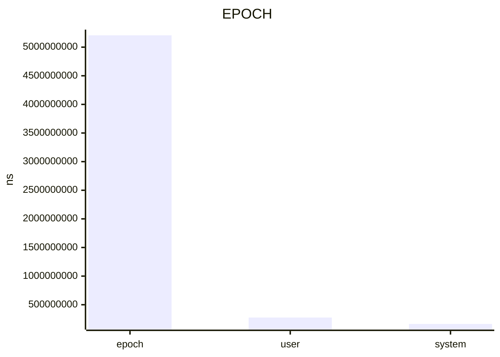

## epoch

+--------+-------+---------------------+--------------+---------------------+---------------------+-------+------+---------------------+
| key    | type  | value               | errorPercent | min                 | max                 | calls | unit | samples             |
+========+=======+=====================+==============+=====================+=====================+=======+======+=====================+
| epoch  | float | 5.207251166666667e9 | 0.0          | 5.207251166666667e9 | 5.207251166666667e9 | 1     | ns   | 5.207251166666667e9 |
+--------+-------+---------------------+--------------+---------------------+---------------------+-------+------+---------------------+
| user   | float | 2.76835e8           | 0.0          | 2.76835e8           | 2.76835e8           | 1     | ns   | 2.76835e8           |
+--------+-------+---------------------+--------------+---------------------+---------------------+-------+------+---------------------+
| system | float | 1.63682e8           | 0.0          | 1.63682e8           | 1.63682e8           | 1     | ns   | 1.63682e8           |
+--------+-------+---------------------+--------------+---------------------+---------------------+-------+------+---------------------+

