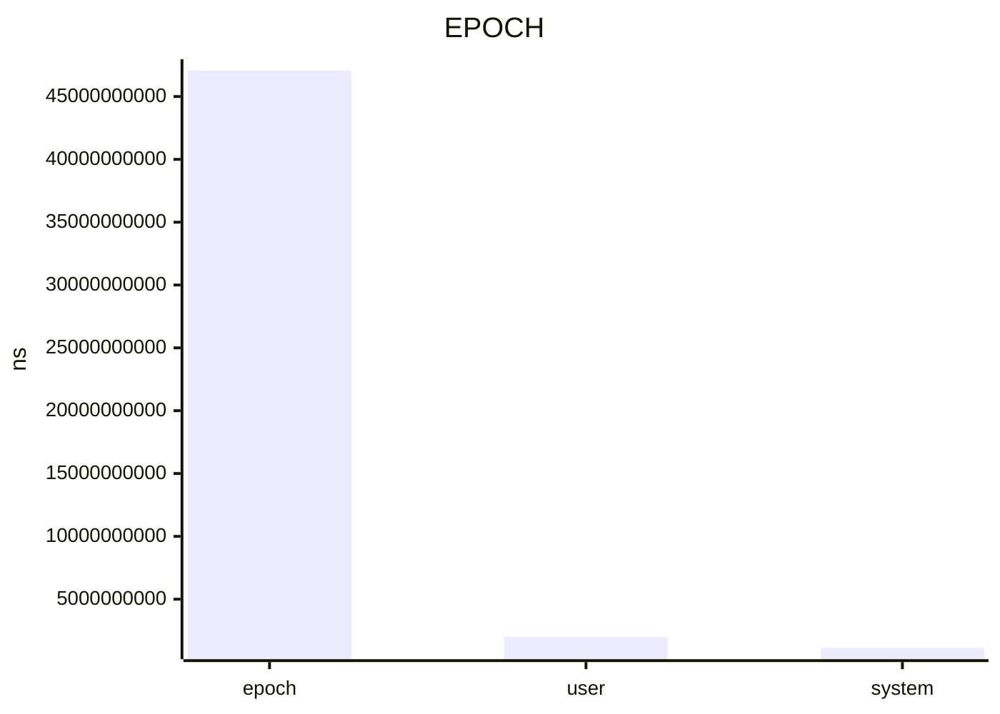

## epoch

+--------+-------+--------------+---------------------+----------------------+-----------------+-------+------+---------------------------------------------------------------------------------------------------------------------------------------------+
| key    | type  | value        | errorPercent        | min                  | max             | calls | unit | samples                                                                                                                                     |
+========+=======+==============+=====================+======================+=================+=======+======+=============================================================================================================================================+
| epoch  | float | 4.7064969e10 | 0.07701030250333321 | 4.692254979166667e10 | 4.7101213875e10 | 1     | ns   | 4.693404833333334e10, 4.7064969e10, 4.692254979166667e10, 4.693750383333333e10, 4.709608079166666e10, 4.707876391666666e10, 4.7101213875e10 |
+--------+-------+--------------+---------------------+----------------------+-----------------+-------+------+---------------------------------------------------------------------------------------------------------------------------------------------+
| user   | float | 1.993444e9   | 0.2111421238820855  | 1.981896e9           | 2.010332e9      | 1     | ns   | 1.981896e9, 1.998534e9, 1.991975e9, 1.99                                                                                                    |
|        |       |              |                     |                      |                 |       |      | 3008e9, 1.993444e9, 2.010332e9, 1.997653                                                                                                    |
|        |       |              |                     |                      |                 |       |      | e9                                                                                                                                          |
+--------+-------+--------------+---------------------+----------------------+-----------------+-------+------+---------------------------------------------------------------------------------------------------------------------------------------------+
| system | float | 1.119782e9   | 0.1520831733319521  | 1.104233e9           | 1.12881e9       | 1     | ns   | 1.104233e9, 1.121485e9, 1.12035e9, 1.112                                                                                                    |
|        |       |              |                     |                      |                 |       |      | 707e9, 1.119e9, 1.12881e9, 1.119782e9                                                                                                       |
+--------+-------+--------------+---------------------+----------------------+-----------------+-------+------+---------------------------------------------------------------------------------------------------------------------------------------------+

