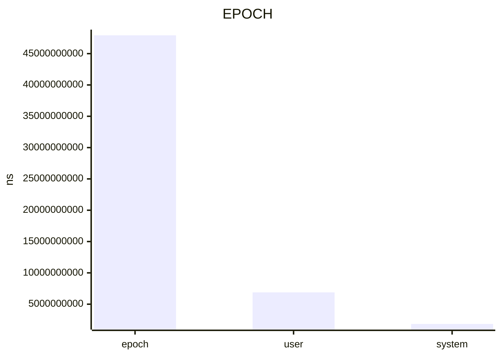

## epoch

+--------+-------+----------------------+---------------------+----------------+--------------+-------+------+------------------------------------------+----------------------+--------------------+-----------------------+
| key    | type  | value                | errorPercent        | min            | max          | calls | unit | samples                                  | baseline             | change             | probability           |
+========+=======+======================+=====================+================+==============+=======+======+==========================================+======================+====================+=======================+
| epoch  | float | 4.792864808333334e10 | 0.09568068403180148 | 4.763906075e10 | 4.9286238e10 | 1     | ns   | 4.9286238e10, 4.778260058333334e10, 4.78 | 6.269837391666667e10 | -23.55679248231221 | 0.7512562064796153    |
|        |       |                      |                     |                |              |       |      | 87011625e10, 4.793451425e10, 4.792864808 |                      |                    |                       |
|        |       |                      |                     |                |              |       |      | 333334e10, 4.797450654166666e10, 4.76390 |                      |                    |                       |
|        |       |                      |                     |                |              |       |      | 6075e10                                  |                      |                    |                       |
+--------+-------+----------------------+---------------------+----------------+--------------+-------+------+------------------------------------------+----------------------+--------------------+-----------------------+
| user   | float | 6.883662e9           | 0.07742971691521169 | 6.820249e9     | 6.893817e9   | 1     | ns   | 6.820249e9, 6.883662e9, 6.878548e9, 6.88 | 2.16933e9            | 217.3174205860796  | 0.0004888051963798146 |
|        |       |                      |                     |                |              |       |      | 8992e9, 6.888456e9, 6.893817e9, 6.853998 |                      |                    |                       |
|        |       |                      |                     |                |              |       |      | e9                                       |                      |                    |                       |
+--------+-------+----------------------+---------------------+----------------+--------------+-------+------+------------------------------------------+----------------------+--------------------+-----------------------+
| system | float | 1.840118e9           | 0.1463493102072802  | 1.823952e9     | 1.871899e9   | 1     | ns   | 1.871899e9, 1.837583e9, 1.841987e9, 1.84 | 1.563257e9           | 17.71052360552359  | 0.0004888051963798146 |
|        |       |                      |                     |                |              |       |      | 0118e9, 1.845251e9, 1.837425e9, 1.823952 |                      |                    |                       |
|        |       |                      |                     |                |              |       |      | e9                                       |                      |                    |                       |
+--------+-------+----------------------+---------------------+----------------+--------------+-------+------+------------------------------------------+----------------------+--------------------+-----------------------+

