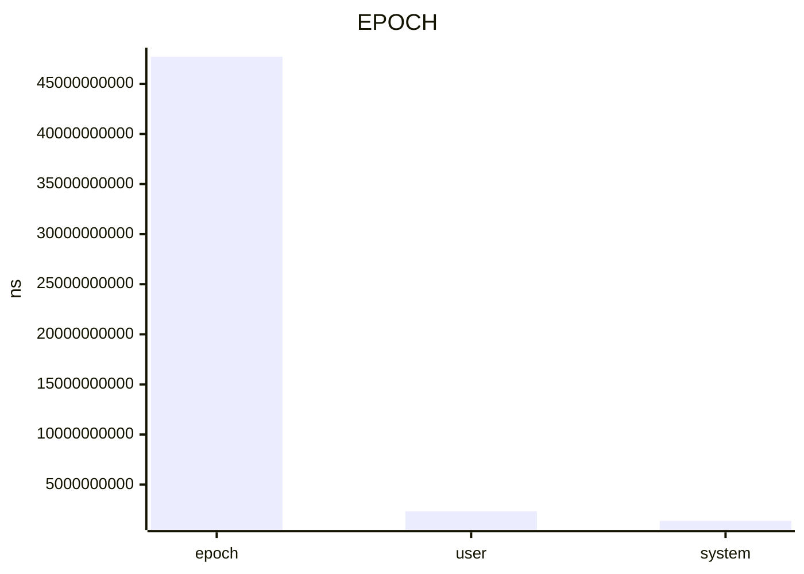

## epoch

+--------+-------+----------------+---------------------+---------------+----------------------+-------+------+--------------------------------------------------------------------------------------------------------------------------------------+--------------+-------------------+----------------------+
| key    | type  | value          | errorPercent        | min           | max                  | calls | unit | samples                                                                                                                              | baseline     | change            | probability          |
+========+=======+================+=====================+===============+======================+=======+======+======================================================================================================================================+==============+===================+======================+
| epoch  | float | 4.770753475e10 | 0.01145346682719573 | 4.76314335e10 | 4.804118716666666e10 | 1     | ns   | 4.804118716666666e10, 4.76314335e10, 4.770383433333334e10, 4.764725179166667e10, 4.771299891666666e10, 4.77108045e10, 4.770753475e10 | 4.7064969e10 | 1.365273925921421 | 0.001745118699528905 |
+--------+-------+----------------+---------------------+---------------+----------------------+-------+------+--------------------------------------------------------------------------------------------------------------------------------------+--------------+-------------------+----------------------+
| user   | float | 2.338418e9     | 0.5374146110746667  | 2.214644e9    | 2.357627e9           | 1     | ns   | 2.214644e9, 2.29161e9, 2.357627e9, 2.350                                                                                             | 1.993444e9   | 17.3054271903299  | 0.001745118699528905 |
|        |       |                |                     |               |                      |       |      | 985e9, 2.338418e9, 2.341816e9, 2.332948e                                                                                             |              |                   |                      |
|        |       |                |                     |               |                      |       |      | 9                                                                                                                                    |              |                   |                      |
+--------+-------+----------------+---------------------+---------------+----------------------+-------+------+--------------------------------------------------------------------------------------------------------------------------------------+--------------+-------------------+----------------------+
| system | float | 1.376288e9     | 1.323850821920993   | 1.325405e9    | 1.413532e9           | 1     | ns   | 1.325405e9, 1.358068e9, 1.413532e9, 1.37                                                                                             | 1.119782e9   | 22.90678006969214 | 0.001745118699528905 |
|        |       |                |                     |               |                      |       |      | 6288e9, 1.389974e9, 1.396855e9, 1.372643                                                                                             |              |                   |                      |
|        |       |                |                     |               |                      |       |      | e9                                                                                                                                   |              |                   |                      |
+--------+-------+----------------+---------------------+---------------+----------------------+-------+------+--------------------------------------------------------------------------------------------------------------------------------------+--------------+-------------------+----------------------+

