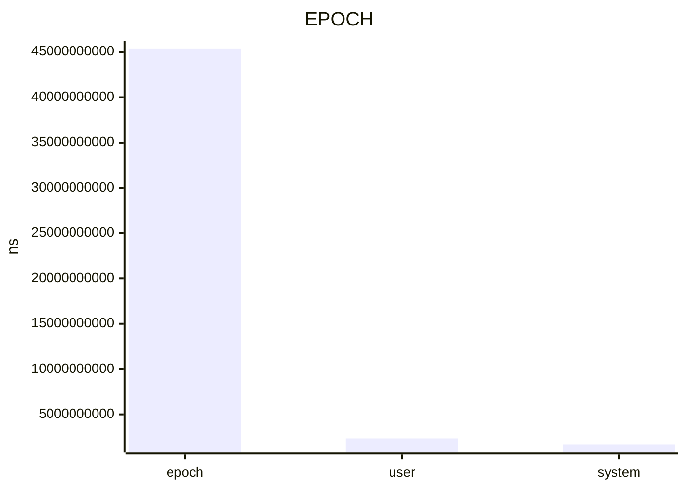

## epoch

+--------+-------+-----------------+---------------------+----------------+----------------------+-------+------+-----------------------------------------------------------------------------------------------------------------------------------------------+----------------------+--------------------+-----------------------+
| key    | type  | value           | errorPercent        | min            | max                  | calls | unit | samples                                                                                                                                       | baseline             | change             | probability           |
+========+=======+=================+=====================+================+======================+=======+======+===============================================================================================================================================+======================+====================+=======================+
| epoch  | float | 4.5390179625e10 | 0.06692022059460152 | 4.531537075e10 | 4.705268629166666e10 | 1     | ns   | 4.705268629166666e10, 4.5390179625e10, 4.532009379166666e10, 4.531537075e10, 4.536906920833334e10, 4.541545504166667e10, 4.542055483333334e10 | 6.269837391666667e10 | -27.60549151509296 | 0.7512562064796153    |
+--------+-------+-----------------+---------------------+----------------+----------------------+-------+------+-----------------------------------------------------------------------------------------------------------------------------------------------+----------------------+--------------------+-----------------------+
| user   | float | 2.358733e9      | 0.4120432452507342  | 2.328897e9     | 2.398513e9           | 1     | ns   | 2.363593e9, 2.358733e9, 2.349014e9, 2.32                                                                                                      | 2.16933e9            | 8.730944577357986  | 0.0004888051963798146 |
|        |       |                 |                     |                |                      |       |      | 8897e9, 2.355344e9, 2.398513e9, 2.378553                                                                                                      |                      |                    |                       |
|        |       |                 |                     |                |                      |       |      | e9                                                                                                                                            |                      |                    |                       |
+--------+-------+-----------------+---------------------+----------------+----------------------+-------+------+-----------------------------------------------------------------------------------------------------------------------------------------------+----------------------+--------------------+-----------------------+
| system | float | 1.654281e9      | 0.984657382875098   | 1.618445e9     | 1.69831e9            | 1     | ns   | 1.69831e9, 1.654281e9, 1.637992e9, 1.618                                                                                                      | 1.563257e9           | 5.822715011031455  | 0.0006831578313102332 |
|        |       |                 |                     |                |                      |       |      | 445e9, 1.649337e9, 1.691212e9, 1.669319e                                                                                                      |                      |                    |                       |
|        |       |                 |                     |                |                      |       |      | 9                                                                                                                                             |                      |                    |                       |
+--------+-------+-----------------+---------------------+----------------+----------------------+-------+------+-----------------------------------------------------------------------------------------------------------------------------------------------+----------------------+--------------------+-----------------------+

