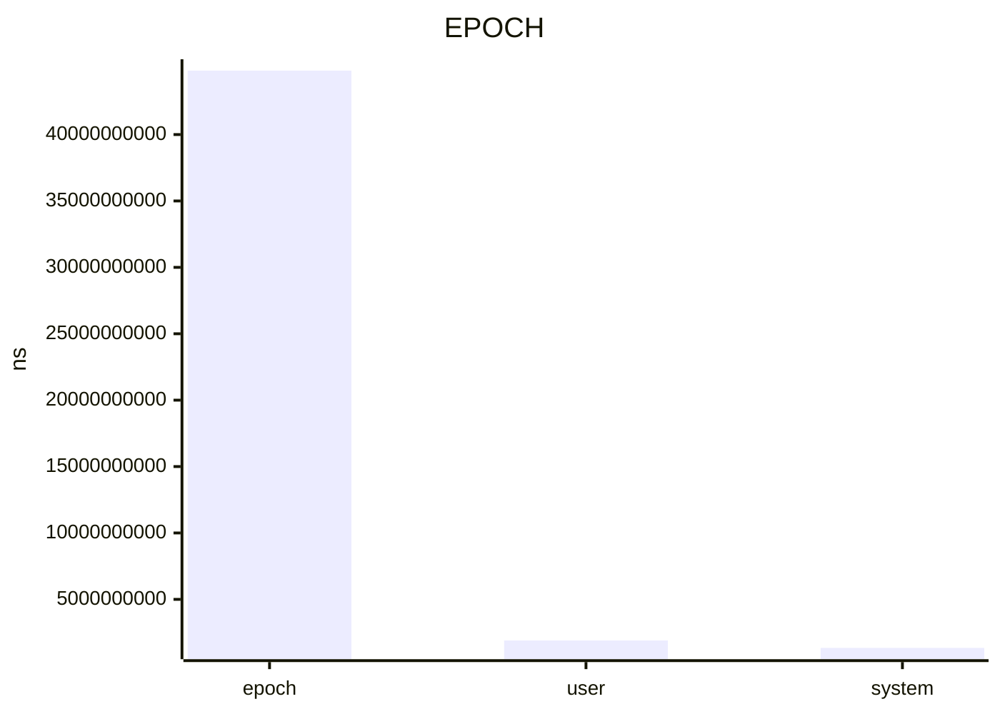

## epoch

+--------+-------+----------------------+-------------------+----------------------+----------------------+-------+------+------------------------------------------+----------------------+--------------------+--------------------+
| key    | type  | value                | errorPercent      | min                  | max                  | calls | unit | samples                                  | baseline             | change             | probability        |
+========+=======+======================+===================+======================+======================+=======+======+==========================================+======================+====================+====================+
| epoch  | float | 4.481711704166667e10 | 1.06772030402683  | 4.433859558333333e10 | 4.674824954166666e10 | 1     | ns   | 4.674824954166666e10, 4.633731220833333e | 6.269837391666667e10 | -28.51949063107481 | 0.7512562064796153 |
|        |       |                      |                   |                      |                      |       |      | 10, 4.530947358333334e10, 4.481711704166 |                      |                    |                    |
|        |       |                      |                   |                      |                      |       |      | 667e10, 4.433859558333333e10, 4.43769236 |                      |                    |                    |
|        |       |                      |                   |                      |                      |       |      | 6666667e10, 4.438594279166666e10         |                      |                    |                    |
+--------+-------+----------------------+-------------------+----------------------+----------------------+-------+------+------------------------------------------+----------------------+--------------------+--------------------+
| user   | float | 1.903499e9           | 2.710114373582545 | 1.851912e9           | 2.441799e9           | 1     | ns   | 2.441799e9, 2.197846e9, 1.962871e9, 1.85 | 2.16933e9            | -12.25406000931163 | 0.1891098717651462 |
|        |       |                      |                   |                      |                      |       |      | 1912e9, 1.903499e9, 1.897846e9, 1.902466 |                      |                    |                    |
|        |       |                      |                   |                      |                      |       |      | e9                                       |                      |                    |                    |
+--------+-------+----------------------+-------------------+----------------------+----------------------+-------+------+------------------------------------------+----------------------+--------------------+--------------------+
| system | float | 1.340758e9           | 2.932744014952736 | 1.301437e9           | 1.725041e9           | 1     | ns   | 1.725041e9, 1.516953e9, 1.394926e9, 1.30 | 1.563257e9           | -14.23304037659835 | 0.5560736509404209 |
|        |       |                      |                   |                      |                      |       |      | 1437e9, 1.307498e9, 1.322553e9, 1.340758 |                      |                    |                    |
|        |       |                      |                   |                      |                      |       |      | e9                                       |                      |                    |                    |
+--------+-------+----------------------+-------------------+----------------------+----------------------+-------+------+------------------------------------------+----------------------+--------------------+--------------------+

