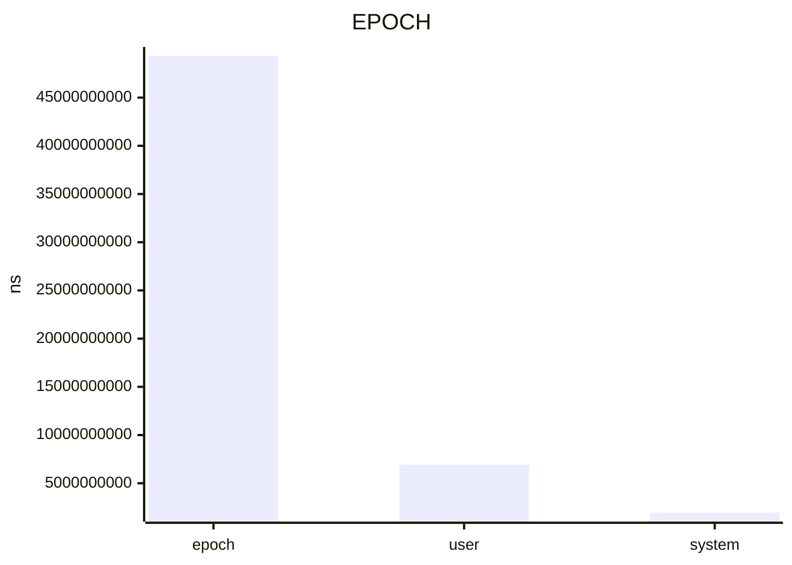

## epoch

+--------+-------+----------------------+--------------+----------------------+----------------------+-------+------+----------------------+
| key    | type  | value                | errorPercent | min                  | max                  | calls | unit | samples              |
+========+=======+======================+==============+======================+======================+=======+======+======================+
| epoch  | float | 4.933104666666666e10 | 0.0          | 4.933104666666666e10 | 4.933104666666666e10 | 1     | ns   | 4.933104666666666e10 |
+--------+-------+----------------------+--------------+----------------------+----------------------+-------+------+----------------------+
| user   | float | 6.947202e9           | 0.0          | 6.947202e9           | 6.947202e9           | 1     | ns   | 6.947202e9           |
+--------+-------+----------------------+--------------+----------------------+----------------------+-------+------+----------------------+
| system | float | 1.940707e9           | 0.0          | 1.940707e9           | 1.940707e9           | 1     | ns   | 1.940707e9           |
+--------+-------+----------------------+--------------+----------------------+----------------------+-------+------+----------------------+

## sample

+------------------------------------------------------------------------------------------------------------------------------------------------------------------------------------------------------------------------------------------------------------------------------------------------------------------------------------------------------------------------------------------------------------------------------------------------------------------------------------------------------------------------------------------------------------------------------------------------------------------------------------------------------------------------------------------------------------------------------------------------------------------------------------------------------------------------------------------------------------------+-------+--------+--------------+--------+--------+-------+-------+---------+
| key                                                                                                                                                                                                                                                                                                                                                                                                                                                                                                                                                                                                                                                                                                                                                                                                                                                              | type  | value  | errorPercent | min    | max    | calls | unit  | samples |
+==================================================================================================================================================================================================================================================================================================================================================================================================================================================================================================================================================================================================================================================================================================================================================================================================================================================================+=======+========+==============+========+========+=======+=======+=========+
| mh execute header                                                                                                                                                                                                                                                                                                                                                                                                                                                                                                                                                                                                                                                                                                                                                                                                                                                | float | 3.0    | 0.0          | 3.0    | 3.0    | 1     | count | 3       |
+------------------------------------------------------------------------------------------------------------------------------------------------------------------------------------------------------------------------------------------------------------------------------------------------------------------------------------------------------------------------------------------------------------------------------------------------------------------------------------------------------------------------------------------------------------------------------------------------------------------------------------------------------------------------------------------------------------------------------------------------------------------------------------------------------------------------------------------------------------------+-------+--------+--------------+--------+--------+-------+-------+---------+
| NS concrete global block                                                                                                                                                                                                                                                                                                                                                                                                                                                                                                                                                                                                                                                                                                                                                                                                                                         | float | 1735.0 | 0.0          | 1735.0 | 1735.0 | 1     | count | 1735    |
+------------------------------------------------------------------------------------------------------------------------------------------------------------------------------------------------------------------------------------------------------------------------------------------------------------------------------------------------------------------------------------------------------------------------------------------------------------------------------------------------------------------------------------------------------------------------------------------------------------------------------------------------------------------------------------------------------------------------------------------------------------------------------------------------------------------------------------------------------------------+-------+--------+--------------+--------+--------+-------+-------+---------+
| merged globals                                                                                                                                                                                                                                                                                                                                                                                                                                                                                                                                                                                                                                                                                                                                                                                                                                                   | float | 849.0  | 0.0          | 849.0  | 849.0  | 1     | count | 849     |
+------------------------------------------------------------------------------------------------------------------------------------------------------------------------------------------------------------------------------------------------------------------------------------------------------------------------------------------------------------------------------------------------------------------------------------------------------------------------------------------------------------------------------------------------------------------------------------------------------------------------------------------------------------------------------------------------------------------------------------------------------------------------------------------------------------------------------------------------------------------+-------+--------+--------------+--------+--------+-------+-------+---------+
| main                                                                                                                                                                                                                                                                                                                                                                                                                                                                                                                                                                                                                                                                                                                                                                                                                                                             | float | 362.0  | 0.0          | 362.0  | 362.0  | 1     | count | 362     |
+------------------------------------------------------------------------------------------------------------------------------------------------------------------------------------------------------------------------------------------------------------------------------------------------------------------------------------------------------------------------------------------------------------------------------------------------------------------------------------------------------------------------------------------------------------------------------------------------------------------------------------------------------------------------------------------------------------------------------------------------------------------------------------------------------------------------------------------------------------------+-------+--------+--------------+--------+--------+-------+-------+---------+
| do highlight                                                                                                                                                                                                                                                                                                                                                                                                                                                                                                                                                                                                                                                                                                                                                                                                                                                     | float | 1.0    | 0.0          | 1.0    | 1.0    | 1     | count | 1       |
+------------------------------------------------------------------------------------------------------------------------------------------------------------------------------------------------------------------------------------------------------------------------------------------------------------------------------------------------------------------------------------------------------------------------------------------------------------------------------------------------------------------------------------------------------------------------------------------------------------------------------------------------------------------------------------------------------------------------------------------------------------------------------------------------------------------------------------------------------------------+-------+--------+--------------+--------+--------+-------+-------+---------+
| init highlight                                                                                                                                                                                                                                                                                                                                                                                                                                                                                                                                                                                                                                                                                                                                                                                                                                                   | float | 1.0    | 0.0          | 1.0    | 1.0    | 1     | count | 1       |
+------------------------------------------------------------------------------------------------------------------------------------------------------------------------------------------------------------------------------------------------------------------------------------------------------------------------------------------------------------------------------------------------------------------------------------------------------------------------------------------------------------------------------------------------------------------------------------------------------------------------------------------------------------------------------------------------------------------------------------------------------------------------------------------------------------------------------------------------------------------+-------+--------+--------------+--------+--------+-------+-------+---------+
| uv fs work                                                                                                                                                                                                                                                                                                                                                                                                                                                                                                                                                                                                                                                                                                                                                                                                                                                       | float | 1.0    | 0.0          | 1.0    | 1.0    | 1     | count | 1       |
+------------------------------------------------------------------------------------------------------------------------------------------------------------------------------------------------------------------------------------------------------------------------------------------------------------------------------------------------------------------------------------------------------------------------------------------------------------------------------------------------------------------------------------------------------------------------------------------------------------------------------------------------------------------------------------------------------------------------------------------------------------------------------------------------------------------------------------------------------------------+-------+--------+--------------+--------+--------+-------+-------+---------+
| uv fs realpath                                                                                                                                                                                                                                                                                                                                                                                                                                                                                                                                                                                                                                                                                                                                                                                                                                                   | float | 1.0    | 0.0          | 1.0    | 1.0    | 1     | count | 1       |
+------------------------------------------------------------------------------------------------------------------------------------------------------------------------------------------------------------------------------------------------------------------------------------------------------------------------------------------------------------------------------------------------------------------------------------------------------------------------------------------------------------------------------------------------------------------------------------------------------------------------------------------------------------------------------------------------------------------------------------------------------------------------------------------------------------------------------------------------------------------+-------+--------+--------------+--------+--------+-------+-------+---------+
| os realpath                                                                                                                                                                                                                                                                                                                                                                                                                                                                                                                                                                                                                                                                                                                                                                                                                                                      | float | 1.0    | 0.0          | 1.0    | 1.0    | 1     | count | 1       |
+------------------------------------------------------------------------------------------------------------------------------------------------------------------------------------------------------------------------------------------------------------------------------------------------------------------------------------------------------------------------------------------------------------------------------------------------------------------------------------------------------------------------------------------------------------------------------------------------------------------------------------------------------------------------------------------------------------------------------------------------------------------------------------------------------------------------------------------------------------------+-------+--------+--------------+--------+--------+-------+-------+---------+
| path full dir name                                                                                                                                                                                                                                                                                                                                                                                                                                                                                                                                                                                                                                                                                                                                                                                                                                               | float | 2.0    | 0.0          | 2.0    | 2.0    | 1     | count | 2       |
+------------------------------------------------------------------------------------------------------------------------------------------------------------------------------------------------------------------------------------------------------------------------------------------------------------------------------------------------------------------------------------------------------------------------------------------------------------------------------------------------------------------------------------------------------------------------------------------------------------------------------------------------------------------------------------------------------------------------------------------------------------------------------------------------------------------------------------------------------------------+-------+--------+--------------+--------+--------+-------+-------+---------+
| vim full name                                                                                                                                                                                                                                                                                                                                                                                                                                                                                                                                                                                                                                                                                                                                                                                                                                                    | float | 2.0    | 0.0          | 2.0    | 2.0    | 1     | count | 2       |
+------------------------------------------------------------------------------------------------------------------------------------------------------------------------------------------------------------------------------------------------------------------------------------------------------------------------------------------------------------------------------------------------------------------------------------------------------------------------------------------------------------------------------------------------------------------------------------------------------------------------------------------------------------------------------------------------------------------------------------------------------------------------------------------------------------------------------------------------------------------+-------+--------+--------------+--------+--------+-------+-------+---------+
| full name save                                                                                                                                                                                                                                                                                                                                                                                                                                                                                                                                                                                                                                                                                                                                                                                                                                                   | float | 2.0    | 0.0          | 2.0    | 2.0    | 1     | count | 2       |
+------------------------------------------------------------------------------------------------------------------------------------------------------------------------------------------------------------------------------------------------------------------------------------------------------------------------------------------------------------------------------------------------------------------------------------------------------------------------------------------------------------------------------------------------------------------------------------------------------------------------------------------------------------------------------------------------------------------------------------------------------------------------------------------------------------------------------------------------------------------+-------+--------+--------------+--------+--------+-------+-------+---------+
| nlua set sctx                                                                                                                                                                                                                                                                                                                                                                                                                                                                                                                                                                                                                                                                                                                                                                                                                                                    | float | 2.0    | 0.0          | 2.0    | 2.0    | 1     | count | 2       |
+------------------------------------------------------------------------------------------------------------------------------------------------------------------------------------------------------------------------------------------------------------------------------------------------------------------------------------------------------------------------------------------------------------------------------------------------------------------------------------------------------------------------------------------------------------------------------------------------------------------------------------------------------------------------------------------------------------------------------------------------------------------------------------------------------------------------------------------------------------------+-------+--------+--------------+--------+--------+-------+-------+---------+
| map add                                                                                                                                                                                                                                                                                                                                                                                                                                                                                                                                                                                                                                                                                                                                                                                                                                                          | float | 2.0    | 0.0          | 2.0    | 2.0    | 1     | count | 2       |
+------------------------------------------------------------------------------------------------------------------------------------------------------------------------------------------------------------------------------------------------------------------------------------------------------------------------------------------------------------------------------------------------------------------------------------------------------------------------------------------------------------------------------------------------------------------------------------------------------------------------------------------------------------------------------------------------------------------------------------------------------------------------------------------------------------------------------------------------------------------+-------+--------+--------------+--------+--------+-------+-------+---------+
| buf do map                                                                                                                                                                                                                                                                                                                                                                                                                                                                                                                                                                                                                                                                                                                                                                                                                                                       | float | 2.0    | 0.0          | 2.0    | 2.0    | 1     | count | 2       |
+------------------------------------------------------------------------------------------------------------------------------------------------------------------------------------------------------------------------------------------------------------------------------------------------------------------------------------------------------------------------------------------------------------------------------------------------------------------------------------------------------------------------------------------------------------------------------------------------------------------------------------------------------------------------------------------------------------------------------------------------------------------------------------------------------------------------------------------------------------------+-------+--------+--------------+--------+--------+-------+-------+---------+
| modify keymap                                                                                                                                                                                                                                                                                                                                                                                                                                                                                                                                                                                                                                                                                                                                                                                                                                                    | float | 2.0    | 0.0          | 2.0    | 2.0    | 1     | count | 2       |
+------------------------------------------------------------------------------------------------------------------------------------------------------------------------------------------------------------------------------------------------------------------------------------------------------------------------------------------------------------------------------------------------------------------------------------------------------------------------------------------------------------------------------------------------------------------------------------------------------------------------------------------------------------------------------------------------------------------------------------------------------------------------------------------------------------------------------------------------------------------+-------+--------+--------------+--------+--------+-------+-------+---------+
| nlua api nvim set keymap                                                                                                                                                                                                                                                                                                                                                                                                                                                                                                                                                                                                                                                                                                                                                                                                                                         | float | 2.0    | 0.0          | 2.0    | 2.0    | 1     | count | 2       |
+------------------------------------------------------------------------------------------------------------------------------------------------------------------------------------------------------------------------------------------------------------------------------------------------------------------------------------------------------------------------------------------------------------------------------------------------------------------------------------------------------------------------------------------------------------------------------------------------------------------------------------------------------------------------------------------------------------------------------------------------------------------------------------------------------------------------------------------------------------------+-------+--------+--------------+--------+--------+-------+-------+---------+
| libluajit 5 1 2 1 1794160931 dylib                                                                                                                                                                                                                                                                                                                                                                                                                                                                                                                                                                                                                                                                                                                                                                                                                               | float | 64.0   | 0.0          | 64.0   | 64.0   | 1     | count | 64      |
+------------------------------------------------------------------------------------------------------------------------------------------------------------------------------------------------------------------------------------------------------------------------------------------------------------------------------------------------------------------------------------------------------------------------------------------------------------------------------------------------------------------------------------------------------------------------------------------------------------------------------------------------------------------------------------------------------------------------------------------------------------------------------------------------------------------------------------------------------------------+-------+--------+--------------+--------+--------+-------+-------+---------+
| nlua module preloader                                                                                                                                                                                                                                                                                                                                                                                                                                                                                                                                                                                                                                                                                                                                                                                                                                            | float | 2.0    | 0.0          | 2.0    | 2.0    | 1     | count | 2       |
+------------------------------------------------------------------------------------------------------------------------------------------------------------------------------------------------------------------------------------------------------------------------------------------------------------------------------------------------------------------------------------------------------------------------------------------------------------------------------------------------------------------------------------------------------------------------------------------------------------------------------------------------------------------------------------------------------------------------------------------------------------------------------------------------------------------------------------------------------------------+-------+--------+--------------+--------+--------+-------+-------+---------+
| lua L openlibs                                                                                                                                                                                                                                                                                                                                                                                                                                                                                                                                                                                                                                                                                                                                                                                                                                                   | float | 7.0    | 0.0          | 7.0    | 7.0    | 1     | count | 7       |
+------------------------------------------------------------------------------------------------------------------------------------------------------------------------------------------------------------------------------------------------------------------------------------------------------------------------------------------------------------------------------------------------------------------------------------------------------------------------------------------------------------------------------------------------------------------------------------------------------------------------------------------------------------------------------------------------------------------------------------------------------------------------------------------------------------------------------------------------------------------+-------+--------+--------------+--------+--------+-------+-------+---------+
| lua pcall                                                                                                                                                                                                                                                                                                                                                                                                                                                                                                                                                                                                                                                                                                                                                                                                                                                        | float | 69.0   | 0.0          | 69.0   | 69.0   | 1     | count | 69      |
+------------------------------------------------------------------------------------------------------------------------------------------------------------------------------------------------------------------------------------------------------------------------------------------------------------------------------------------------------------------------------------------------------------------------------------------------------------------------------------------------------------------------------------------------------------------------------------------------------------------------------------------------------------------------------------------------------------------------------------------------------------------------------------------------------------------------------------------------------------------+-------+--------+--------------+--------+--------+-------+-------+---------+
| nlua init defaults                                                                                                                                                                                                                                                                                                                                                                                                                                                                                                                                                                                                                                                                                                                                                                                                                                               | float | 2.0    | 0.0          | 2.0    | 2.0    | 1     | count | 2       |
+------------------------------------------------------------------------------------------------------------------------------------------------------------------------------------------------------------------------------------------------------------------------------------------------------------------------------------------------------------------------------------------------------------------------------------------------------------------------------------------------------------------------------------------------------------------------------------------------------------------------------------------------------------------------------------------------------------------------------------------------------------------------------------------------------------------------------------------------------------------+-------+--------+--------------+--------+--------+-------+-------+---------+
| uv cwd                                                                                                                                                                                                                                                                                                                                                                                                                                                                                                                                                                                                                                                                                                                                                                                                                                                           | float | 1.0    | 0.0          | 1.0    | 1.0    | 1     | count | 1       |
+------------------------------------------------------------------------------------------------------------------------------------------------------------------------------------------------------------------------------------------------------------------------------------------------------------------------------------------------------------------------------------------------------------------------------------------------------------------------------------------------------------------------------------------------------------------------------------------------------------------------------------------------------------------------------------------------------------------------------------------------------------------------------------------------------------------------------------------------------------------+-------+--------+--------------+--------+--------+-------+-------+---------+
| os dirname                                                                                                                                                                                                                                                                                                                                                                                                                                                                                                                                                                                                                                                                                                                                                                                                                                                       | float | 1.0    | 0.0          | 1.0    | 1.0    | 1     | count | 1       |
+------------------------------------------------------------------------------------------------------------------------------------------------------------------------------------------------------------------------------------------------------------------------------------------------------------------------------------------------------------------------------------------------------------------------------------------------------------------------------------------------------------------------------------------------------------------------------------------------------------------------------------------------------------------------------------------------------------------------------------------------------------------------------------------------------------------------------------------------------------------+-------+--------+--------------+--------+--------+-------+-------+---------+
| lua loadx                                                                                                                                                                                                                                                                                                                                                                                                                                                                                                                                                                                                                                                                                                                                                                                                                                                        | float | 1.0    | 0.0          | 1.0    | 1.0    | 1     | count | 1       |
+------------------------------------------------------------------------------------------------------------------------------------------------------------------------------------------------------------------------------------------------------------------------------------------------------------------------------------------------------------------------------------------------------------------------------------------------------------------------------------------------------------------------------------------------------------------------------------------------------------------------------------------------------------------------------------------------------------------------------------------------------------------------------------------------------------------------------------------------------------------+-------+--------+--------------+--------+--------+-------+-------+---------+
| nlua exec file                                                                                                                                                                                                                                                                                                                                                                                                                                                                                                                                                                                                                                                                                                                                                                                                                                                   | float | 67.0   | 0.0          | 67.0   | 67.0   | 1     | count | 67      |
+------------------------------------------------------------------------------------------------------------------------------------------------------------------------------------------------------------------------------------------------------------------------------------------------------------------------------------------------------------------------------------------------------------------------------------------------------------------------------------------------------------------------------------------------------------------------------------------------------------------------------------------------------------------------------------------------------------------------------------------------------------------------------------------------------------------------------------------------------------------+-------+--------+--------------+--------+--------+-------+-------+---------+
| uv spawn                                                                                                                                                                                                                                                                                                                                                                                                                                                                                                                                                                                                                                                                                                                                                                                                                                                         | float | 25.0   | 0.0          | 25.0   | 25.0   | 1     | count | 25      |
+------------------------------------------------------------------------------------------------------------------------------------------------------------------------------------------------------------------------------------------------------------------------------------------------------------------------------------------------------------------------------------------------------------------------------------------------------------------------------------------------------------------------------------------------------------------------------------------------------------------------------------------------------------------------------------------------------------------------------------------------------------------------------------------------------------------------------------------------------------------+-------+--------+--------------+--------+--------+-------+-------+---------+
| luv spawn                                                                                                                                                                                                                                                                                                                                                                                                                                                                                                                                                                                                                                                                                                                                                                                                                                                        | float | 25.0   | 0.0          | 25.0   | 25.0   | 1     | count | 25      |
+------------------------------------------------------------------------------------------------------------------------------------------------------------------------------------------------------------------------------------------------------------------------------------------------------------------------------------------------------------------------------------------------------------------------------------------------------------------------------------------------------------------------------------------------------------------------------------------------------------------------------------------------------------------------------------------------------------------------------------------------------------------------------------------------------------------------------------------------------------------+-------+--------+--------------+--------+--------+-------+-------+---------+
| binary data::temp binary data 1                                                                                                                                                                                                                                                                                                                                                                                                                                                                                                                                                                                                                                                                                                                                                                                                                                  | float | 17.0   | 0.0          | 17.0   | 17.0   | 1     | count | 17      |
+------------------------------------------------------------------------------------------------------------------------------------------------------------------------------------------------------------------------------------------------------------------------------------------------------------------------------------------------------------------------------------------------------------------------------------------------------------------------------------------------------------------------------------------------------------------------------------------------------------------------------------------------------------------------------------------------------------------------------------------------------------------------------------------------------------------------------------------------------------------+-------+--------+--------------+--------+--------+-------+-------+---------+
| icudt78l dat                                                                                                                                                                                                                                                                                                                                                                                                                                                                                                                                                                                                                                                                                                                                                                                                                                                     | float | 4.0    | 0.0          | 4.0    | 4.0    | 1     | count | 4       |
+------------------------------------------------------------------------------------------------------------------------------------------------------------------------------------------------------------------------------------------------------------------------------------------------------------------------------------------------------------------------------------------------------------------------------------------------------------------------------------------------------------------------------------------------------------------------------------------------------------------------------------------------------------------------------------------------------------------------------------------------------------------------------------------------------------------------------------------------------------------+-------+--------+--------------+--------+--------+-------+-------+---------+
| lldb:: dump process GDB remote packet history                                                                                                                                                                                                                                                                                                                                                                                                                                                                                                                                                                                                                                                                                                                                                                                                                    | float | 6722.0 | 0.0          | 6722.0 | 6722.0 | 1     | count | 6722    |
+------------------------------------------------------------------------------------------------------------------------------------------------------------------------------------------------------------------------------------------------------------------------------------------------------------------------------------------------------------------------------------------------------------------------------------------------------------------------------------------------------------------------------------------------------------------------------------------------------------------------------------------------------------------------------------------------------------------------------------------------------------------------------------------------------------------------------------------------------------------+-------+--------+--------------+--------+--------+-------+-------+---------+
| objc trampolines version number                                                                                                                                                                                                                                                                                                                                                                                                                                                                                                                                                                                                                                                                                                                                                                                                                                  | float | 1.0    | 0.0          | 1.0    | 1.0    | 1     | count | 1       |
+------------------------------------------------------------------------------------------------------------------------------------------------------------------------------------------------------------------------------------------------------------------------------------------------------------------------------------------------------------------------------------------------------------------------------------------------------------------------------------------------------------------------------------------------------------------------------------------------------------------------------------------------------------------------------------------------------------------------------------------------------------------------------------------------------------------------------------------------------------------+-------+--------+--------------+--------+--------+-------+-------+---------+
| libobjc trampolines dylib                                                                                                                                                                                                                                                                                                                                                                                                                                                                                                                                                                                                                                                                                                                                                                                                                                        | float | 1.0    | 0.0          | 1.0    | 1.0    | 1     | count | 1       |
+------------------------------------------------------------------------------------------------------------------------------------------------------------------------------------------------------------------------------------------------------------------------------------------------------------------------------------------------------------------------------------------------------------------------------------------------------------------------------------------------------------------------------------------------------------------------------------------------------------------------------------------------------------------------------------------------------------------------------------------------------------------------------------------------------------------------------------------------------------------+-------+--------+--------------+--------+--------+-------+-------+---------+
| info plist loctable                                                                                                                                                                                                                                                                                                                                                                                                                                                                                                                                                                                                                                                                                                                                                                                                                                              | float | 2.0    | 0.0          | 2.0    | 2.0    | 1     | count | 2       |
+------------------------------------------------------------------------------------------------------------------------------------------------------------------------------------------------------------------------------------------------------------------------------------------------------------------------------------------------------------------------------------------------------------------------------------------------------------------------------------------------------------------------------------------------------------------------------------------------------------------------------------------------------------------------------------------------------------------------------------------------------------------------------------------------------------------------------------------------------------------+-------+--------+--------------+--------+--------+-------+-------+---------+
| void juce:: character functions::copy with char limit juce:: char pointer UTF8 juce:: char pointer UTF8                                                                                                                                                                                                                                                                                                                                                                                                                                                                                                                                                                                                                                                                                                                                                          | float | 2.0    | 0.0          | 2.0    | 2.0    | 1     | count | 2       |
+------------------------------------------------------------------------------------------------------------------------------------------------------------------------------------------------------------------------------------------------------------------------------------------------------------------------------------------------------------------------------------------------------------------------------------------------------------------------------------------------------------------------------------------------------------------------------------------------------------------------------------------------------------------------------------------------------------------------------------------------------------------------------------------------------------------------------------------------------------------+-------+--------+--------------+--------+--------+-------+-------+---------+
| juce:: string juce::add pooled string juce:: char pointer UTF8                                                                                                                                                                                                                                                                                                                                                                                                                                                                                                                                                                                                                                                                                                                                                                                                   | float | 6.0    | 0.0          | 6.0    | 6.0    | 1     | count | 6       |
+------------------------------------------------------------------------------------------------------------------------------------------------------------------------------------------------------------------------------------------------------------------------------------------------------------------------------------------------------------------------------------------------------------------------------------------------------------------------------------------------------------------------------------------------------------------------------------------------------------------------------------------------------------------------------------------------------------------------------------------------------------------------------------------------------------------------------------------------------------------+-------+--------+--------------+--------+--------+-------+-------+---------+
| juce:: string pool::get pooled string                                                                                                                                                                                                                                                                                                                                                                                                                                                                                                                                                                                                                                                                                                                                                                                                                            | float | 9.0    | 0.0          | 9.0    | 9.0    | 1     | count | 9       |
+------------------------------------------------------------------------------------------------------------------------------------------------------------------------------------------------------------------------------------------------------------------------------------------------------------------------------------------------------------------------------------------------------------------------------------------------------------------------------------------------------------------------------------------------------------------------------------------------------------------------------------------------------------------------------------------------------------------------------------------------------------------------------------------------------------------------------------------------------------------+-------+--------+--------------+--------+--------+-------+-------+---------+
| map:: colour id:: colour id                                                                                                                                                                                                                                                                                                                                                                                                                                                                                                                                                                                                                                                                                                                                                                                                                                      | float | 10.0   | 0.0          | 10.0   | 10.0   | 1     | count | 10      |
+------------------------------------------------------------------------------------------------------------------------------------------------------------------------------------------------------------------------------------------------------------------------------------------------------------------------------------------------------------------------------------------------------------------------------------------------------------------------------------------------------------------------------------------------------------------------------------------------------------------------------------------------------------------------------------------------------------------------------------------------------------------------------------------------------------------------------------------------------------------+-------+--------+--------------+--------+--------+-------+-------+---------+
| void jam:: shared instance map:: colour id ::create                                                                                                                                                                                                                                                                                                                                                                                                                                                                                                                                                                                                                                                                                                                                                                                                              | float | 8.0    | 0.0          | 8.0    | 8.0    | 1     | count | 8       |
+------------------------------------------------------------------------------------------------------------------------------------------------------------------------------------------------------------------------------------------------------------------------------------------------------------------------------------------------------------------------------------------------------------------------------------------------------------------------------------------------------------------------------------------------------------------------------------------------------------------------------------------------------------------------------------------------------------------------------------------------------------------------------------------------------------------------------------------------------------------+-------+--------+--------------+--------+--------+-------+-------+---------+
| GLOBAL sub I jam terminal mm                                                                                                                                                                                                                                                                                                                                                                                                                                                                                                                                                                                                                                                                                                                                                                                                                                     | float | 13.0   | 0.0          | 13.0   | 13.0   | 1     | count | 13      |
+------------------------------------------------------------------------------------------------------------------------------------------------------------------------------------------------------------------------------------------------------------------------------------------------------------------------------------------------------------------------------------------------------------------------------------------------------------------------------------------------------------------------------------------------------------------------------------------------------------------------------------------------------------------------------------------------------------------------------------------------------------------------------------------------------------------------------------------------------------------+-------+--------+--------------+--------+--------+-------+-------+---------+
| juce:: file::get special location                                                                                                                                                                                                                                                                                                                                                                                                                                                                                                                                                                                                                                                                                                                                                                                                                                | float | 5.0    | 0.0          | 5.0    | 5.0    | 1     | count | 5       |
+------------------------------------------------------------------------------------------------------------------------------------------------------------------------------------------------------------------------------------------------------------------------------------------------------------------------------------------------------------------------------------------------------------------------------------------------------------------------------------------------------------------------------------------------------------------------------------------------------------------------------------------------------------------------------------------------------------------------------------------------------------------------------------------------------------------------------------------------------------------+-------+--------+--------------+--------+--------+-------+-------+---------+
| juce:: file::parse absolute path                                                                                                                                                                                                                                                                                                                                                                                                                                                                                                                                                                                                                                                                                                                                                                                                                                 | float | 3.0    | 0.0          | 3.0    | 3.0    | 1     | count | 3       |
+------------------------------------------------------------------------------------------------------------------------------------------------------------------------------------------------------------------------------------------------------------------------------------------------------------------------------------------------------------------------------------------------------------------------------------------------------------------------------------------------------------------------------------------------------------------------------------------------------------------------------------------------------------------------------------------------------------------------------------------------------------------------------------------------------------------------------------------------------------------+-------+--------+--------------+--------+--------+-------+-------+---------+
| get or create config directory                                                                                                                                                                                                                                                                                                                                                                                                                                                                                                                                                                                                                                                                                                                                                                                                                                   | float | 2.0    | 0.0          | 2.0    | 2.0    | 1     | count | 2       |
+------------------------------------------------------------------------------------------------------------------------------------------------------------------------------------------------------------------------------------------------------------------------------------------------------------------------------------------------------------------------------------------------------------------------------------------------------------------------------------------------------------------------------------------------------------------------------------------------------------------------------------------------------------------------------------------------------------------------------------------------------------------------------------------------------------------------------------------------------------------+-------+--------+--------------+--------+--------+-------+-------+---------+
| juce::juce application base::main                                                                                                                                                                                                                                                                                                                                                                                                                                                                                                                                                                                                                                                                                                                                                                                                                                | float | 284.0  | 0.0          | 284.0  | 284.0  | 1     | count | 284     |
+------------------------------------------------------------------------------------------------------------------------------------------------------------------------------------------------------------------------------------------------------------------------------------------------------------------------------------------------------------------------------------------------------------------------------------------------------------------------------------------------------------------------------------------------------------------------------------------------------------------------------------------------------------------------------------------------------------------------------------------------------------------------------------------------------------------------------------------------------------------+-------+--------+--------------+--------+--------+-------+-------+---------+
| lldb::sb watchpoint options:: get watchpoint type write                                                                                                                                                                                                                                                                                                                                                                                                                                                                                                                                                                                                                                                                                                                                                                                                          | float | 6714.0 | 0.0          | 6714.0 | 6714.0 | 1     | count | 6714    |
+------------------------------------------------------------------------------------------------------------------------------------------------------------------------------------------------------------------------------------------------------------------------------------------------------------------------------------------------------------------------------------------------------------------------------------------------------------------------------------------------------------------------------------------------------------------------------------------------------------------------------------------------------------------------------------------------------------------------------------------------------------------------------------------------------------------------------------------------------------------+-------+--------+--------------+--------+--------+-------+-------+---------+
| lldb::sb debugger:: initialize with error handling                                                                                                                                                                                                                                                                                                                                                                                                                                                                                                                                                                                                                                                                                                                                                                                                               | float | 15.0   | 0.0          | 15.0   | 15.0   | 1     | count | 15      |
+------------------------------------------------------------------------------------------------------------------------------------------------------------------------------------------------------------------------------------------------------------------------------------------------------------------------------------------------------------------------------------------------------------------------------------------------------------------------------------------------------------------------------------------------------------------------------------------------------------------------------------------------------------------------------------------------------------------------------------------------------------------------------------------------------------------------------------------------------------------+-------+--------+--------------+--------+--------+-------+-------+---------+
| lldb::sb debugger:: initialize                                                                                                                                                                                                                                                                                                                                                                                                                                                                                                                                                                                                                                                                                                                                                                                                                                   | float | 15.0   | 0.0          | 15.0   | 15.0   | 1     | count | 15      |
+------------------------------------------------------------------------------------------------------------------------------------------------------------------------------------------------------------------------------------------------------------------------------------------------------------------------------------------------------------------------------------------------------------------------------------------------------------------------------------------------------------------------------------------------------------------------------------------------------------------------------------------------------------------------------------------------------------------------------------------------------------------------------------------------------------------------------------------------------------------+-------+--------+--------------+--------+--------+-------+-------+---------+
| debug:: session::initialize                                                                                                                                                                                                                                                                                                                                                                                                                                                                                                                                                                                                                                                                                                                                                                                                                                      | float | 35.0   | 0.0          | 35.0   | 35.0   | 1     | count | 35      |
+------------------------------------------------------------------------------------------------------------------------------------------------------------------------------------------------------------------------------------------------------------------------------------------------------------------------------------------------------------------------------------------------------------------------------------------------------------------------------------------------------------------------------------------------------------------------------------------------------------------------------------------------------------------------------------------------------------------------------------------------------------------------------------------------------------------------------------------------------------------+-------+--------+--------------+--------+--------+-------+-------+---------+
| std:: 1::enable if std::is same v void void void ::type juce::detail::call processor::register commands :: 19 void juce:: string const jam:: json document const                                                                                                                                                                                                                                                                                                                                                                                                                                                                                                                                                                                                                                                                                                 | float | 35.0   | 0.0          | 35.0   | 35.0   | 1     | count | 35      |
+------------------------------------------------------------------------------------------------------------------------------------------------------------------------------------------------------------------------------------------------------------------------------------------------------------------------------------------------------------------------------------------------------------------------------------------------------------------------------------------------------------------------------------------------------------------------------------------------------------------------------------------------------------------------------------------------------------------------------------------------------------------------------------------------------------------------------------------------------------------+-------+--------+--------------+--------+--------+-------+-------+---------+
| processor::on command                                                                                                                                                                                                                                                                                                                                                                                                                                                                                                                                                                                                                                                                                                                                                                                                                                            | float | 163.0  | 0.0          | 163.0  | 163.0  | 1     | count | 163     |
+------------------------------------------------------------------------------------------------------------------------------------------------------------------------------------------------------------------------------------------------------------------------------------------------------------------------------------------------------------------------------------------------------------------------------------------------------------------------------------------------------------------------------------------------------------------------------------------------------------------------------------------------------------------------------------------------------------------------------------------------------------------------------------------------------------------------------------------------------------------+-------+--------+--------------+--------+--------+-------+-------+---------+
| processor::handle async update                                                                                                                                                                                                                                                                                                                                                                                                                                                                                                                                                                                                                                                                                                                                                                                                                                   | float | 171.0  | 0.0          | 171.0  | 171.0  | 1     | count | 171     |
+------------------------------------------------------------------------------------------------------------------------------------------------------------------------------------------------------------------------------------------------------------------------------------------------------------------------------------------------------------------------------------------------------------------------------------------------------------------------------------------------------------------------------------------------------------------------------------------------------------------------------------------------------------------------------------------------------------------------------------------------------------------------------------------------------------------------------------------------------------------+-------+--------+--------------+--------+--------+-------+-------+---------+
| lldb::sb debugger:: create bool void                                                                                                                                                                                                                                                                                                                                                                                                                                                                                                                                                                                                                                                                                                                                                                                                                             | float | 20.0   | 0.0          | 20.0   | 20.0   | 1     | count | 20      |
+------------------------------------------------------------------------------------------------------------------------------------------------------------------------------------------------------------------------------------------------------------------------------------------------------------------------------------------------------------------------------------------------------------------------------------------------------------------------------------------------------------------------------------------------------------------------------------------------------------------------------------------------------------------------------------------------------------------------------------------------------------------------------------------------------------------------------------------------------------------+-------+--------+--------------+--------+--------+-------+-------+---------+
| lldb::sb debugger:: create                                                                                                                                                                                                                                                                                                                                                                                                                                                                                                                                                                                                                                                                                                                                                                                                                                       | float | 20.0   | 0.0          | 20.0   | 20.0   | 1     | count | 20      |
+------------------------------------------------------------------------------------------------------------------------------------------------------------------------------------------------------------------------------------------------------------------------------------------------------------------------------------------------------------------------------------------------------------------------------------------------------------------------------------------------------------------------------------------------------------------------------------------------------------------------------------------------------------------------------------------------------------------------------------------------------------------------------------------------------------------------------------------------------------------+-------+--------+--------------+--------+--------+-------+-------+---------+
| lldb::sb debugger:: create target                                                                                                                                                                                                                                                                                                                                                                                                                                                                                                                                                                                                                                                                                                                                                                                                                                | float | 18.0   | 0.0          | 18.0   | 18.0   | 1     | count | 18      |
+------------------------------------------------------------------------------------------------------------------------------------------------------------------------------------------------------------------------------------------------------------------------------------------------------------------------------------------------------------------------------------------------------------------------------------------------------------------------------------------------------------------------------------------------------------------------------------------------------------------------------------------------------------------------------------------------------------------------------------------------------------------------------------------------------------------------------------------------------------------+-------+--------+--------------+--------+--------+-------+-------+---------+
| debug:: session::launch                                                                                                                                                                                                                                                                                                                                                                                                                                                                                                                                                                                                                                                                                                                                                                                                                                          | float | 49.0   | 0.0          | 49.0   | 49.0   | 1     | count | 49      |
+------------------------------------------------------------------------------------------------------------------------------------------------------------------------------------------------------------------------------------------------------------------------------------------------------------------------------------------------------------------------------------------------------------------------------------------------------------------------------------------------------------------------------------------------------------------------------------------------------------------------------------------------------------------------------------------------------------------------------------------------------------------------------------------------------------------------------------------------------------------+-------+--------+--------------+--------+--------+-------+-------+---------+
| std:: 1::enable if std::is same v void void void ::type juce::detail::call processor::register commands :: 1 void juce:: string const jam:: json document const                                                                                                                                                                                                                                                                                                                                                                                                                                                                                                                                                                                                                                                                                                  | float | 51.0   | 0.0          | 51.0   | 51.0   | 1     | count | 51      |
+------------------------------------------------------------------------------------------------------------------------------------------------------------------------------------------------------------------------------------------------------------------------------------------------------------------------------------------------------------------------------------------------------------------------------------------------------------------------------------------------------------------------------------------------------------------------------------------------------------------------------------------------------------------------------------------------------------------------------------------------------------------------------------------------------------------------------------------------------------------+-------+--------+--------------+--------+--------+-------+-------+---------+
| processor::apply pending requests                                                                                                                                                                                                                                                                                                                                                                                                                                                                                                                                                                                                                                                                                                                                                                                                                                | float | 124.0  | 0.0          | 124.0  | 124.0  | 1     | count | 124     |
+------------------------------------------------------------------------------------------------------------------------------------------------------------------------------------------------------------------------------------------------------------------------------------------------------------------------------------------------------------------------------------------------------------------------------------------------------------------------------------------------------------------------------------------------------------------------------------------------------------------------------------------------------------------------------------------------------------------------------------------------------------------------------------------------------------------------------------------------------------------+-------+--------+--------------+--------+--------+-------+-------+---------+
| lldb::sb breakpoint location:: get breakpoint                                                                                                                                                                                                                                                                                                                                                                                                                                                                                                                                                                                                                                                                                                                                                                                                                    | float | 5.0    | 0.0          | 5.0    | 5.0    | 1     | count | 5       |
+------------------------------------------------------------------------------------------------------------------------------------------------------------------------------------------------------------------------------------------------------------------------------------------------------------------------------------------------------------------------------------------------------------------------------------------------------------------------------------------------------------------------------------------------------------------------------------------------------------------------------------------------------------------------------------------------------------------------------------------------------------------------------------------------------------------------------------------------------------------+-------+--------+--------------+--------+--------+-------+-------+---------+
| lldb::sb memory region info:: get description                                                                                                                                                                                                                                                                                                                                                                                                                                                                                                                                                                                                                                                                                                                                                                                                                    | float | 2.0    | 0.0          | 2.0    | 2.0    | 1     | count | 2       |
+------------------------------------------------------------------------------------------------------------------------------------------------------------------------------------------------------------------------------------------------------------------------------------------------------------------------------------------------------------------------------------------------------------------------------------------------------------------------------------------------------------------------------------------------------------------------------------------------------------------------------------------------------------------------------------------------------------------------------------------------------------------------------------------------------------------------------------------------------------------+-------+--------+--------------+--------+--------+-------+-------+---------+
| lldb::sb target:: launch                                                                                                                                                                                                                                                                                                                                                                                                                                                                                                                                                                                                                                                                                                                                                                                                                                         | float | 33.0   | 0.0          | 33.0   | 33.0   | 1     | count | 33      |
+------------------------------------------------------------------------------------------------------------------------------------------------------------------------------------------------------------------------------------------------------------------------------------------------------------------------------------------------------------------------------------------------------------------------------------------------------------------------------------------------------------------------------------------------------------------------------------------------------------------------------------------------------------------------------------------------------------------------------------------------------------------------------------------------------------------------------------------------------------------+-------+--------+--------------+--------+--------+-------+-------+---------+
| g log bits                                                                                                                                                                                                                                                                                                                                                                                                                                                                                                                                                                                                                                                                                                                                                                                                                                                       | float | 590.0  | 0.0          | 590.0  | 590.0  | 1     | count | 590     |
+------------------------------------------------------------------------------------------------------------------------------------------------------------------------------------------------------------------------------------------------------------------------------------------------------------------------------------------------------------------------------------------------------------------------------------------------------------------------------------------------------------------------------------------------------------------------------------------------------------------------------------------------------------------------------------------------------------------------------------------------------------------------------------------------------------------------------------------------------------------+-------+--------+--------------+--------+--------+-------+-------+---------+
| DNB arch mach ARM64:: enable hardware watchpoint                                                                                                                                                                                                                                                                                                                                                                                                                                                                                                                                                                                                                                                                                                                                                                                                                 | float | 18.0   | 0.0          | 18.0   | 18.0   | 1     | count | 18      |
+------------------------------------------------------------------------------------------------------------------------------------------------------------------------------------------------------------------------------------------------------------------------------------------------------------------------------------------------------------------------------------------------------------------------------------------------------------------------------------------------------------------------------------------------------------------------------------------------------------------------------------------------------------------------------------------------------------------------------------------------------------------------------------------------------------------------------------------------------------------+-------+--------+--------------+--------+--------+-------+-------+---------+
| RNB remote:: handle packet q xfer                                                                                                                                                                                                                                                                                                                                                                                                                                                                                                                                                                                                                                                                                                                                                                                                                                | float | 21.0   | 0.0          | 21.0   | 21.0   | 1     | count | 21      |
+------------------------------------------------------------------------------------------------------------------------------------------------------------------------------------------------------------------------------------------------------------------------------------------------------------------------------------------------------------------------------------------------------------------------------------------------------------------------------------------------------------------------------------------------------------------------------------------------------------------------------------------------------------------------------------------------------------------------------------------------------------------------------------------------------------------------------------------------------------------+-------+--------+--------------+--------+--------+-------+-------+---------+
| void std:: 1:: split buffer std:: 1::basic string char std:: 1::char traits char std:: 1::allocator char std:: 1::allocator std:: 1::basic string char std:: 1::char traits char std:: 1::allocator char ::emplace front std:: 1::basic string char std:: 1::char traits char std:: 1::allocator char                                                                                                                                                                                                                                                                                                                                                                                                                                                                                                                                                            | float | 489.0  | 0.0          | 489.0  | 489.0  | 1     | count | 489     |
+------------------------------------------------------------------------------------------------------------------------------------------------------------------------------------------------------------------------------------------------------------------------------------------------------------------------------------------------------------------------------------------------------------------------------------------------------------------------------------------------------------------------------------------------------------------------------------------------------------------------------------------------------------------------------------------------------------------------------------------------------------------------------------------------------------------------------------------------------------------+-------+--------+--------------+--------+--------+-------+-------+---------+
| kqueue thread                                                                                                                                                                                                                                                                                                                                                                                                                                                                                                                                                                                                                                                                                                                                                                                                                                                    | float | 48.0   | 0.0          | 48.0   | 48.0   | 1     | count | 48      |
+------------------------------------------------------------------------------------------------------------------------------------------------------------------------------------------------------------------------------------------------------------------------------------------------------------------------------------------------------------------------------------------------------------------------------------------------------------------------------------------------------------------------------------------------------------------------------------------------------------------------------------------------------------------------------------------------------------------------------------------------------------------------------------------------------------------------------------------------------------------+-------+--------+--------------+--------+--------+-------+-------+---------+
| DNB get TSD address for thread                                                                                                                                                                                                                                                                                                                                                                                                                                                                                                                                                                                                                                                                                                                                                                                                                                   | float | 48.0   | 0.0          | 48.0   | 48.0   | 1     | count | 48      |
+------------------------------------------------------------------------------------------------------------------------------------------------------------------------------------------------------------------------------------------------------------------------------------------------------------------------------------------------------------------------------------------------------------------------------------------------------------------------------------------------------------------------------------------------------------------------------------------------------------------------------------------------------------------------------------------------------------------------------------------------------------------------------------------------------------------------------------------------------------------+-------+--------+--------------+--------+--------+-------+-------+---------+
| RNB remote:: handle packet g                                                                                                                                                                                                                                                                                                                                                                                                                                                                                                                                                                                                                                                                                                                                                                                                                                     | float | 4.0    | 0.0          | 4.0    | 4.0    | 1     | count | 4       |
+------------------------------------------------------------------------------------------------------------------------------------------------------------------------------------------------------------------------------------------------------------------------------------------------------------------------------------------------------------------------------------------------------------------------------------------------------------------------------------------------------------------------------------------------------------------------------------------------------------------------------------------------------------------------------------------------------------------------------------------------------------------------------------------------------------------------------------------------------------------+-------+--------+--------------+--------+--------+-------+-------+---------+
| get processes                                                                                                                                                                                                                                                                                                                                                                                                                                                                                                                                                                                                                                                                                                                                                                                                                                                    | float | 5.0    | 0.0          | 5.0    | 5.0    | 1     | count | 5       |
+------------------------------------------------------------------------------------------------------------------------------------------------------------------------------------------------------------------------------------------------------------------------------------------------------------------------------------------------------------------------------------------------------------------------------------------------------------------------------------------------------------------------------------------------------------------------------------------------------------------------------------------------------------------------------------------------------------------------------------------------------------------------------------------------------------------------------------------------------------------+-------+--------+--------------+--------+--------+-------+-------+---------+
| RNB socket:: read                                                                                                                                                                                                                                                                                                                                                                                                                                                                                                                                                                                                                                                                                                                                                                                                                                                | float | 27.0   | 0.0          | 27.0   | 27.0   | 1     | count | 27      |
+------------------------------------------------------------------------------------------------------------------------------------------------------------------------------------------------------------------------------------------------------------------------------------------------------------------------------------------------------------------------------------------------------------------------------------------------------------------------------------------------------------------------------------------------------------------------------------------------------------------------------------------------------------------------------------------------------------------------------------------------------------------------------------------------------------------------------------------------------------------+-------+--------+--------------+--------+--------+-------+-------+---------+
| RNB remote:: handle packet j thread extended info                                                                                                                                                                                                                                                                                                                                                                                                                                                                                                                                                                                                                                                                                                                                                                                                                | float | 36.0   | 0.0          | 36.0   | 36.0   | 1     | count | 36      |
+------------------------------------------------------------------------------------------------------------------------------------------------------------------------------------------------------------------------------------------------------------------------------------------------------------------------------------------------------------------------------------------------------------------------------------------------------------------------------------------------------------------------------------------------------------------------------------------------------------------------------------------------------------------------------------------------------------------------------------------------------------------------------------------------------------------------------------------------------------------+-------+--------+--------------+--------+--------+-------+-------+---------+
| RNB remote:: handle packet Q thread suffix supported                                                                                                                                                                                                                                                                                                                                                                                                                                                                                                                                                                                                                                                                                                                                                                                                             | float | 15.0   | 0.0          | 15.0   | 15.0   | 1     | count | 15      |
+------------------------------------------------------------------------------------------------------------------------------------------------------------------------------------------------------------------------------------------------------------------------------------------------------------------------------------------------------------------------------------------------------------------------------------------------------------------------------------------------------------------------------------------------------------------------------------------------------------------------------------------------------------------------------------------------------------------------------------------------------------------------------------------------------------------------------------------------------------------+-------+--------+--------------+--------+--------+-------+-------+---------+
| mach thread:: get requested qo S                                                                                                                                                                                                                                                                                                                                                                                                                                                                                                                                                                                                                                                                                                                                                                                                                                 | float | 29.0   | 0.0          | 29.0   | 29.0   | 1     | count | 29      |
+------------------------------------------------------------------------------------------------------------------------------------------------------------------------------------------------------------------------------------------------------------------------------------------------------------------------------------------------------------------------------------------------------------------------------------------------------------------------------------------------------------------------------------------------------------------------------------------------------------------------------------------------------------------------------------------------------------------------------------------------------------------------------------------------------------------------------------------------------------------+-------+--------+--------------+--------+--------+-------+-------+---------+
| mach thread list:: get dispatch queue T                                                                                                                                                                                                                                                                                                                                                                                                                                                                                                                                                                                                                                                                                                                                                                                                                          | float | 38.0   | 0.0          | 38.0   | 38.0   | 1     | count | 38      |
+------------------------------------------------------------------------------------------------------------------------------------------------------------------------------------------------------------------------------------------------------------------------------------------------------------------------------------------------------------------------------------------------------------------------------------------------------------------------------------------------------------------------------------------------------------------------------------------------------------------------------------------------------------------------------------------------------------------------------------------------------------------------------------------------------------------------------------------------------------------+-------+--------+--------------+--------+--------+-------+-------+---------+
| std string extractor:: get hex bytes                                                                                                                                                                                                                                                                                                                                                                                                                                                                                                                                                                                                                                                                                                                                                                                                                             | float | 114.0  | 0.0          | 114.0  | 114.0  | 1     | count | 114     |
+------------------------------------------------------------------------------------------------------------------------------------------------------------------------------------------------------------------------------------------------------------------------------------------------------------------------------------------------------------------------------------------------------------------------------------------------------------------------------------------------------------------------------------------------------------------------------------------------------------------------------------------------------------------------------------------------------------------------------------------------------------------------------------------------------------------------------------------------------------------+-------+--------+--------------+--------+--------+-------+-------+---------+
| RNB remote:: send packet                                                                                                                                                                                                                                                                                                                                                                                                                                                                                                                                                                                                                                                                                                                                                                                                                                         | float | 114.0  | 0.0          | 114.0  | 114.0  | 1     | count | 114     |
+------------------------------------------------------------------------------------------------------------------------------------------------------------------------------------------------------------------------------------------------------------------------------------------------------------------------------------------------------------------------------------------------------------------------------------------------------------------------------------------------------------------------------------------------------------------------------------------------------------------------------------------------------------------------------------------------------------------------------------------------------------------------------------------------------------------------------------------------------------------+-------+--------+--------------+--------+--------+-------+-------+---------+
| DNB process attach                                                                                                                                                                                                                                                                                                                                                                                                                                                                                                                                                                                                                                                                                                                                                                                                                                               | float | 469.0  | 0.0          | 469.0  | 469.0  | 1     | count | 469     |
+------------------------------------------------------------------------------------------------------------------------------------------------------------------------------------------------------------------------------------------------------------------------------------------------------------------------------------------------------------------------------------------------------------------------------------------------------------------------------------------------------------------------------------------------------------------------------------------------------------------------------------------------------------------------------------------------------------------------------------------------------------------------------------------------------------------------------------------------------------------+-------+--------+--------------+--------+--------+-------+-------+---------+
| DNB thread get state                                                                                                                                                                                                                                                                                                                                                                                                                                                                                                                                                                                                                                                                                                                                                                                                                                             | float | 488.0  | 0.0          | 488.0  | 488.0  | 1     | count | 488     |
+------------------------------------------------------------------------------------------------------------------------------------------------------------------------------------------------------------------------------------------------------------------------------------------------------------------------------------------------------------------------------------------------------------------------------------------------------------------------------------------------------------------------------------------------------------------------------------------------------------------------------------------------------------------------------------------------------------------------------------------------------------------------------------------------------------------------------------------------------------------+-------+--------+--------------+--------+--------+-------+-------+---------+
| mach task:: get profile data                                                                                                                                                                                                                                                                                                                                                                                                                                                                                                                                                                                                                                                                                                                                                                                                                                     | float | 140.0  | 0.0          | 140.0  | 140.0  | 1     | count | 140     |
+------------------------------------------------------------------------------------------------------------------------------------------------------------------------------------------------------------------------------------------------------------------------------------------------------------------------------------------------------------------------------------------------------------------------------------------------------------------------------------------------------------------------------------------------------------------------------------------------------------------------------------------------------------------------------------------------------------------------------------------------------------------------------------------------------------------------------------------------------------------+-------+--------+--------------+--------+--------+-------+-------+---------+
| mach task:: exception thread                                                                                                                                                                                                                                                                                                                                                                                                                                                                                                                                                                                                                                                                                                                                                                                                                                     | float | 131.0  | 0.0          | 131.0  | 131.0  | 1     | count | 131     |
+------------------------------------------------------------------------------------------------------------------------------------------------------------------------------------------------------------------------------------------------------------------------------------------------------------------------------------------------------------------------------------------------------------------------------------------------------------------------------------------------------------------------------------------------------------------------------------------------------------------------------------------------------------------------------------------------------------------------------------------------------------------------------------------------------------------------------------------------------------------+-------+--------+--------------+--------+--------+-------+-------+---------+
| mach thread list:: get TSD address for thread                                                                                                                                                                                                                                                                                                                                                                                                                                                                                                                                                                                                                                                                                                                                                                                                                    | float | 76.0   | 0.0          | 76.0   | 76.0   | 1     | count | 76      |
+------------------------------------------------------------------------------------------------------------------------------------------------------------------------------------------------------------------------------------------------------------------------------------------------------------------------------------------------------------------------------------------------------------------------------------------------------------------------------------------------------------------------------------------------------------------------------------------------------------------------------------------------------------------------------------------------------------------------------------------------------------------------------------------------------------------------------------------------------------------+-------+--------+--------------+--------+--------+-------+-------+---------+
| std:: 1::basic string char std:: 1::char traits char std:: 1::allocator char ::basic string abi:nn200100 0                                                                                                                                                                                                                                                                                                                                                                                                                                                                                                                                                                                                                                                                                                                                                       | float | 35.0   | 0.0          | 35.0   | 35.0   | 1     | count | 35      |
+------------------------------------------------------------------------------------------------------------------------------------------------------------------------------------------------------------------------------------------------------------------------------------------------------------------------------------------------------------------------------------------------------------------------------------------------------------------------------------------------------------------------------------------------------------------------------------------------------------------------------------------------------------------------------------------------------------------------------------------------------------------------------------------------------------------------------------------------------------------+-------+--------+--------------+--------+--------+-------+-------+---------+
| RNB remote:: compress string                                                                                                                                                                                                                                                                                                                                                                                                                                                                                                                                                                                                                                                                                                                                                                                                                                     | float | 37.0   | 0.0          | 37.0   | 37.0   | 1     | count | 37      |
+------------------------------------------------------------------------------------------------------------------------------------------------------------------------------------------------------------------------------------------------------------------------------------------------------------------------------------------------------------------------------------------------------------------------------------------------------------------------------------------------------------------------------------------------------------------------------------------------------------------------------------------------------------------------------------------------------------------------------------------------------------------------------------------------------------------------------------------------------------------+-------+--------+--------------+--------+--------+-------+-------+---------+
| DNB log threaded                                                                                                                                                                                                                                                                                                                                                                                                                                                                                                                                                                                                                                                                                                                                                                                                                                                 | float | 1.0    | 0.0          | 1.0    | 1.0    | 1     | count | 1       |
+------------------------------------------------------------------------------------------------------------------------------------------------------------------------------------------------------------------------------------------------------------------------------------------------------------------------------------------------------------------------------------------------------------------------------------------------------------------------------------------------------------------------------------------------------------------------------------------------------------------------------------------------------------------------------------------------------------------------------------------------------------------------------------------------------------------------------------------------------------------+-------+--------+--------------+--------+--------+-------+-------+---------+
| RNB remote:: handle packet p                                                                                                                                                                                                                                                                                                                                                                                                                                                                                                                                                                                                                                                                                                                                                                                                                                     | float | 3.0    | 0.0          | 3.0    | 3.0    | 1     | count | 3       |
+------------------------------------------------------------------------------------------------------------------------------------------------------------------------------------------------------------------------------------------------------------------------------------------------------------------------------------------------------------------------------------------------------------------------------------------------------------------------------------------------------------------------------------------------------------------------------------------------------------------------------------------------------------------------------------------------------------------------------------------------------------------------------------------------------------------------------------------------------------------+-------+--------+--------------+--------+--------+-------+-------+---------+
| DNB process attach by name                                                                                                                                                                                                                                                                                                                                                                                                                                                                                                                                                                                                                                                                                                                                                                                                                                       | float | 40.0   | 0.0          | 40.0   | 40.0   | 1     | count | 40      |
+------------------------------------------------------------------------------------------------------------------------------------------------------------------------------------------------------------------------------------------------------------------------------------------------------------------------------------------------------------------------------------------------------------------------------------------------------------------------------------------------------------------------------------------------------------------------------------------------------------------------------------------------------------------------------------------------------------------------------------------------------------------------------------------------------------------------------------------------------------------+-------+--------+--------------+--------+--------+-------+-------+---------+
| std:: 1:: shared ptr emplace JSON generator:: array std:: 1::allocator JSON generator:: array :: shared ptr emplace                                                                                                                                                                                                                                                                                                                                                                                                                                                                                                                                                                                                                                                                                                                                              | float | 25.0   | 0.0          | 25.0   | 25.0   | 1     | count | 25      |
+------------------------------------------------------------------------------------------------------------------------------------------------------------------------------------------------------------------------------------------------------------------------------------------------------------------------------------------------------------------------------------------------------------------------------------------------------------------------------------------------------------------------------------------------------------------------------------------------------------------------------------------------------------------------------------------------------------------------------------------------------------------------------------------------------------------------------------------------------------------+-------+--------+--------------+--------+--------+-------+-------+---------+
| JSON generator:: dictionary:: dump binary escaped                                                                                                                                                                                                                                                                                                                                                                                                                                                                                                                                                                                                                                                                                                                                                                                                                | float | 11.0   | 0.0          | 11.0   | 11.0   | 1     | count | 11      |
+------------------------------------------------------------------------------------------------------------------------------------------------------------------------------------------------------------------------------------------------------------------------------------------------------------------------------------------------------------------------------------------------------------------------------------------------------------------------------------------------------------------------------------------------------------------------------------------------------------------------------------------------------------------------------------------------------------------------------------------------------------------------------------------------------------------------------------------------------------------+-------+--------+--------------+--------+--------+-------+-------+---------+
| RNB remote:: handle packet set enable async profiling                                                                                                                                                                                                                                                                                                                                                                                                                                                                                                                                                                                                                                                                                                                                                                                                            | float | 13.0   | 0.0          | 13.0   | 13.0   | 1     | count | 13      |
+------------------------------------------------------------------------------------------------------------------------------------------------------------------------------------------------------------------------------------------------------------------------------------------------------------------------------------------------------------------------------------------------------------------------------------------------------------------------------------------------------------------------------------------------------------------------------------------------------------------------------------------------------------------------------------------------------------------------------------------------------------------------------------------------------------------------------------------------------------------+-------+--------+--------------+--------+--------+-------+-------+---------+
| mach thread list:: get requested qo S                                                                                                                                                                                                                                                                                                                                                                                                                                                                                                                                                                                                                                                                                                                                                                                                                            | float | 22.0   | 0.0          | 22.0   | 22.0   | 1     | count | 22      |
+------------------------------------------------------------------------------------------------------------------------------------------------------------------------------------------------------------------------------------------------------------------------------------------------------------------------------------------------------------------------------------------------------------------------------------------------------------------------------------------------------------------------------------------------------------------------------------------------------------------------------------------------------------------------------------------------------------------------------------------------------------------------------------------------------------------------------------------------------------------+-------+--------+--------------+--------+--------+-------+-------+---------+
| std string extractor:: get hex byte string                                                                                                                                                                                                                                                                                                                                                                                                                                                                                                                                                                                                                                                                                                                                                                                                                       | float | 112.0  | 0.0          | 112.0  | 112.0  | 1     | count | 112     |
+------------------------------------------------------------------------------------------------------------------------------------------------------------------------------------------------------------------------------------------------------------------------------------------------------------------------------------------------------------------------------------------------------------------------------------------------------------------------------------------------------------------------------------------------------------------------------------------------------------------------------------------------------------------------------------------------------------------------------------------------------------------------------------------------------------------------------------------------------------------+-------+--------+--------------+--------+--------+-------+-------+---------+
| RNB remote:: initialize registers                                                                                                                                                                                                                                                                                                                                                                                                                                                                                                                                                                                                                                                                                                                                                                                                                                | float | 112.0  | 0.0          | 112.0  | 112.0  | 1     | count | 112     |
+------------------------------------------------------------------------------------------------------------------------------------------------------------------------------------------------------------------------------------------------------------------------------------------------------------------------------------------------------------------------------------------------------------------------------------------------------------------------------------------------------------------------------------------------------------------------------------------------------------------------------------------------------------------------------------------------------------------------------------------------------------------------------------------------------------------------------------------------------------------+-------+--------+--------------+--------+--------+-------+-------+---------+
| mach thread list:: get P thread T                                                                                                                                                                                                                                                                                                                                                                                                                                                                                                                                                                                                                                                                                                                                                                                                                                | float | 90.0   | 0.0          | 90.0   | 90.0   | 1     | count | 90      |
+------------------------------------------------------------------------------------------------------------------------------------------------------------------------------------------------------------------------------------------------------------------------------------------------------------------------------------------------------------------------------------------------------------------------------------------------------------------------------------------------------------------------------------------------------------------------------------------------------------------------------------------------------------------------------------------------------------------------------------------------------------------------------------------------------------------------------------------------------------------+-------+--------+--------------+--------+--------+-------+-------+---------+
| lldb::sb breakpoint::sb breakpoint                                                                                                                                                                                                                                                                                                                                                                                                                                                                                                                                                                                                                                                                                                                                                                                                                               | float | 1.0    | 0.0          | 1.0    | 1.0    | 1     | count | 1       |
+------------------------------------------------------------------------------------------------------------------------------------------------------------------------------------------------------------------------------------------------------------------------------------------------------------------------------------------------------------------------------------------------------------------------------------------------------------------------------------------------------------------------------------------------------------------------------------------------------------------------------------------------------------------------------------------------------------------------------------------------------------------------------------------------------------------------------------------------------------------+-------+--------+--------------+--------+--------+-------+-------+---------+
| lldb::sb target:: breakpoint create by location                                                                                                                                                                                                                                                                                                                                                                                                                                                                                                                                                                                                                                                                                                                                                                                                                  | float | 8.0    | 0.0          | 8.0    | 8.0    | 1     | count | 8       |
+------------------------------------------------------------------------------------------------------------------------------------------------------------------------------------------------------------------------------------------------------------------------------------------------------------------------------------------------------------------------------------------------------------------------------------------------------------------------------------------------------------------------------------------------------------------------------------------------------------------------------------------------------------------------------------------------------------------------------------------------------------------------------------------------------------------------------------------------------------------+-------+--------+--------------+--------+--------+-------+-------+---------+
| debug:: session::add breakpoint by location                                                                                                                                                                                                                                                                                                                                                                                                                                                                                                                                                                                                                                                                                                                                                                                                                      | float | 8.0    | 0.0          | 8.0    | 8.0    | 1     | count | 8       |
+------------------------------------------------------------------------------------------------------------------------------------------------------------------------------------------------------------------------------------------------------------------------------------------------------------------------------------------------------------------------------------------------------------------------------------------------------------------------------------------------------------------------------------------------------------------------------------------------------------------------------------------------------------------------------------------------------------------------------------------------------------------------------------------------------------------------------------------------------------------+-------+--------+--------------+--------+--------+-------+-------+---------+
| debug:: breakpoint manager::on set breakpoints                                                                                                                                                                                                                                                                                                                                                                                                                                                                                                                                                                                                                                                                                                                                                                                                                   | float | 8.0    | 0.0          | 8.0    | 8.0    | 1     | count | 8       |
+------------------------------------------------------------------------------------------------------------------------------------------------------------------------------------------------------------------------------------------------------------------------------------------------------------------------------------------------------------------------------------------------------------------------------------------------------------------------------------------------------------------------------------------------------------------------------------------------------------------------------------------------------------------------------------------------------------------------------------------------------------------------------------------------------------------------------------------------------------------+-------+--------+--------------+--------+--------+-------+-------+---------+
| std:: 1::enable if std::is same v void void void ::type juce::detail::call processor::register commands :: 7 void juce:: string const jam:: json document const                                                                                                                                                                                                                                                                                                                                                                                                                                                                                                                                                                                                                                                                                                  | float | 8.0    | 0.0          | 8.0    | 8.0    | 1     | count | 8       |
+------------------------------------------------------------------------------------------------------------------------------------------------------------------------------------------------------------------------------------------------------------------------------------------------------------------------------------------------------------------------------------------------------------------------------------------------------------------------------------------------------------------------------------------------------------------------------------------------------------------------------------------------------------------------------------------------------------------------------------------------------------------------------------------------------------------------------------------------------------------+-------+--------+--------------+--------+--------+-------+-------+---------+
| GCC except table96                                                                                                                                                                                                                                                                                                                                                                                                                                                                                                                                                                                                                                                                                                                                                                                                                                               | float | 1.0    | 0.0          | 1.0    | 1.0    | 1     | count | 1       |
+------------------------------------------------------------------------------------------------------------------------------------------------------------------------------------------------------------------------------------------------------------------------------------------------------------------------------------------------------------------------------------------------------------------------------------------------------------------------------------------------------------------------------------------------------------------------------------------------------------------------------------------------------------------------------------------------------------------------------------------------------------------------------------------------------------------------------------------------------------------+-------+--------+--------------+--------+--------+-------+-------+---------+
| GCC except table0                                                                                                                                                                                                                                                                                                                                                                                                                                                                                                                                                                                                                                                                                                                                                                                                                                                | float | 1.0    | 0.0          | 1.0    | 1.0    | 1     | count | 1       |
+------------------------------------------------------------------------------------------------------------------------------------------------------------------------------------------------------------------------------------------------------------------------------------------------------------------------------------------------------------------------------------------------------------------------------------------------------------------------------------------------------------------------------------------------------------------------------------------------------------------------------------------------------------------------------------------------------------------------------------------------------------------------------------------------------------------------------------------------------------------+-------+--------+--------------+--------+--------+-------+-------+---------+
| std string extractor:: get char                                                                                                                                                                                                                                                                                                                                                                                                                                                                                                                                                                                                                                                                                                                                                                                                                                  | float | 1.0    | 0.0          | 1.0    | 1.0    | 1     | count | 1       |
+------------------------------------------------------------------------------------------------------------------------------------------------------------------------------------------------------------------------------------------------------------------------------------------------------------------------------------------------------------------------------------------------------------------------------------------------------------------------------------------------------------------------------------------------------------------------------------------------------------------------------------------------------------------------------------------------------------------------------------------------------------------------------------------------------------------------------------------------------------------+-------+--------+--------------+--------+--------+-------+-------+---------+
| RNB socket:: listen char const unsigned short void                                                                                                                                                                                                                                                                                                                                                                                                                                                                                                                                                                                                                                                                                                                                                                                                               | float | 1.0    | 0.0          | 1.0    | 1.0    | 1     | count | 1       |
+------------------------------------------------------------------------------------------------------------------------------------------------------------------------------------------------------------------------------------------------------------------------------------------------------------------------------------------------------------------------------------------------------------------------------------------------------------------------------------------------------------------------------------------------------------------------------------------------------------------------------------------------------------------------------------------------------------------------------------------------------------------------------------------------------------------------------------------------------------------+-------+--------+--------------+--------+--------+-------+-------+---------+
| typeinfo name for                                                                                                                                                                                                                                                                                                                                                                                                                                                                                                                                                                                                                                                                                                                                                                                                                                                | float | 144.0  | 0.0          | 144.0  | 144.0  | 1     | count | 144     |
+------------------------------------------------------------------------------------------------------------------------------------------------------------------------------------------------------------------------------------------------------------------------------------------------------------------------------------------------------------------------------------------------------------------------------------------------------------------------------------------------------------------------------------------------------------------------------------------------------------------------------------------------------------------------------------------------------------------------------------------------------------------------------------------------------------------------------------------------------------------+-------+--------+--------------+--------+--------+-------+-------+---------+
| void std:: 1:: call once proxy abi:nn200100 std:: 1::tuple DNB arch mach arm64::get vfp registerinfo unsigned long :: 0                                                                                                                                                                                                                                                                                                                                                                                                                                                                                                                                                                                                                                                                                                                                          | float | 145.0  | 0.0          | 145.0  | 145.0  | 1     | count | 145     |
+------------------------------------------------------------------------------------------------------------------------------------------------------------------------------------------------------------------------------------------------------------------------------------------------------------------------------------------------------------------------------------------------------------------------------------------------------------------------------------------------------------------------------------------------------------------------------------------------------------------------------------------------------------------------------------------------------------------------------------------------------------------------------------------------------------------------------------------------------------------+-------+--------+--------------+--------+--------+-------+-------+---------+
| std:: 1::basic ostringstream char std:: 1::char traits char std:: 1::allocator char ::basic ostringstream abi:ne200100                                                                                                                                                                                                                                                                                                                                                                                                                                                                                                                                                                                                                                                                                                                                           | float | 5.0    | 0.0          | 5.0    | 5.0    | 1     | count | 5       |
+------------------------------------------------------------------------------------------------------------------------------------------------------------------------------------------------------------------------------------------------------------------------------------------------------------------------------------------------------------------------------------------------------------------------------------------------------------------------------------------------------------------------------------------------------------------------------------------------------------------------------------------------------------------------------------------------------------------------------------------------------------------------------------------------------------------------------------------------------------------+-------+--------+--------------+--------+--------+-------+-------+---------+
| P thread event::p thread event                                                                                                                                                                                                                                                                                                                                                                                                                                                                                                                                                                                                                                                                                                                                                                                                                                   | float | 3.0    | 0.0          | 3.0    | 3.0    | 1     | count | 3       |
+------------------------------------------------------------------------------------------------------------------------------------------------------------------------------------------------------------------------------------------------------------------------------------------------------------------------------------------------------------------------------------------------------------------------------------------------------------------------------------------------------------------------------------------------------------------------------------------------------------------------------------------------------------------------------------------------------------------------------------------------------------------------------------------------------------------------------------------------------------------+-------+--------+--------------+--------+--------+-------+-------+---------+
| RNB remote:: handle packet Q set max packet size                                                                                                                                                                                                                                                                                                                                                                                                                                                                                                                                                                                                                                                                                                                                                                                                                 | float | 1.0    | 0.0          | 1.0    | 1.0    | 1     | count | 1       |
+------------------------------------------------------------------------------------------------------------------------------------------------------------------------------------------------------------------------------------------------------------------------------------------------------------------------------------------------------------------------------------------------------------------------------------------------------------------------------------------------------------------------------------------------------------------------------------------------------------------------------------------------------------------------------------------------------------------------------------------------------------------------------------------------------------------------------------------------------------------+-------+--------+--------------+--------+--------+-------+-------+---------+
| void std:: 1::vector long long std:: 1::allocator long long :: assign with size abi:nn200100 long long long long                                                                                                                                                                                                                                                                                                                                                                                                                                                                                                                                                                                                                                                                                                                                                 | float | 51.0   | 0.0          | 51.0   | 51.0   | 1     | count | 51      |
+------------------------------------------------------------------------------------------------------------------------------------------------------------------------------------------------------------------------------------------------------------------------------------------------------------------------------------------------------------------------------------------------------------------------------------------------------------------------------------------------------------------------------------------------------------------------------------------------------------------------------------------------------------------------------------------------------------------------------------------------------------------------------------------------------------------------------------------------------------------+-------+--------+--------------+--------+--------+-------+-------+---------+
| std:: 1:: num put char :: widen and group int                                                                                                                                                                                                                                                                                                                                                                                                                                                                                                                                                                                                                                                                                                                                                                                                                    | float | 7.0    | 0.0          | 7.0    | 7.0    | 1     | count | 7       |
+------------------------------------------------------------------------------------------------------------------------------------------------------------------------------------------------------------------------------------------------------------------------------------------------------------------------------------------------------------------------------------------------------------------------------------------------------------------------------------------------------------------------------------------------------------------------------------------------------------------------------------------------------------------------------------------------------------------------------------------------------------------------------------------------------------------------------------------------------------------+-------+--------+--------------+--------+--------+-------+-------+---------+
| std:: 1::basic stringbuf char std:: 1::char traits char std:: 1::allocator char ::str                                                                                                                                                                                                                                                                                                                                                                                                                                                                                                                                                                                                                                                                                                                                                                            | float | 25.0   | 0.0          | 25.0   | 25.0   | 1     | count | 25      |
+------------------------------------------------------------------------------------------------------------------------------------------------------------------------------------------------------------------------------------------------------------------------------------------------------------------------------------------------------------------------------------------------------------------------------------------------------------------------------------------------------------------------------------------------------------------------------------------------------------------------------------------------------------------------------------------------------------------------------------------------------------------------------------------------------------------------------------------------------------------+-------+--------+--------------+--------+--------+-------+-------+---------+
| mach exception:: data:: get stop info                                                                                                                                                                                                                                                                                                                                                                                                                                                                                                                                                                                                                                                                                                                                                                                                                            | float | 10.0   | 0.0          | 10.0   | 10.0   | 1     | count | 10      |
+------------------------------------------------------------------------------------------------------------------------------------------------------------------------------------------------------------------------------------------------------------------------------------------------------------------------------------------------------------------------------------------------------------------------------------------------------------------------------------------------------------------------------------------------------------------------------------------------------------------------------------------------------------------------------------------------------------------------------------------------------------------------------------------------------------------------------------------------------------------+-------+--------+--------------+--------+--------+-------+-------+---------+
| std:: 1::basic ostream char std:: 1::char traits char std:: 1::basic ostream char std:: 1::char traits char :: put num abi:ne200100 unsigned long                                                                                                                                                                                                                                                                                                                                                                                                                                                                                                                                                                                                                                                                                                                | float | 4.0    | 0.0          | 4.0    | 4.0    | 1     | count | 4       |
+------------------------------------------------------------------------------------------------------------------------------------------------------------------------------------------------------------------------------------------------------------------------------------------------------------------------------------------------------------------------------------------------------------------------------------------------------------------------------------------------------------------------------------------------------------------------------------------------------------------------------------------------------------------------------------------------------------------------------------------------------------------------------------------------------------------------------------------------------------------+-------+--------+--------------+--------+--------+-------+-------+---------+
| mach exception:: message:: reply                                                                                                                                                                                                                                                                                                                                                                                                                                                                                                                                                                                                                                                                                                                                                                                                                                 | float | 3.0    | 0.0          | 3.0    | 3.0    | 1     | count | 3       |
+------------------------------------------------------------------------------------------------------------------------------------------------------------------------------------------------------------------------------------------------------------------------------------------------------------------------------------------------------------------------------------------------------------------------------------------------------------------------------------------------------------------------------------------------------------------------------------------------------------------------------------------------------------------------------------------------------------------------------------------------------------------------------------------------------------------------------------------------------------------+-------+--------+--------------+--------+--------+-------+-------+---------+
| RNB remote:: handle packet Q set max payload size                                                                                                                                                                                                                                                                                                                                                                                                                                                                                                                                                                                                                                                                                                                                                                                                                | float | 3.0    | 0.0          | 3.0    | 3.0    | 1     | count | 3       |
+------------------------------------------------------------------------------------------------------------------------------------------------------------------------------------------------------------------------------------------------------------------------------------------------------------------------------------------------------------------------------------------------------------------------------------------------------------------------------------------------------------------------------------------------------------------------------------------------------------------------------------------------------------------------------------------------------------------------------------------------------------------------------------------------------------------------------------------------------------------+-------+--------+--------------+--------+--------+-------+-------+---------+
| mach thread list:: get thread info                                                                                                                                                                                                                                                                                                                                                                                                                                                                                                                                                                                                                                                                                                                                                                                                                               | float | 73.0   | 0.0          | 73.0   | 73.0   | 1     | count | 73      |
+------------------------------------------------------------------------------------------------------------------------------------------------------------------------------------------------------------------------------------------------------------------------------------------------------------------------------------------------------------------------------------------------------------------------------------------------------------------------------------------------------------------------------------------------------------------------------------------------------------------------------------------------------------------------------------------------------------------------------------------------------------------------------------------------------------------------------------------------------------------+-------+--------+--------------+--------+--------+-------+-------+---------+
| lldb private:: socket address:: get length                                                                                                                                                                                                                                                                                                                                                                                                                                                                                                                                                                                                                                                                                                                                                                                                                       | float | 100.0  | 0.0          | 100.0  | 100.0  | 1     | count | 100     |
+------------------------------------------------------------------------------------------------------------------------------------------------------------------------------------------------------------------------------------------------------------------------------------------------------------------------------------------------------------------------------------------------------------------------------------------------------------------------------------------------------------------------------------------------------------------------------------------------------------------------------------------------------------------------------------------------------------------------------------------------------------------------------------------------------------------------------------------------------------------+-------+--------+--------------+--------+--------+-------+-------+---------+
| RNB remote:: send stop reply packet for thread                                                                                                                                                                                                                                                                                                                                                                                                                                                                                                                                                                                                                                                                                                                                                                                                                   | float | 122.0  | 0.0          | 122.0  | 122.0  | 1     | count | 122     |
+------------------------------------------------------------------------------------------------------------------------------------------------------------------------------------------------------------------------------------------------------------------------------------------------------------------------------------------------------------------------------------------------------------------------------------------------------------------------------------------------------------------------------------------------------------------------------------------------------------------------------------------------------------------------------------------------------------------------------------------------------------------------------------------------------------------------------------------------------------------+-------+--------+--------------+--------+--------+-------+-------+---------+
| mach task:: start exception thread                                                                                                                                                                                                                                                                                                                                                                                                                                                                                                                                                                                                                                                                                                                                                                                                                               | float | 98.0   | 0.0          | 98.0   | 98.0   | 1     | count | 98      |
+------------------------------------------------------------------------------------------------------------------------------------------------------------------------------------------------------------------------------------------------------------------------------------------------------------------------------------------------------------------------------------------------------------------------------------------------------------------------------------------------------------------------------------------------------------------------------------------------------------------------------------------------------------------------------------------------------------------------------------------------------------------------------------------------------------------------------------------------------------------+-------+--------+--------------+--------+--------+-------+-------+---------+
| std:: 1::ostreambuf iterator wchar t std:: 1::char traits wchar t std:: 1::num put wchar t std:: 1::ostreambuf iterator wchar t std:: 1::char traits wchar t :: do put integral abi:ne200100 unsigned long long                                                                                                                                                                                                                                                                                                                                                                                                                                                                                                                                                                                                                                                  | float | 13.0   | 0.0          | 13.0   | 13.0   | 1     | count | 13      |
+------------------------------------------------------------------------------------------------------------------------------------------------------------------------------------------------------------------------------------------------------------------------------------------------------------------------------------------------------------------------------------------------------------------------------------------------------------------------------------------------------------------------------------------------------------------------------------------------------------------------------------------------------------------------------------------------------------------------------------------------------------------------------------------------------------------------------------------------------------------+-------+--------+--------------+--------+--------+-------+-------+---------+
| std:: 1::basic stringbuf char std:: 1::char traits char std:: 1::allocator char ::seekoff                                                                                                                                                                                                                                                                                                                                                                                                                                                                                                                                                                                                                                                                                                                                                                        | float | 5.0    | 0.0          | 5.0    | 5.0    | 1     | count | 5       |
+------------------------------------------------------------------------------------------------------------------------------------------------------------------------------------------------------------------------------------------------------------------------------------------------------------------------------------------------------------------------------------------------------------------------------------------------------------------------------------------------------------------------------------------------------------------------------------------------------------------------------------------------------------------------------------------------------------------------------------------------------------------------------------------------------------------------------------------------------------------+-------+--------+--------------+--------+--------+-------+-------+---------+
| mach process::binary image information:: binary image information                                                                                                                                                                                                                                                                                                                                                                                                                                                                                                                                                                                                                                                                                                                                                                                                | float | 11.0   | 0.0          | 11.0   | 11.0   | 1     | count | 11      |
+------------------------------------------------------------------------------------------------------------------------------------------------------------------------------------------------------------------------------------------------------------------------------------------------------------------------------------------------------------------------------------------------------------------------------------------------------------------------------------------------------------------------------------------------------------------------------------------------------------------------------------------------------------------------------------------------------------------------------------------------------------------------------------------------------------------------------------------------------------------+-------+--------+--------------+--------+--------+-------+-------+---------+
| mach process:: get libraries info for addresses                                                                                                                                                                                                                                                                                                                                                                                                                                                                                                                                                                                                                                                                                                                                                                                                                  | float | 12.0   | 0.0          | 12.0   | 12.0   | 1     | count | 12      |
+------------------------------------------------------------------------------------------------------------------------------------------------------------------------------------------------------------------------------------------------------------------------------------------------------------------------------------------------------------------------------------------------------------------------------------------------------------------------------------------------------------------------------------------------------------------------------------------------------------------------------------------------------------------------------------------------------------------------------------------------------------------------------------------------------------------------------------------------------------------+-------+--------+--------------+--------+--------+-------+-------+---------+
| should worker run                                                                                                                                                                                                                                                                                                                                                                                                                                                                                                                                                                                                                                                                                                                                                                                                                                                | float | 28.0   | 0.0          | 28.0   | 28.0   | 1     | count | 28      |
+------------------------------------------------------------------------------------------------------------------------------------------------------------------------------------------------------------------------------------------------------------------------------------------------------------------------------------------------------------------------------------------------------------------------------------------------------------------------------------------------------------------------------------------------------------------------------------------------------------------------------------------------------------------------------------------------------------------------------------------------------------------------------------------------------------------------------------------------------------------+-------+--------+--------------+--------+--------+-------+-------+---------+
| mach VM region:: mach VM region                                                                                                                                                                                                                                                                                                                                                                                                                                                                                                                                                                                                                                                                                                                                                                                                                                  | float | 5.0    | 0.0          | 5.0    | 5.0    | 1     | count | 5       |
+------------------------------------------------------------------------------------------------------------------------------------------------------------------------------------------------------------------------------------------------------------------------------------------------------------------------------------------------------------------------------------------------------------------------------------------------------------------------------------------------------------------------------------------------------------------------------------------------------------------------------------------------------------------------------------------------------------------------------------------------------------------------------------------------------------------------------------------------------------------+-------+--------+--------------+--------+--------+-------+-------+---------+
| mach VM memory:: write region                                                                                                                                                                                                                                                                                                                                                                                                                                                                                                                                                                                                                                                                                                                                                                                                                                    | float | 5.0    | 0.0          | 5.0    | 5.0    | 1     | count | 5       |
+------------------------------------------------------------------------------------------------------------------------------------------------------------------------------------------------------------------------------------------------------------------------------------------------------------------------------------------------------------------------------------------------------------------------------------------------------------------------------------------------------------------------------------------------------------------------------------------------------------------------------------------------------------------------------------------------------------------------------------------------------------------------------------------------------------------------------------------------------------------+-------+--------+--------------+--------+--------+-------+-------+---------+
| lldb private:: socket address:: set to any address                                                                                                                                                                                                                                                                                                                                                                                                                                                                                                                                                                                                                                                                                                                                                                                                               | float | 5.0    | 0.0          | 5.0    | 5.0    | 1     | count | 5       |
+------------------------------------------------------------------------------------------------------------------------------------------------------------------------------------------------------------------------------------------------------------------------------------------------------------------------------------------------------------------------------------------------------------------------------------------------------------------------------------------------------------------------------------------------------------------------------------------------------------------------------------------------------------------------------------------------------------------------------------------------------------------------------------------------------------------------------------------------------------------+-------+--------+--------------+--------+--------+-------+-------+---------+
| RNB remote:: handle packet q symbol                                                                                                                                                                                                                                                                                                                                                                                                                                                                                                                                                                                                                                                                                                                                                                                                                              | float | 12.0   | 0.0          | 12.0   | 12.0   | 1     | count | 12      |
+------------------------------------------------------------------------------------------------------------------------------------------------------------------------------------------------------------------------------------------------------------------------------------------------------------------------------------------------------------------------------------------------------------------------------------------------------------------------------------------------------------------------------------------------------------------------------------------------------------------------------------------------------------------------------------------------------------------------------------------------------------------------------------------------------------------------------------------------------------------+-------+--------+--------------+--------+--------+-------+-------+---------+
| void std:: 1::this thread::sleep for abi:nqe210106 long long std:: 1::ratio 1l 1000l                                                                                                                                                                                                                                                                                                                                                                                                                                                                                                                                                                                                                                                                                                                                                                             | float | 12.0   | 0.0          | 12.0   | 12.0   | 1     | count | 12      |
+------------------------------------------------------------------------------------------------------------------------------------------------------------------------------------------------------------------------------------------------------------------------------------------------------------------------------------------------------------------------------------------------------------------------------------------------------------------------------------------------------------------------------------------------------------------------------------------------------------------------------------------------------------------------------------------------------------------------------------------------------------------------------------------------------------------------------------------------------------------+-------+--------+--------------+--------+--------+-------+-------+---------+
| run worker                                                                                                                                                                                                                                                                                                                                                                                                                                                                                                                                                                                                                                                                                                                                                                                                                                                       | float | 12.0   | 0.0          | 12.0   | 12.0   | 1     | count | 12      |
+------------------------------------------------------------------------------------------------------------------------------------------------------------------------------------------------------------------------------------------------------------------------------------------------------------------------------------------------------------------------------------------------------------------------------------------------------------------------------------------------------------------------------------------------------------------------------------------------------------------------------------------------------------------------------------------------------------------------------------------------------------------------------------------------------------------------------------------------------------------+-------+--------+--------------+--------+--------+-------+-------+---------+
| decltype std::declval void std:: 1:: invoke abi:nqe210106 void void                                                                                                                                                                                                                                                                                                                                                                                                                                                                                                                                                                                                                                                                                                                                                                                              | float | 12.0   | 0.0          | 12.0   | 12.0   | 1     | count | 12      |
+------------------------------------------------------------------------------------------------------------------------------------------------------------------------------------------------------------------------------------------------------------------------------------------------------------------------------------------------------------------------------------------------------------------------------------------------------------------------------------------------------------------------------------------------------------------------------------------------------------------------------------------------------------------------------------------------------------------------------------------------------------------------------------------------------------------------------------------------------------------+-------+--------+--------------+--------+--------+-------+-------+---------+
| void std:: 1:: thread execute abi:nqe210106 std:: 1::unique ptr std:: 1:: thread struct std:: 1::default delete std:: 1:: thread struct void std:: 1::tuple std:: 1::unique ptr std:: 1:: thread struct std:: 1::default delete std:: 1:: thread struct void                                                                                                                                                                                                                                                                                                                                                                                                                                                                                                                                                                                                     | float | 12.0   | 0.0          | 12.0   | 12.0   | 1     | count | 12      |
+------------------------------------------------------------------------------------------------------------------------------------------------------------------------------------------------------------------------------------------------------------------------------------------------------------------------------------------------------------------------------------------------------------------------------------------------------------------------------------------------------------------------------------------------------------------------------------------------------------------------------------------------------------------------------------------------------------------------------------------------------------------------------------------------------------------------------------------------------------------+-------+--------+--------------+--------+--------+-------+-------+---------+
| void std:: 1:: thread proxy abi:nqe210106 std:: 1::tuple std:: 1::unique ptr std:: 1:: thread struct std:: 1::default delete std:: 1:: thread struct void                                                                                                                                                                                                                                                                                                                                                                                                                                                                                                                                                                                                                                                                                                        | float | 12.0   | 0.0          | 12.0   | 12.0   | 1     | count | 12      |
+------------------------------------------------------------------------------------------------------------------------------------------------------------------------------------------------------------------------------------------------------------------------------------------------------------------------------------------------------------------------------------------------------------------------------------------------------------------------------------------------------------------------------------------------------------------------------------------------------------------------------------------------------------------------------------------------------------------------------------------------------------------------------------------------------------------------------------------------------------------+-------+--------+--------------+--------+--------+-------+-------+---------+
| dyld shared cache arm64e 01                                                                                                                                                                                                                                                                                                                                                                                                                                                                                                                                                                                                                                                                                                                                                                                                                                      | float | 14.0   | 0.0          | 14.0   | 14.0   | 1     | count | 14      |
+------------------------------------------------------------------------------------------------------------------------------------------------------------------------------------------------------------------------------------------------------------------------------------------------------------------------------------------------------------------------------------------------------------------------------------------------------------------------------------------------------------------------------------------------------------------------------------------------------------------------------------------------------------------------------------------------------------------------------------------------------------------------------------------------------------------------------------------------------------------+-------+--------+--------------+--------+--------+-------+-------+---------+
| GCC except table10                                                                                                                                                                                                                                                                                                                                                                                                                                                                                                                                                                                                                                                                                                                                                                                                                                               | float | 6.0    | 0.0          | 6.0    | 6.0    | 1     | count | 6       |
+------------------------------------------------------------------------------------------------------------------------------------------------------------------------------------------------------------------------------------------------------------------------------------------------------------------------------------------------------------------------------------------------------------------------------------------------------------------------------------------------------------------------------------------------------------------------------------------------------------------------------------------------------------------------------------------------------------------------------------------------------------------------------------------------------------------------------------------------------------------+-------+--------+--------------+--------+--------+-------+-------+---------+
| std:: 1::pair std:: 1:: wrap iter std:: 1::pair juce:: string juce:: string bool jam:: hash map juce:: string juce:: string jam:: hash juce:: string void std:: 1::equal to juce:: string std:: 1::allocator std:: 1::pair juce:: string juce:: string jam:: bucket type:: standard jam:: hash map traits:: default container false ::emplace std:: 1::pair juce:: string juce:: string const                                                                                                                                                                                                                                                                                                                                                                                                                                                                    | float | 2.0    | 0.0          | 2.0    | 2.0    | 1     | count | 2       |
+------------------------------------------------------------------------------------------------------------------------------------------------------------------------------------------------------------------------------------------------------------------------------------------------------------------------------------------------------------------------------------------------------------------------------------------------------------------------------------------------------------------------------------------------------------------------------------------------------------------------------------------------------------------------------------------------------------------------------------------------------------------------------------------------------------------------------------------------------------------+-------+--------+--------------+--------+--------+-------+-------+---------+
| cxx global var init 439                                                                                                                                                                                                                                                                                                                                                                                                                                                                                                                                                                                                                                                                                                                                                                                                                                          | float | 3.0    | 0.0          | 3.0    | 3.0    | 1     | count | 3       |
+------------------------------------------------------------------------------------------------------------------------------------------------------------------------------------------------------------------------------------------------------------------------------------------------------------------------------------------------------------------------------------------------------------------------------------------------------------------------------------------------------------------------------------------------------------------------------------------------------------------------------------------------------------------------------------------------------------------------------------------------------------------------------------------------------------------------------------------------------------------+-------+--------+--------------+--------+--------+-------+-------+---------+
| GLOBAL sub I jam core mm                                                                                                                                                                                                                                                                                                                                                                                                                                                                                                                                                                                                                                                                                                                                                                                                                                         | float | 4.0    | 0.0          | 4.0    | 4.0    | 1     | count | 4       |
+------------------------------------------------------------------------------------------------------------------------------------------------------------------------------------------------------------------------------------------------------------------------------------------------------------------------------------------------------------------------------------------------------------------------------------------------------------------------------------------------------------------------------------------------------------------------------------------------------------------------------------------------------------------------------------------------------------------------------------------------------------------------------------------------------------------------------------------------------------------+-------+--------+--------------+--------+--------+-------+-------+---------+
| lldb::sb target:: attach to process with ID                                                                                                                                                                                                                                                                                                                                                                                                                                                                                                                                                                                                                                                                                                                                                                                                                      | float | 5.0    | 0.0          | 5.0    | 5.0    | 1     | count | 5       |
+------------------------------------------------------------------------------------------------------------------------------------------------------------------------------------------------------------------------------------------------------------------------------------------------------------------------------------------------------------------------------------------------------------------------------------------------------------------------------------------------------------------------------------------------------------------------------------------------------------------------------------------------------------------------------------------------------------------------------------------------------------------------------------------------------------------------------------------------------------------+-------+--------+--------------+--------+--------+-------+-------+---------+
| debug:: session::attach                                                                                                                                                                                                                                                                                                                                                                                                                                                                                                                                                                                                                                                                                                                                                                                                                                          | float | 5.0    | 0.0          | 5.0    | 5.0    | 1     | count | 5       |
+------------------------------------------------------------------------------------------------------------------------------------------------------------------------------------------------------------------------------------------------------------------------------------------------------------------------------------------------------------------------------------------------------------------------------------------------------------------------------------------------------------------------------------------------------------------------------------------------------------------------------------------------------------------------------------------------------------------------------------------------------------------------------------------------------------------------------------------------------------------+-------+--------+--------------+--------+--------+-------+-------+---------+
| std:: 1::enable if std::is same v void void void ::type juce::detail::call processor::register commands :: 3 void juce:: string const jam:: json document const                                                                                                                                                                                                                                                                                                                                                                                                                                                                                                                                                                                                                                                                                                  | float | 4.0    | 0.0          | 4.0    | 4.0    | 1     | count | 4       |
+------------------------------------------------------------------------------------------------------------------------------------------------------------------------------------------------------------------------------------------------------------------------------------------------------------------------------------------------------------------------------------------------------------------------------------------------------------------------------------------------------------------------------------------------------------------------------------------------------------------------------------------------------------------------------------------------------------------------------------------------------------------------------------------------------------------------------------------------------------------+-------+--------+--------------+--------+--------+-------+-------+---------+
| lldb::sb target:: attach                                                                                                                                                                                                                                                                                                                                                                                                                                                                                                                                                                                                                                                                                                                                                                                                                                         | float | 4.0    | 0.0          | 4.0    | 4.0    | 1     | count | 4       |
+------------------------------------------------------------------------------------------------------------------------------------------------------------------------------------------------------------------------------------------------------------------------------------------------------------------------------------------------------------------------------------------------------------------------------------------------------------------------------------------------------------------------------------------------------------------------------------------------------------------------------------------------------------------------------------------------------------------------------------------------------------------------------------------------------------------------------------------------------------------+-------+--------+--------------+--------+--------+-------+-------+---------+
| DNB error:: as string                                                                                                                                                                                                                                                                                                                                                                                                                                                                                                                                                                                                                                                                                                                                                                                                                                            | float | 9.0    | 0.0          | 9.0    | 9.0    | 1     | count | 9       |
+------------------------------------------------------------------------------------------------------------------------------------------------------------------------------------------------------------------------------------------------------------------------------------------------------------------------------------------------------------------------------------------------------------------------------------------------------------------------------------------------------------------------------------------------------------------------------------------------------------------------------------------------------------------------------------------------------------------------------------------------------------------------------------------------------------------------------------------------------------------+-------+--------+--------------+--------+--------+-------+-------+---------+
| RNB remote:: handle packet Q set logging                                                                                                                                                                                                                                                                                                                                                                                                                                                                                                                                                                                                                                                                                                                                                                                                                         | float | 10.0   | 0.0          | 10.0   | 10.0   | 1     | count | 10      |
+------------------------------------------------------------------------------------------------------------------------------------------------------------------------------------------------------------------------------------------------------------------------------------------------------------------------------------------------------------------------------------------------------------------------------------------------------------------------------------------------------------------------------------------------------------------------------------------------------------------------------------------------------------------------------------------------------------------------------------------------------------------------------------------------------------------------------------------------------------------+-------+--------+--------------+--------+--------+-------+-------+---------+
| debugserver version number                                                                                                                                                                                                                                                                                                                                                                                                                                                                                                                                                                                                                                                                                                                                                                                                                                       | float | 18.0   | 0.0          | 18.0   | 18.0   | 1     | count | 18      |
+------------------------------------------------------------------------------------------------------------------------------------------------------------------------------------------------------------------------------------------------------------------------------------------------------------------------------------------------------------------------------------------------------------------------------------------------------------------------------------------------------------------------------------------------------------------------------------------------------------------------------------------------------------------------------------------------------------------------------------------------------------------------------------------------------------------------------------------------------------------+-------+--------+--------------+--------+--------+-------+-------+---------+
| GCC except table102                                                                                                                                                                                                                                                                                                                                                                                                                                                                                                                                                                                                                                                                                                                                                                                                                                              | float | 6.0    | 0.0          | 6.0    | 6.0    | 1     | count | 6       |
+------------------------------------------------------------------------------------------------------------------------------------------------------------------------------------------------------------------------------------------------------------------------------------------------------------------------------------------------------------------------------------------------------------------------------------------------------------------------------------------------------------------------------------------------------------------------------------------------------------------------------------------------------------------------------------------------------------------------------------------------------------------------------------------------------------------------------------------------------------------+-------+--------+--------------+--------+--------+-------+-------+---------+
| RNB remote::rnb remote                                                                                                                                                                                                                                                                                                                                                                                                                                                                                                                                                                                                                                                                                                                                                                                                                                           | float | 6.0    | 0.0          | 6.0    | 6.0    | 1     | count | 6       |
+------------------------------------------------------------------------------------------------------------------------------------------------------------------------------------------------------------------------------------------------------------------------------------------------------------------------------------------------------------------------------------------------------------------------------------------------------------------------------------------------------------------------------------------------------------------------------------------------------------------------------------------------------------------------------------------------------------------------------------------------------------------------------------------------------------------------------------------------------------------+-------+--------+--------------+--------+--------+-------+-------+---------+
| RNB socket:: write                                                                                                                                                                                                                                                                                                                                                                                                                                                                                                                                                                                                                                                                                                                                                                                                                                               | float | 5.0    | 0.0          | 5.0    | 5.0    | 1     | count | 5       |
+------------------------------------------------------------------------------------------------------------------------------------------------------------------------------------------------------------------------------------------------------------------------------------------------------------------------------------------------------------------------------------------------------------------------------------------------------------------------------------------------------------------------------------------------------------------------------------------------------------------------------------------------------------------------------------------------------------------------------------------------------------------------------------------------------------------------------------------------------------------+-------+--------+--------------+--------+--------+-------+-------+---------+
| DNB arch mach ARM64:: set register value                                                                                                                                                                                                                                                                                                                                                                                                                                                                                                                                                                                                                                                                                                                                                                                                                         | float | 3.0    | 0.0          | 3.0    | 3.0    | 1     | count | 3       |
+------------------------------------------------------------------------------------------------------------------------------------------------------------------------------------------------------------------------------------------------------------------------------------------------------------------------------------------------------------------------------------------------------------------------------------------------------------------------------------------------------------------------------------------------------------------------------------------------------------------------------------------------------------------------------------------------------------------------------------------------------------------------------------------------------------------------------------------------------------------+-------+--------+--------------+--------+--------+-------+-------+---------+
| lldb::sb debugger:: supports language                                                                                                                                                                                                                                                                                                                                                                                                                                                                                                                                                                                                                                                                                                                                                                                                                            | float | 5.0    | 0.0          | 5.0    | 5.0    | 1     | count | 5       |
+------------------------------------------------------------------------------------------------------------------------------------------------------------------------------------------------------------------------------------------------------------------------------------------------------------------------------------------------------------------------------------------------------------------------------------------------------------------------------------------------------------------------------------------------------------------------------------------------------------------------------------------------------------------------------------------------------------------------------------------------------------------------------------------------------------------------------------------------------------------+-------+--------+--------------+--------+--------+-------+-------+---------+
| lldb::sb target:: get API mutex                                                                                                                                                                                                                                                                                                                                                                                                                                                                                                                                                                                                                                                                                                                                                                                                                                  | float | 13.0   | 0.0          | 13.0   | 13.0   | 1     | count | 13      |
+------------------------------------------------------------------------------------------------------------------------------------------------------------------------------------------------------------------------------------------------------------------------------------------------------------------------------------------------------------------------------------------------------------------------------------------------------------------------------------------------------------------------------------------------------------------------------------------------------------------------------------------------------------------------------------------------------------------------------------------------------------------------------------------------------------------------------------------------------------------+-------+--------+--------------+--------+--------+-------+-------+---------+
| operator new                                                                                                                                                                                                                                                                                                                                                                                                                                                                                                                                                                                                                                                                                                                                                                                                                                                     | float | 13.0   | 0.0          | 13.0   | 13.0   | 1     | count | 13      |
+------------------------------------------------------------------------------------------------------------------------------------------------------------------------------------------------------------------------------------------------------------------------------------------------------------------------------------------------------------------------------------------------------------------------------------------------------------------------------------------------------------------------------------------------------------------------------------------------------------------------------------------------------------------------------------------------------------------------------------------------------------------------------------------------------------------------------------------------------------------+-------+--------+--------------+--------+--------+-------+-------+---------+
| typeinfo name for std:: 1::locale::facet                                                                                                                                                                                                                                                                                                                                                                                                                                                                                                                                                                                                                                                                                                                                                                                                                         | float | 2.0    | 0.0          | 2.0    | 2.0    | 1     | count | 2       |
+------------------------------------------------------------------------------------------------------------------------------------------------------------------------------------------------------------------------------------------------------------------------------------------------------------------------------------------------------------------------------------------------------------------------------------------------------------------------------------------------------------------------------------------------------------------------------------------------------------------------------------------------------------------------------------------------------------------------------------------------------------------------------------------------------------------------------------------------------------------+-------+--------+--------------+--------+--------+-------+-------+---------+
| typeinfo name for std:: 1::messages wchar t                                                                                                                                                                                                                                                                                                                                                                                                                                                                                                                                                                                                                                                                                                                                                                                                                      | float | 11.0   | 0.0          | 11.0   | 11.0   | 1     | count | 11      |
+------------------------------------------------------------------------------------------------------------------------------------------------------------------------------------------------------------------------------------------------------------------------------------------------------------------------------------------------------------------------------------------------------------------------------------------------------------------------------------------------------------------------------------------------------------------------------------------------------------------------------------------------------------------------------------------------------------------------------------------------------------------------------------------------------------------------------------------------------------------+-------+--------+--------------+--------+--------+-------+-------+---------+
| DNB arch mach ARM64:: get GPR state                                                                                                                                                                                                                                                                                                                                                                                                                                                                                                                                                                                                                                                                                                                                                                                                                              | float | 11.0   | 0.0          | 11.0   | 11.0   | 1     | count | 11      |
+------------------------------------------------------------------------------------------------------------------------------------------------------------------------------------------------------------------------------------------------------------------------------------------------------------------------------------------------------------------------------------------------------------------------------------------------------------------------------------------------------------------------------------------------------------------------------------------------------------------------------------------------------------------------------------------------------------------------------------------------------------------------------------------------------------------------------------------------------------------+-------+--------+--------------+--------+--------+-------+-------+---------+
| time watcher cb                                                                                                                                                                                                                                                                                                                                                                                                                                                                                                                                                                                                                                                                                                                                                                                                                                                  | float | 2.0    | 0.0          | 2.0    | 2.0    | 1     | count | 2       |
+------------------------------------------------------------------------------------------------------------------------------------------------------------------------------------------------------------------------------------------------------------------------------------------------------------------------------------------------------------------------------------------------------------------------------------------------------------------------------------------------------------------------------------------------------------------------------------------------------------------------------------------------------------------------------------------------------------------------------------------------------------------------------------------------------------------------------------------------------------------+-------+--------+--------------+--------+--------+-------+-------+---------+
| uv run timers                                                                                                                                                                                                                                                                                                                                                                                                                                                                                                                                                                                                                                                                                                                                                                                                                                                    | float | 1.0    | 0.0          | 1.0    | 1.0    | 1     | count | 1       |
+------------------------------------------------------------------------------------------------------------------------------------------------------------------------------------------------------------------------------------------------------------------------------------------------------------------------------------------------------------------------------------------------------------------------------------------------------------------------------------------------------------------------------------------------------------------------------------------------------------------------------------------------------------------------------------------------------------------------------------------------------------------------------------------------------------------------------------------------------------------+-------+--------+--------------+--------+--------+-------+-------+---------+
| uv run                                                                                                                                                                                                                                                                                                                                                                                                                                                                                                                                                                                                                                                                                                                                                                                                                                                           | float | 21.0   | 0.0          | 21.0   | 21.0   | 1     | count | 21      |
+------------------------------------------------------------------------------------------------------------------------------------------------------------------------------------------------------------------------------------------------------------------------------------------------------------------------------------------------------------------------------------------------------------------------------------------------------------------------------------------------------------------------------------------------------------------------------------------------------------------------------------------------------------------------------------------------------------------------------------------------------------------------------------------------------------------------------------------------------------------+-------+--------+--------------+--------+--------+-------+-------+---------+
| loop poll events                                                                                                                                                                                                                                                                                                                                                                                                                                                                                                                                                                                                                                                                                                                                                                                                                                                 | float | 22.0   | 0.0          | 22.0   | 22.0   | 1     | count | 22      |
+------------------------------------------------------------------------------------------------------------------------------------------------------------------------------------------------------------------------------------------------------------------------------------------------------------------------------------------------------------------------------------------------------------------------------------------------------------------------------------------------------------------------------------------------------------------------------------------------------------------------------------------------------------------------------------------------------------------------------------------------------------------------------------------------------------------------------------------------------------------+-------+--------+--------------+--------+--------+-------+-------+---------+
| nlua wait                                                                                                                                                                                                                                                                                                                                                                                                                                                                                                                                                                                                                                                                                                                                                                                                                                                        | float | 27.0   | 0.0          | 27.0   | 27.0   | 1     | count | 27      |
+------------------------------------------------------------------------------------------------------------------------------------------------------------------------------------------------------------------------------------------------------------------------------------------------------------------------------------------------------------------------------------------------------------------------------------------------------------------------------------------------------------------------------------------------------------------------------------------------------------------------------------------------------------------------------------------------------------------------------------------------------------------------------------------------------------------------------------------------------------------+-------+--------+--------------+--------+--------+-------+-------+---------+
| RNB remote:: send hex encoded byte packet                                                                                                                                                                                                                                                                                                                                                                                                                                                                                                                                                                                                                                                                                                                                                                                                                        | float | 3.0    | 0.0          | 3.0    | 3.0    | 1     | count | 3       |
+------------------------------------------------------------------------------------------------------------------------------------------------------------------------------------------------------------------------------------------------------------------------------------------------------------------------------------------------------------------------------------------------------------------------------------------------------------------------------------------------------------------------------------------------------------------------------------------------------------------------------------------------------------------------------------------------------------------------------------------------------------------------------------------------------------------------------------------------------------------+-------+--------+--------------+--------+--------+-------+-------+---------+
| RNB remote:: create packet table                                                                                                                                                                                                                                                                                                                                                                                                                                                                                                                                                                                                                                                                                                                                                                                                                                 | float | 37.0   | 0.0          | 37.0   | 37.0   | 1     | count | 37      |
+------------------------------------------------------------------------------------------------------------------------------------------------------------------------------------------------------------------------------------------------------------------------------------------------------------------------------------------------------------------------------------------------------------------------------------------------------------------------------------------------------------------------------------------------------------------------------------------------------------------------------------------------------------------------------------------------------------------------------------------------------------------------------------------------------------------------------------------------------------------+-------+--------+--------------+--------+--------+-------+-------+---------+
| lldb::sb environment:: get                                                                                                                                                                                                                                                                                                                                                                                                                                                                                                                                                                                                                                                                                                                                                                                                                                       | float | 2.0    | 0.0          | 2.0    | 2.0    | 1     | count | 2       |
+------------------------------------------------------------------------------------------------------------------------------------------------------------------------------------------------------------------------------------------------------------------------------------------------------------------------------------------------------------------------------------------------------------------------------------------------------------------------------------------------------------------------------------------------------------------------------------------------------------------------------------------------------------------------------------------------------------------------------------------------------------------------------------------------------------------------------------------------------------------+-------+--------+--------------+--------+--------+-------+-------+---------+
| lldb::sb structured data:: get generic value                                                                                                                                                                                                                                                                                                                                                                                                                                                                                                                                                                                                                                                                                                                                                                                                                     | float | 3.0    | 0.0          | 3.0    | 3.0    | 1     | count | 3       |
+------------------------------------------------------------------------------------------------------------------------------------------------------------------------------------------------------------------------------------------------------------------------------------------------------------------------------------------------------------------------------------------------------------------------------------------------------------------------------------------------------------------------------------------------------------------------------------------------------------------------------------------------------------------------------------------------------------------------------------------------------------------------------------------------------------------------------------------------------------------+-------+--------+--------------+--------+--------+-------+-------+---------+
| mach thread list:: set current thread                                                                                                                                                                                                                                                                                                                                                                                                                                                                                                                                                                                                                                                                                                                                                                                                                            | float | 27.0   | 0.0          | 27.0   | 27.0   | 1     | count | 27      |
+------------------------------------------------------------------------------------------------------------------------------------------------------------------------------------------------------------------------------------------------------------------------------------------------------------------------------------------------------------------------------------------------------------------------------------------------------------------------------------------------------------------------------------------------------------------------------------------------------------------------------------------------------------------------------------------------------------------------------------------------------------------------------------------------------------------------------------------------------------------+-------+--------+--------------+--------+--------+-------+-------+---------+
| mach process:: get mach O information from memory                                                                                                                                                                                                                                                                                                                                                                                                                                                                                                                                                                                                                                                                                                                                                                                                                | float | 4.0    | 0.0          | 4.0    | 4.0    | 1     | count | 4       |
+------------------------------------------------------------------------------------------------------------------------------------------------------------------------------------------------------------------------------------------------------------------------------------------------------------------------------------------------------------------------------------------------------------------------------------------------------------------------------------------------------------------------------------------------------------------------------------------------------------------------------------------------------------------------------------------------------------------------------------------------------------------------------------------------------------------------------------------------------------------+-------+--------+--------------+--------+--------+-------+-------+---------+
| mach thread:: set suspend count before resume                                                                                                                                                                                                                                                                                                                                                                                                                                                                                                                                                                                                                                                                                                                                                                                                                    | float | 3.0    | 0.0          | 3.0    | 3.0    | 1     | count | 3       |
+------------------------------------------------------------------------------------------------------------------------------------------------------------------------------------------------------------------------------------------------------------------------------------------------------------------------------------------------------------------------------------------------------------------------------------------------------------------------------------------------------------------------------------------------------------------------------------------------------------------------------------------------------------------------------------------------------------------------------------------------------------------------------------------------------------------------------------------------------------------+-------+--------+--------------+--------+--------+-------+-------+---------+
| lldb::sb listener:: wait for event                                                                                                                                                                                                                                                                                                                                                                                                                                                                                                                                                                                                                                                                                                                                                                                                                               | float | 4.0    | 0.0          | 4.0    | 4.0    | 1     | count | 4       |
+------------------------------------------------------------------------------------------------------------------------------------------------------------------------------------------------------------------------------------------------------------------------------------------------------------------------------------------------------------------------------------------------------------------------------------------------------------------------------------------------------------------------------------------------------------------------------------------------------------------------------------------------------------------------------------------------------------------------------------------------------------------------------------------------------------------------------------------------------------------+-------+--------+--------------+--------+--------+-------+-------+---------+
| debug:: session::poll events                                                                                                                                                                                                                                                                                                                                                                                                                                                                                                                                                                                                                                                                                                                                                                                                                                     | float | 5.0    | 0.0          | 5.0    | 5.0    | 1     | count | 5       |
+------------------------------------------------------------------------------------------------------------------------------------------------------------------------------------------------------------------------------------------------------------------------------------------------------------------------------------------------------------------------------------------------------------------------------------------------------------------------------------------------------------------------------------------------------------------------------------------------------------------------------------------------------------------------------------------------------------------------------------------------------------------------------------------------------------------------------------------------------------------+-------+--------+--------------+--------+--------+-------+-------+---------+
| std:: 1::cv status std:: 1::condition variable::wait until abi:nqe210106 std:: 1::chrono::steady clock std:: 1::chrono::duration double std:: 1::ratio 1l 1000000000l                                                                                                                                                                                                                                                                                                                                                                                                                                                                                                                                                                                                                                                                                            | float | 2.0    | 0.0          | 2.0    | 2.0    | 1     | count | 2       |
+------------------------------------------------------------------------------------------------------------------------------------------------------------------------------------------------------------------------------------------------------------------------------------------------------------------------------------------------------------------------------------------------------------------------------------------------------------------------------------------------------------------------------------------------------------------------------------------------------------------------------------------------------------------------------------------------------------------------------------------------------------------------------------------------------------------------------------------------------------------+-------+--------+--------------+--------+--------+-------+-------+---------+
| juce:: waitable event::wait                                                                                                                                                                                                                                                                                                                                                                                                                                                                                                                                                                                                                                                                                                                                                                                                                                      | float | 2.0    | 0.0          | 2.0    | 2.0    | 1     | count | 2       |
+------------------------------------------------------------------------------------------------------------------------------------------------------------------------------------------------------------------------------------------------------------------------------------------------------------------------------------------------------------------------------------------------------------------------------------------------------------------------------------------------------------------------------------------------------------------------------------------------------------------------------------------------------------------------------------------------------------------------------------------------------------------------------------------------------------------------------------------------------------------+-------+--------+--------------+--------+--------+-------+-------+---------+
| juce:: timer:: timer thread::run                                                                                                                                                                                                                                                                                                                                                                                                                                                                                                                                                                                                                                                                                                                                                                                                                                 | float | 2.0    | 0.0          | 2.0    | 2.0    | 1     | count | 2       |
+------------------------------------------------------------------------------------------------------------------------------------------------------------------------------------------------------------------------------------------------------------------------------------------------------------------------------------------------------------------------------------------------------------------------------------------------------------------------------------------------------------------------------------------------------------------------------------------------------------------------------------------------------------------------------------------------------------------------------------------------------------------------------------------------------------------------------------------------------------------+-------+--------+--------------+--------+--------+-------+-------+---------+
| juce:: thread::create native thread juce:: thread:: priority :: 0:: invoke                                                                                                                                                                                                                                                                                                                                                                                                                                                                                                                                                                                                                                                                                                                                                                                       | float | 2.0    | 0.0          | 2.0    | 2.0    | 1     | count | 2       |
+------------------------------------------------------------------------------------------------------------------------------------------------------------------------------------------------------------------------------------------------------------------------------------------------------------------------------------------------------------------------------------------------------------------------------------------------------------------------------------------------------------------------------------------------------------------------------------------------------------------------------------------------------------------------------------------------------------------------------------------------------------------------------------------------------------------------------------------------------------------+-------+--------+--------------+--------+--------+-------+-------+---------+
| lua L error                                                                                                                                                                                                                                                                                                                                                                                                                                                                                                                                                                                                                                                                                                                                                                                                                                                      | float | 4.0    | 0.0          | 4.0    | 4.0    | 1     | count | 4       |
+------------------------------------------------------------------------------------------------------------------------------------------------------------------------------------------------------------------------------------------------------------------------------------------------------------------------------------------------------------------------------------------------------------------------------------------------------------------------------------------------------------------------------------------------------------------------------------------------------------------------------------------------------------------------------------------------------------------------------------------------------------------------------------------------------------------------------------------------------------------+-------+--------+--------------+--------+--------+-------+-------+---------+
| get or create sidecar                                                                                                                                                                                                                                                                                                                                                                                                                                                                                                                                                                                                                                                                                                                                                                                                                                            | float | 1.0    | 0.0          | 1.0    | 1.0    | 1     | count | 1       |
+------------------------------------------------------------------------------------------------------------------------------------------------------------------------------------------------------------------------------------------------------------------------------------------------------------------------------------------------------------------------------------------------------------------------------------------------------------------------------------------------------------------------------------------------------------------------------------------------------------------------------------------------------------------------------------------------------------------------------------------------------------------------------------------------------------------------------------------------------------------+-------+--------+--------------+--------+--------+-------+-------+---------+
| std:: 1::basic istream char std:: 1::char traits char std:: 1:: input arithmetic abi:ne200100 unsigned int char std:: 1::char traits char                                                                                                                                                                                                                                                                                                                                                                                                                                                                                                                                                                                                                                                                                                                        | float | 6.0    | 0.0          | 6.0    | 6.0    | 1     | count | 6       |
+------------------------------------------------------------------------------------------------------------------------------------------------------------------------------------------------------------------------------------------------------------------------------------------------------------------------------------------------------------------------------------------------------------------------------------------------------------------------------------------------------------------------------------------------------------------------------------------------------------------------------------------------------------------------------------------------------------------------------------------------------------------------------------------------------------------------------------------------------------------+-------+--------+--------------+--------+--------+-------+-------+---------+
| RNB remote:: handle packet watchpoint support info                                                                                                                                                                                                                                                                                                                                                                                                                                                                                                                                                                                                                                                                                                                                                                                                               | float | 3.0    | 0.0          | 3.0    | 3.0    | 1     | count | 3       |
+------------------------------------------------------------------------------------------------------------------------------------------------------------------------------------------------------------------------------------------------------------------------------------------------------------------------------------------------------------------------------------------------------------------------------------------------------------------------------------------------------------------------------------------------------------------------------------------------------------------------------------------------------------------------------------------------------------------------------------------------------------------------------------------------------------------------------------------------------------------+-------+--------+--------------+--------+--------+-------+-------+---------+
| dark aqua car                                                                                                                                                                                                                                                                                                                                                                                                                                                                                                                                                                                                                                                                                                                                                                                                                                                    | float | 2.0    | 0.0          | 2.0    | 2.0    | 1     | count | 2       |
+------------------------------------------------------------------------------------------------------------------------------------------------------------------------------------------------------------------------------------------------------------------------------------------------------------------------------------------------------------------------------------------------------------------------------------------------------------------------------------------------------------------------------------------------------------------------------------------------------------------------------------------------------------------------------------------------------------------------------------------------------------------------------------------------------------------------------------------------------------------+-------+--------+--------------+--------+--------+-------+-------+---------+
| juce:: array base juce:: string juce:: dummy critical section ::create insert space                                                                                                                                                                                                                                                                                                                                                                                                                                                                                                                                                                                                                                                                                                                                                                              | float | 6.0    | 0.0          | 6.0    | 6.0    | 1     | count | 6       |
+------------------------------------------------------------------------------------------------------------------------------------------------------------------------------------------------------------------------------------------------------------------------------------------------------------------------------------------------------------------------------------------------------------------------------------------------------------------------------------------------------------------------------------------------------------------------------------------------------------------------------------------------------------------------------------------------------------------------------------------------------------------------------------------------------------------------------------------------------------------+-------+--------+--------------+--------+--------+-------+-------+---------+
| lldb::sb attach info::sb attach info                                                                                                                                                                                                                                                                                                                                                                                                                                                                                                                                                                                                                                                                                                                                                                                                                             | float | 6.0    | 0.0          | 6.0    | 6.0    | 1     | count | 6       |
+------------------------------------------------------------------------------------------------------------------------------------------------------------------------------------------------------------------------------------------------------------------------------------------------------------------------------------------------------------------------------------------------------------------------------------------------------------------------------------------------------------------------------------------------------------------------------------------------------------------------------------------------------------------------------------------------------------------------------------------------------------------------------------------------------------------------------------------------------------------+-------+--------+--------------+--------+--------+-------+-------+---------+
| cxa demangle                                                                                                                                                                                                                                                                                                                                                                                                                                                                                                                                                                                                                                                                                                                                                                                                                                                     | float | 1.0    | 0.0          | 1.0    | 1.0    | 1     | count | 1       |
+------------------------------------------------------------------------------------------------------------------------------------------------------------------------------------------------------------------------------------------------------------------------------------------------------------------------------------------------------------------------------------------------------------------------------------------------------------------------------------------------------------------------------------------------------------------------------------------------------------------------------------------------------------------------------------------------------------------------------------------------------------------------------------------------------------------------------------------------------------------+-------+--------+--------------+--------+--------+-------+-------+---------+
| std:: 1::ostreambuf iterator wchar t std:: 1::char traits wchar t std:: 1::num put wchar t std:: 1::ostreambuf iterator wchar t std:: 1::char traits wchar t :: do put integral abi:ne200100 unsigned long                                                                                                                                                                                                                                                                                                                                                                                                                                                                                                                                                                                                                                                       | float | 14.0   | 0.0          | 14.0   | 14.0   | 1     | count | 14      |
+------------------------------------------------------------------------------------------------------------------------------------------------------------------------------------------------------------------------------------------------------------------------------------------------------------------------------------------------------------------------------------------------------------------------------------------------------------------------------------------------------------------------------------------------------------------------------------------------------------------------------------------------------------------------------------------------------------------------------------------------------------------------------------------------------------------------------------------------------------------+-------+--------+--------------+--------+--------+-------+-------+---------+
| RNB remote:: handle packet get profile data                                                                                                                                                                                                                                                                                                                                                                                                                                                                                                                                                                                                                                                                                                                                                                                                                      | float | 7.0    | 0.0          | 7.0    | 7.0    | 1     | count | 7       |
+------------------------------------------------------------------------------------------------------------------------------------------------------------------------------------------------------------------------------------------------------------------------------------------------------------------------------------------------------------------------------------------------------------------------------------------------------------------------------------------------------------------------------------------------------------------------------------------------------------------------------------------------------------------------------------------------------------------------------------------------------------------------------------------------------------------------------------------------------------------+-------+--------+--------------+--------+--------+-------+-------+---------+
| void std:: 1:: split buffer std:: 1::basic string char std:: 1::char traits char std:: 1::allocator char std:: 1::allocator std:: 1::basic string char std:: 1::char traits char std:: 1::allocator char ::emplace back std:: 1::basic string char std:: 1::char traits char std:: 1::allocator char                                                                                                                                                                                                                                                                                                                                                                                                                                                                                                                                                             | float | 4.0    | 0.0          | 4.0    | 4.0    | 1     | count | 4       |
+------------------------------------------------------------------------------------------------------------------------------------------------------------------------------------------------------------------------------------------------------------------------------------------------------------------------------------------------------------------------------------------------------------------------------------------------------------------------------------------------------------------------------------------------------------------------------------------------------------------------------------------------------------------------------------------------------------------------------------------------------------------------------------------------------------------------------------------------------------------+-------+--------+--------------+--------+--------+-------+-------+---------+
| std:: 1::vector register map entry std:: 1::allocator register map entry :: swap out circular buffer                                                                                                                                                                                                                                                                                                                                                                                                                                                                                                                                                                                                                                                                                                                                                             | float | 10.0   | 0.0          | 10.0   | 10.0   | 1     | count | 10      |
+------------------------------------------------------------------------------------------------------------------------------------------------------------------------------------------------------------------------------------------------------------------------------------------------------------------------------------------------------------------------------------------------------------------------------------------------------------------------------------------------------------------------------------------------------------------------------------------------------------------------------------------------------------------------------------------------------------------------------------------------------------------------------------------------------------------------------------------------------------------+-------+--------+--------------+--------+--------+-------+-------+---------+
| std:: 1:: shared ptr pointer JSON generator:: dictionary std:: 1::shared ptr JSON generator:: dictionary :: shared ptr default delete JSON generator:: dictionary JSON generator:: dictionary std:: 1::allocator JSON generator:: dictionary :: on zero shared                                                                                                                                                                                                                                                                                                                                                                                                                                                                                                                                                                                                   | float | 11.0   | 0.0          | 11.0   | 11.0   | 1     | count | 11      |
+------------------------------------------------------------------------------------------------------------------------------------------------------------------------------------------------------------------------------------------------------------------------------------------------------------------------------------------------------------------------------------------------------------------------------------------------------------------------------------------------------------------------------------------------------------------------------------------------------------------------------------------------------------------------------------------------------------------------------------------------------------------------------------------------------------------------------------------------------------------+-------+--------+--------------+--------+--------+-------+-------+---------+
| typeinfo name for cxxabiv1:: vmi class type info                                                                                                                                                                                                                                                                                                                                                                                                                                                                                                                                                                                                                                                                                                                                                                                                                 | float | 2.0    | 0.0          | 2.0    | 2.0    | 1     | count | 2       |
+------------------------------------------------------------------------------------------------------------------------------------------------------------------------------------------------------------------------------------------------------------------------------------------------------------------------------------------------------------------------------------------------------------------------------------------------------------------------------------------------------------------------------------------------------------------------------------------------------------------------------------------------------------------------------------------------------------------------------------------------------------------------------------------------------------------------------------------------------------------+-------+--------+--------------+--------+--------+-------+-------+---------+
| mach VM region:: get flags                                                                                                                                                                                                                                                                                                                                                                                                                                                                                                                                                                                                                                                                                                                                                                                                                                       | float | 3.0    | 0.0          | 3.0    | 3.0    | 1     | count | 3       |
+------------------------------------------------------------------------------------------------------------------------------------------------------------------------------------------------------------------------------------------------------------------------------------------------------------------------------------------------------------------------------------------------------------------------------------------------------------------------------------------------------------------------------------------------------------------------------------------------------------------------------------------------------------------------------------------------------------------------------------------------------------------------------------------------------------------------------------------------------------------+-------+--------+--------------+--------+--------+-------+-------+---------+
| lldb private:: socket address:: is localhost                                                                                                                                                                                                                                                                                                                                                                                                                                                                                                                                                                                                                                                                                                                                                                                                                     | float | 7.0    | 0.0          | 7.0    | 7.0    | 1     | count | 7       |
+------------------------------------------------------------------------------------------------------------------------------------------------------------------------------------------------------------------------------------------------------------------------------------------------------------------------------------------------------------------------------------------------------------------------------------------------------------------------------------------------------------------------------------------------------------------------------------------------------------------------------------------------------------------------------------------------------------------------------------------------------------------------------------------------------------------------------------------------------------------+-------+--------+--------------+--------+--------+-------+-------+---------+
| lldb::sb module spec list:: get description                                                                                                                                                                                                                                                                                                                                                                                                                                                                                                                                                                                                                                                                                                                                                                                                                      | float | 2.0    | 0.0          | 2.0    | 2.0    | 1     | count | 2       |
+------------------------------------------------------------------------------------------------------------------------------------------------------------------------------------------------------------------------------------------------------------------------------------------------------------------------------------------------------------------------------------------------------------------------------------------------------------------------------------------------------------------------------------------------------------------------------------------------------------------------------------------------------------------------------------------------------------------------------------------------------------------------------------------------------------------------------------------------------------------+-------+--------+--------------+--------+--------+-------+-------+---------+
| GCC except table53                                                                                                                                                                                                                                                                                                                                                                                                                                                                                                                                                                                                                                                                                                                                                                                                                                               | float | 2.0    | 0.0          | 2.0    | 2.0    | 1     | count | 2       |
+------------------------------------------------------------------------------------------------------------------------------------------------------------------------------------------------------------------------------------------------------------------------------------------------------------------------------------------------------------------------------------------------------------------------------------------------------------------------------------------------------------------------------------------------------------------------------------------------------------------------------------------------------------------------------------------------------------------------------------------------------------------------------------------------------------------------------------------------------------------+-------+--------+--------------+--------+--------+-------+-------+---------+
| lldb::sb type category:: is default category                                                                                                                                                                                                                                                                                                                                                                                                                                                                                                                                                                                                                                                                                                                                                                                                                     | float | 39.0   | 0.0          | 39.0   | 39.0   | 1     | count | 39      |
+------------------------------------------------------------------------------------------------------------------------------------------------------------------------------------------------------------------------------------------------------------------------------------------------------------------------------------------------------------------------------------------------------------------------------------------------------------------------------------------------------------------------------------------------------------------------------------------------------------------------------------------------------------------------------------------------------------------------------------------------------------------------------------------------------------------------------------------------------------------+-------+--------+--------------+--------+--------+-------+-------+---------+
| lldb::sb type category:: add type summary                                                                                                                                                                                                                                                                                                                                                                                                                                                                                                                                                                                                                                                                                                                                                                                                                        | float | 31.0   | 0.0          | 31.0   | 31.0   | 1     | count | 31      |
+------------------------------------------------------------------------------------------------------------------------------------------------------------------------------------------------------------------------------------------------------------------------------------------------------------------------------------------------------------------------------------------------------------------------------------------------------------------------------------------------------------------------------------------------------------------------------------------------------------------------------------------------------------------------------------------------------------------------------------------------------------------------------------------------------------------------------------------------------------------+-------+--------+--------------+--------+--------+-------+-------+---------+
| lldb::sb value:: get V table                                                                                                                                                                                                                                                                                                                                                                                                                                                                                                                                                                                                                                                                                                                                                                                                                                     | float | 41.0   | 0.0          | 41.0   | 41.0   | 1     | count | 41      |
+------------------------------------------------------------------------------------------------------------------------------------------------------------------------------------------------------------------------------------------------------------------------------------------------------------------------------------------------------------------------------------------------------------------------------------------------------------------------------------------------------------------------------------------------------------------------------------------------------------------------------------------------------------------------------------------------------------------------------------------------------------------------------------------------------------------------------------------------------------------+-------+--------+--------------+--------+--------+-------+-------+---------+
| lldb::sb value:: get name                                                                                                                                                                                                                                                                                                                                                                                                                                                                                                                                                                                                                                                                                                                                                                                                                                        | float | 34.0   | 0.0          | 34.0   | 34.0   | 1     | count | 34      |
+------------------------------------------------------------------------------------------------------------------------------------------------------------------------------------------------------------------------------------------------------------------------------------------------------------------------------------------------------------------------------------------------------------------------------------------------------------------------------------------------------------------------------------------------------------------------------------------------------------------------------------------------------------------------------------------------------------------------------------------------------------------------------------------------------------------------------------------------------------------+-------+--------+--------------+--------+--------+-------+-------+---------+
| debug:: session::apply to locals int std:: 1::function void                                                                                                                                                                                                                                                                                                                                                                                                                                                                                                                                                                                                                                                                                                                                                                                                      | float | 38.0   | 0.0          | 38.0   | 38.0   | 1     | count | 38      |
+------------------------------------------------------------------------------------------------------------------------------------------------------------------------------------------------------------------------------------------------------------------------------------------------------------------------------------------------------------------------------------------------------------------------------------------------------------------------------------------------------------------------------------------------------------------------------------------------------------------------------------------------------------------------------------------------------------------------------------------------------------------------------------------------------------------------------------------------------------------+-------+--------+--------------+--------+--------+-------+-------+---------+
| debug:: variable manager::append variables                                                                                                                                                                                                                                                                                                                                                                                                                                                                                                                                                                                                                                                                                                                                                                                                                       | float | 38.0   | 0.0          | 38.0   | 38.0   | 1     | count | 38      |
+------------------------------------------------------------------------------------------------------------------------------------------------------------------------------------------------------------------------------------------------------------------------------------------------------------------------------------------------------------------------------------------------------------------------------------------------------------------------------------------------------------------------------------------------------------------------------------------------------------------------------------------------------------------------------------------------------------------------------------------------------------------------------------------------------------------------------------------------------------------+-------+--------+--------------+--------+--------+-------+-------+---------+
| std:: 1::enable if std::is same v void void void ::type juce::detail::call processor::register commands :: 11 void juce:: string const jam:: json document const                                                                                                                                                                                                                                                                                                                                                                                                                                                                                                                                                                                                                                                                                                 | float | 38.0   | 0.0          | 38.0   | 38.0   | 1     | count | 38      |
+------------------------------------------------------------------------------------------------------------------------------------------------------------------------------------------------------------------------------------------------------------------------------------------------------------------------------------------------------------------------------------------------------------------------------------------------------------------------------------------------------------------------------------------------------------------------------------------------------------------------------------------------------------------------------------------------------------------------------------------------------------------------------------------------------------------------------------------------------------------+-------+--------+--------------+--------+--------+-------+-------+---------+
| lldb::sb value:: get summary                                                                                                                                                                                                                                                                                                                                                                                                                                                                                                                                                                                                                                                                                                                                                                                                                                     | float | 4.0    | 0.0          | 4.0    | 4.0    | 1     | count | 4       |
+------------------------------------------------------------------------------------------------------------------------------------------------------------------------------------------------------------------------------------------------------------------------------------------------------------------------------------------------------------------------------------------------------------------------------------------------------------------------------------------------------------------------------------------------------------------------------------------------------------------------------------------------------------------------------------------------------------------------------------------------------------------------------------------------------------------------------------------------------------------+-------+--------+--------------+--------+--------+-------+-------+---------+
| debug::get display value                                                                                                                                                                                                                                                                                                                                                                                                                                                                                                                                                                                                                                                                                                                                                                                                                                         | float | 4.0    | 0.0          | 4.0    | 4.0    | 1     | count | 4       |
+------------------------------------------------------------------------------------------------------------------------------------------------------------------------------------------------------------------------------------------------------------------------------------------------------------------------------------------------------------------------------------------------------------------------------------------------------------------------------------------------------------------------------------------------------------------------------------------------------------------------------------------------------------------------------------------------------------------------------------------------------------------------------------------------------------------------------------------------------------------+-------+--------+--------------+--------+--------+-------+-------+---------+
| void debug::apply to variable std:: 1::function void juce:: string const juce:: string const juce:: string const bool int lldb::sb value juce:: string const int std:: 1::function void                                                                                                                                                                                                                                                                                                                                                                                                                                                                                                                                                                                                                                                                          | float | 4.0    | 0.0          | 4.0    | 4.0    | 1     | count | 4       |
+------------------------------------------------------------------------------------------------------------------------------------------------------------------------------------------------------------------------------------------------------------------------------------------------------------------------------------------------------------------------------------------------------------------------------------------------------------------------------------------------------------------------------------------------------------------------------------------------------------------------------------------------------------------------------------------------------------------------------------------------------------------------------------------------------------------------------------------------------------------+-------+--------+--------------+--------+--------+-------+-------+---------+
| lldb::sb command return object:: set immediate output file                                                                                                                                                                                                                                                                                                                                                                                                                                                                                                                                                                                                                                                                                                                                                                                                       | float | 1.0    | 0.0          | 1.0    | 1.0    | 1     | count | 1       |
+------------------------------------------------------------------------------------------------------------------------------------------------------------------------------------------------------------------------------------------------------------------------------------------------------------------------------------------------------------------------------------------------------------------------------------------------------------------------------------------------------------------------------------------------------------------------------------------------------------------------------------------------------------------------------------------------------------------------------------------------------------------------------------------------------------------------------------------------------------------+-------+--------+--------------+--------+--------+-------+-------+---------+
| lsl::s pool bytes                                                                                                                                                                                                                                                                                                                                                                                                                                                                                                                                                                                                                                                                                                                                                                                                                                                | float | 11.0   | 0.0          | 11.0   | 11.0   | 1     | count | 11      |
+------------------------------------------------------------------------------------------------------------------------------------------------------------------------------------------------------------------------------------------------------------------------------------------------------------------------------------------------------------------------------------------------------------------------------------------------------------------------------------------------------------------------------------------------------------------------------------------------------------------------------------------------------------------------------------------------------------------------------------------------------------------------------------------------------------------------------------------------------------------+-------+--------+--------------+--------+--------+-------+-------+---------+
| juce::juce get executable file                                                                                                                                                                                                                                                                                                                                                                                                                                                                                                                                                                                                                                                                                                                                                                                                                                   | float | 2.0    | 0.0          | 2.0    | 2.0    | 1     | count | 2       |
+------------------------------------------------------------------------------------------------------------------------------------------------------------------------------------------------------------------------------------------------------------------------------------------------------------------------------------------------------------------------------------------------------------------------------------------------------------------------------------------------------------------------------------------------------------------------------------------------------------------------------------------------------------------------------------------------------------------------------------------------------------------------------------------------------------------------------------------------------------------+-------+--------+--------------+--------+--------+-------+-------+---------+
| juce:: app delegate::get broadcast event name                                                                                                                                                                                                                                                                                                                                                                                                                                                                                                                                                                                                                                                                                                                                                                                                                    | float | 2.0    | 0.0          | 2.0    | 2.0    | 1     | count | 2       |
+------------------------------------------------------------------------------------------------------------------------------------------------------------------------------------------------------------------------------------------------------------------------------------------------------------------------------------------------------------------------------------------------------------------------------------------------------------------------------------------------------------------------------------------------------------------------------------------------------------------------------------------------------------------------------------------------------------------------------------------------------------------------------------------------------------------------------------------------------------------+-------+--------+--------------+--------+--------+-------+-------+---------+
| juce:: app delegate:: app delegate                                                                                                                                                                                                                                                                                                                                                                                                                                                                                                                                                                                                                                                                                                                                                                                                                               | float | 2.0    | 0.0          | 2.0    | 2.0    | 1     | count | 2       |
+------------------------------------------------------------------------------------------------------------------------------------------------------------------------------------------------------------------------------------------------------------------------------------------------------------------------------------------------------------------------------------------------------------------------------------------------------------------------------------------------------------------------------------------------------------------------------------------------------------------------------------------------------------------------------------------------------------------------------------------------------------------------------------------------------------------------------------------------------------------+-------+--------+--------------+--------+--------+-------+-------+---------+
| juce:: message manager::get instance                                                                                                                                                                                                                                                                                                                                                                                                                                                                                                                                                                                                                                                                                                                                                                                                                             | float | 2.0    | 0.0          | 2.0    | 2.0    | 1     | count | 2       |
+------------------------------------------------------------------------------------------------------------------------------------------------------------------------------------------------------------------------------------------------------------------------------------------------------------------------------------------------------------------------------------------------------------------------------------------------------------------------------------------------------------------------------------------------------------------------------------------------------------------------------------------------------------------------------------------------------------------------------------------------------------------------------------------------------------------------------------------------------------------+-------+--------+--------------+--------+--------+-------+-------+---------+
| lua getfield                                                                                                                                                                                                                                                                                                                                                                                                                                                                                                                                                                                                                                                                                                                                                                                                                                                     | float | 1.0    | 0.0          | 1.0    | 1.0    | 1     | count | 1       |
+------------------------------------------------------------------------------------------------------------------------------------------------------------------------------------------------------------------------------------------------------------------------------------------------------------------------------------------------------------------------------------------------------------------------------------------------------------------------------------------------------------------------------------------------------------------------------------------------------------------------------------------------------------------------------------------------------------------------------------------------------------------------------------------------------------------------------------------------------------------+-------+--------+--------------+--------+--------+-------+-------+---------+
| nlua fast cfpcall                                                                                                                                                                                                                                                                                                                                                                                                                                                                                                                                                                                                                                                                                                                                                                                                                                                | float | 7.0    | 0.0          | 7.0    | 7.0    | 1     | count | 7       |
+------------------------------------------------------------------------------------------------------------------------------------------------------------------------------------------------------------------------------------------------------------------------------------------------------------------------------------------------------------------------------------------------------------------------------------------------------------------------------------------------------------------------------------------------------------------------------------------------------------------------------------------------------------------------------------------------------------------------------------------------------------------------------------------------------------------------------------------------------------------+-------+--------+--------------+--------+--------+-------+-------+---------+
| uv read                                                                                                                                                                                                                                                                                                                                                                                                                                                                                                                                                                                                                                                                                                                                                                                                                                                          | float | 6.0    | 0.0          | 6.0    | 6.0    | 1     | count | 6       |
+------------------------------------------------------------------------------------------------------------------------------------------------------------------------------------------------------------------------------------------------------------------------------------------------------------------------------------------------------------------------------------------------------------------------------------------------------------------------------------------------------------------------------------------------------------------------------------------------------------------------------------------------------------------------------------------------------------------------------------------------------------------------------------------------------------------------------------------------------------------+-------+--------+--------------+--------+--------+-------+-------+---------+
| uv stream io                                                                                                                                                                                                                                                                                                                                                                                                                                                                                                                                                                                                                                                                                                                                                                                                                                                     | float | 6.0    | 0.0          | 6.0    | 6.0    | 1     | count | 6       |
+------------------------------------------------------------------------------------------------------------------------------------------------------------------------------------------------------------------------------------------------------------------------------------------------------------------------------------------------------------------------------------------------------------------------------------------------------------------------------------------------------------------------------------------------------------------------------------------------------------------------------------------------------------------------------------------------------------------------------------------------------------------------------------------------------------------------------------------------------------------+-------+--------+--------------+--------+--------+-------+-------+---------+
| uv io poll                                                                                                                                                                                                                                                                                                                                                                                                                                                                                                                                                                                                                                                                                                                                                                                                                                                       | float | 8.0    | 0.0          | 8.0    | 8.0    | 1     | count | 8       |
+------------------------------------------------------------------------------------------------------------------------------------------------------------------------------------------------------------------------------------------------------------------------------------------------------------------------------------------------------------------------------------------------------------------------------------------------------------------------------------------------------------------------------------------------------------------------------------------------------------------------------------------------------------------------------------------------------------------------------------------------------------------------------------------------------------------------------------------------------------------+-------+--------+--------------+--------+--------+-------+-------+---------+
| lldb::sb attach info:: set scripted process dictionary                                                                                                                                                                                                                                                                                                                                                                                                                                                                                                                                                                                                                                                                                                                                                                                                           | float | 28.0   | 0.0          | 28.0   | 28.0   | 1     | count | 28      |
+------------------------------------------------------------------------------------------------------------------------------------------------------------------------------------------------------------------------------------------------------------------------------------------------------------------------------------------------------------------------------------------------------------------------------------------------------------------------------------------------------------------------------------------------------------------------------------------------------------------------------------------------------------------------------------------------------------------------------------------------------------------------------------------------------------------------------------------------------------------+-------+--------+--------------+--------+--------+-------+-------+---------+
| lldb::sb launch info:: set shadow listener                                                                                                                                                                                                                                                                                                                                                                                                                                                                                                                                                                                                                                                                                                                                                                                                                       | float | 3.0    | 0.0          | 3.0    | 3.0    | 1     | count | 3       |
+------------------------------------------------------------------------------------------------------------------------------------------------------------------------------------------------------------------------------------------------------------------------------------------------------------------------------------------------------------------------------------------------------------------------------------------------------------------------------------------------------------------------------------------------------------------------------------------------------------------------------------------------------------------------------------------------------------------------------------------------------------------------------------------------------------------------------------------------------------------+-------+--------+--------------+--------+--------+-------+-------+---------+
| DNB process signal                                                                                                                                                                                                                                                                                                                                                                                                                                                                                                                                                                                                                                                                                                                                                                                                                                               | float | 4.0    | 0.0          | 4.0    | 4.0    | 1     | count | 4       |
+------------------------------------------------------------------------------------------------------------------------------------------------------------------------------------------------------------------------------------------------------------------------------------------------------------------------------------------------------------------------------------------------------------------------------------------------------------------------------------------------------------------------------------------------------------------------------------------------------------------------------------------------------------------------------------------------------------------------------------------------------------------------------------------------------------------------------------------------------------------+-------+--------+--------------+--------+--------+-------+-------+---------+
| mach task:: get profile data DNB profile data scan type                                                                                                                                                                                                                                                                                                                                                                                                                                                                                                                                                                                                                                                                                                                                                                                                          | float | 1.0    | 0.0          | 1.0    | 1.0    | 1     | count | 1       |
+------------------------------------------------------------------------------------------------------------------------------------------------------------------------------------------------------------------------------------------------------------------------------------------------------------------------------------------------------------------------------------------------------------------------------------------------------------------------------------------------------------------------------------------------------------------------------------------------------------------------------------------------------------------------------------------------------------------------------------------------------------------------------------------------------------------------------------------------------------------+-------+--------+--------------+--------+--------+-------+-------+---------+
| operator new                                                                                                                                                                                                                                                                                                                                                                                                                                                                                                                                                                                                                                                                                                                                                                                                                                                     | float | 1.0    | 0.0          | 1.0    | 1.0    | 1     | count | 1       |
+------------------------------------------------------------------------------------------------------------------------------------------------------------------------------------------------------------------------------------------------------------------------------------------------------------------------------------------------------------------------------------------------------------------------------------------------------------------------------------------------------------------------------------------------------------------------------------------------------------------------------------------------------------------------------------------------------------------------------------------------------------------------------------------------------------------------------------------------------------------+-------+--------+--------------+--------+--------+-------+-------+---------+
| DNB arch mach ARM64:: num supported hardware watchpoints                                                                                                                                                                                                                                                                                                                                                                                                                                                                                                                                                                                                                                                                                                                                                                                                         | float | 2.0    | 0.0          | 2.0    | 2.0    | 1     | count | 2       |
+------------------------------------------------------------------------------------------------------------------------------------------------------------------------------------------------------------------------------------------------------------------------------------------------------------------------------------------------------------------------------------------------------------------------------------------------------------------------------------------------------------------------------------------------------------------------------------------------------------------------------------------------------------------------------------------------------------------------------------------------------------------------------------------------------------------------------------------------------------------+-------+--------+--------------+--------+--------+-------+-------+---------+
| mach process:: profile thread                                                                                                                                                                                                                                                                                                                                                                                                                                                                                                                                                                                                                                                                                                                                                                                                                                    | float | 2.0    | 0.0          | 2.0    | 2.0    | 1     | count | 2       |
+------------------------------------------------------------------------------------------------------------------------------------------------------------------------------------------------------------------------------------------------------------------------------------------------------------------------------------------------------------------------------------------------------------------------------------------------------------------------------------------------------------------------------------------------------------------------------------------------------------------------------------------------------------------------------------------------------------------------------------------------------------------------------------------------------------------------------------------------------------------+-------+--------+--------------+--------+--------+-------+-------+---------+
| std:: 1::basic string char std:: 1::char traits char std:: 1::allocator char ::append                                                                                                                                                                                                                                                                                                                                                                                                                                                                                                                                                                                                                                                                                                                                                                            | float | 1.0    | 0.0          | 1.0    | 1.0    | 1     | count | 1       |
+------------------------------------------------------------------------------------------------------------------------------------------------------------------------------------------------------------------------------------------------------------------------------------------------------------------------------------------------------------------------------------------------------------------------------------------------------------------------------------------------------------------------------------------------------------------------------------------------------------------------------------------------------------------------------------------------------------------------------------------------------------------------------------------------------------------------------------------------------------------+-------+--------+--------------+--------+--------+-------+-------+---------+
| std:: 1::collate wchar t :: collate                                                                                                                                                                                                                                                                                                                                                                                                                                                                                                                                                                                                                                                                                                                                                                                                                              | float | 2.0    | 0.0          | 2.0    | 2.0    | 1     | count | 2       |
+------------------------------------------------------------------------------------------------------------------------------------------------------------------------------------------------------------------------------------------------------------------------------------------------------------------------------------------------------------------------------------------------------------------------------------------------------------------------------------------------------------------------------------------------------------------------------------------------------------------------------------------------------------------------------------------------------------------------------------------------------------------------------------------------------------------------------------------------------------------+-------+--------+--------------+--------+--------+-------+-------+---------+
| mach process:: refine watchpoint stop info                                                                                                                                                                                                                                                                                                                                                                                                                                                                                                                                                                                                                                                                                                                                                                                                                       | float | 7.0    | 0.0          | 7.0    | 7.0    | 1     | count | 7       |
+------------------------------------------------------------------------------------------------------------------------------------------------------------------------------------------------------------------------------------------------------------------------------------------------------------------------------------------------------------------------------------------------------------------------------------------------------------------------------------------------------------------------------------------------------------------------------------------------------------------------------------------------------------------------------------------------------------------------------------------------------------------------------------------------------------------------------------------------------------------+-------+--------+--------------+--------+--------+-------+-------+---------+
| lldb::sb environment::ref                                                                                                                                                                                                                                                                                                                                                                                                                                                                                                                                                                                                                                                                                                                                                                                                                                        | float | 5.0    | 0.0          | 5.0    | 5.0    | 1     | count | 5       |
+------------------------------------------------------------------------------------------------------------------------------------------------------------------------------------------------------------------------------------------------------------------------------------------------------------------------------------------------------------------------------------------------------------------------------------------------------------------------------------------------------------------------------------------------------------------------------------------------------------------------------------------------------------------------------------------------------------------------------------------------------------------------------------------------------------------------------------------------------------------+-------+--------+--------------+--------+--------+-------+-------+---------+
| RNB remote:: handle packet q register info                                                                                                                                                                                                                                                                                                                                                                                                                                                                                                                                                                                                                                                                                                                                                                                                                       | float | 3.0    | 0.0          | 3.0    | 3.0    | 1     | count | 3       |
+------------------------------------------------------------------------------------------------------------------------------------------------------------------------------------------------------------------------------------------------------------------------------------------------------------------------------------------------------------------------------------------------------------------------------------------------------------------------------------------------------------------------------------------------------------------------------------------------------------------------------------------------------------------------------------------------------------------------------------------------------------------------------------------------------------------------------------------------------------------+-------+--------+--------------+--------+--------+-------+-------+---------+
| mach exception:: data:: dump                                                                                                                                                                                                                                                                                                                                                                                                                                                                                                                                                                                                                                                                                                                                                                                                                                     | float | 1.0    | 0.0          | 1.0    | 1.0    | 1     | count | 1       |
+------------------------------------------------------------------------------------------------------------------------------------------------------------------------------------------------------------------------------------------------------------------------------------------------------------------------------------------------------------------------------------------------------------------------------------------------------------------------------------------------------------------------------------------------------------------------------------------------------------------------------------------------------------------------------------------------------------------------------------------------------------------------------------------------------------------------------------------------------------------+-------+--------+--------------+--------+--------+-------+-------+---------+
| CF string:: set file system representation                                                                                                                                                                                                                                                                                                                                                                                                                                                                                                                                                                                                                                                                                                                                                                                                                       | float | 1.0    | 0.0          | 1.0    | 1.0    | 1     | count | 1       |
+------------------------------------------------------------------------------------------------------------------------------------------------------------------------------------------------------------------------------------------------------------------------------------------------------------------------------------------------------------------------------------------------------------------------------------------------------------------------------------------------------------------------------------------------------------------------------------------------------------------------------------------------------------------------------------------------------------------------------------------------------------------------------------------------------------------------------------------------------------------+-------+--------+--------------+--------+--------+-------+-------+---------+
| mach process:: get shared cache info                                                                                                                                                                                                                                                                                                                                                                                                                                                                                                                                                                                                                                                                                                                                                                                                                             | float | 3.0    | 0.0          | 3.0    | 3.0    | 1     | count | 3       |
+------------------------------------------------------------------------------------------------------------------------------------------------------------------------------------------------------------------------------------------------------------------------------------------------------------------------------------------------------------------------------------------------------------------------------------------------------------------------------------------------------------------------------------------------------------------------------------------------------------------------------------------------------------------------------------------------------------------------------------------------------------------------------------------------------------------------------------------------------------------+-------+--------+--------------+--------+--------+-------+-------+---------+
| lldb::sb frame:: evaluate expression                                                                                                                                                                                                                                                                                                                                                                                                                                                                                                                                                                                                                                                                                                                                                                                                                             | float | 16.0   | 0.0          | 16.0   | 16.0   | 1     | count | 16      |
+------------------------------------------------------------------------------------------------------------------------------------------------------------------------------------------------------------------------------------------------------------------------------------------------------------------------------------------------------------------------------------------------------------------------------------------------------------------------------------------------------------------------------------------------------------------------------------------------------------------------------------------------------------------------------------------------------------------------------------------------------------------------------------------------------------------------------------------------------------------+-------+--------+--------------+--------+--------+-------+-------+---------+
| debug:: session::evaluate expression                                                                                                                                                                                                                                                                                                                                                                                                                                                                                                                                                                                                                                                                                                                                                                                                                             | float | 18.0   | 0.0          | 18.0   | 18.0   | 1     | count | 18      |
+------------------------------------------------------------------------------------------------------------------------------------------------------------------------------------------------------------------------------------------------------------------------------------------------------------------------------------------------------------------------------------------------------------------------------------------------------------------------------------------------------------------------------------------------------------------------------------------------------------------------------------------------------------------------------------------------------------------------------------------------------------------------------------------------------------------------------------------------------------------+-------+--------+--------------+--------+--------+-------+-------+---------+
| std:: 1::enable if std::is same v void void void ::type juce::detail::call processor::register commands :: 17 void juce:: string const jam:: json document const                                                                                                                                                                                                                                                                                                                                                                                                                                                                                                                                                                                                                                                                                                 | float | 18.0   | 0.0          | 18.0   | 18.0   | 1     | count | 18      |
+------------------------------------------------------------------------------------------------------------------------------------------------------------------------------------------------------------------------------------------------------------------------------------------------------------------------------------------------------------------------------------------------------------------------------------------------------------------------------------------------------------------------------------------------------------------------------------------------------------------------------------------------------------------------------------------------------------------------------------------------------------------------------------------------------------------------------------------------------------------+-------+--------+--------------+--------+--------+-------+-------+---------+
| lldb::sb type category:: add type synthetic                                                                                                                                                                                                                                                                                                                                                                                                                                                                                                                                                                                                                                                                                                                                                                                                                      | float | 6.0    | 0.0          | 6.0    | 6.0    | 1     | count | 6       |
+------------------------------------------------------------------------------------------------------------------------------------------------------------------------------------------------------------------------------------------------------------------------------------------------------------------------------------------------------------------------------------------------------------------------------------------------------------------------------------------------------------------------------------------------------------------------------------------------------------------------------------------------------------------------------------------------------------------------------------------------------------------------------------------------------------------------------------------------------------------+-------+--------+--------------+--------+--------+-------+-------+---------+
| lldb::sb value:: get error                                                                                                                                                                                                                                                                                                                                                                                                                                                                                                                                                                                                                                                                                                                                                                                                                                       | float | 7.0    | 0.0          | 7.0    | 7.0    | 1     | count | 7       |
+------------------------------------------------------------------------------------------------------------------------------------------------------------------------------------------------------------------------------------------------------------------------------------------------------------------------------------------------------------------------------------------------------------------------------------------------------------------------------------------------------------------------------------------------------------------------------------------------------------------------------------------------------------------------------------------------------------------------------------------------------------------------------------------------------------------------------------------------------------------+-------+--------+--------------+--------+--------+-------+-------+---------+
| lldb::sb frame:: get value for variable path                                                                                                                                                                                                                                                                                                                                                                                                                                                                                                                                                                                                                                                                                                                                                                                                                     | float | 2.0    | 0.0          | 2.0    | 2.0    | 1     | count | 2       |
+------------------------------------------------------------------------------------------------------------------------------------------------------------------------------------------------------------------------------------------------------------------------------------------------------------------------------------------------------------------------------------------------------------------------------------------------------------------------------------------------------------------------------------------------------------------------------------------------------------------------------------------------------------------------------------------------------------------------------------------------------------------------------------------------------------------------------------------------------------------+-------+--------+--------------+--------+--------+-------+-------+---------+
| luv new check                                                                                                                                                                                                                                                                                                                                                                                                                                                                                                                                                                                                                                                                                                                                                                                                                                                    | float | 1.0    | 0.0          | 1.0    | 1.0    | 1     | count | 1       |
+------------------------------------------------------------------------------------------------------------------------------------------------------------------------------------------------------------------------------------------------------------------------------------------------------------------------------------------------------------------------------------------------------------------------------------------------------------------------------------------------------------------------------------------------------------------------------------------------------------------------------------------------------------------------------------------------------------------------------------------------------------------------------------------------------------------------------------------------------------------+-------+--------+--------------+--------+--------+-------+-------+---------+
| uv wait children                                                                                                                                                                                                                                                                                                                                                                                                                                                                                                                                                                                                                                                                                                                                                                                                                                                 | float | 1.0    | 0.0          | 1.0    | 1.0    | 1     | count | 1       |
+------------------------------------------------------------------------------------------------------------------------------------------------------------------------------------------------------------------------------------------------------------------------------------------------------------------------------------------------------------------------------------------------------------------------------------------------------------------------------------------------------------------------------------------------------------------------------------------------------------------------------------------------------------------------------------------------------------------------------------------------------------------------------------------------------------------------------------------------------------------+-------+--------+--------------+--------+--------+-------+-------+---------+
| std:: 1::pair std:: 1:: wrap iter std:: 1::pair juce:: identifier int bool jam:: hash map juce:: identifier int jam:: hash juce:: identifier void std:: 1::equal to juce:: identifier std:: 1::allocator std:: 1::pair juce:: identifier int jam:: bucket type:: standard jam:: hash map traits:: default container false ::emplace juce:: identifier const int const                                                                                                                                                                                                                                                                                                                                                                                                                                                                                            | float | 2.0    | 0.0          | 2.0    | 2.0    | 1     | count | 2       |
+------------------------------------------------------------------------------------------------------------------------------------------------------------------------------------------------------------------------------------------------------------------------------------------------------------------------------------------------------------------------------------------------------------------------------------------------------------------------------------------------------------------------------------------------------------------------------------------------------------------------------------------------------------------------------------------------------------------------------------------------------------------------------------------------------------------------------------------------------------------+-------+--------+--------------+--------+--------+-------+-------+---------+
| jam:: bimap int juce:: identifier :: bimap                                                                                                                                                                                                                                                                                                                                                                                                                                                                                                                                                                                                                                                                                                                                                                                                                       | float | 2.0    | 0.0          | 2.0    | 2.0    | 1     | count | 2       |
+------------------------------------------------------------------------------------------------------------------------------------------------------------------------------------------------------------------------------------------------------------------------------------------------------------------------------------------------------------------------------------------------------------------------------------------------------------------------------------------------------------------------------------------------------------------------------------------------------------------------------------------------------------------------------------------------------------------------------------------------------------------------------------------------------------------------------------------------------------------+-------+--------+--------------+--------+--------+-------+-------+---------+
| juce:: file::get current working directory                                                                                                                                                                                                                                                                                                                                                                                                                                                                                                                                                                                                                                                                                                                                                                                                                       | float | 1.0    | 0.0          | 1.0    | 1.0    | 1     | count | 1       |
+------------------------------------------------------------------------------------------------------------------------------------------------------------------------------------------------------------------------------------------------------------------------------------------------------------------------------------------------------------------------------------------------------------------------------------------------------------------------------------------------------------------------------------------------------------------------------------------------------------------------------------------------------------------------------------------------------------------------------------------------------------------------------------------------------------------------------------------------------------------+-------+--------+--------------+--------+--------+-------+-------+---------+
| lldb::sb process:: load image using paths                                                                                                                                                                                                                                                                                                                                                                                                                                                                                                                                                                                                                                                                                                                                                                                                                        | float | 1.0    | 0.0          | 1.0    | 1.0    | 1     | count | 1       |
+------------------------------------------------------------------------------------------------------------------------------------------------------------------------------------------------------------------------------------------------------------------------------------------------------------------------------------------------------------------------------------------------------------------------------------------------------------------------------------------------------------------------------------------------------------------------------------------------------------------------------------------------------------------------------------------------------------------------------------------------------------------------------------------------------------------------------------------------------------------+-------+--------+--------------+--------+--------+-------+-------+---------+
| std:: 1:: num get base:: src                                                                                                                                                                                                                                                                                                                                                                                                                                                                                                                                                                                                                                                                                                                                                                                                                                     | float | 5.0    | 0.0          | 5.0    | 5.0    | 1     | count | 5       |
+------------------------------------------------------------------------------------------------------------------------------------------------------------------------------------------------------------------------------------------------------------------------------------------------------------------------------------------------------------------------------------------------------------------------------------------------------------------------------------------------------------------------------------------------------------------------------------------------------------------------------------------------------------------------------------------------------------------------------------------------------------------------------------------------------------------------------------------------------------------+-------+--------+--------------+--------+--------+-------+-------+---------+
| RNB remote:: handle packet Q environment                                                                                                                                                                                                                                                                                                                                                                                                                                                                                                                                                                                                                                                                                                                                                                                                                         | float | 1.0    | 0.0          | 1.0    | 1.0    | 1     | count | 1       |
+------------------------------------------------------------------------------------------------------------------------------------------------------------------------------------------------------------------------------------------------------------------------------------------------------------------------------------------------------------------------------------------------------------------------------------------------------------------------------------------------------------------------------------------------------------------------------------------------------------------------------------------------------------------------------------------------------------------------------------------------------------------------------------------------------------------------------------------------------------------+-------+--------+--------------+--------+--------+-------+-------+---------+
| dec                                                                                                                                                                                                                                                                                                                                                                                                                                                                                                                                                                                                                                                                                                                                                                                                                                                              | float | 1.0    | 0.0          | 1.0    | 1.0    | 1     | count | 1       |
+------------------------------------------------------------------------------------------------------------------------------------------------------------------------------------------------------------------------------------------------------------------------------------------------------------------------------------------------------------------------------------------------------------------------------------------------------------------------------------------------------------------------------------------------------------------------------------------------------------------------------------------------------------------------------------------------------------------------------------------------------------------------------------------------------------------------------------------------------------------+-------+--------+--------------+--------+--------+-------+-------+---------+
| mach msg destroy port                                                                                                                                                                                                                                                                                                                                                                                                                                                                                                                                                                                                                                                                                                                                                                                                                                            | float | 1.0    | 0.0          | 1.0    | 1.0    | 1     | count | 1       |
+------------------------------------------------------------------------------------------------------------------------------------------------------------------------------------------------------------------------------------------------------------------------------------------------------------------------------------------------------------------------------------------------------------------------------------------------------------------------------------------------------------------------------------------------------------------------------------------------------------------------------------------------------------------------------------------------------------------------------------------------------------------------------------------------------------------------------------------------------------------+-------+--------+--------------+--------+--------+-------+-------+---------+
| non virtual thunk to std:: 1::basic stringstream char std:: 1::char traits char std:: 1::allocator char :: basic stringstream                                                                                                                                                                                                                                                                                                                                                                                                                                                                                                                                                                                                                                                                                                                                    | float | 1.0    | 0.0          | 1.0    | 1.0    | 1     | count | 1       |
+------------------------------------------------------------------------------------------------------------------------------------------------------------------------------------------------------------------------------------------------------------------------------------------------------------------------------------------------------------------------------------------------------------------------------------------------------------------------------------------------------------------------------------------------------------------------------------------------------------------------------------------------------------------------------------------------------------------------------------------------------------------------------------------------------------------------------------------------------------------+-------+--------+--------------+--------+--------+-------+-------+---------+
| dummy timer due cb                                                                                                                                                                                                                                                                                                                                                                                                                                                                                                                                                                                                                                                                                                                                                                                                                                               | float | 1.0    | 0.0          | 1.0    | 1.0    | 1     | count | 1       |
+------------------------------------------------------------------------------------------------------------------------------------------------------------------------------------------------------------------------------------------------------------------------------------------------------------------------------------------------------------------------------------------------------------------------------------------------------------------------------------------------------------------------------------------------------------------------------------------------------------------------------------------------------------------------------------------------------------------------------------------------------------------------------------------------------------------------------------------------------------------+-------+--------+--------------+--------+--------+-------+-------+---------+
| lua gethookcount                                                                                                                                                                                                                                                                                                                                                                                                                                                                                                                                                                                                                                                                                                                                                                                                                                                 | float | 2.0    | 0.0          | 2.0    | 2.0    | 1     | count | 2       |
+------------------------------------------------------------------------------------------------------------------------------------------------------------------------------------------------------------------------------------------------------------------------------------------------------------------------------------------------------------------------------------------------------------------------------------------------------------------------------------------------------------------------------------------------------------------------------------------------------------------------------------------------------------------------------------------------------------------------------------------------------------------------------------------------------------------------------------------------------------------+-------+--------+--------------+--------+--------+-------+-------+---------+
| lldb::sb command interpreter:: set print callback lldb:: command return object callback result                                                                                                                                                                                                                                                                                                                                                                                                                                                                                                                                                                                                                                                                                                                                                                   | float | 68.0   | 0.0          | 68.0   | 68.0   | 1     | count | 68      |
+------------------------------------------------------------------------------------------------------------------------------------------------------------------------------------------------------------------------------------------------------------------------------------------------------------------------------------------------------------------------------------------------------------------------------------------------------------------------------------------------------------------------------------------------------------------------------------------------------------------------------------------------------------------------------------------------------------------------------------------------------------------------------------------------------------------------------------------------------------------+-------+--------+--------------+--------+--------+-------+-------+---------+
| lldb::sb breakpoint list:: copy to breakpoint ID list                                                                                                                                                                                                                                                                                                                                                                                                                                                                                                                                                                                                                                                                                                                                                                                                            | float | 29.0   | 0.0          | 29.0   | 29.0   | 1     | count | 29      |
+------------------------------------------------------------------------------------------------------------------------------------------------------------------------------------------------------------------------------------------------------------------------------------------------------------------------------------------------------------------------------------------------------------------------------------------------------------------------------------------------------------------------------------------------------------------------------------------------------------------------------------------------------------------------------------------------------------------------------------------------------------------------------------------------------------------------------------------------------------------+-------+--------+--------------+--------+--------+-------+-------+---------+
| GLOBAL sub I RNB remote cpp                                                                                                                                                                                                                                                                                                                                                                                                                                                                                                                                                                                                                                                                                                                                                                                                                                      | float | 1.0    | 0.0          | 1.0    | 1.0    | 1     | count | 1       |
+------------------------------------------------------------------------------------------------------------------------------------------------------------------------------------------------------------------------------------------------------------------------------------------------------------------------------------------------------------------------------------------------------------------------------------------------------------------------------------------------------------------------------------------------------------------------------------------------------------------------------------------------------------------------------------------------------------------------------------------------------------------------------------------------------------------------------------------------------------------+-------+--------+--------------+--------+--------+-------+-------+---------+
| jam:: markdown document:: block parser::close leaf :: 0::operator                                                                                                                                                                                                                                                                                                                                                                                                                                                                                                                                                                                                                                                                                                                                                                                                | float | 1.0    | 0.0          | 1.0    | 1.0    | 1     | count | 1       |
+------------------------------------------------------------------------------------------------------------------------------------------------------------------------------------------------------------------------------------------------------------------------------------------------------------------------------------------------------------------------------------------------------------------------------------------------------------------------------------------------------------------------------------------------------------------------------------------------------------------------------------------------------------------------------------------------------------------------------------------------------------------------------------------------------------------------------------------------------------------+-------+--------+--------------+--------+--------+-------+-------+---------+
| jam:: markdown document::add child cells                                                                                                                                                                                                                                                                                                                                                                                                                                                                                                                                                                                                                                                                                                                                                                                                                         | float | 1.0    | 0.0          | 1.0    | 1.0    | 1     | count | 1       |
+------------------------------------------------------------------------------------------------------------------------------------------------------------------------------------------------------------------------------------------------------------------------------------------------------------------------------------------------------------------------------------------------------------------------------------------------------------------------------------------------------------------------------------------------------------------------------------------------------------------------------------------------------------------------------------------------------------------------------------------------------------------------------------------------------------------------------------------------------------------+-------+--------+--------------+--------+--------+-------+-------+---------+
| GLOBAL sub I jam markdown cpp                                                                                                                                                                                                                                                                                                                                                                                                                                                                                                                                                                                                                                                                                                                                                                                                                                    | float | 1.0    | 0.0          | 1.0    | 1.0    | 1     | count | 1       |
+------------------------------------------------------------------------------------------------------------------------------------------------------------------------------------------------------------------------------------------------------------------------------------------------------------------------------------------------------------------------------------------------------------------------------------------------------------------------------------------------------------------------------------------------------------------------------------------------------------------------------------------------------------------------------------------------------------------------------------------------------------------------------------------------------------------------------------------------------------------+-------+--------+--------------+--------+--------+-------+-------+---------+
| std:: 1::init months                                                                                                                                                                                                                                                                                                                                                                                                                                                                                                                                                                                                                                                                                                                                                                                                                                             | float | 2.0    | 0.0          | 2.0    | 2.0    | 1     | count | 2       |
+------------------------------------------------------------------------------------------------------------------------------------------------------------------------------------------------------------------------------------------------------------------------------------------------------------------------------------------------------------------------------------------------------------------------------------------------------------------------------------------------------------------------------------------------------------------------------------------------------------------------------------------------------------------------------------------------------------------------------------------------------------------------------------------------------------------------------------------------------------------+-------+--------+--------------+--------+--------+-------+-------+---------+
| genealogy:: breadcrumb std:: 1::vector genealogy:: breadcrumb std:: 1::allocator genealogy:: breadcrumb :: emplace back slow path genealogy:: breadcrumb const                                                                                                                                                                                                                                                                                                                                                                                                                                                                                                                                                                                                                                                                                                   | float | 3.0    | 0.0          | 3.0    | 3.0    | 1     | count | 3       |
+------------------------------------------------------------------------------------------------------------------------------------------------------------------------------------------------------------------------------------------------------------------------------------------------------------------------------------------------------------------------------------------------------------------------------------------------------------------------------------------------------------------------------------------------------------------------------------------------------------------------------------------------------------------------------------------------------------------------------------------------------------------------------------------------------------------------------------------------------------------+-------+--------+--------------+--------+--------+-------+-------+---------+
| std:: 1:: function:: func jam:: stdio server::open dispatch queue s int double :: 0 void int ::operator                                                                                                                                                                                                                                                                                                                                                                                                                                                                                                                                                                                                                                                                                                                                                          | float | 1.0    | 0.0          | 1.0    | 1.0    | 1     | count | 1       |
+------------------------------------------------------------------------------------------------------------------------------------------------------------------------------------------------------------------------------------------------------------------------------------------------------------------------------------------------------------------------------------------------------------------------------------------------------------------------------------------------------------------------------------------------------------------------------------------------------------------------------------------------------------------------------------------------------------------------------------------------------------------------------------------------------------------------------------------------------------------+-------+--------+--------------+--------+--------+-------+-------+---------+
| jam:: async output stream:: native::apply bytes ready                                                                                                                                                                                                                                                                                                                                                                                                                                                                                                                                                                                                                                                                                                                                                                                                            | float | 1.0    | 0.0          | 1.0    | 1.0    | 1     | count | 1       |
+------------------------------------------------------------------------------------------------------------------------------------------------------------------------------------------------------------------------------------------------------------------------------------------------------------------------------------------------------------------------------------------------------------------------------------------------------------------------------------------------------------------------------------------------------------------------------------------------------------------------------------------------------------------------------------------------------------------------------------------------------------------------------------------------------------------------------------------------------------------+-------+--------+--------------+--------+--------+-------+-------+---------+
| lldb::sb frame:: get display function name                                                                                                                                                                                                                                                                                                                                                                                                                                                                                                                                                                                                                                                                                                                                                                                                                       | float | 6.0    | 0.0          | 6.0    | 6.0    | 1     | count | 6       |
+------------------------------------------------------------------------------------------------------------------------------------------------------------------------------------------------------------------------------------------------------------------------------------------------------------------------------------------------------------------------------------------------------------------------------------------------------------------------------------------------------------------------------------------------------------------------------------------------------------------------------------------------------------------------------------------------------------------------------------------------------------------------------------------------------------------------------------------------------------------+-------+--------+--------------+--------+--------+-------+-------+---------+
| mach thread:: restore suspend count after stop                                                                                                                                                                                                                                                                                                                                                                                                                                                                                                                                                                                                                                                                                                                                                                                                                   | float | 1.0    | 0.0          | 1.0    | 1.0    | 1     | count | 1       |
+------------------------------------------------------------------------------------------------------------------------------------------------------------------------------------------------------------------------------------------------------------------------------------------------------------------------------------------------------------------------------------------------------------------------------------------------------------------------------------------------------------------------------------------------------------------------------------------------------------------------------------------------------------------------------------------------------------------------------------------------------------------------------------------------------------------------------------------------------------------+-------+--------+--------------+--------+--------+-------+-------+---------+
| mach VM region:: get region for address                                                                                                                                                                                                                                                                                                                                                                                                                                                                                                                                                                                                                                                                                                                                                                                                                          | float | 4.0    | 0.0          | 4.0    | 4.0    | 1     | count | 4       |
+------------------------------------------------------------------------------------------------------------------------------------------------------------------------------------------------------------------------------------------------------------------------------------------------------------------------------------------------------------------------------------------------------------------------------------------------------------------------------------------------------------------------------------------------------------------------------------------------------------------------------------------------------------------------------------------------------------------------------------------------------------------------------------------------------------------------------------------------------------------+-------+--------+--------------+--------+--------+-------+-------+---------+
| jam:: mermaid layout::set group layout                                                                                                                                                                                                                                                                                                                                                                                                                                                                                                                                                                                                                                                                                                                                                                                                                           | float | 1.0    | 0.0          | 1.0    | 1.0    | 1     | count | 1       |
+------------------------------------------------------------------------------------------------------------------------------------------------------------------------------------------------------------------------------------------------------------------------------------------------------------------------------------------------------------------------------------------------------------------------------------------------------------------------------------------------------------------------------------------------------------------------------------------------------------------------------------------------------------------------------------------------------------------------------------------------------------------------------------------------------------------------------------------------------------------+-------+--------+--------------+--------+--------+-------+-------+---------+
| juce:: rendering helpers:: clip regions:: rectangle list region juce:: rendering helpers:: software renderer saved state ::fill all with colour                                                                                                                                                                                                                                                                                                                                                                                                                                                                                                                                                                                                                                                                                                                  | float | 1.0    | 0.0          | 1.0    | 1.0    | 1     | count | 1       |
+------------------------------------------------------------------------------------------------------------------------------------------------------------------------------------------------------------------------------------------------------------------------------------------------------------------------------------------------------------------------------------------------------------------------------------------------------------------------------------------------------------------------------------------------------------------------------------------------------------------------------------------------------------------------------------------------------------------------------------------------------------------------------------------------------------------------------------------------------------------+-------+--------+--------------+--------+--------+-------+-------+---------+
| juce:: look and feel::create graphics context                                                                                                                                                                                                                                                                                                                                                                                                                                                                                                                                                                                                                                                                                                                                                                                                                    | float | 1.0    | 0.0          | 1.0    | 1.0    | 1     | count | 1       |
+------------------------------------------------------------------------------------------------------------------------------------------------------------------------------------------------------------------------------------------------------------------------------------------------------------------------------------------------------------------------------------------------------------------------------------------------------------------------------------------------------------------------------------------------------------------------------------------------------------------------------------------------------------------------------------------------------------------------------------------------------------------------------------------------------------------------------------------------------------------+-------+--------+--------------+--------+--------+-------+-------+---------+
| DNB set architecture                                                                                                                                                                                                                                                                                                                                                                                                                                                                                                                                                                                                                                                                                                                                                                                                                                             | float | 2.0    | 0.0          | 2.0    | 2.0    | 1     | count | 2       |
+------------------------------------------------------------------------------------------------------------------------------------------------------------------------------------------------------------------------------------------------------------------------------------------------------------------------------------------------------------------------------------------------------------------------------------------------------------------------------------------------------------------------------------------------------------------------------------------------------------------------------------------------------------------------------------------------------------------------------------------------------------------------------------------------------------------------------------------------------------------+-------+--------+--------------+--------+--------+-------+-------+---------+
| die                                                                                                                                                                                                                                                                                                                                                                                                                                                                                                                                                                                                                                                                                                                                                                                                                                                              | float | 1.0    | 0.0          | 1.0    | 1.0    | 1     | count | 1       |
+------------------------------------------------------------------------------------------------------------------------------------------------------------------------------------------------------------------------------------------------------------------------------------------------------------------------------------------------------------------------------------------------------------------------------------------------------------------------------------------------------------------------------------------------------------------------------------------------------------------------------------------------------------------------------------------------------------------------------------------------------------------------------------------------------------------------------------------------------------------+-------+--------+--------------+--------+--------+-------+-------+---------+
| lldb::sb file spec:: append path component                                                                                                                                                                                                                                                                                                                                                                                                                                                                                                                                                                                                                                                                                                                                                                                                                       | float | 6.0    | 0.0          | 6.0    | 6.0    | 1     | count | 6       |
+------------------------------------------------------------------------------------------------------------------------------------------------------------------------------------------------------------------------------------------------------------------------------------------------------------------------------------------------------------------------------------------------------------------------------------------------------------------------------------------------------------------------------------------------------------------------------------------------------------------------------------------------------------------------------------------------------------------------------------------------------------------------------------------------------------------------------------------------------------------+-------+--------+--------------+--------+--------+-------+-------+---------+
| juce:: file::delete file                                                                                                                                                                                                                                                                                                                                                                                                                                                                                                                                                                                                                                                                                                                                                                                                                                         | float | 1.0    | 0.0          | 1.0    | 1.0    | 1     | count | 1       |
+------------------------------------------------------------------------------------------------------------------------------------------------------------------------------------------------------------------------------------------------------------------------------------------------------------------------------------------------------------------------------------------------------------------------------------------------------------------------------------------------------------------------------------------------------------------------------------------------------------------------------------------------------------------------------------------------------------------------------------------------------------------------------------------------------------------------------------------------------------------+-------+--------+--------------+--------+--------+-------+-------+---------+
| debug:: session::shutdown                                                                                                                                                                                                                                                                                                                                                                                                                                                                                                                                                                                                                                                                                                                                                                                                                                        | float | 3.0    | 0.0          | 3.0    | 3.0    | 1     | count | 3       |
+------------------------------------------------------------------------------------------------------------------------------------------------------------------------------------------------------------------------------------------------------------------------------------------------------------------------------------------------------------------------------------------------------------------------------------------------------------------------------------------------------------------------------------------------------------------------------------------------------------------------------------------------------------------------------------------------------------------------------------------------------------------------------------------------------------------------------------------------------------------+-------+--------+--------------+--------+--------+-------+-------+---------+
| std:: 1::enable if std::is same v void void void ::type juce::detail::call processor::register commands :: 20 void juce:: string const jam:: json document const                                                                                                                                                                                                                                                                                                                                                                                                                                                                                                                                                                                                                                                                                                 | float | 3.0    | 0.0          | 3.0    | 3.0    | 1     | count | 3       |
+------------------------------------------------------------------------------------------------------------------------------------------------------------------------------------------------------------------------------------------------------------------------------------------------------------------------------------------------------------------------------------------------------------------------------------------------------------------------------------------------------------------------------------------------------------------------------------------------------------------------------------------------------------------------------------------------------------------------------------------------------------------------------------------------------------------------------------------------------------------+-------+--------+--------------+--------+--------+-------+-------+---------+
| lldb::sb process:: detach                                                                                                                                                                                                                                                                                                                                                                                                                                                                                                                                                                                                                                                                                                                                                                                                                                        | float | 1.0    | 0.0          | 1.0    | 1.0    | 1     | count | 1       |
+------------------------------------------------------------------------------------------------------------------------------------------------------------------------------------------------------------------------------------------------------------------------------------------------------------------------------------------------------------------------------------------------------------------------------------------------------------------------------------------------------------------------------------------------------------------------------------------------------------------------------------------------------------------------------------------------------------------------------------------------------------------------------------------------------------------------------------------------------------------+-------+--------+--------------+--------+--------+-------+-------+---------+
| lldb::sb debugger:: terminate                                                                                                                                                                                                                                                                                                                                                                                                                                                                                                                                                                                                                                                                                                                                                                                                                                    | float | 1.0    | 0.0          | 1.0    | 1.0    | 1     | count | 1       |
+------------------------------------------------------------------------------------------------------------------------------------------------------------------------------------------------------------------------------------------------------------------------------------------------------------------------------------------------------------------------------------------------------------------------------------------------------------------------------------------------------------------------------------------------------------------------------------------------------------------------------------------------------------------------------------------------------------------------------------------------------------------------------------------------------------------------------------------------------------------+-------+--------+--------------+--------+--------+-------+-------+---------+
| jam:: stdio protocol::write message                                                                                                                                                                                                                                                                                                                                                                                                                                                                                                                                                                                                                                                                                                                                                                                                                              | float | 1.0    | 0.0          | 1.0    | 1.0    | 1     | count | 1       |
+------------------------------------------------------------------------------------------------------------------------------------------------------------------------------------------------------------------------------------------------------------------------------------------------------------------------------------------------------------------------------------------------------------------------------------------------------------------------------------------------------------------------------------------------------------------------------------------------------------------------------------------------------------------------------------------------------------------------------------------------------------------------------------------------------------------------------------------------------------------+-------+--------+--------------+--------+--------+-------+-------+---------+
| std:: 1::enable if std::is same v void void void ::type juce::detail::call processor::register commands :: 0 void juce:: string const jam:: json document const                                                                                                                                                                                                                                                                                                                                                                                                                                                                                                                                                                                                                                                                                                  | float | 1.0    | 0.0          | 1.0    | 1.0    | 1     | count | 1       |
+------------------------------------------------------------------------------------------------------------------------------------------------------------------------------------------------------------------------------------------------------------------------------------------------------------------------------------------------------------------------------------------------------------------------------------------------------------------------------------------------------------------------------------------------------------------------------------------------------------------------------------------------------------------------------------------------------------------------------------------------------------------------------------------------------------------------------------------------------------------+-------+--------+--------------+--------+--------+-------+-------+---------+
| mach process:: signal async profile data                                                                                                                                                                                                                                                                                                                                                                                                                                                                                                                                                                                                                                                                                                                                                                                                                         | float | 2.0    | 0.0          | 2.0    | 2.0    | 1     | count | 2       |
+------------------------------------------------------------------------------------------------------------------------------------------------------------------------------------------------------------------------------------------------------------------------------------------------------------------------------------------------------------------------------------------------------------------------------------------------------------------------------------------------------------------------------------------------------------------------------------------------------------------------------------------------------------------------------------------------------------------------------------------------------------------------------------------------------------------------------------------------------------------+-------+--------+--------------+--------+--------+-------+-------+---------+
| mach task:: get memory region info                                                                                                                                                                                                                                                                                                                                                                                                                                                                                                                                                                                                                                                                                                                                                                                                                               | float | 3.0    | 0.0          | 3.0    | 3.0    | 1     | count | 3       |
+------------------------------------------------------------------------------------------------------------------------------------------------------------------------------------------------------------------------------------------------------------------------------------------------------------------------------------------------------------------------------------------------------------------------------------------------------------------------------------------------------------------------------------------------------------------------------------------------------------------------------------------------------------------------------------------------------------------------------------------------------------------------------------------------------------------------------------------------------------------+-------+--------+--------------+--------+--------+-------+-------+---------+
| DNB arch mach ARM64:: get register state                                                                                                                                                                                                                                                                                                                                                                                                                                                                                                                                                                                                                                                                                                                                                                                                                         | float | 1.0    | 0.0          | 1.0    | 1.0    | 1     | count | 1       |
+------------------------------------------------------------------------------------------------------------------------------------------------------------------------------------------------------------------------------------------------------------------------------------------------------------------------------------------------------------------------------------------------------------------------------------------------------------------------------------------------------------------------------------------------------------------------------------------------------------------------------------------------------------------------------------------------------------------------------------------------------------------------------------------------------------------------------------------------------------------+-------+--------+--------------+--------+--------+-------+-------+---------+
| lldb::sb line entry::get                                                                                                                                                                                                                                                                                                                                                                                                                                                                                                                                                                                                                                                                                                                                                                                                                                         | float | 1.0    | 0.0          | 1.0    | 1.0    | 1     | count | 1       |
+------------------------------------------------------------------------------------------------------------------------------------------------------------------------------------------------------------------------------------------------------------------------------------------------------------------------------------------------------------------------------------------------------------------------------------------------------------------------------------------------------------------------------------------------------------------------------------------------------------------------------------------------------------------------------------------------------------------------------------------------------------------------------------------------------------------------------------------------------------------+-------+--------+--------------+--------+--------+-------+-------+---------+
| RNB context:: push environment if needed                                                                                                                                                                                                                                                                                                                                                                                                                                                                                                                                                                                                                                                                                                                                                                                                                         | float | 4.0    | 0.0          | 4.0    | 4.0    | 1     | count | 4       |
+------------------------------------------------------------------------------------------------------------------------------------------------------------------------------------------------------------------------------------------------------------------------------------------------------------------------------------------------------------------------------------------------------------------------------------------------------------------------------------------------------------------------------------------------------------------------------------------------------------------------------------------------------------------------------------------------------------------------------------------------------------------------------------------------------------------------------------------------------------------+-------+--------+--------------+--------+--------+-------+-------+---------+
| append hexified string                                                                                                                                                                                                                                                                                                                                                                                                                                                                                                                                                                                                                                                                                                                                                                                                                                           | float | 4.0    | 0.0          | 4.0    | 4.0    | 1     | count | 4       |
+------------------------------------------------------------------------------------------------------------------------------------------------------------------------------------------------------------------------------------------------------------------------------------------------------------------------------------------------------------------------------------------------------------------------------------------------------------------------------------------------------------------------------------------------------------------------------------------------------------------------------------------------------------------------------------------------------------------------------------------------------------------------------------------------------------------------------------------------------------------+-------+--------+--------------+--------+--------+-------+-------+---------+
| void jam:: json writer::append escaped std:: 1::basic string char std:: 1::char traits char std:: 1::allocator char void jam:: json writer::append string body std:: 1::basic string char std:: 1::char traits char std:: 1::allocator char std:: 1::basic string char std:: 1::char traits char std:: 1::allocator char std:: 1::basic string view char std:: 1::char traits char juce::json:: encoding :: lambda wchar t std:: 1::basic string char std:: 1::char traits char std:: 1::allocator char std:: 1::basic string view char std:: 1::char traits char void jam:: json writer::append string body std:: 1::basic string char std:: 1::char traits char std:: 1::allocator char std:: 1::basic string char std:: 1::char traits char std:: 1::allocator char std:: 1::basic string view char std:: 1::char traits char juce::json:: encoding :: lambda | float | 1.0    | 0.0          | 1.0    | 1.0    | 1     | count | 1       |
+------------------------------------------------------------------------------------------------------------------------------------------------------------------------------------------------------------------------------------------------------------------------------------------------------------------------------------------------------------------------------------------------------------------------------------------------------------------------------------------------------------------------------------------------------------------------------------------------------------------------------------------------------------------------------------------------------------------------------------------------------------------------------------------------------------------------------------------------------------------+-------+--------+--------------+--------+--------+-------+-------+---------+
| void jam:: json writer::append key std:: 1::basic string char std:: 1::char traits char std:: 1::allocator char                                                                                                                                                                                                                                                                                                                                                                                                                                                                                                                                                                                                                                                                                                                                                  | float | 1.0    | 0.0          | 1.0    | 1.0    | 1     | count | 1       |
+------------------------------------------------------------------------------------------------------------------------------------------------------------------------------------------------------------------------------------------------------------------------------------------------------------------------------------------------------------------------------------------------------------------------------------------------------------------------------------------------------------------------------------------------------------------------------------------------------------------------------------------------------------------------------------------------------------------------------------------------------------------------------------------------------------------------------------------------------------------+-------+--------+--------------+--------+--------+-------+-------+---------+
| dap::append response members                                                                                                                                                                                                                                                                                                                                                                                                                                                                                                                                                                                                                                                                                                                                                                                                                                     | float | 1.0    | 0.0          | 1.0    | 1.0    | 1     | count | 1       |
+------------------------------------------------------------------------------------------------------------------------------------------------------------------------------------------------------------------------------------------------------------------------------------------------------------------------------------------------------------------------------------------------------------------------------------------------------------------------------------------------------------------------------------------------------------------------------------------------------------------------------------------------------------------------------------------------------------------------------------------------------------------------------------------------------------------------------------------------------------------+-------+--------+--------------+--------+--------+-------+-------+---------+
| std:: 1::enable if std::is same v void void void ::type juce::detail::call processor::register commands :: 13 void juce:: string const jam:: json document const                                                                                                                                                                                                                                                                                                                                                                                                                                                                                                                                                                                                                                                                                                 | float | 1.0    | 0.0          | 1.0    | 1.0    | 1     | count | 1       |
+------------------------------------------------------------------------------------------------------------------------------------------------------------------------------------------------------------------------------------------------------------------------------------------------------------------------------------------------------------------------------------------------------------------------------------------------------------------------------------------------------------------------------------------------------------------------------------------------------------------------------------------------------------------------------------------------------------------------------------------------------------------------------------------------------------------------------------------------------------------+-------+--------+--------------+--------+--------+-------+-------+---------+
| std:: 1:: exception guard exceptions std:: 1::vector mach process::mach o segment std:: 1::allocator mach process::mach o segment :: destroy vector :: exception guard exceptions abi:ne200100                                                                                                                                                                                                                                                                                                                                                                                                                                                                                                                                                                                                                                                                   | float | 1.0    | 0.0          | 1.0    | 1.0    | 1     | count | 1       |
+------------------------------------------------------------------------------------------------------------------------------------------------------------------------------------------------------------------------------------------------------------------------------------------------------------------------------------------------------------------------------------------------------------------------------------------------------------------------------------------------------------------------------------------------------------------------------------------------------------------------------------------------------------------------------------------------------------------------------------------------------------------------------------------------------------------------------------------------------------------+-------+--------+--------------+--------+--------+-------+-------+---------+
| GCC except table69                                                                                                                                                                                                                                                                                                                                                                                                                                                                                                                                                                                                                                                                                                                                                                                                                                               | float | 1.0    | 0.0          | 1.0    | 1.0    | 1     | count | 1       |
+------------------------------------------------------------------------------------------------------------------------------------------------------------------------------------------------------------------------------------------------------------------------------------------------------------------------------------------------------------------------------------------------------------------------------------------------------------------------------------------------------------------------------------------------------------------------------------------------------------------------------------------------------------------------------------------------------------------------------------------------------------------------------------------------------------------------------------------------------------------+-------+--------+--------------+--------+--------+-------+-------+---------+
| mach thread list:: save register state                                                                                                                                                                                                                                                                                                                                                                                                                                                                                                                                                                                                                                                                                                                                                                                                                           | float | 1.0    | 0.0          | 1.0    | 1.0    | 1     | count | 1       |
+------------------------------------------------------------------------------------------------------------------------------------------------------------------------------------------------------------------------------------------------------------------------------------------------------------------------------------------------------------------------------------------------------------------------------------------------------------------------------------------------------------------------------------------------------------------------------------------------------------------------------------------------------------------------------------------------------------------------------------------------------------------------------------------------------------------------------------------------------------------+-------+--------+--------------+--------+--------+-------+-------+---------+
| RNB context:: thread function process status                                                                                                                                                                                                                                                                                                                                                                                                                                                                                                                                                                                                                                                                                                                                                                                                                     | float | 1.0    | 0.0          | 1.0    | 1.0    | 1     | count | 1       |
+------------------------------------------------------------------------------------------------------------------------------------------------------------------------------------------------------------------------------------------------------------------------------------------------------------------------------------------------------------------------------------------------------------------------------------------------------------------------------------------------------------------------------------------------------------------------------------------------------------------------------------------------------------------------------------------------------------------------------------------------------------------------------------------------------------------------------------------------------------------+-------+--------+--------------+--------+--------+-------+-------+---------+
| genealogy:: get activities                                                                                                                                                                                                                                                                                                                                                                                                                                                                                                                                                                                                                                                                                                                                                                                                                                       | float | 1.0    | 0.0          | 1.0    | 1.0    | 1     | count | 1       |
+------------------------------------------------------------------------------------------------------------------------------------------------------------------------------------------------------------------------------------------------------------------------------------------------------------------------------------------------------------------------------------------------------------------------------------------------------------------------------------------------------------------------------------------------------------------------------------------------------------------------------------------------------------------------------------------------------------------------------------------------------------------------------------------------------------------------------------------------------------------+-------+--------+--------------+--------+--------+-------+-------+---------+
| RNB socket:: connect                                                                                                                                                                                                                                                                                                                                                                                                                                                                                                                                                                                                                                                                                                                                                                                                                                             | float | 1.0    | 0.0          | 1.0    | 1.0    | 1     | count | 1       |
+------------------------------------------------------------------------------------------------------------------------------------------------------------------------------------------------------------------------------------------------------------------------------------------------------------------------------------------------------------------------------------------------------------------------------------------------------------------------------------------------------------------------------------------------------------------------------------------------------------------------------------------------------------------------------------------------------------------------------------------------------------------------------------------------------------------------------------------------------------------+-------+--------+--------------+--------+--------+-------+-------+---------+
| genealogy:: get process executable infos at index                                                                                                                                                                                                                                                                                                                                                                                                                                                                                                                                                                                                                                                                                                                                                                                                                | float | 3.0    | 0.0          | 3.0    | 3.0    | 1     | count | 3       |
+------------------------------------------------------------------------------------------------------------------------------------------------------------------------------------------------------------------------------------------------------------------------------------------------------------------------------------------------------------------------------------------------------------------------------------------------------------------------------------------------------------------------------------------------------------------------------------------------------------------------------------------------------------------------------------------------------------------------------------------------------------------------------------------------------------------------------------------------------------------+-------+--------+--------------+--------+--------+-------+-------+---------+
| lldb::sb execution context:: get frame                                                                                                                                                                                                                                                                                                                                                                                                                                                                                                                                                                                                                                                                                                                                                                                                                           | float | 1.0    | 0.0          | 1.0    | 1.0    | 1     | count | 1       |
+------------------------------------------------------------------------------------------------------------------------------------------------------------------------------------------------------------------------------------------------------------------------------------------------------------------------------------------------------------------------------------------------------------------------------------------------------------------------------------------------------------------------------------------------------------------------------------------------------------------------------------------------------------------------------------------------------------------------------------------------------------------------------------------------------------------------------------------------------------------+-------+--------+--------------+--------+--------+-------+-------+---------+
| std:: 1::enable if std::is same v void void void ::type juce::detail::call processor::register commands :: 15 void juce:: string const jam:: json document const                                                                                                                                                                                                                                                                                                                                                                                                                                                                                                                                                                                                                                                                                                 | float | 1.0    | 0.0          | 1.0    | 1.0    | 1     | count | 1       |
+------------------------------------------------------------------------------------------------------------------------------------------------------------------------------------------------------------------------------------------------------------------------------------------------------------------------------------------------------------------------------------------------------------------------------------------------------------------------------------------------------------------------------------------------------------------------------------------------------------------------------------------------------------------------------------------------------------------------------------------------------------------------------------------------------------------------------------------------------------------+-------+--------+--------------+--------+--------+-------+-------+---------+
| vibrant dark car                                                                                                                                                                                                                                                                                                                                                                                                                                                                                                                                                                                                                                                                                                                                                                                                                                                 | float | 1.0    | 0.0          | 1.0    | 1.0    | 1     | count | 1       |
+------------------------------------------------------------------------------------------------------------------------------------------------------------------------------------------------------------------------------------------------------------------------------------------------------------------------------------------------------------------------------------------------------------------------------------------------------------------------------------------------------------------------------------------------------------------------------------------------------------------------------------------------------------------------------------------------------------------------------------------------------------------------------------------------------------------------------------------------------------------+-------+--------+--------------+--------+--------+-------+-------+---------+
| int juce:: character functions::compare juce:: char pointer UTF8 juce:: char pointer UTF8                                                                                                                                                                                                                                                                                                                                                                                                                                                                                                                                                                                                                                                                                                                                                                        | float | 3.0    | 0.0          | 3.0    | 3.0    | 1     | count | 3       |
+------------------------------------------------------------------------------------------------------------------------------------------------------------------------------------------------------------------------------------------------------------------------------------------------------------------------------------------------------------------------------------------------------------------------------------------------------------------------------------------------------------------------------------------------------------------------------------------------------------------------------------------------------------------------------------------------------------------------------------------------------------------------------------------------------------------------------------------------------------------+-------+--------+--------------+--------+--------+-------+-------+---------+
| map:: ansi colours:: ansi colours                                                                                                                                                                                                                                                                                                                                                                                                                                                                                                                                                                                                                                                                                                                                                                                                                                | float | 2.0    | 0.0          | 2.0    | 2.0    | 1     | count | 2       |
+------------------------------------------------------------------------------------------------------------------------------------------------------------------------------------------------------------------------------------------------------------------------------------------------------------------------------------------------------------------------------------------------------------------------------------------------------------------------------------------------------------------------------------------------------------------------------------------------------------------------------------------------------------------------------------------------------------------------------------------------------------------------------------------------------------------------------------------------------------------+-------+--------+--------------+--------+--------+-------+-------+---------+
| lldb::sb command return object:: get values                                                                                                                                                                                                                                                                                                                                                                                                                                                                                                                                                                                                                                                                                                                                                                                                                      | float | 10.0   | 0.0          | 10.0   | 10.0   | 1     | count | 10      |
+------------------------------------------------------------------------------------------------------------------------------------------------------------------------------------------------------------------------------------------------------------------------------------------------------------------------------------------------------------------------------------------------------------------------------------------------------------------------------------------------------------------------------------------------------------------------------------------------------------------------------------------------------------------------------------------------------------------------------------------------------------------------------------------------------------------------------------------------------------------+-------+--------+--------------+--------+--------+-------+-------+---------+
| mach thread:: thread will resume                                                                                                                                                                                                                                                                                                                                                                                                                                                                                                                                                                                                                                                                                                                                                                                                                                 | float | 1.0    | 0.0          | 1.0    | 1.0    | 1     | count | 1       |
+------------------------------------------------------------------------------------------------------------------------------------------------------------------------------------------------------------------------------------------------------------------------------------------------------------------------------------------------------------------------------------------------------------------------------------------------------------------------------------------------------------------------------------------------------------------------------------------------------------------------------------------------------------------------------------------------------------------------------------------------------------------------------------------------------------------------------------------------------------------+-------+--------+--------------+--------+--------+-------+-------+---------+
| mach process:: format dynamic libraries into JSON                                                                                                                                                                                                                                                                                                                                                                                                                                                                                                                                                                                                                                                                                                                                                                                                                | float | 3.0    | 0.0          | 3.0    | 3.0    | 1     | count | 3       |
+------------------------------------------------------------------------------------------------------------------------------------------------------------------------------------------------------------------------------------------------------------------------------------------------------------------------------------------------------------------------------------------------------------------------------------------------------------------------------------------------------------------------------------------------------------------------------------------------------------------------------------------------------------------------------------------------------------------------------------------------------------------------------------------------------------------------------------------------------------------+-------+--------+--------------+--------+--------+-------+-------+---------+
| GCC except table41                                                                                                                                                                                                                                                                                                                                                                                                                                                                                                                                                                                                                                                                                                                                                                                                                                               | float | 1.0    | 0.0          | 1.0    | 1.0    | 1     | count | 1       |
+------------------------------------------------------------------------------------------------------------------------------------------------------------------------------------------------------------------------------------------------------------------------------------------------------------------------------------------------------------------------------------------------------------------------------------------------------------------------------------------------------------------------------------------------------------------------------------------------------------------------------------------------------------------------------------------------------------------------------------------------------------------------------------------------------------------------------------------------------------------+-------+--------+--------------+--------+--------+-------+-------+---------+
| JSON generator:: dictionary:: dictionary                                                                                                                                                                                                                                                                                                                                                                                                                                                                                                                                                                                                                                                                                                                                                                                                                         | float | 1.0    | 0.0          | 1.0    | 1.0    | 1     | count | 1       |
+------------------------------------------------------------------------------------------------------------------------------------------------------------------------------------------------------------------------------------------------------------------------------------------------------------------------------------------------------------------------------------------------------------------------------------------------------------------------------------------------------------------------------------------------------------------------------------------------------------------------------------------------------------------------------------------------------------------------------------------------------------------------------------------------------------------------------------------------------------------+-------+--------+--------------+--------+--------+-------+-------+---------+
| typeinfo name for std:: 1:: num put base                                                                                                                                                                                                                                                                                                                                                                                                                                                                                                                                                                                                                                                                                                                                                                                                                         | float | 1.0    | 0.0          | 1.0    | 1.0    | 1     | count | 1       |
+------------------------------------------------------------------------------------------------------------------------------------------------------------------------------------------------------------------------------------------------------------------------------------------------------------------------------------------------------------------------------------------------------------------------------------------------------------------------------------------------------------------------------------------------------------------------------------------------------------------------------------------------------------------------------------------------------------------------------------------------------------------------------------------------------------------------------------------------------------------+-------+--------+--------------+--------+--------+-------+-------+---------+
| typeinfo name for std:: 1::moneypunct wchar t false                                                                                                                                                                                                                                                                                                                                                                                                                                                                                                                                                                                                                                                                                                                                                                                                              | float | 2.0    | 0.0          | 2.0    | 2.0    | 1     | count | 2       |
+------------------------------------------------------------------------------------------------------------------------------------------------------------------------------------------------------------------------------------------------------------------------------------------------------------------------------------------------------------------------------------------------------------------------------------------------------------------------------------------------------------------------------------------------------------------------------------------------------------------------------------------------------------------------------------------------------------------------------------------------------------------------------------------------------------------------------------------------------------------+-------+--------+--------------+--------+--------+-------+-------+---------+
| mach thread list:: should stop                                                                                                                                                                                                                                                                                                                                                                                                                                                                                                                                                                                                                                                                                                                                                                                                                                   | float | 2.0    | 0.0          | 2.0    | 2.0    | 1     | count | 2       |
+------------------------------------------------------------------------------------------------------------------------------------------------------------------------------------------------------------------------------------------------------------------------------------------------------------------------------------------------------------------------------------------------------------------------------------------------------------------------------------------------------------------------------------------------------------------------------------------------------------------------------------------------------------------------------------------------------------------------------------------------------------------------------------------------------------------------------------------------------------------+-------+--------+--------------+--------+--------+-------+-------+---------+
| mach thread list:: process will resume                                                                                                                                                                                                                                                                                                                                                                                                                                                                                                                                                                                                                                                                                                                                                                                                                           | float | 2.0    | 0.0          | 2.0    | 2.0    | 1     | count | 2       |
+------------------------------------------------------------------------------------------------------------------------------------------------------------------------------------------------------------------------------------------------------------------------------------------------------------------------------------------------------------------------------------------------------------------------------------------------------------------------------------------------------------------------------------------------------------------------------------------------------------------------------------------------------------------------------------------------------------------------------------------------------------------------------------------------------------------------------------------------------------------+-------+--------+--------------+--------+--------+-------+-------+---------+
| lldb private:: socket address:: get address info                                                                                                                                                                                                                                                                                                                                                                                                                                                                                                                                                                                                                                                                                                                                                                                                                 | float | 2.0    | 0.0          | 2.0    | 2.0    | 1     | count | 2       |
+------------------------------------------------------------------------------------------------------------------------------------------------------------------------------------------------------------------------------------------------------------------------------------------------------------------------------------------------------------------------------------------------------------------------------------------------------------------------------------------------------------------------------------------------------------------------------------------------------------------------------------------------------------------------------------------------------------------------------------------------------------------------------------------------------------------------------------------------------------------+-------+--------+--------------+--------+--------+-------+-------+---------+
| RNB remote:: handle packet j get shared cache info                                                                                                                                                                                                                                                                                                                                                                                                                                                                                                                                                                                                                                                                                                                                                                                                               | float | 1.0    | 0.0          | 1.0    | 1.0    | 1     | count | 1       |
+------------------------------------------------------------------------------------------------------------------------------------------------------------------------------------------------------------------------------------------------------------------------------------------------------------------------------------------------------------------------------------------------------------------------------------------------------------------------------------------------------------------------------------------------------------------------------------------------------------------------------------------------------------------------------------------------------------------------------------------------------------------------------------------------------------------------------------------------------------------+-------+--------+--------------+--------+--------+-------+-------+---------+
| std:: 1::time get char std:: 1::istreambuf iterator char std:: 1::char traits char ::get                                                                                                                                                                                                                                                                                                                                                                                                                                                                                                                                                                                                                                                                                                                                                                         | float | 2.0    | 0.0          | 2.0    | 2.0    | 1     | count | 2       |
+------------------------------------------------------------------------------------------------------------------------------------------------------------------------------------------------------------------------------------------------------------------------------------------------------------------------------------------------------------------------------------------------------------------------------------------------------------------------------------------------------------------------------------------------------------------------------------------------------------------------------------------------------------------------------------------------------------------------------------------------------------------------------------------------------------------------------------------------------------------+-------+--------+--------------+--------+--------+-------+-------+---------+
| juce:: char pointer UTF8 juce:: string holder utils::create from char pointer while juce:: char pointer UTF8 juce:: char pointer UTF8 juce:: string holder utils::create from char pointer juce:: char pointer UTF8 juce:: char pointer UTF8 unsigned long :: lambda juce:: char pointer UTF8 unsigned long juce:: char pointer UTF8 juce:: char pointer UTF8 juce:: string holder utils::create from char pointer juce:: char pointer UTF8 juce:: char pointer UTF8 unsigned long :: lambda                                                                                                                                                                                                                                                                                                                                                                     | float | 2.0    | 0.0          | 2.0    | 2.0    | 1     | count | 2       |
+------------------------------------------------------------------------------------------------------------------------------------------------------------------------------------------------------------------------------------------------------------------------------------------------------------------------------------------------------------------------------------------------------------------------------------------------------------------------------------------------------------------------------------------------------------------------------------------------------------------------------------------------------------------------------------------------------------------------------------------------------------------------------------------------------------------------------------------------------------------+-------+--------+--------------+--------+--------+-------+-------+---------+
| lldb::sb format:: get format entry SP                                                                                                                                                                                                                                                                                                                                                                                                                                                                                                                                                                                                                                                                                                                                                                                                                            | float | 1.0    | 0.0          | 1.0    | 1.0    | 1     | count | 1       |
+------------------------------------------------------------------------------------------------------------------------------------------------------------------------------------------------------------------------------------------------------------------------------------------------------------------------------------------------------------------------------------------------------------------------------------------------------------------------------------------------------------------------------------------------------------------------------------------------------------------------------------------------------------------------------------------------------------------------------------------------------------------------------------------------------------------------------------------------------------------+-------+--------+--------------+--------+--------+-------+-------+---------+
| virtual thunk to std:: 1::basic istream char std:: 1::char traits char :: basic istream                                                                                                                                                                                                                                                                                                                                                                                                                                                                                                                                                                                                                                                                                                                                                                          | float | 1.0    | 0.0          | 1.0    | 1.0    | 1     | count | 1       |
+------------------------------------------------------------------------------------------------------------------------------------------------------------------------------------------------------------------------------------------------------------------------------------------------------------------------------------------------------------------------------------------------------------------------------------------------------------------------------------------------------------------------------------------------------------------------------------------------------------------------------------------------------------------------------------------------------------------------------------------------------------------------------------------------------------------------------------------------------------------+-------+--------+--------------+--------+--------+-------+-------+---------+
| lldb::sb process:: continue                                                                                                                                                                                                                                                                                                                                                                                                                                                                                                                                                                                                                                                                                                                                                                                                                                      | float | 1.0    | 0.0          | 1.0    | 1.0    | 1     | count | 1       |
+------------------------------------------------------------------------------------------------------------------------------------------------------------------------------------------------------------------------------------------------------------------------------------------------------------------------------------------------------------------------------------------------------------------------------------------------------------------------------------------------------------------------------------------------------------------------------------------------------------------------------------------------------------------------------------------------------------------------------------------------------------------------------------------------------------------------------------------------------------------+-------+--------+--------------+--------+--------+-------+-------+---------+
| std:: 1::enable if std::is same v jam:: strings void jam:: strings ::type juce::detail::call debug:: stop manager:: stop manager debug:: session debug:: breakpoint manager debug:: variable manager :: 0 jam:: strings debug:: stop reason const juce:: string const                                                                                                                                                                                                                                                                                                                                                                                                                                                                                                                                                                                            | float | 1.0    | 0.0          | 1.0    | 1.0    | 1     | count | 1       |
+------------------------------------------------------------------------------------------------------------------------------------------------------------------------------------------------------------------------------------------------------------------------------------------------------------------------------------------------------------------------------------------------------------------------------------------------------------------------------------------------------------------------------------------------------------------------------------------------------------------------------------------------------------------------------------------------------------------------------------------------------------------------------------------------------------------------------------------------------------------+-------+--------+--------------+--------+--------+-------+-------+---------+
| debug:: stop manager::on stop                                                                                                                                                                                                                                                                                                                                                                                                                                                                                                                                                                                                                                                                                                                                                                                                                                    | float | 1.0    | 0.0          | 1.0    | 1.0    | 1     | count | 1       |
+------------------------------------------------------------------------------------------------------------------------------------------------------------------------------------------------------------------------------------------------------------------------------------------------------------------------------------------------------------------------------------------------------------------------------------------------------------------------------------------------------------------------------------------------------------------------------------------------------------------------------------------------------------------------------------------------------------------------------------------------------------------------------------------------------------------------------------------------------------------+-------+--------+--------------+--------+--------+-------+-------+---------+
| GCC except table98                                                                                                                                                                                                                                                                                                                                                                                                                                                                                                                                                                                                                                                                                                                                                                                                                                               | float | 1.0    | 0.0          | 1.0    | 1.0    | 1     | count | 1       |
+------------------------------------------------------------------------------------------------------------------------------------------------------------------------------------------------------------------------------------------------------------------------------------------------------------------------------------------------------------------------------------------------------------------------------------------------------------------------------------------------------------------------------------------------------------------------------------------------------------------------------------------------------------------------------------------------------------------------------------------------------------------------------------------------------------------------------------------------------------------+-------+--------+--------------+--------+--------+-------+-------+---------+
| DNB debugserver is translated                                                                                                                                                                                                                                                                                                                                                                                                                                                                                                                                                                                                                                                                                                                                                                                                                                    | float | 1.0    | 0.0          | 1.0    | 1.0    | 1     | count | 1       |
+------------------------------------------------------------------------------------------------------------------------------------------------------------------------------------------------------------------------------------------------------------------------------------------------------------------------------------------------------------------------------------------------------------------------------------------------------------------------------------------------------------------------------------------------------------------------------------------------------------------------------------------------------------------------------------------------------------------------------------------------------------------------------------------------------------------------------------------------------------------+-------+--------+--------------+--------+--------+-------+-------+---------+
| RNB remote:: handle packet q shlib info addr                                                                                                                                                                                                                                                                                                                                                                                                                                                                                                                                                                                                                                                                                                                                                                                                                     | float | 2.0    | 0.0          | 2.0    | 2.0    | 1     | count | 2       |
+------------------------------------------------------------------------------------------------------------------------------------------------------------------------------------------------------------------------------------------------------------------------------------------------------------------------------------------------------------------------------------------------------------------------------------------------------------------------------------------------------------------------------------------------------------------------------------------------------------------------------------------------------------------------------------------------------------------------------------------------------------------------------------------------------------------------------------------------------------------+-------+--------+--------------+--------+--------+-------+-------+---------+
| void std:: 1:: double or nothing abi:ne200100 unsigned int std:: 1::unique ptr unsigned int void                                                                                                                                                                                                                                                                                                                                                                                                                                                                                                                                                                                                                                                                                                                                                                 | float | 2.0    | 0.0          | 2.0    | 2.0    | 1     | count | 2       |
+------------------------------------------------------------------------------------------------------------------------------------------------------------------------------------------------------------------------------------------------------------------------------------------------------------------------------------------------------------------------------------------------------------------------------------------------------------------------------------------------------------------------------------------------------------------------------------------------------------------------------------------------------------------------------------------------------------------------------------------------------------------------------------------------------------------------------------------------------------------+-------+--------+--------------+--------+--------+-------+-------+---------+
| binary data::temp binary data 3                                                                                                                                                                                                                                                                                                                                                                                                                                                                                                                                                                                                                                                                                                                                                                                                                                  | float | 1.0    | 0.0          | 1.0    | 1.0    | 1     | count | 1       |
+------------------------------------------------------------------------------------------------------------------------------------------------------------------------------------------------------------------------------------------------------------------------------------------------------------------------------------------------------------------------------------------------------------------------------------------------------------------------------------------------------------------------------------------------------------------------------------------------------------------------------------------------------------------------------------------------------------------------------------------------------------------------------------------------------------------------------------------------------------------+-------+--------+--------------+--------+--------+-------+-------+---------+
| icutz44l dat                                                                                                                                                                                                                                                                                                                                                                                                                                                                                                                                                                                                                                                                                                                                                                                                                                                     | float | 1.0    | 0.0          | 1.0    | 1.0    | 1     | count | 1       |
+------------------------------------------------------------------------------------------------------------------------------------------------------------------------------------------------------------------------------------------------------------------------------------------------------------------------------------------------------------------------------------------------------------------------------------------------------------------------------------------------------------------------------------------------------------------------------------------------------------------------------------------------------------------------------------------------------------------------------------------------------------------------------------------------------------------------------------------------------------------+-------+--------+--------------+--------+--------+-------+-------+---------+
| mach process:: get all loaded libraries infos                                                                                                                                                                                                                                                                                                                                                                                                                                                                                                                                                                                                                                                                                                                                                                                                                    | float | 5.0    | 0.0          | 5.0    | 5.0    | 1     | count | 5       |
+------------------------------------------------------------------------------------------------------------------------------------------------------------------------------------------------------------------------------------------------------------------------------------------------------------------------------------------------------------------------------------------------------------------------------------------------------------------------------------------------------------------------------------------------------------------------------------------------------------------------------------------------------------------------------------------------------------------------------------------------------------------------------------------------------------------------------------------------------------------+-------+--------+--------------+--------+--------+-------+-------+---------+
| block byref object copy                                                                                                                                                                                                                                                                                                                                                                                                                                                                                                                                                                                                                                                                                                                                                                                                                                          | float | 2.0    | 0.0          | 2.0    | 2.0    | 1     | count | 2       |
+------------------------------------------------------------------------------------------------------------------------------------------------------------------------------------------------------------------------------------------------------------------------------------------------------------------------------------------------------------------------------------------------------------------------------------------------------------------------------------------------------------------------------------------------------------------------------------------------------------------------------------------------------------------------------------------------------------------------------------------------------------------------------------------------------------------------------------------------------------------+-------+--------+--------------+--------+--------+-------+-------+---------+
| mach process:: get main binary CPU types                                                                                                                                                                                                                                                                                                                                                                                                                                                                                                                                                                                                                                                                                                                                                                                                                         | float | 2.0    | 0.0          | 2.0    | 2.0    | 1     | count | 2       |
+------------------------------------------------------------------------------------------------------------------------------------------------------------------------------------------------------------------------------------------------------------------------------------------------------------------------------------------------------------------------------------------------------------------------------------------------------------------------------------------------------------------------------------------------------------------------------------------------------------------------------------------------------------------------------------------------------------------------------------------------------------------------------------------------------------------------------------------------------------------+-------+--------+--------------+--------+--------+-------+-------+---------+
| virtual thunk to std:: 1::basic stringstream char std:: 1::char traits char std:: 1::allocator char :: basic stringstream                                                                                                                                                                                                                                                                                                                                                                                                                                                                                                                                                                                                                                                                                                                                        | float | 1.0    | 0.0          | 1.0    | 1.0    | 1     | count | 1       |
+------------------------------------------------------------------------------------------------------------------------------------------------------------------------------------------------------------------------------------------------------------------------------------------------------------------------------------------------------------------------------------------------------------------------------------------------------------------------------------------------------------------------------------------------------------------------------------------------------------------------------------------------------------------------------------------------------------------------------------------------------------------------------------------------------------------------------------------------------------------+-------+--------+--------------+--------+--------+-------+-------+---------+
| GLOBAL sub I generated cpp                                                                                                                                                                                                                                                                                                                                                                                                                                                                                                                                                                                                                                                                                                                                                                                                                                       | float | 1.0    | 0.0          | 1.0    | 1.0    | 1     | count | 1       |
+------------------------------------------------------------------------------------------------------------------------------------------------------------------------------------------------------------------------------------------------------------------------------------------------------------------------------------------------------------------------------------------------------------------------------------------------------------------------------------------------------------------------------------------------------------------------------------------------------------------------------------------------------------------------------------------------------------------------------------------------------------------------------------------------------------------------------------------------------------------+-------+--------+--------------+--------+--------+-------+-------+---------+
| std:: 1::basic string char std:: 1::char traits char std:: 1::allocator char :: erase external with move                                                                                                                                                                                                                                                                                                                                                                                                                                                                                                                                                                                                                                                                                                                                                         | float | 1.0    | 0.0          | 1.0    | 1.0    | 1     | count | 1       |
+------------------------------------------------------------------------------------------------------------------------------------------------------------------------------------------------------------------------------------------------------------------------------------------------------------------------------------------------------------------------------------------------------------------------------------------------------------------------------------------------------------------------------------------------------------------------------------------------------------------------------------------------------------------------------------------------------------------------------------------------------------------------------------------------------------------------------------------------------------------+-------+--------+--------------+--------+--------+-------+-------+---------+
| GCC except table51                                                                                                                                                                                                                                                                                                                                                                                                                                                                                                                                                                                                                                                                                                                                                                                                                                               | float | 3.0    | 0.0          | 3.0    | 3.0    | 1     | count | 3       |
+------------------------------------------------------------------------------------------------------------------------------------------------------------------------------------------------------------------------------------------------------------------------------------------------------------------------------------------------------------------------------------------------------------------------------------------------------------------------------------------------------------------------------------------------------------------------------------------------------------------------------------------------------------------------------------------------------------------------------------------------------------------------------------------------------------------------------------------------------------------+-------+--------+--------------+--------+--------+-------+-------+---------+
| lldb::sb address range list:: get description                                                                                                                                                                                                                                                                                                                                                                                                                                                                                                                                                                                                                                                                                                                                                                                                                    | float | 3.0    | 0.0          | 3.0    | 3.0    | 1     | count | 3       |
+------------------------------------------------------------------------------------------------------------------------------------------------------------------------------------------------------------------------------------------------------------------------------------------------------------------------------------------------------------------------------------------------------------------------------------------------------------------------------------------------------------------------------------------------------------------------------------------------------------------------------------------------------------------------------------------------------------------------------------------------------------------------------------------------------------------------------------------------------------------+-------+--------+--------------+--------+--------+-------+-------+---------+
| lldb::sb file spec list:: get description                                                                                                                                                                                                                                                                                                                                                                                                                                                                                                                                                                                                                                                                                                                                                                                                                        | float | 1.0    | 0.0          | 1.0    | 1.0    | 1     | count | 1       |
+------------------------------------------------------------------------------------------------------------------------------------------------------------------------------------------------------------------------------------------------------------------------------------------------------------------------------------------------------------------------------------------------------------------------------------------------------------------------------------------------------------------------------------------------------------------------------------------------------------------------------------------------------------------------------------------------------------------------------------------------------------------------------------------------------------------------------------------------------------------+-------+--------+--------------+--------+--------+-------+-------+---------+
| lldb::sb command interpreter:: get statistics                                                                                                                                                                                                                                                                                                                                                                                                                                                                                                                                                                                                                                                                                                                                                                                                                    | float | 2.0    | 0.0          | 2.0    | 2.0    | 1     | count | 2       |
+------------------------------------------------------------------------------------------------------------------------------------------------------------------------------------------------------------------------------------------------------------------------------------------------------------------------------------------------------------------------------------------------------------------------------------------------------------------------------------------------------------------------------------------------------------------------------------------------------------------------------------------------------------------------------------------------------------------------------------------------------------------------------------------------------------------------------------------------------------------+-------+--------+--------------+--------+--------+-------+-------+---------+
| dummy timer close cb                                                                                                                                                                                                                                                                                                                                                                                                                                                                                                                                                                                                                                                                                                                                                                                                                                             | float | 1.0    | 0.0          | 1.0    | 1.0    | 1     | count | 1       |
+------------------------------------------------------------------------------------------------------------------------------------------------------------------------------------------------------------------------------------------------------------------------------------------------------------------------------------------------------------------------------------------------------------------------------------------------------------------------------------------------------------------------------------------------------------------------------------------------------------------------------------------------------------------------------------------------------------------------------------------------------------------------------------------------------------------------------------------------------------------+-------+--------+--------------+--------+--------+-------+-------+---------+
| DNB process get thread at index                                                                                                                                                                                                                                                                                                                                                                                                                                                                                                                                                                                                                                                                                                                                                                                                                                  | float | 1.0    | 0.0          | 1.0    | 1.0    | 1     | count | 1       |
+------------------------------------------------------------------------------------------------------------------------------------------------------------------------------------------------------------------------------------------------------------------------------------------------------------------------------------------------------------------------------------------------------------------------------------------------------------------------------------------------------------------------------------------------------------------------------------------------------------------------------------------------------------------------------------------------------------------------------------------------------------------------------------------------------------------------------------------------------------------+-------+--------+--------------+--------+--------+-------+-------+---------+
| void std:: 1:: hash table unsigned int std:: 1::hash unsigned int std:: 1::equal to unsigned int std:: 1::allocator unsigned int :: do rehash true                                                                                                                                                                                                                                                                                                                                                                                                                                                                                                                                                                                                                                                                                                               | float | 1.0    | 0.0          | 1.0    | 1.0    | 1     | count | 1       |
+------------------------------------------------------------------------------------------------------------------------------------------------------------------------------------------------------------------------------------------------------------------------------------------------------------------------------------------------------------------------------------------------------------------------------------------------------------------------------------------------------------------------------------------------------------------------------------------------------------------------------------------------------------------------------------------------------------------------------------------------------------------------------------------------------------------------------------------------------------------+-------+--------+--------------+--------+--------+-------+-------+---------+
| lldb::sb process:: get STDOUT                                                                                                                                                                                                                                                                                                                                                                                                                                                                                                                                                                                                                                                                                                                                                                                                                                    | float | 1.0    | 0.0          | 1.0    | 1.0    | 1     | count | 1       |
+------------------------------------------------------------------------------------------------------------------------------------------------------------------------------------------------------------------------------------------------------------------------------------------------------------------------------------------------------------------------------------------------------------------------------------------------------------------------------------------------------------------------------------------------------------------------------------------------------------------------------------------------------------------------------------------------------------------------------------------------------------------------------------------------------------------------------------------------------------------+-------+--------+--------------+--------+--------+-------+-------+---------+
| debug:: session::drain output                                                                                                                                                                                                                                                                                                                                                                                                                                                                                                                                                                                                                                                                                                                                                                                                                                    | float | 1.0    | 0.0          | 1.0    | 1.0    | 1     | count | 1       |
+------------------------------------------------------------------------------------------------------------------------------------------------------------------------------------------------------------------------------------------------------------------------------------------------------------------------------------------------------------------------------------------------------------------------------------------------------------------------------------------------------------------------------------------------------------------------------------------------------------------------------------------------------------------------------------------------------------------------------------------------------------------------------------------------------------------------------------------------------------------+-------+--------+--------------+--------+--------+-------+-------+---------+
| RNB remote:: get packet payload                                                                                                                                                                                                                                                                                                                                                                                                                                                                                                                                                                                                                                                                                                                                                                                                                                  | float | 1.0    | 0.0          | 1.0    | 1.0    | 1     | count | 1       |
+------------------------------------------------------------------------------------------------------------------------------------------------------------------------------------------------------------------------------------------------------------------------------------------------------------------------------------------------------------------------------------------------------------------------------------------------------------------------------------------------------------------------------------------------------------------------------------------------------------------------------------------------------------------------------------------------------------------------------------------------------------------------------------------------------------------------------------------------------------------+-------+--------+--------------+--------+--------+-------+-------+---------+
| uv hrtime                                                                                                                                                                                                                                                                                                                                                                                                                                                                                                                                                                                                                                                                                                                                                                                                                                                        | float | 1.0    | 0.0          | 1.0    | 1.0    | 1     | count | 1       |
+------------------------------------------------------------------------------------------------------------------------------------------------------------------------------------------------------------------------------------------------------------------------------------------------------------------------------------------------------------------------------------------------------------------------------------------------------------------------------------------------------------------------------------------------------------------------------------------------------------------------------------------------------------------------------------------------------------------------------------------------------------------------------------------------------------------------------------------------------------------+-------+--------+--------------+--------+--------+-------+-------+---------+
| cxx global var init 1                                                                                                                                                                                                                                                                                                                                                                                                                                                                                                                                                                                                                                                                                                                                                                                                                                            | float | 1.0    | 0.0          | 1.0    | 1.0    | 1     | count | 1       |
+------------------------------------------------------------------------------------------------------------------------------------------------------------------------------------------------------------------------------------------------------------------------------------------------------------------------------------------------------------------------------------------------------------------------------------------------------------------------------------------------------------------------------------------------------------------------------------------------------------------------------------------------------------------------------------------------------------------------------------------------------------------------------------------------------------------------------------------------------------------+-------+--------+--------------+--------+--------+-------+-------+---------+
| GLOBAL sub I jam mermaid diagram cpp                                                                                                                                                                                                                                                                                                                                                                                                                                                                                                                                                                                                                                                                                                                                                                                                                             | float | 1.0    | 0.0          | 1.0    | 1.0    | 1     | count | 1       |
+------------------------------------------------------------------------------------------------------------------------------------------------------------------------------------------------------------------------------------------------------------------------------------------------------------------------------------------------------------------------------------------------------------------------------------------------------------------------------------------------------------------------------------------------------------------------------------------------------------------------------------------------------------------------------------------------------------------------------------------------------------------------------------------------------------------------------------------------------------------+-------+--------+--------------+--------+--------+-------+-------+---------+
| json decode                                                                                                                                                                                                                                                                                                                                                                                                                                                                                                                                                                                                                                                                                                                                                                                                                                                      | float | 1.0    | 0.0          | 1.0    | 1.0    | 1     | count | 1       |
+------------------------------------------------------------------------------------------------------------------------------------------------------------------------------------------------------------------------------------------------------------------------------------------------------------------------------------------------------------------------------------------------------------------------------------------------------------------------------------------------------------------------------------------------------------------------------------------------------------------------------------------------------------------------------------------------------------------------------------------------------------------------------------------------------------------------------------------------------------------+-------+--------+--------------+--------+--------+-------+-------+---------+
| fpconv g fmt                                                                                                                                                                                                                                                                                                                                                                                                                                                                                                                                                                                                                                                                                                                                                                                                                                                     | float | 1.0    | 0.0          | 1.0    | 1.0    | 1     | count | 1       |
+------------------------------------------------------------------------------------------------------------------------------------------------------------------------------------------------------------------------------------------------------------------------------------------------------------------------------------------------------------------------------------------------------------------------------------------------------------------------------------------------------------------------------------------------------------------------------------------------------------------------------------------------------------------------------------------------------------------------------------------------------------------------------------------------------------------------------------------------------------------+-------+--------+--------------+--------+--------+-------+-------+---------+
| json append number                                                                                                                                                                                                                                                                                                                                                                                                                                                                                                                                                                                                                                                                                                                                                                                                                                               | float | 1.0    | 0.0          | 1.0    | 1.0    | 1     | count | 1       |
+------------------------------------------------------------------------------------------------------------------------------------------------------------------------------------------------------------------------------------------------------------------------------------------------------------------------------------------------------------------------------------------------------------------------------------------------------------------------------------------------------------------------------------------------------------------------------------------------------------------------------------------------------------------------------------------------------------------------------------------------------------------------------------------------------------------------------------------------------------------+-------+--------+--------------+--------+--------+-------+-------+---------+
| json append data                                                                                                                                                                                                                                                                                                                                                                                                                                                                                                                                                                                                                                                                                                                                                                                                                                                 | float | 1.0    | 0.0          | 1.0    | 1.0    | 1     | count | 1       |
+------------------------------------------------------------------------------------------------------------------------------------------------------------------------------------------------------------------------------------------------------------------------------------------------------------------------------------------------------------------------------------------------------------------------------------------------------------------------------------------------------------------------------------------------------------------------------------------------------------------------------------------------------------------------------------------------------------------------------------------------------------------------------------------------------------------------------------------------------------------+-------+--------+--------------+--------+--------+-------+-------+---------+
| json encode                                                                                                                                                                                                                                                                                                                                                                                                                                                                                                                                                                                                                                                                                                                                                                                                                                                      | float | 1.0    | 0.0          | 1.0    | 1.0    | 1     | count | 1       |
+------------------------------------------------------------------------------------------------------------------------------------------------------------------------------------------------------------------------------------------------------------------------------------------------------------------------------------------------------------------------------------------------------------------------------------------------------------------------------------------------------------------------------------------------------------------------------------------------------------------------------------------------------------------------------------------------------------------------------------------------------------------------------------------------------------------------------------------------------------------+-------+--------+--------------+--------+--------+-------+-------+---------+
| jam::char props T2                                                                                                                                                                                                                                                                                                                                                                                                                                                                                                                                                                                                                                                                                                                                                                                                                                               | float | 1.0    | 0.0          | 1.0    | 1.0    | 1     | count | 1       |
+------------------------------------------------------------------------------------------------------------------------------------------------------------------------------------------------------------------------------------------------------------------------------------------------------------------------------------------------------------------------------------------------------------------------------------------------------------------------------------------------------------------------------------------------------------------------------------------------------------------------------------------------------------------------------------------------------------------------------------------------------------------------------------------------------------------------------------------------------------------+-------+--------+--------------+--------+--------+-------+-------+---------+
| jam:: array jam:: document:: token juce:: dummy critical section ::reallocate storage                                                                                                                                                                                                                                                                                                                                                                                                                                                                                                                                                                                                                                                                                                                                                                            | float | 1.0    | 0.0          | 1.0    | 1.0    | 1     | count | 1       |
+------------------------------------------------------------------------------------------------------------------------------------------------------------------------------------------------------------------------------------------------------------------------------------------------------------------------------------------------------------------------------------------------------------------------------------------------------------------------------------------------------------------------------------------------------------------------------------------------------------------------------------------------------------------------------------------------------------------------------------------------------------------------------------------------------------------------------------------------------------------+-------+--------+--------------+--------+--------+-------+-------+---------+
| jam:: json document::add string                                                                                                                                                                                                                                                                                                                                                                                                                                                                                                                                                                                                                                                                                                                                                                                                                                  | float | 1.0    | 0.0          | 1.0    | 1.0    | 1     | count | 1       |
+------------------------------------------------------------------------------------------------------------------------------------------------------------------------------------------------------------------------------------------------------------------------------------------------------------------------------------------------------------------------------------------------------------------------------------------------------------------------------------------------------------------------------------------------------------------------------------------------------------------------------------------------------------------------------------------------------------------------------------------------------------------------------------------------------------------------------------------------------------------+-------+--------+--------------+--------+--------+-------+-------+---------+
| jam:: json document::get token                                                                                                                                                                                                                                                                                                                                                                                                                                                                                                                                                                                                                                                                                                                                                                                                                                   | float | 1.0    | 0.0          | 1.0    | 1.0    | 1     | count | 1       |
+------------------------------------------------------------------------------------------------------------------------------------------------------------------------------------------------------------------------------------------------------------------------------------------------------------------------------------------------------------------------------------------------------------------------------------------------------------------------------------------------------------------------------------------------------------------------------------------------------------------------------------------------------------------------------------------------------------------------------------------------------------------------------------------------------------------------------------------------------------------+-------+--------+--------------+--------+--------+-------+-------+---------+
| jam:: document::parse                                                                                                                                                                                                                                                                                                                                                                                                                                                                                                                                                                                                                                                                                                                                                                                                                                            | float | 1.0    | 0.0          | 1.0    | 1.0    | 1     | count | 1       |
+------------------------------------------------------------------------------------------------------------------------------------------------------------------------------------------------------------------------------------------------------------------------------------------------------------------------------------------------------------------------------------------------------------------------------------------------------------------------------------------------------------------------------------------------------------------------------------------------------------------------------------------------------------------------------------------------------------------------------------------------------------------------------------------------------------------------------------------------------------------+-------+--------+--------------+--------+--------+-------+-------+---------+
| jam:: json document::read                                                                                                                                                                                                                                                                                                                                                                                                                                                                                                                                                                                                                                                                                                                                                                                                                                        | float | 1.0    | 0.0          | 1.0    | 1.0    | 1     | count | 1       |
+------------------------------------------------------------------------------------------------------------------------------------------------------------------------------------------------------------------------------------------------------------------------------------------------------------------------------------------------------------------------------------------------------------------------------------------------------------------------------------------------------------------------------------------------------------------------------------------------------------------------------------------------------------------------------------------------------------------------------------------------------------------------------------------------------------------------------------------------------------------+-------+--------+--------------+--------+--------+-------+-------+---------+
| mach header is main executable                                                                                                                                                                                                                                                                                                                                                                                                                                                                                                                                                                                                                                                                                                                                                                                                                                   | float | 1.0    | 0.0          | 1.0    | 1.0    | 1     | count | 1       |
+------------------------------------------------------------------------------------------------------------------------------------------------------------------------------------------------------------------------------------------------------------------------------------------------------------------------------------------------------------------------------------------------------------------------------------------------------------------------------------------------------------------------------------------------------------------------------------------------------------------------------------------------------------------------------------------------------------------------------------------------------------------------------------------------------------------------------------------------------------------+-------+--------+--------------+--------+--------+-------+-------+---------+
| JSON generator:: string:: string                                                                                                                                                                                                                                                                                                                                                                                                                                                                                                                                                                                                                                                                                                                                                                                                                                 | float | 1.0    | 0.0          | 1.0    | 1.0    | 1     | count | 1       |
+------------------------------------------------------------------------------------------------------------------------------------------------------------------------------------------------------------------------------------------------------------------------------------------------------------------------------------------------------------------------------------------------------------------------------------------------------------------------------------------------------------------------------------------------------------------------------------------------------------------------------------------------------------------------------------------------------------------------------------------------------------------------------------------------------------------------------------------------------------------+-------+--------+--------------+--------+--------+-------+-------+---------+
| std:: 1::allocator mach process::binary image information ::destroy abi:ne200100                                                                                                                                                                                                                                                                                                                                                                                                                                                                                                                                                                                                                                                                                                                                                                                 | float | 1.0    | 0.0          | 1.0    | 1.0    | 1     | count | 1       |
+------------------------------------------------------------------------------------------------------------------------------------------------------------------------------------------------------------------------------------------------------------------------------------------------------------------------------------------------------------------------------------------------------------------------------------------------------------------------------------------------------------------------------------------------------------------------------------------------------------------------------------------------------------------------------------------------------------------------------------------------------------------------------------------------------------------------------------------------------------------+-------+--------+--------------+--------+--------+-------+-------+---------+
| std:: 1:: itoa:: base 10 u32 abi:ne200100                                                                                                                                                                                                                                                                                                                                                                                                                                                                                                                                                                                                                                                                                                                                                                                                                        | float | 1.0    | 0.0          | 1.0    | 1.0    | 1     | count | 1       |
+------------------------------------------------------------------------------------------------------------------------------------------------------------------------------------------------------------------------------------------------------------------------------------------------------------------------------------------------------------------------------------------------------------------------------------------------------------------------------------------------------------------------------------------------------------------------------------------------------------------------------------------------------------------------------------------------------------------------------------------------------------------------------------------------------------------------------------------------------------------+-------+--------+--------------+--------+--------+-------+-------+---------+
| std:: 1::allocator wchar t ::allocate at least abi:ne200100                                                                                                                                                                                                                                                                                                                                                                                                                                                                                                                                                                                                                                                                                                                                                                                                      | float | 1.0    | 0.0          | 1.0    | 1.0    | 1     | count | 1       |
+------------------------------------------------------------------------------------------------------------------------------------------------------------------------------------------------------------------------------------------------------------------------------------------------------------------------------------------------------------------------------------------------------------------------------------------------------------------------------------------------------------------------------------------------------------------------------------------------------------------------------------------------------------------------------------------------------------------------------------------------------------------------------------------------------------------------------------------------------------------+-------+--------+--------------+--------+--------+-------+-------+---------+
| JSON generator:: dictionary:: dump                                                                                                                                                                                                                                                                                                                                                                                                                                                                                                                                                                                                                                                                                                                                                                                                                               | float | 1.0    | 0.0          | 1.0    | 1.0    | 1     | count | 1       |
+------------------------------------------------------------------------------------------------------------------------------------------------------------------------------------------------------------------------------------------------------------------------------------------------------------------------------------------------------------------------------------------------------------------------------------------------------------------------------------------------------------------------------------------------------------------------------------------------------------------------------------------------------------------------------------------------------------------------------------------------------------------------------------------------------------------------------------------------------------------+-------+--------+--------------+--------+--------+-------+-------+---------+
| std:: 1::from chars result std:: 1:: from chars atoi abi:nqe210106 int 0                                                                                                                                                                                                                                                                                                                                                                                                                                                                                                                                                                                                                                                                                                                                                                                         | float | 1.0    | 0.0          | 1.0    | 1.0    | 1     | count | 1       |
+------------------------------------------------------------------------------------------------------------------------------------------------------------------------------------------------------------------------------------------------------------------------------------------------------------------------------------------------------------------------------------------------------------------------------------------------------------------------------------------------------------------------------------------------------------------------------------------------------------------------------------------------------------------------------------------------------------------------------------------------------------------------------------------------------------------------------------------------------------------+-------+--------+--------------+--------+--------+-------+-------+---------+
| pre load delay ms                                                                                                                                                                                                                                                                                                                                                                                                                                                                                                                                                                                                                                                                                                                                                                                                                                                | float | 2.0    | 0.0          | 2.0    | 2.0    | 1     | count | 2       |
+------------------------------------------------------------------------------------------------------------------------------------------------------------------------------------------------------------------------------------------------------------------------------------------------------------------------------------------------------------------------------------------------------------------------------------------------------------------------------------------------------------------------------------------------------------------------------------------------------------------------------------------------------------------------------------------------------------------------------------------------------------------------------------------------------------------------------------------------------------------+-------+--------+--------------+--------+--------+-------+-------+---------+
| hb ot get glyph extents                                                                                                                                                                                                                                                                                                                                                                                                                                                                                                                                                                                                                                                                                                                                                                                                                                          | float | 1.0    | 0.0          | 1.0    | 1.0    | 1     | count | 1       |
+------------------------------------------------------------------------------------------------------------------------------------------------------------------------------------------------------------------------------------------------------------------------------------------------------------------------------------------------------------------------------------------------------------------------------------------------------------------------------------------------------------------------------------------------------------------------------------------------------------------------------------------------------------------------------------------------------------------------------------------------------------------------------------------------------------------------------------------------------------------+-------+--------+--------------+--------+--------+-------+-------+---------+
| jam:: shared instance map:: emphasis type :: shared instance                                                                                                                                                                                                                                                                                                                                                                                                                                                                                                                                                                                                                                                                                                                                                                                                     | float | 1.0    | 0.0          | 1.0    | 1.0    | 1     | count | 1       |
+------------------------------------------------------------------------------------------------------------------------------------------------------------------------------------------------------------------------------------------------------------------------------------------------------------------------------------------------------------------------------------------------------------------------------------------------------------------------------------------------------------------------------------------------------------------------------------------------------------------------------------------------------------------------------------------------------------------------------------------------------------------------------------------------------------------------------------------------------------------+-------+--------+--------------+--------+--------+-------+-------+---------+
| std:: 1::pair juce:: identifier int std:: 1::vector std:: 1::pair juce:: identifier int std:: 1::allocator std:: 1::pair juce:: identifier int :: emplace back slow path juce:: identifier const int const                                                                                                                                                                                                                                                                                                                                                                                                                                                                                                                                                                                                                                                       | float | 1.0    | 0.0          | 1.0    | 1.0    | 1     | count | 1       |
+------------------------------------------------------------------------------------------------------------------------------------------------------------------------------------------------------------------------------------------------------------------------------------------------------------------------------------------------------------------------------------------------------------------------------------------------------------------------------------------------------------------------------------------------------------------------------------------------------------------------------------------------------------------------------------------------------------------------------------------------------------------------------------------------------------------------------------------------------------------+-------+--------+--------------+--------+--------+-------+-------+---------+
| debug:: session::drain launcher output                                                                                                                                                                                                                                                                                                                                                                                                                                                                                                                                                                                                                                                                                                                                                                                                                           | float | 1.0    | 0.0          | 1.0    | 1.0    | 1     | count | 1       |
+------------------------------------------------------------------------------------------------------------------------------------------------------------------------------------------------------------------------------------------------------------------------------------------------------------------------------------------------------------------------------------------------------------------------------------------------------------------------------------------------------------------------------------------------------------------------------------------------------------------------------------------------------------------------------------------------------------------------------------------------------------------------------------------------------------------------------------------------------------------+-------+--------+--------------+--------+--------+-------+-------+---------+
| mach thread:: suspend                                                                                                                                                                                                                                                                                                                                                                                                                                                                                                                                                                                                                                                                                                                                                                                                                                            | float | 1.0    | 0.0          | 1.0    | 1.0    | 1     | count | 1       |
+------------------------------------------------------------------------------------------------------------------------------------------------------------------------------------------------------------------------------------------------------------------------------------------------------------------------------------------------------------------------------------------------------------------------------------------------------------------------------------------------------------------------------------------------------------------------------------------------------------------------------------------------------------------------------------------------------------------------------------------------------------------------------------------------------------------------------------------------------------------+-------+--------+--------------+--------+--------+-------+-------+---------+
| std:: 1::basic ostream char std:: 1::char traits char ::put                                                                                                                                                                                                                                                                                                                                                                                                                                                                                                                                                                                                                                                                                                                                                                                                      | float | 1.0    | 0.0          | 1.0    | 1.0    | 1     | count | 1       |
+------------------------------------------------------------------------------------------------------------------------------------------------------------------------------------------------------------------------------------------------------------------------------------------------------------------------------------------------------------------------------------------------------------------------------------------------------------------------------------------------------------------------------------------------------------------------------------------------------------------------------------------------------------------------------------------------------------------------------------------------------------------------------------------------------------------------------------------------------------------+-------+--------+--------------+--------+--------+-------+-------+---------+

## cswitch

+---------------------------------------------------------------------------------------------------------------------------------------------------------------------------------------------------------------------------------------------------------------------------------------------------------------------------------------------------------------------------------------------------------------------------------+-------+---------+--------------+---------+---------+-------+-------+---------+
| key                                                                                                                                                                                                                                                                                                                                                                                                                             | type  | value   | errorPercent | min     | max     | calls | unit  | samples |
+=================================================================================================================================================================================================================================================================================================================================================================================================================================+=======+=========+==============+=========+=========+=======+=======+=========+
| NS concrete global block                                                                                                                                                                                                                                                                                                                                                                                                        | float | 17211.0 | 0.0          | 17211.0 | 17211.0 | 1     | count | 17211   |
+---------------------------------------------------------------------------------------------------------------------------------------------------------------------------------------------------------------------------------------------------------------------------------------------------------------------------------------------------------------------------------------------------------------------------------+-------+---------+--------------+---------+---------+-------+-------+---------+
| lsl::s pool bytes                                                                                                                                                                                                                                                                                                                                                                                                               | float | 215.0   | 0.0          | 215.0   | 215.0   | 1     | count | 215     |
+---------------------------------------------------------------------------------------------------------------------------------------------------------------------------------------------------------------------------------------------------------------------------------------------------------------------------------------------------------------------------------------------------------------------------------+-------+---------+--------------+---------+---------+-------+-------+---------+
| mh execute header                                                                                                                                                                                                                                                                                                                                                                                                               | float | 9.0     | 0.0          | 9.0     | 9.0     | 1     | count | 9       |
+---------------------------------------------------------------------------------------------------------------------------------------------------------------------------------------------------------------------------------------------------------------------------------------------------------------------------------------------------------------------------------------------------------------------------------+-------+---------+--------------+---------+---------+-------+-------+---------+
| merged globals                                                                                                                                                                                                                                                                                                                                                                                                                  | float | 335.0   | 0.0          | 335.0   | 335.0   | 1     | count | 335     |
+---------------------------------------------------------------------------------------------------------------------------------------------------------------------------------------------------------------------------------------------------------------------------------------------------------------------------------------------------------------------------------------------------------------------------------+-------+---------+--------------+---------+---------+-------+-------+---------+
| utf8proc properties                                                                                                                                                                                                                                                                                                                                                                                                             | float | 2.0     | 0.0          | 2.0     | 2.0     | 1     | count | 2       |
+---------------------------------------------------------------------------------------------------------------------------------------------------------------------------------------------------------------------------------------------------------------------------------------------------------------------------------------------------------------------------------------------------------------------------------+-------+---------+--------------+---------+---------+-------+-------+---------+
| uv spawn                                                                                                                                                                                                                                                                                                                                                                                                                        | float | 24.0    | 0.0          | 24.0    | 24.0    | 1     | count | 24      |
+---------------------------------------------------------------------------------------------------------------------------------------------------------------------------------------------------------------------------------------------------------------------------------------------------------------------------------------------------------------------------------------------------------------------------------+-------+---------+--------------+---------+---------+-------+-------+---------+
| luv spawn                                                                                                                                                                                                                                                                                                                                                                                                                       | float | 24.0    | 0.0          | 24.0    | 24.0    | 1     | count | 24      |
+---------------------------------------------------------------------------------------------------------------------------------------------------------------------------------------------------------------------------------------------------------------------------------------------------------------------------------------------------------------------------------------------------------------------------------+-------+---------+--------------+---------+---------+-------+-------+---------+
| libluajit 5 1 2 1 1794160931 dylib                                                                                                                                                                                                                                                                                                                                                                                              | float | 180.0   | 0.0          | 180.0   | 180.0   | 1     | count | 180     |
+---------------------------------------------------------------------------------------------------------------------------------------------------------------------------------------------------------------------------------------------------------------------------------------------------------------------------------------------------------------------------------------------------------------------------------+-------+---------+--------------+---------+---------+-------+-------+---------+
| lua pcall                                                                                                                                                                                                                                                                                                                                                                                                                       | float | 180.0   | 0.0          | 180.0   | 180.0   | 1     | count | 180     |
+---------------------------------------------------------------------------------------------------------------------------------------------------------------------------------------------------------------------------------------------------------------------------------------------------------------------------------------------------------------------------------------------------------------------------------+-------+---------+--------------+---------+---------+-------+-------+---------+
| nlua exec file                                                                                                                                                                                                                                                                                                                                                                                                                  | float | 180.0   | 0.0          | 180.0   | 180.0   | 1     | count | 180     |
+---------------------------------------------------------------------------------------------------------------------------------------------------------------------------------------------------------------------------------------------------------------------------------------------------------------------------------------------------------------------------------------------------------------------------------+-------+---------+--------------+---------+---------+-------+-------+---------+
| main                                                                                                                                                                                                                                                                                                                                                                                                                            | float | 319.0   | 0.0          | 319.0   | 319.0   | 1     | count | 319     |
+---------------------------------------------------------------------------------------------------------------------------------------------------------------------------------------------------------------------------------------------------------------------------------------------------------------------------------------------------------------------------------------------------------------------------------+-------+---------+--------------+---------+---------+-------+-------+---------+
| binary data::temp binary data 1                                                                                                                                                                                                                                                                                                                                                                                                 | float | 19.0    | 0.0          | 19.0    | 19.0    | 1     | count | 19      |
+---------------------------------------------------------------------------------------------------------------------------------------------------------------------------------------------------------------------------------------------------------------------------------------------------------------------------------------------------------------------------------------------------------------------------------+-------+---------+--------------+---------+---------+-------+-------+---------+
| info plist loctable                                                                                                                                                                                                                                                                                                                                                                                                             | float | 6.0     | 0.0          | 6.0     | 6.0     | 1     | count | 6       |
+---------------------------------------------------------------------------------------------------------------------------------------------------------------------------------------------------------------------------------------------------------------------------------------------------------------------------------------------------------------------------------------------------------------------------------+-------+---------+--------------+---------+---------+-------+-------+---------+
| juce::juce application base::main                                                                                                                                                                                                                                                                                                                                                                                               | float | 85.0    | 0.0          | 85.0    | 85.0    | 1     | count | 85      |
+---------------------------------------------------------------------------------------------------------------------------------------------------------------------------------------------------------------------------------------------------------------------------------------------------------------------------------------------------------------------------------------------------------------------------------+-------+---------+--------------+---------+---------+-------+-------+---------+
| lldb::sb target::sb target                                                                                                                                                                                                                                                                                                                                                                                                      | float | 1.0     | 0.0          | 1.0     | 1.0     | 1     | count | 1       |
+---------------------------------------------------------------------------------------------------------------------------------------------------------------------------------------------------------------------------------------------------------------------------------------------------------------------------------------------------------------------------------------------------------------------------------+-------+---------+--------------+---------+---------+-------+-------+---------+
| processor:: processor                                                                                                                                                                                                                                                                                                                                                                                                           | float | 1.0     | 0.0          | 1.0     | 1.0     | 1     | count | 1       |
+---------------------------------------------------------------------------------------------------------------------------------------------------------------------------------------------------------------------------------------------------------------------------------------------------------------------------------------------------------------------------------------------------------------------------------+-------+---------+--------------+---------+---------+-------+-------+---------+
| whatdbg:: whatdbg                                                                                                                                                                                                                                                                                                                                                                                                               | float | 1.0     | 0.0          | 1.0     | 1.0     | 1     | count | 1       |
+---------------------------------------------------------------------------------------------------------------------------------------------------------------------------------------------------------------------------------------------------------------------------------------------------------------------------------------------------------------------------------------------------------------------------------+-------+---------+--------------+---------+---------+-------+-------+---------+
| juce create application                                                                                                                                                                                                                                                                                                                                                                                                         | float | 1.0     | 0.0          | 1.0     | 1.0     | 1     | count | 1       |
+---------------------------------------------------------------------------------------------------------------------------------------------------------------------------------------------------------------------------------------------------------------------------------------------------------------------------------------------------------------------------------------------------------------------------------+-------+---------+--------------+---------+---------+-------+-------+---------+
| lldb:: dump process GDB remote packet history                                                                                                                                                                                                                                                                                                                                                                                   | float | 9113.0  | 0.0          | 9113.0  | 9113.0  | 1     | count | 9113    |
+---------------------------------------------------------------------------------------------------------------------------------------------------------------------------------------------------------------------------------------------------------------------------------------------------------------------------------------------------------------------------------------------------------------------------------+-------+---------+--------------+---------+---------+-------+-------+---------+
| lldb::sb watchpoint options:: get watchpoint type write                                                                                                                                                                                                                                                                                                                                                                         | float | 9031.0  | 0.0          | 9031.0  | 9031.0  | 1     | count | 9031    |
+---------------------------------------------------------------------------------------------------------------------------------------------------------------------------------------------------------------------------------------------------------------------------------------------------------------------------------------------------------------------------------------------------------------------------------+-------+---------+--------------+---------+---------+-------+-------+---------+
| lldb::sb command interpreter:: set print callback lldb:: command return object callback result                                                                                                                                                                                                                                                                                                                                  | float | 36.0    | 0.0          | 36.0    | 36.0    | 1     | count | 36      |
+---------------------------------------------------------------------------------------------------------------------------------------------------------------------------------------------------------------------------------------------------------------------------------------------------------------------------------------------------------------------------------------------------------------------------------+-------+---------+--------------+---------+---------+-------+-------+---------+
| lldb::sb target:: launch                                                                                                                                                                                                                                                                                                                                                                                                        | float | 162.0   | 0.0          | 162.0   | 162.0   | 1     | count | 162     |
+---------------------------------------------------------------------------------------------------------------------------------------------------------------------------------------------------------------------------------------------------------------------------------------------------------------------------------------------------------------------------------------------------------------------------------+-------+---------+--------------+---------+---------+-------+-------+---------+
| debug:: session::launch                                                                                                                                                                                                                                                                                                                                                                                                         | float | 166.0   | 0.0          | 166.0   | 166.0   | 1     | count | 166     |
+---------------------------------------------------------------------------------------------------------------------------------------------------------------------------------------------------------------------------------------------------------------------------------------------------------------------------------------------------------------------------------------------------------------------------------+-------+---------+--------------+---------+---------+-------+-------+---------+
| std:: 1::enable if std::is same v void void void ::type juce::detail::call processor::register commands :: 1 void juce:: string const jam:: json document const                                                                                                                                                                                                                                                                 | float | 167.0   | 0.0          | 167.0   | 167.0   | 1     | count | 167     |
+---------------------------------------------------------------------------------------------------------------------------------------------------------------------------------------------------------------------------------------------------------------------------------------------------------------------------------------------------------------------------------------------------------------------------------+-------+---------+--------------+---------+---------+-------+-------+---------+
| processor::on command                                                                                                                                                                                                                                                                                                                                                                                                           | float | 275.0   | 0.0          | 275.0   | 275.0   | 1     | count | 275     |
+---------------------------------------------------------------------------------------------------------------------------------------------------------------------------------------------------------------------------------------------------------------------------------------------------------------------------------------------------------------------------------------------------------------------------------+-------+---------+--------------+---------+---------+-------+-------+---------+
| processor::apply pending requests                                                                                                                                                                                                                                                                                                                                                                                               | float | 270.0   | 0.0          | 270.0   | 270.0   | 1     | count | 270     |
+---------------------------------------------------------------------------------------------------------------------------------------------------------------------------------------------------------------------------------------------------------------------------------------------------------------------------------------------------------------------------------------------------------------------------------+-------+---------+--------------+---------+---------+-------+-------+---------+
| processor::handle async update                                                                                                                                                                                                                                                                                                                                                                                                  | float | 403.0   | 0.0          | 403.0   | 403.0   | 1     | count | 403     |
+---------------------------------------------------------------------------------------------------------------------------------------------------------------------------------------------------------------------------------------------------------------------------------------------------------------------------------------------------------------------------------------------------------------------------------+-------+---------+--------------+---------+---------+-------+-------+---------+
| std:: 1:: shared ptr emplace JSON generator:: array std:: 1::allocator JSON generator:: array :: shared ptr emplace                                                                                                                                                                                                                                                                                                             | float | 6698.0  | 0.0          | 6698.0  | 6698.0  | 1     | count | 6698    |
+---------------------------------------------------------------------------------------------------------------------------------------------------------------------------------------------------------------------------------------------------------------------------------------------------------------------------------------------------------------------------------------------------------------------------------+-------+---------+--------------+---------+---------+-------+-------+---------+
| uv run                                                                                                                                                                                                                                                                                                                                                                                                                          | float | 21.0    | 0.0          | 21.0    | 21.0    | 1     | count | 21      |
+---------------------------------------------------------------------------------------------------------------------------------------------------------------------------------------------------------------------------------------------------------------------------------------------------------------------------------------------------------------------------------------------------------------------------------+-------+---------+--------------+---------+---------+-------+-------+---------+
| loop poll events                                                                                                                                                                                                                                                                                                                                                                                                                | float | 22.0    | 0.0          | 22.0    | 22.0    | 1     | count | 22      |
+---------------------------------------------------------------------------------------------------------------------------------------------------------------------------------------------------------------------------------------------------------------------------------------------------------------------------------------------------------------------------------------------------------------------------------+-------+---------+--------------+---------+---------+-------+-------+---------+
| nlua wait                                                                                                                                                                                                                                                                                                                                                                                                                       | float | 23.0    | 0.0          | 23.0    | 23.0    | 1     | count | 23      |
+---------------------------------------------------------------------------------------------------------------------------------------------------------------------------------------------------------------------------------------------------------------------------------------------------------------------------------------------------------------------------------------------------------------------------------+-------+---------+--------------+---------+---------+-------+-------+---------+
| operator new                                                                                                                                                                                                                                                                                                                                                                                                                    | float | 21.0    | 0.0          | 21.0    | 21.0    | 1     | count | 21      |
+---------------------------------------------------------------------------------------------------------------------------------------------------------------------------------------------------------------------------------------------------------------------------------------------------------------------------------------------------------------------------------------------------------------------------------+-------+---------+--------------+---------+---------+-------+-------+---------+
| DNB arch mach ARM64:: num supported hardware watchpoints                                                                                                                                                                                                                                                                                                                                                                        | float | 21.0    | 0.0          | 21.0    | 21.0    | 1     | count | 21      |
+---------------------------------------------------------------------------------------------------------------------------------------------------------------------------------------------------------------------------------------------------------------------------------------------------------------------------------------------------------------------------------------------------------------------------------+-------+---------+--------------+---------+---------+-------+-------+---------+
| DNB error:: as string                                                                                                                                                                                                                                                                                                                                                                                                           | float | 22.0    | 0.0          | 22.0    | 22.0    | 1     | count | 22      |
+---------------------------------------------------------------------------------------------------------------------------------------------------------------------------------------------------------------------------------------------------------------------------------------------------------------------------------------------------------------------------------------------------------------------------------+-------+---------+--------------+---------+---------+-------+-------+---------+
| RNB remote:: handle packet Q set logging                                                                                                                                                                                                                                                                                                                                                                                        | float | 22.0    | 0.0          | 22.0    | 22.0    | 1     | count | 22      |
+---------------------------------------------------------------------------------------------------------------------------------------------------------------------------------------------------------------------------------------------------------------------------------------------------------------------------------------------------------------------------------------------------------------------------------+-------+---------+--------------+---------+---------+-------+-------+---------+
| void std:: 1:: split buffer std:: 1::basic string char std:: 1::char traits char std:: 1::allocator char std:: 1::allocator std:: 1::basic string char std:: 1::char traits char std:: 1::allocator char ::emplace front std:: 1::basic string char std:: 1::char traits char std:: 1::allocator char                                                                                                                           | float | 183.0   | 0.0          | 183.0   | 183.0   | 1     | count | 183     |
+---------------------------------------------------------------------------------------------------------------------------------------------------------------------------------------------------------------------------------------------------------------------------------------------------------------------------------------------------------------------------------------------------------------------------------+-------+---------+--------------+---------+---------+-------+-------+---------+
| kqueue thread                                                                                                                                                                                                                                                                                                                                                                                                                   | float | 26.0    | 0.0          | 26.0    | 26.0    | 1     | count | 26      |
+---------------------------------------------------------------------------------------------------------------------------------------------------------------------------------------------------------------------------------------------------------------------------------------------------------------------------------------------------------------------------------------------------------------------------------+-------+---------+--------------+---------+---------+-------+-------+---------+
| DNB get TSD address for thread                                                                                                                                                                                                                                                                                                                                                                                                  | float | 26.0    | 0.0          | 26.0    | 26.0    | 1     | count | 26      |
+---------------------------------------------------------------------------------------------------------------------------------------------------------------------------------------------------------------------------------------------------------------------------------------------------------------------------------------------------------------------------------------------------------------------------------+-------+---------+--------------+---------+---------+-------+-------+---------+
| g log bits                                                                                                                                                                                                                                                                                                                                                                                                                      | float | 211.0   | 0.0          | 211.0   | 211.0   | 1     | count | 211     |
+---------------------------------------------------------------------------------------------------------------------------------------------------------------------------------------------------------------------------------------------------------------------------------------------------------------------------------------------------------------------------------------------------------------------------------+-------+---------+--------------+---------+---------+-------+-------+---------+
| mach thread:: get requested qo S                                                                                                                                                                                                                                                                                                                                                                                                | float | 1.0     | 0.0          | 1.0     | 1.0     | 1     | count | 1       |
+---------------------------------------------------------------------------------------------------------------------------------------------------------------------------------------------------------------------------------------------------------------------------------------------------------------------------------------------------------------------------------------------------------------------------------+-------+---------+--------------+---------+---------+-------+-------+---------+
| mach thread list:: get requested qo S                                                                                                                                                                                                                                                                                                                                                                                           | float | 3.0     | 0.0          | 3.0     | 3.0     | 1     | count | 3       |
+---------------------------------------------------------------------------------------------------------------------------------------------------------------------------------------------------------------------------------------------------------------------------------------------------------------------------------------------------------------------------------------------------------------------------------+-------+---------+--------------+---------+---------+-------+-------+---------+
| std string extractor:: get hex byte string                                                                                                                                                                                                                                                                                                                                                                                      | float | 3.0     | 0.0          | 3.0     | 3.0     | 1     | count | 3       |
+---------------------------------------------------------------------------------------------------------------------------------------------------------------------------------------------------------------------------------------------------------------------------------------------------------------------------------------------------------------------------------------------------------------------------------+-------+---------+--------------+---------+---------+-------+-------+---------+
| RNB remote:: initialize registers                                                                                                                                                                                                                                                                                                                                                                                               | float | 3.0     | 0.0          | 3.0     | 3.0     | 1     | count | 3       |
+---------------------------------------------------------------------------------------------------------------------------------------------------------------------------------------------------------------------------------------------------------------------------------------------------------------------------------------------------------------------------------------------------------------------------------+-------+---------+--------------+---------+---------+-------+-------+---------+
| DNB process attach                                                                                                                                                                                                                                                                                                                                                                                                              | float | 161.0   | 0.0          | 161.0   | 161.0   | 1     | count | 161     |
+---------------------------------------------------------------------------------------------------------------------------------------------------------------------------------------------------------------------------------------------------------------------------------------------------------------------------------------------------------------------------------------------------------------------------------+-------+---------+--------------+---------+---------+-------+-------+---------+
| DNB thread get state                                                                                                                                                                                                                                                                                                                                                                                                            | float | 176.0   | 0.0          | 176.0   | 176.0   | 1     | count | 176     |
+---------------------------------------------------------------------------------------------------------------------------------------------------------------------------------------------------------------------------------------------------------------------------------------------------------------------------------------------------------------------------------------------------------------------------------+-------+---------+--------------+---------+---------+-------+-------+---------+
| lldb::sb listener:: wait for event                                                                                                                                                                                                                                                                                                                                                                                              | float | 102.0   | 0.0          | 102.0   | 102.0   | 1     | count | 102     |
+---------------------------------------------------------------------------------------------------------------------------------------------------------------------------------------------------------------------------------------------------------------------------------------------------------------------------------------------------------------------------------------------------------------------------------+-------+---------+--------------+---------+---------+-------+-------+---------+
| debug:: session::poll events                                                                                                                                                                                                                                                                                                                                                                                                    | float | 114.0   | 0.0          | 114.0   | 114.0   | 1     | count | 114     |
+---------------------------------------------------------------------------------------------------------------------------------------------------------------------------------------------------------------------------------------------------------------------------------------------------------------------------------------------------------------------------------------------------------------------------------+-------+---------+--------------+---------+---------+-------+-------+---------+
| lldb::sb target:: breakpoint create by location                                                                                                                                                                                                                                                                                                                                                                                 | float | 29.0    | 0.0          | 29.0    | 29.0    | 1     | count | 29      |
+---------------------------------------------------------------------------------------------------------------------------------------------------------------------------------------------------------------------------------------------------------------------------------------------------------------------------------------------------------------------------------------------------------------------------------+-------+---------+--------------+---------+---------+-------+-------+---------+
| debug:: session::add breakpoint by location                                                                                                                                                                                                                                                                                                                                                                                     | float | 28.0    | 0.0          | 28.0    | 28.0    | 1     | count | 28      |
+---------------------------------------------------------------------------------------------------------------------------------------------------------------------------------------------------------------------------------------------------------------------------------------------------------------------------------------------------------------------------------------------------------------------------------+-------+---------+--------------+---------+---------+-------+-------+---------+
| debug:: breakpoint manager::on set breakpoints                                                                                                                                                                                                                                                                                                                                                                                  | float | 32.0    | 0.0          | 32.0    | 32.0    | 1     | count | 32      |
+---------------------------------------------------------------------------------------------------------------------------------------------------------------------------------------------------------------------------------------------------------------------------------------------------------------------------------------------------------------------------------------------------------------------------------+-------+---------+--------------+---------+---------+-------+-------+---------+
| std:: 1::enable if std::is same v void void void ::type juce::detail::call processor::register commands :: 7 void juce:: string const jam:: json document const                                                                                                                                                                                                                                                                 | float | 32.0    | 0.0          | 32.0    | 32.0    | 1     | count | 32      |
+---------------------------------------------------------------------------------------------------------------------------------------------------------------------------------------------------------------------------------------------------------------------------------------------------------------------------------------------------------------------------------------------------------------------------------+-------+---------+--------------+---------+---------+-------+-------+---------+
| should worker run                                                                                                                                                                                                                                                                                                                                                                                                               | float | 244.0   | 0.0          | 244.0   | 244.0   | 1     | count | 244     |
+---------------------------------------------------------------------------------------------------------------------------------------------------------------------------------------------------------------------------------------------------------------------------------------------------------------------------------------------------------------------------------------------------------------------------------+-------+---------+--------------+---------+---------+-------+-------+---------+
| std:: 1:: wrap iter std:: 1::pair juce:: identifier std:: 1::unique ptr void void void jam:: hash map juce:: identifier std:: 1::unique ptr void void void jam:: hash juce:: identifier void std:: 1::equal to juce:: identifier std:: 1::allocator std:: 1::pair juce:: identifier std:: 1::unique ptr void void void jam:: bucket type:: standard jam:: hash map traits:: default container false ::do find juce:: identifier | float | 2.0     | 0.0          | 2.0     | 2.0     | 1     | count | 2       |
+---------------------------------------------------------------------------------------------------------------------------------------------------------------------------------------------------------------------------------------------------------------------------------------------------------------------------------------------------------------------------------------------------------------------------------+-------+---------+--------------+---------+---------+-------+-------+---------+
| jam:: parameter int jam:: model::get parameter jam:: parameter int                                                                                                                                                                                                                                                                                                                                                              | float | 1.0     | 0.0          | 1.0     | 1.0     | 1     | count | 1       |
+---------------------------------------------------------------------------------------------------------------------------------------------------------------------------------------------------------------------------------------------------------------------------------------------------------------------------------------------------------------------------------------------------------------------------------+-------+---------+--------------+---------+---------+-------+-------+---------+
| dyld shared cache arm64e 01                                                                                                                                                                                                                                                                                                                                                                                                     | float | 90.0    | 0.0          | 90.0    | 90.0    | 1     | count | 90      |
+---------------------------------------------------------------------------------------------------------------------------------------------------------------------------------------------------------------------------------------------------------------------------------------------------------------------------------------------------------------------------------------------------------------------------------+-------+---------+--------------+---------+---------+-------+-------+---------+
| JSON generator:: dictionary:: dump binary escaped                                                                                                                                                                                                                                                                                                                                                                               | float | 146.0   | 0.0          | 146.0   | 146.0   | 1     | count | 146     |
+---------------------------------------------------------------------------------------------------------------------------------------------------------------------------------------------------------------------------------------------------------------------------------------------------------------------------------------------------------------------------------------------------------------------------------+-------+---------+--------------+---------+---------+-------+-------+---------+
| RNB remote:: send stop reply packet for thread                                                                                                                                                                                                                                                                                                                                                                                  | float | 148.0   | 0.0          | 148.0   | 148.0   | 1     | count | 148     |
+---------------------------------------------------------------------------------------------------------------------------------------------------------------------------------------------------------------------------------------------------------------------------------------------------------------------------------------------------------------------------------------------------------------------------------+-------+---------+--------------+---------+---------+-------+-------+---------+
| lldb::sb broadcaster:: broadcast event by type                                                                                                                                                                                                                                                                                                                                                                                  | float | 1.0     | 0.0          | 1.0     | 1.0     | 1     | count | 1       |
+---------------------------------------------------------------------------------------------------------------------------------------------------------------------------------------------------------------------------------------------------------------------------------------------------------------------------------------------------------------------------------------------------------------------------------+-------+---------+--------------+---------+---------+-------+-------+---------+
| jam:: async output stream:: native::apply bytes ready                                                                                                                                                                                                                                                                                                                                                                           | float | 1.0     | 0.0          | 1.0     | 1.0     | 1     | count | 1       |
+---------------------------------------------------------------------------------------------------------------------------------------------------------------------------------------------------------------------------------------------------------------------------------------------------------------------------------------------------------------------------------------------------------------------------------+-------+---------+--------------+---------+---------+-------+-------+---------+
| DNB arch mach ARM64::SME::SME                                                                                                                                                                                                                                                                                                                                                                                                   | float | 13.0    | 0.0          | 13.0    | 13.0    | 1     | count | 13      |
+---------------------------------------------------------------------------------------------------------------------------------------------------------------------------------------------------------------------------------------------------------------------------------------------------------------------------------------------------------------------------------------------------------------------------------+-------+---------+--------------+---------+---------+-------+-------+---------+
| mach VM region:: get memory types                                                                                                                                                                                                                                                                                                                                                                                               | float | 13.0    | 0.0          | 13.0    | 13.0    | 1     | count | 13      |
+---------------------------------------------------------------------------------------------------------------------------------------------------------------------------------------------------------------------------------------------------------------------------------------------------------------------------------------------------------------------------------------------------------------------------------+-------+---------+--------------+---------+---------+-------+-------+---------+
| operator new                                                                                                                                                                                                                                                                                                                                                                                                                    | float | 15.0    | 0.0          | 15.0    | 15.0    | 1     | count | 15      |
+---------------------------------------------------------------------------------------------------------------------------------------------------------------------------------------------------------------------------------------------------------------------------------------------------------------------------------------------------------------------------------------------------------------------------------+-------+---------+--------------+---------+---------+-------+-------+---------+
| lldb::sb process:: continue                                                                                                                                                                                                                                                                                                                                                                                                     | float | 34.0    | 0.0          | 34.0    | 34.0    | 1     | count | 34      |
+---------------------------------------------------------------------------------------------------------------------------------------------------------------------------------------------------------------------------------------------------------------------------------------------------------------------------------------------------------------------------------------------------------------------------------+-------+---------+--------------+---------+---------+-------+-------+---------+
| std:: 1::enable if std::is same v void void void ::type juce::detail::call processor::register commands :: 12 void juce:: string const jam:: json document const                                                                                                                                                                                                                                                                | float | 28.0    | 0.0          | 28.0    | 28.0    | 1     | count | 28      |
+---------------------------------------------------------------------------------------------------------------------------------------------------------------------------------------------------------------------------------------------------------------------------------------------------------------------------------------------------------------------------------------------------------------------------------+-------+---------+--------------+---------+---------+-------+-------+---------+
| void std:: 1::this thread::sleep for abi:nqe210106 long long std:: 1::ratio 1l 1000l                                                                                                                                                                                                                                                                                                                                            | float | 17.0    | 0.0          | 17.0    | 17.0    | 1     | count | 17      |
+---------------------------------------------------------------------------------------------------------------------------------------------------------------------------------------------------------------------------------------------------------------------------------------------------------------------------------------------------------------------------------------------------------------------------------+-------+---------+--------------+---------+---------+-------+-------+---------+
| run worker                                                                                                                                                                                                                                                                                                                                                                                                                      | float | 16.0    | 0.0          | 16.0    | 16.0    | 1     | count | 16      |
+---------------------------------------------------------------------------------------------------------------------------------------------------------------------------------------------------------------------------------------------------------------------------------------------------------------------------------------------------------------------------------------------------------------------------------+-------+---------+--------------+---------+---------+-------+-------+---------+
| decltype std::declval void std:: 1:: invoke abi:nqe210106 void void                                                                                                                                                                                                                                                                                                                                                             | float | 16.0    | 0.0          | 16.0    | 16.0    | 1     | count | 16      |
+---------------------------------------------------------------------------------------------------------------------------------------------------------------------------------------------------------------------------------------------------------------------------------------------------------------------------------------------------------------------------------------------------------------------------------+-------+---------+--------------+---------+---------+-------+-------+---------+
| void std:: 1:: thread execute abi:nqe210106 std:: 1::unique ptr std:: 1:: thread struct std:: 1::default delete std:: 1:: thread struct void std:: 1::tuple std:: 1::unique ptr std:: 1:: thread struct std:: 1::default delete std:: 1:: thread struct void                                                                                                                                                                    | float | 16.0    | 0.0          | 16.0    | 16.0    | 1     | count | 16      |
+---------------------------------------------------------------------------------------------------------------------------------------------------------------------------------------------------------------------------------------------------------------------------------------------------------------------------------------------------------------------------------------------------------------------------------+-------+---------+--------------+---------+---------+-------+-------+---------+
| void std:: 1:: thread proxy abi:nqe210106 std:: 1::tuple std:: 1::unique ptr std:: 1:: thread struct std:: 1::default delete std:: 1:: thread struct void                                                                                                                                                                                                                                                                       | float | 16.0    | 0.0          | 16.0    | 16.0    | 1     | count | 16      |
+---------------------------------------------------------------------------------------------------------------------------------------------------------------------------------------------------------------------------------------------------------------------------------------------------------------------------------------------------------------------------------------------------------------------------------+-------+---------+--------------+---------+---------+-------+-------+---------+
| std:: 1::cv status std:: 1::condition variable::wait until abi:nqe210106 std:: 1::chrono::steady clock std:: 1::chrono::duration double std:: 1::ratio 1l 1000000000l                                                                                                                                                                                                                                                           | float | 13.0    | 0.0          | 13.0    | 13.0    | 1     | count | 13      |
+---------------------------------------------------------------------------------------------------------------------------------------------------------------------------------------------------------------------------------------------------------------------------------------------------------------------------------------------------------------------------------------------------------------------------------+-------+---------+--------------+---------+---------+-------+-------+---------+
| juce:: waitable event::wait                                                                                                                                                                                                                                                                                                                                                                                                     | float | 13.0    | 0.0          | 13.0    | 13.0    | 1     | count | 13      |
+---------------------------------------------------------------------------------------------------------------------------------------------------------------------------------------------------------------------------------------------------------------------------------------------------------------------------------------------------------------------------------------------------------------------------------+-------+---------+--------------+---------+---------+-------+-------+---------+
| juce:: timer:: timer thread::run                                                                                                                                                                                                                                                                                                                                                                                                | float | 13.0    | 0.0          | 13.0    | 13.0    | 1     | count | 13      |
+---------------------------------------------------------------------------------------------------------------------------------------------------------------------------------------------------------------------------------------------------------------------------------------------------------------------------------------------------------------------------------------------------------------------------------+-------+---------+--------------+---------+---------+-------+-------+---------+
| juce:: thread::create native thread juce:: thread:: priority :: 0:: invoke                                                                                                                                                                                                                                                                                                                                                      | float | 13.0    | 0.0          | 13.0    | 13.0    | 1     | count | 13      |
+---------------------------------------------------------------------------------------------------------------------------------------------------------------------------------------------------------------------------------------------------------------------------------------------------------------------------------------------------------------------------------------------------------------------------------+-------+---------+--------------+---------+---------+-------+-------+---------+
| libobjc trampolines dylib                                                                                                                                                                                                                                                                                                                                                                                                       | float | 4.0     | 0.0          | 4.0     | 4.0     | 1     | count | 4       |
+---------------------------------------------------------------------------------------------------------------------------------------------------------------------------------------------------------------------------------------------------------------------------------------------------------------------------------------------------------------------------------------------------------------------------------+-------+---------+--------------+---------+---------+-------+-------+---------+
| lldb::sb target:: attach                                                                                                                                                                                                                                                                                                                                                                                                        | float | 9.0     | 0.0          | 9.0     | 9.0     | 1     | count | 9       |
+---------------------------------------------------------------------------------------------------------------------------------------------------------------------------------------------------------------------------------------------------------------------------------------------------------------------------------------------------------------------------------------------------------------------------------+-------+---------+--------------+---------+---------+-------+-------+---------+
| lldb::sb target:: attach to process with ID                                                                                                                                                                                                                                                                                                                                                                                     | float | 9.0     | 0.0          | 9.0     | 9.0     | 1     | count | 9       |
+---------------------------------------------------------------------------------------------------------------------------------------------------------------------------------------------------------------------------------------------------------------------------------------------------------------------------------------------------------------------------------------------------------------------------------+-------+---------+--------------+---------+---------+-------+-------+---------+
| debug:: session::attach                                                                                                                                                                                                                                                                                                                                                                                                         | float | 9.0     | 0.0          | 9.0     | 9.0     | 1     | count | 9       |
+---------------------------------------------------------------------------------------------------------------------------------------------------------------------------------------------------------------------------------------------------------------------------------------------------------------------------------------------------------------------------------------------------------------------------------+-------+---------+--------------+---------+---------+-------+-------+---------+
| std:: 1::enable if std::is same v void void void ::type juce::detail::call processor::register commands :: 3 void juce:: string const jam:: json document const                                                                                                                                                                                                                                                                 | float | 7.0     | 0.0          | 7.0     | 7.0     | 1     | count | 7       |
+---------------------------------------------------------------------------------------------------------------------------------------------------------------------------------------------------------------------------------------------------------------------------------------------------------------------------------------------------------------------------------------------------------------------------------+-------+---------+--------------+---------+---------+-------+-------+---------+
| void std:: 1::vector long long std:: 1::allocator long long :: assign with size abi:nn200100 long long long long                                                                                                                                                                                                                                                                                                                | float | 1.0     | 0.0          | 1.0     | 1.0     | 1     | count | 1       |
+---------------------------------------------------------------------------------------------------------------------------------------------------------------------------------------------------------------------------------------------------------------------------------------------------------------------------------------------------------------------------------------------------------------------------------+-------+---------+--------------+---------+---------+-------+-------+---------+
| GCC except table10                                                                                                                                                                                                                                                                                                                                                                                                              | float | 27.0    | 0.0          | 27.0    | 27.0    | 1     | count | 27      |
+---------------------------------------------------------------------------------------------------------------------------------------------------------------------------------------------------------------------------------------------------------------------------------------------------------------------------------------------------------------------------------------------------------------------------------+-------+---------+--------------+---------+---------+-------+-------+---------+
| jam:: stdio protocol::write message                                                                                                                                                                                                                                                                                                                                                                                             | float | 8.0     | 0.0          | 8.0     | 8.0     | 1     | count | 8       |
+---------------------------------------------------------------------------------------------------------------------------------------------------------------------------------------------------------------------------------------------------------------------------------------------------------------------------------------------------------------------------------------------------------------------------------+-------+---------+--------------+---------+---------+-------+-------+---------+
| icudt78l dat                                                                                                                                                                                                                                                                                                                                                                                                                    | float | 8.0     | 0.0          | 8.0     | 8.0     | 1     | count | 8       |
+---------------------------------------------------------------------------------------------------------------------------------------------------------------------------------------------------------------------------------------------------------------------------------------------------------------------------------------------------------------------------------------------------------------------------------+-------+---------+--------------+---------+---------+-------+-------+---------+
| lldb::sb debugger:: supports language                                                                                                                                                                                                                                                                                                                                                                                           | float | 1.0     | 0.0          | 1.0     | 1.0     | 1     | count | 1       |
+---------------------------------------------------------------------------------------------------------------------------------------------------------------------------------------------------------------------------------------------------------------------------------------------------------------------------------------------------------------------------------------------------------------------------------+-------+---------+--------------+---------+---------+-------+-------+---------+
| RNB remote:: create packet table                                                                                                                                                                                                                                                                                                                                                                                                | float | 22.0    | 0.0          | 22.0    | 22.0    | 1     | count | 22      |
+---------------------------------------------------------------------------------------------------------------------------------------------------------------------------------------------------------------------------------------------------------------------------------------------------------------------------------------------------------------------------------------------------------------------------------+-------+---------+--------------+---------+---------+-------+-------+---------+
| DNB log threaded                                                                                                                                                                                                                                                                                                                                                                                                                | float | 3.0     | 0.0          | 3.0     | 3.0     | 1     | count | 3       |
+---------------------------------------------------------------------------------------------------------------------------------------------------------------------------------------------------------------------------------------------------------------------------------------------------------------------------------------------------------------------------------------------------------------------------------+-------+---------+--------------+---------+---------+-------+-------+---------+
| RNB remote:: handle packet m                                                                                                                                                                                                                                                                                                                                                                                                    | float | 3.0     | 0.0          | 3.0     | 3.0     | 1     | count | 3       |
+---------------------------------------------------------------------------------------------------------------------------------------------------------------------------------------------------------------------------------------------------------------------------------------------------------------------------------------------------------------------------------------------------------------------------------+-------+---------+--------------+---------+---------+-------+-------+---------+
| lldb::sb event:: get description                                                                                                                                                                                                                                                                                                                                                                                                | float | 4.0     | 0.0          | 4.0     | 4.0     | 1     | count | 4       |
+---------------------------------------------------------------------------------------------------------------------------------------------------------------------------------------------------------------------------------------------------------------------------------------------------------------------------------------------------------------------------------------------------------------------------------+-------+---------+--------------+---------+---------+-------+-------+---------+
| typeinfo name for                                                                                                                                                                                                                                                                                                                                                                                                               | float | 2.0     | 0.0          | 2.0     | 2.0     | 1     | count | 2       |
+---------------------------------------------------------------------------------------------------------------------------------------------------------------------------------------------------------------------------------------------------------------------------------------------------------------------------------------------------------------------------------------------------------------------------------+-------+---------+--------------+---------+---------+-------+-------+---------+
| void std:: 1:: call once proxy abi:nn200100 std:: 1::tuple DNB arch mach arm64::get vfp registerinfo unsigned long :: 0                                                                                                                                                                                                                                                                                                         | float | 2.0     | 0.0          | 2.0     | 2.0     | 1     | count | 2       |
+---------------------------------------------------------------------------------------------------------------------------------------------------------------------------------------------------------------------------------------------------------------------------------------------------------------------------------------------------------------------------------------------------------------------------------+-------+---------+--------------+---------+---------+-------+-------+---------+
| mach task:: exception thread                                                                                                                                                                                                                                                                                                                                                                                                    | float | 2.0     | 0.0          | 2.0     | 2.0     | 1     | count | 2       |
+---------------------------------------------------------------------------------------------------------------------------------------------------------------------------------------------------------------------------------------------------------------------------------------------------------------------------------------------------------------------------------------------------------------------------------+-------+---------+--------------+---------+---------+-------+-------+---------+
| mach thread list:: get thread info                                                                                                                                                                                                                                                                                                                                                                                              | float | 2.0     | 0.0          | 2.0     | 2.0     | 1     | count | 2       |
+---------------------------------------------------------------------------------------------------------------------------------------------------------------------------------------------------------------------------------------------------------------------------------------------------------------------------------------------------------------------------------------------------------------------------------+-------+---------+--------------+---------+---------+-------+-------+---------+
| lldb private:: socket address:: get length                                                                                                                                                                                                                                                                                                                                                                                      | float | 2.0     | 0.0          | 2.0     | 2.0     | 1     | count | 2       |
+---------------------------------------------------------------------------------------------------------------------------------------------------------------------------------------------------------------------------------------------------------------------------------------------------------------------------------------------------------------------------------------------------------------------------------+-------+---------+--------------+---------+---------+-------+-------+---------+
| lldb::sb thread:: resume new plan                                                                                                                                                                                                                                                                                                                                                                                               | float | 10.0    | 0.0          | 10.0    | 10.0    | 1     | count | 10      |
+---------------------------------------------------------------------------------------------------------------------------------------------------------------------------------------------------------------------------------------------------------------------------------------------------------------------------------------------------------------------------------------------------------------------------------+-------+---------+--------------+---------+---------+-------+-------+---------+
| lldb::sb thread:: step over                                                                                                                                                                                                                                                                                                                                                                                                     | float | 8.0     | 0.0          | 8.0     | 8.0     | 1     | count | 8       |
+---------------------------------------------------------------------------------------------------------------------------------------------------------------------------------------------------------------------------------------------------------------------------------------------------------------------------------------------------------------------------------------------------------------------------------+-------+---------+--------------+---------+---------+-------+-------+---------+
| std:: 1::enable if std::is same v void void void ::type juce::detail::call processor::register commands :: 13 void juce:: string const jam:: json document const                                                                                                                                                                                                                                                                | float | 8.0     | 0.0          | 8.0     | 8.0     | 1     | count | 8       |
+---------------------------------------------------------------------------------------------------------------------------------------------------------------------------------------------------------------------------------------------------------------------------------------------------------------------------------------------------------------------------------------------------------------------------------+-------+---------+--------------+---------+---------+-------+-------+---------+
| debugserver version number                                                                                                                                                                                                                                                                                                                                                                                                      | float | 9.0     | 0.0          | 9.0     | 9.0     | 1     | count | 9       |
+---------------------------------------------------------------------------------------------------------------------------------------------------------------------------------------------------------------------------------------------------------------------------------------------------------------------------------------------------------------------------------------------------------------------------------+-------+---------+--------------+---------+---------+-------+-------+---------+
| GCC except table34                                                                                                                                                                                                                                                                                                                                                                                                              | float | 9.0     | 0.0          | 9.0     | 9.0     | 1     | count | 9       |
+---------------------------------------------------------------------------------------------------------------------------------------------------------------------------------------------------------------------------------------------------------------------------------------------------------------------------------------------------------------------------------------------------------------------------------+-------+---------+--------------+---------+---------+-------+-------+---------+
| typeinfo name for std:: 1:: money get char                                                                                                                                                                                                                                                                                                                                                                                      | float | 9.0     | 0.0          | 9.0     | 9.0     | 1     | count | 9       |
+---------------------------------------------------------------------------------------------------------------------------------------------------------------------------------------------------------------------------------------------------------------------------------------------------------------------------------------------------------------------------------------------------------------------------------+-------+---------+--------------+---------+---------+-------+-------+---------+
| mach thread list:: should stop                                                                                                                                                                                                                                                                                                                                                                                                  | float | 9.0     | 0.0          | 9.0     | 9.0     | 1     | count | 9       |
+---------------------------------------------------------------------------------------------------------------------------------------------------------------------------------------------------------------------------------------------------------------------------------------------------------------------------------------------------------------------------------------------------------------------------------+-------+---------+--------------+---------+---------+-------+-------+---------+
| mach thread list:: process will resume                                                                                                                                                                                                                                                                                                                                                                                          | float | 9.0     | 0.0          | 9.0     | 9.0     | 1     | count | 9       |
+---------------------------------------------------------------------------------------------------------------------------------------------------------------------------------------------------------------------------------------------------------------------------------------------------------------------------------------------------------------------------------------------------------------------------------+-------+---------+--------------+---------+---------+-------+-------+---------+
| lldb private:: socket address:: get address info                                                                                                                                                                                                                                                                                                                                                                                | float | 9.0     | 0.0          | 9.0     | 9.0     | 1     | count | 9       |
+---------------------------------------------------------------------------------------------------------------------------------------------------------------------------------------------------------------------------------------------------------------------------------------------------------------------------------------------------------------------------------------------------------------------------------+-------+---------+--------------+---------+---------+-------+-------+---------+
| RNB remote:: handle packet j get shared cache info                                                                                                                                                                                                                                                                                                                                                                              | float | 9.0     | 0.0          | 9.0     | 9.0     | 1     | count | 9       |
+---------------------------------------------------------------------------------------------------------------------------------------------------------------------------------------------------------------------------------------------------------------------------------------------------------------------------------------------------------------------------------------------------------------------------------+-------+---------+--------------+---------+---------+-------+-------+---------+
| uv backend timeout                                                                                                                                                                                                                                                                                                                                                                                                              | float | 1.0     | 0.0          | 1.0     | 1.0     | 1     | count | 1       |
+---------------------------------------------------------------------------------------------------------------------------------------------------------------------------------------------------------------------------------------------------------------------------------------------------------------------------------------------------------------------------------------------------------------------------------+-------+---------+--------------+---------+---------+-------+-------+---------+
| dyld start                                                                                                                                                                                                                                                                                                                                                                                                                      | float | 12.0    | 0.0          | 12.0    | 12.0    | 1     | count | 12      |
+---------------------------------------------------------------------------------------------------------------------------------------------------------------------------------------------------------------------------------------------------------------------------------------------------------------------------------------------------------------------------------------------------------------------------------+-------+---------+--------------+---------+---------+-------+-------+---------+
| std:: 1::pair std:: 1:: wrap iter std:: 1::pair juce:: string int bool jam:: hash map juce:: string int jam:: hash juce:: string void std:: 1::equal to juce:: string std:: 1::allocator std:: 1::pair juce:: string int jam:: bucket type:: standard jam:: hash map traits:: default container false ::emplace std:: 1::pair juce:: string int const                                                                           | float | 1.0     | 0.0          | 1.0     | 1.0     | 1     | count | 1       |
+---------------------------------------------------------------------------------------------------------------------------------------------------------------------------------------------------------------------------------------------------------------------------------------------------------------------------------------------------------------------------------------------------------------------------------+-------+---------+--------------+---------+---------+-------+-------+---------+
| GLOBAL sub I jam core mm                                                                                                                                                                                                                                                                                                                                                                                                        | float | 1.0     | 0.0          | 1.0     | 1.0     | 1     | count | 1       |
+---------------------------------------------------------------------------------------------------------------------------------------------------------------------------------------------------------------------------------------------------------------------------------------------------------------------------------------------------------------------------------------------------------------------------------+-------+---------+--------------+---------+---------+-------+-------+---------+
| lldb::sb type member function::ref                                                                                                                                                                                                                                                                                                                                                                                              | float | 1.0     | 0.0          | 1.0     | 1.0     | 1     | count | 1       |
+---------------------------------------------------------------------------------------------------------------------------------------------------------------------------------------------------------------------------------------------------------------------------------------------------------------------------------------------------------------------------------------------------------------------------------+-------+---------+--------------+---------+---------+-------+-------+---------+
| lldb::sb frame:: get variables                                                                                                                                                                                                                                                                                                                                                                                                  | float | 2.0     | 0.0          | 2.0     | 2.0     | 1     | count | 2       |
+---------------------------------------------------------------------------------------------------------------------------------------------------------------------------------------------------------------------------------------------------------------------------------------------------------------------------------------------------------------------------------------------------------------------------------+-------+---------+--------------+---------+---------+-------+-------+---------+
| std:: 1::ostreambuf iterator wchar t std:: 1::char traits wchar t std:: 1::num put wchar t std:: 1::ostreambuf iterator wchar t std:: 1::char traits wchar t :: do put integral abi:ne200100 unsigned long                                                                                                                                                                                                                      | float | 1.0     | 0.0          | 1.0     | 1.0     | 1     | count | 1       |
+---------------------------------------------------------------------------------------------------------------------------------------------------------------------------------------------------------------------------------------------------------------------------------------------------------------------------------------------------------------------------------------------------------------------------------+-------+---------+--------------+---------+---------+-------+-------+---------+
| std:: 1::basic stringbuf char std:: 1::char traits char std:: 1::allocator char ::str                                                                                                                                                                                                                                                                                                                                           | float | 1.0     | 0.0          | 1.0     | 1.0     | 1     | count | 1       |
+---------------------------------------------------------------------------------------------------------------------------------------------------------------------------------------------------------------------------------------------------------------------------------------------------------------------------------------------------------------------------------------------------------------------------------+-------+---------+--------------+---------+---------+-------+-------+---------+
| RNB remote:: handle packet watchpoint support info                                                                                                                                                                                                                                                                                                                                                                              | float | 1.0     | 0.0          | 1.0     | 1.0     | 1     | count | 1       |
+---------------------------------------------------------------------------------------------------------------------------------------------------------------------------------------------------------------------------------------------------------------------------------------------------------------------------------------------------------------------------------------------------------------------------------+-------+---------+--------------+---------+---------+-------+-------+---------+
| DNB process attach by name                                                                                                                                                                                                                                                                                                                                                                                                      | float | 15.0    | 0.0          | 15.0    | 15.0    | 1     | count | 15      |
+---------------------------------------------------------------------------------------------------------------------------------------------------------------------------------------------------------------------------------------------------------------------------------------------------------------------------------------------------------------------------------------------------------------------------------+-------+---------+--------------+---------+---------+-------+-------+---------+
| lldb::sb address:: get line entry                                                                                                                                                                                                                                                                                                                                                                                               | float | 1.0     | 0.0          | 1.0     | 1.0     | 1     | count | 1       |
+---------------------------------------------------------------------------------------------------------------------------------------------------------------------------------------------------------------------------------------------------------------------------------------------------------------------------------------------------------------------------------------------------------------------------------+-------+---------+--------------+---------+---------+-------+-------+---------+
| lldb::sb target:: get API mutex                                                                                                                                                                                                                                                                                                                                                                                                 | float | 15.0    | 0.0          | 15.0    | 15.0    | 1     | count | 15      |
+---------------------------------------------------------------------------------------------------------------------------------------------------------------------------------------------------------------------------------------------------------------------------------------------------------------------------------------------------------------------------------------------------------------------------------+-------+---------+--------------+---------+---------+-------+-------+---------+
| lldb::sb value:: get V table                                                                                                                                                                                                                                                                                                                                                                                                    | float | 7.0     | 0.0          | 7.0     | 7.0     | 1     | count | 7       |
+---------------------------------------------------------------------------------------------------------------------------------------------------------------------------------------------------------------------------------------------------------------------------------------------------------------------------------------------------------------------------------------------------------------------------------+-------+---------+--------------+---------+---------+-------+-------+---------+
| lldb::sb value:: get name                                                                                                                                                                                                                                                                                                                                                                                                       | float | 7.0     | 0.0          | 7.0     | 7.0     | 1     | count | 7       |
+---------------------------------------------------------------------------------------------------------------------------------------------------------------------------------------------------------------------------------------------------------------------------------------------------------------------------------------------------------------------------------------------------------------------------------+-------+---------+--------------+---------+---------+-------+-------+---------+
| debug:: session::apply to locals int std:: 1::function void                                                                                                                                                                                                                                                                                                                                                                     | float | 7.0     | 0.0          | 7.0     | 7.0     | 1     | count | 7       |
+---------------------------------------------------------------------------------------------------------------------------------------------------------------------------------------------------------------------------------------------------------------------------------------------------------------------------------------------------------------------------------------------------------------------------------+-------+---------+--------------+---------+---------+-------+-------+---------+
| debug:: variable manager::append variables                                                                                                                                                                                                                                                                                                                                                                                      | float | 7.0     | 0.0          | 7.0     | 7.0     | 1     | count | 7       |
+---------------------------------------------------------------------------------------------------------------------------------------------------------------------------------------------------------------------------------------------------------------------------------------------------------------------------------------------------------------------------------------------------------------------------------+-------+---------+--------------+---------+---------+-------+-------+---------+
| std:: 1::enable if std::is same v void void void ::type juce::detail::call processor::register commands :: 11 void juce:: string const jam:: json document const                                                                                                                                                                                                                                                                | float | 7.0     | 0.0          | 7.0     | 7.0     | 1     | count | 7       |
+---------------------------------------------------------------------------------------------------------------------------------------------------------------------------------------------------------------------------------------------------------------------------------------------------------------------------------------------------------------------------------------------------------------------------------+-------+---------+--------------+---------+---------+-------+-------+---------+
| lldb::sb debugger:: initialize with error handling                                                                                                                                                                                                                                                                                                                                                                              | float | 1.0     | 0.0          | 1.0     | 1.0     | 1     | count | 1       |
+---------------------------------------------------------------------------------------------------------------------------------------------------------------------------------------------------------------------------------------------------------------------------------------------------------------------------------------------------------------------------------------------------------------------------------+-------+---------+--------------+---------+---------+-------+-------+---------+
| lldb::sb debugger:: initialize                                                                                                                                                                                                                                                                                                                                                                                                  | float | 1.0     | 0.0          | 1.0     | 1.0     | 1     | count | 1       |
+---------------------------------------------------------------------------------------------------------------------------------------------------------------------------------------------------------------------------------------------------------------------------------------------------------------------------------------------------------------------------------------------------------------------------------+-------+---------+--------------+---------+---------+-------+-------+---------+
| debug:: session::initialize                                                                                                                                                                                                                                                                                                                                                                                                     | float | 1.0     | 0.0          | 1.0     | 1.0     | 1     | count | 1       |
+---------------------------------------------------------------------------------------------------------------------------------------------------------------------------------------------------------------------------------------------------------------------------------------------------------------------------------------------------------------------------------------------------------------------------------+-------+---------+--------------+---------+---------+-------+-------+---------+
| std:: 1::enable if std::is same v void void void ::type juce::detail::call processor::register commands :: 19 void juce:: string const jam:: json document const                                                                                                                                                                                                                                                                | float | 1.0     | 0.0          | 1.0     | 1.0     | 1     | count | 1       |
+---------------------------------------------------------------------------------------------------------------------------------------------------------------------------------------------------------------------------------------------------------------------------------------------------------------------------------------------------------------------------------------------------------------------------------+-------+---------+--------------+---------+---------+-------+-------+---------+
| lldb::sb attach info:: set scripted process dictionary                                                                                                                                                                                                                                                                                                                                                                          | float | 6.0     | 0.0          | 6.0     | 6.0     | 1     | count | 6       |
+---------------------------------------------------------------------------------------------------------------------------------------------------------------------------------------------------------------------------------------------------------------------------------------------------------------------------------------------------------------------------------------------------------------------------------+-------+---------+--------------+---------+---------+-------+-------+---------+
| lldb::sb frame:: evaluate expression                                                                                                                                                                                                                                                                                                                                                                                            | float | 10.0    | 0.0          | 10.0    | 10.0    | 1     | count | 10      |
+---------------------------------------------------------------------------------------------------------------------------------------------------------------------------------------------------------------------------------------------------------------------------------------------------------------------------------------------------------------------------------------------------------------------------------+-------+---------+--------------+---------+---------+-------+-------+---------+
| debug:: session::evaluate expression                                                                                                                                                                                                                                                                                                                                                                                            | float | 11.0    | 0.0          | 11.0    | 11.0    | 1     | count | 11      |
+---------------------------------------------------------------------------------------------------------------------------------------------------------------------------------------------------------------------------------------------------------------------------------------------------------------------------------------------------------------------------------------------------------------------------------+-------+---------+--------------+---------+---------+-------+-------+---------+
| std:: 1::enable if std::is same v void void void ::type juce::detail::call processor::register commands :: 17 void juce:: string const jam:: json document const                                                                                                                                                                                                                                                                | float | 11.0    | 0.0          | 11.0    | 11.0    | 1     | count | 11      |
+---------------------------------------------------------------------------------------------------------------------------------------------------------------------------------------------------------------------------------------------------------------------------------------------------------------------------------------------------------------------------------------------------------------------------------+-------+---------+--------------+---------+---------+-------+-------+---------+
| lldb::sb frame:: get value for variable path                                                                                                                                                                                                                                                                                                                                                                                    | float | 1.0     | 0.0          | 1.0     | 1.0     | 1     | count | 1       |
+---------------------------------------------------------------------------------------------------------------------------------------------------------------------------------------------------------------------------------------------------------------------------------------------------------------------------------------------------------------------------------------------------------------------------------+-------+---------+--------------+---------+---------+-------+-------+---------+
| debug:: session::drain output                                                                                                                                                                                                                                                                                                                                                                                                   | float | 7.0     | 0.0          | 7.0     | 7.0     | 1     | count | 7       |
+---------------------------------------------------------------------------------------------------------------------------------------------------------------------------------------------------------------------------------------------------------------------------------------------------------------------------------------------------------------------------------------------------------------------------------+-------+---------+--------------+---------+---------+-------+-------+---------+
| juce:: file::get special location                                                                                                                                                                                                                                                                                                                                                                                               | float | 2.0     | 0.0          | 2.0     | 2.0     | 1     | count | 2       |
+---------------------------------------------------------------------------------------------------------------------------------------------------------------------------------------------------------------------------------------------------------------------------------------------------------------------------------------------------------------------------------------------------------------------------------+-------+---------+--------------+---------+---------+-------+-------+---------+
| juce:: file::parse absolute path                                                                                                                                                                                                                                                                                                                                                                                                | float | 1.0     | 0.0          | 1.0     | 1.0     | 1     | count | 1       |
+---------------------------------------------------------------------------------------------------------------------------------------------------------------------------------------------------------------------------------------------------------------------------------------------------------------------------------------------------------------------------------------------------------------------------------+-------+---------+--------------+---------+---------+-------+-------+---------+
| get or create config directory                                                                                                                                                                                                                                                                                                                                                                                                  | float | 1.0     | 0.0          | 1.0     | 1.0     | 1     | count | 1       |
+---------------------------------------------------------------------------------------------------------------------------------------------------------------------------------------------------------------------------------------------------------------------------------------------------------------------------------------------------------------------------------------------------------------------------------+-------+---------+--------------+---------+---------+-------+-------+---------+
| dec                                                                                                                                                                                                                                                                                                                                                                                                                             | float | 4.0     | 0.0          | 4.0     | 4.0     | 1     | count | 4       |
+---------------------------------------------------------------------------------------------------------------------------------------------------------------------------------------------------------------------------------------------------------------------------------------------------------------------------------------------------------------------------------------------------------------------------------+-------+---------+--------------+---------+---------+-------+-------+---------+
| mach msg destroy port                                                                                                                                                                                                                                                                                                                                                                                                           | float | 5.0     | 0.0          | 5.0     | 5.0     | 1     | count | 5       |
+---------------------------------------------------------------------------------------------------------------------------------------------------------------------------------------------------------------------------------------------------------------------------------------------------------------------------------------------------------------------------------------------------------------------------------+-------+---------+--------------+---------+---------+-------+-------+---------+
| start                                                                                                                                                                                                                                                                                                                                                                                                                           | float | 2.0     | 0.0          | 2.0     | 2.0     | 1     | count | 2       |
+---------------------------------------------------------------------------------------------------------------------------------------------------------------------------------------------------------------------------------------------------------------------------------------------------------------------------------------------------------------------------------------------------------------------------------+-------+---------+--------------+---------+---------+-------+-------+---------+
| dyld3::kdebug trace dyld duration end                                                                                                                                                                                                                                                                                                                                                                                           | float | 3.0     | 0.0          | 3.0     | 3.0     | 1     | count | 3       |
+---------------------------------------------------------------------------------------------------------------------------------------------------------------------------------------------------------------------------------------------------------------------------------------------------------------------------------------------------------------------------------------------------------------------------------+-------+---------+--------------+---------+---------+-------+-------+---------+
| lldb::sb error:: set error                                                                                                                                                                                                                                                                                                                                                                                                      | float | 4.0     | 0.0          | 4.0     | 4.0     | 1     | count | 4       |
+---------------------------------------------------------------------------------------------------------------------------------------------------------------------------------------------------------------------------------------------------------------------------------------------------------------------------------------------------------------------------------------------------------------------------------+-------+---------+--------------+---------+---------+-------+-------+---------+
| lldb::sb module spec list:: get description                                                                                                                                                                                                                                                                                                                                                                                     | float | 2.0     | 0.0          | 2.0     | 2.0     | 1     | count | 2       |
+---------------------------------------------------------------------------------------------------------------------------------------------------------------------------------------------------------------------------------------------------------------------------------------------------------------------------------------------------------------------------------------------------------------------------------+-------+---------+--------------+---------+---------+-------+-------+---------+
| lldb::sb attach info::sb attach info                                                                                                                                                                                                                                                                                                                                                                                            | float | 1.0     | 0.0          | 1.0     | 1.0     | 1     | count | 1       |
+---------------------------------------------------------------------------------------------------------------------------------------------------------------------------------------------------------------------------------------------------------------------------------------------------------------------------------------------------------------------------------------------------------------------------------+-------+---------+--------------+---------+---------+-------+-------+---------+
| com apple intl data cache le kbdx                                                                                                                                                                                                                                                                                                                                                                                               | float | 2.0     | 0.0          | 2.0     | 2.0     | 1     | count | 2       |
+---------------------------------------------------------------------------------------------------------------------------------------------------------------------------------------------------------------------------------------------------------------------------------------------------------------------------------------------------------------------------------------------------------------------------------+-------+---------+--------------+---------+---------+-------+-------+---------+
| events allowlist                                                                                                                                                                                                                                                                                                                                                                                                                | float | 3.0     | 0.0          | 3.0     | 3.0     | 1     | count | 3       |
+---------------------------------------------------------------------------------------------------------------------------------------------------------------------------------------------------------------------------------------------------------------------------------------------------------------------------------------------------------------------------------------------------------------------------------+-------+---------+--------------+---------+---------+-------+-------+---------+
| icutz44l dat                                                                                                                                                                                                                                                                                                                                                                                                                    | float | 2.0     | 0.0          | 2.0     | 2.0     | 1     | count | 2       |
+---------------------------------------------------------------------------------------------------------------------------------------------------------------------------------------------------------------------------------------------------------------------------------------------------------------------------------------------------------------------------------------------------------------------------------+-------+---------+--------------+---------+---------+-------+-------+---------+
| lldb::sb process:: detach                                                                                                                                                                                                                                                                                                                                                                                                       | float | 4.0     | 0.0          | 4.0     | 4.0     | 1     | count | 4       |
+---------------------------------------------------------------------------------------------------------------------------------------------------------------------------------------------------------------------------------------------------------------------------------------------------------------------------------------------------------------------------------------------------------------------------------+-------+---------+--------------+---------+---------+-------+-------+---------+
| debug:: session::shutdown                                                                                                                                                                                                                                                                                                                                                                                                       | float | 5.0     | 0.0          | 5.0     | 5.0     | 1     | count | 5       |
+---------------------------------------------------------------------------------------------------------------------------------------------------------------------------------------------------------------------------------------------------------------------------------------------------------------------------------------------------------------------------------------------------------------------------------+-------+---------+--------------+---------+---------+-------+-------+---------+
| std:: 1::enable if std::is same v void void void ::type juce::detail::call processor::register commands :: 20 void juce:: string const jam:: json document const                                                                                                                                                                                                                                                                | float | 5.0     | 0.0          | 5.0     | 5.0     | 1     | count | 5       |
+---------------------------------------------------------------------------------------------------------------------------------------------------------------------------------------------------------------------------------------------------------------------------------------------------------------------------------------------------------------------------------------------------------------------------------+-------+---------+--------------+---------+---------+-------+-------+---------+
| lldb::sb debugger:: terminate                                                                                                                                                                                                                                                                                                                                                                                                   | float | 1.0     | 0.0          | 1.0     | 1.0     | 1     | count | 1       |
+---------------------------------------------------------------------------------------------------------------------------------------------------------------------------------------------------------------------------------------------------------------------------------------------------------------------------------------------------------------------------------------------------------------------------------+-------+---------+--------------+---------+---------+-------+-------+---------+
| compute sum                                                                                                                                                                                                                                                                                                                                                                                                                     | float | 6.0     | 0.0          | 6.0     | 6.0     | 1     | count | 6       |
+---------------------------------------------------------------------------------------------------------------------------------------------------------------------------------------------------------------------------------------------------------------------------------------------------------------------------------------------------------------------------------------------------------------------------------+-------+---------+--------------+---------+---------+-------+-------+---------+
| lldb::sb thread:: step out of frame                                                                                                                                                                                                                                                                                                                                                                                             | float | 5.0     | 0.0          | 5.0     | 5.0     | 1     | count | 5       |
+---------------------------------------------------------------------------------------------------------------------------------------------------------------------------------------------------------------------------------------------------------------------------------------------------------------------------------------------------------------------------------------------------------------------------------+-------+---------+--------------+---------+---------+-------+-------+---------+
| std:: 1::enable if std::is same v void void void ::type juce::detail::call processor::register commands :: 15 void juce:: string const jam:: json document const                                                                                                                                                                                                                                                                | float | 7.0     | 0.0          | 7.0     | 7.0     | 1     | count | 7       |
+---------------------------------------------------------------------------------------------------------------------------------------------------------------------------------------------------------------------------------------------------------------------------------------------------------------------------------------------------------------------------------------------------------------------------------+-------+---------+--------------+---------+---------+-------+-------+---------+
| binary data::temp binary data 3                                                                                                                                                                                                                                                                                                                                                                                                 | float | 6.0     | 0.0          | 6.0     | 6.0     | 1     | count | 6       |
+---------------------------------------------------------------------------------------------------------------------------------------------------------------------------------------------------------------------------------------------------------------------------------------------------------------------------------------------------------------------------------------------------------------------------------+-------+---------+--------------+---------+---------+-------+-------+---------+
| juce:: file::get current working directory                                                                                                                                                                                                                                                                                                                                                                                      | float | 1.0     | 0.0          | 1.0     | 1.0     | 1     | count | 1       |
+---------------------------------------------------------------------------------------------------------------------------------------------------------------------------------------------------------------------------------------------------------------------------------------------------------------------------------------------------------------------------------------------------------------------------------+-------+---------+--------------+---------+---------+-------+-------+---------+
| juce::juce get executable file                                                                                                                                                                                                                                                                                                                                                                                                  | float | 1.0     | 0.0          | 1.0     | 1.0     | 1     | count | 1       |
+---------------------------------------------------------------------------------------------------------------------------------------------------------------------------------------------------------------------------------------------------------------------------------------------------------------------------------------------------------------------------------------------------------------------------------+-------+---------+--------------+---------+---------+-------+-------+---------+
| lldb::sb thread:: get num frames                                                                                                                                                                                                                                                                                                                                                                                                | float | 1.0     | 0.0          | 1.0     | 1.0     | 1     | count | 1       |
+---------------------------------------------------------------------------------------------------------------------------------------------------------------------------------------------------------------------------------------------------------------------------------------------------------------------------------------------------------------------------------------------------------------------------------+-------+---------+--------------+---------+---------+-------+-------+---------+
| debug:: session::append stack frames std:: 1::basic string char std:: 1::char traits char std:: 1::allocator char int std:: 1::function int                                                                                                                                                                                                                                                                                     | float | 1.0     | 0.0          | 1.0     | 1.0     | 1     | count | 1       |
+---------------------------------------------------------------------------------------------------------------------------------------------------------------------------------------------------------------------------------------------------------------------------------------------------------------------------------------------------------------------------------------------------------------------------------+-------+---------+--------------+---------+---------+-------+-------+---------+
| std:: 1::enable if std::is same v void void void ::type juce::detail::call processor::register commands :: 9 void juce:: string const jam:: json document const                                                                                                                                                                                                                                                                 | float | 1.0     | 0.0          | 1.0     | 1.0     | 1     | count | 1       |
+---------------------------------------------------------------------------------------------------------------------------------------------------------------------------------------------------------------------------------------------------------------------------------------------------------------------------------------------------------------------------------------------------------------------------------+-------+---------+--------------+---------+---------+-------+-------+---------+
| std:: 1::allocator mach process::binary image information ::destroy abi:ne200100                                                                                                                                                                                                                                                                                                                                                | float | 1.0     | 0.0          | 1.0     | 1.0     | 1     | count | 1       |
+---------------------------------------------------------------------------------------------------------------------------------------------------------------------------------------------------------------------------------------------------------------------------------------------------------------------------------------------------------------------------------------------------------------------------------+-------+---------+--------------+---------+---------+-------+-------+---------+
| GLOBAL sub I jam tui cpp                                                                                                                                                                                                                                                                                                                                                                                                        | float | 1.0     | 0.0          | 1.0     | 1.0     | 1     | count | 1       |
+---------------------------------------------------------------------------------------------------------------------------------------------------------------------------------------------------------------------------------------------------------------------------------------------------------------------------------------------------------------------------------------------------------------------------------+-------+---------+--------------+---------+---------+-------+-------+---------+
| std:: 1::enable if std::is same v jam:: strings void jam:: strings ::type juce::detail::call debug:: stop manager:: stop manager debug:: session debug:: breakpoint manager debug:: variable manager :: 0 jam:: strings debug:: stop reason const juce:: string const                                                                                                                                                           | float | 6.0     | 0.0          | 6.0     | 6.0     | 1     | count | 6       |
+---------------------------------------------------------------------------------------------------------------------------------------------------------------------------------------------------------------------------------------------------------------------------------------------------------------------------------------------------------------------------------------------------------------------------------+-------+---------+--------------+---------+---------+-------+-------+---------+
| debug:: stop manager::on stop                                                                                                                                                                                                                                                                                                                                                                                                   | float | 6.0     | 0.0          | 6.0     | 6.0     | 1     | count | 6       |
+---------------------------------------------------------------------------------------------------------------------------------------------------------------------------------------------------------------------------------------------------------------------------------------------------------------------------------------------------------------------------------------------------------------------------------+-------+---------+--------------+---------+---------+-------+-------+---------+
| lldb::sb breakpoint list:: copy to breakpoint ID list                                                                                                                                                                                                                                                                                                                                                                           | float | 6.0     | 0.0          | 6.0     | 6.0     | 1     | count | 6       |
+---------------------------------------------------------------------------------------------------------------------------------------------------------------------------------------------------------------------------------------------------------------------------------------------------------------------------------------------------------------------------------------------------------------------------------+-------+---------+--------------+---------+---------+-------+-------+---------+
| lldb::sb target:: breakpoint delete                                                                                                                                                                                                                                                                                                                                                                                             | float | 3.0     | 0.0          | 3.0     | 3.0     | 1     | count | 3       |
+---------------------------------------------------------------------------------------------------------------------------------------------------------------------------------------------------------------------------------------------------------------------------------------------------------------------------------------------------------------------------------------------------------------------------------+-------+---------+--------------+---------+---------+-------+-------+---------+
| debug:: session::remove breakpoint                                                                                                                                                                                                                                                                                                                                                                                              | float | 3.0     | 0.0          | 3.0     | 3.0     | 1     | count | 3       |
+---------------------------------------------------------------------------------------------------------------------------------------------------------------------------------------------------------------------------------------------------------------------------------------------------------------------------------------------------------------------------------------------------------------------------------+-------+---------+--------------+---------+---------+-------+-------+---------+
| std:: 1::enable if std::is same v void void void ::type juce::detail::call processor::register events :: 4 void juce:: identifier const int int                                                                                                                                                                                                                                                                                 | float | 2.0     | 0.0          | 2.0     | 2.0     | 1     | count | 2       |
+---------------------------------------------------------------------------------------------------------------------------------------------------------------------------------------------------------------------------------------------------------------------------------------------------------------------------------------------------------------------------------------------------------------------------------+-------+---------+--------------+---------+---------+-------+-------+---------+
| lldb::sb debugger:: create target                                                                                                                                                                                                                                                                                                                                                                                               | float | 4.0     | 0.0          | 4.0     | 4.0     | 1     | count | 4       |
+---------------------------------------------------------------------------------------------------------------------------------------------------------------------------------------------------------------------------------------------------------------------------------------------------------------------------------------------------------------------------------------------------------------------------------+-------+---------+--------------+---------+---------+-------+-------+---------+
| lldb::sb queue:: get kind                                                                                                                                                                                                                                                                                                                                                                                                       | float | 1.0     | 0.0          | 1.0     | 1.0     | 1     | count | 1       |
+---------------------------------------------------------------------------------------------------------------------------------------------------------------------------------------------------------------------------------------------------------------------------------------------------------------------------------------------------------------------------------------------------------------------------------+-------+---------+--------------+---------+---------+-------+-------+---------+
| lldb::sb process:: get process ID                                                                                                                                                                                                                                                                                                                                                                                               | float | 1.0     | 0.0          | 1.0     | 1.0     | 1     | count | 1       |
+---------------------------------------------------------------------------------------------------------------------------------------------------------------------------------------------------------------------------------------------------------------------------------------------------------------------------------------------------------------------------------------------------------------------------------+-------+---------+--------------+---------+---------+-------+-------+---------+
| std:: 1::enable if std::is same v void void void ::type juce::detail::call processor::register commands :: 16 void juce:: string const jam:: json document const                                                                                                                                                                                                                                                                | float | 1.0     | 0.0          | 1.0     | 1.0     | 1     | count | 1       |
+---------------------------------------------------------------------------------------------------------------------------------------------------------------------------------------------------------------------------------------------------------------------------------------------------------------------------------------------------------------------------------------------------------------------------------+-------+---------+--------------+---------+---------+-------+-------+---------+
| lldb::sb breakpoint::sb breakpoint                                                                                                                                                                                                                                                                                                                                                                                              | float | 1.0     | 0.0          | 1.0     | 1.0     | 1     | count | 1       |
+---------------------------------------------------------------------------------------------------------------------------------------------------------------------------------------------------------------------------------------------------------------------------------------------------------------------------------------------------------------------------------------------------------------------------------+-------+---------+--------------+---------+---------+-------+-------+---------+
| jam:: parameter long long jam:: model::get parameter jam:: parameter long long                                                                                                                                                                                                                                                                                                                                                  | float | 1.0     | 0.0          | 1.0     | 1.0     | 1     | count | 1       |
+---------------------------------------------------------------------------------------------------------------------------------------------------------------------------------------------------------------------------------------------------------------------------------------------------------------------------------------------------------------------------------------------------------------------------------+-------+---------+--------------+---------+---------+-------+-------+---------+
| map:: colour id:: colour id                                                                                                                                                                                                                                                                                                                                                                                                     | float | 2.0     | 0.0          | 2.0     | 2.0     | 1     | count | 2       |
+---------------------------------------------------------------------------------------------------------------------------------------------------------------------------------------------------------------------------------------------------------------------------------------------------------------------------------------------------------------------------------------------------------------------------------+-------+---------+--------------+---------+---------+-------+-------+---------+
| void jam:: shared instance map:: colour id ::create                                                                                                                                                                                                                                                                                                                                                                             | float | 2.0     | 0.0          | 2.0     | 2.0     | 1     | count | 2       |
+---------------------------------------------------------------------------------------------------------------------------------------------------------------------------------------------------------------------------------------------------------------------------------------------------------------------------------------------------------------------------------------------------------------------------------+-------+---------+--------------+---------+---------+-------+-------+---------+
| GLOBAL sub I jam terminal mm                                                                                                                                                                                                                                                                                                                                                                                                    | float | 2.0     | 0.0          | 2.0     | 2.0     | 1     | count | 2       |
+---------------------------------------------------------------------------------------------------------------------------------------------------------------------------------------------------------------------------------------------------------------------------------------------------------------------------------------------------------------------------------------------------------------------------------+-------+---------+--------------+---------+---------+-------+-------+---------+
| binary data::temp binary data 5                                                                                                                                                                                                                                                                                                                                                                                                 | float | 3.0     | 0.0          | 3.0     | 3.0     | 1     | count | 3       |
+---------------------------------------------------------------------------------------------------------------------------------------------------------------------------------------------------------------------------------------------------------------------------------------------------------------------------------------------------------------------------------------------------------------------------------+-------+---------+--------------+---------+---------+-------+-------+---------+
| apple keyboard layouts L dat                                                                                                                                                                                                                                                                                                                                                                                                    | float | 2.0     | 0.0          | 2.0     | 2.0     | 1     | count | 2       |
+---------------------------------------------------------------------------------------------------------------------------------------------------------------------------------------------------------------------------------------------------------------------------------------------------------------------------------------------------------------------------------------------------------------------------------+-------+---------+--------------+---------+---------+-------+-------+---------+
| pre load delay ms                                                                                                                                                                                                                                                                                                                                                                                                               | float | 14.0    | 0.0          | 14.0    | 14.0    | 1     | count | 14      |
+---------------------------------------------------------------------------------------------------------------------------------------------------------------------------------------------------------------------------------------------------------------------------------------------------------------------------------------------------------------------------------------------------------------------------------+-------+---------+--------------+---------+---------+-------+-------+---------+
| debug:: session::drain launcher output                                                                                                                                                                                                                                                                                                                                                                                          | float | 2.0     | 0.0          | 2.0     | 2.0     | 1     | count | 2       |
+---------------------------------------------------------------------------------------------------------------------------------------------------------------------------------------------------------------------------------------------------------------------------------------------------------------------------------------------------------------------------------------------------------------------------------+-------+---------+--------------+---------+---------+-------+-------+---------+
| plist cache uc IKFZ0 V                                                                                                                                                                                                                                                                                                                                                                                                          | float | 2.0     | 0.0          | 2.0     | 2.0     | 1     | count | 2       |
+---------------------------------------------------------------------------------------------------------------------------------------------------------------------------------------------------------------------------------------------------------------------------------------------------------------------------------------------------------------------------------------------------------------------------------+-------+---------+--------------+---------+---------+-------+-------+---------+
| DNB arch mach ARM64:: align requested watchpoint                                                                                                                                                                                                                                                                                                                                                                                | float | 1.0     | 0.0          | 1.0     | 1.0     | 1     | count | 1       |
+---------------------------------------------------------------------------------------------------------------------------------------------------------------------------------------------------------------------------------------------------------------------------------------------------------------------------------------------------------------------------------------------------------------------------------+-------+---------+--------------+---------+---------+-------+-------+---------+
| lldb::sb environment::ref                                                                                                                                                                                                                                                                                                                                                                                                       | float | 1.0     | 0.0          | 1.0     | 1.0     | 1     | count | 1       |
+---------------------------------------------------------------------------------------------------------------------------------------------------------------------------------------------------------------------------------------------------------------------------------------------------------------------------------------------------------------------------------------------------------------------------------+-------+---------+--------------+---------+---------+-------+-------+---------+
| port was bound callback unix socket void const unsigned short                                                                                                                                                                                                                                                                                                                                                                   | float | 1.0     | 0.0          | 1.0     | 1.0     | 1     | count | 1       |
+---------------------------------------------------------------------------------------------------------------------------------------------------------------------------------------------------------------------------------------------------------------------------------------------------------------------------------------------------------------------------------------------------------------------------------+-------+---------+--------------+---------+---------+-------+-------+---------+
| DNB arch mach ARM64:: create                                                                                                                                                                                                                                                                                                                                                                                                    | float | 1.0     | 0.0          | 1.0     | 1.0     | 1     | count | 1       |
+---------------------------------------------------------------------------------------------------------------------------------------------------------------------------------------------------------------------------------------------------------------------------------------------------------------------------------------------------------------------------------------------------------------------------------+-------+---------+--------------+---------+---------+-------+-------+---------+
| lldb::sb process:: event is process event                                                                                                                                                                                                                                                                                                                                                                                       | float | 1.0     | 0.0          | 1.0     | 1.0     | 1     | count | 1       |
+---------------------------------------------------------------------------------------------------------------------------------------------------------------------------------------------------------------------------------------------------------------------------------------------------------------------------------------------------------------------------------------------------------------------------------+-------+---------+--------------+---------+---------+-------+-------+---------+
| jam:: json document::add run                                                                                                                                                                                                                                                                                                                                                                                                    | float | 1.0     | 0.0          | 1.0     | 1.0     | 1     | count | 1       |
+---------------------------------------------------------------------------------------------------------------------------------------------------------------------------------------------------------------------------------------------------------------------------------------------------------------------------------------------------------------------------------------------------------------------------------+-------+---------+--------------+---------+---------+-------+-------+---------+
| jam:: document::parse                                                                                                                                                                                                                                                                                                                                                                                                           | float | 1.0     | 0.0          | 1.0     | 1.0     | 1     | count | 1       |
+---------------------------------------------------------------------------------------------------------------------------------------------------------------------------------------------------------------------------------------------------------------------------------------------------------------------------------------------------------------------------------------------------------------------------------+-------+---------+--------------+---------+---------+-------+-------+---------+
| jam:: json document::read                                                                                                                                                                                                                                                                                                                                                                                                       | float | 1.0     | 0.0          | 1.0     | 1.0     | 1     | count | 1       |
+---------------------------------------------------------------------------------------------------------------------------------------------------------------------------------------------------------------------------------------------------------------------------------------------------------------------------------------------------------------------------------------------------------------------------------+-------+---------+--------------+---------+---------+-------+-------+---------+



```mermaid
xychart-beta
title "SAMPLE"
x-axis ["-mh-execute-header", "-NSConcreteGlobalBlock", "-MergedGlobals", "main", "do-highlight", "init-highlight", "uv--fs-work", "uv-fs-realpath", "os-realpath", "path-full-dir-name", "vim-FullName", "FullName-save", "nlua-set-sctx", "map-add", "buf-do-map", "modify-keymap", "nlua-api-nvim-set-keymap", "libluajit-5-1-2-1-1794160931-dylib", "nlua-module-preloader", "luaL-openlibs", "lua-pcall", "nlua-init-defaults", "uv-cwd", "os-dirname", "lua-loadx", "nlua-exec-file", "uv-spawn", "luv-spawn", "BinaryData::temp-binary-data-1", "icudt78l-dat", "lldb::DumpProcessGDBRemotePacketHistory", "objc-trampolinesVersionNumber", "libobjc-trampolines-dylib", "InfoPlist-loctable", "void-juce::CharacterFunctions::copyWithCharLimit-juce::CharPointer-UTF8--juce::CharPointer-UTF8-", "juce::String-juce::addPooledString-juce::CharPointer-UTF8-", "juce::StringPool::getPooledString", "map::ColourId::ColourId", "void-jam::SharedInstance-map::ColourId-::create--", "-GLOBAL--sub-I-jam-terminal-mm", "juce::File::getSpecialLocation", "juce::File::parseAbsolutePath", "getOrCreateConfigDirectory", "juce::JUCEApplicationBase::main", "lldb::SBWatchpointOptions::GetWatchpointTypeWrite", "lldb::SBDebugger::InitializeWithErrorHandling", "lldb::SBDebugger::Initialize", "debug::Session::initialize", "std::--1::enable-if-std::is-same-v-void--void---void-::type-juce::detail::call-Processor::registerCommands--::--19--void--juce::String-const---jam::JsonDocument-const--", "Processor::onCommand", "Processor::handleAsyncUpdate", "lldb::SBDebugger::Create-bool--void----", "lldb::SBDebugger::Create", "lldb::SBDebugger::CreateTarget", "debug::Session::launch", "std::--1::enable-if-std::is-same-v-void--void---void-::type-juce::detail::call-Processor::registerCommands--::--1--void--juce::String-const---jam::JsonDocument-const--", "Processor::applyPendingRequests", "lldb::SBBreakpointLocation::GetBreakpoint", "lldb::SBMemoryRegionInfo::GetDescription", "lldb::SBTarget::Launch", "g-log-bits", "DNBArchMachARM64::EnableHardwareWatchpoint", "RNBRemote::HandlePacket-qXfer", "void-std::--1::--split-buffer-std::--1::basic-string-char--std::--1::char-traits-char---std::--1::allocator-char-----std::--1::allocator-std::--1::basic-string-char--std::--1::char-traits-char---std::--1::allocator-char------::emplace-front-std::--1::basic-string-char--std::--1::char-traits-char---std::--1::allocator-char-----", "kqueue-thread", "DNBGetTSDAddressForThread", "RNBRemote::HandlePacket-g", "GetProcesses", "RNBSocket::Read", "RNBRemote::HandlePacket-jThreadExtendedInfo", "RNBRemote::HandlePacket-QThreadSuffixSupported", "MachThread::GetRequestedQoS", "MachThreadList::GetDispatchQueueT", "StdStringExtractor::GetHexBytes", "RNBRemote::SendPacket", "DNBProcessAttach", "DNBThreadGetState", "MachTask::GetProfileData", "MachTask::ExceptionThread", "MachThreadList::GetTSDAddressForThread", "std::--1::basic-string-char--std::--1::char-traits-char---std::--1::allocator-char--::basic-string-abi:nn200100--0-", "RNBRemote::CompressString", "-DNBLogThreaded", "RNBRemote::HandlePacket-p", "DNBProcessAttachByName", "std::--1::--shared-ptr-emplace-JSONGenerator::Array--std::--1::allocator-JSONGenerator::Array--::---shared-ptr-emplace", "JSONGenerator::Dictionary::DumpBinaryEscaped", "RNBRemote::HandlePacket-SetEnableAsyncProfiling", "MachThreadList::GetRequestedQoS", "StdStringExtractor::GetHexByteString", "RNBRemote::InitializeRegisters", "MachThreadList::GetPThreadT", "lldb::SBBreakpoint::SBBreakpoint", "lldb::SBTarget::BreakpointCreateByLocation", "debug::Session::addBreakpointByLocation", "debug::BreakpointManager::onSetBreakpoints", "std::--1::enable-if-std::is-same-v-void--void---void-::type-juce::detail::call-Processor::registerCommands--::--7--void--juce::String-const---jam::JsonDocument-const--", "GCC-except-table96", "GCC-except-table0", "StdStringExtractor::GetChar", "RNBSocket::Listen-char-const---unsigned-short--void----", "typeinfo-name-for-", "void-std::--1::--call-once-proxy-abi:nn200100--std::--1::tuple-DNBArchMachARM64::get-vfp-registerinfo-unsigned-long--::--0----", "std::--1::basic-ostringstream-char--std::--1::char-traits-char---std::--1::allocator-char--::basic-ostringstream-abi:ne200100-", "PThreadEvent::PThreadEvent", "RNBRemote::HandlePacket-QSetMaxPacketSize", "void-std::--1::vector-long-long--std::--1::allocator-long-long--::--assign-with-size-abi:nn200100--long-long---long-long--", "std::--1::--num-put-char-::--widen-and-group-int", "std::--1::basic-stringbuf-char--std::--1::char-traits-char---std::--1::allocator-char--::str", "MachException::Data::GetStopInfo", "std::--1::basic-ostream-char--std::--1::char-traits-char----std::--1::basic-ostream-char--std::--1::char-traits-char--::--put-num-abi:ne200100--unsigned-long-", "MachException::Message::Reply", "RNBRemote::HandlePacket-QSetMaxPayloadSize", "MachThreadList::GetThreadInfo", "lldb-private::SocketAddress::GetLength", "RNBRemote::SendStopReplyPacketForThread", "MachTask::StartExceptionThread", "std::--1::ostreambuf-iterator-wchar-t--std::--1::char-traits-wchar-t---std::--1::num-put-wchar-t--std::--1::ostreambuf-iterator-wchar-t--std::--1::char-traits-wchar-t---::--do-put-integral-abi:ne200100--unsigned-long-long-", "std::--1::basic-stringbuf-char--std::--1::char-traits-char---std::--1::allocator-char--::seekoff", "MachProcess::binary-image-information::-binary-image-information", "MachProcess::GetLibrariesInfoForAddresses", "shouldWorkerRun", "MachVMRegion::-MachVMRegion", "MachVMMemory::WriteRegion", "lldb-private::SocketAddress::SetToAnyAddress", "RNBRemote::HandlePacket-qSymbol", "void-std::--1::this-thread::sleep-for-abi:nqe210106--long-long--std::--1::ratio-1l--1000l--", "runWorker", "decltype-std::declval-void-------------std::--1::--invoke-abi:nqe210106--void--------void------", "void-std::--1::--thread-execute-abi:nqe210106--std::--1::unique-ptr-std::--1::--thread-struct--std::--1::default-delete-std::--1::--thread-struct----void--------std::--1::tuple-std::--1::unique-ptr-std::--1::--thread-struct--std::--1::default-delete-std::--1::--thread-struct----void----", "void--std::--1::--thread-proxy-abi:nqe210106--std::--1::tuple-std::--1::unique-ptr-std::--1::--thread-struct--std::--1::default-delete-std::--1::--thread-struct----void--------", "dyld-shared-cache-arm64e-01", "GCC-except-table10", "std::--1::pair-std::--1::--wrap-iter-std::--1::pair-juce::String--juce::String-----bool--jam::HashMap-juce::String--juce::String--jam::Hash-juce::String--void---std::--1::equal-to-juce::String---std::--1::allocator-std::--1::pair-juce::String--juce::String----jam::BucketType::Standard--jam::HashMapTraits::DefaultContainer--false-::emplace-std::--1::pair-juce::String--juce::String--const--", "--cxx-global-var-init-439", "-GLOBAL--sub-I-jam-core-mm", "lldb::SBTarget::AttachToProcessWithID", "debug::Session::attach", "std::--1::enable-if-std::is-same-v-void--void---void-::type-juce::detail::call-Processor::registerCommands--::--3--void--juce::String-const---jam::JsonDocument-const--", "lldb::SBTarget::Attach", "DNBError::AsString", "RNBRemote::HandlePacket-QSetLogging", "debugserverVersionNumber", "GCC-except-table102", "RNBRemote::RNBRemote", "RNBSocket::Write", "DNBArchMachARM64::SetRegisterValue", "lldb::SBDebugger::SupportsLanguage", "lldb::SBTarget::GetAPIMutex", "operator-new--", "typeinfo-name-for-std::--1::locale::facet", "typeinfo-name-for-std::--1::messages-wchar-t-", "DNBArchMachARM64::GetGPRState", "time-watcher-cb", "uv--run-timers", "uv-run", "loop-poll-events", "nlua-wait", "RNBRemote::SendHexEncodedBytePacket", "RNBRemote::CreatePacketTable", "lldb::SBEnvironment::Get", "lldb::SBStructuredData::GetGenericValue", "MachThreadList::SetCurrentThread", "MachProcess::GetMachOInformationFromMemory", "MachThread::SetSuspendCountBeforeResume", "lldb::SBListener::WaitForEvent", "debug::Session::pollEvents", "std::--1::cv-status-std::--1::condition-variable::wait-until-abi:nqe210106--std::--1::chrono::steady-clock--std::--1::chrono::duration-double--std::--1::ratio-1l--1000000000l---", "juce::WaitableEvent::wait", "juce::Timer::TimerThread::run", "juce::Thread::createNativeThread-juce::Thread::Priority-::--0::--invoke", "luaL-error", "getOrCreateSidecar", "std::--1::basic-istream-char--std::--1::char-traits-char----std::--1::--input-arithmetic-abi:ne200100--unsigned-int--char--std::--1::char-traits-char--", "RNBRemote::HandlePacket-WatchpointSupportInfo", "DarkAqua-car", "juce::ArrayBase-juce::String--juce::DummyCriticalSection-::createInsertSpace", "lldb::SBAttachInfo::SBAttachInfo", "--cxa-demangle", "std::--1::ostreambuf-iterator-wchar-t--std::--1::char-traits-wchar-t---std::--1::num-put-wchar-t--std::--1::ostreambuf-iterator-wchar-t--std::--1::char-traits-wchar-t---::--do-put-integral-abi:ne200100--unsigned-long-", "RNBRemote::HandlePacket-GetProfileData", "void-std::--1::--split-buffer-std::--1::basic-string-char--std::--1::char-traits-char---std::--1::allocator-char-----std::--1::allocator-std::--1::basic-string-char--std::--1::char-traits-char---std::--1::allocator-char-----::emplace-back-std::--1::basic-string-char--std::--1::char-traits-char---std::--1::allocator-char----", "std::--1::vector-register-map-entry--std::--1::allocator-register-map-entry--::--swap-out-circular-buffer", "std::--1::--shared-ptr-pointer-JSONGenerator::Dictionary---std::--1::shared-ptr-JSONGenerator::Dictionary-::--shared-ptr-default-delete-JSONGenerator::Dictionary--JSONGenerator::Dictionary---std::--1::allocator-JSONGenerator::Dictionary--::--on-zero-shared", "typeinfo-name-for---cxxabiv1::--vmi-class-type-info", "MachVMRegion::GetFlags", "lldb-private::SocketAddress::IsLocalhost", "lldb::SBModuleSpecList::GetDescription", "GCC-except-table53", "lldb::SBTypeCategory::IsDefaultCategory", "lldb::SBTypeCategory::AddTypeSummary", "lldb::SBValue::GetVTable", "lldb::SBValue::GetName", "debug::Session::applyToLocals-int--std::--1::function-void-", "debug::VariableManager::appendVariables", "std::--1::enable-if-std::is-same-v-void--void---void-::type-juce::detail::call-Processor::registerCommands--::--11--void--juce::String-const---jam::JsonDocument-const--", "lldb::SBValue::GetSummary", "debug::getDisplayValue", "void-debug::applyToVariable-std::--1::function-void--juce::String-const---juce::String-const---juce::String-const---bool--int----lldb::SBValue---juce::String-const---int--std::--1::function-void-", "lldb::SBCommandReturnObject::SetImmediateOutputFile", "lsl::sPoolBytes", "juce::juce-getExecutableFile", "juce::AppDelegate::getBroadcastEventName", "juce::AppDelegate::AppDelegate", "juce::MessageManager::getInstance", "lua-getfield", "nlua-fast-cfpcall", "uv--read", "uv--stream-io", "uv--io-poll", "lldb::SBAttachInfo::SetScriptedProcessDictionary", "lldb::SBLaunchInfo::SetShadowListener", "DNBProcessSignal", "MachTask::GetProfileData-DNBProfileDataScanType--", "operator-new", "DNBArchMachARM64::NumSupportedHardwareWatchpoints", "MachProcess::ProfileThread", "std::--1::basic-string-char--std::--1::char-traits-char---std::--1::allocator-char--::append", "std::--1::collate-wchar-t-::-collate", "MachProcess::RefineWatchpointStopInfo", "lldb::SBEnvironment::ref", "RNBRemote::HandlePacket-qRegisterInfo", "MachException::Data::Dump", "CFString::SetFileSystemRepresentation", "MachProcess::GetSharedCacheInfo", "lldb::SBFrame::EvaluateExpression", "debug::Session::evaluateExpression", "std::--1::enable-if-std::is-same-v-void--void---void-::type-juce::detail::call-Processor::registerCommands--::--17--void--juce::String-const---jam::JsonDocument-const--", "lldb::SBTypeCategory::AddTypeSynthetic", "lldb::SBValue::GetError", "lldb::SBFrame::GetValueForVariablePath", "luv-new-check", "uv--wait-children", "std::--1::pair-std::--1::--wrap-iter-std::--1::pair-juce::Identifier--int-----bool--jam::HashMap-juce::Identifier--int--jam::Hash-juce::Identifier--void---std::--1::equal-to-juce::Identifier---std::--1::allocator-std::--1::pair-juce::Identifier--int----jam::BucketType::Standard--jam::HashMapTraits::DefaultContainer--false-::emplace-juce::Identifier-const---int-const--", "jam::Bimap-int--juce::Identifier-::Bimap", "juce::File::getCurrentWorkingDirectory", "lldb::SBProcess::LoadImageUsingPaths", "std::--1::--num-get-base::--src", "RNBRemote::HandlePacket-QEnvironment", "dec", "mach-msg-destroy-port", "non-virtual-thunk-to-std::--1::basic-stringstream-char--std::--1::char-traits-char---std::--1::allocator-char--::-basic-stringstream", "dummy-timer-due-cb", "lua-gethookcount", "lldb::SBCommandInterpreter::SetPrintCallback-lldb::CommandReturnObjectCallbackResult----", "lldb::SBBreakpointList::CopyToBreakpointIDList", "-GLOBAL--sub-I-RNBRemote-cpp", "jam::MarkdownDocument::BlockParser::closeLeaf--::--0::operator--", "jam::MarkdownDocument::addChildCells", "-GLOBAL--sub-I-jam-markdown-cpp", "std::--1::init-months", "Genealogy::Breadcrumb--std::--1::vector-Genealogy::Breadcrumb--std::--1::allocator-Genealogy::Breadcrumb--::--emplace-back-slow-path-Genealogy::Breadcrumb-const--", "std::--1::--function::--func-jam::StdioServer::open-dispatch-queue-s---int--double-::--0--void--int--::operator--", "jam::AsyncOutputStream::Native::applyBytesReady", "lldb::SBFrame::GetDisplayFunctionName", "MachThread::RestoreSuspendCountAfterStop", "MachVMRegion::GetRegionForAddress", "jam::MermaidLayout::setGroupLayout", "juce::RenderingHelpers::ClipRegions::RectangleListRegion-juce::RenderingHelpers::SoftwareRendererSavedState-::fillAllWithColour", "juce::LookAndFeel::createGraphicsContext", "DNBSetArchitecture", "die", "lldb::SBFileSpec::AppendPathComponent", "juce::File::deleteFile", "debug::Session::shutdown", "std::--1::enable-if-std::is-same-v-void--void---void-::type-juce::detail::call-Processor::registerCommands--::--20--void--juce::String-const---jam::JsonDocument-const--", "lldb::SBProcess::Detach", "lldb::SBDebugger::Terminate", "jam::StdioProtocol::writeMessage", "std::--1::enable-if-std::is-same-v-void--void---void-::type-juce::detail::call-Processor::registerCommands--::--0--void--juce::String-const---jam::JsonDocument-const--", "MachProcess::SignalAsyncProfileData", "MachTask::GetMemoryRegionInfo", "DNBArchMachARM64::GetRegisterState", "lldb::SBLineEntry::get", "RNBContext::PushEnvironmentIfNeeded", "append-hexified-string", "void-jam::JsonWriter::appendEscaped-std::--1::basic-string-char--std::--1::char-traits-char---std::--1::allocator-char----void-jam::JsonWriter::appendStringBody-std::--1::basic-string-char--std::--1::char-traits-char---std::--1::allocator-char----std::--1::basic-string-char--std::--1::char-traits-char---std::--1::allocator-char-----std::--1::basic-string-view-char--std::--1::char-traits-char----juce::JSON::Encoding-::-lambda--wchar-t---std::--1::basic-string-char--std::--1::char-traits-char---std::--1::allocator-char-----std::--1::basic-string-view-char--std::--1::char-traits-char----void-jam::JsonWriter::appendStringBody-std::--1::basic-string-char--std::--1::char-traits-char---std::--1::allocator-char----std::--1::basic-string-char--std::--1::char-traits-char---std::--1::allocator-char-----std::--1::basic-string-view-char--std::--1::char-traits-char----juce::JSON::Encoding-::-lambda-", "void-jam::JsonWriter::appendKey-std::--1::basic-string-char--std::--1::char-traits-char---std::--1::allocator-char---", "dap::appendResponseMembers", "std::--1::enable-if-std::is-same-v-void--void---void-::type-juce::detail::call-Processor::registerCommands--::--13--void--juce::String-const---jam::JsonDocument-const--", "std::--1::--exception-guard-exceptions-std::--1::vector-MachProcess::mach-o-segment--std::--1::allocator-MachProcess::mach-o-segment--::--destroy-vector-::---exception-guard-exceptions-abi:ne200100-", "GCC-except-table69", "MachThreadList::SaveRegisterState", "RNBContext::ThreadFunctionProcessStatus", "Genealogy::GetActivities", "RNBSocket::Connect", "Genealogy::GetProcessExecutableInfosAtIndex", "lldb::SBExecutionContext::GetFrame", "std::--1::enable-if-std::is-same-v-void--void---void-::type-juce::detail::call-Processor::registerCommands--::--15--void--juce::String-const---jam::JsonDocument-const--", "VibrantDark-car", "int-juce::CharacterFunctions::compare-juce::CharPointer-UTF8--juce::CharPointer-UTF8-", "map::AnsiColours::AnsiColours", "lldb::SBCommandReturnObject::GetValues", "MachThread::ThreadWillResume", "MachProcess::FormatDynamicLibrariesIntoJSON", "GCC-except-table41", "JSONGenerator::Dictionary::-Dictionary", "typeinfo-name-for-std::--1::--num-put-base", "typeinfo-name-for-std::--1::moneypunct-wchar-t--false-", "MachThreadList::ShouldStop", "MachThreadList::ProcessWillResume", "lldb-private::SocketAddress::GetAddressInfo", "RNBRemote::HandlePacket-jGetSharedCacheInfo", "std::--1::time-get-char--std::--1::istreambuf-iterator-char--std::--1::char-traits-char---::get", "juce::CharPointer-UTF8-juce::StringHolderUtils::createFromCharPointerWhile-juce::CharPointer-UTF8--juce::CharPointer-UTF8-juce::StringHolderUtils::createFromCharPointer-juce::CharPointer-UTF8--juce::CharPointer-UTF8--unsigned-long-::-lambda--juce::CharPointer-UTF8--unsigned-long---juce::CharPointer-UTF8--juce::CharPointer-UTF8-juce::StringHolderUtils::createFromCharPointer-juce::CharPointer-UTF8--juce::CharPointer-UTF8--unsigned-long-::-lambda-", "lldb::SBFormat::GetFormatEntrySP", "virtual-thunk-to-std::--1::basic-istream-char--std::--1::char-traits-char--::-basic-istream", "lldb::SBProcess::Continue", "std::--1::enable-if--std::is-same-v-jam::Strings--void---jam::Strings-::type-juce::detail::call-debug::StopManager::StopManager-debug::Session---debug::BreakpointManager---debug::VariableManager--::--0--jam::Strings--debug::StopReason-const---juce::String-const--", "debug::StopManager::onStop", "GCC-except-table98", "DNBDebugserverIsTranslated", "RNBRemote::HandlePacket-qShlibInfoAddr", "void-std::--1::--double-or-nothing-abi:ne200100--unsigned-int--std::--1::unique-ptr-unsigned-int--void----", "BinaryData::temp-binary-data-3", "icutz44l-dat", "MachProcess::GetAllLoadedLibrariesInfos", "--Block-byref-object-copy-", "MachProcess::GetMainBinaryCPUTypes", "virtual-thunk-to-std::--1::basic-stringstream-char--std::--1::char-traits-char---std::--1::allocator-char--::-basic-stringstream", "-GLOBAL--sub-I-Generated-cpp", "std::--1::basic-string-char--std::--1::char-traits-char---std::--1::allocator-char--::--erase-external-with-move", "GCC-except-table51", "lldb::SBAddressRangeList::GetDescription", "lldb::SBFileSpecList::GetDescription", "lldb::SBCommandInterpreter::GetStatistics", "dummy-timer-close-cb", "DNBProcessGetThreadAtIndex", "void-std::--1::--hash-table-unsigned-int--std::--1::hash-unsigned-int---std::--1::equal-to-unsigned-int---std::--1::allocator-unsigned-int--::--do-rehash-true-", "lldb::SBProcess::GetSTDOUT", "debug::Session::drainOutput", "RNBRemote::GetPacketPayload", "uv--hrtime", "--cxx-global-var-init-1", "-GLOBAL--sub-I-jam-mermaid-diagram-cpp", "json-decode", "fpconv-g-fmt", "json-append-number", "json-append-data", "json-encode", "jam::charPropsT2", "jam::Array-jam::Document::Token--juce::DummyCriticalSection-::reallocateStorage", "jam::JsonDocument::addString", "jam::JsonDocument::getToken", "jam::Document::parse", "jam::JsonDocument::read", "MachHeaderIsMainExecutable", "JSONGenerator::String::-String", "std::--1::allocator-MachProcess::binary-image-information-::destroy-abi:ne200100-", "std::--1::--itoa::--base-10-u32-abi:ne200100-", "std::--1::allocator-wchar-t-::allocate-at-least-abi:ne200100-", "JSONGenerator::Dictionary::Dump", "std::--1::from-chars-result-std::--1::--from-chars-atoi-abi:nqe210106--int--0-", "preLoadDelayMs", "hb-ot-get-glyph-extents", "jam::SharedInstance-map::EmphasisType-::SharedInstance--", "std::--1::pair-juce::Identifier--int---std::--1::vector-std::--1::pair-juce::Identifier--int---std::--1::allocator-std::--1::pair-juce::Identifier--int---::--emplace-back-slow-path-juce::Identifier-const---int-const--", "debug::Session::drainLauncherOutput", "MachThread::Suspend", "std::--1::basic-ostream-char--std::--1::char-traits-char--::put"]
y-axis "count"
bar [3.00000000000000000, 1735.00000000000000000, 849.00000000000000000, 362.00000000000000000, 1.00000000000000000, 1.00000000000000000, 1.00000000000000000, 1.00000000000000000, 1.00000000000000000, 2.00000000000000000, 2.00000000000000000, 2.00000000000000000, 2.00000000000000000, 2.00000000000000000, 2.00000000000000000, 2.00000000000000000, 2.00000000000000000, 64.00000000000000000, 2.00000000000000000, 7.00000000000000000, 69.00000000000000000, 2.00000000000000000, 1.00000000000000000, 1.00000000000000000, 1.00000000000000000, 67.00000000000000000, 25.00000000000000000, 25.00000000000000000, 17.00000000000000000, 4.00000000000000000, 6722.00000000000000000, 1.00000000000000000, 1.00000000000000000, 2.00000000000000000, 2.00000000000000000, 6.00000000000000000, 9.00000000000000000, 10.00000000000000000, 8.00000000000000000, 13.00000000000000000, 5.00000000000000000, 3.00000000000000000, 2.00000000000000000, 284.00000000000000000, 6714.00000000000000000, 15.00000000000000000, 15.00000000000000000, 35.00000000000000000, 35.00000000000000000, 163.00000000000000000, 171.00000000000000000, 20.00000000000000000, 20.00000000000000000, 18.00000000000000000, 49.00000000000000000, 51.00000000000000000, 124.00000000000000000, 5.00000000000000000, 2.00000000000000000, 33.00000000000000000, 590.00000000000000000, 18.00000000000000000, 21.00000000000000000, 489.00000000000000000, 48.00000000000000000, 48.00000000000000000, 4.00000000000000000, 5.00000000000000000, 27.00000000000000000, 36.00000000000000000, 15.00000000000000000, 29.00000000000000000, 38.00000000000000000, 114.00000000000000000, 114.00000000000000000, 469.00000000000000000, 488.00000000000000000, 140.00000000000000000, 131.00000000000000000, 76.00000000000000000, 35.00000000000000000, 37.00000000000000000, 1.00000000000000000, 3.00000000000000000, 40.00000000000000000, 25.00000000000000000, 11.00000000000000000, 13.00000000000000000, 22.00000000000000000, 112.00000000000000000, 112.00000000000000000, 90.00000000000000000, 1.00000000000000000, 8.00000000000000000, 8.00000000000000000, 8.00000000000000000, 8.00000000000000000, 1.00000000000000000, 1.00000000000000000, 1.00000000000000000, 1.00000000000000000, 144.00000000000000000, 145.00000000000000000, 5.00000000000000000, 3.00000000000000000, 1.00000000000000000, 51.00000000000000000, 7.00000000000000000, 25.00000000000000000, 10.00000000000000000, 4.00000000000000000, 3.00000000000000000, 3.00000000000000000, 73.00000000000000000, 100.00000000000000000, 122.00000000000000000, 98.00000000000000000, 13.00000000000000000, 5.00000000000000000, 11.00000000000000000, 12.00000000000000000, 28.00000000000000000, 5.00000000000000000, 5.00000000000000000, 5.00000000000000000, 12.00000000000000000, 12.00000000000000000, 12.00000000000000000, 12.00000000000000000, 12.00000000000000000, 12.00000000000000000, 14.00000000000000000, 6.00000000000000000, 2.00000000000000000, 3.00000000000000000, 4.00000000000000000, 5.00000000000000000, 5.00000000000000000, 4.00000000000000000, 4.00000000000000000, 9.00000000000000000, 10.00000000000000000, 18.00000000000000000, 6.00000000000000000, 6.00000000000000000, 5.00000000000000000, 3.00000000000000000, 5.00000000000000000, 13.00000000000000000, 13.00000000000000000, 2.00000000000000000, 11.00000000000000000, 11.00000000000000000, 2.00000000000000000, 1.00000000000000000, 21.00000000000000000, 22.00000000000000000, 27.00000000000000000, 3.00000000000000000, 37.00000000000000000, 2.00000000000000000, 3.00000000000000000, 27.00000000000000000, 4.00000000000000000, 3.00000000000000000, 4.00000000000000000, 5.00000000000000000, 2.00000000000000000, 2.00000000000000000, 2.00000000000000000, 2.00000000000000000, 4.00000000000000000, 1.00000000000000000, 6.00000000000000000, 3.00000000000000000, 2.00000000000000000, 6.00000000000000000, 6.00000000000000000, 1.00000000000000000, 14.00000000000000000, 7.00000000000000000, 4.00000000000000000, 10.00000000000000000, 11.00000000000000000, 2.00000000000000000, 3.00000000000000000, 7.00000000000000000, 2.00000000000000000, 2.00000000000000000, 39.00000000000000000, 31.00000000000000000, 41.00000000000000000, 34.00000000000000000, 38.00000000000000000, 38.00000000000000000, 38.00000000000000000, 4.00000000000000000, 4.00000000000000000, 4.00000000000000000, 1.00000000000000000, 11.00000000000000000, 2.00000000000000000, 2.00000000000000000, 2.00000000000000000, 2.00000000000000000, 1.00000000000000000, 7.00000000000000000, 6.00000000000000000, 6.00000000000000000, 8.00000000000000000, 28.00000000000000000, 3.00000000000000000, 4.00000000000000000, 1.00000000000000000, 1.00000000000000000, 2.00000000000000000, 2.00000000000000000, 1.00000000000000000, 2.00000000000000000, 7.00000000000000000, 5.00000000000000000, 3.00000000000000000, 1.00000000000000000, 1.00000000000000000, 3.00000000000000000, 16.00000000000000000, 18.00000000000000000, 18.00000000000000000, 6.00000000000000000, 7.00000000000000000, 2.00000000000000000, 1.00000000000000000, 1.00000000000000000, 2.00000000000000000, 2.00000000000000000, 1.00000000000000000, 1.00000000000000000, 5.00000000000000000, 1.00000000000000000, 1.00000000000000000, 1.00000000000000000, 1.00000000000000000, 1.00000000000000000, 2.00000000000000000, 68.00000000000000000, 29.00000000000000000, 1.00000000000000000, 1.00000000000000000, 1.00000000000000000, 1.00000000000000000, 2.00000000000000000, 3.00000000000000000, 1.00000000000000000, 1.00000000000000000, 6.00000000000000000, 1.00000000000000000, 4.00000000000000000, 1.00000000000000000, 1.00000000000000000, 1.00000000000000000, 2.00000000000000000, 1.00000000000000000, 6.00000000000000000, 1.00000000000000000, 3.00000000000000000, 3.00000000000000000, 1.00000000000000000, 1.00000000000000000, 1.00000000000000000, 1.00000000000000000, 2.00000000000000000, 3.00000000000000000, 1.00000000000000000, 1.00000000000000000, 4.00000000000000000, 4.00000000000000000, 1.00000000000000000, 1.00000000000000000, 1.00000000000000000, 1.00000000000000000, 1.00000000000000000, 1.00000000000000000, 1.00000000000000000, 1.00000000000000000, 1.00000000000000000, 1.00000000000000000, 3.00000000000000000, 1.00000000000000000, 1.00000000000000000, 1.00000000000000000, 3.00000000000000000, 2.00000000000000000, 10.00000000000000000, 1.00000000000000000, 3.00000000000000000, 1.00000000000000000, 1.00000000000000000, 1.00000000000000000, 2.00000000000000000, 2.00000000000000000, 2.00000000000000000, 2.00000000000000000, 1.00000000000000000, 2.00000000000000000, 2.00000000000000000, 1.00000000000000000, 1.00000000000000000, 1.00000000000000000, 1.00000000000000000, 1.00000000000000000, 1.00000000000000000, 1.00000000000000000, 2.00000000000000000, 2.00000000000000000, 1.00000000000000000, 1.00000000000000000, 5.00000000000000000, 2.00000000000000000, 2.00000000000000000, 1.00000000000000000, 1.00000000000000000, 1.00000000000000000, 3.00000000000000000, 3.00000000000000000, 1.00000000000000000, 2.00000000000000000, 1.00000000000000000, 1.00000000000000000, 1.00000000000000000, 1.00000000000000000, 1.00000000000000000, 1.00000000000000000, 1.00000000000000000, 1.00000000000000000, 1.00000000000000000, 1.00000000000000000, 1.00000000000000000, 1.00000000000000000, 1.00000000000000000, 1.00000000000000000, 1.00000000000000000, 1.00000000000000000, 1.00000000000000000, 1.00000000000000000, 1.00000000000000000, 1.00000000000000000, 1.00000000000000000, 1.00000000000000000, 1.00000000000000000, 1.00000000000000000, 1.00000000000000000, 1.00000000000000000, 1.00000000000000000, 2.00000000000000000, 1.00000000000000000, 1.00000000000000000, 1.00000000000000000, 1.00000000000000000, 1.00000000000000000, 1.00000000000000000]
```

```mermaid
xychart-beta
title "CSWITCH"
x-axis ["-NSConcreteGlobalBlock", "lsl::sPoolBytes", "-mh-execute-header", "-MergedGlobals", "utf8proc-properties", "uv-spawn", "luv-spawn", "libluajit-5-1-2-1-1794160931-dylib", "lua-pcall", "nlua-exec-file", "main", "BinaryData::temp-binary-data-1", "InfoPlist-loctable", "juce::JUCEApplicationBase::main", "lldb::SBTarget::SBTarget", "Processor::Processor", "Whatdbg::Whatdbg", "juce-CreateApplication", "lldb::DumpProcessGDBRemotePacketHistory", "lldb::SBWatchpointOptions::GetWatchpointTypeWrite", "lldb::SBCommandInterpreter::SetPrintCallback-lldb::CommandReturnObjectCallbackResult----", "lldb::SBTarget::Launch", "debug::Session::launch", "std::--1::enable-if-std::is-same-v-void--void---void-::type-juce::detail::call-Processor::registerCommands--::--1--void--juce::String-const---jam::JsonDocument-const--", "Processor::onCommand", "Processor::applyPendingRequests", "Processor::handleAsyncUpdate", "std::--1::--shared-ptr-emplace-JSONGenerator::Array--std::--1::allocator-JSONGenerator::Array--::---shared-ptr-emplace", "uv-run", "loop-poll-events", "nlua-wait", "operator-new", "DNBArchMachARM64::NumSupportedHardwareWatchpoints", "DNBError::AsString", "RNBRemote::HandlePacket-QSetLogging", "void-std::--1::--split-buffer-std::--1::basic-string-char--std::--1::char-traits-char---std::--1::allocator-char-----std::--1::allocator-std::--1::basic-string-char--std::--1::char-traits-char---std::--1::allocator-char------::emplace-front-std::--1::basic-string-char--std::--1::char-traits-char---std::--1::allocator-char-----", "kqueue-thread", "DNBGetTSDAddressForThread", "g-log-bits", "MachThread::GetRequestedQoS", "MachThreadList::GetRequestedQoS", "StdStringExtractor::GetHexByteString", "RNBRemote::InitializeRegisters", "DNBProcessAttach", "DNBThreadGetState", "lldb::SBListener::WaitForEvent", "debug::Session::pollEvents", "lldb::SBTarget::BreakpointCreateByLocation", "debug::Session::addBreakpointByLocation", "debug::BreakpointManager::onSetBreakpoints", "std::--1::enable-if-std::is-same-v-void--void---void-::type-juce::detail::call-Processor::registerCommands--::--7--void--juce::String-const---jam::JsonDocument-const--", "shouldWorkerRun", "std::--1::--wrap-iter-std::--1::pair-juce::Identifier--std::--1::unique-ptr-void--void-----void-------jam::HashMap-juce::Identifier--std::--1::unique-ptr-void--void-----void-----jam::Hash-juce::Identifier--void---std::--1::equal-to-juce::Identifier---std::--1::allocator-std::--1::pair-juce::Identifier--std::--1::unique-ptr-void--void-----void-------jam::BucketType::Standard--jam::HashMapTraits::DefaultContainer--false-::doFind-juce::Identifier-", "jam::Parameter-int---jam::Model::getParameter-jam::Parameter-int--", "dyld-shared-cache-arm64e-01", "JSONGenerator::Dictionary::DumpBinaryEscaped", "RNBRemote::SendStopReplyPacketForThread", "lldb::SBBroadcaster::BroadcastEventByType", "jam::AsyncOutputStream::Native::applyBytesReady", "DNBArchMachARM64::SME::SME", "MachVMRegion::GetMemoryTypes", "operator-new--", "lldb::SBProcess::Continue", "std::--1::enable-if-std::is-same-v-void--void---void-::type-juce::detail::call-Processor::registerCommands--::--12--void--juce::String-const---jam::JsonDocument-const--", "void-std::--1::this-thread::sleep-for-abi:nqe210106--long-long--std::--1::ratio-1l--1000l--", "runWorker", "decltype-std::declval-void-------------std::--1::--invoke-abi:nqe210106--void--------void------", "void-std::--1::--thread-execute-abi:nqe210106--std::--1::unique-ptr-std::--1::--thread-struct--std::--1::default-delete-std::--1::--thread-struct----void--------std::--1::tuple-std::--1::unique-ptr-std::--1::--thread-struct--std::--1::default-delete-std::--1::--thread-struct----void----", "void--std::--1::--thread-proxy-abi:nqe210106--std::--1::tuple-std::--1::unique-ptr-std::--1::--thread-struct--std::--1::default-delete-std::--1::--thread-struct----void--------", "std::--1::cv-status-std::--1::condition-variable::wait-until-abi:nqe210106--std::--1::chrono::steady-clock--std::--1::chrono::duration-double--std::--1::ratio-1l--1000000000l---", "juce::WaitableEvent::wait", "juce::Timer::TimerThread::run", "juce::Thread::createNativeThread-juce::Thread::Priority-::--0::--invoke", "libobjc-trampolines-dylib", "lldb::SBTarget::Attach", "lldb::SBTarget::AttachToProcessWithID", "debug::Session::attach", "std::--1::enable-if-std::is-same-v-void--void---void-::type-juce::detail::call-Processor::registerCommands--::--3--void--juce::String-const---jam::JsonDocument-const--", "void-std::--1::vector-long-long--std::--1::allocator-long-long--::--assign-with-size-abi:nn200100--long-long---long-long--", "GCC-except-table10", "jam::StdioProtocol::writeMessage", "icudt78l-dat", "lldb::SBDebugger::SupportsLanguage", "RNBRemote::CreatePacketTable", "-DNBLogThreaded", "RNBRemote::HandlePacket-m", "lldb::SBEvent::GetDescription", "typeinfo-name-for-", "void-std::--1::--call-once-proxy-abi:nn200100--std::--1::tuple-DNBArchMachARM64::get-vfp-registerinfo-unsigned-long--::--0----", "MachTask::ExceptionThread", "MachThreadList::GetThreadInfo", "lldb-private::SocketAddress::GetLength", "lldb::SBThread::ResumeNewPlan", "lldb::SBThread::StepOver", "std::--1::enable-if-std::is-same-v-void--void---void-::type-juce::detail::call-Processor::registerCommands--::--13--void--juce::String-const---jam::JsonDocument-const--", "debugserverVersionNumber", "GCC-except-table34", "typeinfo-name-for-std::--1::--money-get-char-", "MachThreadList::ShouldStop", "MachThreadList::ProcessWillResume", "lldb-private::SocketAddress::GetAddressInfo", "RNBRemote::HandlePacket-jGetSharedCacheInfo", "uv--backend-timeout", "-dyld-start", "std::--1::pair-std::--1::--wrap-iter-std::--1::pair-juce::String--int-----bool--jam::HashMap-juce::String--int--jam::Hash-juce::String--void---std::--1::equal-to-juce::String---std::--1::allocator-std::--1::pair-juce::String--int----jam::BucketType::Standard--jam::HashMapTraits::DefaultContainer--false-::emplace-std::--1::pair-juce::String--int--const--", "-GLOBAL--sub-I-jam-core-mm", "lldb::SBTypeMemberFunction::ref", "lldb::SBFrame::GetVariables", "std::--1::ostreambuf-iterator-wchar-t--std::--1::char-traits-wchar-t---std::--1::num-put-wchar-t--std::--1::ostreambuf-iterator-wchar-t--std::--1::char-traits-wchar-t---::--do-put-integral-abi:ne200100--unsigned-long-", "std::--1::basic-stringbuf-char--std::--1::char-traits-char---std::--1::allocator-char--::str", "RNBRemote::HandlePacket-WatchpointSupportInfo", "DNBProcessAttachByName", "lldb::SBAddress::GetLineEntry", "lldb::SBTarget::GetAPIMutex", "lldb::SBValue::GetVTable", "lldb::SBValue::GetName", "debug::Session::applyToLocals-int--std::--1::function-void-", "debug::VariableManager::appendVariables", "std::--1::enable-if-std::is-same-v-void--void---void-::type-juce::detail::call-Processor::registerCommands--::--11--void--juce::String-const---jam::JsonDocument-const--", "lldb::SBDebugger::InitializeWithErrorHandling", "lldb::SBDebugger::Initialize", "debug::Session::initialize", "std::--1::enable-if-std::is-same-v-void--void---void-::type-juce::detail::call-Processor::registerCommands--::--19--void--juce::String-const---jam::JsonDocument-const--", "lldb::SBAttachInfo::SetScriptedProcessDictionary", "lldb::SBFrame::EvaluateExpression", "debug::Session::evaluateExpression", "std::--1::enable-if-std::is-same-v-void--void---void-::type-juce::detail::call-Processor::registerCommands--::--17--void--juce::String-const---jam::JsonDocument-const--", "lldb::SBFrame::GetValueForVariablePath", "debug::Session::drainOutput", "juce::File::getSpecialLocation", "juce::File::parseAbsolutePath", "getOrCreateConfigDirectory", "dec", "mach-msg-destroy-port", "start", "dyld3::kdebug-trace-dyld-duration-end", "lldb::SBError::SetError", "lldb::SBModuleSpecList::GetDescription", "lldb::SBAttachInfo::SBAttachInfo", "com-apple-IntlDataCache-le-kbdx", "events-allowlist", "icutz44l-dat", "lldb::SBProcess::Detach", "debug::Session::shutdown", "std::--1::enable-if-std::is-same-v-void--void---void-::type-juce::detail::call-Processor::registerCommands--::--20--void--juce::String-const---jam::JsonDocument-const--", "lldb::SBDebugger::Terminate", "computeSum", "lldb::SBThread::StepOutOfFrame", "std::--1::enable-if-std::is-same-v-void--void---void-::type-juce::detail::call-Processor::registerCommands--::--15--void--juce::String-const---jam::JsonDocument-const--", "BinaryData::temp-binary-data-3", "juce::File::getCurrentWorkingDirectory", "juce::juce-getExecutableFile", "lldb::SBThread::GetNumFrames", "debug::Session::appendStackFrames-std::--1::basic-string-char--std::--1::char-traits-char---std::--1::allocator-char-----int--std::--1::function-int-", "std::--1::enable-if-std::is-same-v-void--void---void-::type-juce::detail::call-Processor::registerCommands--::--9--void--juce::String-const---jam::JsonDocument-const--", "std::--1::allocator-MachProcess::binary-image-information-::destroy-abi:ne200100-", "-GLOBAL--sub-I-jam-tui-cpp", "std::--1::enable-if--std::is-same-v-jam::Strings--void---jam::Strings-::type-juce::detail::call-debug::StopManager::StopManager-debug::Session---debug::BreakpointManager---debug::VariableManager--::--0--jam::Strings--debug::StopReason-const---juce::String-const--", "debug::StopManager::onStop", "lldb::SBBreakpointList::CopyToBreakpointIDList", "lldb::SBTarget::BreakpointDelete", "debug::Session::removeBreakpoint", "std::--1::enable-if-std::is-same-v-void--void---void-::type-juce::detail::call-Processor::registerEvents--::--4--void--juce::Identifier-const---int--int-", "lldb::SBDebugger::CreateTarget", "lldb::SBQueue::GetKind", "lldb::SBProcess::GetProcessID", "std::--1::enable-if-std::is-same-v-void--void---void-::type-juce::detail::call-Processor::registerCommands--::--16--void--juce::String-const---jam::JsonDocument-const--", "lldb::SBBreakpoint::SBBreakpoint", "jam::Parameter-long-long---jam::Model::getParameter-jam::Parameter-long-long--", "map::ColourId::ColourId", "void-jam::SharedInstance-map::ColourId-::create--", "-GLOBAL--sub-I-jam-terminal-mm", "BinaryData::temp-binary-data-5", "AppleKeyboardLayouts-L-dat", "preLoadDelayMs", "debug::Session::drainLauncherOutput", "-plist-cache-ucIKFZ0V", "DNBArchMachARM64::AlignRequestedWatchpoint", "lldb::SBEnvironment::ref", "PortWasBoundCallbackUnixSocket-void-const---unsigned-short--", "DNBArchMachARM64::Create", "lldb::SBProcess::EventIsProcessEvent", "jam::JsonDocument::addRun", "jam::Document::parse", "jam::JsonDocument::read"]
y-axis "count"
bar [17211.00000000000000000, 215.00000000000000000, 9.00000000000000000, 335.00000000000000000, 2.00000000000000000, 24.00000000000000000, 24.00000000000000000, 180.00000000000000000, 180.00000000000000000, 180.00000000000000000, 319.00000000000000000, 19.00000000000000000, 6.00000000000000000, 85.00000000000000000, 1.00000000000000000, 1.00000000000000000, 1.00000000000000000, 1.00000000000000000, 9113.00000000000000000, 9031.00000000000000000, 36.00000000000000000, 162.00000000000000000, 166.00000000000000000, 167.00000000000000000, 275.00000000000000000, 270.00000000000000000, 403.00000000000000000, 6698.00000000000000000, 21.00000000000000000, 22.00000000000000000, 23.00000000000000000, 21.00000000000000000, 21.00000000000000000, 22.00000000000000000, 22.00000000000000000, 183.00000000000000000, 26.00000000000000000, 26.00000000000000000, 211.00000000000000000, 1.00000000000000000, 3.00000000000000000, 3.00000000000000000, 3.00000000000000000, 161.00000000000000000, 176.00000000000000000, 102.00000000000000000, 114.00000000000000000, 29.00000000000000000, 28.00000000000000000, 32.00000000000000000, 32.00000000000000000, 244.00000000000000000, 2.00000000000000000, 1.00000000000000000, 90.00000000000000000, 146.00000000000000000, 148.00000000000000000, 1.00000000000000000, 1.00000000000000000, 13.00000000000000000, 13.00000000000000000, 15.00000000000000000, 34.00000000000000000, 28.00000000000000000, 17.00000000000000000, 16.00000000000000000, 16.00000000000000000, 16.00000000000000000, 16.00000000000000000, 13.00000000000000000, 13.00000000000000000, 13.00000000000000000, 13.00000000000000000, 4.00000000000000000, 9.00000000000000000, 9.00000000000000000, 9.00000000000000000, 7.00000000000000000, 1.00000000000000000, 27.00000000000000000, 8.00000000000000000, 8.00000000000000000, 1.00000000000000000, 22.00000000000000000, 3.00000000000000000, 3.00000000000000000, 4.00000000000000000, 2.00000000000000000, 2.00000000000000000, 2.00000000000000000, 2.00000000000000000, 2.00000000000000000, 10.00000000000000000, 8.00000000000000000, 8.00000000000000000, 9.00000000000000000, 9.00000000000000000, 9.00000000000000000, 9.00000000000000000, 9.00000000000000000, 9.00000000000000000, 9.00000000000000000, 1.00000000000000000, 12.00000000000000000, 1.00000000000000000, 1.00000000000000000, 1.00000000000000000, 2.00000000000000000, 1.00000000000000000, 1.00000000000000000, 1.00000000000000000, 15.00000000000000000, 1.00000000000000000, 15.00000000000000000, 7.00000000000000000, 7.00000000000000000, 7.00000000000000000, 7.00000000000000000, 7.00000000000000000, 1.00000000000000000, 1.00000000000000000, 1.00000000000000000, 1.00000000000000000, 6.00000000000000000, 10.00000000000000000, 11.00000000000000000, 11.00000000000000000, 1.00000000000000000, 7.00000000000000000, 2.00000000000000000, 1.00000000000000000, 1.00000000000000000, 4.00000000000000000, 5.00000000000000000, 2.00000000000000000, 3.00000000000000000, 4.00000000000000000, 2.00000000000000000, 1.00000000000000000, 2.00000000000000000, 3.00000000000000000, 2.00000000000000000, 4.00000000000000000, 5.00000000000000000, 5.00000000000000000, 1.00000000000000000, 6.00000000000000000, 5.00000000000000000, 7.00000000000000000, 6.00000000000000000, 1.00000000000000000, 1.00000000000000000, 1.00000000000000000, 1.00000000000000000, 1.00000000000000000, 1.00000000000000000, 1.00000000000000000, 6.00000000000000000, 6.00000000000000000, 6.00000000000000000, 3.00000000000000000, 3.00000000000000000, 2.00000000000000000, 4.00000000000000000, 1.00000000000000000, 1.00000000000000000, 1.00000000000000000, 1.00000000000000000, 1.00000000000000000, 2.00000000000000000, 2.00000000000000000, 2.00000000000000000, 3.00000000000000000, 2.00000000000000000, 14.00000000000000000, 2.00000000000000000, 2.00000000000000000, 1.00000000000000000, 1.00000000000000000, 1.00000000000000000, 1.00000000000000000, 1.00000000000000000, 1.00000000000000000, 1.00000000000000000, 1.00000000000000000]
```


