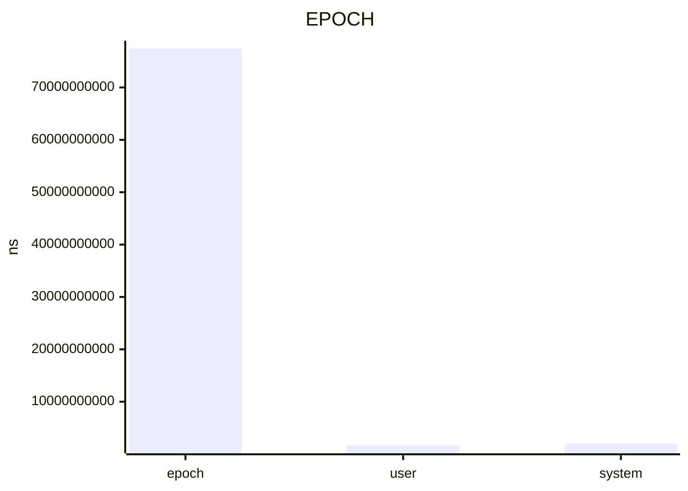

## epoch

+--------+-------+---------------+-------------------+---------------+-------------+-------+------+----------------------------------------------------------------------------+
| key    | type  | value         | errorPercent      | min           | max         | calls | unit | samples                                                                    |
+========+=======+===============+===================+===============+=============+=======+======+============================================================================+
| epoch  | float | 7.74324709e10 | 0.110115432206878 | 7.72703226e10 | 8.897744e10 | 1     | ns   | 7.73472058e10, 7.74324709e10, 7.74927337                                   |
|        |       |               |                   |               |             |       |      | e10, 7.72703226e10, 7.72811987e10, 8.897                                   |
|        |       |               |                   |               |             |       |      | 744e10, 7.74630567e10                                                      |
+--------+-------+---------------+-------------------+---------------+-------------+-------+------+----------------------------------------------------------------------------+
| user   | float | 1.625e9       | 10.57692307692308 | 1.234375e9    | 1.8125e9    | 1     | ns   | 1.625e9, 1.625e9, 1.234375e9, 1.8125e9, 1.671875e9, 1.390625e9, 1.453125e9 |
+--------+-------+---------------+-------------------+---------------+-------------+-------+------+----------------------------------------------------------------------------+
| system | float | 2.015625e9    | 6.2015503875969   | 1.734375e9    | 2.1875e9    | 1     | ns   | 1.859375e9, 2.1875e9, 2.125e9, 2.015625e                                   |
|        |       |               |                   |               |             |       |      | 9, 1.734375e9, 2.0e9, 2.140625e9                                           |
+--------+-------+---------------+-------------------+---------------+-------------+-------+------+----------------------------------------------------------------------------+

