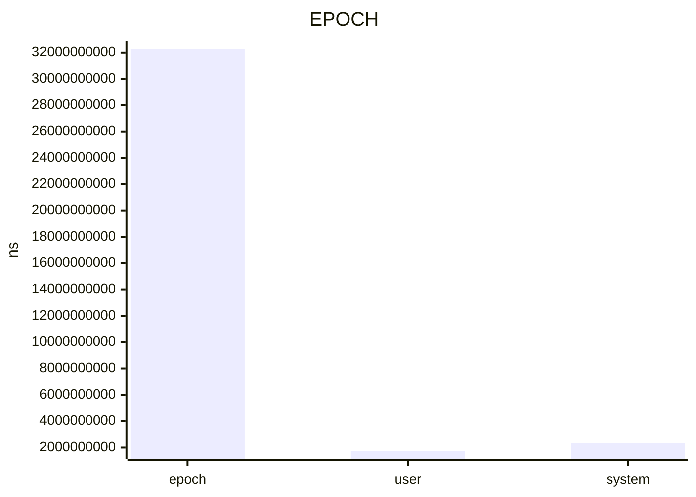

## epoch

+--------+-------+--------------+--------------------+---------------+---------------+-------+------+------------------------------------------------------------------------------------------------------------------------+---------------+--------------------+----------------------+
| key    | type  | value        | errorPercent       | min           | max           | calls | unit | samples                                                                                                                | baseline      | change             | probability          |
+========+=======+==============+====================+===============+===============+=======+======+========================================================================================================================+===============+====================+======================+
| epoch  | float | 3.2262846e10 | 0.4369103085325955 | 3.19676825e10 | 3.28391307e10 | 1     | ns   | 3.26858524e10, 3.2262846e10, 3.21863075e                                                                               | 7.74324709e10 | -58.33421609176622 | 0.1350840943268114   |
|        |       |              |                    |               |               |       |      | 10, 3.20005443e10, 3.19676825e10, 3.2049                                                                               |               |                    |                      |
|        |       |              |                    |               |               |       |      | 9489e10, 3.21884512e10, 3.22959451e10, 3                                                                               |               |                    |                      |
|        |       |              |                    |               |               |       |      | .24038057e10, 3.23101714e10, 3.28391307e                                                                               |               |                    |                      |
|        |       |              |                    |               |               |       |      | 10                                                                                                                     |               |                    |                      |
+--------+-------+--------------+--------------------+---------------+---------------+-------+------+------------------------------------------------------------------------------------------------------------------------+---------------+--------------------+----------------------+
| user   | float | 1.734375e9   | 4.504504504504505  | 1.484375e9    | 2.0625e9      | 1     | ns   | 1.59375e9, 1.734375e9, 1.484375e9, 1.671                                                                               | 1.625e9       | 6.730769230769231  | 0.03724815195298666  |
|        |       |              |                    |               |               |       |      | 875e9, 1.671875e9, 1.859375e9, 1.671875e                                                                               |               |                    |                      |
|        |       |              |                    |               |               |       |      | 9, 1.8125e9, 1.8125e9, 2.0625e9, 1.78125                                                                               |               |                    |                      |
|        |       |              |                    |               |               |       |      | e9                                                                                                                     |               |                    |                      |
+--------+-------+--------------+--------------------+---------------+---------------+-------+------+------------------------------------------------------------------------------------------------------------------------+---------------+--------------------+----------------------+
| system | float | 2.34375e9    | 4.0                | 1.890625e9    | 2.6875e9      | 1     | ns   | 2.34375e9, 2.546875e9, 2.359375e9, 2.125e9, 2.296875e9, 1.890625e9, 2.265625e9, 2.6875e9, 2.3125e9, 2.4375e9, 2.6875e9 | 2.015625e9    | 16.27906976744186  | 0.003753903542302934 |
+--------+-------+--------------+--------------------+---------------+---------------+-------+------+------------------------------------------------------------------------------------------------------------------------+---------------+--------------------+----------------------+

