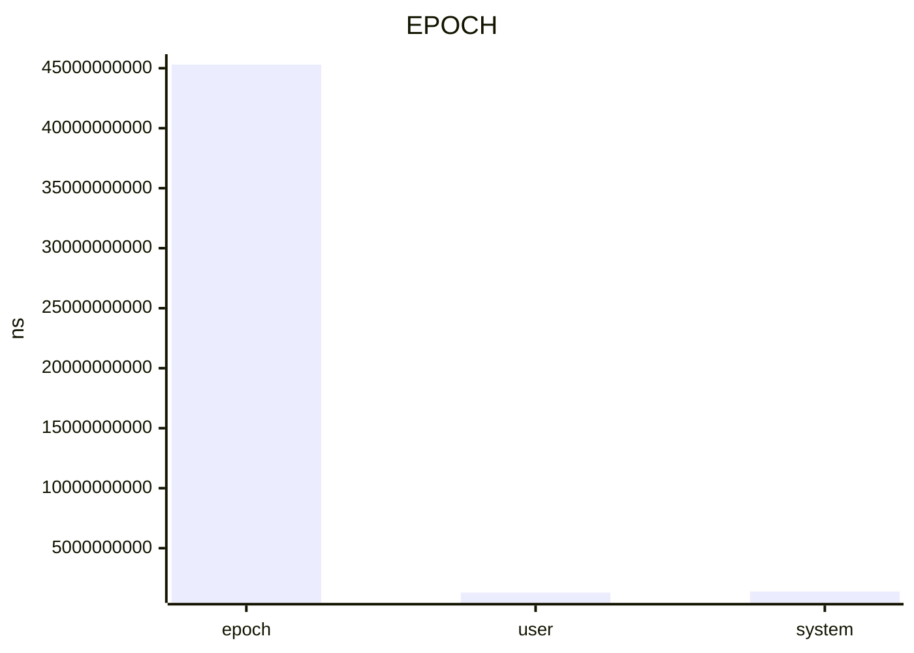

## epoch

+--------+-------+---------------+---------------------+---------------+---------------+-------+------+---------------------------------------------------------------------------------------------------------------------------------------------------------------------+---------------+--------------------+---------------------+
| key    | type  | value         | errorPercent        | min           | max           | calls | unit | samples                                                                                                                                                             | baseline      | change             | probability         |
+========+=======+===============+=====================+===============+===============+=======+======+=====================================================================================================================================================================+===============+====================+=====================+
| epoch  | float | 4.53040654e10 | 0.07189862479758825 | 4.52260187e10 | 4.57181479e10 | 1     | ns   | 4.57181479e10, 4.53394164e10, 4.53040654e10, 4.53108073e10, 4.53407371e10, 4.52744053e10, 4.52812297e10, 4.52714924e10, 4.53695388e10, 4.52839379e10, 4.52260187e10 | 7.74324709e10 | -41.49216101019449 | 0.1350840943268114  |
+--------+-------+---------------+---------------------+---------------+---------------+-------+------+---------------------------------------------------------------------------------------------------------------------------------------------------------------------+---------------+--------------------+---------------------+
| user   | float | 1.296875e9    | 9.638554216867471   | 9.6875e8      | 1.46875e9     | 1     | ns   | 1.328125e9, 1.328125e9, 1.28125e9, 9.6875e8, 1.21875e9, 1.171875e9, 1.171875e9, 1.296875e9, 1.46875e9, 1.421875e9, 1.4375e9                                         | 1.625e9       | -20.19230769230769 | 0.01275334273215133 |
+--------+-------+---------------+---------------------+---------------+---------------+-------+------+---------------------------------------------------------------------------------------------------------------------------------------------------------------------+---------------+--------------------+---------------------+
| system | float | 1.390625e9    | 3.370786516853932   | 1.25e9        | 1.5625e9      | 1     | ns   | 1.34375e9, 1.34375e9, 1.28125e9, 1.54687                                                                                                                            | 2.015625e9    | -31.00775193798449 | 0.01275334273215133 |
|        |       |               |                     |               |               |       |      | 5e9, 1.421875e9, 1.40625e9, 1.5625e9, 1.                                                                                                                            |               |                    |                     |
|        |       |               |                     |               |               |       |      | 453125e9, 1.25e9, 1.390625e9, 1.390625e9                                                                                                                            |               |                    |                     |
+--------+-------+---------------+---------------------+---------------+---------------+-------+------+---------------------------------------------------------------------------------------------------------------------------------------------------------------------+---------------+--------------------+---------------------+

